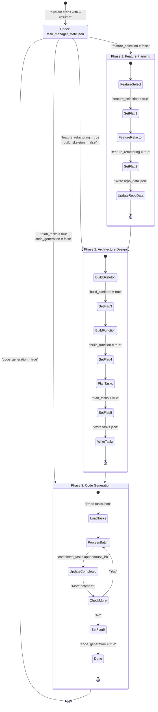
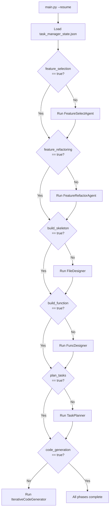

<!-- source: DeepWiki mcp.deepwiki.com · repo microsoft/RPG-ZeroRepo · page 5 State Management and Checkpointing · fetched 2026-10-26 -->

# State Management and Checkpointing

<details>
<summary>Relevant source files</summary>

The following files were used as context for generating this wiki page:

- [README.md](README.md)
- [configs/checkpoint_config.yaml](configs/checkpoint_config.yaml)
- [main.py](main.py)

</details>


RPG-ZeroRepo implements a comprehensive checkpoint system that enables fault tolerance, resumability, and progress tracking throughout the three-phase code generation pipeline. This page documents the checkpoint architecture, state tracking mechanisms, and how different checkpoint files work together to maintain system state.

For detailed information about individual checkpoint file formats and contents, see [Checkpoint File Reference](#5.1). For instructions on resuming from checkpoints and recovering from failures, see [Resume and Recovery](#5.2). For the overall pipeline architecture, see [Core Pipeline](#3).

---

## Checkpoint System Architecture

The checkpoint system is built around a global `CheckpointManager` that provides centralized access to all state files. The system is configured through `checkpoint_config.yaml`, which defines the canonical names and locations of all checkpoint files.

```mermaid
graph TB
    subgraph "Configuration Layer"
        CPC["checkpoint_config.yaml<br/>Defines all checkpoint files"]
    end
    
    subgraph "Global Checkpoint Manager"
        GCM["create_default_manager()<br/>main.py:214"]
        GCM --> RepoData["repo_data<br/>→ repo_data.json"]
        GCM --> TaskMgr["task_manager_state<br/>→ task_manager_state.json"]
        GCM --> Skeleton["skeleton<br/>→ skeleton.json"]
        GCM --> Graph["graph<br/>→ graph.json"]
        GCM --> Tasks["tasks<br/>→ tasks.json"]
        GCM --> GlobalRPG["global_repo_rpg<br/>→ global_repo_rpg.json"]
        GCM --> CurRPG["current_repo_rpg<br/>→ cur_repo_rpg.json"]
        GCM --> IterState["iteration_state<br/>→ iteration_state.json"]
        GCM --> ExecHist["execution_history<br/>→ execution_history.json"]
        GCM --> BatchTraj["batch_trajectory<br/>→ batch_trajectory.json"]
    end
    
    subgraph "Pipeline Components"
        ZeroRepo["ZeroRepo<br/>main orchestrator"]
        PropBuilder["PropBuilder<br/>Phase 1"]
        ImplBuilder["ImplBuilder<br/>Phase 2"]
        CodeGen["IterativeCodeGenerator<br/>Phase 3"]
    end
    
    CPC -.->|"defines schema"| GCM
    ZeroRepo -->|"initializes"| GCM
    ZeroRepo -->|"passes checkpoint_dir"| PropBuilder
    ZeroRepo -->|"passes checkpoint_dir"| ImplBuilder
    ZeroRepo -->|"passes checkpoint_dir"| CodeGen
    
    PropBuilder -->|"reads/writes"| RepoData
    PropBuilder -->|"updates"| TaskMgr
    
    ImplBuilder -->|"reads"| RepoData
    ImplBuilder -->|"writes"| Skeleton
    ImplBuilder -->|"writes"| Graph
    ImplBuilder -->|"writes"| Tasks
    ImplBuilder -->|"writes"| GlobalRPG
    ImplBuilder -->|"updates"| TaskMgr
    
    CodeGen -->|"reads"| Tasks
    CodeGen -->|"writes"| IterState
    CodeGen -->|"writes"| ExecHist
    CodeGen -->|"writes"| BatchTraj
    CodeGen -->|"writes"| CurRPG
    CodeGen -->|"updates"| TaskMgr
```



**Sources:** [configs/checkpoint_config.yaml:1-27](), [main.py:214](), [README.md:354-380]()

The `CheckpointManager` is created once at system initialization and provides a consistent interface for all components to access checkpoint files without hardcoding file paths.

### Checkpoint Directory Structure

```
checkpoints/
├── repo_data.json                 # Input + Phase 1 output
├── task_manager_state.json        # Master progress tracker
├── feature_selection.json         # Phase 1 intermediate
├── feature_refactoring.json       # Phase 1 intermediate
├── global_repo_rpg.json           # Phase 2 output (RPG graph)
├── skeleton.json                  # Phase 2 output (file layout)
├── skeleton_traj.json             # Phase 2 trajectories
├── graph.json                     # Phase 2 output (interfaces)
├── tasks.json                     # Phase 2 output (task batches)
├── cur_repo_rpg.json              # Phase 3 working state
├── iteration_state.json           # Phase 3 current iteration
├── execution_history.json         # Phase 3 all executions
└── batch_trajectory.json          # Phase 3 batch records
```

**Sources:** [configs/checkpoint_config.yaml:4-27](), [README.md:383-400]()

---

## State Tracking with task_manager_state.json

The `task_manager_state.json` file serves as the master progress tracker, maintaining completion flags for each major stage and tracking task-level progress during code generation.

### State Structure

```json
{
  "feature_selection": true,
  "feature_refactoring": true,
  "build_skeleton": true,
  "build_function": true,
  "plan_tasks": true,
  "code_generation": false,
  "completed_tasks": ["task_id_1", "task_id_2"],
  "failed_tasks": [],
  "current_task": {
    "task_id": "src_ai_planning_pathfinding.py_...",
    "subtree": "ai.pathfinding",
    "file_path": "src/ai/planning/pathfinding.py"
  },
  "last_updated": "2026-02-09T13:56:20"
}
```

**Sources:** [README.md:360-374]()

### State Transition Flow



**Sources:** [README.md:354-380](), [main.py:195-199]()

---

## Checkpoint File Categories

Checkpoint files are organized into four functional categories based on their role in the pipeline.

| Category | Files | Purpose | Created By |
|----------|-------|---------|------------|
| **Core State** | `repo_data.json`<br/>`task_manager_state.json` | Project metadata and master progress tracking | Input + all phases |
| **Design Phase** | `skeleton.json`<br/>`skeleton_traj.json`<br/>`graph.json`<br/>`tasks.json` | File layouts, interfaces, task batches | `ImplBuilder` (Phase 2) |
| **RPG Files** | `global_repo_rpg.json`<br/>`current_repo_rpg.json` | Repository Planning Graph representations | Phase 2 & 3 |
| **Code Generation** | `iteration_state.json`<br/>`execution_history.json`<br/>`batch_trajectory.json` | Iteration tracking, execution logs | `IterativeCodeGenerator` (Phase 3) |

**Sources:** [configs/checkpoint_config.yaml:4-27](), [README.md:383-400]()

### Core State Files

**`repo_data.json`** - The central repository definition that evolves through Phase 1:

```json
{
  "repository_name": "SnakeGame",
  "repository_purpose": "A multiplayer snake game...",
  "Feature_tree": {
    "functionality": { "game mechanics": [...] },
    "algorithm": { "pathfinding": [...] }
  },
  "Component": [
    {
      "name": "gameplay.core",
      "refactored_subtree": { "gameplay": {...} }
    }
  ]
}
```

**`task_manager_state.json`** - Tracks completion of all stages and individual tasks during code generation.

**Sources:** [README.md:154-172](), [configs/checkpoint_config.yaml:6-7]()

### Design Phase Files

**`skeleton.json`** - Complete file/directory structure with initial code skeletons:

```json
{
  "src/ai/planning/pathfinding.py": {
    "type": "file",
    "features": ["pathfinding", "astar", "bfs flood fill"],
    "skeleton_code": "# File skeleton here"
  }
}
```

**`graph.json`** - Detailed interface designs for all files:

```json
{
  "src/io/persistence/serialization.py": {
    "file_code": "class HighScoreBinarySerializer:\n    def serialize(self, entries) -> bytes: ...",
    "units": ["class HighScoreBinarySerializer"],
    "units_to_features": {
      "class HighScoreBinarySerializer": ["high score binary serialization"]
    }
  }
}
```

**`tasks.json`** - Implementation batches organized by component:

```json
{
  "planned_batches_dict": {
    "io.input_persistence": {
      "src/io/persistence/serialization.py": [
        {
          "task_id": "src_io_persistence_serialization.py_...",
          "file_path": "src/io/persistence/serialization.py",
          "units_key": ["class HighScoreBinarySerializer"],
          "unit_to_code": {...},
          "unit_to_features": {...}
        }
      ]
    }
  }
}
```

**Sources:** [README.md:189-280](), [configs/checkpoint_config.yaml:10-13]()

### RPG Files

**`global_repo_rpg.json`** - Complete Repository Planning Graph with nodes and edges representing the full repository structure, features, files, and dependencies.

**`cur_repo_rpg.json`** - Updated during code generation to reflect current implementation state.

**Sources:** [configs/checkpoint_config.yaml:16-17](), [README.md:184-187]()

### Code Generation Files

**`iteration_state.json`** - Tracks the current iteration state for the active task batch, including workflow type, retry counts, and test/code patch history.

**`execution_history.json`** - Flat chronological list of all workflow executions across all batches.

**`batch_trajectory.json`** - Per-batch execution records linking task IDs to their complete execution trajectories, git commits, and final status.

**Sources:** [configs/checkpoint_config.yaml:20-22](), [README.md:395-399]()

---

## State Flow and Dependencies

Checkpoint files have strict dependencies that determine the pipeline execution order. Understanding these dependencies is crucial for resumability.

```mermaid
graph TD
    subgraph "Input"
        Input["repo_data.json (initial)<br/>{name, purpose}"]
    end
    
    subgraph "Phase 1 Checkpoints"
        FS["feature_selection.json<br/>FeatureSelectAgent output"]
        FR["feature_refactoring.json<br/>FeatureRefactorAgent output"]
        RD2["repo_data.json (enriched)<br/>+ Feature_tree<br/>+ Component[]"]
    end
    
    subgraph "Phase 2 Checkpoints"
        GRPG1["global_repo_rpg.json (v1)<br/>Initial RPG from Components"]
        Skel["skeleton.json<br/>File layout + skeletons"]
        SkelTraj["skeleton_traj.json<br/>LLM trajectories"]
        Graph["graph.json<br/>Complete interfaces"]
        GRPG2["global_repo_rpg.json (v2)<br/>RPG with interfaces"]
        Tasks["tasks.json<br/>Implementation batches"]
    end
    
    subgraph "Phase 3 Checkpoints"
        IterState["iteration_state.json<br/>Current batch state"]
        ExecHist["execution_history.json<br/>All workflow executions"]
        BatchTraj["batch_trajectory.json<br/>Batch execution records"]
        CurRPG["cur_repo_rpg.json<br/>Updated during generation"]
    end
    
    subgraph "Master Tracker"
        TMS["task_manager_state.json<br/>Progress flags"]
    end
    
    Input --> FS
    FS --> FR
    FR --> RD2
    RD2 --> GRPG1
    GRPG1 --> Skel
    Skel --> SkelTraj
    Skel --> Graph
    Graph --> GRPG2
    GRPG2 --> Tasks
    Tasks --> IterState
    Tasks --> ExecHist
    Tasks --> BatchTraj
    Tasks --> CurRPG
    
    FS -.->|"updates"| TMS
    FR -.->|"updates"| TMS
    Skel -.->|"updates"| TMS
    Graph -.->|"updates"| TMS
    Tasks -.->|"updates"| TMS
    IterState -.->|"updates"| TMS
```

**Sources:** [README.md:112-280](), [configs/checkpoint_config.yaml:1-27]()

### Dependency Rules

1. **Phase 1 Dependencies:**
   - `feature_selection.json` requires initial `repo_data.json`
   - `feature_refactoring.json` requires `feature_selection.json`
   - Enriched `repo_data.json` requires `feature_refactoring.json`

2. **Phase 2 Dependencies:**
   - `global_repo_rpg.json` (v1) requires enriched `repo_data.json` with `Component[]`
   - `skeleton.json` requires `global_repo_rpg.json` (v1)
   - `graph.json` requires `skeleton.json`
   - `tasks.json` requires `graph.json` and updated `global_repo_rpg.json` (v2)

3. **Phase 3 Dependencies:**
   - `iteration_state.json` requires `tasks.json`
   - `execution_history.json` accumulates across all batches
   - `batch_trajectory.json` links to specific task batches from `tasks.json`
   - `cur_repo_rpg.json` is cloned from `global_repo_rpg.json` and updated during generation

**Sources:** [README.md:98-280]()

---

## Resumability Mechanism

When the system starts with `--resume` flag, it consults `task_manager_state.json` to determine which operations can be skipped.

### Resume Decision Logic



**Sources:** [main.py:98-101](), [README.md:376-380]()

### Checkpoint Validation

Before resuming from a checkpoint, the system validates:

1. **File Existence:** All required checkpoint files for the next phase exist
2. **File Integrity:** JSON files can be parsed without errors
3. **Data Completeness:** Required fields are present in checkpoint data
4. **Dependency Satisfaction:** All prerequisite phases marked complete in `task_manager_state.json`

If validation fails, the system either:
- Regenerates the invalid checkpoint (if parent checkpoints are valid)
- Fails with an error message directing the user to fix or delete corrupted checkpoints

**Sources:** [main.py:202-276]()

---

## Atomic Updates and Consistency

The checkpoint system ensures consistency through atomic file operations:

1. **Write-then-rename pattern:** New checkpoint data is written to a temporary file, then atomically renamed to replace the old file
2. **Transaction boundaries:** `task_manager_state.json` is always updated last, after all dependent checkpoint files are successfully written
3. **No partial states:** If a component crashes mid-phase, `task_manager_state.json` will still reflect the last completed stage

This design ensures that the system always resumes from a consistent state, even if interrupted during checkpoint writes.

**Sources:** [main.py:202-276](), [README.md:354-380]()

---

