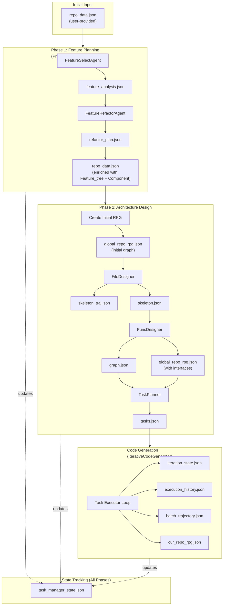
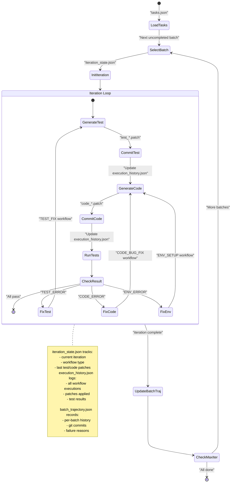
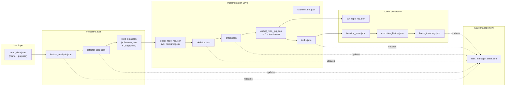

<!-- source: DeepWiki mcp.deepwiki.com · repo microsoft/RPG-ZeroRepo · page 5.1 Checkpoint File Reference · fetched 2026-10-26 -->

# Checkpoint File Reference

<details>
<summary>Relevant source files</summary>

The following files were used as context for generating this wiki page:

- [README.md](README.md)
- [configs/checkpoint_config.yaml](configs/checkpoint_config.yaml)

</details>


This document provides a comprehensive reference for all checkpoint files used throughout the RPG-ZeroRepo system. Checkpoint files track pipeline state, store intermediate artifacts, and enable resumability at every stage of repository generation. For information about the resume mechanism and recovery procedures, see [Resume and Recovery](#5.2).

## Purpose and Scope

The checkpoint system serves three primary functions:

1. **State Persistence**: Tracks completion status of each pipeline phase and task
2. **Artifact Storage**: Preserves intermediate design outputs (feature trees, file layouts, interfaces)
3. **Resumability**: Enables pipeline restart from any completed stage without re-executing expensive LLM operations

All checkpoint files are stored in the `checkpoints/` directory specified via the `--checkpoint` CLI argument. Files are written as JSON for human readability and programmatic access.

**Sources**: [configs/checkpoint_config.yaml:1-27](), [README.md:354-400]()

---

## Checkpoint File Lifecycle

The following diagram shows when each checkpoint file is created and consumed across the three-phase pipeline:

**Pipeline Phase to Checkpoint File Mapping**



**Sources**: [configs/checkpoint_config.yaml:4-27](), [README.md:98-281]()

---

## Core State Files

These files maintain global state across the entire pipeline.

### repo_data.json

**Created**: User-provided initially; enriched by Phase 1  
**Updated By**: `PropBuilder` ([zerorepo/rpg_gen/prop_level/prop_builder.py]())  
**Consumed By**: All phases  

#### Structure

| Field | Type | Phase | Description |
|-------|------|-------|-------------|
| `repository_name` | string | Input | Project name |
| `repository_purpose` | string | Input | Natural language description of project goals |
| `Feature_tree` | object | Phase 1 | Hierarchical feature taxonomy from `FeatureSelectAgent` |
| `Component` | array | Phase 1 | Logical module decomposition from `FeatureRefactorAgent` |

#### Example

```json
{
  "repository_name": "SnakeGame",
  "repository_purpose": "A multiplayer snake game with AI opponents, pathfinding, replay recording, and persistent high scores.",
  "Feature_tree": {
    "functionality": {
      "game mechanics": ["movement", "collision detection", "food spawning", "scoring"],
      "ai opponent": ["strategy", "training"]
    },
    "algorithm": {
      "pathfinding": ["astar", "bfs flood fill", "monte carlo rollouts"]
    }
  },
  "Component": [
    {
      "name": "gameplay.core",
      "refactored_subtree": {
        "gameplay": {
          "rules": ["movement", "collision detection", "scoring"],
          "levels": ["static layout", "procedural generation"]
        }
      }
    }
  ]
}
```

**Sources**: [README.md:51-58](), [README.md:152-172](), [README.md:387]()

---

### task_manager_state.json

**Created**: First run  
**Updated By**: All phases (`PropBuilder`, `ImplBuilder`, `IterativeCodeGenerator`)  
**Consumed By**: `main.py` for resume logic  

Tracks completion status of each pipeline stage and task-level progress in Phase 3.

#### Structure

| Field | Type | Description |
|-------|------|-------------|
| `feature_selection` | boolean | Phase 1, Step 1 complete |
| `feature_refactoring` | boolean | Phase 1, Step 2 complete |
| `build_skeleton` | boolean | Phase 2, Step 2 complete |
| `build_function` | boolean | Phase 2, Step 3 complete |
| `plan_tasks` | boolean | Phase 2, Step 4 complete |
| `code_generation` | boolean | Phase 3 complete |
| `completed_tasks` | array | List of completed task IDs |
| `failed_tasks` | array | List of failed task IDs |
| `current_task` | object | Currently executing task metadata |
| `last_updated` | string | ISO 8601 timestamp |

#### Example

```json
{
  "feature_selection": true,
  "feature_refactoring": true,
  "build_skeleton": true,
  "build_function": true,
  "plan_tasks": true,
  "code_generation": false,
  "completed_tasks": ["batch_io_input_persistence", "batch_gameplay_core"],
  "failed_tasks": [],
  "current_task": {
    "batch_id": "batch_ai_pathfinding",
    "file_path": "src/ai/planning/pathfinding.py",
    "iteration": 2
  },
  "last_updated": "2026-02-09T13:56:20Z"
}
```

**Sources**: [README.md:360-374](), [configs/checkpoint_config.yaml:7](), [README.md:399]()

---

## Phase 1: Property Level Files

Phase 1 transforms natural language project descriptions into structured feature hierarchies and component decompositions.

### feature_analysis.json

**Created**: `FeatureSelectAgent` ([zerorepo/rpg_gen/prop_level/feature_select.py]())  
**Maps to**: `feature_selection.json` in README  
**Consumed By**: `FeatureRefactorAgent`  

Contains the raw hierarchical feature tree generated from `repository_purpose`.

#### Structure

```json
{
  "feature_tree": {
    "functionality": { ... },
    "algorithm": { ... },
    "data structures": { ... },
    "ui_ux": { ... }
  },
  "generation_metadata": {
    "model": "gpt-5-mini-20250807",
    "timestamp": "2026-02-09T10:15:30Z"
  }
}
```

**Sources**: [README.md:105-128](), [README.md:388](), [configs/checkpoint_config.yaml:25]()

---

### refactor_plan.json

**Created**: `FeatureRefactorAgent` ([zerorepo/rpg_gen/prop_level/feature_refactor.py]())  
**Maps to**: `feature_refactoring.json` in README  
**Consumed By**: Phase 2 `ImplBuilder`  

Groups features into logical components (top-level modules).

#### Structure

```json
{
  "components": [
    {
      "name": "gameplay.core",
      "refactored_subtree": {
        "gameplay": {
          "rules": ["movement", "collision detection", "scoring"],
          "levels": ["static layout", "procedural generation"]
        }
      },
      "rationale": "Core gameplay logic and mechanics"
    },
    {
      "name": "ai.pathfinding",
      "refactored_subtree": {
        "ai": {
          "pathfinding": ["astar", "bfs flood fill"],
          "strategies": ["aggressive", "defensive"]
        }
      },
      "rationale": "AI opponent behavior and planning"
    }
  ],
  "refactoring_iterations": 3
}
```

**Sources**: [README.md:131-149](), [README.md:389](), [configs/checkpoint_config.yaml:26]()

---

## Phase 2: Architecture Design Files

Phase 2 converts feature plans into concrete file structures and complete interface definitions.

### State Flow Through Design Phase

```mermaid
stateDiagram-v2
    [*] --> CreateInitialRPG
    
    state CreateInitialRPG {
        [*] --> ParseComponents
        ParseComponents --> BuildNodes: "Components from repo_data.json"
        BuildNodes --> BuildEdges: "Feature relationships"
        BuildEdges --> SaveRPG: "global_repo_rpg.json v1"
    }
    
    CreateInitialRPG --> FileDesign
    
    state FileDesign {
        [*] --> RawSkeletonAgent
        RawSkeletonAgent --> raw_skeleton: "High-level layout"
        raw_skeleton --> GroupSkeletonAgent
        GroupSkeletonAgent --> grouped_skeleton: "Features to files"
        grouped_skeleton --> SaveSkeleton: "skeleton.json + skeleton_traj.json"
    }
    
    FileDesign --> FunctionDesign
    
    state FunctionDesign {
        [*] --> DataFlowAgent
        DataFlowAgent --> data_flow: "Component dependencies"
        data_flow --> BaseClassAgent
        BaseClassAgent --> base_classes: "Shared structures"
        base_classes --> InterfaceAgent
        InterfaceAgent --> interfaces: "Function signatures"
        interfaces --> SaveGraph: "graph.json + global_repo_rpg.json v2"
    }
    
    FunctionDesign --> TaskPlanning
    
    state TaskPlanning {
        [*] --> SplitBySubtree
        SplitBySubtree --> GroupByFile
        GroupByFile --> CreateBatches
        CreateBatches --> SaveTasks: "tasks.json"
    }
    
    TaskPlanning --> [*]
```



**Sources**: [README.md:176-281]()

---

### global_repo_rpg.json

**Created**: `ImplBuilder.create_initial_rpg()` ([zerorepo/rpg_gen/impl_level/impl_builder.py]())  
**Updated By**: `FuncDesigner` after interface generation  
**Consumed By**: `TaskPlanner`, Phase 3  

The Repository Planning Graph (RPG) is the central data structure representing the repository's architecture. It contains nodes (features, components, files, functions) and edges (dependencies, containment).

#### Structure

```json
{
  "nodes": {
    "node_001": {
      "id": "node_001",
      "type": "component",
      "name": "gameplay.core",
      "metadata": {
        "description": "Core gameplay mechanics and rules"
      }
    },
    "node_042": {
      "id": "node_042",
      "type": "file",
      "name": "src/gameplay/rules/movement.py",
      "metadata": {
        "language": "python",
        "features": ["movement", "collision detection"]
      }
    },
    "node_315": {
      "id": "node_315",
      "type": "function",
      "name": "class SnakeMovementController",
      "metadata": {
        "signature": "class SnakeMovementController:\n    def move(self, direction: Direction) -> Position: ...",
        "docstring": "Handles snake movement and boundary checking"
      }
    }
  },
  "edges": [
    {
      "source": "node_001",
      "target": "node_042",
      "relation": "contains"
    },
    {
      "source": "node_042",
      "target": "node_315",
      "relation": "defines"
    },
    {
      "source": "node_315",
      "target": "node_320",
      "relation": "depends_on"
    }
  ]
}
```

**Sources**: [README.md:183-188](), [README.md:390](), [configs/checkpoint_config.yaml:16]()

---

### skeleton.json

**Created**: `FileDesigner` ([zerorepo/rpg_gen/impl_level/file_designer.py]())  
**Consumed By**: `FuncDesigner`  

Defines the complete file and directory structure with skeleton code (class/function stubs).

#### Structure

```json
{
  "repository_structure": {
    "src/": {
      "ai/": {
        "planning/": {
          "pathfinding.py": {
            "skeleton_code": "# Pathfinding algorithms\n\nclass AStarPathfinder:\n    pass\n",
            "assigned_features": ["astar", "heuristics"]
          },
          "__init__.py": {
            "skeleton_code": "",
            "assigned_features": []
          }
        }
      },
      "gameplay/": {
        "rules/": {
          "movement.py": {
            "skeleton_code": "# Snake movement logic\n\nclass SnakeMovementController:\n    pass\n",
            "assigned_features": ["movement", "boundary detection"]
          }
        }
      }
    },
    "tests/": {
      "test_ai/": {
        "test_pathfinding.py": {
          "skeleton_code": "import pytest\n",
          "assigned_features": []
        }
      }
    }
  },
  "metadata": {
    "total_files": 76,
    "total_directories": 23
  }
}
```

**Sources**: [README.md:189-219](), [README.md:392](), [configs/checkpoint_config.yaml:10]()

---

### skeleton_traj.json

**Created**: `FileDesigner` (alongside `skeleton.json`)  
**Purpose**: Audit trail  

Stores LLM interaction trajectories from the skeleton generation process (prompts, responses, reasoning steps).

#### Structure

```json
{
  "raw_skeleton_trajectory": {
    "iterations": [
      {
        "iteration": 1,
        "prompt": "Generate a file layout for components: gameplay.core, ai.pathfinding...",
        "response": "src/\n  gameplay/\n    rules/\n      movement.py\n...",
        "model": "gpt-5-mini-20250807",
        "timestamp": "2026-02-09T11:23:45Z"
      }
    ]
  },
  "group_skeleton_trajectory": {
    "iterations": [ ... ]
  }
}
```

**Sources**: [README.md:219](), [README.md:392](), [configs/checkpoint_config.yaml:11]()

---

### graph.json

**Created**: `FuncDesigner` ([zerorepo/rpg_gen/impl_level/func_designer.py]())  
**Consumed By**: `TaskPlanner`  

Complete interface definitions for every file, including classes, functions, signatures, docstrings, and type annotations.

#### Structure

```json
{
  "files": {
    "src/io/persistence/serialization.py": {
      "file_code": "class HighScoreBinarySerializer:\n    \"\"\"Serialize high scores to binary format.\"\"\"\n    \n    def serialize(self, entries: List[HighScoreEntry]) -> bytes:\n        \"\"\"Convert entries to binary.\"\"\"\n        ...\n    \n    def deserialize(self, data: bytes) -> List[HighScoreEntry]:\n        \"\"\"Parse binary to entries.\"\"\"\n        ...",
      "units": [
        "class HighScoreBinarySerializer"
      ],
      "units_to_features": {
        "class HighScoreBinarySerializer": [
          "high score binary serialization",
          "data persistence"
        ]
      },
      "units_to_code": {
        "class HighScoreBinarySerializer": "class HighScoreBinarySerializer:\n    ..."
      }
    }
  },
  "data_flow_analysis": {
    "component_dependencies": [
      {
        "from": "io.input_persistence",
        "to": "gameplay.core",
        "data_types": ["HighScoreEntry", "GameState"]
      }
    ]
  },
  "base_classes": [
    {
      "name": "BaseSerializer",
      "definition": "class BaseSerializer(ABC):\n    @abstractmethod\n    def serialize(self, obj: Any) -> bytes: ...",
      "rationale": "Common interface for all serializers"
    }
  ]
}
```

**Sources**: [README.md:221-246](), [README.md:393](), [configs/checkpoint_config.yaml:12]()

---

### tasks.json

**Created**: `TaskPlanner` ([zerorepo/rpg_gen/impl_level/task_planner.py]())  
**Consumed By**: `IterativeCodeGenerator` in Phase 3  

Implementation tasks grouped by component (subtree) and file, ready for code generation.

#### Structure

```json
{
  "planned_batches_dict": {
    "io.input_persistence": {
      "src/io/persistence/serialization.py": [
        {
          "task_id": "src_io_persistence_serialization.py_1234567890",
          "file_path": "src/io/persistence/serialization.py",
          "units_key": [
            "class HighScoreBinarySerializer"
          ],
          "unit_to_code": {
            "class HighScoreBinarySerializer": "class HighScoreBinarySerializer:\n    def serialize(self, entries: List[HighScoreEntry]) -> bytes:\n        ..."
          },
          "unit_to_features": {
            "class HighScoreBinarySerializer": [
              "high score binary serialization"
            ]
          },
          "priority": 0,
          "subtree": "io.input_persistence",
          "task_type": "implementation"
        }
      ]
    },
    "gameplay.core": {
      "src/gameplay/rules/movement.py": [ ... ]
    }
  },
  "metadata": {
    "total_tasks": 76,
    "total_subtrees": 6
  }
}
```

**Sources**: [README.md:248-280](), [README.md:394](), [configs/checkpoint_config.yaml:13]()

---

## Phase 3: Code Generation Files

Phase 3 executes implementation tasks in a Docker container using the TRAE agent with TDD loops.

### Code Generation State Machine



**Sources**: [README.md:284-351]()

---

### iteration_state.json

**Created**: `IterativeCodeGenerator` at start of each batch  
**Updated By**: Each iteration of TDD loop  
**Purpose**: Tracks current iteration state for active batch  

#### Structure

```json
{
  "current_batch_id": "batch_io_input_persistence",
  "current_file": "src/io/persistence/serialization.py",
  "iteration": 2,
  "max_iterations": 5,
  "workflow_type": "CODE_BUG_FIX",
  "last_test_patch": "test_gen_1770643795",
  "last_code_patch": "code_gen_1770644020",
  "last_test_result": {
    "status": "FAILED",
    "passed": 3,
    "failed": 1,
    "error_message": "AssertionError: Expected 12 bytes, got 10"
  },
  "retry_count": 1,
  "max_retries": 3
}
```

**Sources**: [README.md:398](), [configs/checkpoint_config.yaml:20]()

---

### execution_history.json

**Created**: `IterativeCodeGenerator` on first execution  
**Updated By**: After each workflow execution (test gen, code gen, test fix, etc.)  
**Purpose**: Flat chronological log of all executions  

#### Structure

```json
{
  "executions": [
    {
      "execution_id": "exec_1770643795",
      "batch_id": "batch_io_input_persistence",
      "workflow_type": "TEST_DEVELOPMENT",
      "iteration": 1,
      "timestamp": "2026-02-09T14:15:30Z",
      "patch_path": "results/test_gen_1770643795/test_gen_1770643795.patch",
      "trajectory_path": "results/test_gen_1770643795/test_gen_1770643795.json",
      "git_commit": "a3f2c1b",
      "status": "success"
    },
    {
      "execution_id": "exec_1770644020",
      "batch_id": "batch_io_input_persistence",
      "workflow_type": "CODE_INCREMENTAL",
      "iteration": 1,
      "timestamp": "2026-02-09T14:23:45Z",
      "patch_path": "results/code_gen_1770644020/code_gen_1770644020.patch",
      "trajectory_path": "results/code_gen_1770644020/code_gen_1770644020.json",
      "git_commit": "b8e4d9f",
      "status": "success"
    },
    {
      "execution_id": "exec_1770644315",
      "batch_id": "batch_io_input_persistence",
      "workflow_type": "CODE_BUG_FIX",
      "iteration": 2,
      "timestamp": "2026-02-09T14:31:20Z",
      "patch_path": "results/code_gen_1770644315/code_gen_1770644315.patch",
      "test_result": {
        "status": "PASSED",
        "passed": 4,
        "failed": 0
      },
      "git_commit": "c1a7e5d",
      "status": "success"
    }
  ]
}
```

**Sources**: [README.md:397](), [configs/checkpoint_config.yaml:21]()

---

### batch_trajectory.json

**Created**: `IterativeCodeGenerator` on first batch  
**Updated By**: After each batch completes or fails  
**Purpose**: Per-batch summary including all attempts and final status  

#### Structure

```json
{
  "batches": {
    "batch_io_input_persistence": {
      "batch_id": "batch_io_input_persistence",
      "subtree": "io.input_persistence",
      "file_path": "src/io/persistence/serialization.py",
      "start_time": "2026-02-09T14:10:00Z",
      "end_time": "2026-02-09T14:35:12Z",
      "status": "completed",
      "iterations": [
        {
          "iteration": 1,
          "test_workflow": "TEST_DEVELOPMENT",
          "code_workflow": "CODE_INCREMENTAL",
          "test_result": "FAILED",
          "commits": ["a3f2c1b", "b8e4d9f"]
        },
        {
          "iteration": 2,
          "test_workflow": null,
          "code_workflow": "CODE_BUG_FIX",
          "test_result": "PASSED",
          "commits": ["c1a7e5d"]
        }
      ],
      "final_commits": ["a3f2c1b", "b8e4d9f", "c1a7e5d"],
      "total_iterations": 2,
      "final_test_status": "PASSED"
    },
    "batch_gameplay_core": {
      "batch_id": "batch_gameplay_core",
      "subtree": "gameplay.core",
      "file_path": "src/gameplay/rules/movement.py",
      "start_time": "2026-02-09T14:40:00Z",
      "end_time": null,
      "status": "failed",
      "failure_reason": "Max iterations exceeded (5)",
      "iterations": [ ... ]
    }
  }
}
```

**Sources**: [README.md:396](), [configs/checkpoint_config.yaml:22]()

---

### cur_repo_rpg.json

**Created**: Copy of `global_repo_rpg.json` at start of Phase 3  
**Updated By**: `IterativeCodeGenerator` as code is implemented  
**Purpose**: Tracks current implementation state (which functions have implementations vs. just interfaces)  

The structure is identical to `global_repo_rpg.json`, but function nodes gain additional metadata:

```json
{
  "nodes": {
    "node_315": {
      "id": "node_315",
      "type": "function",
      "name": "class SnakeMovementController",
      "metadata": {
        "signature": "class SnakeMovementController:\n    def move(self, direction: Direction) -> Position: ...",
        "docstring": "Handles snake movement and boundary checking",
        "implementation_status": "completed",
        "test_status": "passing",
        "git_commit": "c1a7e5d",
        "implemented_at": "2026-02-09T14:31:20Z"
      }
    }
  }
}
```

**Sources**: [README.md:395](), [configs/checkpoint_config.yaml:17]()

---

## Checkpoint File Dependencies

The following diagram shows data flow and dependencies between checkpoint files:

**Checkpoint File Dependency Graph**



**Sources**: [configs/checkpoint_config.yaml:4-27](), [README.md:383-400]()

---

## File Access Patterns by Component

The following table maps code components to the checkpoint files they read and write:

| Component | Location | Reads | Writes |
|-----------|----------|-------|--------|
| `FeatureSelectAgent` | [zerorepo/rpg_gen/prop_level/feature_select.py]() | `repo_data.json` | `feature_analysis.json` |
| `FeatureRefactorAgent` | [zerorepo/rpg_gen/prop_level/feature_refactor.py]() | `feature_analysis.json` | `refactor_plan.json` |
| `PropBuilder` | [zerorepo/rpg_gen/prop_level/prop_builder.py]() | `feature_analysis.json`, `refactor_plan.json` | `repo_data.json` (updated), `task_manager_state.json` |
| `ImplBuilder.create_initial_rpg()` | [zerorepo/rpg_gen/impl_level/impl_builder.py]() | `repo_data.json` | `global_repo_rpg.json` (v1) |
| `FileDesigner` | [zerorepo/rpg_gen/impl_level/file_designer.py]() | `global_repo_rpg.json` | `skeleton.json`, `skeleton_traj.json`, `task_manager_state.json` |
| `FuncDesigner` | [zerorepo/rpg_gen/impl_level/func_designer.py]() | `skeleton.json`, `global_repo_rpg.json` | `graph.json`, `global_repo_rpg.json` (v2), `task_manager_state.json` |
| `TaskPlanner` | [zerorepo/rpg_gen/impl_level/task_planner.py]() | `graph.json`, `global_repo_rpg.json` | `tasks.json`, `task_manager_state.json` |
| `IterativeCodeGenerator` | [zerorepo/code_gen/iterative_codegen.py]() | `tasks.json`, `global_repo_rpg.json`, `task_manager_state.json` | `cur_repo_rpg.json`, `iteration_state.json`, `execution_history.json`, `batch_trajectory.json`, `task_manager_state.json` |

**Sources**: [configs/checkpoint_config.yaml:4-27]()

---

## Storage Location

All checkpoint files are stored in the directory specified by the `--checkpoint` CLI argument. The default structure:

```
checkpoints/
├── repo_data.json
├── task_manager_state.json
├── feature_analysis.json
├── refactor_plan.json
├── global_repo_rpg.json
├── cur_repo_rpg.json
├── skeleton.json
├── skeleton_traj.json
├── graph.json
├── tasks.json
├── iteration_state.json
├── execution_history.json
└── batch_trajectory.json
```

The checkpoint directory must be specified explicitly and should be outside any existing git repository to avoid conflicts with the workspace git tracking.

**Sources**: [README.md:36-49](), [configs/checkpoint_config.yaml:1-27]()

---

