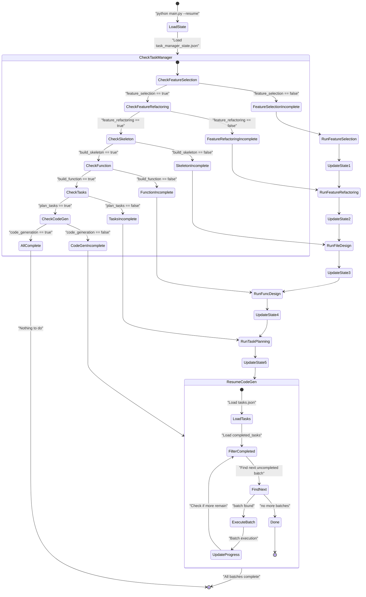
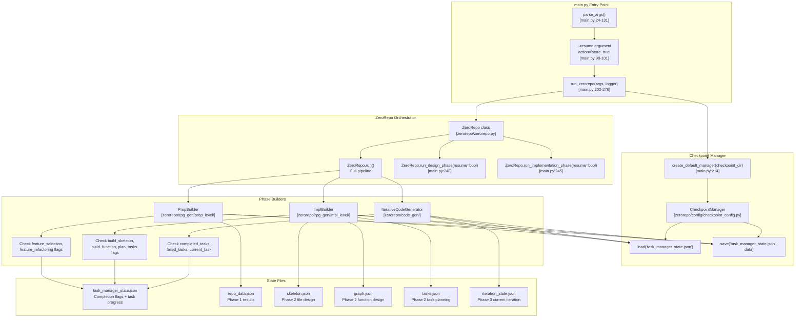
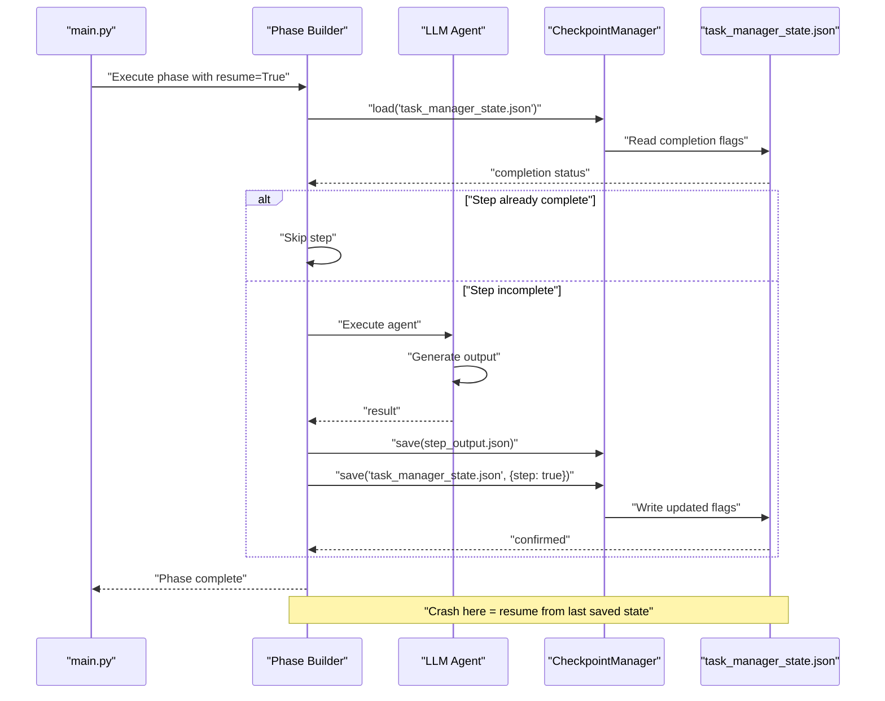

<!-- source: DeepWiki mcp.deepwiki.com · repo microsoft/RPG-ZeroRepo · page 5.2 Resume and Recovery · fetched 2026-10-26 -->

# Resume and Recovery

<details>
<summary>Relevant source files</summary>

The following files were used as context for generating this wiki page:

- [README.md](README.md)
- [configs/checkpoint_config.yaml](configs/checkpoint_config.yaml)
- [main.py](main.py)

</details>


This document explains how RPG-ZeroRepo's checkpoint system enables resumable execution and recovery from failures. It covers the `--resume` and `--force-rebuild` command-line flags, the resume decision logic based on checkpoint state, and strategies for recovering from interrupted or failed pipeline runs.

For detailed information about individual checkpoint files and their contents, see [Checkpoint File Reference](#5.1). For general state management concepts, see [State Management and Checkpointing](#5).

---

## Resume Mode Overview

The `--resume` flag allows the pipeline to continue from the last completed stage instead of restarting from scratch. This is critical for long-running repository generation jobs where LLM calls are expensive and time-consuming.

**Command-line usage:**

```bash
python main.py \
  --config configs/zerorepo_config.yaml \
  --checkpoint ./my_project/checkpoints \
  --repo ./my_project/workspace \
  --resume
```

When `--resume` is specified, the system:
1. Loads `task_manager_state.json` from the checkpoint directory
2. Checks completion flags for each major pipeline stage
3. Skips any stage marked as complete
4. Resumes execution from the first incomplete stage
5. For code generation phase, resumes from the next uncompleted task batch

**Sources:** [main.py:97-101](), [README.md:82](), [README.md:354-380]()

---

## Task Manager State File

The `task_manager_state.json` file serves as the master progress tracker for the entire pipeline. It records completion status for each phase and tracks progress within the code generation phase.

### State File Structure

```json
{
  "feature_selection": true,
  "feature_refactoring": true,
  "build_skeleton": true,
  "build_function": true,
  "plan_tasks": true,
  "code_generation": false,
  "completed_tasks": [
    "io.input_persistence/src_io_persistence_serialization.py_...",
    "gameplay.core/src_gameplay_rules_movement.py_..."
  ],
  "failed_tasks": [],
  "current_task": {
    "task_id": "ai.pathfinding/src_ai_planning_pathfinding.py_...",
    "batch_id": "ai.pathfinding",
    "file_path": "src/ai/planning/pathfinding.py",
    "iteration": 2,
    "last_workflow": "CODE_BUG_FIX"
  },
  "last_updated": "2026-02-09T13:56:20"
}
```

### Completion Flags

| Flag | Phase | Meaning |
|------|-------|---------|
| `feature_selection` | Phase 1, Step 1 | FeatureSelectAgent completed, feature tree generated |
| `feature_refactoring` | Phase 1, Step 2 | FeatureRefactorAgent completed, components created |
| `build_skeleton` | Phase 2, Step 2 | FileDesigner completed, skeleton.json created |
| `build_function` | Phase 2, Step 3 | FuncDesigner completed, graph.json with interfaces created |
| `plan_tasks` | Phase 2, Step 4 | TaskPlanner completed, tasks.json generated |
| `code_generation` | Phase 3 | All task batches completed successfully |

### Task Tracking Fields

| Field | Type | Purpose |
|-------|------|---------|
| `completed_tasks` | list[str] | Task IDs that finished successfully (tests passed) |
| `failed_tasks` | list[str] | Task IDs that exceeded max iterations or encountered unrecoverable errors |
| `current_task` | dict | State of the currently executing task (for mid-task resume) |

**Sources:** [README.md:360-374](), [configs/checkpoint_config.yaml:6-7]()

---

## Resume Decision Flow

**Diagram: Resume Logic State Machine**



**Sources:** [main.py:202-276](), [README.md:376-379]()

---

## Resume Behavior by Phase

### Phase 1: Feature Planning

**Resume point:** After `feature_selection` or `feature_refactoring` completes

The system checks for these checkpoint files:
- `feature_selection.json` - If exists and `feature_selection == true`, skip FeatureSelectAgent
- `feature_refactoring.json` - If exists and `feature_refactoring == true`, skip FeatureRefactorAgent
- `repo_data.json` - Updated with Feature_tree and Component fields after each step

**Behavior:**
- If both flags are true, Phase 1 is skipped entirely
- If only `feature_selection == true`, only FeatureRefactorAgent runs
- Phase 1 has no partial resume within a single step (each agent is atomic)

**Sources:** [README.md:98-173](), [configs/checkpoint_config.yaml:24-26]()

### Phase 2: Architecture Design

**Resume point:** After `build_skeleton`, `build_function`, or `plan_tasks` completes

The system checks for:
- `skeleton.json` - If exists and `build_skeleton == true`, skip FileDesigner
- `graph.json` - If exists and `build_function == true`, skip FuncDesigner
- `tasks.json` - If exists and `plan_tasks == true`, skip TaskPlanner

**Behavior:**
- Each sub-phase (file design, function design, task planning) is atomic
- Cannot resume mid-step within FileDesigner or FuncDesigner
- `global_repo_rpg.json` is incrementally updated but not used for resume decisions (only completion flags matter)

**Sources:** [README.md:175-281](), [configs/checkpoint_config.yaml:9-13]()

### Phase 3: Code Generation

**Resume point:** After any task batch completes

The system maintains fine-grained state:
- `iteration_state.json` - Current iteration state for active batch
- `execution_history.json` - Flat list of all workflow executions
- `batch_trajectory.json` - Per-batch execution records

**Behavior:**
1. Loads `tasks.json` to get all task batches
2. Filters out task IDs in `completed_tasks`
3. Skips task IDs in `failed_tasks` (unless explicitly retried)
4. Resumes from the first uncompleted task in the next batch
5. Within a batch, can resume mid-iteration if `current_task` is set

**Mid-batch resume logic:**
- If `current_task` exists, the system resumes that specific batch
- It loads the last iteration state from `iteration_state.json`
- Depending on `last_workflow`, it may retry test generation or code generation
- After `max_iterations` is reached, the task is marked as failed

**Sources:** [README.md:284-351](), [configs/checkpoint_config.yaml:19-22]()

---

## Code Entity Mapping: Resume Implementation

**Diagram: Resume Components in Code**



**Sources:** [main.py:202-276](), [configs/checkpoint_config.yaml:1-27]()

---

## Force Rebuild Mode

The `--force-rebuild` flag bypasses resume logic and forces a complete regeneration from scratch. This is useful when:
- Configuration has changed significantly
- Previous run produced incorrect results
- Checkpoint state is corrupted
- Docker containers need to be rebuilt

**Command-line usage:**

```bash
python main.py \
  --config configs/zerorepo_config.yaml \
  --checkpoint ./my_project/checkpoints \
  --repo ./my_project/workspace \
  --force-rebuild
```

### Force Rebuild Behavior

| Aspect | Behavior |
|--------|----------|
| Checkpoint files | Not deleted, but ignored during execution |
| `task_manager_state.json` | Reset or ignored (depends on implementation) |
| Design phases (1 & 2) | Re-executed from scratch |
| Code generation phase (3) | Docker containers rebuilt, all tasks re-executed |
| Workspace | May be cleared (implementation-specific) |

**Note:** `--force-rebuild` is primarily used for code generation phase (Phase 3) to rebuild Docker containers. For design phases, you typically delete checkpoint files manually instead.

**Sources:** [main.py:92-95](), [main.py:193-194](), [main.py:247]()

---

## Recovery from Failures

### Task Failures

When a task batch fails (exceeds `max_iterations` or encounters unrecoverable errors), it is added to the `failed_tasks` list in `task_manager_state.json`.

**Automatic recovery behavior:**
- Failed tasks are skipped on subsequent resume runs
- The pipeline continues with remaining batches
- Failed tasks do not block overall completion

**Manual recovery:**
1. Examine the failure logs in `results/` directory
2. Fix the issue (e.g., adjust configuration, fix prompt templates)
3. Remove the task ID from `failed_tasks` list
4. Re-run with `--resume`

**Example failed task entry:**

```json
{
  "failed_tasks": [
    "ai.pathfinding/src_ai_planning_pathfinding.py_class_AStarPathfinder"
  ],
  "current_task": null
}
```

### Interrupted Execution

If execution is interrupted (Ctrl+C, system crash, OOM), the system can resume from:

**Phase 1 or 2 interruption:**
- Resume from the beginning of the interrupted step
- No partial progress within a single agent execution
- Completed steps remain completed

**Phase 3 interruption:**
- Resume from the beginning of the interrupted batch
- The `current_task` field may indicate mid-batch state
- All completed batches remain completed
- The batch in progress restarts from iteration 1

**Sources:** [main.py:268-270](), [README.md:376-379]()

---

## Practical Resume Examples

### Example 1: Resume After Phase 1 Completion

**Scenario:** Feature planning completed, but system crashed before Phase 2 started

```bash
# Initial run (crashed during Phase 2)
python main.py --config configs/zerorepo_config.yaml \
  --checkpoint ./checkpoints --repo ./workspace

# Resume from Phase 2
python main.py --config configs/zerorepo_config.yaml \
  --checkpoint ./checkpoints --repo ./workspace \
  --resume
```

**Expected behavior:**
- Loads `task_manager_state.json`
- Sees `feature_selection == true` and `feature_refactoring == true`
- Skips Phase 1 entirely
- Starts Phase 2 from FileDesigner

### Example 2: Resume Mid-Code-Generation

**Scenario:** Code generation phase is 60% complete (30 out of 50 batches)

```bash
# Resume from batch 31
python main.py --config configs/zerorepo_config.yaml \
  --checkpoint ./checkpoints --repo ./workspace \
  --resume
```

**Expected behavior:**
- Loads `tasks.json` to get all 50 batches
- Loads `completed_tasks` list with 30 task IDs
- Filters out completed tasks
- Executes remaining 20 batches
- Updates `task_manager_state.json` after each batch

### Example 3: Retry Failed Tasks

**Scenario:** 2 tasks failed, need to retry after fixing configuration

```bash
# Edit task_manager_state.json manually
# Change: "failed_tasks": ["task_1", "task_2"]
# To:     "failed_tasks": []

# Resume with retries
python main.py --config configs/zerorepo_config.yaml \
  --checkpoint ./checkpoints --repo ./workspace \
  --resume
```

**Expected behavior:**
- Previously failed tasks are no longer in `failed_tasks`
- They are also not in `completed_tasks`
- System treats them as uncompleted and re-executes them

### Example 4: Design-Only Resume

**Scenario:** Want to re-run only Phase 2 (skip Phase 1, don't run Phase 3)

```bash
python main.py --config configs/zerorepo_config.yaml \
  --checkpoint ./checkpoints --repo ./workspace \
  --phase design \
  --resume
```

**Expected behavior:**
- `--phase design` limits execution to Phase 1 + Phase 2
- `--resume` flag makes it skip completed Phase 1 steps
- Only Phase 2 design steps run
- Phase 3 code generation is not executed

**Sources:** [main.py:110-115](), [main.py:238-250]()

---

## State Persistence Timing

**Diagram: When State is Saved**



**Key timing guarantees:**
- State is saved **after** each major step completes
- Checkpoint files are written **before** `task_manager_state.json` is updated
- If a crash occurs mid-step, that step will re-execute on resume
- No partial state corruption (atomic writes)

**Sources:** [main.py:202-276](), [configs/checkpoint_config.yaml:1-27]()

---

## Resume Limitations

### Cannot Resume Within Single Agent Execution

If an LLM agent (e.g., FeatureSelectAgent, FileDesigner) crashes mid-execution, that agent must re-execute from the beginning on resume. There is no sub-step checkpointing within individual agent runs.

**Affected agents:**
- FeatureSelectAgent (Phase 1)
- FeatureRefactorAgent (Phase 1)
- RawSkeletonAgent, GroupSkeletonAgent (Phase 2)
- DataFlowAgent, BaseClassAgent, InterfaceAgent (Phase 2)
- TaskPlanner (Phase 2)

### Cannot Resume Within Docker Container

If the Docker container crashes or is killed during code generation, the current batch restarts from iteration 1. The `trae_agent` does not maintain checkpoint state within a single task execution.

**Workaround:** The system's multi-iteration design (max_iterations=5 by default) provides resilience against transient failures. If a batch consistently fails, it's marked as failed rather than blocking progress indefinitely.

### Manual Checkpoint Editing Risks

Manually editing `task_manager_state.json` can lead to inconsistent state if done incorrectly:
- Setting a flag to `true` when the corresponding checkpoint file doesn't exist causes errors
- Removing a task from `completed_tasks` when it was actually completed wastes computation
- Corrupted JSON syntax prevents the system from loading state entirely

**Best practice:** Only edit `failed_tasks` to retry failures. Don't modify completion flags unless you understand the consequences.

**Sources:** [README.md:354-380](), [configs/checkpoint_config.yaml:1-27]()

---

