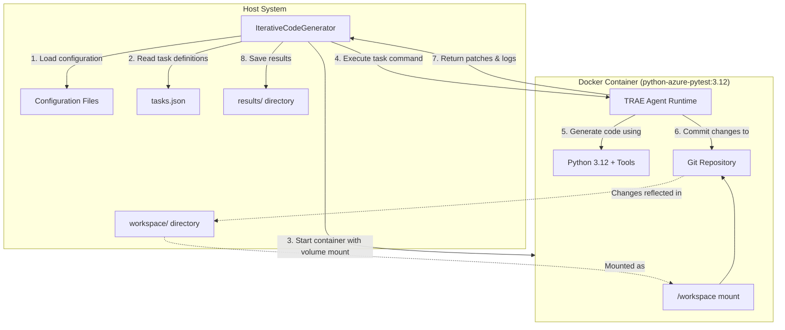
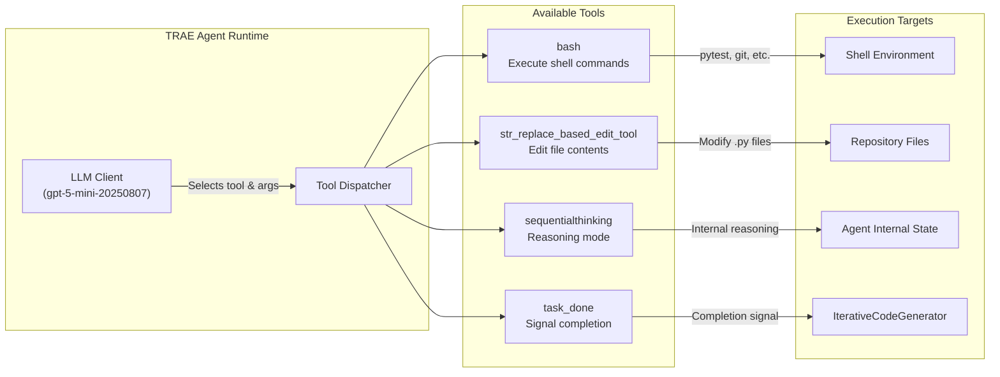
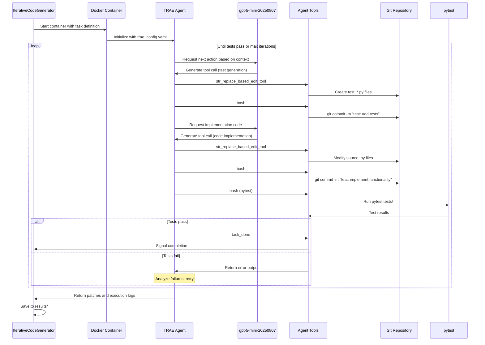

<!-- source: DeepWiki mcp.deepwiki.com · repo microsoft/RPG-ZeroRepo · page 6 Execution Environment · fetched 2026-10-26 -->

# Execution Environment

<details>
<summary>Relevant source files</summary>

The following files were used as context for generating this wiki page:

- [configs/trae_config.yaml](configs/trae_config.yaml)
- [configs/zerorepo_config.yaml](configs/zerorepo_config.yaml)
- [dockerfile/Dockerfile](dockerfile/Dockerfile)

</details>


## Purpose and Scope

This document describes the containerized execution environment used during Phase 3 (Code Generation) of the RPG-ZeroRepo pipeline. It covers the Docker-based isolation model, the TRAE agent runtime, and the integration of development tools (testing frameworks, linters, formatters) that enable automated code generation and validation.

For details on the code generation workflow that executes within this environment, see [Phase 3: Code Generation](#3.3). For configuration of the TRAE agent and Docker settings, see [Main Configuration](#4.1) and [TRAE Agent Configuration](#4.4).

---

## Overview

The execution environment provides an isolated, reproducible containerized workspace where the TRAE agent generates and validates code. This environment runs during Phase 3 after the architecture design phase has produced implementation tasks.

The environment consists of three primary layers:

| Layer | Component | Purpose |
|-------|-----------|---------|
| **Host System** | `IterativeCodeGenerator` | Orchestrates Docker container lifecycle, manages task execution, collects results |
| **Container Runtime** | Docker container (`python-azure-pytest:3.12`) | Provides isolated Python 3.12 environment with testing and development tools |
| **Agent Runtime** | TRAE agent | LLM-powered coding agent that generates tests and implementation code using available tools |

**Sources:** [configs/zerorepo_config.yaml:53-72](), [dockerfile/Dockerfile:1-32](), [configs/trae_config.yaml:1-28]()

---

## Container Architecture

### Container Image: python-azure-pytest:3.12

The Docker container is built from a Python 3.12 base image with specialized tooling for test-driven development and Azure integration. The container image is defined in [dockerfile/Dockerfile:1-32]() and includes:

**Base Environment:**
- Python 3.12 runtime
- Azure CLI for cloud integration
- Git (implicitly available in base image)

**Testing Framework:**
- `pytest` - Core testing framework
- `pytest-cov` - Coverage measurement
- `pytest-xdist` - Parallel test execution
- `pytest-mock` - Mocking utilities
- `pytest-asyncio` - Async test support
- `pytest-timeout` - Test timeout handling
- `pytest-html` - HTML report generation
- `pytest-benchmark` - Performance benchmarking

**Code Quality Tools:**
- `coverage` - Coverage analysis
- `flake8` - Style enforcement
- `black` - Code formatting
- `isort` - Import sorting
- `mypy` - Static type checking
- `tox` - Test automation

**Azure Integration:**
- `azure-identity` - Azure authentication
- Azure CLI - Command-line tools

**LLM Client:**
- `openai` - API client for LLM communication

The working directory is set to `/workspace`, which serves as the mount point for the generated repository code.

**Sources:** [dockerfile/Dockerfile:1-32]()

---

## Host-Container Interaction

The following diagram shows how the host system interacts with the Docker container during code generation:

### Diagram: Host-Container Communication Flow



**Container Lifecycle:**

1. `IterativeCodeGenerator` loads configuration from [configs/zerorepo_config.yaml:53-72]()
2. Container is started with the following parameters:
   - Image: `python-azure-pytest:3.12`
   - Container name: `zerorepo_2` (configurable)
   - Volume mount: host workspace → `/workspace` in container
   - Force rebuild option: controls whether to recreate container

3. The container runs for the duration of a task batch execution
4. All code changes are reflected back to the host via the mounted volume
5. Results (patches, execution logs) are extracted and saved to `results/`

**Sources:** [configs/zerorepo_config.yaml:54-60]()

---

## TRAE Agent Architecture

The TRAE (Test-Driven Automated Engineering) agent is an LLM-powered coding agent that operates within the container. It is configured via [configs/trae_config.yaml:1-28]().

### Agent Configuration Structure

| Configuration Key | Value | Purpose |
|-------------------|-------|---------|
| `model` | `trae_agent_model` | References the model definition |
| `max_steps` | 300 | Maximum action steps per task execution |
| `enable_lakeview` | false | Telemetry logging (disabled) |
| `tools` | `[bash, str_replace_based_edit_tool, sequentialthinking, task_done]` | Available agent capabilities |

**Model Configuration:**
- Provider: OpenAI
- Model: `gpt-5-mini-20250807`
- Max completion tokens: 16,384
- Temperature: 0.0 (deterministic)
- Top-p: 1, Top-k: 0
- Max retries: 10
- Parallel tool calls: enabled

**Sources:** [configs/trae_config.yaml:2-28]()

---

## Agent Tool Suite

The TRAE agent has access to four specialized tools that enable code generation and repository management:

### Diagram: TRAE Agent Tool Architecture



**Tool Descriptions:**

1. **bash** - Executes shell commands
   - Used for: running pytest, git commits, file operations
   - Example commands: `pytest tests/`, `git add .`, `git commit -m "test: ..."`, `pip install`

2. **str_replace_based_edit_tool** - String-replacement-based file editor
   - Used for: creating/modifying Python source files
   - Performs exact string replacements to avoid accidental corruption
   - Generates test files and implementation code

3. **sequentialthinking** - Multi-step reasoning mode
   - Used for: planning complex changes, debugging failures
   - Allows the agent to think through problems before taking action
   - Not directly observable in output (internal to agent)

4. **task_done** - Signals successful task completion
   - Used for: indicating that all tests pass and the task is complete
   - Triggers the orchestrator to move to the next task

**Sources:** [configs/trae_config.yaml:6-10]()

---

## Code Generation Execution Flow

The following diagram shows the complete execution flow within the container during a single task execution:

### Diagram: Task Execution Flow



**Execution Parameters:**

From [configs/zerorepo_config.yaml:69-71]():
- `max_iterations`: 5 - Maximum TDD loops per task
- `max_retries_per_workflow`: 3 - Retries for each workflow type (test generation, code implementation, etc.)
- `workflow_timeout`: 1800 seconds (30 minutes) - Timeout per workflow execution

**Sources:** [configs/zerorepo_config.yaml:68-71](), [configs/trae_config.yaml:2-10]()

---

## Workspace Structure

The container workspace at `/workspace` contains the generated repository with the following structure during execution:

```
/workspace/
├── src/                    # Source code generated by agent
│   ├── __init__.py
│   ├── module1.py
│   └── module2.py
├── tests/                  # Test files generated by agent
│   ├── test_module1.py
│   └── test_module2.py
├── .git/                   # Git repository (commits tracked)
├── pytest.ini              # pytest configuration (if created)
└── requirements.txt        # Dependencies (if needed)
```

**Git Tracking:**

All changes are committed to the local git repository with standardized commit messages:
- Test commits: `git commit -m "test: add tests for feature X"`
- Implementation commits: `git commit -m "feat: implement feature X"`

This creates an auditable history of the generation process and enables the system to track which changes caused test failures.

**Sources:** [dockerfile/Dockerfile:30]()

---

## Environment Variables

The container sets the following environment variable:

| Variable | Value | Purpose |
|----------|-------|---------|
| `PYTHONUNBUFFERED` | `1` | Ensures Python output is not buffered, enabling real-time log streaming |

This is critical for monitoring the agent's progress during long-running code generation tasks.

**Sources:** [dockerfile/Dockerfile:32]()

---

## Integration with Code Generation Phase

The execution environment is invoked by the `IterativeCodeGenerator` class during Phase 3. The integration flow:

1. **Task Loading**: `IterativeCodeGenerator` reads `tasks.json` produced by Phase 2
2. **Container Startup**: Docker container is started with workspace mount
3. **Task Execution**: For each task batch:
   - Task definition and context are provided to TRAE agent
   - Agent performs TDD loop (test → implement → verify)
   - Results (patches, logs) are collected
4. **State Tracking**: Progress is saved to `iteration_state.json` and `execution_history.json`
5. **Container Cleanup**: Container persists or is recreated based on `force_rebuild` setting

For details on the code generation workflow and error handling, see [Phase 3: Code Generation](#3.3).

**Sources:** [configs/zerorepo_config.yaml:53-72]()

---

## Resource Management

### Container Resource Configuration

The container is managed with the following parameters from [configs/zerorepo_config.yaml:54-60]():

| Parameter | Default Value | Purpose |
|-----------|---------------|---------|
| `enabled` | `true` | Enable/disable Docker isolation (if false, runs on host) |
| `image` | `python-azure-pytest:3.12` | Container image name |
| `container_name` | `zerorepo_2` | Persistent container identifier |
| `force_rebuild` | `true` | Whether to recreate container on each run |
| `workspace` | `/tare_workspace` | Mount path inside container |

**Container Lifecycle:**
- When `force_rebuild: true`: Container is removed and recreated for each execution
- When `force_rebuild: false`: Existing container is reused, preserving any installed dependencies

**Sources:** [configs/zerorepo_config.yaml:54-60]()

---

## Error Handling and Retry Logic

The execution environment includes multiple layers of retry logic:

### Agent-Level Retries

From [configs/trae_config.yaml:27]():
- `max_retries: 10` - LLM API call retries on transient failures

### Orchestrator-Level Retries

From [configs/zerorepo_config.yaml:65-66]():
- `max_retries: 3` - Container execution retries
- `retry_delay: 5` - Seconds to wait between retries

### Workflow-Level Retries

From [configs/zerorepo_config.yaml:70]():
- `max_retries_per_workflow: 3` - Retries for each workflow type (TEST_DEVELOPMENT, CODE_INCREMENTAL, etc.)

If all retries are exhausted, the task is marked as failed and execution continues with remaining tasks. Failed tasks are tracked in `task_manager_state.json` for later analysis.

**Sources:** [configs/trae_config.yaml:27](), [configs/zerorepo_config.yaml:65-71]()

---

## Summary

The execution environment provides a controlled, reproducible containerized workspace for automated code generation. Key characteristics:

- **Isolation**: Docker container ensures consistent execution environment across machines
- **Tool Integration**: Complete Python development stack (pytest, linters, formatters, Azure CLI)
- **Agent Runtime**: TRAE agent with LLM-powered decision making and four specialized tools
- **TDD Workflow**: Iterative test-first development with automated validation
- **State Tracking**: Git commits and execution logs create auditable generation history
- **Resilience**: Multi-layer retry logic handles transient failures

For detailed information on specific components, see:
- [Docker Container Setup](#6.1) - Container image details and tool installation
- [TRAE Agent](#6.2) - Agent architecture and tool usage patterns
- [Development Tools Integration](#6.3) - Testing framework and code quality tools

**Sources:** [dockerfile/Dockerfile:1-32](), [configs/trae_config.yaml:1-28](), [configs/zerorepo_config.yaml:53-72]()

---

