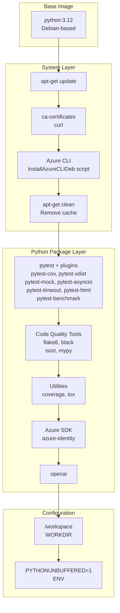
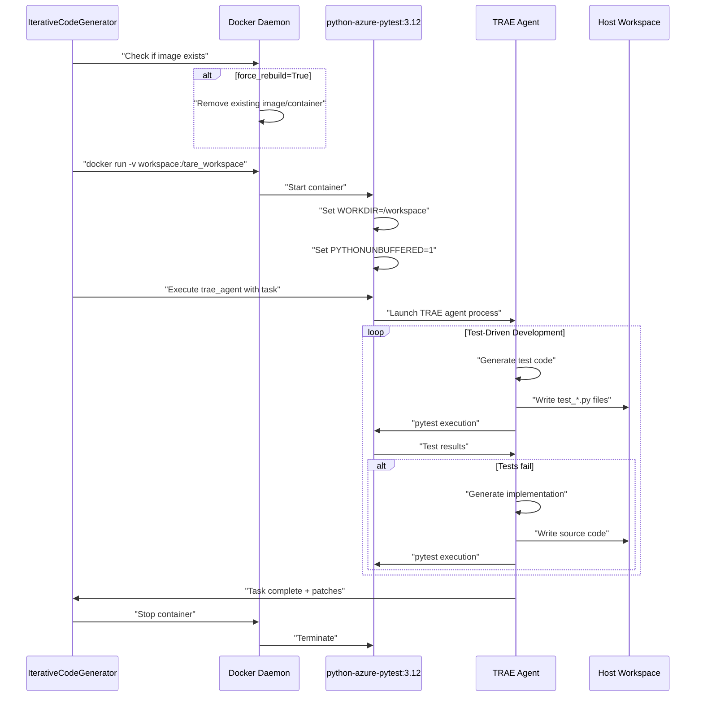
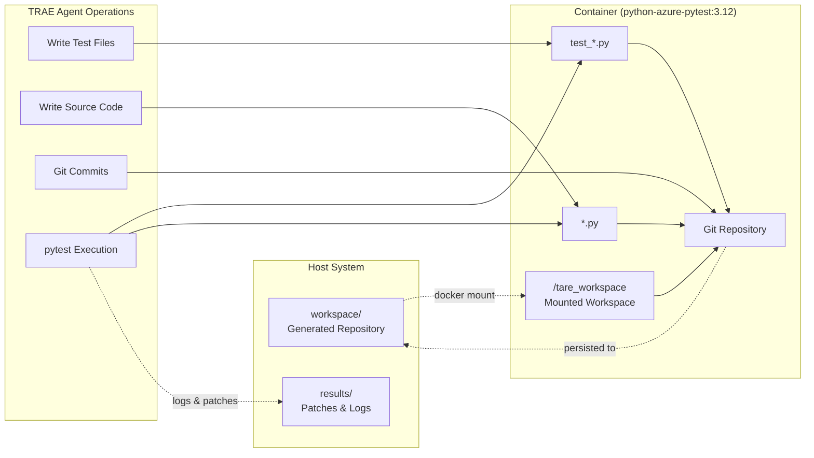

<!-- source: DeepWiki mcp.deepwiki.com · repo microsoft/RPG-ZeroRepo · page 6.1 Docker Container Setup · fetched 2026-10-26 -->

# Docker Container Setup

<details>
<summary>Relevant source files</summary>

The following files were used as context for generating this wiki page:

- [configs/zerorepo_config.yaml](configs/zerorepo_config.yaml)
- [dockerfile/Dockerfile](dockerfile/Dockerfile)

</details>


This document describes the Docker container environment used by RPG-ZeroRepo for code generation. The container provides an isolated, reproducible Python development environment with testing frameworks, code quality tools, and Azure integration.

For information about the TRAE agent that executes inside this container, see [TRAE Agent](#6.2). For details on how the installed development tools are used during code generation, see [Development Tools Integration](#6.3).

---

## Purpose and Scope

The Docker container serves as the execution environment for Phase 3 (Code Generation) of the RPG-ZeroRepo pipeline. The `IterativeCodeGenerator` launches this container to run the TRAE agent, which generates tests and implementation code within a controlled environment. The container image is named `python-azure-pytest:3.12` and is built from the Dockerfile in the repository.

**Sources:** [dockerfile/Dockerfile:1-32](), [configs/zerorepo_config.yaml:54-60]()

---

## Container Architecture

### Base Image and Build Process

The container is built on the official `python:3.12` base image, providing a clean Python 3.12 environment on Debian Linux.



**Diagram: Container Build Layers**

The Dockerfile defines three main installation stages:

1. **System dependencies** ([dockerfile/Dockerfile:3-9]()): Installs `ca-certificates` and `curl` for secure HTTPS connections, then installs Azure CLI using Microsoft's official installation script
2. **Python packages** ([dockerfile/Dockerfile:12-28]()): Installs all Python dependencies using `pip install --no-cache-dir`
3. **Environment setup** ([dockerfile/Dockerfile:30-32]()): Sets working directory and environment variables

**Sources:** [dockerfile/Dockerfile:1-32]()

---

## System Dependencies

### Azure CLI Integration

The container includes the Azure CLI, installed via Microsoft's official Debian installation script:

```bash
curl -sL https://aka.ms/InstallAzureCLIDeb | bash
```

This enables:
- Azure authentication within the container
- Azure resource management if needed by generated code
- Integration with Azure services during test execution

The `azure-identity` Python SDK ([dockerfile/Dockerfile:27]()) provides programmatic Azure authentication capabilities for generated Python code.

**Sources:** [dockerfile/Dockerfile:3-9](), [dockerfile/Dockerfile:27]()

---

## Python Environment

### Testing Framework

The container includes a comprehensive pytest-based testing stack:

| Package | Purpose |
|---------|---------|
| `pytest` | Core testing framework |
| `pytest-cov` | Code coverage measurement |
| `pytest-xdist` | Parallel test execution |
| `pytest-mock` | Mocking and patching utilities |
| `pytest-asyncio` | Async test support |
| `pytest-timeout` | Test timeout enforcement |
| `pytest-html` | HTML test reports |
| `pytest-benchmark` | Performance benchmarking |

These plugins enable the TRAE agent to run comprehensive test suites during the TDD workflow described in [Test-Driven Development Workflow](#3.3.1).

**Sources:** [dockerfile/Dockerfile:13-20]()

### Code Quality Tools

The container includes standard Python code quality tools:

| Tool | Purpose | Usage |
|------|---------|-------|
| `flake8` | PEP 8 linting | Style checking |
| `black` | Code formatting | Auto-formatting |
| `isort` | Import sorting | Import organization |
| `mypy` | Static type checking | Type validation |
| `coverage` | Coverage analysis | Test coverage reports |
| `tox` | Test automation | Multi-environment testing |

The TRAE agent can invoke these tools via the `bash` tool to ensure generated code meets quality standards.

**Sources:** [dockerfile/Dockerfile:21-26]()

### Azure and LLM Integration

Two additional packages support cloud integration:

- **`azure-identity`** ([dockerfile/Dockerfile:27]()): Provides Azure authentication mechanisms (managed identity, service principal, etc.)
- **`openai`** ([dockerfile/Dockerfile:28]()): OpenAI Python SDK for LLM API access

**Sources:** [dockerfile/Dockerfile:27-28]()

---

## Container Configuration

### Working Directory

The container's default working directory is `/workspace` ([dockerfile/Dockerfile:30]()):

```dockerfile
WORKDIR /workspace
```

However, when launched by the `IterativeCodeGenerator`, the actual workspace mount point is configurable via `code_generation.docker.workspace` in the main configuration, which defaults to `/tare_workspace` ([configs/zerorepo_config.yaml:60]()).

### Environment Variables

The container sets `PYTHONUNBUFFERED=1` ([dockerfile/Dockerfile:32]()):

```dockerfile
ENV PYTHONUNBUFFERED=1
```

This ensures Python output (stdout/stderr) is not buffered, providing real-time logging during code generation and test execution.

**Sources:** [dockerfile/Dockerfile:30-32](), [configs/zerorepo_config.yaml:60]()

---

## ZeroRepo Integration

### Container Configuration Parameters

The `IterativeCodeGenerator` reads Docker configuration from the main config file:

```yaml
code_generation:
  docker:
    enabled: true
    image: "python-azure-pytest:3.12"
    container_name: "zerorepo_2"
    force_rebuild: True
    workspace: "/tare_workspace"
```

**Configuration Parameters:**

| Parameter | Description | Default |
|-----------|-------------|---------|
| `enabled` | Enable Docker execution | `true` |
| `image` | Docker image name | `python-azure-pytest:3.12` |
| `container_name` | Container instance name | `zerorepo_2` |
| `force_rebuild` | Rebuild container on each run | `True` |
| `workspace` | Workspace mount point inside container | `/tare_workspace` |

**Sources:** [configs/zerorepo_config.yaml:54-60]()

### Container Lifecycle



**Diagram: Container Execution Flow**

The `IterativeCodeGenerator` manages the container lifecycle:

1. **Image availability check**: Verifies `python-azure-pytest:3.12` exists
2. **Optional rebuild**: If `force_rebuild=True`, removes existing containers/images
3. **Container launch**: Starts container with mounted workspace
4. **TRAE agent execution**: Runs code generation tasks inside container
5. **Workspace persistence**: All generated code persists to host filesystem via mount
6. **Container cleanup**: Stops container after task completion

**Sources:** [configs/zerorepo_config.yaml:54-60]()

---

## Build and Deployment

### Building the Image

To build the Docker image from the Dockerfile:

```bash
cd dockerfile
docker build -t python-azure-pytest:3.12 .
```

The build process:
1. Downloads `python:3.12` base image
2. Installs system dependencies (Azure CLI)
3. Installs Python packages via pip
4. Configures working directory and environment

**Build time:** Approximately 5-10 minutes depending on network speed and cache.

### Image Size Optimization

The Dockerfile includes several optimizations:

- `--no-cache-dir` flag in pip install ([dockerfile/Dockerfile:12]()): Prevents caching of pip downloads, reducing image size
- `apt-get clean` and cache removal ([dockerfile/Dockerfile:8-9]()): Removes apt package lists after installation
- Single `RUN` command for pip installs ([dockerfile/Dockerfile:12-28]()): Reduces layer count

**Sources:** [dockerfile/Dockerfile:3-32]()

---

## Workspace Mounting

### Host-Container Mapping



**Diagram: Workspace Mounting and Persistence**

The workspace mount enables:

- **Bidirectional access**: Host can read generated code in real-time; container can write to persistent storage
- **Git integration**: Git commits made inside container persist to host repository
- **Result extraction**: Test results, patches, and logs flow back to host's `results/` directory
- **State preservation**: If container crashes, workspace state is preserved on host

The mount point is configurable via `code_generation.docker.workspace` ([configs/zerorepo_config.yaml:60]()), defaulting to `/tare_workspace`.

**Sources:** [configs/zerorepo_config.yaml:60]()

---

## Environment Verification

### Verifying Installation

To verify the container environment is correctly configured:

```bash
docker run --rm python-azure-pytest:3.12 python --version
# Expected: Python 3.12.x

docker run --rm python-azure-pytest:3.12 pytest --version
# Expected: pytest 8.x.x

docker run --rm python-azure-pytest:3.12 az --version
# Expected: azure-cli x.x.x
```

### Installed Packages

To list all installed Python packages:

```bash
docker run --rm python-azure-pytest:3.12 pip list
```

Expected key packages:

- pytest and 7 pytest plugins
- flake8, black, isort, mypy
- coverage, tox
- azure-identity
- openai

**Sources:** [dockerfile/Dockerfile:12-28]()

---

