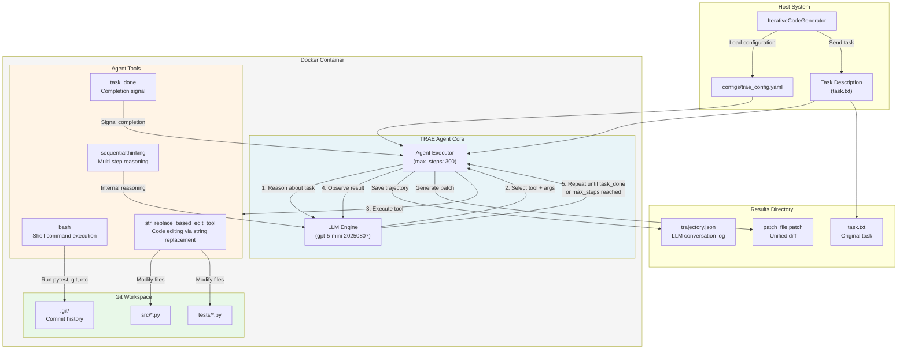
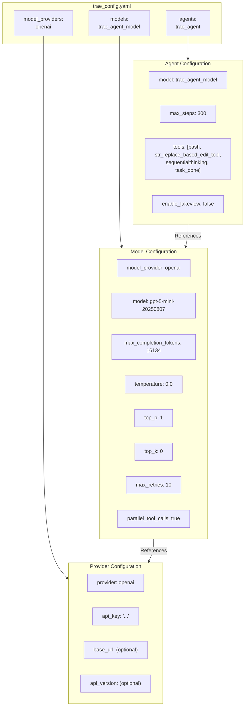
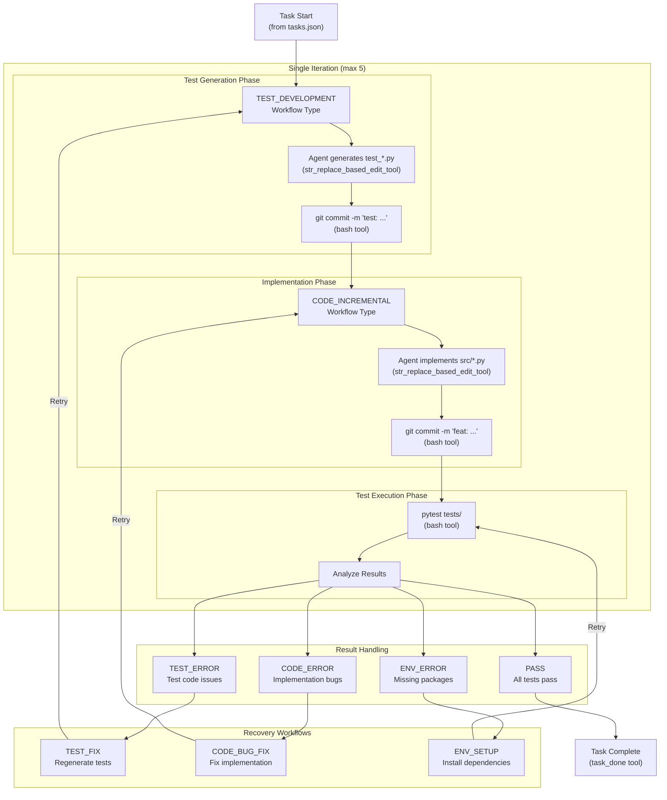
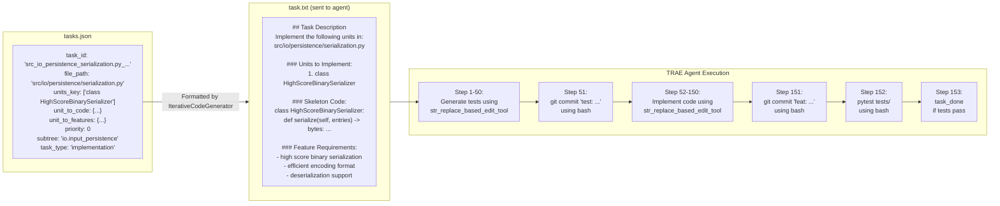
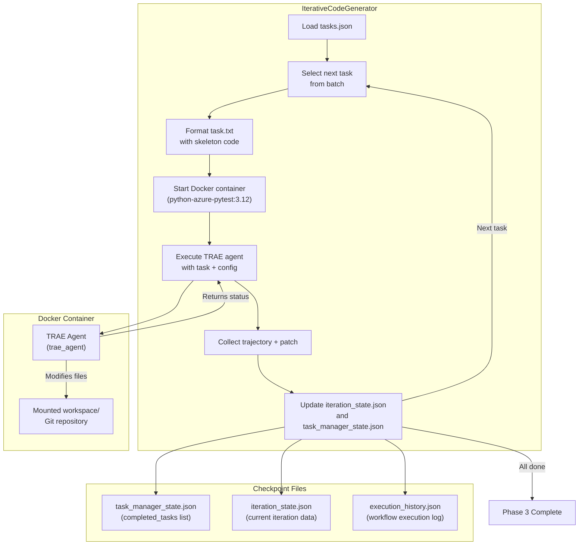

<!-- source: DeepWiki mcp.deepwiki.com · repo microsoft/RPG-ZeroRepo · page 6.2 TRAE Agent · fetched 2026-10-26 -->

# TRAE Agent

<details>
<summary>Relevant source files</summary>

The following files were used as context for generating this wiki page:

- [README.md](README.md)
- [configs/trae_config.yaml](configs/trae_config.yaml)
- [dockerfile/Dockerfile](dockerfile/Dockerfile)

</details>


The TRAE Agent is an LLM-powered coding agent that executes code generation tasks within Docker containers during Phase 3 of the RPG-ZeroRepo pipeline. It implements a test-driven development (TDD) workflow by autonomously generating tests, implementing code, and fixing errors through iterative refinement.

For information about the Docker container environment where TRAE runs, see [Docker Container Setup](#6.1). For details about the overall code generation phase, see [Phase 3: Code Generation](#3.3).

---

## Agent Architecture

The TRAE Agent operates as an autonomous coding system that receives task descriptions and produces code patches. It combines an LLM reasoning engine with specialized tools for file manipulation, shell execution, and structured thinking.

### TRAE Agent Execution Model



**Diagram: TRAE Agent execution flow showing tool selection and workspace interaction**

The agent operates in a perception-action loop: it receives a task, uses the LLM to reason about what actions to take, executes tools, observes results, and repeats until the task is complete or the maximum step count is reached.

**Sources:** 
- [README.md:284-351]()
- [configs/trae_config.yaml:1-28]()

---

## Tool System

The TRAE Agent has access to four specialized tools that enable it to interact with the development environment. Each tool is registered in the `tools` list within [configs/trae_config.yaml:6-10]().

### Tool Reference

| Tool Name | Purpose | Primary Use Cases |
|-----------|---------|-------------------|
| `bash` | Execute shell commands | Running pytest, git commits, installing packages, checking file structure |
| `str_replace_based_edit_tool` | Edit files via string replacement | Writing test code, implementing functions, fixing bugs |
| `sequentialthinking` | Multi-step reasoning mode | Breaking down complex tasks, planning implementation strategy |
| `task_done` | Signal task completion | Indicating successful implementation or unrecoverable failure |

### bash Tool

Enables execution of arbitrary shell commands within the Docker container. The agent uses this tool to:
- **Run tests:** `pytest tests/test_module.py -v`
- **Create git commits:** `git add . && git commit -m "feat: implement feature"`
- **Check environment:** `pip list`, `python --version`
- **Install dependencies:** `pip install package-name`
- **Examine repository state:** `ls -la src/`, `cat README.md`

### str_replace_based_edit_tool

Performs targeted code edits by replacing exact string matches. This is the primary mechanism for code generation. The tool:
- Requires exact string matching (whitespace-sensitive)
- Supports multi-line replacements
- Can create new files by replacing empty string
- Generates unified diff patches automatically

The agent uses this tool to write test files first, then implement the corresponding source code.

### sequentialthinking Tool

Provides a structured thinking framework for complex reasoning tasks. The agent uses this when:
- Planning multi-file implementations
- Analyzing test failure patterns
- Designing error handling strategies
- Breaking down architectural decisions

This tool does not modify the workspace; it only affects the agent's internal reasoning process.

### task_done Tool

Signals completion to the `IterativeCodeGenerator`. The agent invokes this when:
- All tests pass successfully
- The task implementation is complete
- An unrecoverable error is encountered
- Maximum retries have been exhausted

**Sources:**
- [configs/trae_config.yaml:6-10]()
- [README.md:284-351]()

---

## LLM Integration

The TRAE Agent uses an LLM as its reasoning engine to decide which tools to call and what arguments to provide. The LLM configuration is defined in [configs/trae_config.yaml:19-28]().

### Model Configuration Structure



**Diagram: Configuration hierarchy in trae_config.yaml**

### Key Model Parameters

| Parameter | Value | Purpose |
|-----------|-------|---------|
| `model` | `gpt-5-mini-20250807` | OpenAI model identifier |
| `temperature` | `0.0` | Deterministic output (no randomness) |
| `max_completion_tokens` | `16134` | Maximum response length |
| `max_retries` | `10` | API retry attempts on failure |
| `parallel_tool_calls` | `true` | Allow concurrent tool execution |
| `max_steps` | `300` | Maximum agent actions per task |

The `temperature: 0.0` setting ensures deterministic behavior, critical for reproducible code generation. The high `max_steps` value allows the agent to iterate extensively on complex tasks.

**Sources:**
- [configs/trae_config.yaml:11-28]()

---

## Test-Driven Development Workflow

The TRAE Agent implements a structured TDD workflow where it generates tests before implementation, then iteratively fixes code until tests pass. This workflow is orchestrated by the `IterativeCodeGenerator` in Phase 3 (see [Test-Driven Development Workflow](#3.3.1)).

### Workflow Type Execution



**Diagram: TDD workflow types and error recovery paths**

### Workflow Type Details

The workflow type determines what instructions the agent receives and what code it should modify:

| Workflow Type | Agent Instruction | Target Files | When Used |
|---------------|------------------|--------------|-----------|
| `TEST_DEVELOPMENT` | "Write comprehensive tests for..." | `tests/*.py` | First iteration, or after `TEST_ERROR` |
| `CODE_INCREMENTAL` | "Implement the following units..." | `src/*.py` | First iteration, after successful test generation |
| `TEST_FIX` | "Fix the failing tests. Error: ..." | `tests/*.py` | When test code itself has syntax/logic errors |
| `CODE_BUG_FIX` | "Fix implementation to pass tests. Failures: ..." | `src/*.py` | When tests fail due to incorrect implementation |
| `ENV_SETUP` | "Install missing packages: ..." | N/A (uses bash only) | When import errors or missing dependencies detected |

Each workflow type is tracked in `iteration_state.json` and `execution_history.json` (see [Checkpoint File Reference](#5.1)).

**Sources:**
- [README.md:316-324]()
- [README.md:291-314]()

---

## Task Execution Process

The TRAE Agent receives structured task descriptions that specify what code to generate. Each task corresponds to one file from `tasks.json` (see [Phase 2: Architecture Design](#3.2)).

### Task Input Format



**Diagram: Task flow from tasks.json to agent execution**

### Output Artifacts

For each agent invocation, the following files are generated in the `results/` directory:

| File | Content | Purpose |
|------|---------|---------|
| `task.txt` | Original task description | Reproducibility and debugging |
| `{workflow_type}_{timestamp}.json` | Complete LLM conversation trajectory | Analysis of agent reasoning |
| `{workflow_type}_{timestamp}.patch` | Unified diff patch | Code changes made |

The trajectory JSON contains:
- Full prompt sent to LLM
- Tool calls and arguments
- Tool execution results
- Agent observations
- Final completion status

**Sources:**
- [README.md:327-340]()
- [README.md:254-281]()

---

## Agent Configuration Reference

The complete TRAE Agent configuration is defined in `configs/trae_config.yaml`. This file is referenced by `zerorepo_config.yaml` at [code_generation.trae_agent.trae_config](#4.1).

### Configuration Schema

```yaml
# Model provider authentication
model_providers:
  openai:
    provider: openai
    api_key: ""                    # OpenAI API key
    # base_url: ""                 # Optional: custom endpoint
    # api_version: ""              # Optional: for Azure OpenAI
    # tenant_id: ""                # Optional: for Azure auth
    # token_scope: ""              # Optional: for Azure auth

# Model definitions
models:
  trae_agent_model:
    model_provider: openai         # References model_providers key
    model: gpt-5-mini-20250807     # Model identifier
    max_completion_tokens: 16134   # Max output tokens
    temperature: 0.0               # Deterministic (0.0 = no randomness)
    top_p: 1                       # Nucleus sampling (1 = disabled)
    top_k: 0                       # Top-k sampling (0 = disabled)
    max_retries: 10                # API retry attempts
    parallel_tool_calls: true      # Allow concurrent tool execution

# Agent definitions
agents:
  trae_agent:
    enable_lakeview: false         # Debug UI (disabled)
    model: trae_agent_model        # References models key
    max_steps: 300                 # Maximum actions per task
    tools:                         # Available tools
      - bash
      - str_replace_based_edit_tool
      - sequentialthinking
      - task_done
```

### Configuration Override

The TRAE configuration is loaded by `IterativeCodeGenerator` from the path specified in `zerorepo_config.yaml`. To use a custom configuration:

```bash
# Edit zerorepo_config.yaml
code_generation:
  trae_agent:
    trae_config: "./configs/my_custom_trae_config.yaml"
```

**Sources:**
- [configs/trae_config.yaml:1-28]()
- [README.md:436-459]()

---

## Agent Behavior Characteristics

### Step Budget Management

The agent has a maximum of 300 steps per task ([configs/trae_config.yaml:5]()). Step consumption varies by workflow:
- **Test generation:** 50-100 steps (write tests, commit)
- **Code implementation:** 100-150 steps (implement functions, commit)
- **Test execution:** 1-5 steps (run pytest, analyze output)
- **Error recovery:** 20-50 steps (diagnose, fix, retest)

If the agent exhausts its step budget without completing the task, it returns a failure status to the `IterativeCodeGenerator`, which may retry with a fresh agent instance.

### Deterministic Code Generation

The `temperature: 0.0` parameter ensures that the agent produces consistent output for identical inputs. This is critical for:
- **Reproducibility:** Running the same task twice produces the same code
- **Debugging:** Trajectory logs accurately reflect decision-making
- **Testing:** Evaluation results are stable across runs

However, non-determinism can still occur due to:
- Changes in repository state between retries
- Different test failure messages
- External factors (network issues, API changes)

### Error Handling Strategy

The agent employs a layered error recovery approach:

1. **Syntax errors in tests:** Detected immediately, triggers `TEST_FIX` workflow
2. **Test failures:** Agent reads pytest output, triggers `CODE_BUG_FIX` workflow
3. **Import errors:** Triggers `ENV_SETUP` to install packages via pip
4. **Persistent failures:** After max retries, marks task as failed

The agent uses `sequentialthinking` tool to analyze complex error patterns before attempting fixes.

**Sources:**
- [configs/trae_config.yaml:5]()
- [configs/trae_config.yaml:24]()
- [README.md:316-324]()

---

## Integration with Code Generation Phase

The TRAE Agent is invoked by the `IterativeCodeGenerator` class during Phase 3. The integration points are:



**Diagram: TRAE Agent integration with IterativeCodeGenerator**

The `IterativeCodeGenerator` maintains state across all tasks, while each TRAE Agent invocation is stateless (receives fresh task description, produces patch, terminates).

**Sources:**
- [README.md:284-351]()
- [README.md:356-400]()

---

