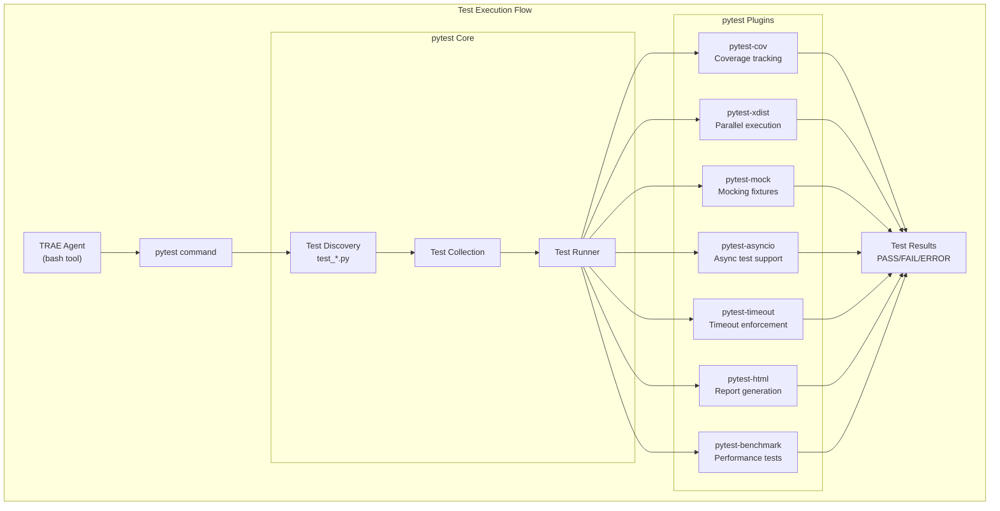
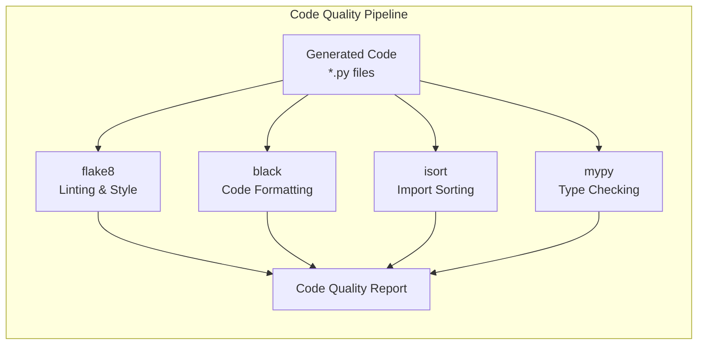
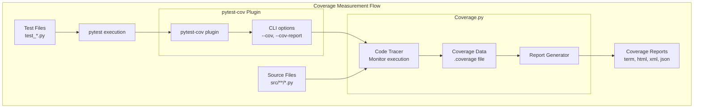
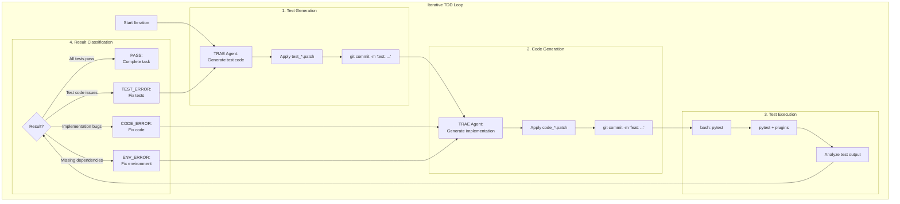

<!-- source: DeepWiki mcp.deepwiki.com · repo microsoft/RPG-ZeroRepo · page 6.3 Development Tools Integration · fetched 2026-10-26 -->

# Development Tools Integration

<details>
<summary>Relevant source files</summary>

The following files were used as context for generating this wiki page:

- [README.md](README.md)
- [dockerfile/Dockerfile](dockerfile/Dockerfile)

</details>


## Purpose and Scope

This document describes the development tools integrated into the Docker execution environment for automated code generation. These tools support the test-driven development (TDD) workflow used during Phase 3 code generation, providing test execution, code quality validation, and coverage measurement capabilities.

For information about the Docker container setup and environment configuration, see [Docker Container Setup](#6.1). For details on how the TRAE agent orchestrates these tools, see [TRAE Agent](#6.2).

**Sources:** [README.md:232-352](), [dockerfile/Dockerfile:1-32]()

---

## Testing Framework

The execution environment uses **pytest** as the primary testing framework, extended with multiple plugins to support comprehensive test execution during code generation.

### Core Testing Stack

The testing stack consists of pytest and seven specialized plugins that provide additional capabilities:

| Tool | Version | Purpose |
|------|---------|---------|
| `pytest` | Latest | Base testing framework with test discovery, execution, and reporting |
| `pytest-cov` | Latest | Coverage measurement integration with pytest |
| `pytest-xdist` | Latest | Parallel test execution across multiple CPUs |
| `pytest-mock` | Latest | Enhanced mocking capabilities via `mocker` fixture |
| `pytest-asyncio` | Latest | Support for testing async/await code |
| `pytest-timeout` | Latest | Timeout control for long-running tests |
| `pytest-html` | Latest | HTML test report generation |
| `pytest-benchmark` | Latest | Performance benchmarking support |

**Sources:** [dockerfile/Dockerfile:12-21]()

### Testing Framework Architecture



**Figure 1: pytest Framework and Plugin Architecture**

The TRAE agent invokes pytest through the `bash` tool, which triggers test discovery in the workspace. The pytest core loads and executes tests while plugins provide enhanced functionality through hooks and fixtures.

**Sources:** [dockerfile/Dockerfile:12-21](), [README.md:295-313]()

### Test Discovery and Execution

The pytest framework automatically discovers tests using standard Python naming conventions:

- **Test files:** `test_*.py` or `*_test.py`
- **Test classes:** `Test*` (must not have `__init__`)
- **Test functions:** `test_*` or `*_test`

During Phase 3 code generation, the TRAE agent generates test files following these conventions, ensuring automatic discovery when pytest executes. Tests are typically located in a `tests/` directory that mirrors the source structure.

**Typical pytest invocation patterns:**

```bash
# Basic test execution
pytest

# With coverage reporting
pytest --cov=src --cov-report=term-missing

# Parallel execution with xdist
pytest -n auto

# With timeout enforcement
pytest --timeout=300

# Generate HTML report
pytest --html=report.html --self-contained-html
```

**Sources:** [README.md:295-313](), [dockerfile/Dockerfile:12-21]()

---

## Code Quality Tools

The Docker environment includes four code quality tools that ensure generated code follows Python best practices and maintains consistency. While these tools are available in the environment, the TRAE agent primarily focuses on test-passing code generation rather than strict style enforcement.

### Code Quality Tool Stack



**Figure 2: Code Quality Tool Pipeline**

**Sources:** [dockerfile/Dockerfile:23-26]()

### Tool Details

| Tool | Purpose | Validation Type | Typical Usage |
|------|---------|-----------------|---------------|
| **flake8** | Linting and PEP 8 style checking | Style violations, unused imports, undefined names | `flake8 src/ tests/` |
| **black** | Deterministic code formatting | Code formatting consistency | `black --check src/ tests/` |
| **isort** | Import statement organization | Import order and grouping | `isort --check-only src/ tests/` |
| **mypy** | Static type checking | Type hint violations, type errors | `mypy src/` |

**Sources:** [dockerfile/Dockerfile:23-26]()

### flake8: Linting and Style Enforcement

**flake8** is a wrapper around PyFlakes (logical errors), pycodestyle (PEP 8), and McCabe (complexity). It checks for:

- Syntax errors and undefined names
- PEP 8 style violations (line length, whitespace, naming)
- Unused imports and variables
- Code complexity (cyclomatic complexity)

The tool is available for validation but not enforced as a strict requirement during code generation. The TRAE agent may run flake8 if instructed but prioritizes test success over perfect style compliance.

**Sources:** [dockerfile/Dockerfile:23]()

### black: Code Formatting

**black** is an opinionated code formatter that enforces a consistent style. It reformats Python code to follow a deterministic style, eliminating debates about formatting.

Key characteristics:
- Line length default: 88 characters
- String quote normalization
- Deterministic output (same input always produces same output)
- Minimal configuration options

The formatter can be used to ensure consistency but is not mandatorily applied to all generated code.

**Sources:** [dockerfile/Dockerfile:24]()

### isort: Import Organization

**isort** sorts and organizes import statements according to PEP 8 guidelines. It groups imports into:

1. Standard library imports
2. Related third-party imports
3. Local application/library imports

Within each group, imports are alphabetically sorted. This tool helps maintain clean, organized import sections in generated code.

**Sources:** [dockerfile/Dockerfile:25]()

### mypy: Static Type Checking

**mypy** is a static type checker for Python that validates type hints. During Phase 2, the `InterfaceAgent` generates function signatures with type hints, and mypy can verify type consistency during implementation.

Type checking capabilities:
- Validates type annotations against usage
- Detects type mismatches in function calls
- Enforces return type consistency
- Checks generic type parameters

**Sources:** [dockerfile/Dockerfile:26]()

---

## Coverage Measurement

The environment includes **coverage.py** and its pytest integration (**pytest-cov**) to measure code coverage during test execution.

### Coverage Tool Integration



**Figure 3: Coverage Measurement Integration**

**Sources:** [dockerfile/Dockerfile:14-21]()

### Coverage Reporting Options

The `pytest-cov` plugin provides multiple reporting formats:

| Format | Option | Description | Use Case |
|--------|--------|-------------|----------|
| **Terminal** | `--cov-report=term` | Console output with coverage percentages | Quick feedback during development |
| **Term-missing** | `--cov-report=term-missing` | Console output showing uncovered lines | Identify specific gaps |
| **HTML** | `--cov-report=html` | Interactive HTML report | Detailed visual analysis |
| **XML** | `--cov-report=xml` | XML format (Cobertura) | CI/CD integration |
| **JSON** | `--cov-report=json` | JSON format | Programmatic analysis |

**Typical usage:**

```bash
# Generate terminal report showing missing lines
pytest --cov=src --cov-report=term-missing

# Generate HTML report for detailed analysis
pytest --cov=src --cov-report=html:htmlcov

# Generate multiple report formats
pytest --cov=src --cov-report=term --cov-report=html --cov-report=xml
```

**Sources:** [dockerfile/Dockerfile:14-21]()

### Coverage Data Storage

Coverage data is stored in a `.coverage` file in the workspace root. This binary file contains:
- Execution traces for all measured code
- Line-by-line execution counts
- Branch coverage data (if enabled)
- Context information (test names)

The `.coverage` file persists between test runs and can be combined with other coverage files for comprehensive analysis.

**Sources:** [dockerfile/Dockerfile:14-21]()

---

## Testing Orchestration with tox

The environment includes **tox** for test automation and orchestration. While not directly used in the standard TDD workflow, tox is available for advanced testing scenarios.

**tox** capabilities:
- Testing across multiple Python versions
- Environment isolation
- Automated dependency installation
- Multi-configuration test execution

**Typical tox configuration (`tox.ini`):**

```ini
[tox]
envlist = py312

[testenv]
deps =
    pytest
    pytest-cov
commands =
    pytest --cov=src tests/
```

**Sources:** [dockerfile/Dockerfile:22]()

---

## Tool Integration in TDD Workflow

The development tools integrate with the TRAE agent's TDD workflow during Phase 3 code generation. The agent uses the `bash` tool to execute commands and analyze results.

### TDD Workflow with Tool Integration



**Figure 4: Development Tools in TDD Workflow**

**Sources:** [README.md:290-324]()

### Workflow Types and Tool Usage

The TDD workflow uses different tool invocation patterns depending on the workflow type:

| Workflow Type | Primary Tool | Purpose | Typical Command |
|---------------|--------------|---------|-----------------|
| `TEST_DEVELOPMENT` | pytest | Validate test syntax | `pytest --collect-only` |
| `CODE_INCREMENTAL` | pytest | Run generated tests | `pytest -v` |
| `TEST_FIX` | pytest | Re-run failing tests | `pytest --last-failed` |
| `CODE_BUG_FIX` | pytest | Verify bug fixes | `pytest -x` (stop on first failure) |
| `ENV_SETUP` | pip | Install dependencies | `pip install <package>` |

**Sources:** [README.md:315-324]()

### Error Detection and Classification

The TRAE agent analyzes pytest output to classify failures and determine the appropriate remediation workflow:

**Error classification logic:**

1. **TEST_ERROR**: Detected when:
   - Test syntax errors (IndentationError, SyntaxError)
   - Test collection failures
   - Test setup/teardown failures
   - Invalid assertions

2. **CODE_ERROR**: Detected when:
   - ImportError in implementation code
   - AttributeError, NameError, TypeError in implementation
   - Assertion failures in tests
   - Logic errors causing incorrect behavior

3. **ENV_ERROR**: Detected when:
   - ModuleNotFoundError for external packages
   - Missing system dependencies
   - Configuration issues

4. **PASS**: Detected when:
   - All tests pass (exit code 0)
   - No errors or failures in pytest output

**Sources:** [README.md:295-324]()

### Command Execution Patterns

The TRAE agent executes development tools through the `bash` tool. Typical command patterns:

**Test execution:**
```bash
# Basic test run
pytest tests/

# Verbose output with coverage
pytest -v --cov=src --cov-report=term-missing tests/

# Stop on first failure
pytest -x tests/

# Re-run only failed tests
pytest --last-failed tests/
```

**Code quality checks:**
```bash
# Check linting
flake8 src/ tests/ --max-line-length=100

# Check formatting
black --check src/ tests/

# Check import sorting
isort --check-only src/ tests/

# Type checking
mypy src/ --ignore-missing-imports
```

**Environment management:**
```bash
# Install package
pip install requests

# Install with version constraint
pip install "numpy>=1.20,<2.0"

# Install from requirements
pip install -r requirements.txt
```

**Sources:** [README.md:295-324](), [dockerfile/Dockerfile:1-32]()

---

## Tool Output Parsing

The TRAE agent parses tool output to extract actionable information for subsequent iterations. Key patterns:

### pytest Output Parsing

**Success indicators:**
- Exit code: 0
- Output contains: `passed`, `test session starts`, no `FAILED` or `ERROR`

**Failure indicators:**
- Exit code: non-zero
- Output contains: `FAILED`, `ERROR`, `ERRORS`
- Stack traces with file paths and line numbers

**Extracted information:**
- Failed test names (e.g., `test_feature_x FAILED`)
- Error types (e.g., `AssertionError`, `ImportError`)
- File locations (e.g., `src/module.py:42`)
- Failure messages and stack traces

### Coverage Report Parsing

**Coverage percentage extraction:**
```
src/module.py    85%    15 missed lines: 23-25, 45-52, 67
```

**Extracted metrics:**
- Overall coverage percentage
- Per-file coverage percentages
- Uncovered line numbers
- Missing branches

### Linter Output Parsing

**flake8 output:**
```
src/module.py:42:1: E302 expected 2 blank lines, found 1
src/utils.py:15:80: E501 line too long (95 > 79 characters)
```

**Extracted violations:**
- File path and line number
- Error code (e.g., E302, E501)
- Violation description

**Sources:** [README.md:295-324]()

---

## Summary

The Docker execution environment integrates a comprehensive suite of development tools:

**Testing Stack:**
- pytest with 7 plugins for test execution, coverage, parallel runs, mocking, async support, timeouts, HTML reports, and benchmarking

**Code Quality:**
- flake8 for linting and PEP 8 compliance
- black for code formatting
- isort for import organization
- mypy for static type checking

**Testing Orchestration:**
- tox for multi-environment testing
- coverage.py for execution tracing

These tools integrate with the TRAE agent's TDD workflow, providing test validation, error detection, and code quality feedback during automated code generation. The agent primarily focuses on test-passing code, using these tools through the `bash` tool to execute commands and analyze results for iterative improvement.

**Sources:** [dockerfile/Dockerfile:1-32](), [README.md:232-352]()

---

