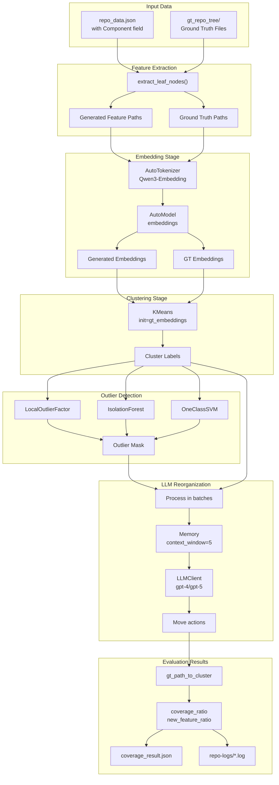
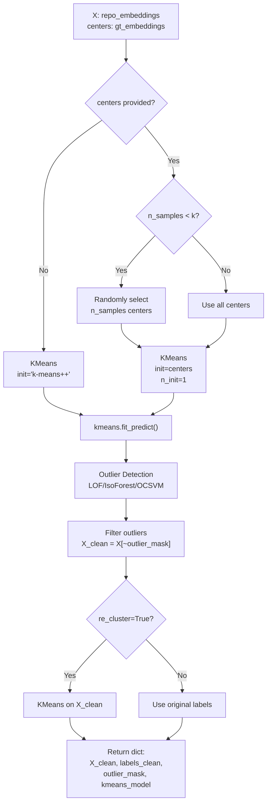
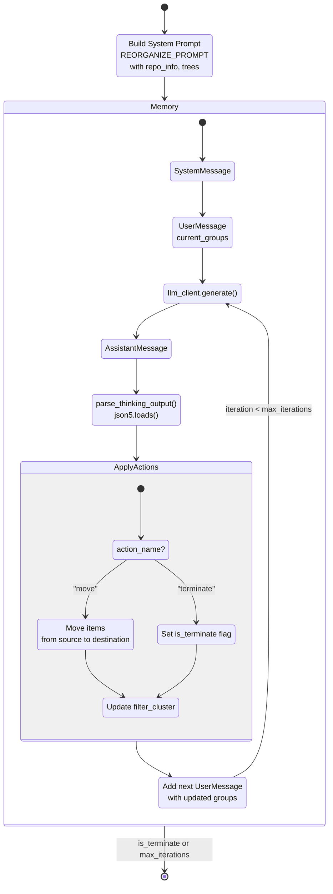

<!-- source: DeepWiki mcp.deepwiki.com · repo microsoft/RPG-ZeroRepo · page 7 Evaluation System (RepoCraft) · fetched 2026-10-26 -->

# Evaluation System (RepoCraft)

<details>
<summary>Relevant source files</summary>

The following files were used as context for generating this wiki page:

- [repocraft/README.md](repocraft/README.md)
- [repocraft/__init__.py](repocraft/__init__.py)
- [repocraft/coverage/coverage.py](repocraft/coverage/coverage.py)

</details>


The RepoCraft evaluation system quantifies the quality of generated repositories by comparing their feature coverage against ground truth reference repositories. It uses embedding-based clustering, outlier detection, and LLM-assisted reorganization to map generated features to canonical feature taxonomies. This page documents the `SubtreeCoverageEvaluator` class, its algorithmic components, and how to run evaluations.

For information about the code generation process being evaluated, see [Phase 3: Code Generation](#3.3). For details about the checkpoint files that feed into evaluation, see [Checkpoint File Reference](#5.1).

**Sources:** [repocraft/coverage/coverage.py:1-627](), [repocraft/README.md:1]()

---

## Overview and Architecture

The evaluation system operates on generated repositories that have been processed through the three-phase pipeline. It extracts feature paths from the generated code's component structure and compares them against predefined ground truth feature trees using semantic similarity.

### System Components

| Component | Purpose | Implementation |
|-----------|---------|----------------|
| `SubtreeCoverageEvaluator` | Main evaluation orchestrator | [repocraft/coverage/coverage.py:108-607]() |
| Embedding Model | Converts text features to vectors | `Qwen/Qwen3-Embedding-0.6B` via HuggingFace |
| Clustering Engine | Groups similar features | KMeans with configurable centers |
| Outlier Detector | Identifies novel features | LOF, IsolationForest, or OneClassSVM |
| LLM Reorganizer | Refines feature mappings | `LLMClient` with GPT-4/GPT-5 models |
| Ground Truth Database | Reference feature taxonomies | 6 JSON files in `gt_repo_tree/` |

**Diagram: Evaluation Pipeline Architecture**



**Sources:** [repocraft/coverage/coverage.py:108-607](), [zerorepo/utils/tree.py](), [zerorepo/rpg_gen/base/llm_client.py]()

---

## SubtreeCoverageEvaluator Class

The `SubtreeCoverageEvaluator` class implements the complete evaluation pipeline from feature extraction to metric calculation.

### Initialization

```python
SubtreeCoverageEvaluator(
    model_id: str = "Qwen/Qwen3-Embedding-0.6B",
    outlier_tag: str = "outlier_features",
    context_window: int = 5,
    llm_model: str = None
)
```

**Parameters:**

| Parameter | Type | Default | Purpose |
|-----------|------|---------|---------|
| `model_id` | `str` | `"Qwen/Qwen3-Embedding-0.6B"` | HuggingFace model for embeddings |
| `outlier_tag` | `str` | `"outlier_features"` | Key for storing novel features |
| `context_window` | `int` | `5` | Conversation history for LLM |
| `llm_model` | `str` | `USE_MODEL` env var | Model for reorganization |

The constructor initializes the embedding model, tokenizer, and LLM client. It uses `AutoTokenizer` and `AutoModel` from HuggingFace Transformers with `trust_remote_code=True`.

**Sources:** [repocraft/coverage/coverage.py:111-127]()

### Core Methods

| Method | Purpose | Returns |
|--------|---------|---------|
| `embedding(texts)` | Converts text to normalized embeddings | `np.ndarray` |
| `smart_cluster_with_outlier_filter(X, centers)` | Clusters data and detects outliers | `dict` with cleaned data and labels |
| `evaluate(data, pre_trees, gt_tree)` | Main evaluation logic | `dict` with metrics |
| `reorgnize_tree(...)` | LLM-based refinement in batches | `dict` with final mappings |
| `run(input_file, gt_dir, output_file)` | Complete evaluation workflow | `dict` or `None` |

**Sources:** [repocraft/coverage/coverage.py:129-607]()

---

## Embedding and Clustering Process

### Feature Path Extraction

The system extracts leaf nodes from hierarchical feature trees using `extract_leaf_nodes()` from `zerorepo.utils.tree`. For generated repositories, it processes the `Component` field containing refactored subtrees.

```python
# From generated repo
pre_paths = extract_leaf_nodes(pre_tree_dict)

# From ground truth
gt_paths = extract_leaf_nodes(gt_tree)
```

**Sources:** [repocraft/coverage/coverage.py:229-241](), [zerorepo/utils/tree.py]()

### Embedding Generation

The `embedding()` method generates normalized embeddings using the [CLS] token from the transformer model:

**Diagram: Embedding Process**

```mermaid
graph LR
    subgraph Input
        Texts["Feature Path Strings"]
    end
    
    subgraph Tokenization
        Tokenizer["AutoTokenizer.tokenizer()"]
        Inputs["input_ids, attention_mask"]
    end
    
    subgraph Model
        Forward["AutoModel.forward()"]
        LastHidden["last_hidden_state"]
        CLS["[:, 0] CLS token"]
    end
    
    subgraph Normalization
        L2Norm["torch.nn.functional.normalize"]
        Embeddings["Normalized Embeddings"]
    end
    
    Texts --> Tokenizer
    Tokenizer --> Inputs
    Inputs --> Forward
    Forward --> LastHidden
    LastHidden --> CLS
    CLS --> L2Norm
    L2Norm --> Embeddings
```



Implementation details at [repocraft/coverage/coverage.py:129-136]():
- Uses `padding=True`, `truncation=True`
- Extracts [CLS] token: `outputs.last_hidden_state[:, 0]`
- Applies L2 normalization: `torch.nn.functional.normalize(embeddings, dim=1)`

**Sources:** [repocraft/coverage/coverage.py:129-136]()

### Clustering with Ground Truth Centers

The `smart_cluster_with_outlier_filter()` method performs KMeans clustering initialized with ground truth embeddings as cluster centers:

**Algorithm Flow:**



**Sources:** [repocraft/coverage/coverage.py:139-223]()

---

## Outlier Detection Methods

The system supports three outlier detection algorithms, selectable via the `outlier_method` parameter:

### Supported Algorithms

| Method | Class | Contamination | Notes |
|--------|-------|---------------|-------|
| `"lof"` | `LocalOutlierFactor` | `"auto"` | Skipped if n_samples ≤ 20 |
| `"isoforest"` | `IsolationForest` | `"auto"` | Default method (robust) |
| `"ocsvm"` | `OneClassSVM` | N/A | Uses `gamma="auto"` |

### Implementation

Outlier detection occurs at [repocraft/coverage/coverage.py:176-195]():

```python
if outlier_method == "lof":
    if n_samples <= 20:
        outlier_mask = np.array([False] * n_samples)
    else:
        model = LocalOutlierFactor(n_neighbors=20, contamination="auto")
        outlier_mask = model.fit_predict(X) == -1

elif outlier_method == "isoforest":
    model = IsolationForest(contamination="auto", random_state=42)
    outlier_mask = model.fit_predict(X) == -1

elif outlier_method == "ocsvm":
    model = OneClassSVM(gamma="auto")
    outlier_mask = model.fit_predict(X) == -1
```

Features marked as outliers are stored in a special cluster with key `self.outlier_tag` (default: `"outlier_features"`).

**Sources:** [repocraft/coverage/coverage.py:176-195](), [repocraft/coverage/coverage.py:268-285]()

---

## LLM-Based Reorganization

After initial clustering, an LLM refines the feature mappings by iteratively moving features between clusters based on semantic understanding of the repository purpose and feature trees.

### Batch Processing

The `reorgnize_tree()` method processes cluster keys in batches to stay within LLM context limits:

**Configuration:**

| Model | Batch Size |
|-------|-----------|
| `gpt-5`, `o4-mini-20250416` | 5 |
| Other models | 10 |

**Sources:** [repocraft/coverage/coverage.py:288-296](), [repocraft/coverage/coverage.py:462-517]()

### Reorganization Workflow

**Diagram: LLM Reorganization Process**



### Move Action Schema

The LLM generates JSON actions in the following format:

```json
{
  "action_name": "move",
  "source": "HTTP Request/Response Handling",
  "destination": "Network Communication",
  "target": ["request_parsing", "response_building"]
}
```

or

```json
{
  "action_name": "terminate"
}
```

**Sources:** [repocraft/coverage/coverage.py:310-459]()

### Memory Management

The system uses a `Memory` object with a sliding context window to manage conversation history:

- **Context Window:** 5 messages (configurable)
- **Message Types:** `SystemMessage`, `UserMessage`, `AssistantMessage`
- **Prompt Templates:** 
  - `REORGANIZE_PROMPT` (with thinking) for most models
  - `REORGANIZE_PROMPT_NO_THINKING` for GPT-5 and o4-mini

**Sources:** [repocraft/coverage/coverage.py:364-365](), [evaluation/coverage/sys_prompt.py]()

---

## Ground Truth Repository Mapping

The evaluation system uses 6 reference repositories covering different software domains. Input repository names are mapped to ground truth files via the `REPO_NAME_ALIAS` dictionary.

### Alias Mapping

| Input Name | Ground Truth File | Domain |
|------------|------------------|--------|
| `requests` | `HttpEasy.json` | HTTP client library |
| `scikit-learn` | `MLKit-Py.json` | Machine learning algorithms |
| `django` | `PyWebEngine.json` | Web framework |
| `statsmodels` | `StatModeler.json` | Statistical modeling |
| `sympy` | `SymbolicMath.json` | Symbolic mathematics |
| `pandas` | `TableKit.json` | Data manipulation |

Defined at [repocraft/coverage/coverage.py:30-37]():

```python
REPO_NAME_ALIAS = {
    "requests": "HttpEasy",
    "scikit-learn": "MLKit-Py",
    "django": "PyWebEngine",
    "statsmodels": "StatModeler",
    "sympy": "SymbolicMath",
    "pandas": "TableKit",
}
```

Ground truth files are stored in the `gt_repo_tree/` directory and loaded at [repocraft/coverage/coverage.py:578-584]().

**Sources:** [repocraft/coverage/coverage.py:30-37](), [repocraft/coverage/coverage.py:568-584]()

---

## Evaluation Metrics

The `evaluate()` method returns a dictionary with the following metrics:

### Metric Definitions

| Metric | Formula | Interpretation |
|--------|---------|----------------|
| `coverage_ratio` | `len(coverage_paths) / len(gt_paths)` | Percentage of ground truth features present |
| `new_feature_ratio` | `len(outlier_repo_paths) / len(repo_paths)` | Percentage of novel features generated |
| `num_gt_paths` | `len(gt_paths)` | Total ground truth features |
| `num_repo_paths` | `len(repo_paths)` | Total generated features |

### Additional Fields

| Field | Type | Description |
|-------|------|-------------|
| `retained_repo_paths` | `list[str]` | Features not marked as outliers |
| `gt_path_to_cluster` | `dict` | Mapping from GT features to generated features |

**Example Output:**

```json
{
  "coverage_ratio": 0.87,
  "new_feature_ratio": 0.13,
  "num_gt_paths": 45,
  "num_repo_paths": 52,
  "retained_repo_paths": [...],
  "gt_path_to_cluster": {
    "HTTP Request/Response Handling": ["request_builder", "response_parser"],
    "Authentication": ["oauth2_flow", "api_key_auth"],
    "outlier_features": ["custom_cache_manager"]
  }
}
```

Calculated at [repocraft/coverage/coverage.py:298-307]().

**Sources:** [repocraft/coverage/coverage.py:225-307]()

---

## Running Evaluations

### Command-Line Interface

The evaluator can be run directly via command line:

```bash
python repocraft/coverage/coverage.py \
    --input-file path/to/repo_data.json \
    --gt-dir ./gt_repo_tree \
    --output-file results/coverage_result.json \
    --llm-model gpt-4o-20241120
```

**Arguments:**

| Argument | Required | Default | Description |
|----------|----------|---------|-------------|
| `--input-file` | Yes | - | Input JSON with `Component` field |
| `--gt-dir` | No | `./gt_repo_tree` | Ground truth directory |
| `--output-file` | Yes | - | Output JSON path |
| `--llm-model` | No | `USE_MODEL` env | LLM for reorganization |

Defined at [repocraft/coverage/coverage.py:611-626]().

**Sources:** [repocraft/coverage/coverage.py:611-626]()

### Programmatic Usage

```python
from repocraft.coverage.coverage import SubtreeCoverageEvaluator

evaluator = SubtreeCoverageEvaluator(
    model_id="Qwen/Qwen3-Embedding-0.6B",
    outlier_tag="outlier_features",
    context_window=5,
    llm_model="gpt-4o-20241120"
)

result = evaluator.run(
    input_file="workspace/my_repo/repo_data.json",
    gt_dir="./gt_repo_tree",
    output_file="results/my_repo_coverage.json"
)

print(f"Coverage: {result['coverage_ratio']:.2%}")
print(f"New Features: {result['new_feature_ratio']:.2%}")
```

**Sources:** [repocraft/coverage/coverage.py:545-606]()

### Batch Evaluation Script

For batch processing multiple repositories, use the `run_api.sh` script (referenced in high-level diagrams):

```bash
bash repocraft/coverage/scripts/run_api.sh
```

This script iterates through multiple repository JSON files and generates coverage results for each.

**Sources:** High-level architecture diagrams, [repocraft/coverage/scripts/]()

---

## Logging and Output

### Repository-Specific Logs

The `attach_repo_log_handler()` function creates per-repository log files:

- **Location:** `repo-logs/<repo_name>.log`
- **Lifecycle:** Attached before evaluation, detached after completion
- **Format:** `[LEVEL] TIMESTAMP - MESSAGE`

Implementation at [repocraft/coverage/coverage.py:45-89]():

```python
attach_repo_log_handler(repo_name, log_root="repo-logs", level=logging.INFO)
# ... evaluation happens ...
detach_repo_log_handler()
```

**Sources:** [repocraft/coverage/coverage.py:45-106](), [repocraft/coverage/coverage.py:586-606]()

### Output Files

| File | Content | Location |
|------|---------|----------|
| `coverage_result.json` | Evaluation metrics and mappings | User-specified via `--output-file` |
| `<repo_name>.log` | Detailed execution logs | `repo-logs/` directory |

---

## Post-Processing

The `post_process()` method performs final cleanup by moving features that match group names into their correct groups:

**Algorithm:**

1. Build normalized group name map (lowercase, alphanumeric only)
2. Identify entries that match a group name but are in wrong group
3. Move entries to correct groups

Example: If `"http request handling"` appears in the `"Authentication"` group but a group named `"HTTP Request Handling"` exists, it moves the feature there.

**Sources:** [repocraft/coverage/coverage.py:519-543]()

---

## Integration with RPG Data

The evaluation system expects input files to contain a `Component` field with refactored feature subtrees. To integrate RPG (Repository Planning Graph) data into repository files, use the `load_rpg_to_repo.py` script:

```bash
python repocraft/coverage/load_rpg_to_repo.py \
    --repo-data workspace/my_repo/repo_data.json \
    --rpg-file workspace/my_repo/global_repo_rpg.json \
    --output new_repo_data.json
```

This script merges the RPG's component structure into the repository data, enabling evaluation.

**Sources:** High-level architecture diagrams, [repocraft/coverage/load_rpg_to_repo.py]()

---

## Dependencies

### Python Packages

| Package | Purpose |
|---------|---------|
| `torch` | PyTorch for model inference |
| `transformers` | HuggingFace models and tokenizers |
| `scikit-learn` | Clustering and outlier detection |
| `numpy` | Numerical operations |
| `json5` | Lenient JSON parsing for LLM outputs |

### Internal Modules

| Module | Usage |
|--------|-------|
| `zerorepo.utils.tree.extract_leaf_nodes` | Extract feature paths |
| `zerorepo.utils.api.parse_thinking_output` | Parse LLM thinking sections |
| `zerorepo.rpg_gen.base.llm_client` | LLM interaction |
| `evaluation.coverage.sys_prompt` | Reorganization prompts |

**Sources:** [repocraft/coverage/coverage.py:1-24]()

---

