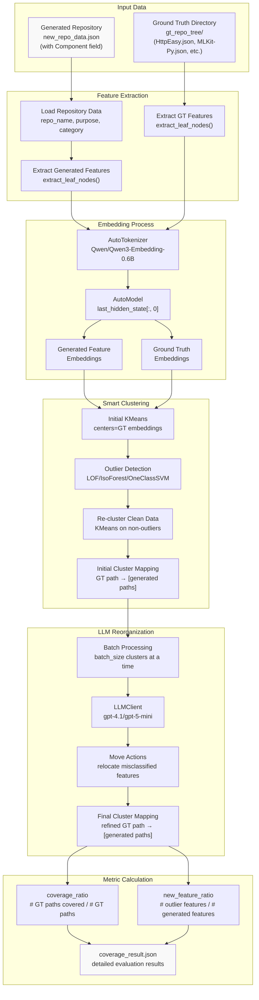
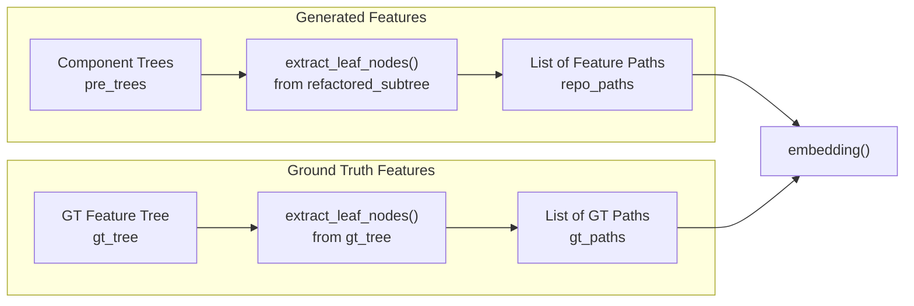
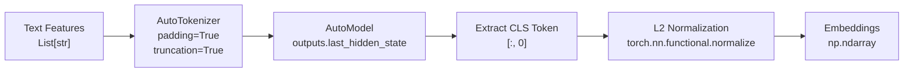
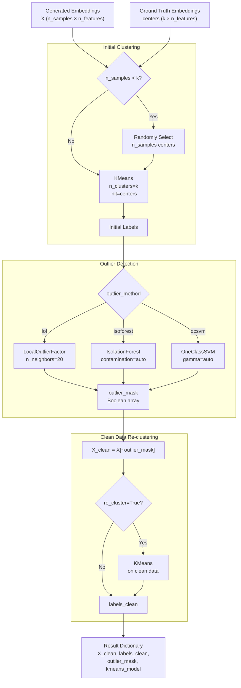
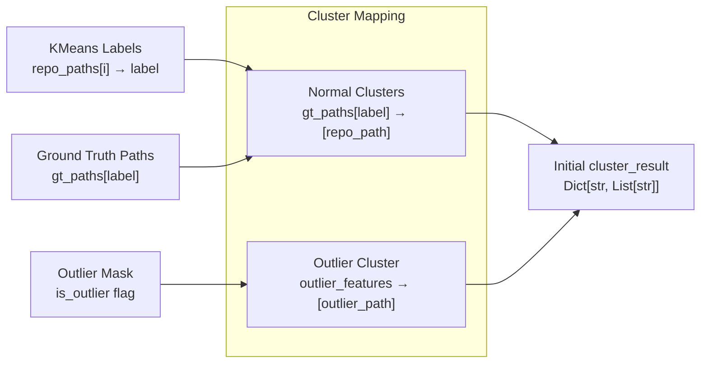
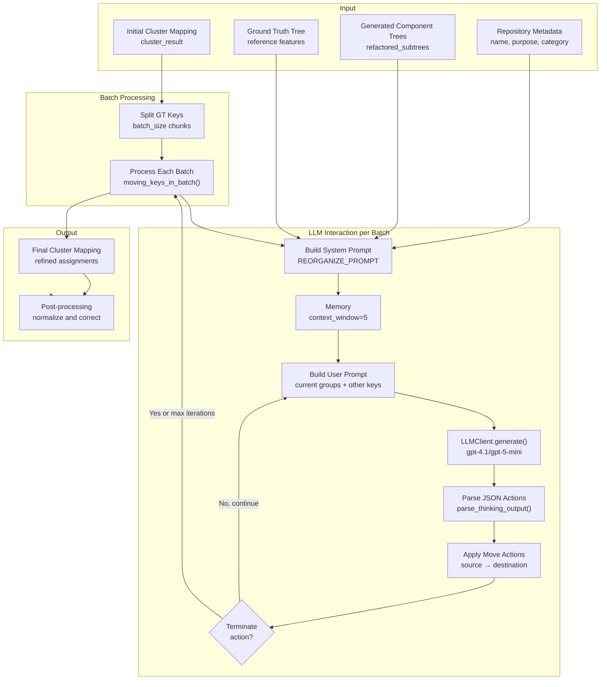
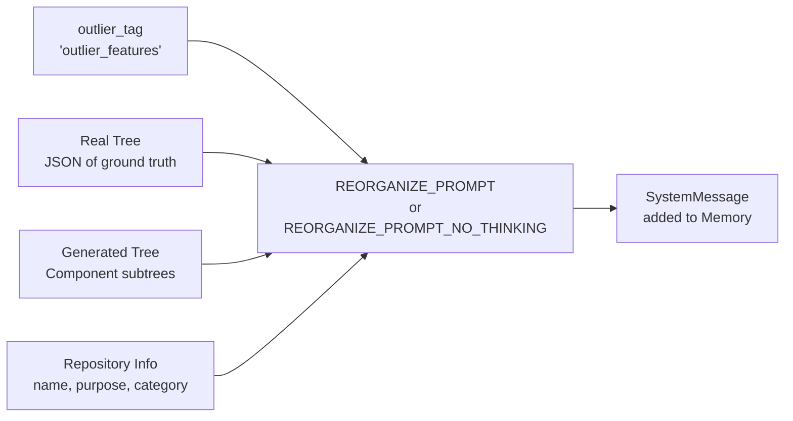
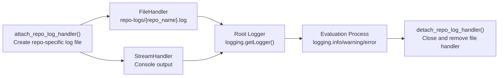
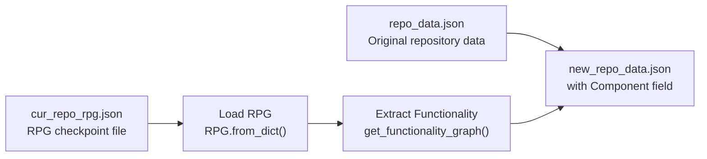
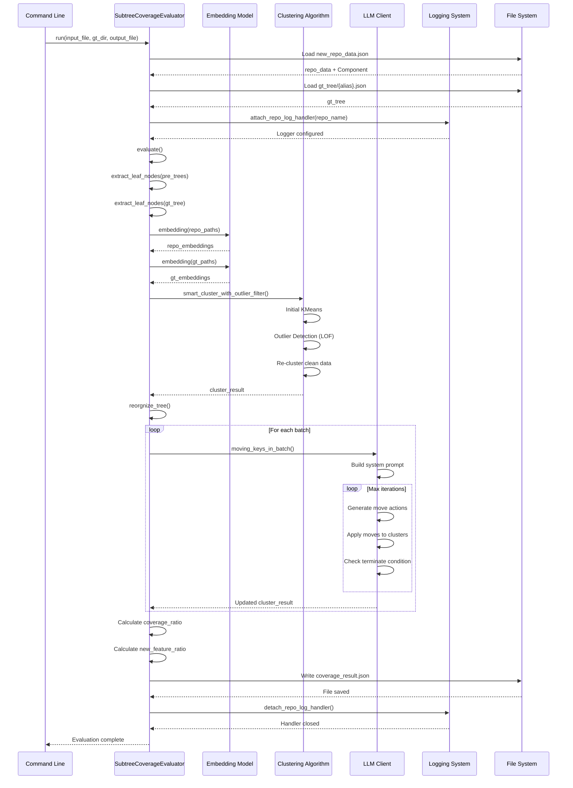

<!-- source: DeepWiki mcp.deepwiki.com · repo microsoft/RPG-ZeroRepo · page 7.1 Coverage Evaluation · fetched 2026-10-26 -->

# Coverage Evaluation

<details>
<summary>Relevant source files</summary>

The following files were used as context for generating this wiki page:

- [repocraft/__init__.py](repocraft/__init__.py)
- [repocraft/coverage/coverage.py](repocraft/coverage/coverage.py)
- [repocraft/coverage/load_rpg_to_repo.py](repocraft/coverage/load_rpg_to_repo.py)

</details>


## Purpose and Scope

This document describes the **RepoCraft Coverage Evaluation** system, which assesses the quality of generated repositories by comparing their features against ground truth reference repositories. The evaluation uses a hybrid approach combining embedding-based clustering and LLM-powered reorganization to measure feature coverage and novelty.

For information about running batch evaluations using the command-line interface, see [Running Evaluations](#7.3). For details about the ground truth reference repositories used in evaluation, see [Ground Truth Repositories](#7.2).

**Sources**: [repocraft/coverage/coverage.py:1-627]()

---

## Overview

The coverage evaluation system quantifies how well a generated repository implements features from a target domain by:

1. **Extracting** features from generated tests and ground truth repositories
2. **Embedding** features as semantic vectors using transformer models
3. **Clustering** generated features against ground truth using smart clustering with outlier detection
4. **Reorganizing** cluster assignments using LLM-based reasoning
5. **Computing** coverage and novelty metrics

The system is implemented in the `SubtreeCoverageEvaluator` class, which orchestrates the entire evaluation pipeline.

**Sources**: [repocraft/coverage/coverage.py:108-127]()

---

## Evaluation Pipeline

### High-Level Workflow

The following diagram illustrates the complete evaluation pipeline from generated repository to final metrics:

**Coverage Evaluation Pipeline**



**Sources**: [repocraft/coverage/coverage.py:225-307](), [repocraft/coverage/coverage.py:545-606]()

---

## Core Components

### SubtreeCoverageEvaluator Class

The `SubtreeCoverageEvaluator` is the main orchestrator for the evaluation process. It initializes the embedding model, LLM client, and manages the evaluation workflow.

| Component | Purpose | Configuration |
|-----------|---------|---------------|
| `tokenizer` | Tokenizes feature text | `Qwen/Qwen3-Embedding-0.6B` |
| `model` | Generates feature embeddings | AutoModel with trust_remote_code |
| `llm_client` | Powers reorganization logic | `LLMClient` with configurable model |
| `outlier_tag` | Labels outlier features | Default: `"outlier_features"` |
| `context_window` | LLM conversation history | Default: 5 messages |

**Initialization Example**:

The evaluator is initialized in [repocraft/coverage/coverage.py:111-127]() with parameters:

```python
SubtreeCoverageEvaluator(
    model_id="Qwen/Qwen3-Embedding-0.6B",
    outlier_tag="outlier_features",
    context_window=5,
    llm_model="gpt-4.1-20250414"
)
```

**Sources**: [repocraft/coverage/coverage.py:108-127]()

---

## Embedding and Feature Extraction

### Feature Path Extraction

Features are extracted as leaf nodes from hierarchical component trees using `extract_leaf_nodes()` from the zerorepo utility functions. The function traverses the refactored subtree structure to identify terminal feature nodes.

**Extraction Process**:



**Sources**: [repocraft/coverage/coverage.py:227-241](), [zerorepo/utils/tree.py]()

### Embedding Generation

The `embedding()` method converts text features into dense vector representations using a transformer model. The method applies the following steps:

1. **Tokenize** input texts with padding and truncation
2. **Forward pass** through the model to get hidden states
3. **Extract** [CLS] token embeddings (first position)
4. **Normalize** embeddings using L2 normalization

**Implementation Details**:



The embeddings are generated with gradient computation disabled for efficiency (see [repocraft/coverage/coverage.py:129-136]()).

**Sources**: [repocraft/coverage/coverage.py:129-136]()

---

## Smart Clustering with Outlier Detection

### Clustering Algorithm

The `smart_cluster_with_outlier_filter()` method implements a robust clustering approach that identifies and filters outliers before final cluster assignment. This prevents noisy or irrelevant features from distorting the evaluation.

**Clustering Process Diagram**:



**Sources**: [repocraft/coverage/coverage.py:139-223]()

### Outlier Detection Methods

The system supports three outlier detection algorithms, selectable via the `outlier_method` parameter:

| Method | Algorithm | Use Case | Implementation |
|--------|-----------|----------|----------------|
| `lof` | Local Outlier Factor | Density-based outlier detection | `LocalOutlierFactor(n_neighbors=20)` |
| `isoforest` | Isolation Forest | Efficient for large datasets | `IsolationForest(contamination="auto")` |
| `ocsvm` | One-Class SVM | Support vector-based approach | `OneClassSVM(gamma="auto")` |

The default method is `"lof"` (Local Outlier Factor), which is used in [repocraft/coverage/coverage.py:256-261]().

**Special Cases**:
- If `n_samples <= 20`, LOF skips outlier detection to avoid errors
- If outlier detection fails, all samples are retained (no outliers marked)

**Sources**: [repocraft/coverage/coverage.py:176-195]()

### Initial Mapping Construction

After clustering, the system constructs an initial mapping from ground truth features to generated features. Each generated feature is assigned to the ground truth feature represented by its cluster center:



Empty clusters (ground truth features with no assigned generated features) are initialized with empty lists (see [repocraft/coverage/coverage.py:271-285]()).

**Sources**: [repocraft/coverage/coverage.py:271-285]()

---

## LLM-Based Reorganization

### Purpose and Approach

The LLM reorganization phase refines the initial clustering by leveraging language models to understand semantic relationships between features. This addresses limitations of pure embedding-based clustering, which may group features incorrectly due to subtle semantic differences.

**Reorganization Architecture**:



**Sources**: [repocraft/coverage/coverage.py:462-517]()

### Batch Processing Strategy

The reorganization processes ground truth features in batches to manage LLM context limits and improve efficiency. The `reorgnize_tree()` method implements this strategy:

| Parameter | Purpose | Default Value |
|-----------|---------|---------------|
| `batch_size` | Number of GT keys per batch | 5 (gpt-5) or 10 (others) |
| `max_iterations` | Max LLM rounds per batch | 10 |
| `context_window` | Conversation history size | 5 messages |

**Batch Processing Logic**:
1. Split ground truth keys (excluding outliers) into chunks of `batch_size`
2. Process each batch with `moving_keys_in_batch()`
3. Skip batches where all clusters are empty
4. Process outliers separately as a final batch

**Sources**: [repocraft/coverage/coverage.py:462-517](), [repocraft/coverage/coverage.py:288-296]()

### Move Action Protocol

The LLM reorganization uses a structured action protocol. The LLM responds with JSON actions that specify feature movements between clusters:

**Action Format**:
```json
{
  "action_name": "move",
  "source": "GT feature path (source cluster)",
  "destination": "GT feature path (destination cluster)",
  "target": ["feature1", "feature2"]
}
```

or:
```json
{
  "action_name": "terminate"
}
```

**Action Processing**:

The `moving_keys_in_batch()` method applies these actions iteratively:

1. **Validate Source**: Source must exist in current batch clusters
2. **Validate Destination**: Destination must be in current batch or other available keys
3. **Move Items**: Remove from source, add to destination
4. **Update Memory**: Add assistant response and next user prompt to conversation
5. **Terminate Check**: Stop if terminate action received and iteration >= 1

**Sources**: [repocraft/coverage/coverage.py:310-459]()

### System Prompt Construction

The system prompt provides context about the repository and task. It uses either `REORGANIZE_PROMPT` or `REORGANIZE_PROMPT_NO_THINKING` depending on the model:

**Prompt Components**:



**Model-Specific Behavior**:
- Models `gpt-5`, `o4-mini-20250416`, `gpt-5.1-chat-20251113` use `REORGANIZE_PROMPT_NO_THINKING`
- All other models use `REORGANIZE_PROMPT` with thinking capability
- High-reasoning models are instructed to "avoid excessive thinking" (see [repocraft/coverage/coverage.py:360-361]())

**Sources**: [repocraft/coverage/coverage.py:344-361](), [evaluation/coverage/sys_prompt.py]()

### Post-Processing

The `post_process()` method performs final cleanup on cluster assignments. It identifies features that should be in different clusters based on normalized string matching:

**Post-Processing Steps**:
1. Build a normalized group name map (lowercase, alphanumeric only)
2. Identify entries that match a group name but are in the wrong cluster
3. Move misplaced entries to their correct cluster

This handles cases where the LLM placed a feature in a semantically related but incorrect cluster.

**Sources**: [repocraft/coverage/coverage.py:519-543]()

---

## Metrics Calculation

### Coverage Ratio

The **coverage ratio** measures what percentage of ground truth features are represented in the generated repository. It is calculated as:

```
coverage_ratio = (# of GT features with ≥1 generated feature) / (total # of GT features)
```

A GT feature is considered "covered" if its cluster contains at least one generated feature (excluding outliers).

**Sources**: [repocraft/coverage/coverage.py:298-301]()

### New Feature Ratio

The **new feature ratio** quantifies the proportion of novel features not aligned with ground truth. It is calculated as:

```
new_feature_ratio = (# of outlier features) / (total # of generated features)
```

Higher values indicate the generated repository contains more features outside the ground truth scope, which may represent innovation or deviation from requirements.

**Sources**: [repocraft/coverage/coverage.py:302]()

### Evaluation Result Structure

The `evaluate()` method returns a dictionary with the following structure:

| Field | Type | Description |
|-------|------|-------------|
| `coverage_ratio` | float | Percentage of GT features covered (0.0-1.0) |
| `new_feature_ratio` | float | Percentage of outlier features (0.0-1.0) |
| `num_gt_paths` | int | Total number of GT feature paths |
| `num_repo_paths` | int | Total number of generated feature paths |
| `retained_repo_paths` | List[str] | Non-outlier generated features |
| `gt_path_to_cluster` | Dict[str, List[str]] | Final mapping of GT paths to generated features |

**Sources**: [repocraft/coverage/coverage.py:300-307]()

---

## Repository Name Aliasing

The evaluator uses a name aliasing system to map generated repository names to ground truth file names. This allows flexibility in repository naming while ensuring correct ground truth lookup.

**Alias Mapping**:

| Generated Name | Ground Truth File | Domain |
|----------------|-------------------|--------|
| `requests` | `HttpEasy.json` | HTTP client library |
| `scikit-learn` | `MLKit-Py.json` | Machine learning toolkit |
| `django` | `PyWebEngine.json` | Web framework |
| `statsmodels` | `StatModeler.json` | Statistical modeling |
| `sympy` | `SymbolicMath.json` | Symbolic mathematics |
| `pandas` | `TableKit.json` | Data manipulation |

The alias is applied in [repocraft/coverage/coverage.py:570-573]() before loading the ground truth file.

**Sources**: [repocraft/coverage/coverage.py:29-37](), [repocraft/coverage/coverage.py:570-573]()

---

## Logging System

### Repository-Specific Logging

The evaluation system implements per-repository logging to facilitate debugging and analysis. Each repository's evaluation is logged to a dedicated file in the `repo-logs/` directory.

**Logging Functions**:



**Handler Management**:
- `attach_repo_log_handler(repo_name)`: Creates a new file handler for the repository and attaches it to the root logger
- `detach_repo_log_handler()`: Removes and closes the current file handler to prevent file handle leaks

The system ensures only one repository handler is active at a time by removing the previous handler before attaching a new one.

**Sources**: [repocraft/coverage/coverage.py:45-106]()

---

## Running Evaluations

### Command-Line Interface

The evaluator can be run as a standalone script with command-line arguments:

**Usage**:
```bash
python repocraft/coverage/coverage.py \
  --input-file path/to/new_repo_data.json \
  --gt-dir path/to/gt_repo_tree \
  --output-file path/to/coverage_result.json \
  --llm-model gpt-4.1-20250414
```

**Arguments**:

| Argument | Required | Default | Description |
|----------|----------|---------|-------------|
| `--input-file` | Yes | - | Path to input JSON with Component field |
| `--gt-dir` | No | `./gt_repo_tree` | Directory containing ground truth files |
| `--output-file` | Yes | - | Path to save evaluation results |
| `--llm-model` | No | `USE_MODEL` env var | LLM model for reorganization |

**Sources**: [repocraft/coverage/coverage.py:610-626]()

### Integration with Repository Data

Before running evaluation, the repository data must include the `Component` field. The `load_rpg_to_repo.py` script handles this integration:

**Integration Process**:



The script locates checkpoint files in the repository directory structure and adds the extracted functionality graph as the `Component` field.

**Sources**: [repocraft/coverage/load_rpg_to_repo.py:1-89]()

### Evaluation Workflow

The `run()` method orchestrates the complete evaluation workflow:

1. **Load Input**: Read `new_repo_data.json` with repository metadata and Component field
2. **Resolve Alias**: Map repository name to ground truth file using `REPO_NAME_ALIAS`
3. **Load GT**: Read ground truth feature tree from `gt_repo_tree/{gt_name}.json`
4. **Attach Logging**: Configure repository-specific log file
5. **Evaluate**: Run the evaluation pipeline (embedding, clustering, reorganization)
6. **Save Results**: Write evaluation results to output JSON file
7. **Detach Logging**: Clean up log handler

**Error Handling**:
- If ground truth file is not found, the evaluation is skipped with a warning
- Exceptions during evaluation are logged with detailed error messages
- Log handlers are properly cleaned up in a `finally` block

**Sources**: [repocraft/coverage/coverage.py:545-606]()

---

## Example Evaluation Flow

**Complete Evaluation Sequence**:



**Sources**: [repocraft/coverage/coverage.py:545-606](), [repocraft/coverage/coverage.py:225-307]()

---

