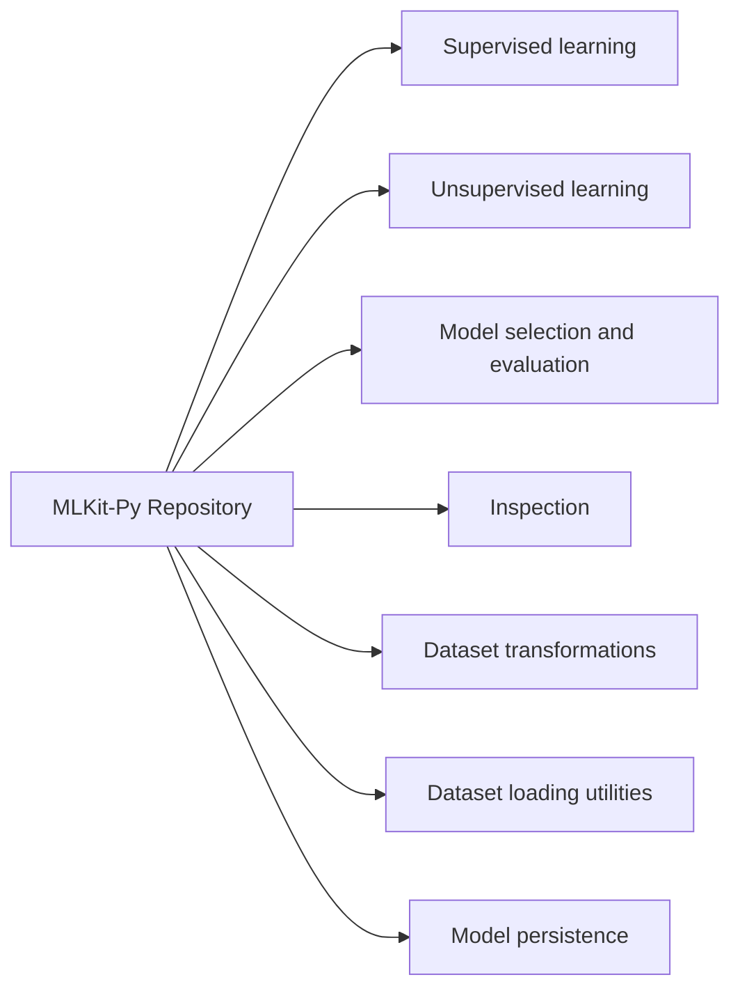
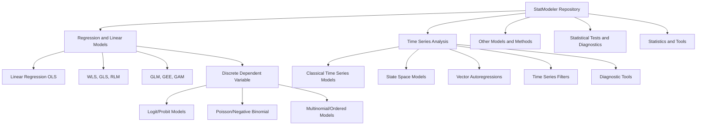
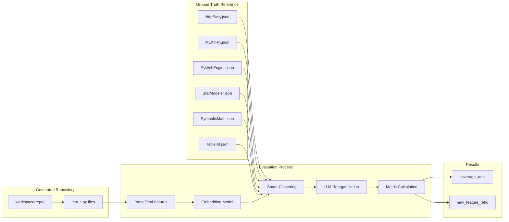

<!-- source: DeepWiki mcp.deepwiki.com · repo microsoft/RPG-ZeroRepo · page 7.2 Ground Truth Repositories · fetched 2026-10-26 -->

# Ground Truth Repositories

<details>
<summary>Relevant source files</summary>

The following files were used as context for generating this wiki page:

- [repocraft/coverage/gt_repo_tree/HttpEasy.json](repocraft/coverage/gt_repo_tree/HttpEasy.json)
- [repocraft/coverage/gt_repo_tree/MLKit-Py.json](repocraft/coverage/gt_repo_tree/MLKit-Py.json)
- [repocraft/coverage/gt_repo_tree/PyWebEngine.json](repocraft/coverage/gt_repo_tree/PyWebEngine.json)
- [repocraft/coverage/gt_repo_tree/StatModeler.json](repocraft/coverage/gt_repo_tree/StatModeler.json)
- [repocraft/coverage/gt_repo_tree/SymbolicMath.json](repocraft/coverage/gt_repo_tree/SymbolicMath.json)
- [repocraft/coverage/gt_repo_tree/TableKit.json](repocraft/coverage/gt_repo_tree/TableKit.json)

</details>


## Purpose and Scope

This document describes the six reference repositories used by the RepoCraft evaluation system to assess the quality of generated code. These ground truth repositories define hierarchical feature taxonomies across different software domains (HTTP clients, machine learning, web frameworks, statistics, symbolic mathematics, and data manipulation). The evaluation system compares features extracted from generated repositories against these reference feature sets to calculate coverage and novelty metrics.

For information on how these ground truth repositories are used in the evaluation process, see [Coverage Evaluation](#7.1). For details on running evaluations, see [Running Evaluations](#7.3).

---

## Overview of Ground Truth Repositories

RPG-ZeroRepo includes six ground truth repositories that represent diverse software domains. Each repository is stored as a JSON file containing a hierarchical feature taxonomy derived from established open-source projects in that domain.

| Repository | File | Domain | Reference Inspiration |
|------------|------|--------|----------------------|
| **HttpEasy** | `HttpEasy.json` | HTTP Client Library | Similar to Python `requests` library |
| **MLKit-Py** | `MLKit-Py.json` | Machine Learning | Similar to `scikit-learn` algorithms |
| **PyWebEngine** | `PyWebEngine.json` | Web Framework | Similar to Django framework |
| **StatModeler** | `StatModeler.json` | Statistical Modeling | Similar to `statsmodels` library |
| **SymbolicMath** | `SymbolicMath.json` | Symbolic Computation | Similar to SymPy library |
| **TableKit** | `TableKit.json` | Data Manipulation | Similar to pandas library |

These repositories serve as reference points for the `SubtreeCoverageEvaluator` to determine:
- **Coverage Ratio**: What percentage of ground truth features appear in generated code
- **New Feature Ratio**: What percentage of generated features are novel (not in ground truth)

**Sources:**
- [repocraft/coverage/gt_repo_tree/HttpEasy.json]()
- [repocraft/coverage/gt_repo_tree/MLKit-Py.json]()
- [repocraft/coverage/gt_repo_tree/PyWebEngine.json]()
- [repocraft/coverage/gt_repo_tree/StatModeler.json]()
- [repocraft/coverage/gt_repo_tree/SymbolicMath.json]()
- [repocraft/coverage/gt_repo_tree/TableKit.json]()

---

## Repository Structure and Format

Each ground truth repository is stored as a JSON file with a hierarchical structure representing feature categories and subcategories. The structure follows a nested dictionary format where:

1. **Top Level**: Major feature domains (e.g., "requests", "Supervised learning")
2. **Second Level**: Feature categories (e.g., "Core Request Features", "Linear Models")
3. **Third Level**: Specific feature groups (e.g., "HTTP Method Support", "SVC")
4. **Leaf Level**: Empty arrays `[]` or nested objects `{}`

### JSON Structure Example

```json
{
  "TopLevelDomain": {
    "FeatureCategory": {
      "SpecificFeature": [],
      "FeatureWithSubcategories": {
        "Subcategory1": [],
        "Subcategory2": []
      }
    }
  }
}
```

Empty arrays `[]` indicate terminal feature nodes (specific capabilities), while nested objects `{}` indicate further subdivisions.

**Sources:**
- [repocraft/coverage/gt_repo_tree/HttpEasy.json:1-61]()
- [repocraft/coverage/gt_repo_tree/MLKit-Py.json:1-92]()

---

## Ground Truth Repository Catalog

### 1. HttpEasy: HTTP Client Library Features

**File:** [repocraft/coverage/gt_repo_tree/HttpEasy.json]()

HttpEasy represents features typical of a comprehensive HTTP client library, modeled after the Python `requests` library. It includes 6 major domains covering the complete lifecycle of HTTP communication.

#### Feature Domain Structure

```mermaid
graph TD
    Root["HttpEasy Repository"]
    
    Requests["requests (Top Domain)"]
    
    Core["Core Request Features"]
    Response["Response Handling"]
    Session["Session Management"]
    Advanced["Advanced Configuration"]
    Security["Security and Transport"]
    Compliance["Compliance and Encoding"]
    
    Core1["HTTP Method Support"]
    Core2["URL and Query Handling"]
    Core3["Request Body Construction"]
    Core4["Custom Headers"]
    
    Resp1["Response Body Access"]
    Resp2["JSON Processing"]
    Resp3["Response Metadata"]
    Resp4["Cookie Handling"]
    
    Adv1["Timeouts and Retries"]
    Adv2["Redirect Control"]
    Adv3["Streaming and Chunking"]
    Adv4["Authentication Support"]
    Adv5["Event Hooks"]
    
    Root --> Requests
    Requests --> Core
    Requests --> Response
    Requests --> Session
    Requests --> Advanced
    Requests --> Security
    Requests --> Compliance
    
    Core --> Core1
    Core --> Core2
    Core --> Core3
    Core --> Core4
    
    Response --> Resp1
    Response --> Resp2
    Response --> Resp3
    Response --> Resp4
    
    Advanced --> Adv1
    Advanced --> Adv2
    Advanced --> Adv3
    Advanced --> Adv4
    Advanced --> Adv5
```



#### Feature Categories

| Category | Features |
|----------|----------|
| **Core Request Features** | HTTP Method Support, URL and Query Handling, Request Body Construction, Custom Headers |
| **Response Handling** | Response Body Access, JSON Processing, Response Metadata, Cookie Handling |
| **Session Management** | Session Persistence, Session Customization |
| **Advanced Configuration** | Timeouts and Retries, Redirect Control, Streaming and Chunking, Authentication Support, Event Hooks |
| **Security and Transport** | SSL Verification, Client Certificates, Transport Control, Proxy Support |
| **Compliance and Encoding** | Encoding Handling, Standards Compliance, Blocking Behavior |

**Sources:**
- [repocraft/coverage/gt_repo_tree/HttpEasy.json:2-60]()

---

### 2. MLKit-Py: Machine Learning Library Features

**File:** [repocraft/coverage/gt_repo_tree/MLKit-Py.json]()

MLKit-Py represents a comprehensive machine learning library modeled after scikit-learn, covering supervised learning, unsupervised learning, model evaluation, and data preprocessing.

#### Top-Level Domain Structure



#### Supervised Learning Features

The supervised learning domain includes 14 major categories:

- **Linear Models**: Standard linear regression and classification
- **Kernel ridge regression**: Kernel-based regression
- **Support Vector Machines**: SVC, SVR, OneClassSVM
- **Nearest Neighbors**: k-NN algorithms
- **Gaussian Processes**: GP regression and classification
- **Cross decomposition**: PLS, CCA methods
- **Naive Bayes**: Probabilistic classifiers
- **Decision Trees**: Tree-based models
- **Ensembles**: Random forests, boosting, bagging
- **Multiclass and multioutput algorithms**: One-vs-rest, one-vs-one
- **Feature selection**: Univariate, recursive elimination
- **Semi-supervised learning**: Label propagation
- **Isotonic regression**: Monotonic regression
- **Neural network models**: MLPClassifier, MLPRegressor

#### Unsupervised Learning Features

The unsupervised learning domain includes:

- **Gaussian mixture models**: GMM clustering
- **Manifold learning**: Isomap, LLE, t-SNE
- **Clustering**: K-means, DBSCAN, hierarchical
- **Biclustering**: Spectral biclustering
- **Matrix factorization**: PCA, NMF, ICA, FA
- **Covariance estimation**: EmpiricalCovariance, shrinkage
- **Novelty and Outlier Detection**: One-class SVM, isolation forest
- **Density Estimation**: KDE
- **Neural network models**: Autoencoders, RBM

**Sources:**
- [repocraft/coverage/gt_repo_tree/MLKit-Py.json:2-92]()

---

### 3. PyWebEngine: Web Framework Features

**File:** [repocraft/coverage/gt_repo_tree/PyWebEngine.json]()

PyWebEngine represents a full-stack web framework modeled after Django, covering everything from ORM to REST APIs.

#### Feature Domain Map

```mermaid
graph TD
    Root["PyWebEngine Repository"]
    
    Data["Data Modeling and Queries"]
    Routing["Routing and Views"]
    Templating["Templating and Rendering"]
    Forms["Form Processing"]
    Auth["Authentication and Authorization"]
    Admin["Admin Interface"]
    Request["Request Handling and Middleware"]
    Security["Security and Sessions"]
    Signals["Signals and Extensibility"]
    AppInfra["Application Infrastructure"]
    Async["Asynchronous Support"]
    REST["REST API Support"]
    GIS["Geospatial Features"]
    Static["Static and Media Files"]
    I18n["Internationalization and Localization"]
    
    Root --> Data
    Root --> Routing
    Root --> Templating
    Root --> Forms
    Root --> Auth
    Root --> Admin
    Root --> Request
    Root --> Security
    Root --> Signals
    Root --> AppInfra
    Root --> Async
    Root --> REST
    Root --> GIS
    Root --> Static
    Root --> I18n
```



#### Core Feature Areas

| Domain | Features |
|--------|----------|
| **Data Modeling and Queries** | ORM (Models, Fields, Relationships), Query System (QuerySets), Migrations |
| **Routing and Views** | Function-Based Views, Class-Based Views, Generic Views, URL Routing & Dispatcher |
| **Templating and Rendering** | Template Language, Context System, Tags and Filters |
| **Form Processing** | Forms and Validation, ModelForms, Formsets, File Uploads |
| **Authentication and Authorization** | User Model & Backends, Permissions & Groups, Login/Logout |
| **Admin Interface** | Admin Site, ModelAdmin Customization, Inlines and Filters |
| **REST API Support** | Serializers, ViewSets & Routers, Permissions, Authentication |
| **Asynchronous Support** | Async Views, ASGI Compatibility, WebSocket Consumers (Channels) |

**Sources:**
- [repocraft/coverage/gt_repo_tree/PyWebEngine.json:2-80]()

---

### 4. StatModeler: Statistical Modeling Library Features

**File:** [repocraft/coverage/gt_repo_tree/StatModeler.json]()

StatModeler represents a comprehensive statistical modeling library modeled after statsmodels, with extensive support for regression, time series, and statistical tests.

#### Major Feature Domains



#### Regression Models

The regression domain includes:
- **Linear Models**: OLS, WLS, GLS, RLM
- **Quantile Regression**: Conditional quantile estimation
- **Generalized Models**: GLM, GEE, GAM
- **Mixed Effects**: LME, GLMM
- **Discrete Outcomes**: Logit, Probit, Poisson, Negative Binomial, Multinomial, Ordered

#### Time Series Analysis

The time series domain includes:
- **Classical Models**: AR, MA, ARMA, ARIMA, SARIMA, Seasonal Decomposition
- **State Space Models**: Unobserved Components, Structural Time Series, Dynamic Factor Models
- **Vector Models**: VAR, VARMAX, VECM
- **Filters**: Hodrick-Prescott, Baxter-King, Christiano-Fitzgerald
- **Diagnostics**: ACF/PACF, Ljung-Box Test, Durbin-Watson Test, ADF Test

**Sources:**
- [repocraft/coverage/gt_repo_tree/StatModeler.json:2-142]()

---

### 5. SymbolicMath: Symbolic Computation Library Features

**File:** [repocraft/coverage/gt_repo_tree/SymbolicMath.json]()

SymbolicMath represents a symbolic mathematics library modeled after SymPy, covering symbolic manipulation, equation solving, calculus, and physics modules.

#### Feature Hierarchy

```mermaid
graph TD
    Root["SymbolicMath Repository"]
    
    Assumptions["Assumption System"]
    Input["Input and Symbol Management"]
    Logic["Symbolic Logic and Substitution"]
    Simplify["Expression Simplification and Manipulation"]
    Solving["Equation Solving"]
    Analysis["Mathematical Analysis"]
    Combinatorics["Combinatorics and Abstract Algebra"]
    Geometry["Geometry"]
    Physics["Physics Modules"]
    Stats["Statistics and Probability"]
    Code["Code and Output"]
    
    Solve1["System of Equations"]
    Solve2["Polynomial Equations"]
    Solve3["Matrix Equations"]
    Solve4["Inequality Solving"]
    Solve5["Diophantine Equations"]
    Solve6["Numerical Solving"]
    Solve7["Differential Equations"]
    
    Phys1["Classical Mechanics"]
    Phys2["Continuum Mechanics"]
    Phys3["Control Systems"]
    Phys4["High-Energy Physics"]
    Phys5["Quantum Mechanics"]
    Phys6["Units and Dimensionality"]
    
    Root --> Assumptions
    Root --> Input
    Root --> Logic
    Root --> Simplify
    Root --> Solving
    Root --> Analysis
    Root --> Combinatorics
    Root --> Geometry
    Root --> Physics
    Root --> Stats
    Root --> Code
    
    Solving --> Solve1
    Solving --> Solve2
    Solving --> Solve3
    Solving --> Solve4
    Solving --> Solve5
    Solving --> Solve6
    Solving --> Solve7
    
    Physics --> Phys1
    Physics --> Phys2
    Physics --> Phys3
    Physics --> Phys4
    Physics --> Phys5
    Physics --> Phys6
```



#### Equation Solving Capabilities

The equation solving domain is particularly rich:

| Solver Type | Features |
|-------------|----------|
| **System of Equations** | Linear system solving, Symbolic parameters support, Multiple unknowns, Various output formats |
| **Polynomial Equations** | Algebraic equation solving |
| **Matrix Equations** | Matrix-based systems |
| **Inequality Solving** | Symbolic inequality solutions |
| **Diophantine Equations** | Integer solutions |
| **Numerical Solving** | Numeric roots, Real/complex solutions, Initial guess support, Arbitrary precision |
| **Differential Equations** | ODE systems, Initial/boundary conditions, Implicit/explicit output, Multi-function systems |

**Sources:**
- [repocraft/coverage/gt_repo_tree/SymbolicMath.json:2-95]()

---

### 6. TableKit: Data Manipulation Library Features

**File:** [repocraft/coverage/gt_repo_tree/TableKit.json]()

TableKit represents a data manipulation and analysis library modeled after pandas, covering data structures, I/O, transformation, and visualization.

#### Comprehensive Feature Map

```mermaid
graph TB
    Root["TableKit Repository"]
    
    Core["Core Data Structures"]
    Indexing["Indexing and Selection"]
    Dtypes["Data Types and Dtypes Support"]
    Arithmetic["Data Alignment and Arithmetic"]
    Missing["Missing Data Handling"]
    IO["IO Tools"]
    Merge["Merge, Join, Concatenate and Compare"]
    Reshape["Reshaping and Pivoting"]
    Text["Text and String Operations"]
    GroupBy["GroupBy and Aggregation"]
    Window["Window Functions"]
    TimeSeries["Time Series Handling"]
    MultiIndex["MultiIndex and Advanced Indexing"]
    Viz["Visualization and Plotting"]
    
    IO1["Text Formats"]
    IO2["Spreadsheet Formats"]
    IO3["Database Interfaces"]
    
    Text1["CSV, JSON, HTML"]
    Text2["Excel, ODS"]
    Text3["SQL databases"]
    
    Root --> Core
    Root --> Indexing
    Root --> Dtypes
    Root --> Arithmetic
    Root --> Missing
    Root --> IO
    Root --> Merge
    Root --> Reshape
    Root --> Text
    Root --> GroupBy
    Root --> Window
    Root --> TimeSeries
    Root --> MultiIndex
    Root --> Viz
    
    IO --> IO1
    IO --> IO2
    IO --> IO3
```



#### Key Feature Categories

| Category | Features |
|----------|----------|
| **Indexing and Selection** | Access Methods, Row/Column Operations, Basic/Advanced Indexing, Setting Data, Random/Conditional Selection, Duplication Handling |
| **IO Tools** | CSV, JSON, HTML, Excel, ODS, SQL databases, Normalized nested JSON, Multiple Excel engines |
| **Missing Data Handling** | Detection, Propagation, Insertion, Computation, Filling, Interpolation |
| **GroupBy and Aggregation** | GroupBy Basics/Operations, Aggregation, Transformation, Filtration, Group Enumeration, Advanced Grouping |
| **Reshaping and Pivoting** | Pivoting, Stacking/Unstacking, Melting, Dummy Variables, Exploding Lists, Cross Tabulation, Categorical Binning |
| **Text Operations** | String Access/Manipulation, Advanced Operations, Indexing, Comparison/Search, Unicode/Normalization, Length/Padding, Validation |
| **Window Functions** | Rolling/Expanding/EWM windows, Windowing with GroupBy, Binary Window Functions, Custom Indexers |

**Sources:**
- [repocraft/coverage/gt_repo_tree/TableKit.json:2-111]()

---

## Integration with Evaluation Pipeline

The ground truth repositories integrate with the RepoCraft evaluation system through the `SubtreeCoverageEvaluator` class. The following diagram shows how these repositories flow through the evaluation process:

**Ground Truth Repository Evaluation Flow**



**Sources:**
- [repocraft/coverage/gt_repo_tree/]()

---

## Feature Extraction and Matching

The evaluation system uses these ground truth repositories to:

1. **Extract Ground Truth Features**: Parse the JSON hierarchies to create a flat list of feature descriptions
2. **Extract Generated Features**: Parse test files from generated repositories to identify implemented features
3. **Embed Features**: Convert feature descriptions to vector embeddings using a language model
4. **Cluster and Match**: Group similar features and detect outliers using smart clustering
5. **LLM Reorganization**: Refine feature mappings using an LLM to handle semantic variations
6. **Calculate Metrics**: Compute coverage (intersection with ground truth) and novelty (features not in ground truth)

The hierarchical structure of ground truth repositories allows the evaluator to understand relationships between features. For example, in HttpEasy.json, "HTTP Method Support" is part of "Core Request Features" under the "requests" domain, providing context for feature matching.

**Sources:**
- [repocraft/coverage/gt_repo_tree/HttpEasy.json]()
- [repocraft/coverage/gt_repo_tree/MLKit-Py.json]()
- [repocraft/coverage/gt_repo_tree/PyWebEngine.json]()
- [repocraft/coverage/gt_repo_tree/StatModeler.json]()
- [repocraft/coverage/gt_repo_tree/SymbolicMath.json]()
- [repocraft/coverage/gt_repo_tree/TableKit.json]()

---

