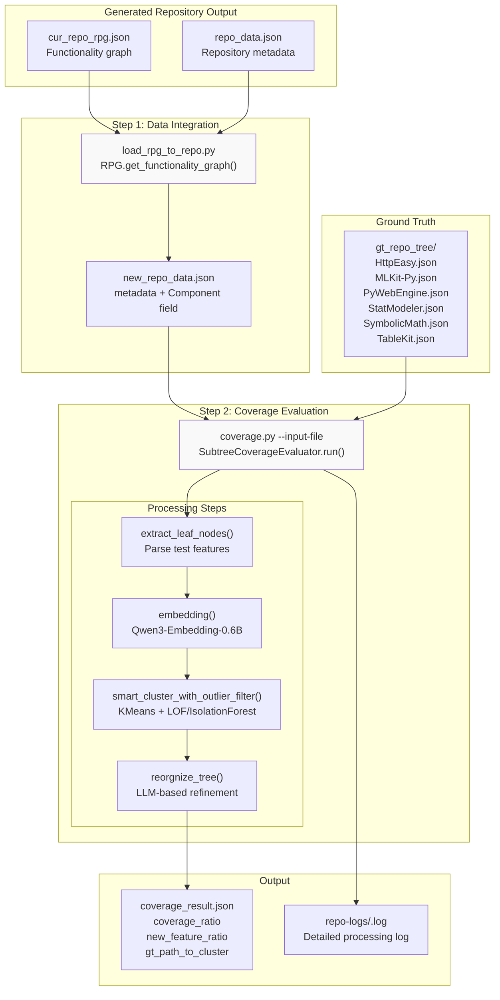
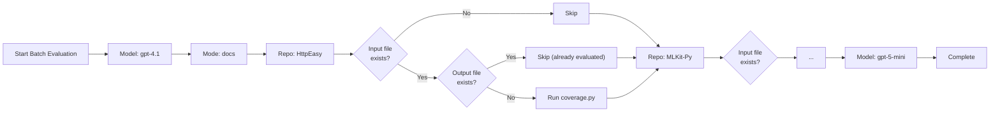
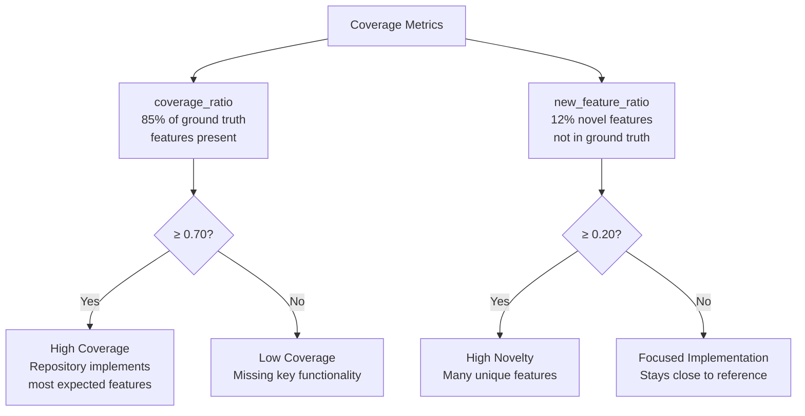

<!-- source: DeepWiki mcp.deepwiki.com · repo microsoft/RPG-ZeroRepo · page 7.3 Running Evaluations · fetched 2026-10-26 -->

# Running Evaluations

<details>
<summary>Relevant source files</summary>

The following files were used as context for generating this wiki page:

- [repocraft/coverage/coverage.py](repocraft/coverage/coverage.py)
- [repocraft/coverage/load_rpg_to_repo.py](repocraft/coverage/load_rpg_to_repo.py)
- [repocraft/coverage/scripts/run_api.sh](repocraft/coverage/scripts/run_api.sh)

</details>


This document explains how to execute the RepoCraft evaluation system to assess generated repository quality. It covers the workflow from preparing evaluation inputs to interpreting coverage results. For details on the underlying evaluation algorithms and metrics, see [Coverage Evaluation](#7.1). For information about the reference datasets used for comparison, see [Ground Truth Repositories](#7.2).

## Overview

The evaluation process consists of three main steps:

1. **Data Preparation**: Integrate functionality graphs from RPG checkpoints into repository metadata
2. **Evaluation Execution**: Run the `SubtreeCoverageEvaluator` on prepared repositories
3. **Results Analysis**: Examine coverage metrics and feature mappings

**Sources**: [repocraft/coverage/coverage.py:1-627](), [repocraft/coverage/load_rpg_to_repo.py:1-90](), [repocraft/coverage/scripts/run_api.sh:1-68]()

---

## Prerequisites

Before running evaluations, ensure the following checkpoint files exist from Phase 3 code generation:

| File | Location | Purpose |
|------|----------|---------|
| `cur_repo_rpg.json` | `<workspace>/checkpoints/` | Current RPG state with functionality graph |
| `repo_data.json` | `<workspace>/checkpoints/` | Repository metadata (name, purpose, category, scope) |

The evaluation also requires access to ground truth feature trees located in the `gt_repo_tree/` directory. These reference files define the expected feature hierarchies for comparison.

**Sources**: [repocraft/coverage/load_rpg_to_repo.py:29-36]()

---

## Evaluation Workflow

The following diagram illustrates the complete evaluation pipeline from generated repositories to coverage metrics:



**Evaluation Pipeline Flow**

This workflow transforms raw RPG outputs into quantitative coverage metrics by comparing generated features against ground truth repositories.

**Sources**: [repocraft/coverage/coverage.py:545-606](), [repocraft/coverage/load_rpg_to_repo.py:20-48]()

---

## Step 1: Integrating RPG Data

The `load_rpg_to_repo.py` script extracts functionality graphs from RPG checkpoints and merges them into repository metadata.

### Script Functionality

The script performs the following operations:

```python
# Load RPG and repo data
rpg_dict = json.load(cur_rpg_path)
repo_data_dict = json.load(repo_data_path)

# Extract functionality graph
repo_rpg = RPG.from_dict(rpg_dict)
cur_component = repo_rpg.get_functionality_graph()

# Add Component field
new_repo_data["Component"] = cur_component
```

The `Component` field contains a list of refactored feature subtrees that represent the logical component structure generated during Phase 1 feature planning.

### Expected Input Structure

The script expects this directory layout:

```
<workspace>/
  checkpoints/
    cur_repo_rpg.json      # RPG with functionality graph
    repo_data.json         # Repository metadata
```

### Output Format

The script generates `new_repo_data.json` with the following structure:

```json
{
  "repository_name": "HttpEasy",
  "repository_purpose": "HTTP request/response library",
  "category": "networking",
  "scope": "http_client",
  "Component": [
    {
      "name": "Request Handling",
      "refactored_subtree": {
        "HTTP Methods": {...},
        "Request Building": {...}
      }
    }
  ]
}
```

**Sources**: [repocraft/coverage/load_rpg_to_repo.py:1-90]()

---

## Step 2: Running Individual Evaluations

The `coverage.py` script provides a command-line interface for evaluating single repositories.

### Command-Line Arguments

| Argument | Required | Default | Description |
|----------|----------|---------|-------------|
| `--input-file` | Yes | - | Path to `new_repo_data.json` |
| `--gt-dir` | No | `./gt_repo_tree` | Directory containing ground truth JSON files |
| `--output-file` | Yes | - | Path to save `coverage_result.json` |
| `--llm-model` | No | `USE_MODEL` env or `gpt-4.1-20250414` | LLM model for reorganization |

### Example Usage

```bash
python repocraft/coverage/coverage.py \
    --input-file workspace/HttpEasy/checkpoints/new_repo_data.json \
    --gt-dir gt_repo_tree/ \
    --output-file workspace/HttpEasy/checkpoints/coverage_result.json \
    --llm-model gpt-5-mini-20250807
```

### Repository Name Aliasing

The evaluator maps generated repository names to ground truth files using `REPO_NAME_ALIAS`:

```python
REPO_NAME_ALIAS = {
    "requests": "HttpEasy",
    "scikit-learn": "MLKit-Py",
    "django": "PyWebEngine",
    "statsmodels": "StatModeler",
    "sympy": "SymbolicMath",
    "pandas": "TableKit",
}
```

If the input file contains `"repository_name": "requests"`, the evaluator loads `HttpEasy.json` from the ground truth directory.

**Sources**: [repocraft/coverage/coverage.py:610-627](), [repocraft/coverage/coverage.py:29-37]()

---

## Step 3: Batch Evaluations

The `run_api.sh` script automates evaluation across multiple repositories and models.

### Script Configuration

The script defines base directories and processing parameters:

```bash
BASE_DIR="/path/to/experiments"
GT_DIR="/path/to/gt_repo_tree"
COVERAGE_SCRIPT="/path/to/coverage.py"

MODELS=("gpt-4.1" "gpt-5-mini")
```

### Directory Structure

The batch script expects this hierarchical organization:

```
BASE_DIR/
  gpt-4.1/
    docs/
      HttpEasy/
        checkpoints/
          new_repo_data.json
          coverage_result.json (created)
      MLKit-Py/
        checkpoints/
          new_repo_data.json
          coverage_result.json (created)
  gpt-5-mini/
    docs/
      HttpEasy/
        ...
```

### Execution Flow



**Batch Evaluation Decision Flow**

The script automatically skips repositories where evaluation results already exist, enabling incremental processing of large experiment sets.

### Running the Batch Script

```bash
cd repocraft/coverage/scripts/
chmod +x run_api.sh
./run_api.sh
```

The script prints progress messages for each repository:

```
========================================
Processing model: gpt-4.1
========================================
[gpt-4.1/HttpEasy] Running coverage evaluation...
  Input: /path/to/gpt-4.1/docs/HttpEasy/checkpoints/new_repo_data.json
  Output: /path/to/gpt-4.1/docs/HttpEasy/checkpoints/coverage_result.json
[gpt-4.1/HttpEasy] Done!

[gpt-4.1/MLKit-Py] Output file already exists: coverage_result.json, skipping...
```

**Sources**: [repocraft/coverage/scripts/run_api.sh:1-68]()

---

## Understanding Output Files

### Coverage Result JSON

The `coverage_result.json` file contains the following fields:

| Field | Type | Description |
|-------|------|-------------|
| `coverage_ratio` | float | Proportion of ground truth features covered by generated tests |
| `new_feature_ratio` | float | Proportion of generated features not found in ground truth |
| `num_gt_paths` | int | Total leaf nodes in ground truth feature tree |
| `num_repo_paths` | int | Total leaf nodes extracted from generated repository |
| `retained_repo_paths` | list[str] | Features retained after outlier filtering |
| `gt_path_to_cluster` | dict | Mapping from ground truth features to generated features |

### Example Output

```json
{
  "coverage_ratio": 0.85,
  "new_feature_ratio": 0.12,
  "num_gt_paths": 45,
  "num_repo_paths": 52,
  "retained_repo_paths": [
    "HTTP Methods/GET Request",
    "HTTP Methods/POST Request",
    "Response Parsing/JSON Decoding"
  ],
  "gt_path_to_cluster": {
    "HTTP Methods/GET": ["HTTP Methods/GET Request", "GET with params"],
    "HTTP Methods/POST": ["HTTP Methods/POST Request"],
    "Response/JSON": ["Response Parsing/JSON Decoding"],
    "outlier_features": ["Custom Feature A", "Custom Feature B"]
  }
}
```

### Metric Interpretation



**Interpreting Coverage Metrics**

High `coverage_ratio` indicates the generated repository implements most expected functionality. High `new_feature_ratio` suggests the generator added features beyond the reference implementation.

**Sources**: [repocraft/coverage/coverage.py:300-307]()

---

## Logging and Debugging

### Per-Repository Log Files

The evaluator creates detailed logs in `repo-logs/<repo_name>.log` using the `attach_repo_log_handler()` function:

```python
def attach_repo_log_handler(repo_name: str,
                            log_root: str = "repo-logs",
                            level: int = logging.INFO):
    """
    Attach file handler for repository-specific logging.
    Simultaneously outputs to terminal and log file.
    """
    os.makedirs(log_root, exist_ok=True)
    log_path = os.path.join(log_root, f"{repo_name}.log")
    # Creates FileHandler with formatted output
```

### Log Content Structure

Each log file captures:

1. **System Prompt**: The reorganization prompt sent to LLM
2. **Iteration Details**: Each reorganization iteration with actions
3. **Batch Progress**: Processing status for feature groups
4. **Final Results**: Coverage ratio and new feature ratio

Example log excerpt:

```
[INFO] 2025-01-20 10:15:30 - Switched to repo 'HttpEasy', log file: repo-logs/HttpEasy.log
[INFO] 2025-01-20 10:15:31 - [System Prompt] =====
You are tasked with reorganizing feature mappings...
[INFO] 2025-01-20 10:15:45 - [Batch 1] Processing keys: ['HTTP Methods/GET', 'HTTP Methods/POST', ...]
[INFO] 2025-01-20 10:16:12 - [Iteration 1 Response]: {"action_name": "move", "source": "..."}
[INFO] 2025-01-20 10:18:30 - Evaluation completed for HttpEasy
[INFO] 2025-01-20 10:18:30 - Coverage: 85.00%
[INFO] 2025-01-20 10:18:30 - New Feature Ratio: 12.00%
```

### Debugging Common Issues

| Issue | Symptom | Solution |
|-------|---------|----------|
| Missing ground truth file | `WARNING: Ground truth file for <name> not found` | Check `REPO_NAME_ALIAS` mapping or add ground truth file |
| Empty feature paths | `coverage_ratio: 0.0` with note `"No paths to compare"` | Verify `Component` field exists in `new_repo_data.json` |
| LLM timeout | Iteration logs stop without completion | Adjust `max_iterations` or check LLM API connectivity |
| Outlier detection failure | `WARNING: Outlier detection failed` | All samples treated as inliers, evaluation continues |

**Sources**: [repocraft/coverage/coverage.py:45-106](), [repocraft/coverage/coverage.py:545-606]()

---

## Advanced Configuration

### Embedding Model

The evaluator uses `Qwen/Qwen3-Embedding-0.6B` for feature embedding. This is configured in `SubtreeCoverageEvaluator.__init__()`:

```python
def __init__(
    self,
    model_id: str="Qwen/Qwen3-Embedding-0.6B",
    outlier_tag: str="outlier_features",
    context_window: int=5,
    llm_model: str=None
):
    self.tokenizer = AutoTokenizer.from_pretrained(model_id, use_fast=False)
    self.model = AutoModel.from_pretrained(model_id, trust_remote_code=True)
```

### Outlier Detection Methods

The clustering process supports three outlier detection algorithms:

| Method | Parameter Value | Best For |
|--------|----------------|----------|
| Local Outlier Factor | `"lof"` | Density-based detection, good for varied cluster sizes |
| Isolation Forest | `"isoforest"` | Fast, handles high-dimensional data well (default) |
| One-Class SVM | `"ocsvm"` | Formal margin-based approach |

Configured in `smart_cluster_with_outlier_filter()`:

```python
result = self.smart_cluster_with_outlier_filter(
    X=repo_embeddings,
    centers=gt_embeddings, 
    outlier_method="lof",  # or "isoforest", "ocsvm"
    re_cluster=True
)
```

### Batch Size Tuning

The LLM reorganization processes features in batches. Batch size depends on the model:

```python
batch_size = 5 if USE_MODEL in ["gpt-5", "o4-mini-20250416"] else 10
```

Larger batches reduce API calls but may decrease reorganization quality. Adjust in `evaluate()` method.

**Sources**: [repocraft/coverage/coverage.py:111-127](), [repocraft/coverage/coverage.py:139-223](), [repocraft/coverage/coverage.py:288-296]()

---

