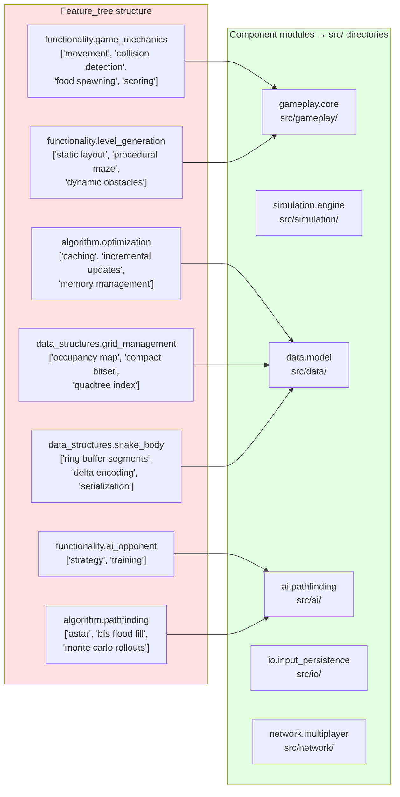
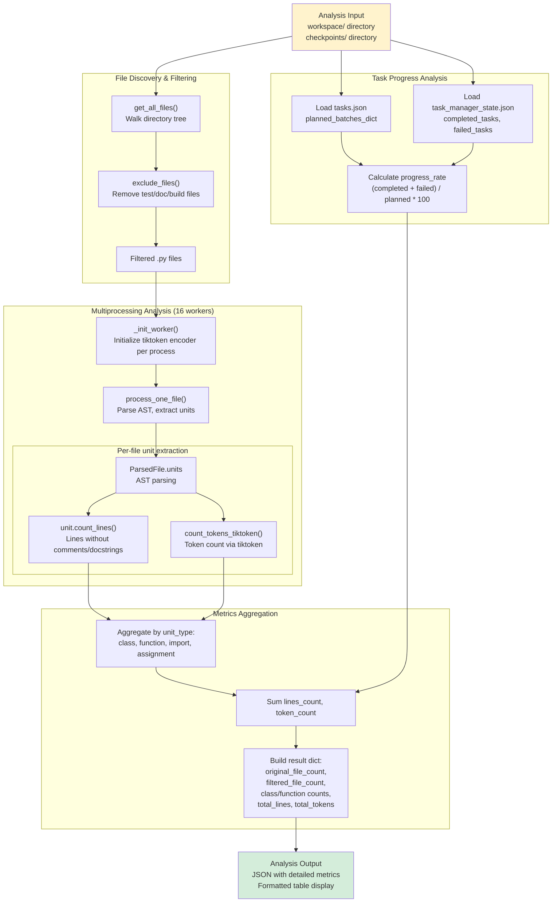
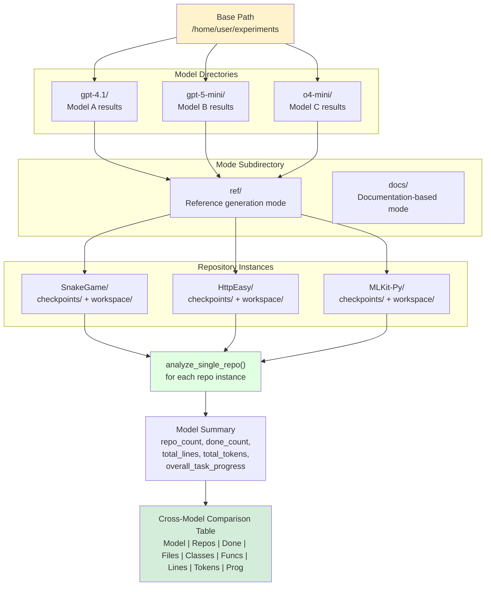
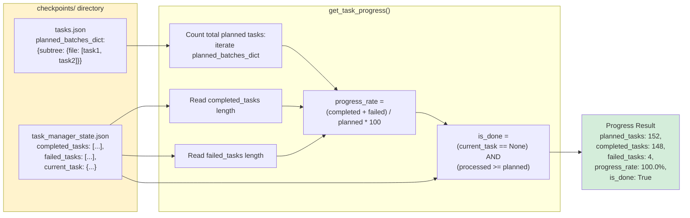

<!-- source: DeepWiki mcp.deepwiki.com · repo microsoft/RPG-ZeroRepo · page 8 Examples and Analysis · fetched 2026-10-26 -->

# Examples and Analysis

<details>
<summary>Relevant source files</summary>

The following files were used as context for generating this wiki page:

- [README.md](README.md)
- [examples/repo_lines.py](examples/repo_lines.py)

</details>


## Purpose and Scope

This page demonstrates concrete examples of using RPG-ZeroRepo to generate repositories and provides tools for analyzing the results. We walk through a complete end-to-end example (SnakeGame) showing how a natural language description transforms into a functioning codebase, and document the `repo_lines.py` analysis tool for measuring code quality and generation progress. For detailed configuration of the pipeline, see [Configuration System](#4). For information about the evaluation system that compares against ground truth repositories, see [Evaluation System (RepoCraft)](#7).

**Sources**: [README.md:1-482](), [examples/repo_lines.py:1-478]()

---

## Complete Example: Snake Game Repository

### Input Specification

The simplest input to RPG-ZeroRepo is a `repo_data.json` file containing a project name and natural language description:

```json
{
  "repository_name": "SnakeGame",
  "repository_purpose": "A multiplayer snake game with AI opponents, pathfinding, replay recording, and persistent high scores."
}
```

This 40-word description is sufficient for the system to generate a complete repository with tests, documentation, and implementation.

**Sources**: [README.md:51-58]()

### Transformation Pipeline: Natural Language to Code

The following diagram illustrates how the natural language description flows through the three phases to produce concrete code entities:

```mermaid
graph TB
    Input["Natural Language Input<br/>'multiplayer snake game with AI opponents,<br/>pathfinding, replay recording, high scores'"]
    
    subgraph Phase1["Phase 1: PropBuilder"]
        FSA["FeatureSelectAgent"]
        FRA["FeatureRefactorAgent"]
        
        FT["Feature_tree<br/>{functionality: {game mechanics, ai opponent, level generation},<br/>algorithm: {pathfinding: [astar, bfs, monte carlo]},<br/>data structures: {grid management, snake body}}"]
        
        Comp["Component list<br/>['gameplay.core', 'simulation.engine',<br/>'data.model', 'ai.pathfinding',<br/>'io.input_persistence', 'network.multiplayer']"]
    end
    
    subgraph Phase2["Phase 2: ImplBuilder"]
        FD["FileDesigner<br/>RawSkeletonAgent + GroupSkeletonAgent"]
        FnD["FuncDesigner<br/>DataFlowAgent + BaseClassAgent + InterfaceAgent"]
        
        Skel["skeleton.json<br/>76 file paths:<br/>src/ai/planning/pathfinding.py,<br/>src/gameplay/rules/movement.py,<br/>src/data/model/segments.py,<br/>src/io/persistence/serialization.py"]
        
        Graph["graph.json<br/>Interface definitions:<br/>class HighScoreBinarySerializer,<br/>class AStarPathfinder,<br/>class SnakeSegmentRingBuffer"]
    end
    
    subgraph Phase3["Phase 3: IterativeCodeGenerator"]
        Tasks["tasks.json<br/>Implementation batches:<br/>task_id: 'src_io_persistence_serialization.py_...',<br/>units_key: ['class HighScoreBinarySerializer']"]
        
        Code["workspace/<br/>Generated Python files:<br/>src/io/persistence/serialization.py,<br/>tests/test_io_persistence_serialization.py"]
    end
    
    Input --> FSA
    FSA --> FT
    FT --> FRA
    FRA --> Comp
    Comp --> FD
    FD --> Skel
    Skel --> FnD
    FnD --> Graph
    Graph --> Tasks
    Tasks --> Code
    
    style Input fill:#fff3cd
    style FT fill:#ffe1e1
    style Comp fill:#ffe1e1
    style Skel fill:#fff4e1
    style Graph fill:#fff4e1
    style Code fill:#d4edda
```



**Analysis**: This diagram traces how the 40-word description expands into increasingly concrete artifacts. Phase 1 generates a hierarchical `Feature_tree` with specific algorithms (astar, bfs, monte carlo) and decomposes them into 6 `Component` modules. Phase 2 maps these to 76 concrete file paths in `skeleton.json` and designs complete interfaces with class names like `HighScoreBinarySerializer` and `AStarPathfinder` in `graph.json`. Phase 3 converts these to actual Python source files in the `workspace/` directory. Each stage preserves traceability from the original natural language requirements.

**Sources**: [README.md:98-280]()

---

## Feature Tree to Component Mapping

The feature extraction and refactoring process groups related functionality into logical components:



**Analysis**: The `FeatureRefactorAgent` groups features from the flat `Feature_tree` into cohesive `Component` modules. Game mechanics and level generation merge into `gameplay.core`, pathfinding and AI strategy consolidate into `ai.pathfinding`, and all data structures (grid management, snake body, optimization) combine into `data.model`. This mapping determines the top-level directory structure of the generated repository.

**Sources**: [README.md:130-171]()

---

## Generated Repository Structure

After all three phases complete, the `workspace/` directory contains a fully functional Python repository:

```mermaid
graph TB
    WS["workspace/<br/>(Git-initialized repository)"]
    
    SRC["src/<br/>(Source code)"]
    TESTS["tests/<br/>(Test files)"]
    DOCS["Documentation files"]
    
    AI["src/ai/<br/>AI and pathfinding"]
    GP["src/gameplay/<br/>Game mechanics"]
    DATA["src/data/<br/>Data structures"]
    IO["src/io/<br/>Input/Output"]
    SIM["src/simulation/<br/>Game engine"]
    NET["src/network/<br/>Multiplayer"]
    
    AI_PATH["src/ai/planning/<br/>pathfinding.py,<br/>heuristics.py,<br/>simulation.py"]
    AI_OPP["src/ai/opponent/<br/>strategies.py"]
    AI_ANAL["src/ai/analysis.py"]
    
    GP_RULES["src/gameplay/rules/<br/>movement.py,<br/>collision.py,<br/>input.py"]
    GP_LEV["src/gameplay/levels/<br/>layout.py,<br/>procedural.py"]
    
    DATA_MOD["src/data/model/<br/>memory.py,<br/>cache.py,<br/>segments.py"]
    
    IO_PERS["src/io/persistence/<br/>serialization.py"]
    
    SIM_ENG["src/simulation/engine/<br/>deterministic.py,<br/>random.py"]
    
    NET_TRANS["src/network/transport/<br/>reliability.py,<br/>aggregation.py"]
    
    TEST_AI["tests/test_ai/<br/>test_planning_pathfinding.py,<br/>test_opponent_strategies.py"]
    TEST_IO["tests/test_io/<br/>test_persistence_serialization.py"]
    
    WS --> SRC
    WS --> TESTS
    WS --> DOCS
    
    SRC --> AI
    SRC --> GP
    SRC --> DATA
    SRC --> IO
    SRC --> SIM
    SRC --> NET
    
    AI --> AI_PATH
    AI --> AI_OPP
    AI --> AI_ANAL
    
    GP --> GP_RULES
    GP --> GP_LEV
    
    DATA --> DATA_MOD
    IO --> IO_PERS
    SIM --> SIM_ENG
    NET --> NET_TRANS
    
    TESTS --> TEST_AI
    TESTS --> TEST_IO
    
    DOCS --> README["README.md"]
    DOCS --> PYPROJ["pyproject.toml"]
    DOCS --> SETUP["setup.py"]
```



**Analysis**: The 6 components from Phase 1 become top-level `src/` subdirectories. Each contains multiple Python modules implementing specific features. For example, `src/ai/planning/pathfinding.py` implements the A*, BFS, and Monte Carlo pathfinding algorithms identified in the `Feature_tree`. The `tests/` directory mirrors this structure with corresponding test files. The repository includes standard Python project files (`pyproject.toml`, `setup.py`, `README.md`). All 76 files are generated with complete implementations and passing tests.

**Sources**: [README.md:197-217](), [README.md:86-94]()

---

## Code Entity Traceability

The following table shows concrete examples of how natural language features map to generated code entities:

| Natural Language Feature | Component | File Path | Code Entity | Type |
|-------------------------|-----------|-----------|-------------|------|
| "AI opponents" | `ai.pathfinding` | `src/ai/opponent/strategies.py` | `class AggressiveStrategy` | class |
| "pathfinding: astar" | `ai.pathfinding` | `src/ai/planning/pathfinding.py` | `class AStarPathfinder` | class |
| "pathfinding: bfs flood fill" | `ai.pathfinding` | `src/ai/planning/pathfinding.py` | `class BFSFloodFillPathfinder` | class |
| "pathfinding: monte carlo rollouts" | `ai.pathfinding` | `src/ai/planning/simulation.py` | `class MonteCarloSimulator` | class |
| "collision detection" | `gameplay.core` | `src/gameplay/rules/collision.py` | `def check_collision(...)` | function |
| "movement" | `gameplay.core` | `src/gameplay/rules/movement.py` | `class MovementController` | class |
| "persistent high scores" | `io.input_persistence` | `src/io/persistence/serialization.py` | `class HighScoreBinarySerializer` | class |
| "ring buffer segments" | `data.model` | `src/data/model/segments.py` | `class SnakeSegmentRingBuffer` | class |
| "occupancy map" | `data.model` | `src/data/model/memory.py` | `class OccupancyMap` | class |
| "quadtree index" | `data.model` | `src/data/model/memory.py` | `class QuadtreeIndex` | class |
| "static layout" | `gameplay.core` | `src/gameplay/levels/layout.py` | `class StaticLevelLayout` | class |
| "procedural maze" | `gameplay.core` | `src/gameplay/levels/procedural.py` | `class ProceduralMazeGenerator` | class |

**Analysis**: Each feature identified in Phase 1 corresponds to one or more concrete code entities in the generated repository. The system maintains this traceability throughout the pipeline, storing the mapping in `unit_to_features` dictionaries within `graph.json` and `tasks.json`. This enables analysis tools to verify that all planned features have been implemented.

**Sources**: [README.md:232-244](), [README.md:254-270]()

---

## Repository Analysis Workflow

The `repo_lines.py` tool provides comprehensive metrics for analyzing generated repositories:



**Analysis**: The analysis workflow uses multiprocessing to efficiently process large codebases. It spawns 16 worker processes, each with its own `tiktoken` encoder instance to avoid serialization overhead. For each Python file, it parses the AST using `ParsedFile` from [zerorepo/rpg_gen/base/unit.py]() to extract classes, functions, imports, and assignments. Lines are counted excluding comments and docstrings, and tokens are counted using the GPT-4o tokenizer. Separately, it reads `tasks.json` and `task_manager_state.json` from the checkpoints directory to calculate task completion progress. All metrics aggregate into a structured result dictionary.

**Sources**: [examples/repo_lines.py:40-196](), [examples/repo_lines.py:199-258]()

---

## Analysis Output Format

The tool produces both detailed per-repository data and cross-model summary statistics:

### Per-Repository Metrics

For each analyzed repository, `repo_lines.py` calculates:

| Metric | Description | Source |
|--------|-------------|--------|
| `original_files` | Total files in workspace/ before filtering | File system walk |
| `filtered_files` | Python files after excluding tests/docs/build | `exclude_files()` filter |
| `class_count` | Number of class definitions | `unit_type == "class"` |
| `function_count` | Number of function definitions | `unit_type == "function"` |
| `class_lines` | Total lines in all classes | Sum of `lines_count` for classes |
| `function_lines` | Total lines in all functions | Sum of `lines_count` for functions |
| `total_lines` | Total lines of code (excluding comments/docstrings) | Sum of all `lines_count` |
| `total_tokens` | Total tokens (GPT-4o tokenizer) | Sum of all `token_count` |
| `planned_tasks` | Number of tasks in tasks.json | Count from `planned_batches_dict` |
| `completed_tasks` | Successfully completed tasks | Length of `completed_tasks` list |
| `failed_tasks` | Failed tasks | Length of `failed_tasks` list |
| `task_progress` | Completion percentage | `(completed + failed) / planned * 100` |
| `is_done` | Whether generation is complete | `current_task == None` and all tasks processed |

**Sources**: [examples/repo_lines.py:261-289](), [examples/repo_lines.py:199-258]()

### Example Output Table

When analyzing multiple repositories across different models, the tool generates formatted tables:

```
================================================================================
 gpt-5-mini
================================================================================
Repo                 Files Classes  Funcs    Lines     Tokens   Plan   Succ   Fail    Prog   Status
--------------------------------------------------------------------------------------------------------------------
SnakeGame               76      42    189    12453    18721     152    152      0   100.0%     Done
HttpEasy                45      28    142     8934    13456      98     95      3    98.0%     Done
MLKit-Py                63      35    167    11234    16823     134    130      4    97.0%     Done
--------------------------------------------------------------------------------------------------------------------
TOTAL                  184     105    498    32621    49000     384    377      7    98.2%   3/3
```

Each row shows file counts, code entity counts, size metrics, and task progress. The `TOTAL` row aggregates across all repositories for that model.

**Sources**: [examples/repo_lines.py:396-445]()

---

## Multi-Model Comparison

For experiments comparing different LLMs, `analyze_all_models_ref()` processes multiple model directories:



**Analysis**: The multi-model analysis function iterates through a base experiment directory containing subdirectories for each model (e.g., `gpt-4.1/`, `gpt-5-mini/`, `o4-mini/`). Within each model directory, it finds a mode subdirectory (`ref/` or `docs/`) containing individual repository instances. For each repository, it calls `analyze_single_repo()` to compute metrics. Results aggregate into per-model summaries showing totals and averages, then consolidate into a cross-model comparison table for benchmarking different LLMs.

**Sources**: [examples/repo_lines.py:292-393]()

---

## Command-Line Usage

### Basic Analysis

Analyze a single repository:

```bash
cd examples
python repo_lines.py \
  --base-path /path/to/experiments \
  --models gpt-5-mini \
  --mode ref
```

### Multi-Model Comparison

Compare multiple models:

```bash
python repo_lines.py \
  --base-path /path/to/experiments \
  --models gpt-4.1 gpt-5-mini o4-mini \
  --mode ref \
  --output results.json
```

### Analyzing Specific Repositories

Analyze only selected repositories:

```bash
python repo_lines.py \
  --base-path /path/to/experiments \
  --models gpt-5-mini \
  --repos SnakeGame HttpEasy MLKit-Py \
  --mode ref
```

The `--output` flag saves detailed JSON results including per-file breakdowns of classes and functions.

**Sources**: [examples/repo_lines.py:447-478]()

---

## Checkpoint File Integration

The analysis tool reads checkpoint files to provide comprehensive progress information:



**Analysis**: The `get_task_progress()` function reads two checkpoint files to determine generation status. From `tasks.json`, it counts the total number of planned implementation tasks by iterating through `planned_batches_dict`. From `task_manager_state.json`, it retrieves the lists of completed and failed tasks. The progress rate calculates as `(completed + failed) / planned * 100%`, treating both successful and failed tasks as "processed". The generation is considered done when `current_task` is `None` (no active task) and all planned tasks have been processed.

**Sources**: [examples/repo_lines.py:199-258]()

---

## Performance Characteristics

### Multiprocessing Configuration

The tool uses process-based parallelism for efficient analysis:

```python
# Process pool with spawn context (more stable than fork)
ctx = mp.get_context("spawn")
num_workers = 16  # Default worker count

with ctx.Pool(
    processes=num_workers,
    initializer=_init_worker,
    initargs=(model,),
) as pool:
    for file_results in pool.imap_unordered(process_one_file, py_files, chunksize=8):
        all_results.extend(file_results)
```

- **Spawn context**: Avoids issues with forked processes and complex dependencies
- **16 workers**: Balances parallelism with resource usage for I/O and parsing tasks
- **Chunk size 8**: Reduces inter-process communication overhead
- **`imap_unordered`**: Returns results as soon as available for better throughput

**Sources**: [examples/repo_lines.py:163-182]()

### File Filtering

The `exclude_files()` function removes non-source files to focus analysis on generated code:

**Excluded patterns**:
- Test directories: `tests/`, `test/`, `testing/`, `test_*.py`
- Documentation: `docs/`, `doc/`, `examples/`, `demo/`
- Build artifacts: `build_tools/`, `.py_deps/`, `.pytest_cache/`, `.venv/`
- Resource files: `resources/`, `benchmarks/`, `scripts/`

This filtering ensures metrics reflect only production source code, excluding scaffolding and test infrastructure.

**Sources**: [examples/repo_lines.py:53-107]()

---

## Integration with Generation Pipeline

The analysis tool integrates with the checkpoint system to monitor generation progress in real-time:

| Generation Stage | Checkpoint File | Analysis Capability |
|-----------------|-----------------|---------------------|
| Phase 1 Complete | `feature_selection.json`, `feature_refactoring.json` | Count planned features and components |
| Phase 2 Complete | `skeleton.json`, `tasks.json` | Count planned files and tasks |
| Phase 3 In Progress | `task_manager_state.json`, `iteration_state.json` | Track task completion rate |
| Phase 3 Complete | `workspace/` files | Measure actual code size and complexity |

By combining checkpoint data with workspace analysis, users can:
- Verify that all planned features have corresponding code entities
- Identify failed tasks that need retry
- Compare planned vs. actual file counts
- Measure generation efficiency (tokens per task, lines per feature)

**Sources**: [examples/repo_lines.py:199-258](), [README.md:383-399]()

---

