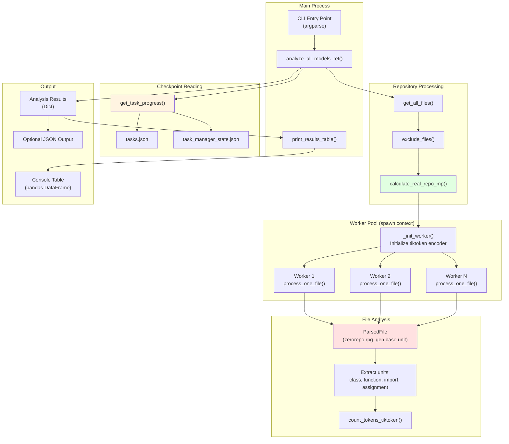
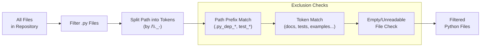
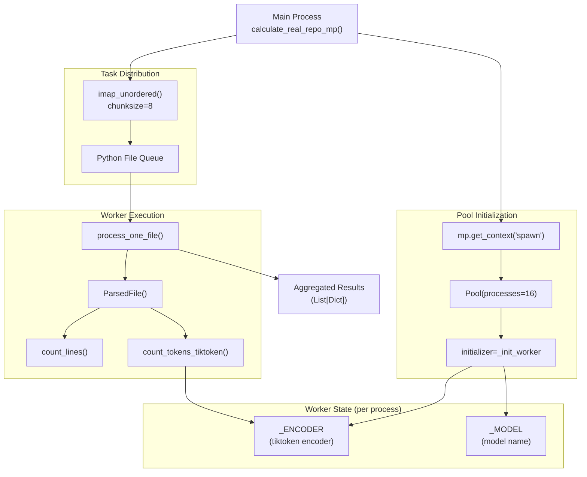
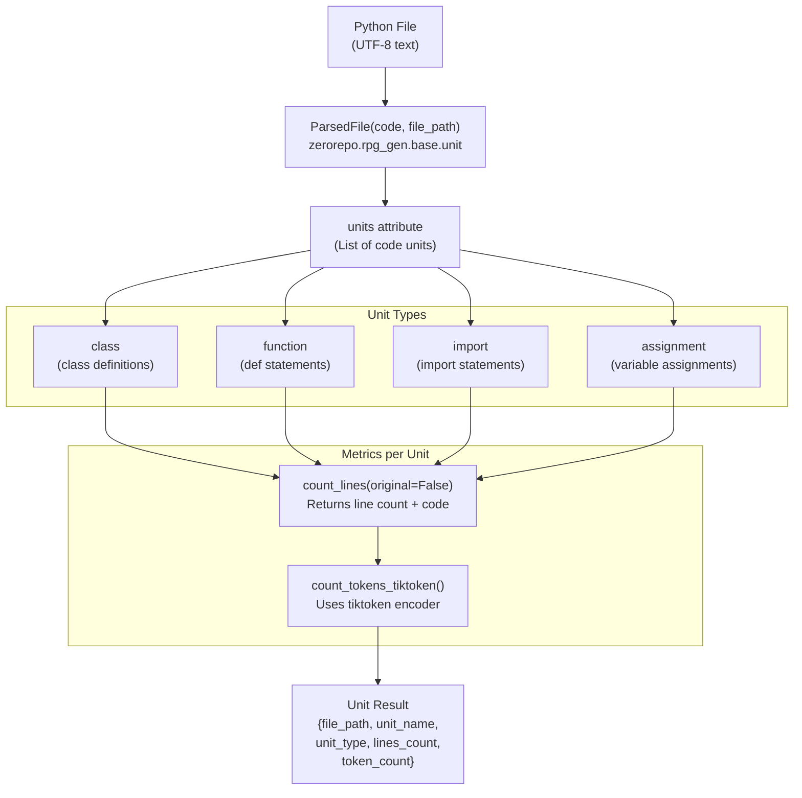
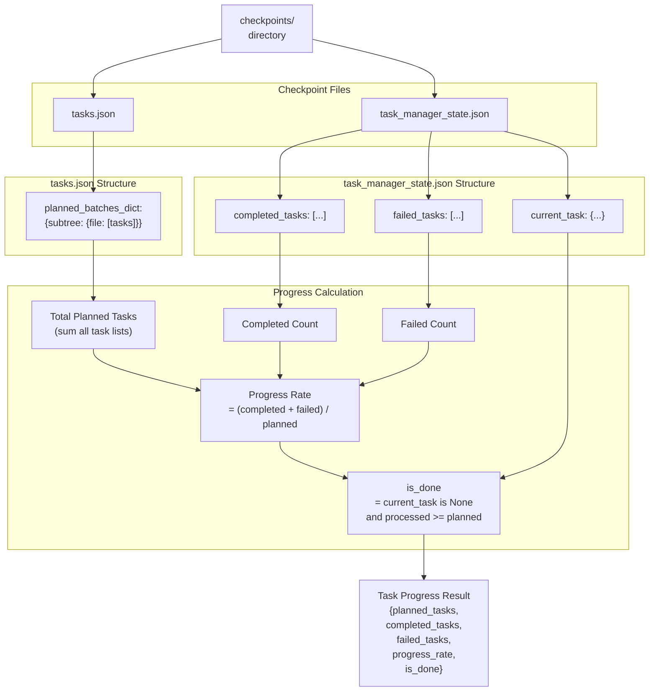
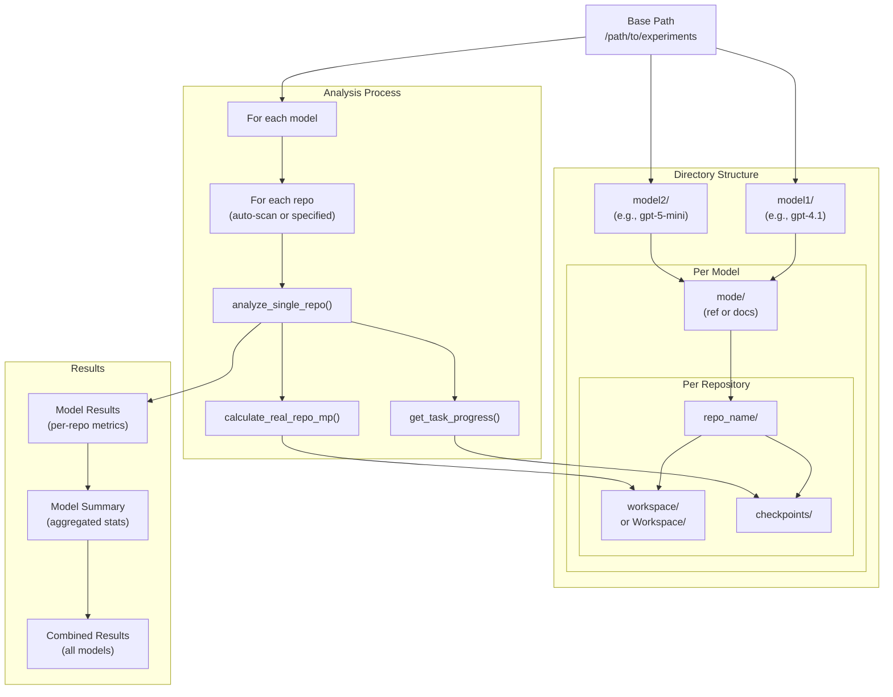
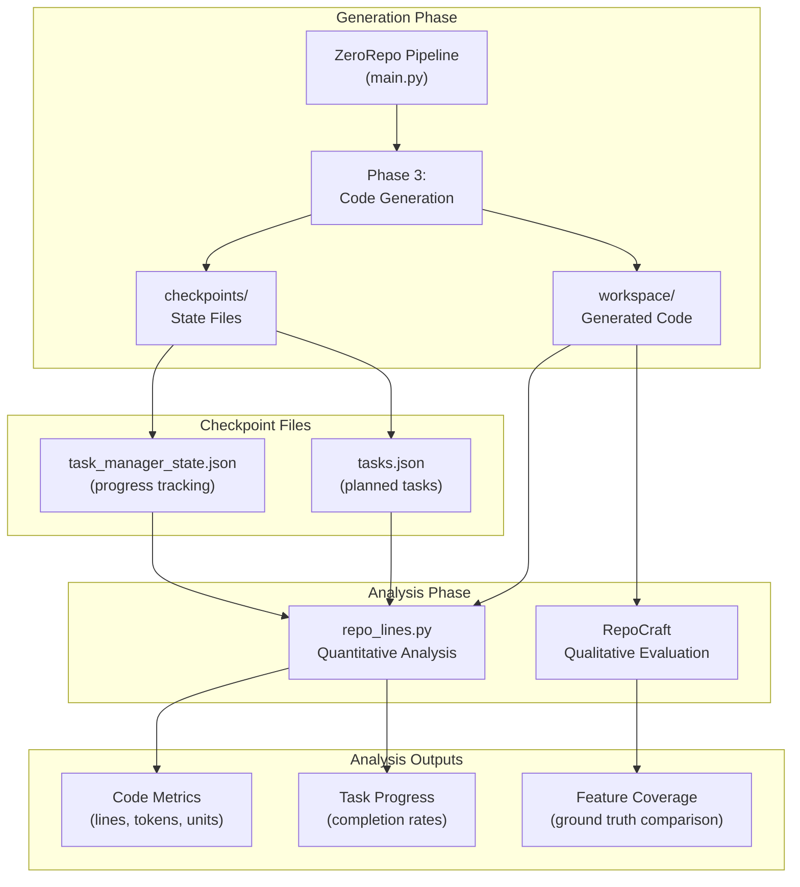

<!-- source: DeepWiki mcp.deepwiki.com · repo microsoft/RPG-ZeroRepo · page 8.1 Repository Analysis Tools · fetched 2026-10-26 -->

# Repository Analysis Tools

<details>
<summary>Relevant source files</summary>

The following files were used as context for generating this wiki page:

- [configs/checkpoint_config.yaml](configs/checkpoint_config.yaml)
- [examples/repo_lines.py](examples/repo_lines.py)

</details>


This page documents the repository analysis utilities provided in `examples/repo_lines.py`, which enable quantitative assessment of generated code repositories. These tools measure code metrics including lines of code, token counts, function/class counts, and task completion progress across multiple repositories and model configurations.

For information about evaluating repository quality and feature coverage, see [Evaluation System (RepoCraft)](#7). For checkpoint file structure and state management, see [Checkpoint File Reference](#5.1).

## Purpose and Scope

The `repo_lines.py` tool serves as a post-generation analysis utility that:

- Computes code metrics (lines of code, token counts) for generated repositories
- Parses Python files to extract and count classes, functions, imports, and assignments
- Filters out non-production code (tests, documentation, examples, benchmarks)
- Tracks task completion progress by reading checkpoint files
- Supports batch analysis across multiple models and repositories
- Provides comparative statistics for different generation configurations

This tool is primarily used for quantitative evaluation of code generation results, complementing the qualitative RepoCraft evaluation system.

**Sources**: [examples/repo_lines.py:1-478]()

## Architecture Overview

The tool follows a multiprocessing architecture to efficiently analyze large numbers of repositories:



**Diagram**: Repository analysis tool architecture showing multiprocessing workflow

**Sources**: [examples/repo_lines.py:149-197](), [examples/repo_lines.py:199-259](), [examples/repo_lines.py:292-394]()

## Core Components

### File Discovery and Filtering

The tool uses a two-stage approach to identify relevant Python files:

| Component | Function | Purpose |
|-----------|----------|---------|
| `get_all_files()` | Recursive directory traversal | Discovers all files in repository |
| `exclude_files()` | Pattern-based filtering | Removes tests, docs, examples, build artifacts |

**Exclusion Rules**:

The filter applies multiple exclusion strategies [examples/repo_lines.py:53-107]():

1. **Token-based exclusion**: Path segments containing tokens like `docs`, `tests`, `examples`, `benchmark`, `demo`, `build_tools`, etc.
2. **Prefix matching**: Files starting with `test_`, `.py_dep_`, `py_deps_`
3. **Empty file removal**: Files that cannot be read or are empty
4. **Binary/encoding errors**: Files that fail UTF-8 decoding



**Diagram**: File filtering pipeline with three-stage exclusion logic

**Sources**: [examples/repo_lines.py:40-107]()

### Multiprocessing Worker Pool

The tool uses Python's `multiprocessing` with spawn context for stable parallel execution:



**Diagram**: Multiprocessing architecture with per-worker encoder initialization

**Key Design Decisions**:

- **Spawn context** [examples/repo_lines.py:170](): More stable than fork in complex environments
- **Per-worker initialization** [examples/repo_lines.py:25-32](): Each worker initializes its own tiktoken encoder to avoid pickling issues
- **imap_unordered** [examples/repo_lines.py:179](): Better throughput than ordered processing
- **Configurable workers** [examples/repo_lines.py:163-166](): Defaults to 16 workers for IO-bound parsing tasks

**Sources**: [examples/repo_lines.py:22-38](), [examples/repo_lines.py:149-197]()

### File Parsing and Unit Extraction

The tool leverages the `ParsedFile` class from the ZeroRepo codebase to extract code units:



**Diagram**: Code parsing pipeline using ParsedFile from zerorepo.rpg_gen.base.unit

**Processing Logic** [examples/repo_lines.py:112-146]():

1. Read file content with UTF-8 encoding
2. Create `ParsedFile` instance to parse syntax tree
3. Filter units by type (class, function, import, assignment)
4. Count lines using `unit.count_lines(original=False)` (excluding comments/docstrings)
5. Count tokens using tiktoken encoder for the model
6. Return dictionary with file path, unit name, type, and metrics

**Sources**: [examples/repo_lines.py:112-146]()

## Task Progress Tracking

The tool reads checkpoint files to track code generation progress:



**Diagram**: Task progress extraction from checkpoint files

**Implementation** [examples/repo_lines.py:199-259]():

The `get_task_progress()` function reads two checkpoint files:

1. **tasks.json** [configs/checkpoint_config.yaml:13](): Contains `planned_batches_dict` with all planned implementation tasks organized by subtree and file
2. **task_manager_state.json** [configs/checkpoint_config.yaml:7](): Tracks `completed_tasks`, `failed_tasks`, and `current_task`

**Progress Calculation**:
- Planned tasks = Sum of all tasks in `planned_batches_dict`
- Processed tasks = `len(completed_tasks) + len(failed_tasks)`
- Progress rate = `(processed / planned) * 100`
- Is done = `current_task is None` and `processed >= planned`

**Sources**: [examples/repo_lines.py:199-259](), [configs/checkpoint_config.yaml:1-27]()

## Batch Analysis Workflow

The tool supports analyzing multiple repositories across different model configurations:



**Diagram**: Batch analysis workflow across multiple models and repositories

**Function**: `analyze_all_models_ref()` [examples/repo_lines.py:292-394]()

**Parameters**:
| Parameter | Type | Default | Description |
|-----------|------|---------|-------------|
| `base_path` | str | Required | Root directory for experiments |
| `models` | List[str] | `["gpt-4.1", "gpt-5-mini", "o4-mini"]` | Model names to analyze |
| `repos` | List[str] | None | Repository names (auto-scanned if None) |
| `mode` | str | `"ref"` | Analysis mode (e.g., "ref" or "docs") |

**Directory Convention**:
```
base_path/
  ├── gpt-4.1/
  │   └── ref/
  │       ├── repo1/
  │       │   ├── workspace/     # or Workspace/
  │       │   └── checkpoints/
  │       └── repo2/
  ├── gpt-5-mini/
  │   └── ref/
  └── o4-mini/
      └── docs/
```

**Sources**: [examples/repo_lines.py:292-394]()

## Output Format

### Per-Repository Metrics

Each analyzed repository produces the following metrics [examples/repo_lines.py:278-289]():

| Field | Type | Description |
|-------|------|-------------|
| `model` | str | Model name used for generation |
| `repo` | str | Repository name |
| `original_files` | int | Total files before filtering |
| `filtered_files` | int | Python files after exclusion |
| `class_count` | int | Number of class definitions |
| `function_count` | int | Number of function definitions |
| `class_lines` | int | Lines of code in classes |
| `function_lines` | int | Lines of code in functions |
| `total_lines` | int | Total lines across all units |
| `total_tokens` | int | Total tokens (tiktoken) |
| `planned_tasks` | int | Tasks planned in tasks.json |
| `completed_tasks` | int | Successfully completed tasks |
| `failed_tasks` | int | Failed tasks |
| `task_progress` | float | Completion percentage |
| `is_done` | bool | Whether generation is complete |

### Model Summary

Aggregated statistics per model [examples/repo_lines.py:366-388]():

| Field | Type | Description |
|-------|------|-------------|
| `repo_count` | int | Number of repositories analyzed |
| `done_count` | int | Repositories with `is_done=True` |
| `total_files` | int | Sum of filtered files |
| `total_classes` | int | Sum of all classes |
| `total_functions` | int | Sum of all functions |
| `total_lines` | int | Sum of all code lines |
| `total_tokens` | int | Sum of all tokens |
| `avg_lines_per_repo` | float | Average lines per repository |
| `avg_tokens_per_repo` | float | Average tokens per repository |
| `total_planned_tasks` | int | Sum of planned tasks |
| `total_completed_tasks` | int | Sum of completed tasks |
| `total_failed_tasks` | int | Sum of failed tasks |
| `overall_task_progress` | float | Overall completion percentage |

### Console Output

The `print_results_table()` function [examples/repo_lines.py:396-445]() produces formatted tables:

**Per-Model Detail Table**:
```
================================================================================
 gpt-5-mini
================================================================================
Repo                  Files Classes  Funcs    Lines     Tokens   Plan   Succ   Fail    Prog   Status
------------------------------------------------------------
HttpEasy                 42      89    234     5432    12543     156    148      8   100.0%     Done
MLKit-Py                 38      67    198     4821    11234     142    135      7    95.1%  Running
...
------------------------------------------------------------
TOTAL                   124     245    687    15678    36542     456    432     24    96.5%    18/20
```

**Cross-Model Comparison**:
```
================================================================================
 CROSS-MODEL COMPARISON
================================================================================
Model        Repos  Done  Files Classes  Funcs    Lines     Tokens   Plan   Succ   Fail    Prog
------------------------------------------------------------
gpt-4.1         20    18    124     245    687    15678    36542     456    432     24   96.5%
gpt-5-mini      20    19    132     267    712    17234    39876     478    465     13   97.3%
o4-mini         15    14    108     198    589    13456    31234     389    378     11   97.2%
```

**Sources**: [examples/repo_lines.py:396-445]()

## Command-Line Interface

Usage pattern [examples/repo_lines.py:447-478]():

```bash
python examples/repo_lines.py \
    --base-path /path/to/experiments \
    --models gpt-4.1 gpt-5-mini o4-mini \
    --repos HttpEasy MLKit-Py PyWebEngine \
    --mode ref \
    --output results.json
```

### CLI Arguments

| Argument | Type | Default | Description |
|----------|------|---------|-------------|
| `--base-path` | str | Required | Root directory containing model/mode/repo structure |
| `--models` | List[str] | `["gpt-4.1", "gpt-5-mini"]` | Models to analyze |
| `--repos` | List[str] | None (auto-scan) | Specific repositories to analyze |
| `--mode` | str | `"ref"` | Mode subdirectory (e.g., "ref" or "docs") |
| `--output` | str | None | Optional JSON output file path |

### Example Invocations

**Analyze all repositories for specific models**:
```bash
python examples/repo_lines.py \
    --base-path /experiments \
    --models gpt-5-mini o4-mini
```

**Analyze specific repositories**:
```bash
python examples/repo_lines.py \
    --base-path /experiments \
    --repos HttpEasy MLKit-Py TableKit \
    --output analysis.json
```

**Change analysis mode**:
```bash
python examples/repo_lines.py \
    --base-path /experiments \
    --mode docs
```

**Sources**: [examples/repo_lines.py:447-478]()

## Integration with ZeroRepo Pipeline

The analysis tool integrates with the broader ZeroRepo system:



**Diagram**: Integration of repo_lines.py in the ZeroRepo evaluation pipeline

**Relationship to Other Components**:

- **Workspace Analysis**: Reads generated code from `workspace/` or `Workspace/` directories
- **Checkpoint Integration**: Extracts task progress from `tasks.json` and `task_manager_state.json` [configs/checkpoint_config.yaml:6-7]()
- **ParsedFile Usage**: Leverages the same `ParsedFile` class used in Phase 2 for consistency [examples/repo_lines.py:120]()
- **Complementary to RepoCraft**: Provides quantitative metrics while RepoCraft provides qualitative feature coverage [see page 7](#7)

**Sources**: [examples/repo_lines.py:1-478](), [configs/checkpoint_config.yaml:1-27]()

## Performance Characteristics

### Multiprocessing Configuration

The tool uses multiprocessing to handle large-scale analysis efficiently:

| Setting | Value | Rationale |
|---------|-------|-----------|
| Context | `spawn` | More stable than fork in complex environments |
| Workers | 16 (default) | Optimized for IO-bound parsing tasks |
| Chunksize | 8 | Balance between overhead and parallelism |
| Pool Type | `imap_unordered` | Better throughput for independent files |

**Token Counting**: Uses `tiktoken` encoder initialized once per worker to avoid repeated encoding setup [examples/repo_lines.py:25-37]().

**File Filtering**: Reduces parsing overhead by excluding ~30-50% of files (tests, docs, examples) before analysis [examples/repo_lines.py:53-107]().

### Typical Performance

For a standard generated repository (~40-50 Python files, ~200-300 functions):
- Single repository analysis: ~5-10 seconds
- Batch analysis (20 repositories): ~2-3 minutes
- Token counting overhead: ~10-15% of total time

**Sources**: [examples/repo_lines.py:149-197](), [examples/repo_lines.py:25-37]()

---

