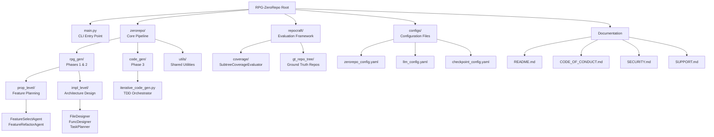
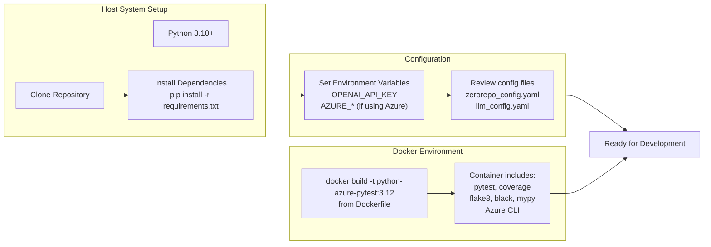
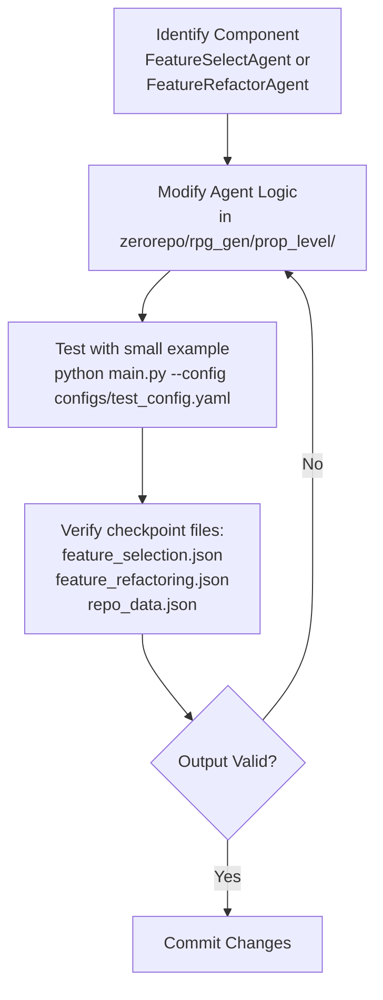
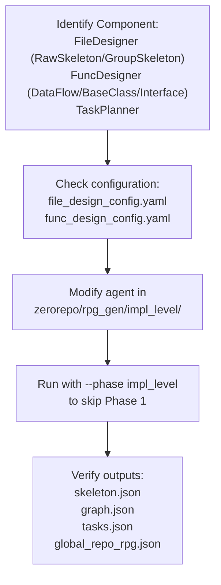
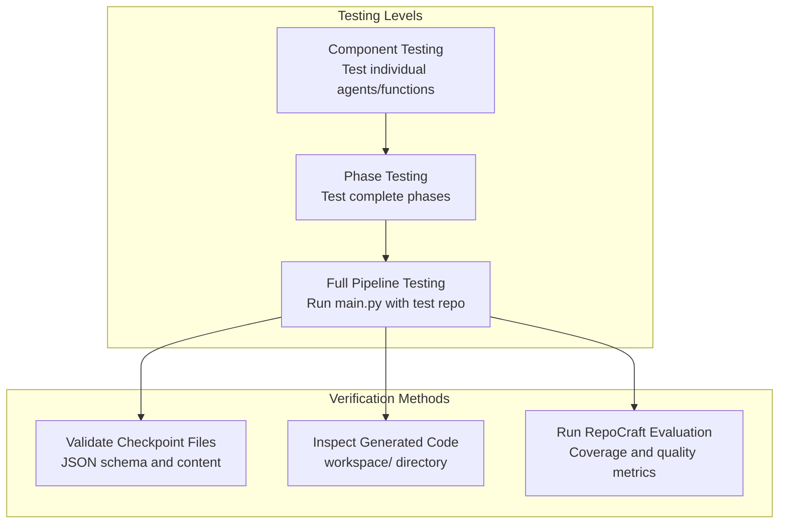
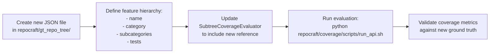

<!-- source: DeepWiki mcp.deepwiki.com · repo microsoft/RPG-ZeroRepo · page 9 Development and Contributing · fetched 2026-10-26 -->

# Development and Contributing

<details>
<summary>Relevant source files</summary>

The following files were used as context for generating this wiki page:

- [.gitignore](.gitignore)
- [CODE_OF_CONDUCT.md](CODE_OF_CONDUCT.md)
- [SECURITY.md](SECURITY.md)
- [SUPPORT.md](SUPPORT.md)

</details>


This document provides guidance for developers who want to contribute to RPG-ZeroRepo or understand the project structure for development purposes. It covers the repository organization, development workflow, testing standards, and community guidelines.

For detailed information about specific topics, see:
- **Project Structure Details**: [9.1](#9.1) for comprehensive directory layout and module organization
- **Code of Conduct**: [9.2](#9.2) for community standards and behavioral expectations  
- **Security Reporting**: [9.3](#9.3) for vulnerability disclosure procedures
- **Getting Support**: [9.4](#9.4) for filing issues and requesting help

## Repository Organization

RPG-ZeroRepo is organized into distinct functional areas that separate the core generation pipeline from evaluation tools and configuration:



**Sources**: [.gitignore:1-419](), repository structure from Diagram 1

### Core Pipeline Components

The `zerorepo/` directory contains the three-phase generation pipeline:

| Directory | Purpose | Key Components |
|-----------|---------|----------------|
| `zerorepo/rpg_gen/prop_level/` | Phase 1: Feature Planning | `FeatureSelectAgent`, `FeatureRefactorAgent`, `PropBuilder` |
| `zerorepo/rpg_gen/impl_level/` | Phase 2: Architecture Design | `FileDesigner`, `FuncDesigner`, `TaskPlanner`, `ImplBuilder` |
| `zerorepo/code_gen/` | Phase 3: Code Generation | `IterativeCodeGenerator`, Docker orchestration |
| `zerorepo/utils/` | Shared Utilities | LLM clients, configuration loaders, checkpoint managers |

### Evaluation Framework

The `repocraft/` directory contains tools for assessing generated repository quality:

| Component | Purpose |
|-----------|---------|
| `repocraft/coverage/coverage.py` | `SubtreeCoverageEvaluator` for feature analysis |
| `repocraft/coverage/load_rpg_to_repo.py` | RPG integration with repository data |
| `repocraft/gt_repo_tree/` | Ground truth reference repositories |

**Sources**: Diagram 1 (Overall System Architecture), Diagram 6 (Evaluation System)

## Development Workflow

### Setting Up the Development Environment

The development environment requires both host-level dependencies and Docker for the execution environment:



**Sources**: Diagram 5 (Docker Execution Environment), [Dockerfile]() referenced in Diagram 1

### Making Changes to the Pipeline

When modifying the pipeline, changes typically fall into one of these categories:

#### Modifying Phase 1 (Feature Planning)

Changes to feature generation logic:



**Configuration Impact**: Changes may require updates to `zerorepo_config.yaml` prop_level section or agent-specific prompts.

**Sources**: Diagram 2 (Three-Phase Pipeline), [main.py]() from Diagram 1

#### Modifying Phase 2 (Architecture Design)

Changes to file layout or interface design:



**Key Files to Monitor**:
- `skeleton.json`: File structure definitions
- `graph.json`: Complete interface specifications
- `tasks.json`: Task batching and dependencies

**Sources**: Diagram 2 (Phase 2 Architecture Design), Diagram 3 (Configuration Hierarchy)

#### Modifying Phase 3 (Code Generation)

Changes to the TDD loop or TRAE agent integration:

| Change Type | Files to Modify | Testing Approach |
|-------------|----------------|------------------|
| TDD orchestration | `zerorepo/code_gen/iterative_code_gen.py` | Run with `--phase code_gen` on existing tasks.json |
| Agent tools | `trae_config.yaml`, agent tool definitions | Test in Docker container with sample task |
| Docker environment | `Dockerfile` | Rebuild image, verify tool availability |
| Workflow types | `IterativeCodeGenerator` workflow handlers | Test each workflow type (TEST_DEVELOPMENT, CODE_INCREMENTAL, etc.) |

**Sources**: Diagram 5 (Docker Execution Environment and TRAE Agent), [zerorepo_config.yaml]() from Diagram 3

### Testing Changes

#### Unit Testing Strategy

While the repository does not include extensive unit tests, contributors should test changes at multiple levels:



**Sources**: Diagram 4 (Checkpoint System), Diagram 6 (Evaluation System)

#### Running Tests with Checkpoints

Use the checkpoint system to efficiently test changes:

```bash
# Test Phase 1 only
python main.py --config configs/test_config.yaml --phase prop_level

# Resume from existing checkpoints to test Phase 2
python main.py --config configs/test_config.yaml --resume --phase impl_level

# Force rebuild of specific phase
python main.py --config configs/test_config.yaml --force-rebuild --phase code_gen
```

**Checkpoint Files to Monitor**:
- `task_manager_state.json`: Overall progress tracking
- `iteration_state.json`: Code generation iteration state
- `execution_history.json`: TRAE agent execution logs

**Sources**: [main.py:87-90]() for resume logic, [checkpoint_config.yaml]() from Diagram 3

### Code Quality Standards

Contributors should maintain code quality through:

#### Python Code Standards

The repository follows standard Python conventions:

| Tool | Purpose | Configuration |
|------|---------|---------------|
| `flake8` | Linting and style checking | Standard PEP 8 rules |
| `black` | Code formatting | Line length 100 characters |
| `mypy` | Type checking | Optional, gradual typing |
| `isort` | Import sorting | Standard ordering |

**Note**: The Docker container (`python-azure-pytest:3.12`) includes these tools pre-installed.

**Sources**: Diagram 5 (Docker Container tools), [Dockerfile]() referenced

#### Configuration File Standards

YAML configuration files should follow these conventions:

```yaml
# Use clear, descriptive names
component_name:
  # Group related settings
  setting_group:
    parameter: value
    
  # Document complex parameters with comments
  complex_setting:
    # This controls XYZ behavior
    nested_parameter: value
```

**Example**: See [zerorepo_config.yaml](), [llm_config.yaml](), [file_design_config.yaml](), [func_design_config.yaml](), [trae_config.yaml]() referenced in Diagram 3.

#### Checkpoint File Validation

When modifying checkpoint file formats, ensure:

1. **JSON Schema Compliance**: Files must be valid JSON
2. **Required Fields**: Maintain all fields referenced in `checkpoint_config.yaml`
3. **Backward Compatibility**: Existing checkpoints should remain loadable
4. **Version Management**: Update version fields when making breaking changes

**Sources**: [checkpoint_config.yaml]() from Diagram 3, Diagram 4 (Checkpoint System)

## Contributing to Evaluation Tools

The RepoCraft evaluation framework can be extended with new metrics or ground truth repositories:

### Adding Ground Truth Repositories

To add a new reference repository for coverage evaluation:



**Existing Ground Truth Files**:
- `HttpEasy.json`: HTTP client/server features
- `MLKit-Py.json`: Machine learning algorithms
- `PyWebEngine.json`: Web framework features
- `StatModeler.json`: Statistical modeling
- `SymbolicMath.json`: Symbolic computation
- `TableKit.json`: Data manipulation and tables

**Sources**: Diagram 6 (Evaluation System), [repocraft/coverage/coverage.py]() referenced

### Extending Coverage Metrics

To add new evaluation metrics:

1. Modify `SubtreeCoverageEvaluator` class in `repocraft/coverage/coverage.py`
2. Update the metric calculation logic
3. Ensure results are saved to `coverage_result.json` with proper schema
4. Test on multiple generated repositories to validate metric behavior

**Sources**: [repocraft/coverage/coverage.py]() from Diagram 6

## Version Control Practices

### Ignored Files

The repository uses `.gitignore` to exclude:

| Category | Pattern | Rationale |
|----------|---------|-----------|
| Build artifacts | `[Bb]in/`, `[Oo]bj/`, `__pycache__/` | Auto-generated, not source |
| IDE files | `.vscode/*`, `.vs/` | Editor-specific |
| Environment | `*.env` | Sensitive credentials |
| Logs | `[Ll]og/`, `*.log` | Runtime artifacts |
| Python cache | `*.pyc`, `**/__pycache__/` | Compiled bytecode |
| Test results | `coverage*.json`, `*.coverage` | Generated test outputs |

**Sources**: [.gitignore:1-419]()

### Commit Conventions

When contributing, follow these commit message guidelines:

- **Prefix commits by component**: `[Phase1]`, `[Phase2]`, `[Phase3]`, `[RepoCraft]`, `[Config]`, `[Docs]`
- **Be descriptive**: Explain what changed and why
- **Reference issues**: Include issue numbers when applicable

**Example**:
```
[Phase2] Fix FileDesigner skeleton generation for nested modules

- Updated RawSkeletonAgent to properly handle deeply nested package structures
- Added validation for skeleton.json format
- Fixes #123
```

## Community and Support

### Code of Conduct

This project follows the Microsoft Open Source Code of Conduct. All contributors must adhere to professional and inclusive behavior standards. See [9.2](#9.2) for complete details.

**Key Principles**:
- Be respectful and inclusive
- Welcome diverse perspectives
- Focus on constructive feedback
- Report unacceptable behavior to [opencode@microsoft.com](mailto:opencode@microsoft.com)

**Sources**: [CODE_OF_CONDUCT.md:1-11]()

### Security Vulnerability Reporting

**Do not report security vulnerabilities through public GitHub issues.**

For security concerns:
1. Review the latest guidance at [https://aka.ms/SECURITY.md](https://aka.ms/SECURITY.md)
2. Follow Microsoft's responsible disclosure process
3. See [9.3](#9.3) for complete security policy

**Sources**: [SECURITY.md:1-14]()

### Getting Help

For questions, issues, or feature requests:

1. **Search existing issues** before filing new ones to avoid duplicates
2. **File issues on GitHub** for bugs or feature requests
3. **Provide context**: Include configuration files, logs, and reproduction steps
4. See [9.4](#9.4) for complete support guidelines

**Sources**: [SUPPORT.md:1-26]()

## Next Steps

- **Explore the codebase**: See [9.1](#9.1) for detailed project structure
- **Run the pipeline**: Follow [Getting Started](#2) for setup and execution
- **Understand the architecture**: Review [Core Pipeline](#3) documentation
- **Modify configurations**: See [Configuration System](#4) for customization options

---

