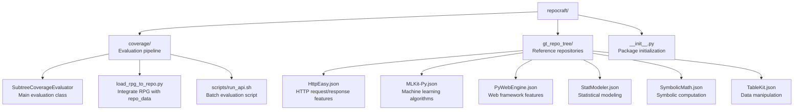
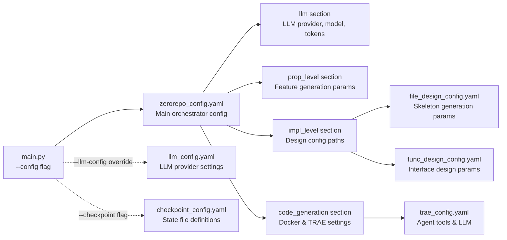

<!-- source: DeepWiki mcp.deepwiki.com · repo microsoft/RPG-ZeroRepo · page 9.1 Project Structure · fetched 2026-10-26 -->

# Project Structure

Relevant source files

The following files were used as context for generating this wiki page:

- [.gitignore](.gitignore)
- [README.md](README.md)
- [configs/checkpoint_config.yaml](configs/checkpoint_config.yaml)

This page documents the organization of the RPG-ZeroRepo codebase, describing the purpose of each top-level directory and the internal structure of core modules. This is intended as a reference for developers contributing to the project or integrating with its components.

For information about setting up your development environment, see [Installation](#2.1). For details on specific pipeline components, see the Core Pipeline sections: [Phase 1](#3.1), [Phase 2](#3.2), and [Phase 3](#3.3).

---

## Repository Layout

The RPG-ZeroRepo repository follows a modular organization that separates the code generation pipeline (`zerorepo/`), evaluation framework (`repocraft/`), configuration (`configs/`), and runtime artifacts (`workspace/`, `checkpoints/`, `results/`).

**Top-Level Directory Structure**

```mermaid
graph TB
    Root["RPG-ZeroRepo<br/>(repository root)"]
    
    Root --> MainPy["main.py<br/>CLI entry point"]
    Root --> ZeroRepo["zerorepo/<br/>Core pipeline code"]
    Root --> RepoCraft["repocraft/<br/>Evaluation system"]
    Root --> Configs["configs/<br/>Configuration files"]
    Root --> Examples["examples/<br/>Sample projects"]
    Root --> Docs["docs/<br/>Documentation assets"]
    Root --> Scripts["scripts/<br/>Helper scripts"]
    
    Root --> Workspace["workspace/<br/>Generated repositories"]
    Root --> Checkpoints["checkpoints/<br/>State & design artifacts"]
    Root --> Results["results/<br/>Agent execution logs"]
    
    Root --> PyProject["pyproject.toml<br/>Python package metadata"]
    Root --> Dockerfile["Dockerfile<br/>Execution environment"]
    Root --> GitIgnore[".gitignore<br/>Version control exclusions"]
    
    style Workspace fill:#f0f0f0
    style Checkpoints fill:#f0f0f0
    style Results fill:#f0f0f0
```

**Sources**: [README.md](), [.gitignore]()

| Directory | Purpose | Key Contents |
|-----------|---------|--------------|
| `zerorepo/` | Core code generation pipeline | Phase 1, Phase 2, Phase 3 modules |
| `repocraft/` | Repository evaluation framework | Coverage analysis, ground truth repos |
| `configs/` | System configuration files | LLM settings, design configs, agent configs |
| `examples/` | Sample project definitions | Example `repo_data.json` files |
| `docs/` | Documentation assets | Pipeline diagrams, images |
| `scripts/` | Helper scripts | `run_main.sh`, utility scripts |
| `workspace/` | Generated repository output | Git-initialized repository (user-specific) |
| `checkpoints/` | Pipeline state and design files | JSON checkpoints (user-specific) |
| `results/` | Agent execution artifacts | Test/code patches, trajectories (user-specific) |

**Runtime Directories**: The `workspace/`, `checkpoints/`, and `results/` directories are created during pipeline execution and are typically project-specific. They are excluded from version control via [.gitignore:33-35]().

**Sources**: [.gitignore:33-35](), [README.md:86-94]()

---

## Core Pipeline Module (`zerorepo/`)

The `zerorepo/` directory contains the three-phase code generation pipeline: feature planning, architecture design, and iterative code generation.

**Module Structure**

```mermaid
graph TB
    ZeroRepo["zerorepo/"]
    
    subgraph "Phase 1: Feature Planning"
        PropLevel["rpg_gen/prop_level/"]
        PropLevel --> PropBuilder["PropBuilder<br/>Orchestrates feature generation"]
        PropLevel --> FeatureSelect["FeatureSelectAgent<br/>Generates feature taxonomy"]
        PropLevel --> FeatureRefactor["FeatureRefactorAgent<br/>Groups features into components"]
    end
    
    subgraph "Phase 2: Architecture Design"
        ImplLevel["rpg_gen/impl_level/"]
        ImplLevel --> ImplBuilder["ImplBuilder<br/>Orchestrates design phases"]
        ImplLevel --> FileDesigner["FileDesigner<br/>RawSkeletonAgent + GroupSkeletonAgent"]
        ImplLevel --> FuncDesigner["FuncDesigner<br/>DataFlowAgent + BaseClassAgent + InterfaceAgent"]
        ImplLevel --> TaskPlanner["TaskPlanner<br/>Splits into implementation batches"]
    end
    
    subgraph "Phase 3: Code Generation"
        CodeGen["code_gen/"]
        CodeGen --> IterativeGen["IterativeCodeGenerator<br/>Orchestrates TDD loop"]
        CodeGen --> DockerClient["Docker integration<br/>Container management"]
        CodeGen --> TraeIntegration["TRAE agent wrapper<br/>LLM-powered coding agent"]
    end
    
    ZeroRepo --> PropLevel
    ZeroRepo --> ImplLevel
    ZeroRepo --> CodeGen
    
    ZeroRepo --> Utils["utils/<br/>Shared utilities"]
    ZeroRepo --> Models["models/<br/>Data structures"]
```

**Sources**: [README.md:100-102](), [README.md:177-179](), [README.md:285-287]()

### Phase 1: Property Level (`rpg_gen/prop_level/`)

Contains agents for transforming natural language descriptions into structured feature hierarchies and component decompositions.

| Component | Class/Function | Purpose |
|-----------|---------------|---------|
| `PropBuilder` | `PropBuilder.build_feature_tree()` | Entry point for Phase 1; orchestrates feature selection and refactoring |
| `FeatureSelectAgent` | Agent class | Generates hierarchical feature tree from project description |
| `FeatureRefactorAgent` | Agent class | Groups features into logical components (top-level directories) |

**Outputs**: `feature_selection.json`, `feature_refactoring.json`, updated `repo_data.json`

**Sources**: [README.md:100-102](), [README.md:105-148]()

### Phase 2: Implementation Level (`rpg_gen/impl_level/`)

Contains agents for architecture design: file layout generation, interface design, and task planning.

| Component | Class/Function | Purpose |
|-----------|---------------|---------|
| `ImplBuilder` | `ImplBuilder.run()` | Entry point for Phase 2; orchestrates design sub-phases |
| `RawSkeletonAgent` | Agent class | Generates high-level file/directory structure |
| `GroupSkeletonAgent` | Agent class | Assigns features to files, adds `__init__.py` files |
| `DataFlowAgent` | Agent class | Analyzes data dependencies between components |
| `BaseClassAgent` | Agent class | Designs shared data structures and base classes |
| `InterfaceAgent` | Agent class | Designs function signatures, docstrings, type hints |
| `TaskPlanner` | Agent class | Splits interface designs into implementation batches |

**Outputs**: `skeleton.json`, `skeleton_traj.json`, `graph.json`, `tasks.json`, `global_repo_rpg.json`

**Sources**: [README.md:177-179](), [README.md:189-247](), [README.md:249-280]()

### Phase 3: Code Generation (`code_gen/`)

Contains the iterative test-driven development (TDD) loop that executes inside Docker containers using the TRAE agent.

| Component | Class/Function | Purpose |
|-----------|---------------|---------|
| `IterativeCodeGenerator` | `task_executor()` | Entry point for Phase 3; executes task batches |
| Docker client wrapper | Module | Manages container lifecycle, volume mounting |
| TRAE agent integration | Module | Interfaces with `trae_agent` for LLM-powered code generation |
| Workflow executors | Classes | Handle different workflow types (TEST_DEVELOPMENT, CODE_INCREMENTAL, etc.) |

**Outputs**: `iteration_state.json`, `execution_history.json`, `batch_trajectory.json`, `cur_repo_rpg.json`, generated code in `workspace/`

**Sources**: [README.md:285-287](), [README.md:289-351]()

---

## Evaluation System (`repocraft/`)

The `repocraft/` directory contains the RepoCraft evaluation framework for assessing generated repository quality.

**Module Structure**

**Sources**: README.md high-level diagrams (Diagram 6)

### Coverage Evaluation Pipeline

The `SubtreeCoverageEvaluator` class implements a multi-stage evaluation process:

1. **Test Feature Extraction**: Parses test files to extract tested features
2. **Embedding**: Converts features to vector representations
3. **Smart Clustering**: Groups features with outlier detection
4. **LLM Reorganization**: Refines feature mappings using LLM reasoning
5. **Metrics Calculation**: Computes `coverage_ratio` and `new_feature_ratio`

| File | Purpose |
|------|---------|
| `coverage/coverage.py` | `SubtreeCoverageEvaluator` implementation |
| `coverage/load_rpg_to_repo.py` | Integrates RPG functionality graphs into repo_data |
| `coverage/scripts/run_api.sh` | Batch-processes multiple repositories for evaluation |

**Output**: `coverage_result.json`, `repo-logs/*.log`

**Sources**: README.md high-level diagrams (Diagram 6)

### Ground Truth Repositories

Six reference repositories covering different domains:

| Repository | Domain | Features |
|------------|--------|----------|
| `HttpEasy.json` | HTTP communication | Request/response handling, headers, sessions |
| `MLKit-Py.json` | Machine learning | Algorithms, model training, evaluation |
| `PyWebEngine.json` | Web frameworks | Routing, middleware, templating |
| `StatModeler.json` | Statistical modeling | Distributions, hypothesis testing, regression |
| `SymbolicMath.json` | Symbolic computation | Expression manipulation, calculus, solving |
| `TableKit.json` | Data manipulation | DataFrame operations, aggregation, filtering |

**Sources**: README.md high-level diagrams (Diagram 6)

---

## Configuration System (`configs/`)

The `configs/` directory contains all system configuration files that control pipeline behavior, LLM settings, and agent parameters.

**Configuration File Relationships**

**Sources**: [README.md:404-458](), [configs/checkpoint_config.yaml]()

### Configuration Files

| File | Purpose | Key Sections |
|------|---------|--------------|
| `zerorepo_config.yaml` | Main pipeline configuration | `llm`, `prop_level`, `impl_level`, `code_generation` |
| `llm_config.yaml` | LLM provider settings (can override main config) | Model provider, API keys, token limits |
| `checkpoint_config.yaml` | Defines all checkpoint file names | Maps logical names to JSON filenames |
| `file_design_config.yaml` | Controls file skeleton generation | Parameters for RawSkeletonAgent and GroupSkeletonAgent |
| `func_design_config.yaml` | Controls interface design | Parameters for DataFlowAgent, BaseClassAgent, InterfaceAgent |
| `trae_config.yaml` | TRAE agent configuration | Model settings, available tools, max steps |

For detailed information on each configuration file, see [Main Configuration](#4.1), [LLM Configuration](#4.2), [Design Configuration](#4.3), and [TRAE Agent Configuration](#4.4).

**Sources**: [README.md:404-458](), [configs/checkpoint_config.yaml:1-27]()

### Checkpoint File Definitions

The `checkpoint_config.yaml` defines the canonical names for all state files used throughout the pipeline:

**Core State Files**
- `repo_data.json`: Repository metadata, feature tree, components
- `task_manager_state.json`: Progress tracking, completion flags

**Design Phase Files**
- `skeleton.json`: File/directory layout with code skeletons
- `skeleton_traj.json`: LLM trajectories from skeleton generation
- `graph.json`: Complete interface designs (data flow + base classes + per-file interfaces)
- `tasks.json`: Implementation task batches

**RPG Files**
- `global_repo_rpg.json`: Full Repository Planning Graph
- `cur_repo_rpg.json`: Current RPG state during code generation

**Code Generation Files**
- `iteration_state.json`: Current iteration state for active batch
- `execution_history.json`: Flat list of all workflow executions
- `batch_trajectory.json`: Execution records per batch

**Property Level Files**
- `feature_analysis.json`: Feature analysis results
- `refactor_plan.json`: Component refactoring plan

**Sources**: [configs/checkpoint_config.yaml:4-27]()

---

## Entry Point and CLI

The main entry point is [main.py](), which provides the command-line interface for running the pipeline.

**CLI Integration**

```mermaid
graph TB
    CLI["main.py<br/>ArgumentParser"]
    
    CLI --> ConfigArgs["Configuration Arguments"]
    ConfigArgs --> ConfigPath["--config<br/>Path to zerorepo_config.yaml"]
    ConfigArgs --> CheckpointPath["--checkpoint<br/>Path to checkpoint directory"]
    ConfigArgs --> LLMConfigPath["--llm-config<br/>Override LLM configuration"]
    
    CLI --> ExecutionArgs["Execution Arguments"]
    ExecutionArgs --> RepoPath["--repo<br/>Path to workspace directory"]
    ExecutionArgs --> Phase["--phase<br/>Which phases to run"]
    ExecutionArgs --> Resume["--resume<br/>Resume from checkpoints"]
    ExecutionArgs --> ForceRebuild["--force-rebuild<br/>Ignore checkpoints"]
    ExecutionArgs --> DryRun["--dry-run<br/>Show what would be done"]
    
    CLI --> LoggingArgs["Logging Arguments"]
    LoggingArgs --> LogLevel["--log-level<br/>DEBUG, INFO, WARNING, ERROR"]
    
    CLI --> Orchestrator["Pipeline Orchestrator"]
    Orchestrator --> Phase1["Phase 1: PropBuilder"]
    Orchestrator --> Phase2["Phase 2: ImplBuilder"]
    Orchestrator --> Phase3["Phase 3: IterativeCodeGenerator"]
```

**Sources**: README.md high-level diagrams (Diagram 1)

For complete CLI reference, see [Command Line Interface](#11.1).

---

## Supporting Directories

### Examples (`examples/`)

Contains sample project definitions demonstrating different types of repositories that can be generated.

**Typical contents**:
- Sample `repo_data.json` files with various project purposes
- Minimal working examples for quick testing

### Documentation (`docs/`)

Contains documentation assets referenced by README and wiki.

**Typical contents**:
- `pipeline.png`: Three-phase pipeline diagram
- Additional diagrams and visual assets

### Scripts (`scripts/`)

Contains helper scripts for running and managing the pipeline.

**Key scripts**:
- `run_main.sh`: Wrapper script for `main.py` with common arguments
- Evaluation scripts for batch processing

### Runtime Artifacts

**Workspace (`workspace/`)**

The generated repository is written to this directory, which is initialized as a Git repository. Each code generation step creates a commit, providing an auditable history of the generation process.

- Created and managed by IterativeCodeGenerator
- Git-initialized with commits for each test/code patch
- Structure mirrors the designed skeleton from Phase 2

**Checkpoints (`checkpoints/`)**

Contains all state files and design artifacts. This directory enables the resume capability.

- Populated progressively as pipeline executes
- File names defined in `checkpoint_config.yaml`
- See [Checkpoint File Reference](#5.1) for complete file list

**Results (`results/`)**

Contains detailed execution logs and patches from TRAE agent invocations.

- Subdirectories named by workflow type and timestamp (e.g., `test_gen_1770643795/`)
- Each contains `task.txt`, trajectory JSON, and unified diff patch
- Used for debugging and analysis of generation process

**Sources**: [README.md:86-94](), [README.md:327-340]()

---

## Version Control Configuration

The [.gitignore]() file excludes generated artifacts and user-specific files from version control:

**Key exclusions**:
- `[Ll]og/`, `[Ll]ogs/`: Log files [.gitignore:34-35]()
- `**/__pycache__/`, `*.pyc`: Python bytecode [.gitignore:343-344]()
- `*.log`: All log files [.gitignore:107]()
- `*.env`: Environment files with secrets [.gitignore:12]()

The workspace, checkpoints, and results directories should be excluded in user projects but are not explicitly listed in the main repository's `.gitignore` since they are typically created outside the repository root.

**Sources**: [.gitignore:12](), [.gitignore:34-35](), [.gitignore:107](), [.gitignore:343-344]()

---

