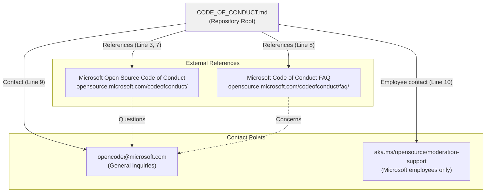
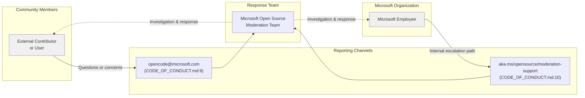
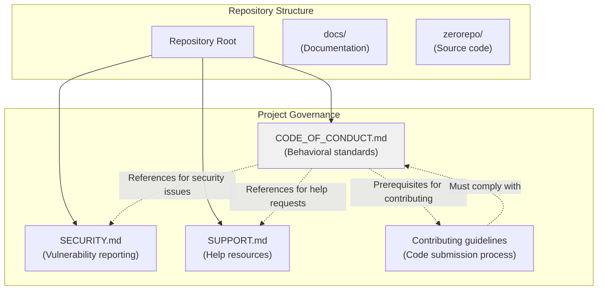

<!-- source: DeepWiki mcp.deepwiki.com · repo microsoft/RPG-ZeroRepo · page 9.2 Code of Conduct · fetched 2026-10-26 -->

# Code of Conduct

Relevant source files

The following files were used as context for generating this wiki page:

- [CODE_OF_CONDUCT.md](CODE_OF_CONDUCT.md)

This document presents the community standards and behavioral expectations for contributors, users, and maintainers of the RPG-ZeroRepo project. It establishes guidelines for respectful collaboration and provides mechanisms for reporting concerns.

For information about contributing code changes, see [Project Structure](#9.1). For security vulnerability reporting, see [Security](#9.3). For general support inquiries, see [Support](#9.4).

## Overview

The RPG-ZeroRepo project has formally adopted the **Microsoft Open Source Code of Conduct**. This code of conduct applies to all project spaces, including the GitHub repository, issue discussions, pull request reviews, and any other community interactions related to the project.

The adoption is documented in [CODE_OF_CONDUCT.md:1-10]() at the repository root.

**Sources**: [CODE_OF_CONDUCT.md:1-3]()

## Code of Conduct Framework

### Document Structure

The project's code of conduct implementation consists of a single authoritative file that references the external Microsoft Open Source Code of Conduct framework.

**Diagram: Code of Conduct File Structure**

**Sources**: [CODE_OF_CONDUCT.md:1-10]()

## Resources and Documentation

The code of conduct provides four primary resources for understanding and engaging with community standards:

| Resource | URL | Purpose |
|----------|-----|---------|
| **Primary Code of Conduct** | https://opensource.microsoft.com/codeofconduct/ | Main policy document detailing expected behaviors and prohibited conduct |
| **FAQ** | https://opensource.microsoft.com/codeofconduct/faq/ | Frequently asked questions about interpretation and application |
| **General Contact** | opencode@microsoft.com | Email for questions, concerns, or incident reporting |
| **Employee Support** | https://aka.ms/opensource/moderation-support | Internal Microsoft resource for employees |

These resources are defined in [CODE_OF_CONDUCT.md:5-10]().

**Sources**: [CODE_OF_CONDUCT.md:5-10]()

## Reporting and Resolution Process

### Contact Mechanisms

The code of conduct establishes two distinct contact channels based on the reporter's relationship to Microsoft:

**Diagram: Issue Reporting Flow**

**Sources**: [CODE_OF_CONDUCT.md:9-10]()

### Reporting Scope

The code of conduct email contact (`opencode@microsoft.com`) accepts communications regarding:

- **Questions**: Clarifications about the code of conduct's application to specific scenarios
- **Concerns**: Potential violations or behaviors that may violate community standards
- **Incidents**: Formal reports of code of conduct violations requiring investigation

This contact mechanism is referenced in [CODE_OF_CONDUCT.md:9]().

**Sources**: [CODE_OF_CONDUCT.md:9]()

## Microsoft Employee-Specific Resources

Microsoft employees have access to an additional internal support channel at `aka.ms/opensource/moderation-support`. This resource, specified in [CODE_OF_CONDUCT.md:10](), provides:

- Internal escalation paths for sensitive issues
- Direct access to the Microsoft Open Source Programs Office
- Additional context on corporate policies related to open source conduct

This internal channel complements, but does not replace, the public `opencode@microsoft.com` contact for code of conduct matters.

**Sources**: [CODE_OF_CONDUCT.md:10]()

## Integration with Project Governance

### Relationship to Other Policies

The code of conduct operates as part of a broader governance framework within the RPG-ZeroRepo project:

**Diagram: Policy Framework Integration**

The code of conduct establishes the foundational behavioral expectations that apply to all other project interactions, including:

- **Security Reporting**: While [SECURITY.md](#9.3) defines the technical process for vulnerability disclosure, all security-related communications must comply with the code of conduct's standards for respectful interaction
- **Support Requests**: General help inquiries documented in [SUPPORT.md](#9.4) are subject to the same behavioral expectations as other community interactions
- **Code Contributions**: Contributors submitting pull requests or issues must adhere to the code of conduct during all review discussions and feedback exchanges

**Sources**: [CODE_OF_CONDUCT.md:1-10]()

## Enforcement

While the `CODE_OF_CONDUCT.md` file itself does not specify detailed enforcement procedures, it delegates enforcement to the Microsoft Open Source Code of Conduct framework. The external policy document (linked in [CODE_OF_CONDUCT.md:7]()) defines:

- Investigation procedures for reported violations
- Escalation paths for serious or repeated violations
- Potential consequences ranging from warnings to permanent bans
- Appeals processes for enforcement decisions

Project maintainers and the Microsoft Open Source Programs Office retain authority to enforce the code of conduct and make final determinations on violations.

**Sources**: [CODE_OF_CONDUCT.md:7-9]()

## Summary

The RPG-ZeroRepo project's code of conduct adoption is straightforward and follows Microsoft's standard open source practice. The implementation consists of:

1. A single file (`CODE_OF_CONDUCT.md`) at the repository root
2. Formal adoption of the Microsoft Open Source Code of Conduct
3. Two contact channels: `opencode@microsoft.com` for general use and an internal Microsoft support link
4. References to external documentation for detailed policy information

Contributors and users should familiarize themselves with the full Microsoft Open Source Code of Conduct at https://opensource.microsoft.com/codeofconduct/ before engaging with the project.

**Sources**: [CODE_OF_CONDUCT.md:1-10]()

---

