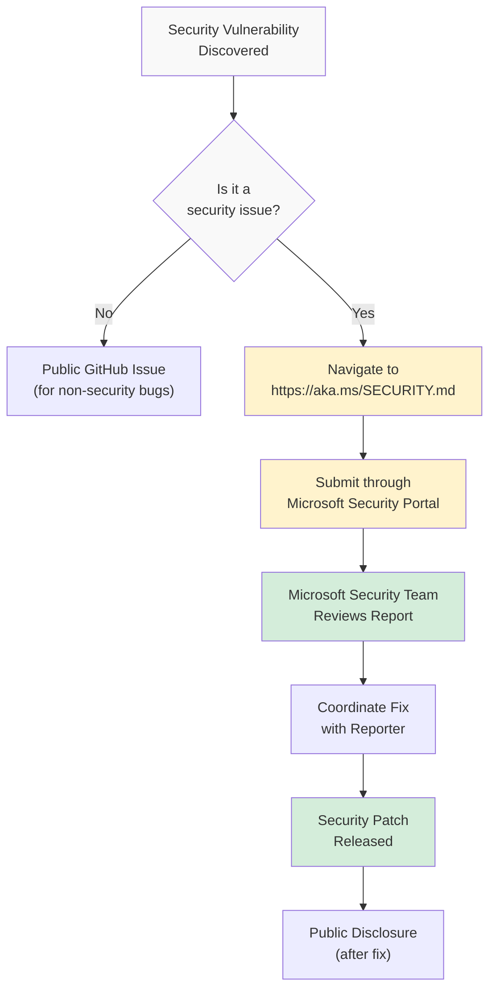
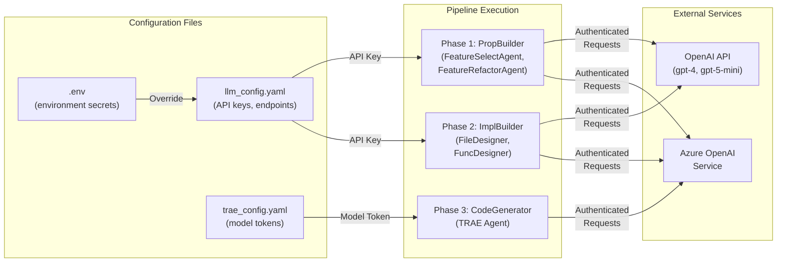
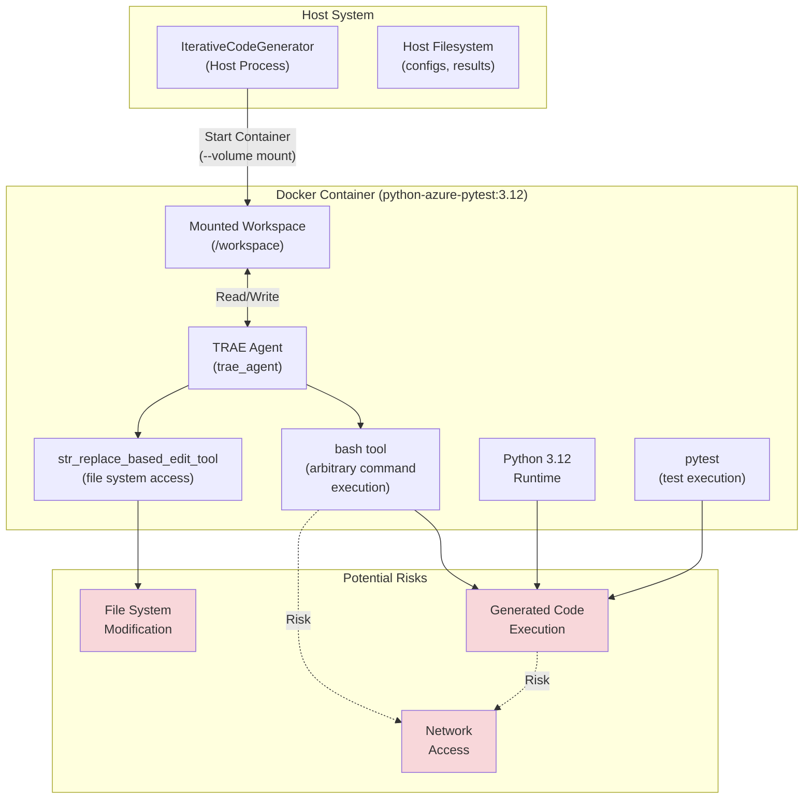
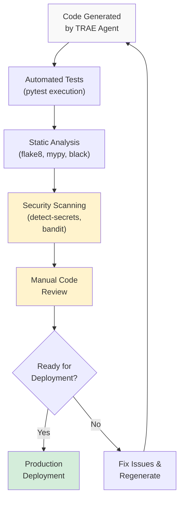

<!-- source: DeepWiki mcp.deepwiki.com · repo microsoft/RPG-ZeroRepo · page 9.3 Security · fetched 2026-10-26 -->

# Security

Relevant source files

The following files were used as context for generating this wiki page:

- [SECURITY.md](SECURITY.md)

## Purpose and Scope

This document explains the security vulnerability reporting process and policies for the RPG-ZeroRepo project. It covers how to report security issues responsibly, Microsoft's security policies, and security considerations when using the system. For information about project contribution guidelines, see [Code of Conduct](#9.2). For general support and non-security questions, see [Support](#9.4).

**Sources**: [SECURITY.md:1-14]()

---

## Security Policy

Microsoft takes the security of software products and services seriously, including all source code repositories in the Microsoft GitHub organizations. The RPG-ZeroRepo project follows Microsoft's standard security reporting procedures.

### Key Principles

| Principle | Description |
|-----------|-------------|
| **Private Reporting** | Security vulnerabilities must be reported through private channels, never through public GitHub issues |
| **Centralized Process** | All Microsoft repositories follow the same security reporting process documented at https://aka.ms/SECURITY.md |
| **Responsible Disclosure** | Microsoft coordinates with reporters to address vulnerabilities before public disclosure |

**Sources**: [SECURITY.md:5-12]()

---

## Vulnerability Reporting Process

### Reporting Security Issues

**DO NOT report security vulnerabilities through public GitHub issues, discussions, or pull requests.**

Instead, follow the official Microsoft security reporting guidance:

1. Visit the official Microsoft security reporting portal: https://aka.ms/SECURITY.md
2. Review the reporting locations, contact information, and policies
3. Submit your vulnerability report through the designated private channel
4. Include detailed information about the vulnerability, reproduction steps, and potential impact

### Vulnerability Reporting Workflow

**Diagram: Security Vulnerability Reporting Workflow**

This diagram illustrates the proper process for handling security vulnerabilities. Security issues must be reported privately through Microsoft's security portal, not through public GitHub issues.

**Sources**: [SECURITY.md:8-12]()

---

## Security Considerations in RPG-ZeroRepo

While the [SECURITY.md:1-14]() file addresses vulnerability reporting, users and developers should be aware of security considerations when using and deploying the RPG-ZeroRepo system.

### API Keys and Credentials

The system requires API keys for LLM providers (OpenAI, Azure OpenAI, etc.) configured in `llm_config.yaml`. These credentials must be protected.

| Configuration File | Security-Sensitive Data | Protection Method |
|-------------------|------------------------|-------------------|
| `llm_config.yaml` | API keys, endpoints, organization IDs | Store in secure location, exclude from version control |
| `.env` files | Environment variables for credentials | Use `.gitignore`, never commit to repository |
| `trae_config.yaml` | LLM model access tokens | Treat as secrets, rotate regularly |

**Security Best Practices:**
- Store `llm_config.yaml` outside the repository or use environment variable substitution
- Use Azure Key Vault or similar secret management systems for production deployments
- Rotate API keys regularly
- Restrict API key permissions to minimum required scope
- Monitor API usage for anomalies

### Credential Flow in System Architecture

**Diagram: API Credential Flow Through System Components**

This diagram shows how API credentials flow from configuration files through the three-phase pipeline to external LLM services. Each phase requires authenticated access to LLM APIs.

**Sources**: [SECURITY.md:1-14](), referenced from architectural knowledge of `llm_config.yaml`, `trae_config.yaml`, and the three-phase pipeline structure

---

### Docker Execution Environment

Phase 3 executes code generation inside Docker containers, which provides isolation but requires careful security configuration.

#### Docker Security Considerations

**Diagram: Docker Container Security Boundaries and Risks**

This diagram illustrates the security boundaries in the Docker-based execution environment. The TRAE agent has access to bash and file editing tools, which can execute arbitrary code and modify the file system within the container.

**Security Measures:**
- **Container Isolation**: Code generation runs in isolated Docker containers
- **Volume Mounting**: Only the workspace directory is mounted, limiting host filesystem access
- **Network Isolation**: Consider using `--network none` for offline code generation when possible
- **Resource Limits**: Set CPU/memory limits on containers to prevent resource exhaustion
- **Non-root Execution**: Configure containers to run as non-root users

**Risks:**
- The `bash` tool in TRAE agent configuration allows arbitrary command execution
- Generated code is executed during pytest runs, which could be malicious
- Network access enables external communication from generated code
- Mounted workspace provides read/write access to host filesystem

**Sources**: [SECURITY.md:1-14](), referenced from `Dockerfile`, `trae_config.yaml`, and Phase 3 architecture

---

### Generated Code Security

The system generates Python code automatically using LLMs. This generated code should be reviewed before deployment to production environments.

#### Security Risks in Generated Code

| Risk Category | Description | Mitigation |
|---------------|-------------|------------|
| **Injection Vulnerabilities** | Generated code may not properly sanitize inputs (SQL injection, command injection, etc.) | Code review, static analysis tools |
| **Hardcoded Secrets** | LLMs may generate code with example API keys or passwords | Scan for secrets, use linters like `detect-secrets` |
| **Insecure Dependencies** | Generated code may import vulnerable packages | Dependency scanning with `pip-audit` or `safety` |
| **Information Disclosure** | Debug statements or error messages may leak sensitive data | Review logging and error handling |
| **Authentication/Authorization** | Generated security logic may have flaws | Security-focused code review, penetration testing |
| **Unsafe Deserialization** | Use of `pickle`, `eval()`, or `exec()` without validation | Static analysis, manual review |

#### Generated Code Security Workflow

**Diagram: Security Review Process for Generated Code**

This diagram shows the recommended security review process for code generated by RPG-ZeroRepo before production deployment.

**Recommended Tools:**
- `bandit`: Security linter for Python code
- `detect-secrets`: Scan for hardcoded secrets
- `pip-audit`: Check dependencies for known vulnerabilities
- `safety`: Another dependency vulnerability scanner
- `semgrep`: Pattern-based code analysis for security issues

**Sources**: [SECURITY.md:1-14](), referenced from Phase 3 code generation and testing infrastructure

---

### External Service Interactions

The system interacts with external services that require secure configuration.

| Service | Interaction Point | Security Considerations |
|---------|------------------|------------------------|
| **OpenAI API** | All three phases | API key security, rate limiting, token usage monitoring |
| **Azure OpenAI** | All three phases | Managed identity vs. key-based auth, virtual network integration |
| **Azure CLI** | Docker container (optional) | Credential management, scope of permissions |
| **Git Repositories** | Code generation phase | SSH keys, personal access tokens, repository permissions |
| **PyPI** | Dependency installation | Package verification, private package repositories |

**Best Practices:**
- Use managed identities for Azure services when possible
- Implement rate limiting and quota management
- Monitor API usage for anomalies
- Use private package repositories for internal dependencies
- Audit external service access regularly

**Sources**: [SECURITY.md:1-14](), referenced from `Dockerfile`, `trae_config.yaml`, and Azure integration components

---

## Security Checklist

Before deploying RPG-ZeroRepo in a production or security-sensitive environment:

- [ ] API keys stored securely (not in version control)
- [ ] Docker containers configured with resource limits
- [ ] Network isolation enabled where appropriate
- [ ] Generated code reviewed for security vulnerabilities
- [ ] Dependencies scanned for known vulnerabilities
- [ ] Static analysis tools integrated into workflow
- [ ] Monitoring and alerting configured for API usage
- [ ] Principle of least privilege applied to all credentials
- [ ] Security scanning tools (bandit, detect-secrets) run on generated code
- [ ] Incident response plan documented for security issues

**Sources**: [SECURITY.md:1-14]()

---

## Summary

Security in RPG-ZeroRepo encompasses three main areas:

1. **Vulnerability Reporting**: Follow Microsoft's security reporting process at https://aka.ms/SECURITY.md. Never report security issues through public GitHub issues.

2. **Credential Security**: Protect API keys for LLM services using secure storage, environment variables, or secret management systems.

3. **Generated Code Security**: Review and scan generated code before deployment, as LLM-generated code may contain security vulnerabilities or unsafe practices.

For operational security guidance and deployment recommendations, consult your organization's security team and follow industry best practices for Python application security.

**Sources**: [SECURITY.md:1-14]()

---

