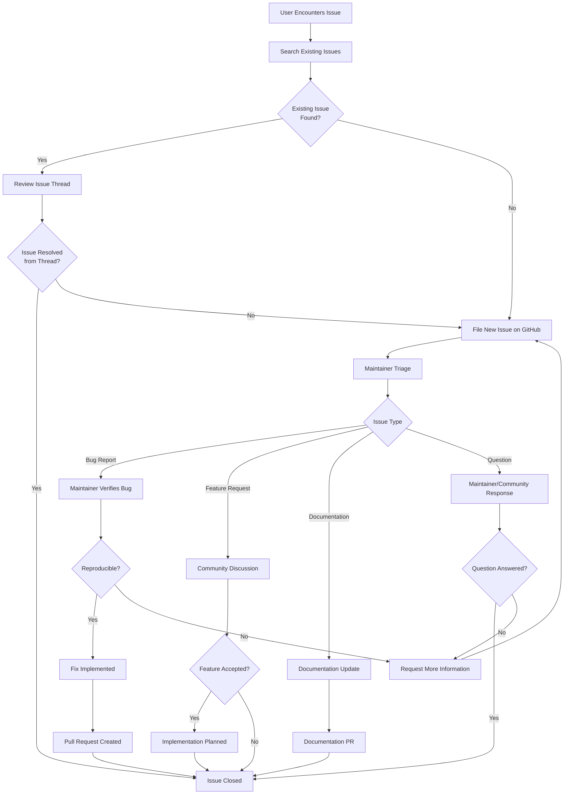
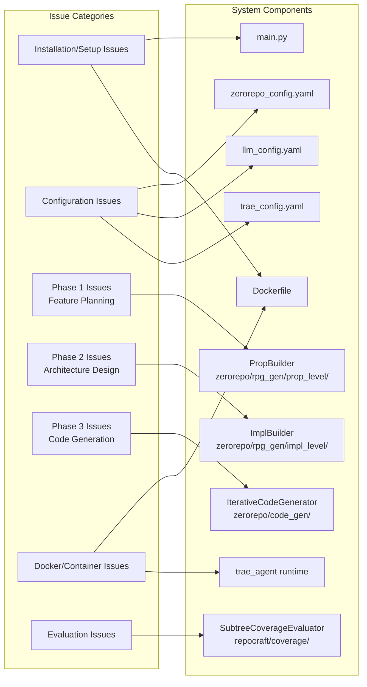

<!-- source: DeepWiki mcp.deepwiki.com · repo microsoft/RPG-ZeroRepo · page 9.4 Support · fetched 2026-10-26 -->

# Support

<details>
<summary>Relevant source files</summary>

The following files were used as context for generating this wiki page:

- [SUPPORT.md](SUPPORT.md)

</details>


This page provides guidance on obtaining help with RPG-ZeroRepo, filing issues, and understanding the project's support model. For information about contributing code or reporting security vulnerabilities, see [Security](#9.3). For community standards and conduct expectations, see [Code of Conduct](#9.2).

---

## Support Channels

RPG-ZeroRepo uses GitHub as the primary platform for community support and issue tracking. Support is provided on a best-effort basis by project maintainers and the community.

### GitHub Issues

GitHub Issues is the primary channel for:
- **Bug reports**: Errors, crashes, or unexpected behavior in the pipeline
- **Feature requests**: Proposals for new functionality or enhancements
- **Documentation issues**: Gaps, errors, or unclear explanations in documentation
- **Questions**: Usage questions about configuration, pipeline behavior, or troubleshooting

**Repository**: [https://github.com/microsoft/RPG-ZeroRepo/issues](https://github.com/microsoft/RPG-ZeroRepo/issues)

Before filing a new issue, search existing issues to avoid duplicates. Many common problems have already been discussed and may have workarounds or solutions.

**Sources**: [SUPPORT.md:15-17]()

---

## How to File an Effective Issue

When creating a new issue, provide sufficient context to help maintainers understand and reproduce the problem.

### Required Information

| Issue Type | Required Information |
|------------|---------------------|
| **Bug Report** | - Operating system and Docker version<br>- Python version<br>- Configuration files used (`zerorepo_config.yaml`, `llm_config.yaml`)<br>- Command-line arguments<br>- Full error message and stack trace<br>- `repo_data.json` content (if relevant)<br>- Checkpoint files present in `checkpoints/` directory |
| **Feature Request** | - Use case description<br>- Desired behavior<br>- Current workarounds (if any)<br>- Impact on your workflow |
| **Documentation Issue** | - Page or section with the problem<br>- What's unclear or incorrect<br>- Suggested improvement |
| **Question** | - What you're trying to accomplish<br>- Configuration used<br>- What you've already tried<br>- Specific error messages or unexpected output |

### Log Files and Debugging Information

Include relevant log files when reporting issues. The log level can be controlled via the `--log-level` argument. For detailed debugging:

```bash
python main.py --config configs/zerorepo_config.yaml \
               --log-level DEBUG \
               --repo my_project
```

Key files to include:
- Console output (redirect to file: `python main.py ... 2>&1 | tee output.log`)
- Checkpoint files from `checkpoints/` directory (see [Checkpoint File Reference](#5.1))
- Docker container logs (if applicable)
- TRAE agent execution history: `results/execution_history.json`
- Task manager state: `checkpoints/task_manager_state.json`

For configuration-related issues, sanitize API keys and credentials before sharing configuration files.

**Sources**: [main.py:50-114]()

---

## Support Request Workflow

The following diagram illustrates how different types of support requests are triaged and handled:

**Support Request Routing and Resolution**


**Sources**: [SUPPORT.md:13-21]()

---

## Common Issue Categories

Issues are typically categorized into the following areas, which map to specific system components:

**Issue Categories and Component Mapping**


### Installation and Setup Issues

Problems with dependencies, Docker configuration, or environment setup.

**Common Problems**:
- Docker daemon not running
- Missing Azure CLI credentials
- Python version incompatibility
- LLM API key configuration

**Relevant Files**:
- [Dockerfile:1-50]()
- [main.py:1-30]()
- Configuration files in `configs/` directory

**Documentation**: See [Installation](#2.1) and [Docker Container Setup](#6.1)

### Configuration Issues

Problems with `zerorepo_config.yaml`, `llm_config.yaml`, or related configuration files.

**Common Problems**:
- Invalid YAML syntax
- Missing required fields
- Incorrect file paths in configuration
- LLM token limit exceeded
- Incompatible configuration combinations

**Relevant Files**:
- [zerorepo_config.yaml:1-100]()
- [llm_config.yaml:1-50]()
- [checkpoint_config.yaml:1-100]()

**Documentation**: See [Configuration System](#4) and [Configuration Overview](#2.3)

### Phase 1 Issues (Feature Planning)

Problems during feature tree generation or component creation.

**Common Problems**:
- LLM generating malformed feature trees
- Component boundaries unclear
- Feature selection agent failing

**Relevant Files**:
- `zerorepo/rpg_gen/prop_level/`
- [checkpoint_config.yaml:10-20]() for `feature_selection.json`, `feature_refactoring.json`
- [zerorepo_config.yaml:20-35]() for `prop_level` configuration

**Documentation**: See [Phase 1: Feature Planning](#3.1)

### Phase 2 Issues (Architecture Design)

Problems during file skeleton creation, interface design, or task planning.

**Common Problems**:
- File skeleton generation produces invalid structure
- Function interface design fails
- Task planning creates unbuildable tasks

**Relevant Files**:
- `zerorepo/rpg_gen/impl_level/`
- [file_design_config.yaml:1-50]()
- [func_design_config.yaml:1-50]()
- Checkpoint files: `skeleton.json`, `graph.json`, `tasks.json`

**Documentation**: See [Phase 2: Architecture Design](#3.2), [File Design Process](#3.2.1), [Function Design Process](#3.2.2)

### Phase 3 Issues (Code Generation)

Problems during the iterative TDD loop, TRAE agent execution, or test failures.

**Common Problems**:
- TRAE agent exceeds iteration limit
- Tests fail consistently
- Docker container crashes
- Git operations fail in container
- Code patches not applying correctly

**Relevant Files**:
- `zerorepo/code_gen/`
- [trae_config.yaml:1-100]()
- [Dockerfile:20-40]()
- Checkpoint files: `iteration_state.json`, `execution_history.json`, `batch_trajectory.json`
- Results: `results/*.patch`, `results/execution_history.json`

**Documentation**: See [Phase 3: Code Generation](#3.3), [Test-Driven Development Workflow](#3.3.1), [Workflow Types and Error Handling](#3.3.2)

### Docker and Container Issues

Problems with Docker execution environment or tool availability.

**Common Problems**:
- Container fails to start
- Workspace mount issues
- Tool not found in container (pytest, black, etc.)
- Azure CLI authentication failures

**Relevant Files**:
- [Dockerfile:1-50]()
- [zerorepo_config.yaml:49-60]() for Docker configuration

**Documentation**: See [Docker Container Setup](#6.1) and [Development Tools Integration](#6.3)

### Evaluation Issues

Problems running RepoCraft evaluations or interpreting results.

**Common Problems**:
- Coverage evaluation fails
- Embedding model errors
- Ground truth repository format issues

**Relevant Files**:
- `repocraft/coverage/`
- `repocraft/coverage/scripts/run_api.sh`
- Ground truth files: `HttpEasy.json`, `MLKit-Py.json`, etc.

**Documentation**: See [Evaluation System (RepoCraft)](#7) and [Coverage Evaluation](#7.1)

**Sources**: [main.py:1-400](), [zerorepo_config.yaml:1-100](), [Dockerfile:1-50]()

---

## Troubleshooting Self-Service Resources

Before filing an issue, consult these resources:

| Resource | Location | Use For |
|----------|----------|---------|
| **Quick Start Guide** | [Section 2.2](#2.2) | First-time setup and basic usage |
| **Configuration Documentation** | [Section 4](#4) | Configuration syntax and options |
| **Checkpoint Files** | [Section 5.1](#5.1) | Understanding system state |
| **Resume and Recovery** | [Section 5.2](#5.2) | Recovering from failures |
| **Command Line Reference** | [Section 11.1](#11.1) | CLI arguments and flags |
| **Project Structure** | [Section 9.1](#9.1) | Understanding codebase organization |

### Debugging Commands

```bash
# Check system state
cat checkpoints/task_manager_state.json

# Verify Docker setup
docker --version
docker ps

# Test LLM connectivity (requires API key)
python -c "import openai; print('OpenAI SDK available')"

# Check Python environment
python --version
pip list | grep -E "(openai|docker|pytest)"

# View detailed logs
python main.py --config configs/zerorepo_config.yaml \
               --log-level DEBUG \
               --repo test_project 2>&1 | tee debug.log

# Force rebuild from Phase 1
python main.py --config configs/zerorepo_config.yaml \
               --force-rebuild \
               --repo test_project

# Resume from checkpoint
python main.py --config configs/zerorepo_config.yaml \
               --resume \
               --repo test_project
```

**Sources**: [main.py:50-114](), [checkpoint_config.yaml:1-100]()

---

## What's Supported

The project maintainers provide support for:

| Category | Scope | Response Expectation |
|----------|-------|---------------------|
| **Core Pipeline Issues** | Bugs in Phase 1, 2, or 3 execution | Best effort, prioritized by impact |
| **Configuration Problems** | Invalid configurations or unclear documentation | Documentation updates or configuration fixes |
| **Docker Environment** | Issues with provided Dockerfile or container setup | Fixes to Dockerfile or documentation |
| **LLM Integration** | Problems with OpenAI API integration | Limited to configuration guidance; API issues should be reported to provider |
| **Documentation** | Gaps, errors, or clarity issues | Updates and improvements |
| **Examples** | Issues with provided examples | Fixes and clarifications |

### What's Not Supported

- **Custom LLM Providers**: Only OpenAI models are officially supported. Other providers may work but are not tested.
- **Modified Pipeline Code**: If you've modified core pipeline code, support is limited.
- **Third-Party Tools**: Issues with pytest, black, mypy, or other tools should be reported to their respective projects.
- **Generated Code Quality**: The quality of generated code depends on the LLM and project requirements. The pipeline's correctness does not guarantee production-ready code.
- **Azure-Specific Issues**: Azure CLI and SDK issues should be reported to Microsoft Azure support.
- **Commercial Support**: This is an open-source research project without commercial support agreements.

**Sources**: [SUPPORT.md:23-25](), [README.md:1-50]()

---

## Response Times and Expectations

RPG-ZeroRepo is maintained by Microsoft researchers on a best-effort basis. Response times vary based on:

- **Issue Complexity**: Simple configuration issues typically receive faster responses than complex pipeline bugs
- **Reproducibility**: Issues with clear reproduction steps are prioritized
- **Community Impact**: Issues affecting many users receive higher priority
- **Maintainer Availability**: Responses may be slower during academic conference seasons or holidays

Typical response patterns:
- **Issue Acknowledgment**: 1-7 days
- **Bug Fixes**: 1-4 weeks for verified reproducible bugs
- **Feature Requests**: Variable; may be deferred to future releases
- **Documentation Updates**: 1-2 weeks

Contributors from the community are encouraged to help answer questions and review issues.

---

## Microsoft Support Policy

Support for RPG-ZeroRepo is limited to the resources described on this page. This is an open-source research project distributed under the MIT license with no warranty or commercial support agreement.

For enterprise or commercial support inquiries, contact Microsoft through official support channels. This project does not provide:
- Service level agreements (SLAs)
- 24/7 support
- Priority support
- Custom feature development on demand
- Production deployment assistance

**Sources**: [SUPPORT.md:23-25]()

---

## Related Resources

- **[Code of Conduct](#9.2)**: Community standards and expected behavior
- **[Security](#9.3)**: How to report security vulnerabilities
- **[Project Structure](#9.1)**: Understanding the codebase organization
- **[Quick Start Guide](#2.2)**: Getting started with the system
- **[Resume and Recovery](#5.2)**: Recovering from pipeline failures

For questions not covered by documentation or existing issues, file a new issue on GitHub using the guidance above.

---

