# Page: Overview

# Overview

<details>
<summary>Relevant source files</summary>

The following files were used as context for generating this wiki page:

- [LICENSE](LICENSE)
- [README.md](README.md)
- [main.py](main.py)

</details>


## Purpose and Scope

This document provides a high-level introduction to the RPG-ZeroRepo system, explaining its purpose, architecture, and the three-phase automated repository generation pipeline. It covers the system's main components, data flow, and execution model.

For detailed installation and setup instructions, see [Getting Started](#2). For in-depth documentation on individual phases, see [Core Pipeline](#3). For configuration details, see [Configuration System](#4).

**Sources:** [README.md:1-32]()

## What is RPG-ZeroRepo?

RPG-ZeroRepo is an LLM-driven framework that generates complete software repositories from natural language descriptions. The system takes a short project description (e.g., "a multiplayer snake game") and automatically produces a fully functional codebase with tests, documentation, and proper structure.

The framework consists of two key concepts:

**RPG (Repository Planning Graph)**: A hierarchical graph representation that captures both the functional view (features, requirements) and the structural view (files, classes, functions, dependencies) of a software repository.

**ZeroRepo**: The automated generation framework built on RPG that orchestrates the transformation from natural language to working code through a three-phase pipeline.

**Sources:** [README.md:1-10](), [README.md:465-481]()

## System Architecture

The system is organized around three sequential phases, each producing specific artifacts that feed into the next phase. The entry point is `main.py`, which loads configurations, initializes the checkpoint system, and orchestrates the complete pipeline through the `ZeroRepo` class.

### System Entry Point and Main Components

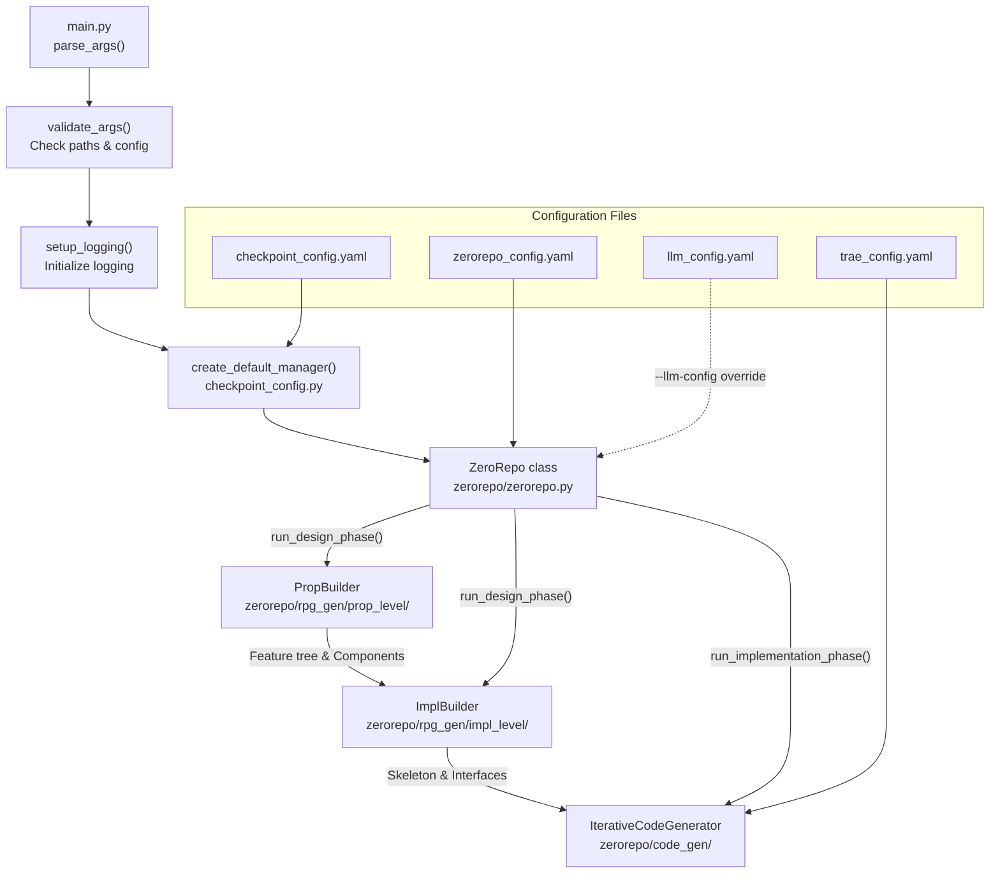

**Sources:** [main.py:1-308](), [README.md:34-95]()

### Natural Language to Code Entity Mapping

The following diagram shows how natural language concepts are progressively transformed into concrete code entities through the pipeline:

```mermaid
graph LR
    subgraph "Natural Language Space"
        NL["'A multiplayer snake game<br/>with AI opponents...'"]
        
        Features["Feature Tree<br/>• game mechanics<br/>• AI pathfinding<br/>• replay recording"]
        
        Components["Components<br/>• gameplay.core<br/>• ai.pathfinding<br/>• io.persistence"]
    end
    
    subgraph "Intermediate Representation"
        RPG["global_repo_rpg.json<br/>Repository Planning Graph"]
        
        Skeleton["skeleton.json<br/>File Structure<br/>76 files"]
        
        Graph["graph.json<br/>Function Interfaces"]
        
        Tasks["tasks.json<br/>Implementation Batches"]
    end
    
    subgraph "Code Entity Space"
        Files["Generated Files<br/>src/ai/planning/pathfinding.py<br/>src/gameplay/rules/movement.py<br/>tests/test_pathfinding.py"]
        
        Classes["Python Classes<br/>class HighScoreBinarySerializer<br/>class PathfindingEngine<br/>class SnakeMovementController"]
        
        Functions["Python Functions<br/>def serialize(entries) -> bytes<br/>def find_path(start, goal) -> List<br/>def update_position(delta) -> None"]
    end
    
    NL --> |"FeatureSelectAgent"| Features
    Features --> |"FeatureRefactorAgent"| Components
    Components --> RPG
    
    RPG --> |"FileDesigner"| Skeleton
    Skeleton --> |"FuncDesigner"| Graph
    Graph --> |"TaskPlanner"| Tasks
    
    Tasks --> |"IterativeCodeGenerator<br/>+ TRAE Agent"| Files
    Files --> Classes
    Classes --> Functions
```

**Sources:** [README.md:98-172](), [README.md:174-281](), [README.md:283-351]()

## Three-Phase Pipeline

The pipeline transforms natural language descriptions into working code through three sequential phases, each managed by a dedicated builder class.

| Phase | Builder Class | Input | Output | Primary Agents |
|-------|--------------|-------|--------|----------------|
| **Phase 1: Feature Planning** | `PropBuilder` | `repo_data.json` (name + purpose) | Feature tree + Components | `FeatureSelectAgent`, `FeatureRefactorAgent` |
| **Phase 2: Architecture Design** | `ImplBuilder` | Feature tree + Components | File skeleton + Interfaces + Tasks | `FileDesigner`, `FuncDesigner`, `TaskPlanner` |
| **Phase 3: Code Generation** | `IterativeCodeGenerator` | Tasks + Interfaces | Working Python code + Tests | TRAE Agent (LLM-powered) |

### Phase 1: Feature Planning

**Module:** `zerorepo/rpg_gen/prop_level/`

**Entry Point:** `PropBuilder.build_feature_tree()`

This phase uses LLM agents to transform a simple project description into a structured feature taxonomy and logical component decomposition.

**Workflow:**
1. `FeatureSelectAgent` generates a hierarchical Feature Tree
2. `FeatureRefactorAgent` groups features into Components (logical modules)
3. Results saved to `repo_data.json` with `Feature_tree` and `Component` fields

**Example Output:**
```json
{
  "Feature_tree": {
    "functionality": {
      "game mechanics": ["movement", "collision detection", "food spawning"]
    },
    "algorithm": {
      "pathfinding": ["astar", "bfs flood fill"]
    }
  },
  "Component": [
    {
      "name": "gameplay.core",
      "refactored_subtree": { ... }
    }
  ]
}
```

**Sources:** [README.md:98-172]()

### Phase 2: Architecture Design

**Module:** `zerorepo/rpg_gen/impl_level/`

**Entry Point:** `ImplBuilder.run()`

This phase converts abstract features into concrete file structures, complete interfaces, and implementation tasks.

**Workflow:**
1. Create initial RPG from Components → `global_repo_rpg.json`
2. `FileDesigner` (via `RawSkeletonAgent` + `GroupSkeletonAgent`) generates file layout → `skeleton.json`
3. `FuncDesigner` (via `DataFlowAgent` + `BaseClassAgent` + `InterfaceAgent`) designs function signatures → `graph.json`
4. `TaskPlanner` splits work into implementation batches → `tasks.json`

**Key Artifacts:**
- **skeleton.json**: Complete directory structure with file paths and initial code skeletons
- **graph.json**: Full interface definitions with signatures, docstrings, and type hints
- **tasks.json**: Implementation batches grouped by component and file

**Sources:** [README.md:174-281]()

### Phase 3: Code Generation

**Module:** `zerorepo/code_gen/`

**Entry Point:** `IterativeCodeGenerator.task_executor()`

This phase executes a test-driven development loop inside Docker containers, using the TRAE agent to generate tests and implementation code iteratively.

**Workflow per Batch:**
1. TRAE agent generates test file → `test_*.patch` → `git commit "test: ..."`
2. TRAE agent implements code → `code_*.patch` → `git commit "feat: ..."`
3. Execute `pytest` inside container
4. If tests fail, retry with error feedback (up to `max_iterations`)
5. Save patches and trajectories to `results/` directory

**Workflow Types:**
- `TEST_DEVELOPMENT`: Initial test generation
- `CODE_INCREMENTAL`: Initial code implementation
- `TEST_FIX`: Fix failing tests
- `CODE_BUG_FIX`: Fix code based on test failures
- `ENV_SETUP`: Install packages or fix imports

**Sources:** [README.md:283-351]()

## Data Flow Through Pipeline

```mermaid
graph TB
    subgraph "Input"
        Input["repo_data.json<br/>{repository_name, repository_purpose}"]
    end
    
    subgraph "Phase 1 Outputs"
        FS["feature_selection.json<br/>FeatureSelectAgent output"]
        FR["feature_refactoring.json<br/>FeatureRefactorAgent output"]
        RD1["repo_data.json v2<br/>+ Feature_tree + Component"]
    end
    
    subgraph "Phase 2 Outputs"
        RPG1["global_repo_rpg.json v1<br/>Initial RPG structure"]
        Skel["skeleton.json<br/>File layout + code skeletons"]
        SkelTraj["skeleton_traj.json<br/>Design trajectories"]
        Graph["graph.json<br/>Complete interfaces"]
        Tasks["tasks.json<br/>Implementation batches"]
        RPG2["global_repo_rpg.json v2<br/>Updated with interfaces"]
    end
    
    subgraph "Phase 3 Outputs"
        Iter["iteration_state.json<br/>Current iteration state"]
        ExecHist["execution_history.json<br/>All workflow executions"]
        BatchTraj["batch_trajectory.json<br/>Per-batch execution records"]
        CurRPG["cur_repo_rpg.json<br/>Runtime RPG state"]
        Workspace["workspace/<br/>Generated repository"]
        Results["results/<br/>Patches + trajectories"]
    end
    
    subgraph "State Tracking"
        TMS["task_manager_state.json<br/>Progress tracking"]
    end
    
    Input --> FS
    FS --> FR
    FR --> RD1
    
    RD1 --> RPG1
    RPG1 --> Skel
    Skel --> SkelTraj
    Skel --> Graph
    Graph --> Tasks
    Graph --> RPG2
    
    Tasks --> Iter
    Iter --> ExecHist
    ExecHist --> BatchTraj
    BatchTraj --> CurRPG
    Tasks --> Workspace
    Workspace --> Results
    
    FS -.-> TMS
    FR -.-> TMS
    Skel -.-> TMS
    Graph -.-> TMS
    Tasks -.-> TMS
    Workspace -.-> TMS
```

**Sources:** [README.md:383-400]()

## Checkpoint System and Resumability

The checkpoint system enables the pipeline to resume from any point without repeating expensive LLM operations. The `task_manager_state.json` file tracks completion status for each phase and individual task.

### Checkpoint Architecture

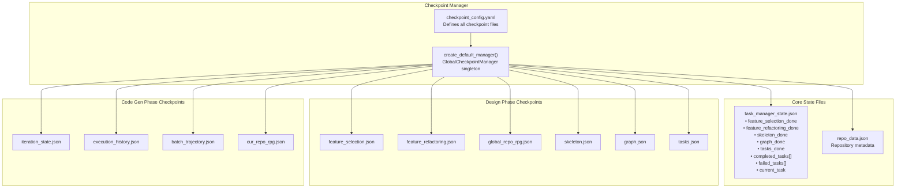

**Resume Logic:**
When `--resume` flag is provided to `main.py`, the system:
1. Loads `task_manager_state.json` from checkpoint directory
2. Skips phases marked as complete
3. Resumes code generation from the next uncompleted batch
4. Failed tasks can be retried automatically

**Sources:** [README.md:353-380](), [main.py:97-101](), [checkpoint_config.yaml]()

## Docker Execution Environment

Phase 3 executes code generation inside isolated Docker containers to provide a clean, reproducible environment with all necessary development tools.

### Container Architecture

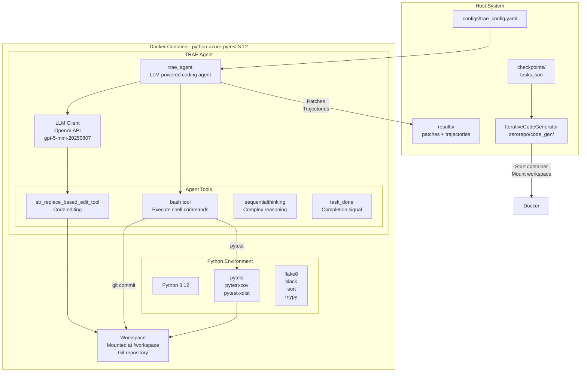

**Container Configuration:**
- **Image:** `python-azure-pytest:3.12` (specified in `zerorepo_config.yaml`)
- **Workspace Mount:** Host's `workspace/` directory mounted at `/workspace` in container
- **Network:** Isolated network with access to LLM APIs
- **Tools:** pytest, coverage.py, flake8, black, isort, mypy, Azure CLI

**Sources:** [README.md:283-351](), [README.md:425-458](), [Dockerfile]()

## Key Classes and Components

The following table maps system concepts to their concrete implementations:

| Concept | Class/Module | File Path | Purpose |
|---------|-------------|-----------|---------|
| **Main Orchestrator** | `ZeroRepo` | `zerorepo/zerorepo.py` | Top-level pipeline coordinator |
| **CLI Entry Point** | `main()` | `main.py` | Parse args, setup, run pipeline |
| **Feature Planning** | `PropBuilder` | `zerorepo/rpg_gen/prop_level/prop_builder.py` | Phase 1 orchestrator |
| **Feature Selection** | `FeatureSelectAgent` | `zerorepo/rpg_gen/prop_level/feature_select_agent.py` | Generate feature taxonomy |
| **Feature Refactoring** | `FeatureRefactorAgent` | `zerorepo/rpg_gen/prop_level/feature_refactor_agent.py` | Group into components |
| **Architecture Design** | `ImplBuilder` | `zerorepo/rpg_gen/impl_level/impl_builder.py` | Phase 2 orchestrator |
| **File Design** | `FileDesigner` | `zerorepo/rpg_gen/impl_level/file_designer.py` | Generate file skeleton |
| **Function Design** | `FuncDesigner` | `zerorepo/rpg_gen/impl_level/func_designer.py` | Design interfaces |
| **Task Planning** | `TaskPlanner` | `zerorepo/rpg_gen/impl_level/task_planner.py` | Split into batches |
| **Code Generation** | `IterativeCodeGenerator` | `zerorepo/code_gen/iterative_code_generator.py` | Phase 3 orchestrator |
| **Checkpoint System** | `GlobalCheckpointManager` | `zerorepo/config/checkpoint_config.py` | State management |
| **LLM Configuration** | `LLMConfig` | `zerorepo/rpg_gen/base/llm_client.py` | LLM client abstraction |

**Sources:** [README.md:98-351](), [main.py:1-308]()

## Configuration Files

The system uses a hierarchical configuration system with multiple YAML files:

| Configuration File | Purpose | Key Sections |
|-------------------|---------|--------------|
| `zerorepo_config.yaml` | Main orchestrator config | `llm`, `prop_level`, `impl_level`, `code_generation` |
| `llm_config.yaml` | LLM provider settings | `model_providers`, `models`, `api_keys` |
| `file_design_config.yaml` | File skeleton design params | `raw_skeleton`, `group_skeleton` |
| `func_design_config.yaml` | Function interface design params | `data_flow`, `base_classes`, `interfaces` |
| `trae_config.yaml` | TRAE agent configuration | `agents`, `tools`, `models`, `max_steps` |
| `checkpoint_config.yaml` | State management schema | Checkpoint file definitions |

**Configuration Override:**
The `--llm-config` CLI flag allows overriding LLM settings from the main config file, enabling easy switching between different models or providers.

**Sources:** [README.md:403-458](), [main.py:117-123](), [main.py:231-235]()

## System Execution Flow

The complete execution flow from command invocation to final repository:

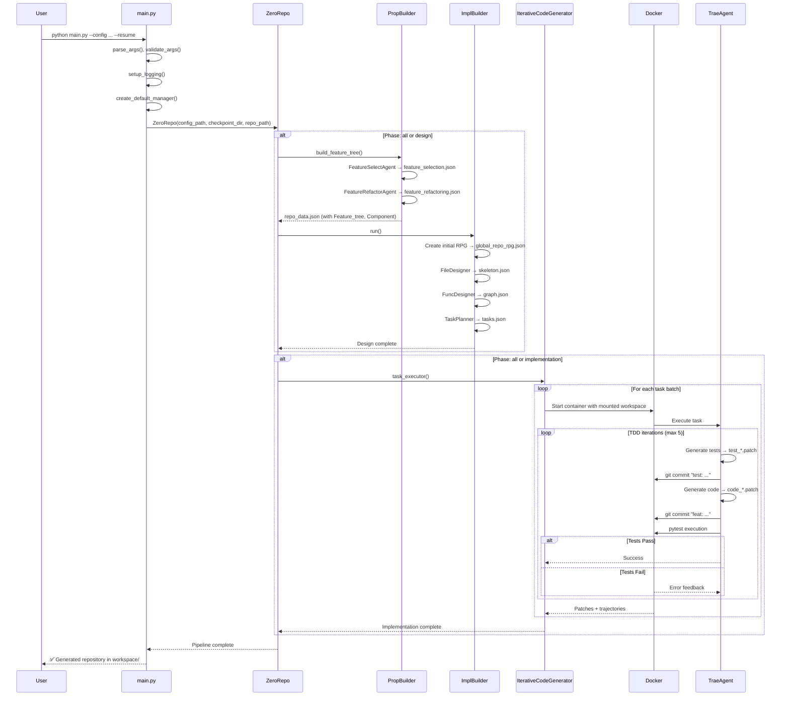

**Sources:** [main.py:202-276](), [README.md:283-351]()

---

This overview provides the foundational understanding of RPG-ZeroRepo's architecture and operation. For detailed information on specific subsystems, refer to the subsequent sections of this documentation.

---

# Page: Getting Started

# Getting Started

<details>
<summary>Relevant source files</summary>

The following files were used as context for generating this wiki page:

- [README.md](README.md)
- [configs/zerorepo_config.yaml](configs/zerorepo_config.yaml)
- [dockerfile/Dockerfile](dockerfile/Dockerfile)
- [main.py](main.py)

</details>


This page guides you through the initial setup required to use RPG-ZeroRepo for automated repository generation. It covers prerequisites, project structure, basic configuration, and executing your first code generation run.

For detailed installation instructions, see [Installation](#2.1). For a complete walkthrough with examples, see [Quick Start Guide](#2.2). For comprehensive configuration documentation, see [Configuration Overview](#2.3) and [Configuration System](#4).

---

## Prerequisites

RPG-ZeroRepo requires the following components to operate:

| Component | Requirement | Purpose |
|-----------|-------------|---------|
| **Python** | 3.11 or higher | Host system runtime |
| **Docker** | Latest stable version | Isolated code generation environment |
| **LLM API Access** | OpenAI, Anthropic, or compatible provider | Powers all AI-driven generation stages |
| **Git** | Any recent version | Version control for generated code |
| **Disk Space** | ~5GB minimum | Docker images and generated repositories |

The system architecture separates the host environment (Python 3.11+) from the code generation environment (Python 3.12 in Docker). The `python-azure-pytest:3.12` Docker image contains all testing and development tools needed for the TRAE agent to operate.

**Sources:** [README.md:1-50](), [dockerfile/Dockerfile:1-32]()

---

## Project Directory Structure

RPG-ZeroRepo operates on a project directory that **must not** be inside an existing git repository, as the system uses git internally to track implementation steps in the `workspace/` directory.

### Required Directory Layout

```
my_project/                     # Project root (NOT inside a git repo)
├── checkpoints/                # Design artifacts and pipeline state
│   ├── repo_data.json         # Input: project description (you create)
│   ├── task_manager_state.json # Auto-generated: progress tracking
│   ├── global_repo_rpg.json   # Auto-generated: repository planning graph
│   ├── skeleton.json          # Auto-generated: file layout design
│   ├── graph.json             # Auto-generated: interface definitions
│   └── tasks.json             # Auto-generated: implementation batches
└── workspace/                  # Generated repository (auto-initialized as git repo)
    ├── src/                    # Generated source code
    ├── tests/                  # Generated test files
    ├── pyproject.toml          # Generated project metadata
    └── README.md               # Generated documentation
```

### Directory Creation

```bash
# Create project structure
mkdir -p my_project/checkpoints my_project/workspace
cd my_project
```

The `checkpoints/` directory stores all intermediate design artifacts and state files that enable resumability. The `workspace/` directory becomes the generated repository with a git history tracking each implementation step.

**Sources:** [README.md:36-95](), [main.py:62-74]()

---

## Input Specification: repo_data.json

Create `checkpoints/repo_data.json` with your project description:

```json
{
  "repository_name": "SnakeGame",
  "repository_purpose": "A multiplayer snake game with AI opponents, pathfinding algorithms (A*, BFS), replay recording, and persistent high score storage using binary serialization."
}
```

| Field | Type | Description |
|-------|------|-------------|
| `repository_name` | string | Project identifier used for directory and module naming |
| `repository_purpose` | string | Natural language description of desired functionality |

The `repository_purpose` field drives the entire generation pipeline:
- **Phase 1** extracts a feature taxonomy from this description
- **Phase 2** designs file layouts and interfaces based on features
- **Phase 3** implements code to fulfill the described purpose

The more detailed your description, the more comprehensive the generated repository. Include specific algorithms, data structures, features, and architectural requirements.

**Sources:** [README.md:51-58](), [README.md:152-172]()

---

## Configuration Files Overview

The following diagram shows the configuration hierarchy and where each file is located:

**Configuration File Structure**

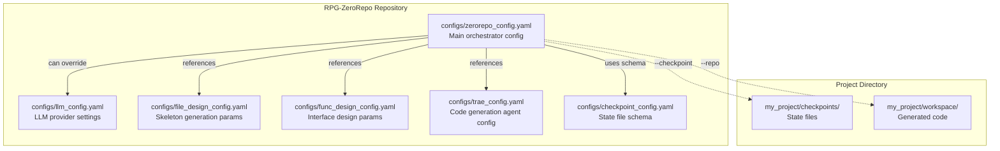

### Essential Configuration Files

| File | Location | Purpose |
|------|----------|---------|
| `zerorepo_config.yaml` | `configs/` | Main pipeline settings: LLM model, phase parameters, Docker settings |
| `trae_config.yaml` | `configs/` | TRAE agent configuration: tools, model, execution limits |
| `llm_config.yaml` | `configs/` (optional) | Override LLM settings from command line with `--llm-config` |

### Minimal Configuration Setup

Edit `configs/zerorepo_config.yaml` to set your LLM provider:

```yaml
llm:
  model: "gpt-5-mini-20250807"
  provider: "openai"
  api_key: "sk-..."
  temperature: 0.0
```

Edit `configs/trae_config.yaml` to configure the code generation agent:

```yaml
model_providers:
  openai:
    provider: openai
    api_key: "sk-..."

models:
  trae_agent_model:
    model_provider: openai
    model: gpt-5-mini-20250807
    max_completion_tokens: 16134
```

Both configuration files require valid API credentials. You can also set the `OPENAI_API_KEY` environment variable instead of storing keys in configuration files.

**Sources:** [configs/zerorepo_config.yaml:1-73](), [README.md:405-459](), [main.py:117-123]()

---

## Running Your First Generation

The following diagram shows how the `main.py` CLI entry point orchestrates the pipeline:

**CLI to System Components Flow**

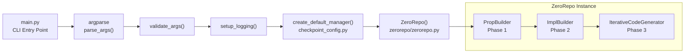

### Basic Execution Command

```bash
python main.py \
  --config configs/zerorepo_config.yaml \
  --checkpoint ../my_project/checkpoints \
  --repo ../my_project/workspace \
  --phase all \
  --resume
```

### Command-Line Arguments Reference

| Argument | Short | Required | Description |
|----------|-------|----------|-------------|
| `--config` | `-c` | Yes | Path to `zerorepo_config.yaml` |
| `--checkpoint` | `-k` | Yes | Directory for state files (e.g., `my_project/checkpoints`) |
| `--repo` | `-r` | Yes | Target directory for generated code (e.g., `my_project/workspace`) |
| `--phase` | | No | Execution scope: `all` (default), `design`, `implementation` |
| `--resume` | `-res` | No | Skip completed phases, continue from last checkpoint |
| `--force-rebuild` | `-f` | No | Rebuild Docker containers, reset state |
| `--llm-config` | | No | Override LLM settings with external config file |
| `--log-level` | `-l` | No | Logging verbosity: `DEBUG`, `INFO`, `WARNING`, `ERROR`, `CRITICAL` |
| `--dry-run` | `-d` | No | Validate configuration without executing pipeline |

### Execution Phases

The `--phase` argument controls which parts of the pipeline execute:

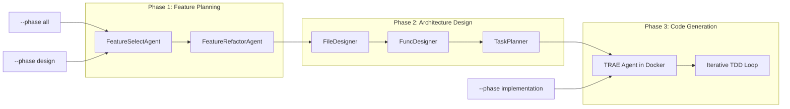

- **`all`**: Executes the complete pipeline from feature planning through code generation
- **`design`**: Runs Phase 1 (feature planning) and Phase 2 (architecture design), stops before code generation
- **`implementation`**: Assumes design artifacts exist in `checkpoints/`, runs only Phase 3 (code generation)

**Sources:** [main.py:24-131](), [main.py:202-276](), [README.md:66-83]()

---

## Understanding the Output

After successful execution, your project directory contains:

### Checkpoint Directory Contents

```
checkpoints/
├── repo_data.json              # Updated with Feature_tree and Component fields
├── task_manager_state.json     # Progress tracking: completed/failed tasks
├── feature_selection.json      # Phase 1: Raw feature taxonomy
├── feature_refactoring.json    # Phase 1: Component decomposition
├── global_repo_rpg.json        # Phase 2: Full repository planning graph
├── skeleton.json               # Phase 2: File layout with 76+ files
├── skeleton_traj.json          # Phase 2: LLM interaction logs for skeleton
├── graph.json                  # Phase 2: Complete interface definitions
├── tasks.json                  # Phase 2: Implementation task batches
├── cur_repo_rpg.json           # Phase 3: Current RPG state during generation
├── batch_trajectory.json       # Phase 3: Per-batch execution records
├── execution_history.json      # Phase 3: Flat list of all workflow executions
└── iteration_state.json        # Phase 3: Active iteration state
```

### Workspace Directory Contents

```
workspace/
├── .git/                       # Git repository with commit history
├── src/                        # Source code organized by component
│   ├── ai/
│   │   ├── pathfinding.py
│   │   └── opponent/
│   ├── gameplay/
│   │   ├── rules/
│   │   └── levels/
│   ├── data/
│   └── network/
├── tests/                      # Mirror structure of src/
│   ├── test_ai/
│   ├── test_gameplay/
│   └── ...
├── pyproject.toml              # Python project metadata
├── README.md                   # Generated documentation
└── requirements.txt            # Dependency list
```

### Git History

The `workspace/` directory is initialized as a git repository. Each code generation step creates commits:

```
test: add unit tests for HighScoreBinarySerializer
feat: implement HighScoreBinarySerializer binary encoding/decoding
test: add tests for PathfindingEngine A* algorithm
feat: implement PathfindingEngine with A* and BFS
fix: correct deserialization of optional player_name field
```

This commit history provides full traceability of the generation process and enables rollback if needed.

**Sources:** [README.md:84-95](), [README.md:383-400](), [README.md:342-351]()

---

## Resume and Recovery

The checkpoint system enables resumability at multiple granularities:

**Checkpoint System Architecture**

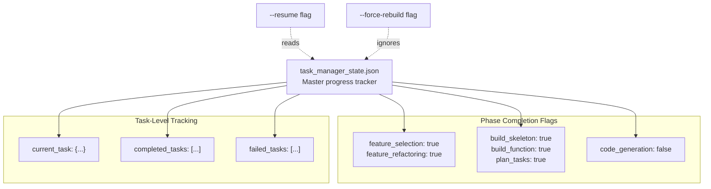

### Resume Behavior

When `--resume` is specified, `main.py` loads `task_manager_state.json` to determine which stages are complete:

- **Phase-level resume**: If Phase 1 is complete, skip feature selection and refactoring
- **Task-level resume**: Within Phase 3, skip completed implementation batches
- **Failure recovery**: Retry failed tasks from the point of failure

### Force Rebuild

The `--force-rebuild` flag ignores all checkpoints and restarts from scratch:

```bash
python main.py \
  --config configs/zerorepo_config.yaml \
  --checkpoint ../my_project/checkpoints \
  --repo ../my_project/workspace \
  --force-rebuild
```

This also rebuilds Docker containers, useful when updating the execution environment or resolving persistent errors.

**Sources:** [README.md:354-380](), [main.py:91-101](), [main.py:237-249]()

---

## Docker Environment Verification

The code generation phase executes inside a Docker container with the following environment:

| Component | Version | Purpose |
|-----------|---------|---------|
| **Base Image** | `python:3.12` | Runtime environment |
| **Azure CLI** | Latest | Azure authentication support |
| **pytest** | + plugins | Test execution framework |
| **coverage** | Latest | Code coverage measurement |
| **flake8, black, isort, mypy** | Latest | Code quality and type checking |
| **azure-identity** | Latest | Azure SDK authentication |
| **openai** | Latest | LLM API client |

The `python-azure-pytest:3.12` image must be built before first execution. The system handles this automatically, or you can build manually:

```bash
cd dockerfile
docker build -t python-azure-pytest:3.12 .
```

The container mounts `workspace/` at `/tare_workspace` for the TRAE agent to access and modify generated code.

**Sources:** [dockerfile/Dockerfile:1-32](), [configs/zerorepo_config.yaml:54-61]()

---

## Example Execution Output

When running the pipeline, you'll see log output like:

```
============================================================
🚀 ZeroRepo Automated Code Generation System Starting
============================================================
📋 Configuration file: configs/zerorepo_config.yaml
💾 Checkpoint directory: ../my_project/checkpoints
📁 Target repository: ../my_project/workspace
🔧 Execution phase: all
📊 Log level: INFO
⏯️ Resume mode enabled
============================================================
🔧 Initializing ZeroRepo system...
📋 Setting up global checkpoint manager: ../my_project/checkpoints
🔄 Executing full pipeline...
[Phase 1] Feature Planning starting...
[Phase 1] FeatureSelectAgent: Generating feature tree...
[Phase 1] FeatureRefactorAgent: Grouping into components...
[Phase 2] Architecture Design starting...
[Phase 2] FileDesigner: Creating file layout...
[Phase 2] FuncDesigner: Designing interfaces...
[Phase 2] TaskPlanner: Splitting into implementation batches...
[Phase 3] Code Generation starting...
[Phase 3] Task 1/25: src/ai/pathfinding.py...
[Phase 3] Task 2/25: src/gameplay/rules/movement.py...
...
============================================================
🎉 ZeroRepo execution completed successfully!
📁 Generated code saved in: ../my_project/workspace
💾 Intermediate files saved in: ../my_project/checkpoints
============================================================
```

The entire process can take 30 minutes to several hours depending on repository size and LLM response times.

**Sources:** [main.py:183-200](), [main.py:252-265]()

---

## Next Steps

You now have the foundational knowledge to run RPG-ZeroRepo. Continue with:

- **[Installation](#2.1)** - Detailed installation procedures, dependency management, and troubleshooting
- **[Quick Start Guide](#2.2)** - Step-by-step walkthrough with a complete example project
- **[Configuration Overview](#2.3)** - Understanding the configuration hierarchy and customization options

For deeper understanding of the system:

- **[Core Pipeline](#3)** - Detailed explanation of the three-phase architecture
- **[Configuration System](#4)** - Comprehensive configuration reference
- **[State Management and Checkpointing](#5)** - Advanced checkpoint manipulation and recovery strategies

**Sources:** [README.md:21-31]()

---

# Page: Installation

# Installation

<details>
<summary>Relevant source files</summary>

The following files were used as context for generating this wiki page:

- [.gitignore](.gitignore)
- [README.md](README.md)
- [dockerfile/Dockerfile](dockerfile/Dockerfile)

</details>


This page provides detailed instructions for installing and configuring RPG-ZeroRepo, including Docker environment setup, Python dependencies, and initial configuration. After completing these steps, you will be ready to generate your first repository using the three-phase pipeline.

For instructions on running your first generation, see [Quick Start Guide](#2.2). For a comprehensive overview of the configuration system, see [Configuration Overview](#2.3).

---

## Prerequisites

RPG-ZeroRepo requires the following software to be installed on your host system:

| Component | Version | Purpose |
|-----------|---------|---------|
| Python | 3.11+ | Host-side pipeline orchestration |
| Docker | 20.10+ | Containerized code generation environment |
| Git | 2.30+ | Version control and workspace tracking |
| Bash | 4.0+ | Script execution |

**Sources:** [README.md:4](), [README.md:38-39]()

---

## Installation Workflow

The following diagram illustrates the complete installation process from prerequisites through verification:

**Installation Process Flow**

```mermaid
graph TB
    Start[Start Installation]
    
    subgraph "1. Prerequisites"
        CheckPython["Check Python 3.11+"]
        CheckDocker["Check Docker 20.10+"]
        CheckGit["Check Git 2.30+"]
    end
    
    subgraph "2. Docker Setup"
        CloneRepo["Clone Repository"]
        BuildImage["Build Docker Image<br/>python-azure-pytest:3.12"]
        VerifyImage["Verify Image"]
    end
    
    subgraph "3. Python Environment"
        CreateVenv["Create Virtual Environment<br/>(Optional)"]
        InstallDeps["Install Host Dependencies<br/>pip install -r requirements.txt"]
    end
    
    subgraph "4. Project Structure"
        CreateProjectDir["Create Project Directory<br/>Outside Git Repos"]
        CreateCheckpoints["Create checkpoints/"]
        CreateWorkspace["Create workspace/"]
        CreateRepoData["Write repo_data.json"]
    end
    
    subgraph "5. Configuration"
        CopyConfigs["Copy Config Templates"]
        SetAPIKeys["Configure LLM API Keys"]
        EditZeroRepo["Edit zerorepo_config.yaml"]
        EditTRAE["Edit trae_config.yaml"]
    end
    
    subgraph "6. Verification"
        TestDocker["Test Docker Container"]
        TestPython["Test Python Imports"]
        DryRun["Run with --dry-run"]
    end
    
    Start --> CheckPython
    CheckPython --> CheckDocker
    CheckDocker --> CheckGit
    CheckGit --> CloneRepo
    
    CloneRepo --> BuildImage
    BuildImage --> VerifyImage
    VerifyImage --> CreateVenv
    
    CreateVenv --> InstallDeps
    InstallDeps --> CreateProjectDir
    
    CreateProjectDir --> CreateCheckpoints
    CreateCheckpoints --> CreateWorkspace
    CreateWorkspace --> CreateRepoData
    
    CreateRepoData --> CopyConfigs
    CopyConfigs --> SetAPIKeys
    SetAPIKeys --> EditZeroRepo
    EditZeroRepo --> EditTRAE
    
    EditTRAE --> TestDocker
    TestDocker --> TestPython
    TestPython --> DryRun
    DryRun --> Complete[Installation Complete]
```

**Sources:** [README.md:34-95](), [dockerfile/Dockerfile:1-32]()

---

## Docker Environment Setup

### Building the Container Image

The code generation phase (Phase 3) executes inside a Docker container with a complete Python development environment. Build the image from the provided Dockerfile:

```bash
cd dockerfile
docker build -t python-azure-pytest:3.12 .
```

### Container Components

The Docker image includes the following tools and libraries:

**Container Architecture**

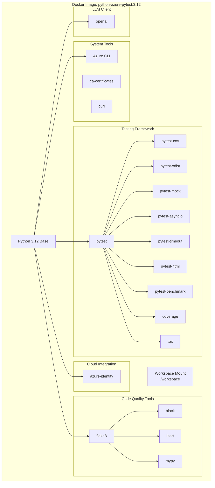

**Installed Packages:**

| Category | Packages | Purpose |
|----------|----------|---------|
| Testing | `pytest`, `pytest-cov`, `pytest-xdist`, `pytest-mock`, `pytest-asyncio`, `pytest-timeout`, `pytest-html`, `pytest-benchmark`, `coverage`, `tox` | Test execution and coverage measurement |
| Code Quality | `flake8`, `black`, `isort`, `mypy` | Linting, formatting, type checking |
| Azure | `azure-identity` | Azure SDK authentication |
| LLM | `openai` | OpenAI API client for TRAE agent |

**Sources:** [dockerfile/Dockerfile:1-32]()

### Verifying the Docker Image

Test that the container can start and has the required tools:

```bash
# Verify container can start
docker run --rm python-azure-pytest:3.12 python --version

# Verify pytest installation
docker run --rm python-azure-pytest:3.12 pytest --version

# Verify Azure CLI
docker run --rm python-azure-pytest:3.12 az --version
```

**Sources:** [dockerfile/Dockerfile:1-32]()

---

## Host System Dependencies

The host system runs the main pipeline orchestrator (`main.py`) and needs Python packages for:
- LLM API clients
- Configuration parsing
- Checkpoint management
- Docker SDK for Python

### Installation Steps

1. **Clone the repository:**
   ```bash
   git clone https://github.com/microsoft/RPG-ZeroRepo.git
   cd RPG-ZeroRepo
   ```

2. **Create a virtual environment (recommended):**
   ```bash
   python -m venv venv
   source venv/bin/activate  # On Windows: venv\Scripts\activate
   ```

3. **Install dependencies:**
   ```bash
   pip install -r requirements.txt
   ```

**Note:** The exact dependencies are not provided in the codebase files reviewed, but would typically include:
- `pyyaml` - Configuration file parsing
- `docker` - Docker SDK for container management
- `openai` or other LLM client libraries
- `jsonschema` - Configuration validation
- Standard libraries for the pipeline components

**Sources:** [README.md:1-6]()

---

## Project Directory Structure

Create a project directory **outside any existing Git repository**. ZeroRepo initializes `workspace/` as a Git repository to track code generation history, which conflicts with nested repositories.

### Directory Layout

```
my_project/                      # Project root (NOT inside a git repo)
├── checkpoints/                 # Pipeline state & design artifacts
│   ├── repo_data.json          # [REQUIRED] Project description (you create this)
│   ├── task_manager_state.json # Auto-generated progress tracker
│   ├── feature_selection.json  # Phase 1 output
│   ├── feature_refactoring.json
│   ├── global_repo_rpg.json    # Phase 2 RPG graph
│   ├── skeleton.json           # File layout design
│   ├── graph.json              # Interface design
│   ├── tasks.json              # Implementation batches
│   ├── cur_repo_rpg.json       # Phase 3 current state
│   ├── batch_trajectory.json   # Execution records
│   ├── execution_history.json  # Workflow history
│   └── iteration_state.json    # Current iteration
│
├── workspace/                   # Generated repository (auto-initialized as git repo)
│   ├── .git/                   # Auto-created by Phase 3
│   ├── src/                    # Generated source code
│   ├── tests/                  # Generated tests
│   ├── pyproject.toml          # Auto-generated
│   └── README.md               # Auto-generated
│
└── results/                     # TRAE agent outputs (optional)
    ├── test_gen_*/             # Test generation trajectories
    └── code_gen_*/             # Code generation trajectories
```

### Creating the Structure

```bash
# Create project directory (OUTSIDE any git repo)
mkdir -p my_project/checkpoints my_project/workspace

# Create the required repo_data.json
cat > my_project/checkpoints/repo_data.json << 'EOF'
{
  "repository_name": "MyProject",
  "repository_purpose": "A brief description of what your project should do. Be specific about features, algorithms, and requirements."
}
EOF
```

**Sources:** [README.md:36-58](), [README.md:385-399]()

---

## Configuration Files

RPG-ZeroRepo uses a hierarchical configuration system with four main files:

**Configuration File Relationships**

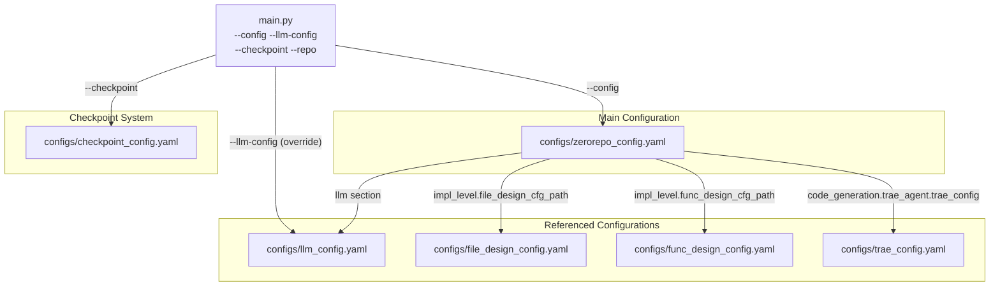

**Sources:** [README.md:404-458]()

### Primary Configuration: zerorepo_config.yaml

This file orchestrates the entire pipeline. Key sections to configure:

```yaml
# LLM settings for design phases (Phase 1 & 2)
llm:
  model: "gpt-5-mini-20250807"      # Or your preferred model
  provider: "openai"                 # Or "azure", "anthropic", etc.
  api_key: "${OPENAI_API_KEY}"      # Use environment variable

# Phase 1: Feature Planning
prop_level:
  feature_selection:
    mode: "simple"                   # "simple" or "feature"
  feature_refactoring:
    refactor_max_iterations: 40

# Phase 2: Architecture Design
impl_level:
  file_design_cfg_path: "configs/file_design_config.yaml"
  func_design_cfg_path: "configs/func_design_config.yaml"

# Phase 3: Code Generation
code_generation:
  docker:
    image: "python-azure-pytest:3.12"
    container_name: "zerorepo_container"
    workspace: "/workspace"
  trae_agent:
    trae_config: "configs/trae_config.yaml"
    max_iterations: 5
    max_retries_per_workflow: 3
```

**Sources:** [README.md:405-434]()

### TRAE Agent Configuration: trae_config.yaml

Controls the LLM-powered coding agent that runs inside Docker:

```yaml
# LLM provider configuration
model_providers:
  openai:
    provider: openai
    api_key: "${OPENAI_API_KEY}"

# Model settings for the coding agent
models:
  trae_agent_model:
    model_provider: openai
    model: gpt-5-mini-20250807
    max_completion_tokens: 16134
    temperature: 0.0
    reasoning_effort: high            # For o1 series models

# Agent configuration
agents:
  trae_agent:
    model: trae_agent_model
    max_steps: 300
    tools:
      - bash                          # Shell command execution
      - str_replace_based_edit_tool   # Code editing
      - sequentialthinking            # Complex reasoning
      - task_done                     # Completion signal
```

**Sources:** [README.md:436-458]()

### API Key Management

Set API keys as environment variables to avoid committing them:

```bash
# Add to ~/.bashrc or ~/.zshrc
export OPENAI_API_KEY="sk-..."
export AZURE_OPENAI_API_KEY="..."  # If using Azure
```

Or create a `.env` file (add to `.gitignore`):

```bash
OPENAI_API_KEY=sk-...
AZURE_OPENAI_API_KEY=...
```

**Sources:** [.gitignore:12](), [README.md:410-414]()

---

## Verification Steps

After installation, verify the setup:

### 1. Test Docker Container

```bash
# Start container with mounted workspace
docker run --rm -v $(pwd)/my_project/workspace:/workspace \
  python-azure-pytest:3.12 \
  bash -c "python --version && pytest --version && az --version"
```

Expected output:
```
Python 3.12.x
pytest 8.x.x
azure-cli 2.x.x
```

### 2. Test Python Environment

```bash
cd RPG-ZeroRepo
python -c "import yaml, json; print('Configuration modules loaded successfully')"
```

### 3. Validate Configuration

```bash
python main.py --version
```

### 4. Dry Run Test

```bash
python main.py \
  --config configs/zerorepo_config.yaml \
  --checkpoint my_project/checkpoints \
  --repo my_project/workspace \
  --dry-run
```

This validates configuration files without starting the pipeline.

**Sources:** [README.md:66-82]()

---

## Post-Installation Checklist

Before running your first repository generation, ensure:

| Step | Verification Command | Expected Result |
|------|---------------------|-----------------|
| Docker image built | `docker images | grep python-azure-pytest` | Image listed with tag 3.12 |
| Python version | `python --version` | Python 3.11 or higher |
| Host dependencies | `python -c "import yaml"` | No import errors |
| Project structure | `ls my_project/checkpoints/repo_data.json` | File exists |
| Configuration files | `ls configs/*.yaml` | All config files present |
| API keys set | `echo $OPENAI_API_KEY` | Key value displayed |
| Docker can access workspace | `docker run --rm -v $(pwd)/my_project/workspace:/workspace python-azure-pytest:3.12 ls /workspace` | Directory listing |

**Sources:** [README.md:34-95]()

---

## Troubleshooting

### Common Installation Issues

**Docker build fails:**
- Ensure Docker daemon is running: `docker ps`
- Check network connectivity for package downloads
- Verify sufficient disk space: `docker system df`

**Python import errors:**
- Verify virtual environment is activated
- Reinstall dependencies: `pip install --force-reinstall -r requirements.txt`

**Permission errors on workspace mount:**
- Ensure the workspace directory has correct permissions
- On Linux, the container runs as root; files may need ownership adjustment

**API key not recognized:**
- Verify environment variables are exported in current shell
- Check for leading/trailing whitespace in `.env` files
- Restart terminal after adding to `.bashrc`/`.zshrc`

**Sources:** [README.md:38-39](), [dockerfile/Dockerfile:1-32]()

---

## Next Steps

With installation complete, you are ready to:

1. **[Quick Start Guide](#2.2)** - Run your first repository generation
2. **[Configuration Overview](#2.3)** - Customize pipeline behavior
3. **[Command Line Interface](#11.1)** - Learn all CLI options

**Sources:** [README.md:23-31]()

---

# Page: Quick Start Guide

# Quick Start Guide

<details>
<summary>Relevant source files</summary>

The following files were used as context for generating this wiki page:

- [README.md](README.md)
- [configs/zerorepo_config.yaml](configs/zerorepo_config.yaml)
- [main.py](main.py)

</details>


## Purpose and Scope

This guide walks you through generating your first repository with RPG-ZeroRepo using the command-line interface. By the end, you will have executed the complete three-phase pipeline to transform a natural language project description into a functional codebase with tests.

**Prerequisites:** Before following this guide, ensure you have completed the installation steps described in [Installation](#2.1). For detailed configuration options, see [Configuration Overview](#2.3). For information about the checkpoint system and resuming execution, see [State Management and Checkpointing](#5).

---

## Directory Structure Setup

RPG-ZeroRepo requires a specific directory structure **outside of any existing git repository**. The system uses git internally to track code generation steps in `workspace/`, so placing it inside an existing repository will cause conflicts.

### Required Structure

```
my_project/                  # Must NOT be inside a git repo
├── checkpoints/             # Stores pipeline state & design artifacts
│   └── repo_data.json       # Your initial project description (required)
└── workspace/               # Generated repository (auto-created)
```

### Creating the Structure

```bash
# Create a directory outside any git repository
mkdir -p my_project/checkpoints my_project/workspace
cd my_project
```

**Sources:** [README.md:36-49]()

---

## Step 1: Define Your Project

Create `checkpoints/repo_data.json` with your project description. This file is the only required input to start the pipeline.

### Basic Template

```json
{
  "repository_name": "YourProjectName",
  "repository_purpose": "A detailed description of what the project should do, including key features and requirements."
}
```

### Example: Multiplayer Snake Game

```json
{
  "repository_name": "SnakeGame",
  "repository_purpose": "A multiplayer snake game with AI opponents, pathfinding algorithms (A*, BFS, Monte Carlo), replay recording, persistent high scores using binary serialization, and real-time network synchronization."
}
```

**Key Points:**
- `repository_name`: Will become the top-level directory name in `workspace/`
- `repository_purpose`: Should be detailed and specific about features, algorithms, and requirements
- The LLM will use this description to generate the feature tree in Phase 1

**Sources:** [README.md:51-58]()

---

## Step 2: Configure LLM Settings

Edit `configs/zerorepo_config.yaml` to set your LLM provider and authentication. The configuration file controls settings for both the design phases (Phases 1 & 2) and the code generation phase (Phase 3).

### Main Configuration File

**File:** `configs/zerorepo_config.yaml`

```yaml
llm:
  model: "gpt-5-mini-20250807"
  provider: "openai"
  api_key: "your-api-key-here"  # Or set OPENAI_API_KEY environment variable
  max_tokens: 32268
  temperature: 0.0
  reasoning_effort: "medium"
```

### TRAE Agent Configuration

The code generation agent (Phase 3) uses a separate configuration file.

**File:** `configs/trae_config.yaml`

```yaml
model_providers:
  openai:
    provider: openai
    api_key: "your-api-key-here"  # Or use environment variable

models:
  trae_agent_model:
    model_provider: openai
    model: gpt-5-mini-20250807
    max_completion_tokens: 16134
    temperature: 0.0

agents:
  trae_agent:
    model: trae_agent_model
    max_steps: 300
```

**Environment Variables (Recommended):**
```bash
export OPENAI_API_KEY="your-api-key-here"
```

**Sources:** [README.md:60-62](), [configs/zerorepo_config.yaml:7-17](), [README.md:436-458]()

---

## Step 3: Run the Pipeline

### Basic Execution

Navigate to the RPG-ZeroRepo repository root and run:

```bash
python main.py \
  --config configs/zerorepo_config.yaml \
  --checkpoint ../my_project/checkpoints \
  --repo ../my_project/workspace \
  --phase all \
  --resume
```

### Command-Line Arguments Reference

| Argument | Short | Required | Description |
|----------|-------|----------|-------------|
| `--config` | `-c` | ✓ | Path to `zerorepo_config.yaml` |
| `--checkpoint` | `-k` | ✓ | Directory for intermediate state files |
| `--repo` | `-r` | ✓ | Target directory for generated code |
| `--phase` | | | `all` (default), `design`, or `implementation` |
| `--resume` | `-res` | | Resume from last checkpoint |
| `--force-rebuild` | `-f` | | Rebuild Docker containers and reset state |
| `--log-level` | `-l` | | `DEBUG`, `INFO` (default), `WARNING`, `ERROR`, `CRITICAL` |
| `--log-file` | | | Save logs to file (default: console only) |
| `--dry-run` | `-d` | | Validate configuration without execution |
| `--llm-config` | | | Override LLM settings from separate file |

**Sources:** [main.py:54-131](), [README.md:64-83]()

---

## Pipeline Execution Flow

### Overview Diagram

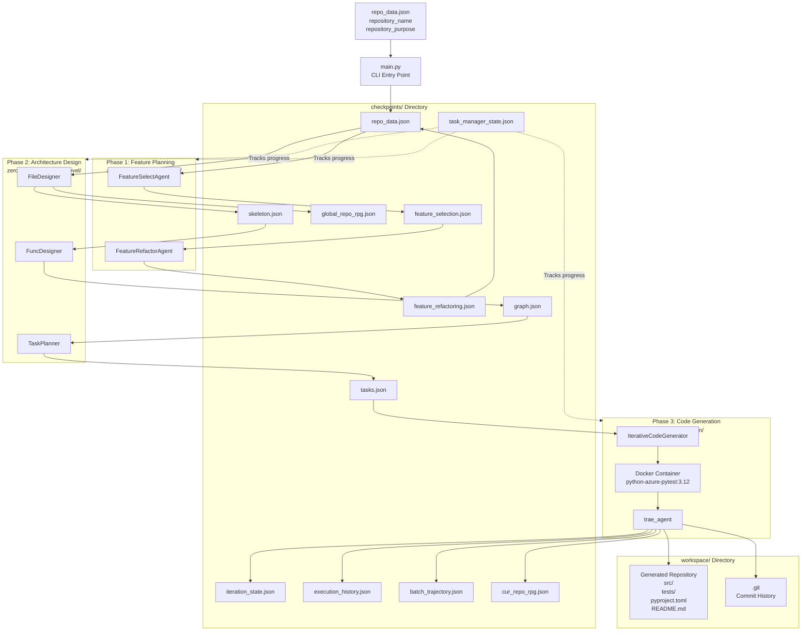

**Key Entry Points:**
- **main.py:** CLI entry point, argument parsing, pipeline orchestration
- **ZeroRepo.run():** Main pipeline executor
- **PropBuilder.build_feature_tree():** Phase 1 entry
- **ImplBuilder.run():** Phase 2 entry
- **IterativeCodeGenerator.task_executor():** Phase 3 entry

**Sources:** [main.py:1-307](), [README.md:34-96]()

---

## Step 4: Monitor Progress

### Console Output

The system provides real-time progress information:

```
🚀 ZeroRepo Automated Code Generation System Starting
============================================================
📋 Configuration file: configs/zerorepo_config.yaml
💾 Checkpoint directory: ../my_project/checkpoints
📁 Target repository: ../my_project/workspace
🔧 Execution phase: all
📊 Log level: INFO
⏯️ Resume mode enabled
============================================================

🔧 Initializing ZeroRepo system...
📋 Setting up global checkpoint manager: ../my_project/checkpoints

🎨 Executing Phase 1: Feature Planning...
  └─ Running FeatureSelectAgent...
  └─ Running FeatureRefactorAgent...
  ✅ Phase 1 complete

🏗️ Executing Phase 2: Architecture Design...
  └─ Creating initial RPG...
  └─ Running FileDesigner (skeleton generation)...
  └─ Running FuncDesigner (interface design)...
  └─ Running TaskPlanner (batch splitting)...
  ✅ Phase 2 complete

⚡ Executing Phase 3: Code Generation...
  └─ Processing task batch 1/24...
  └─ Processing task batch 2/24...
  ...
```

### Checkpoint Files

Monitor progress by checking `checkpoints/task_manager_state.json`:

```json
{
  "feature_selection": true,
  "feature_refactoring": true,
  "build_skeleton": true,
  "build_function": true,
  "plan_tasks": true,
  "code_generation": false,
  "completed_tasks": ["batch_id_1", "batch_id_2"],
  "failed_tasks": [],
  "current_task": {
    "task_id": "batch_id_3",
    "file_path": "src/ai/pathfinding.py"
  },
  "last_updated": "2026-02-09T13:56:20"
}
```

**Sources:** [main.py:168-200](), [README.md:354-380]()

---

## Step 5: Understanding the Output

### Workspace Structure

After successful execution, `workspace/` contains a complete repository:

```
workspace/
├── .git/                    # Git repository with commit history
├── src/                     # Source code
│   ├── ai/
│   │   ├── pathfinding.py
│   │   └── opponent/
│   ├── gameplay/
│   │   ├── rules/
│   │   └── levels/
│   ├── data/
│   ├── io/
│   ├── simulation/
│   └── network/
├── tests/                   # Test files (mirroring src/ structure)
│   ├── test_pathfinding.py
│   └── ...
├── pyproject.toml          # Python project configuration
├── README.md               # Generated documentation
└── requirements.txt        # Dependencies
```

### Checkpoint Artifacts

The `checkpoints/` directory contains all design artifacts and state:

| File | Phase | Description |
|------|-------|-------------|
| `repo_data.json` | Input/Phase 1 | Project description + feature tree + components |
| `feature_selection.json` | Phase 1 | Raw feature taxonomy from LLM |
| `feature_refactoring.json` | Phase 1 | Component grouping results |
| `global_repo_rpg.json` | Phase 2 | Complete Repository Planning Graph |
| `skeleton.json` | Phase 2 | File/directory layout with code skeletons |
| `graph.json` | Phase 2 | Interface designs (signatures, docstrings, types) |
| `tasks.json` | Phase 2 | Implementation task batches |
| `iteration_state.json` | Phase 3 | Current TDD iteration state |
| `execution_history.json` | Phase 3 | Flat list of all workflow executions |
| `batch_trajectory.json` | Phase 3 | Per-batch execution records |
| `cur_repo_rpg.json` | Phase 3 | Updated RPG with implementation status |
| `task_manager_state.json` | All | Master progress tracker |

### Git History

The workspace is initialized as a git repository with detailed commit history:

```bash
cd workspace
git log --oneline
```

Example output:
```
abc1234 fix: correct deserialization of optional player_name field
def5678 feat: implement HighScoreBinarySerializer binary encoding/decoding
ghi9012 test: add unit tests for HighScoreBinarySerializer
jkl3456 feat: implement pathfinding A* algorithm
mno7890 test: add pathfinding integration tests
...
```

**Sources:** [README.md:84-96](), [README.md:382-399]()

---

## Resuming Execution

### Resume from Checkpoint

If execution is interrupted (Ctrl+C, error, timeout), resume with the same command using `--resume`:

```bash
python main.py \
  --config configs/zerorepo_config.yaml \
  --checkpoint ../my_project/checkpoints \
  --repo ../my_project/workspace \
  --phase all \
  --resume
```

### Resume Behavior

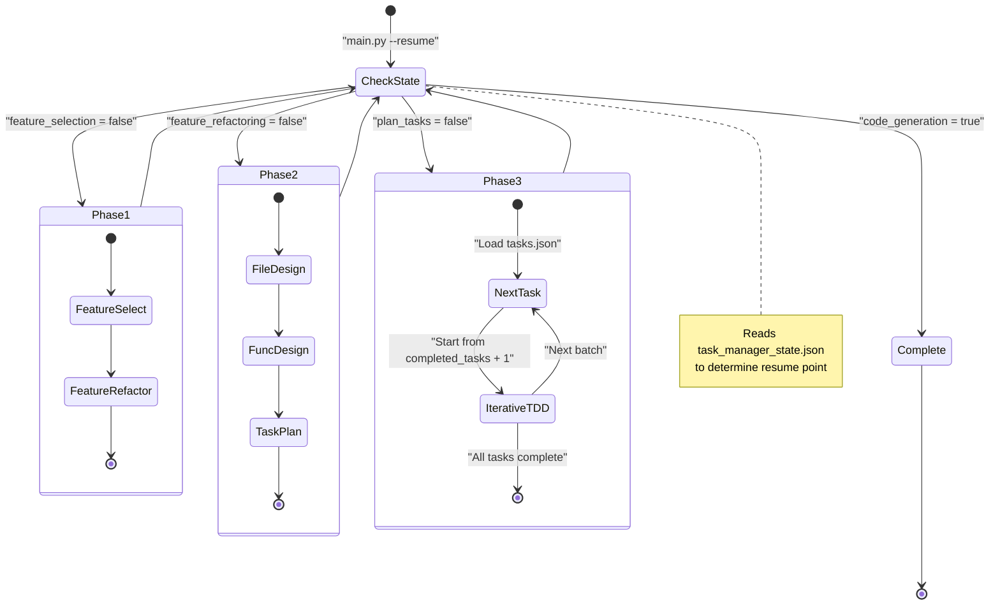

**Resume Logic:**
1. Loads `task_manager_state.json`
2. Skips completed phases entirely
3. Resumes Phase 3 from `completed_tasks` list
4. Can retry failed tasks from `failed_tasks` list

### Force Rebuild

To start completely fresh (useful for testing configuration changes):

```bash
python main.py \
  --config configs/zerorepo_config.yaml \
  --checkpoint ../my_project/checkpoints \
  --repo ../my_project/workspace \
  --force-rebuild
```

This will:
- Rebuild Docker containers
- Clear `task_manager_state.json`
- Re-execute all phases from scratch

**Sources:** [README.md:354-380](), [main.py:86-101]()

---

## Common Usage Scenarios

### Design Only (Phases 1 & 2)

Generate architecture without implementing code:

```bash
python main.py \
  --config configs/zerorepo_config.yaml \
  --checkpoint ../my_project/checkpoints \
  --repo ../my_project/workspace \
  --phase design
```

**Outputs:** Feature tree, components, file skeleton, interface designs, task plan
**Use Case:** Review architecture before committing to full code generation

### Implementation Only (Phase 3)

Execute code generation using existing design artifacts:

```bash
python main.py \
  --config configs/zerorepo_config.yaml \
  --checkpoint ../my_project/checkpoints \
  --repo ../my_project/workspace \
  --phase implementation
```

**Prerequisites:** Requires completed Phase 2 outputs (`skeleton.json`, `graph.json`, `tasks.json`)
**Use Case:** Re-run implementation with different code generation settings

### Dry Run (Validation)

Validate configuration without execution:

```bash
python main.py \
  --config configs/zerorepo_config.yaml \
  --checkpoint ../my_project/checkpoints \
  --repo ../my_project/workspace \
  --dry-run
```

**Use Case:** Test configuration changes before starting expensive operations

### Custom LLM Configuration

Override LLM settings without editing `zerorepo_config.yaml`:

```bash
python main.py \
  --config configs/zerorepo_config.yaml \
  --llm-config configs/custom_llm.yaml \
  --checkpoint ../my_project/checkpoints \
  --repo ../my_project/workspace
```

**Sources:** [main.py:109-115](), [main.py:231-235]()

---

## Execution Time Estimates

Typical execution times vary based on project complexity and LLM provider:

| Phase | SnakeGame Example | Typical Range |
|-------|-------------------|---------------|
| Phase 1: Feature Planning | 5-10 minutes | 3-15 minutes |
| Phase 2: Architecture Design | 15-30 minutes | 10-60 minutes |
| Phase 3: Code Generation | 1-3 hours | 30 min - 8 hours |
| **Total** | **1.5-3.5 hours** | **45 min - 9 hours** |

**Factors Affecting Time:**
- Project complexity (number of features, files)
- LLM response speed and rate limits
- Test-driven development iterations (Phase 3)
- Docker container startup overhead

**Sources:** [README.md:34-96](), [README.md:284-352]()

---

## Troubleshooting

### Common Issues

**Problem:** `Configuration file does not exist: configs/zerorepo_config.yaml`
- **Solution:** Ensure you're running from the RPG-ZeroRepo repository root

**Problem:** `Cannot create checkpoint directory`
- **Solution:** Verify directory permissions and path is outside git repository

**Problem:** Docker container fails to start
- **Solution:** Ensure Docker daemon is running and image `python-azure-pytest:3.12` is built (see [Docker Container Setup](#6.1))

**Problem:** LLM API authentication errors
- **Solution:** Verify `OPENAI_API_KEY` environment variable or `api_key` in configuration

**Problem:** Phase 3 hangs on test execution
- **Solution:** Check Docker container logs, may need to increase `workflow_timeout` in configuration

### Log Levels

For detailed debugging:

```bash
python main.py \
  --config configs/zerorepo_config.yaml \
  --checkpoint ../my_project/checkpoints \
  --repo ../my_project/workspace \
  --log-level DEBUG \
  --log-file debug.log
```

**Sources:** [main.py:76-89](), [main.py:134-167]()

---

## Next Steps

After successfully generating your first repository:

1. **Review Architecture:** Examine `checkpoints/skeleton.json` and `checkpoints/graph.json` to understand the design decisions
2. **Inspect Code Quality:** Run tests in `workspace/tests/`, review code style and documentation
3. **Customize Configuration:** See [Configuration Overview](#2.3) for advanced settings
4. **Understand Checkpoints:** Read [State Management and Checkpointing](#5) for recovery and resume capabilities
5. **Explore Evaluation:** Use [RepoCraft](#7) to assess quality against ground truth repositories

**Sources:** [README.md:1-482]()

---

# Page: Configuration Overview

# Configuration Overview

<details>
<summary>Relevant source files</summary>

The following files were used as context for generating this wiki page:

- [configs/checkpoint_config.yaml](configs/checkpoint_config.yaml)
- [configs/llm_config.yaml](configs/llm_config.yaml)
- [configs/zerorepo_config.yaml](configs/zerorepo_config.yaml)

</details>


This document introduces the RPG-ZeroRepo configuration system, explaining how configuration files work together to control system behavior. It provides an overview of the configuration hierarchy, file relationships, and override mechanisms. For detailed documentation of specific configuration parameters, see [Main Configuration](#4.1), [LLM Configuration](#4.2), [Design Configuration](#4.3), and [TRAE Agent Configuration](#4.4).

## Purpose and Scope

RPG-ZeroRepo uses a multi-layered configuration system that separates concerns across specialized files. The main orchestrator configuration file (`zerorepo_config.yaml`) references domain-specific configuration files for LLM settings, design agents, and code generation. This modular approach allows:

- Independent tuning of subsystem parameters
- Override capabilities via command-line arguments
- Consistent state management through checkpoint definitions
- Easy configuration sharing and version control

## Configuration File Hierarchy

The configuration system consists of a primary orchestrator and several specialized configuration files:

**Configuration File Relationships**

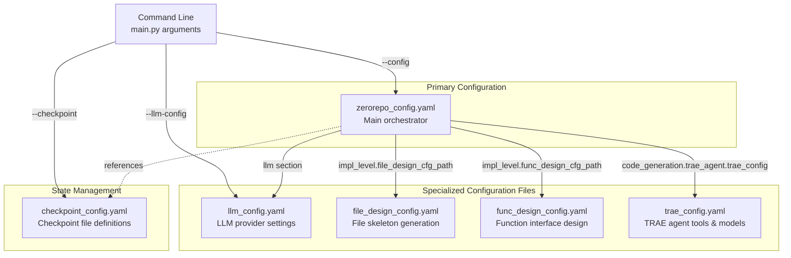

**Sources:** [configs/zerorepo_config.yaml](), [configs/llm_config.yaml](), [configs/checkpoint_config.yaml](), Diagram 3 from context

## Main Configuration File

The `zerorepo_config.yaml` file serves as the primary orchestrator, organizing configuration into three major sections corresponding to the three-phase pipeline:

| Section | Purpose | Key Parameters |
|---------|---------|----------------|
| `llm` | LLM provider and model settings | `model`, `max_tokens`, `temperature`, `reasoning_effort`, `api_key` |
| `prop_level` | Phase 1 feature planning parameters | `feature_selection`, `feature_refactoring` |
| `impl_level` | Phase 2 architecture design configuration | `file_design_cfg_path`, `func_design_cfg_path` |
| `code_generation` | Phase 3 code generation and Docker settings | `docker`, `trae_agent` |

### LLM Section

The `llm` section in `zerorepo_config.yaml` defines default LLM settings:

```yaml
llm:
  model: "gpt-5-mini-20250807"
  max_tokens: 32268
  temperature: 0.0
  reasoning_effort: "medium"
  provider: "openai"
  api_key: ""
```

These settings can be overridden by a separate `llm_config.yaml` file when provided via the `--llm-config` CLI argument.

**Sources:** [configs/zerorepo_config.yaml:7-17]()

### Property Level Section

The `prop_level` section configures Phase 1 feature planning:

```yaml
prop_level:
  feature_selection:
    mode: "simple"  # "feature" or "simple"
    explore_conditions: [5, 8, 5, 4, 5]
    select_max_iterations: 2
    temperature: 10
  
  feature_refactoring:
    refactor_max_iterations: 40
    refactor_context_window: 0
```

The `mode` parameter controls whether to use simple single-agent feature generation (`"simple"`) or complex multi-agent feature tree exploration (`"feature"`).

**Sources:** [configs/zerorepo_config.yaml:21-40]()

### Implementation Level Section

The `impl_level` section references external configuration files for Phase 2 design agents:

```yaml
impl_level:
  file_design_cfg_path: "configs/file_design_config.yaml"
  func_design_cfg_path: "configs/func_design_config.yaml"
```

This indirection allows detailed agent parameters to be maintained in separate files without cluttering the main configuration.

**Sources:** [configs/zerorepo_config.yaml:44-48]()

### Code Generation Section

The `code_generation` section configures Docker execution and TRAE agent behavior:

```yaml
code_generation:
  docker:
    enabled: true
    image: "python-azure-pytest:3.12"
    container_name: "zerorepo_2"
    force_rebuild: True
    workspace: "/tare_workspace"
  
  trae_agent:
    trae_config: "./configs/trae_config.yaml"
    max_retries: 3
    retry_delay: 5
    max_iterations: 5
    max_retries_per_workflow: 3
    workflow_timeout: 1800
```

**Sources:** [configs/zerorepo_config.yaml:53-72]()

## Specialized Configuration Files

**Configuration File Structure and References**

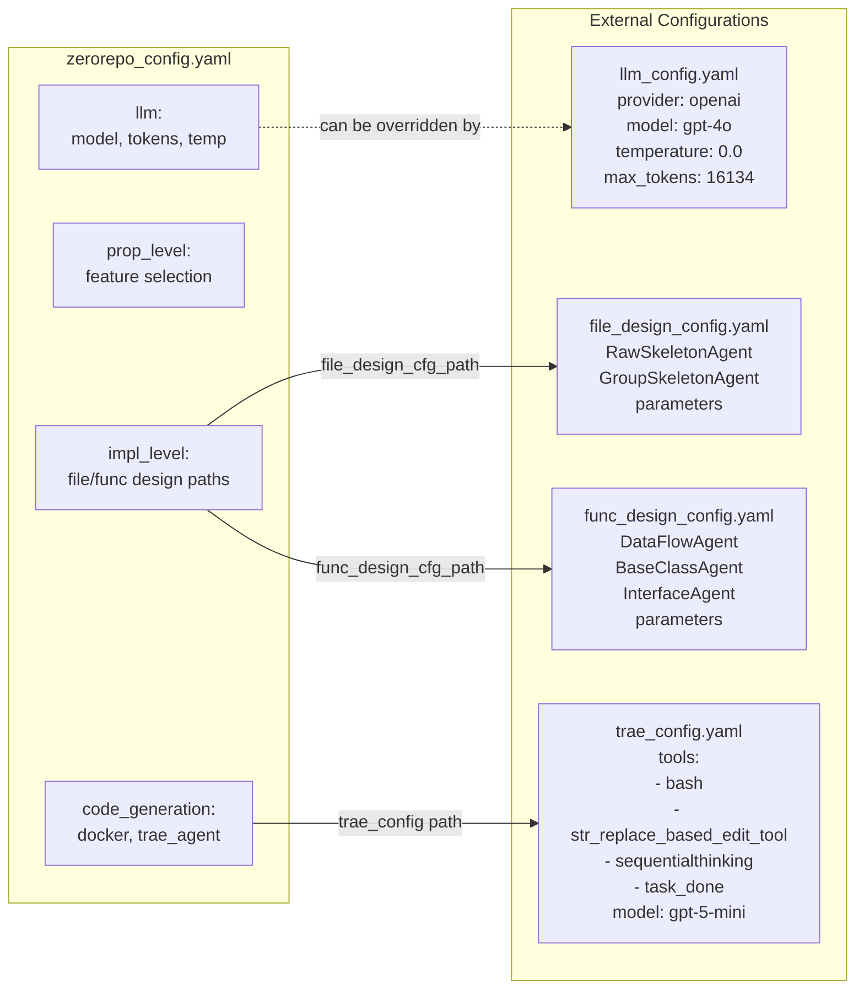

**Sources:** [configs/zerorepo_config.yaml](), [configs/llm_config.yaml](), Diagram 3 from context

### llm_config.yaml

A standalone LLM configuration file that can override the `llm` section in `zerorepo_config.yaml`:

| Parameter | Purpose | Example Value |
|-----------|---------|---------------|
| `model` | LLM model identifier | `gpt-4o` |
| `provider` | LLM provider service | `openai` |
| `temperature` | Sampling temperature | `0.0` |
| `max_tokens` | Maximum response tokens | `16134` |
| `api_key` | Authentication key | `""` |
| `base_url` | Optional custom endpoint | `""` |

**Sources:** [configs/llm_config.yaml:1-16]()

### file_design_config.yaml

Referenced by `impl_level.file_design_cfg_path`, this file configures the `RawSkeletonAgent` and `GroupSkeletonAgent` for Phase 2 file structure generation.

**Sources:** [configs/zerorepo_config.yaml:46]()

### func_design_config.yaml

Referenced by `impl_level.func_design_cfg_path`, this file configures the `DataFlowAgent`, `BaseClassAgent`, and `InterfaceAgent` for Phase 2 function interface design.

**Sources:** [configs/zerorepo_config.yaml:48]()

### trae_config.yaml

Referenced by `code_generation.trae_agent.trae_config`, this file defines the TRAE agent's available tools and model settings. Key tools include:
- `bash` - shell command execution
- `str_replace_based_edit_tool` - code editing
- `sequentialthinking` - reasoning mode
- `task_done` - completion signal

For detailed documentation, see [TRAE Agent Configuration](#4.4).

**Sources:** [configs/zerorepo_config.yaml:64](), Diagram 5 from context

## Configuration Override System

The system supports a hierarchical override mechanism where command-line arguments take precedence over configuration files:

**Override Precedence Flow**

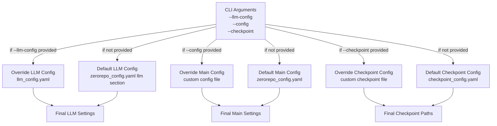

**Sources:** Diagram 3 from context, [main.py CLI argument parsing]()

### CLI Override Arguments

| Argument | Purpose | Default |
|----------|---------|---------|
| `--config` | Override main configuration file | `configs/zerorepo_config.yaml` |
| `--llm-config` | Override LLM configuration file | Uses `llm` section from main config |
| `--checkpoint` | Override checkpoint configuration file | `configs/checkpoint_config.yaml` |

For complete CLI documentation, see [Command Line Interface](#11.1).

**Sources:** [main.py CLI arguments]()

## Checkpoint Configuration

The `checkpoint_config.yaml` file defines paths for all state files used throughout the pipeline. This configuration is separate from behavioral configuration because it defines the state management schema:

**Checkpoint File Categories**

```yaml
checkpoint_files:
  # Core state files
  repo_data: "repo_data.json"
  task_manager_state: "task_manager_state.json"
  
  # Design phase files
  skeleton: "skeleton.json"
  skeleton_trajectory: "skeleton_traj.json"
  graph: "graph.json"
  tasks: "tasks.json"
  
  # RPG files
  global_repo_rpg: "global_repo_rpg.json"
  current_repo_rpg: "cur_repo_rpg.json"
  
  # Code generation files
  iteration_state: "iteration_state.json"
  execution_history: "execution_history.json"
  batch_trajectory: "batch_trajectory.json"
  
  # Property level files
  feature_analysis: "feature_analysis.json"
  refactor_plan: "refactor_plan.json"
```

These checkpoint files enable the resume capability and progress tracking. For detailed information on checkpoint files and state management, see [State Management and Checkpointing](#5) and [Checkpoint File Reference](#5.1).

**Sources:** [configs/checkpoint_config.yaml:1-27]()

## Configuration Quick Reference

### Key Configuration Files

| File | Purpose | CLI Override | Referenced By |
|------|---------|--------------|---------------|
| `zerorepo_config.yaml` | Main orchestrator configuration | `--config` | `main.py` |
| `llm_config.yaml` | LLM provider and model settings | `--llm-config` | `zerorepo_config.yaml` or CLI |
| `checkpoint_config.yaml` | State file path definitions | `--checkpoint` | `main.py` |
| `file_design_config.yaml` | File skeleton agent parameters | N/A | `zerorepo_config.yaml` |
| `func_design_config.yaml` | Function design agent parameters | N/A | `zerorepo_config.yaml` |
| `trae_config.yaml` | TRAE agent tools and settings | N/A | `zerorepo_config.yaml` |

### Configuration Sections by Pipeline Phase

| Phase | Configuration Location | Key Parameters |
|-------|----------------------|----------------|
| **Phase 1: Feature Planning** | `zerorepo_config.yaml` → `prop_level` | `feature_selection.mode`, `feature_refactoring.refactor_max_iterations` |
| **Phase 2: Architecture Design** | `zerorepo_config.yaml` → `impl_level` → external files | `file_design_cfg_path`, `func_design_cfg_path` |
| **Phase 3: Code Generation** | `zerorepo_config.yaml` → `code_generation` | `docker.image`, `trae_agent.max_iterations` |

**Sources:** [configs/zerorepo_config.yaml](), [configs/checkpoint_config.yaml](), [configs/llm_config.yaml]()

## Next Steps

To customize RPG-ZeroRepo for your use case:

1. **Modify LLM settings** - See [LLM Configuration](#4.2) for details on model selection and API configuration
2. **Adjust design parameters** - See [Design Configuration](#4.3) for file and function design agent tuning
3. **Configure TRAE agent** - See [TRAE Agent Configuration](#4.4) for tool and execution parameter customization
4. **Understand state management** - See [State Management and Checkpointing](#5) for checkpoint system details

For a complete walkthrough of using these configurations, see [Quick Start Guide](#2.2).

**Sources:** [configs/zerorepo_config.yaml](), [configs/llm_config.yaml](), [configs/checkpoint_config.yaml]()

---

# Page: Core Pipeline

# Core Pipeline

<details>
<summary>Relevant source files</summary>

The following files were used as context for generating this wiki page:

- [README.md](README.md)
- [configs/checkpoint_config.yaml](configs/checkpoint_config.yaml)
- [configs/zerorepo_config.yaml](configs/zerorepo_config.yaml)

</details>


The Core Pipeline is the three-phase orchestration system that transforms a natural language project description into a complete, tested software repository. This page provides an architectural overview of how phases interact, what data flows between them, and how the system maintains state for resumability.

For detailed information about individual phase implementations, see [Phase 1: Feature Planning](#3.1), [Phase 2: Architecture Design](#3.2), and [Phase 3: Code Generation](#3.3). For configuration details, see [Configuration System](#4).

---

## Three-Phase Architecture

The pipeline consists of three sequential phases, each producing checkpoint files that serve as inputs to the next phase:

| Phase | Module | Entry Point | Input | Output |
|-------|--------|-------------|-------|--------|
| **Phase 1: Feature Planning** | `zerorepo/rpg_gen/prop_level/` | `PropBuilder.build_feature_tree()` | `repo_data.json` (name + purpose) | `repo_data.json` (with Feature_tree + Component) |
| **Phase 2: Architecture Design** | `zerorepo/rpg_gen/impl_level/` | `ImplBuilder.run()` | Feature_tree + Component | `skeleton.json`, `graph.json`, `tasks.json` |
| **Phase 3: Code Generation** | `zerorepo/code_gen/` | `IterativeCodeGenerator.task_executor()` | `tasks.json` | `workspace/` (generated repository) |

Each phase is idempotent and resumable. If interrupted, the system can skip completed phases and resume from the next incomplete stage.

**Sources:** [README.md:98-280](), [main.py](), [zerorepo_config.yaml]()

---

## Pipeline Data Flow

This diagram shows the concrete checkpoint files and code entities that connect the three phases:

**Pipeline Phase Transitions and Checkpoint Files**

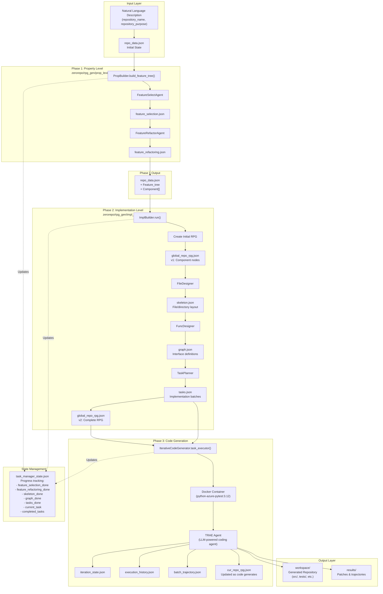

The pipeline transforms inputs through three distinct representations:

1. **Natural Language → Feature Tree**: User description becomes hierarchical taxonomy of features
2. **Feature Tree → Architecture**: Features mapped to file structure and interface specifications
3. **Architecture → Code**: Interface specifications filled with implementations via TDD

Each transition produces machine-readable JSON checkpoint files that enable phase independence and resumability.

**Sources:** [README.md:98-280](), [checkpoint_config.yaml](), [Diagram 2 from context]()

---

## Component Class Structure

The pipeline is implemented by three main builder classes, each managing a distinct phase:

**Core Pipeline Components and Their Relationships**

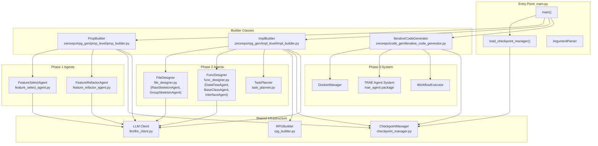

The `main()` function orchestrates phase execution by instantiating builder classes in sequence. Each builder depends on `CheckpointManager` for state persistence and `LLMClient` for model interactions (except Phase 3, which uses TRAE agent's internal LLM client).

**Sources:** [main.py](), [README.md:98-280](), [zerorepo/rpg_gen/prop_level/](), [zerorepo/rpg_gen/impl_level/](), [zerorepo/code_gen/]()

---

## Phase Orchestration

The `main()` function in [main.py]() controls phase execution based on command-line arguments and checkpoint state:

### Execution Flow

```mermaid
graph TD
    Start["main() Entry"]
    ParseCLI["Parse CLI Arguments<br/>--config, --checkpoint,<br/>--repo, --phase,<br/>--resume, --force-rebuild"]
    LoadConfig["Load zerorepo_config.yaml<br/>+ checkpoint_config.yaml<br/>+ llm_config.yaml"]
    InitCheckpoint["CheckpointManager.__init__()<br/>Load task_manager_state.json"]
    
    CheckPhase{"--phase<br/>argument"}
    
    CheckP1{"Phase 1<br/>Needed?"}
    RunP1["PropBuilder.build_feature_tree()<br/>+ save to repo_data.json<br/>+ update task_manager_state"]
    
    CheckP2{"Phase 2<br/>Needed?"}
    RunP2["ImplBuilder.run()<br/>+ save skeleton.json, graph.json, tasks.json<br/>+ update task_manager_state"]
    
    CheckP3{"Phase 3<br/>Needed?"}
    RunP3["IterativeCodeGenerator.task_executor()<br/>+ generate code in workspace/<br/>+ update task_manager_state"]
    
    Complete["Pipeline Complete"]
    
    Start --> ParseCLI
    ParseCLI --> LoadConfig
    LoadConfig --> InitCheckpoint
    InitCheckpoint --> CheckPhase
    
    CheckPhase -->|"all or prop"| CheckP1
    CheckPhase -->|"impl"| CheckP2
    CheckPhase -->|"code"| CheckP3
    
    CheckP1 -->|"Not done or<br/>--force-rebuild"| RunP1
    CheckP1 -->|"Done and<br/>--resume"| CheckP2
    RunP1 --> CheckP2
    
    CheckP2 -->|"Not done or<br/>--force-rebuild"| RunP2
    CheckP2 -->|"Done and<br/>--resume"| CheckP3
    RunP2 --> CheckP3
    
    CheckP3 -->|"Not done or<br/>--force-rebuild"| RunP3
    CheckP3 -->|"Done and<br/>--resume"| Complete
    RunP3 --> Complete
```

### Phase Selection Logic

The `--phase` argument determines which phases execute:

| Value | Behavior |
|-------|----------|
| `all` (default) | Run all three phases in sequence |
| `prop` | Run Phase 1 only (feature planning) |
| `impl` | Run Phase 2 only (architecture design) |
| `code` | Run Phase 3 only (code generation) |

When `--resume` is specified, completed phases are skipped based on flags in `task_manager_state.json`:
- `feature_selection_done` → skip `FeatureSelectAgent`
- `feature_refactoring_done` → skip `FeatureRefactorAgent`
- `skeleton_done` → skip `FileDesigner`
- `graph_done` → skip `FuncDesigner`
- `tasks_done` → skip `TaskPlanner`
- `completed_tasks[]` → skip completed implementation batches

The `--force-rebuild` flag clears completion flags, forcing phases to re-execute from scratch.

**Sources:** [main.py](), [README.md:354-380](), [checkpoint_config.yaml]()

---

## Checkpoint File Dependencies

Each phase produces specific checkpoint files that subsequent phases consume:

**Checkpoint File Dependency Graph**

```mermaid
graph LR
    subgraph Input["Input (User-Provided)"]
        RD0["repo_data.json<br/>{repository_name,<br/>repository_purpose}"]
    end
    
    subgraph P1Files["Phase 1 Checkpoints"]
        FS["feature_selection.json<br/>Raw feature taxonomy"]
        FR["feature_refactoring.json<br/>Component groupings"]
        RD1["repo_data.json<br/>+ Feature_tree<br/>+ Component[]"]
    end
    
    subgraph P2Files["Phase 2 Checkpoints"]
        RPG1["global_repo_rpg.json<br/>Initial RPG structure"]
        SKEL["skeleton.json<br/>File/directory layout"]
        SKELTRAJ["skeleton_traj.json<br/>LLM trajectories"]
        GRAPH["graph.json<br/>Interface definitions"]
        TASKS["tasks.json<br/>Implementation batches"]
        RPG2["global_repo_rpg.json<br/>Complete RPG with interfaces"]
    end
    
    subgraph P3Files["Phase 3 Checkpoints"]
        ITER["iteration_state.json<br/>Current iteration state"]
        EXEC["execution_history.json<br/>All workflow executions"]
        BATCH["batch_trajectory.json<br/>Per-batch execution records"]
        CRRPG["cur_repo_rpg.json<br/>Runtime RPG state"]
    end
    
    subgraph State["Global State"]
        TMS["task_manager_state.json<br/>Phase completion flags<br/>+ task progress"]
    end
    
    RD0 -->|"Phase 1 input"| FS
    FS --> FR
    FR --> RD1
    
    RD1 -->|"Phase 2 input"| RPG1
    RPG1 --> SKEL
    SKEL --> SKELTRAJ
    SKEL --> GRAPH
    GRAPH --> TASKS
    TASKS --> RPG2
    
    RPG2 -->|"Phase 3 input"| ITER
    TASKS -->|"Phase 3 input"| ITER
    ITER --> EXEC
    EXEC --> BATCH
    ITER --> CRRPG
    
    RD0 -.->|"Updated by all phases"| TMS
    RD1 -.->|"Updated by all phases"| TMS
    RPG2 -.->|"Updated by all phases"| TMS
```

### Critical Checkpoint Files

| File | Producer | Consumers | Purpose |
|------|----------|-----------|---------|
| `repo_data.json` | User (initial), Phase 1 (enriched) | Phase 1, Phase 2 | Master repository metadata with Feature_tree and Component definitions |
| `task_manager_state.json` | All phases | `main()`, All phases | Progress tracking and resume logic |
| `global_repo_rpg.json` | Phase 2 | Phase 3 | Complete Repository Planning Graph with all nodes/edges |
| `skeleton.json` | Phase 2 (`FileDesigner`) | Phase 2 (`FuncDesigner`) | File structure before interface design |
| `graph.json` | Phase 2 (`FuncDesigner`) | Phase 2 (`TaskPlanner`), Phase 3 | Complete interface definitions per file |
| `tasks.json` | Phase 2 (`TaskPlanner`) | Phase 3 | Implementation task batches with units and priorities |
| `cur_repo_rpg.json` | Phase 3 | Phase 3 | Dynamically updated RPG reflecting generated code |

The checkpoint system ensures that:
1. No phase is re-executed unnecessarily when resuming
2. Failures in later phases don't corrupt earlier work
3. Each phase can be developed/debugged independently

**Sources:** [README.md:383-399](), [checkpoint_config.yaml](), [Diagram 4 from context]()

---

## Configuration Hierarchy

The pipeline's behavior is controlled by a layered configuration system:

### Configuration File Structure

```mermaid
graph TB
    CLI["Command Line<br/>main.py --config ... --llm-config ..."]
    
    subgraph MainCfg["Primary Configuration"]
        ZRC["zerorepo_config.yaml<br/>Main orchestrator config"]
        
        ZRC_LLM["llm:<br/>model, provider, api_key,<br/>max_tokens, temperature"]
        ZRC_PROP["prop_level:<br/>feature_selection, feature_refactoring"]
        ZRC_IMPL["impl_level:<br/>file_design_cfg_path,<br/>func_design_cfg_path"]
        ZRC_CODE["code_generation:<br/>docker, trae_agent"]
        
        ZRC --> ZRC_LLM
        ZRC --> ZRC_PROP
        ZRC --> ZRC_IMPL
        ZRC --> ZRC_CODE
    end
    
    subgraph RefCfg["Referenced Configurations"]
        LLMCFG["llm_config.yaml<br/>(optional override)"]
        FDCFG["file_design_config.yaml<br/>RawSkeletonAgent,<br/>GroupSkeletonAgent params"]
        FNCFG["func_design_config.yaml<br/>DataFlowAgent, BaseClassAgent,<br/>InterfaceAgent params"]
        TRACFG["trae_config.yaml<br/>TRAE agent tools, models,<br/>max_steps"]
    end
    
    subgraph StateCfg["State Configuration"]
        CHKPT["checkpoint_config.yaml<br/>Checkpoint file definitions"]
    end
    
    CLI -.->|"--config"| ZRC
    CLI -.->|"--llm-config"| LLMCFG
    CLI -.->|"--checkpoint"| CHKPT
    
    ZRC_LLM -.->|"Can be overridden by"| LLMCFG
    ZRC_IMPL --> FDCFG
    ZRC_IMPL --> FNCFG
    ZRC_CODE --> TRACFG
```

### Configuration Loading Order

1. `main()` parses command-line arguments
2. Loads `zerorepo_config.yaml` from `--config` path
3. If `--llm-config` provided, overrides `llm` section
4. Loads `checkpoint_config.yaml` to initialize `CheckpointManager`
5. Phase 2 loads `file_design_config.yaml` and `func_design_config.yaml`
6. Phase 3 loads `trae_config.yaml` for TRAE agent

This hierarchy allows:
- **Global defaults** in `zerorepo_config.yaml`
- **LLM-specific overrides** via `--llm-config`
- **Phase-specific tuning** via referenced config files
- **State management schema** via `checkpoint_config.yaml`

**Sources:** [main.py](), [zerorepo_config.yaml:1-73](), [Diagram 3 from context](), [configs/]()

---

## Resume and Recovery Mechanism

The checkpoint system enables the pipeline to resume from any point without repeating expensive operations:

### Resume Logic Flow

```mermaid
graph TD
    Start["main() with --resume"]
    LoadState["Load task_manager_state.json"]
    
    CheckP1["Check feature_selection_done<br/>and feature_refactoring_done"]
    DecisionP1{"Phase 1<br/>Complete?"}
    RunP1["Execute PropBuilder"]
    SkipP1["Skip Phase 1"]
    
    CheckP2["Check skeleton_done,<br/>graph_done, tasks_done"]
    DecisionP2{"Phase 2<br/>Complete?"}
    RunP2["Execute ImplBuilder"]
    SkipP2["Skip Phase 2"]
    
    CheckP3["Check completed_tasks[]<br/>vs tasks.json batches"]
    DecisionP3{"Phase 3<br/>Complete?"}
    LoadTasks["Load tasks.json"]
    FilterTasks["Filter out completed_tasks"]
    RunP3["Execute IterativeCodeGenerator<br/>on remaining tasks"]
    SkipP3["Skip Phase 3"]
    
    Done["Pipeline Complete"]
    
    Start --> LoadState
    LoadState --> CheckP1
    CheckP1 --> DecisionP1
    DecisionP1 -->|"Yes"| SkipP1
    DecisionP1 -->|"No"| RunP1
    SkipP1 --> CheckP2
    RunP1 --> CheckP2
    
    CheckP2 --> DecisionP2
    DecisionP2 -->|"Yes"| SkipP2
    DecisionP2 -->|"No"| RunP2
    SkipP2 --> CheckP3
    RunP2 --> CheckP3
    
    CheckP3 --> DecisionP3
    DecisionP3 -->|"Yes"| SkipP3
    DecisionP3 -->|"No"| LoadTasks
    LoadTasks --> FilterTasks
    FilterTasks --> RunP3
    SkipP3 --> Done
    RunP3 --> Done
```

### task_manager_state.json Structure

```json
{
  "feature_selection_done": true,
  "feature_refactoring_done": true,
  "skeleton_done": true,
  "graph_done": true,
  "tasks_done": true,
  "code_generation": false,
  "completed_tasks": [
    "src_ai_pathfinding_astar.py_batch_1",
    "src_gameplay_rules_movement.py_batch_1"
  ],
  "failed_tasks": [
    "src_network_transport_reliability.py_batch_1"
  ],
  "current_task": {
    "task_id": "src_io_persistence_serialization.py_batch_1",
    "batch_name": "io.input_persistence",
    "iteration": 2,
    "last_workflow": "CODE_BUG_FIX"
  },
  "last_updated": "2026-02-09T14:23:45.123456"
}
```

### Recovery Capabilities

| Scenario | Behavior |
|----------|----------|
| **Phase 1 interrupted** | Resumes from `FeatureSelectAgent` or `FeatureRefactorAgent` based on completion flags |
| **Phase 2 interrupted** | Resumes from `FileDesigner`, `FuncDesigner`, or `TaskPlanner` |
| **Phase 3 interrupted** | Resumes from next uncompleted task batch; retries failed tasks |
| **Docker container crash** | Current task marked as failed; next run retries from iteration 0 |
| **LLM API error** | Task not marked complete; retry on next run |
| **Test failure at max iterations** | Task marked failed in `failed_tasks[]`; manual intervention required |

Failed tasks remain in `failed_tasks[]` until manually resolved. They can be retried by:
1. Removing the task from `failed_tasks[]` in `task_manager_state.json`
2. Running with `--resume`

Or by using `--force-rebuild` to restart all code generation from scratch.

**Sources:** [README.md:354-380](), [checkpoint_config.yaml](), [main.py](), [Diagram 4 from context]()

---

## Phase Input/Output Summary

This table summarizes the key transformations performed by each phase:

| Phase | Input Format | Output Format | Key Transformation |
|-------|--------------|---------------|-------------------|
| **Phase 1** | Natural language string: `"A multiplayer snake game..."` | Structured JSON: `Feature_tree` (hierarchical taxonomy), `Component[]` (logical modules) | Unstructured text → Structured feature hierarchy |
| **Phase 2** | Feature hierarchy + Components | File paths + Interface specifications: `skeleton.json` (76 files), `graph.json` (complete signatures, docstrings, types) | Abstract features → Concrete architecture |
| **Phase 3** | Interface specifications + Task batches | Executable Python code: `workspace/src/`, `workspace/tests/` | Type signatures → Working implementations |

### Data Size Growth

Using the SnakeGame example from the README:

- **Input**: ~50 words (project description)
- **After Phase 1**: ~200 features in Feature_tree, 6 Components
- **After Phase 2**: 76 files in skeleton, ~500 function/class interfaces in graph
- **After Phase 3**: ~5,000 lines of code, ~3,000 lines of tests

The pipeline expands a brief description into a complete repository through progressive refinement and LLM-guided generation.

**Sources:** [README.md:98-280](), [README.md:54-58](), [README.md:112-173](), [README.md:197-244]()

---

# Page: Phase 1: Feature Planning

# Phase 1: Feature Planning

<details>
<summary>Relevant source files</summary>

The following files were used as context for generating this wiki page:

- [README.md](README.md)
- [configs/checkpoint_config.yaml](configs/checkpoint_config.yaml)
- [configs/zerorepo_config.yaml](configs/zerorepo_config.yaml)

</details>


## Purpose and Scope

Phase 1 transforms a natural language project description into a structured, hierarchical representation of features and logical components. This phase is implemented by the `PropBuilder` class in [zerorepo/rpg_gen/prop_level/]() and consists of two sequential steps: feature selection and feature refactoring. 

For information about the subsequent architecture design phase, see [Phase 2: Architecture Design](#3.2). For details on checkpoint management and resumability, see [State Management and Checkpointing](#5).

**Sources:** [README.md:98-173](), [configs/zerorepo_config.yaml:19-40]()

---

## Overview

Phase 1 is the first stage of the three-phase RPG-ZeroRepo pipeline. It takes a simple text description of a desired repository and produces two key outputs:

1. **Feature Tree**: A hierarchical taxonomy of all functionality, algorithms, data structures, and quality attributes the project should implement
2. **Components**: Logical modules that group related features and will become top-level source directories

The phase operates through two LLM-powered agents that progressively refine the project scope from abstract natural language to structured, implementable units.

**Phase 1 Architecture**

```mermaid
graph TB
    Input["repo_data.json<br/>(input)"]
    PropBuilder["PropBuilder<br/>zerorepo/rpg_gen/prop_level/"]
    
    subgraph "Step 1: Feature Selection"
        FSA["FeatureSelectAgent"]
        FeatureTree["Feature Tree<br/>(hierarchical taxonomy)"]
        FSCheckpoint["feature_selection.json"]
    end
    
    subgraph "Step 2: Feature Refactoring"
        FRA["FeatureRefactorAgent"]
        Components["Components<br/>(logical modules)"]
        FRCheckpoint["feature_refactoring.json"]
    end
    
    Output["repo_data.json<br/>(enriched output)"]
    TaskManager["task_manager_state.json"]
    
    Input --> PropBuilder
    PropBuilder --> FSA
    FSA --> FeatureTree
    FeatureTree --> FSCheckpoint
    FeatureTree --> FRA
    FRA --> Components
    Components --> FRCheckpoint
    Components --> Output
    
    PropBuilder -.->|"updates progress flags"| TaskManager
    
    FSCheckpoint -.->|"checkpoint"| PropBuilder
    FRCheckpoint -.->|"checkpoint"| PropBuilder
```

**Sources:** [README.md:98-173](), [configs/checkpoint_config.yaml:24-26]()

---

## Input and Output

### Input Format

Phase 1 expects a `repo_data.json` file in the checkpoints directory with the following minimal structure:

```json
{
  "repository_name": "SnakeGame",
  "repository_purpose": "A multiplayer snake game with AI opponents, pathfinding, replay recording, and persistent high scores."
}
```

| Field | Type | Description |
|-------|------|-------------|
| `repository_name` | string | Name of the repository to generate |
| `repository_purpose` | string | Natural language description of the project's purpose, features, and requirements |

**Sources:** [README.md:51-58]()

### Output Format

Phase 1 enriches the `repo_data.json` file by adding two new fields:

```json
{
  "repository_name": "SnakeGame",
  "repository_purpose": "...",
  "Feature_tree": {
    "functionality": {
      "game mechanics": ["movement", "collision detection", "food spawning", "scoring"],
      "ai opponent": ["strategy", "training"],
      "level generation": ["static layout", "procedural maze", "dynamic obstacles"]
    },
    "algorithm": {
      "pathfinding": ["astar", "bfs flood fill", "monte carlo rollouts"],
      "optimization": ["caching", "incremental updates", "memory management"]
    },
    "data structures": {
      "grid management": ["occupancy map", "compact bitset", "quadtree index"],
      "snake body": ["ring buffer segments", "delta encoding", "serialization"]
    }
  },
  "Component": [
    {
      "name": "gameplay.core",
      "refactored_subtree": {
        "gameplay": {
          "rules": ["movement", "collision detection", "scoring"],
          "levels": ["static layout", "procedural generation"]
        }
      }
    },
    {
      "name": "ai.pathfinding",
      "refactored_subtree": {
        "pathfinding": ["astar", "bfs flood fill"],
        "opponent AI": ["strategy selection", "difficulty scaling"]
      }
    }
  ]
}
```

| Field | Type | Description |
|-------|------|-------------|
| `Feature_tree` | object | Hierarchical feature taxonomy organized by category (functionality, algorithm, data structures, quality attributes) |
| `Component` | array | List of logical components, each with a name and refactored feature subtree |

**Sources:** [README.md:152-172]()

---

## Step 1: Feature Selection

### Agent Architecture

The `FeatureSelectAgent` is responsible for generating a comprehensive feature taxonomy from the natural language description. The agent operates in one of two modes:

| Mode | Description | Use Case |
|------|-------------|----------|
| `simple` | Single-agent generation | Default mode, suitable for most projects |
| `feature` | Multi-agent with vector database | Advanced mode requiring pre-populated feature database |

**Feature Selection Data Flow**

```mermaid
graph LR
    Input["repository_purpose<br/>Natural Language"]
    
    subgraph "FeatureSelectAgent Processing"
        LLM["LLM<br/>(gpt-5-mini-20250807)"]
        
        subgraph "Mode: simple"
            SimplePrompt["Generate comprehensive<br/>feature taxonomy"]
        end
        
        subgraph "Mode: feature"
            VecDB["Vector Database<br/>(vec_db_path)"]
            FeatureTree["Feature Tree Reference<br/>(feature_tree_path)"]
            FreqData["Frequency Data<br/>(frequency_path)"]
            MultiAgent["Multi-agent exploration"]
        end
    end
    
    Output["Feature_tree<br/>{functionality, algorithm,<br/>data structures, ...}"]
    Checkpoint["feature_selection.json"]
    
    Input --> SimplePrompt
    Input --> VecDB
    
    SimplePrompt --> LLM
    VecDB --> MultiAgent
    FeatureTree --> MultiAgent
    FreqData --> MultiAgent
    MultiAgent --> LLM
    
    LLM --> Output
    Output --> Checkpoint
```

**Sources:** [configs/zerorepo_config.yaml:21-34](), [README.md:105-128]()

### Configuration Parameters

The feature selection step is configured via the `prop_level.feature_selection` section in `zerorepo_config.yaml`:

```yaml
prop_level:
  feature_selection:
    mode: "simple"  # "simple" or "feature"
    explore_conditions: [5, 8, 5, 4, 5]
    select_max_iterations: 2
    select_context_window: 0
    temperature: 10
    overlap_pct: 0
    
    # Required only for mode="feature"
    # feature_tree_path: "./data/seed42-step9001-27000_merged_fea_ori.json"
    # frequency_path: "./data/seed42-step9001-27000_merged_fea_ori_fre.json"
    # vec_db_path: "./data/vec_db"
```

| Parameter | Type | Description |
|-----------|------|-------------|
| `mode` | string | Agent mode: `"simple"` for single-agent, `"feature"` for multi-agent with vector DB |
| `explore_conditions` | array | Exploration depth parameters for each feature category (only for `"feature"` mode) |
| `select_max_iterations` | int | Maximum iterations for feature generation |
| `select_context_window` | int | Context window size for iterative refinement |
| `temperature` | float | LLM temperature for feature generation (higher = more creative) |
| `overlap_pct` | float | Allowed percentage overlap between feature categories |

**Sources:** [configs/zerorepo_config.yaml:21-34]()

### Feature Tree Structure

The `FeatureSelectAgent` generates a hierarchical feature tree organized by these standard categories:

**Feature Category Taxonomy**

```mermaid
graph TD
    Root["Feature_tree"]
    
    Func["functionality<br/>(what the system does)"]
    Algo["algorithm<br/>(computational methods)"]
    Data["data structures<br/>(data organization)"]
    Quality["quality attributes<br/>(non-functional requirements)"]
    
    Root --> Func
    Root --> Algo
    Root --> Data
    Root --> Quality
    
    Func --> F1["game mechanics"]
    Func --> F2["ai opponent"]
    Func --> F3["level generation"]
    Func --> F4["multiplayer"]
    
    F1 --> F1a["movement"]
    F1 --> F1b["collision detection"]
    F1 --> F1c["food spawning"]
    F1 --> F1d["scoring"]
    
    Algo --> A1["pathfinding"]
    Algo --> A2["optimization"]
    
    A1 --> A1a["astar"]
    A1 --> A1b["bfs flood fill"]
    A1 --> A1c["monte carlo rollouts"]
    
    Data --> D1["grid management"]
    Data --> D2["snake body"]
    
    D1 --> D1a["occupancy map"]
    D1 --> D1b["compact bitset"]
    D1 --> D1c["quadtree index"]
    
    Quality --> Q1["performance"]
    Quality --> Q2["reliability"]
```

**Sources:** [README.md:111-126]()

### Example Output

For the input `"A multiplayer snake game with AI opponents, pathfinding, replay recording, and persistent high scores"`, the `FeatureSelectAgent` produces:

```json
{
  "Feature_tree": {
    "functionality": {
      "game mechanics": [
        "movement",
        "collision detection", 
        "food spawning",
        "scoring"
      ],
      "ai opponent": [
        "strategy",
        "training"
      ],
      "level generation": [
        "static layout",
        "procedural maze",
        "dynamic obstacles"
      ],
      "multiplayer": [
        "transport",
        "netcode",
        "matchmaking"
      ],
      "replay system": [
        "recording",
        "playback",
        "fast-forward"
      ],
      "persistence": [
        "high score storage",
        "replay file I/O",
        "configuration"
      ]
    },
    "algorithm": {
      "pathfinding": [
        "astar",
        "bfs flood fill",
        "monte carlo rollouts"
      ],
      "optimization": [
        "caching",
        "incremental updates",
        "memory management"
      ]
    },
    "data structures": {
      "grid management": [
        "occupancy map",
        "compact bitset",
        "quadtree index"
      ],
      "snake body": [
        "ring buffer segments",
        "delta encoding",
        "serialization"
      ]
    },
    "quality attributes": {
      "performance": [
        "deterministic simulation",
        "fixed time step",
        "efficient collision"
      ],
      "reliability": [
        "network reliability",
        "error handling",
        "graceful degradation"
      ]
    }
  }
}
```

**Sources:** [README.md:111-126]()

---

## Step 2: Feature Refactoring

### Agent Architecture

The `FeatureRefactorAgent` takes the flat feature tree and groups related features into logical **Components**. Each component represents a cohesive module that will become a top-level directory in the generated repository structure.

**Feature Refactoring Process**

```mermaid
graph TB
    Input["Feature_tree<br/>(from Step 1)"]
    
    subgraph "FeatureRefactorAgent Processing"
        Analyze["Analyze feature<br/>relationships"]
        Group["Group by cohesion<br/>and coupling"]
        Name["Generate component<br/>names"]
        LLM["LLM<br/>(gpt-5-mini-20250807)"]
        Iterate["Iterative refinement<br/>(max 40 iterations)"]
        
        Analyze --> Group
        Group --> Name
        Name --> LLM
        LLM --> Iterate
        Iterate --> LLM
    end
    
    Output["Components<br/>[gameplay.core,<br/>ai.pathfinding, ...]"]
    Checkpoint["feature_refactoring.json"]
    
    Input --> Analyze
    Iterate --> Output
    Output --> Checkpoint
```

**Sources:** [configs/zerorepo_config.yaml:36-39](), [README.md:130-149]()

### Configuration Parameters

The feature refactoring step is configured via the `prop_level.feature_refactoring` section:

```yaml
prop_level:
  feature_refactoring:
    refactor_max_iterations: 40
    refactor_context_window: 0
```

| Parameter | Type | Description |
|-----------|------|-------------|
| `refactor_max_iterations` | int | Maximum iterations for component grouping refinement |
| `refactor_context_window` | int | Context window size for iterative refinement |

**Sources:** [configs/zerorepo_config.yaml:36-39]()

### Component Structure

Each component produced by the `FeatureRefactorAgent` has the following structure:

```json
{
  "name": "gameplay.core",
  "refactored_subtree": {
    "gameplay": {
      "rules": ["movement", "collision detection", "scoring"],
      "levels": ["static layout", "procedural generation"]
    },
    "game loop": {
      "timing": ["fixed time step", "deterministic simulation"]
    }
  }
}
```

| Field | Type | Description |
|-------|------|-------------|
| `name` | string | Component name (typically uses dot notation for namespace hierarchy) |
| `refactored_subtree` | object | Hierarchical grouping of features assigned to this component |

**Sources:** [README.md:154-172]()

### Example Output

For the SnakeGame example, the `FeatureRefactorAgent` groups features into these components:

**Component Decomposition**

```mermaid
graph TD
    Features["Feature_tree<br/>(70+ individual features)"]
    
    subgraph "Components (6 modules)"
        C1["gameplay.core<br/>(game mechanics, rules, levels)"]
        C2["simulation.engine<br/>(deterministic tick, physics, timing)"]
        C3["data.model<br/>(grid structures, snake body, caching)"]
        C4["ai.pathfinding<br/>(pathfinding, opponent AI, training)"]
        C5["io.input_persistence<br/>(input handling, file I/O, replay)"]
        C6["network.multiplayer<br/>(transport, netcode, matchmaking)"]
    end
    
    Features --> C1
    Features --> C2
    Features --> C3
    Features --> C4
    Features --> C5
    Features --> C6
```

Complete component list:

```json
{
  "Component": [
    {
      "name": "gameplay.core",
      "refactored_subtree": {
        "gameplay": {
          "rules": ["movement", "collision detection", "scoring"],
          "levels": ["static layout", "procedural generation"]
        }
      }
    },
    {
      "name": "simulation.engine",
      "refactored_subtree": {
        "simulation": {
          "deterministic": ["fixed time step", "tick processing"],
          "physics": ["collision resolution", "boundary handling"]
        }
      }
    },
    {
      "name": "data.model",
      "refactored_subtree": {
        "grid management": ["occupancy map", "quadtree index"],
        "snake body": ["ring buffer segments", "serialization"],
        "caching": ["incremental updates", "memory management"]
      }
    },
    {
      "name": "ai.pathfinding",
      "refactored_subtree": {
        "pathfinding": ["astar", "bfs flood fill", "monte carlo rollouts"],
        "opponent AI": ["strategy selection", "training", "difficulty scaling"]
      }
    },
    {
      "name": "io.input_persistence",
      "refactored_subtree": {
        "input handling": ["keyboard", "network input"],
        "replay system": ["recording", "playback", "fast-forward"],
        "persistence": ["high score storage", "replay file I/O"]
      }
    },
    {
      "name": "network.multiplayer",
      "refactored_subtree": {
        "transport": ["reliable messaging", "packet aggregation"],
        "netcode": ["client prediction", "server reconciliation"],
        "matchmaking": ["lobby system", "player discovery"]
      }
    }
  ]
}
```

**Sources:** [README.md:136-149]()

---

## Checkpoint Files

Phase 1 produces and updates several checkpoint files to enable resumability:

### Checkpoint File Reference

| File | Purpose | Producer | Format |
|------|---------|----------|--------|
| `feature_selection.json` | Raw feature tree from LLM | `FeatureSelectAgent` | JSON |
| `feature_refactoring.json` | Component decomposition results | `FeatureRefactorAgent` | JSON |
| `repo_data.json` | Enriched with `Feature_tree` and `Component` fields | `PropBuilder` | JSON |
| `task_manager_state.json` | Progress tracking with completion flags | `PropBuilder` | JSON |

**Sources:** [README.md:383-400](), [configs/checkpoint_config.yaml:24-26]()

### State Tracking

The `task_manager_state.json` file tracks completion of Phase 1 steps:

```json
{
  "feature_selection": true,
  "feature_refactoring": true,
  "build_skeleton": false,
  "build_function": false,
  "plan_tasks": false,
  "code_generation": false,
  "last_updated": "2026-02-09T13:56:20"
}
```

| Flag | Meaning |
|------|---------|
| `feature_selection: true` | Step 1 completed successfully |
| `feature_refactoring: true` | Step 2 completed successfully |

When resuming with `--resume`, the system checks these flags and skips completed steps.

**Sources:** [README.md:354-380]()

### Checkpoint State Diagram

```mermaid
stateDiagram-v2
    [*] --> CheckState: PropBuilder.build_feature_tree()
    
    state CheckState {
        [*] --> LoadTaskManager: Load task_manager_state.json
        LoadTaskManager --> CheckFeatureSelection: Check feature_selection flag
    }
    
    state "Step 1: Feature Selection" as FS {
        [*] --> RunFSA: Execute FeatureSelectAgent
        RunFSA --> SaveFS: Save feature_selection.json
        SaveFS --> UpdateRepo1: Update repo_data.json
        UpdateRepo1 --> SetFlag1: Set feature_selection=true
        SetFlag1 --> [*]
    }
    
    state "Step 2: Feature Refactoring" as FR {
        [*] --> RunFRA: Execute FeatureRefactorAgent
        RunFRA --> SaveFR: Save feature_refactoring.json
        SaveFR --> UpdateRepo2: Update repo_data.json
        UpdateRepo2 --> SetFlag2: Set feature_refactoring=true
        SetFlag2 --> [*]
    }
    
    CheckFeatureSelection --> FS: feature_selection=false
    CheckFeatureSelection --> CheckFeatureRefactoring: feature_selection=true
    
    CheckFeatureRefactoring --> FR: feature_refactoring=false
    CheckFeatureRefactoring --> [*]: feature_refactoring=true
    
    FS --> CheckFeatureRefactoring
    FR --> [*]
    
    note right of CheckState
        Resumability: Completed
        steps are skipped based
        on task_manager_state.json
    end note
```

**Sources:** [README.md:354-380](), [configs/checkpoint_config.yaml:5-7]()

---

## Configuration Reference

### LLM Configuration

Phase 1 agents use the LLM settings from the main configuration file:

```yaml
llm:
  model: "gpt-5-mini-20250807"
  max_tokens: 32268
  temperature: 0.0
  reasoning_effort: "medium"
  provider: "openai"
  api_key: ""
```

These settings can be overridden using the `--llm-config` CLI argument.

**Sources:** [configs/zerorepo_config.yaml:7-17](), [README.md:409-414]()

### PropBuilder Configuration

Complete Phase 1 configuration structure:

```yaml
prop_level:
  feature_selection:
    mode: "simple"                    # "simple" | "feature"
    explore_conditions: [5, 8, 5, 4, 5]
    select_max_iterations: 2
    select_context_window: 0
    temperature: 10
    overlap_pct: 0
    
    # Required for mode="feature" only
    # feature_tree_path: "./data/seed42-step9001-27000_merged_fea_ori.json"
    # frequency_path: "./data/seed42-step9001-27000_merged_fea_ori_fre.json"
    # vec_db_path: "./data/vec_db"

  feature_refactoring:
    refactor_max_iterations: 40
    refactor_context_window: 0
```

**Sources:** [configs/zerorepo_config.yaml:19-40]()

---

## Integration with Pipeline

Phase 1 is invoked as part of the complete pipeline or can be run independently:

### CLI Invocation

```bash
# Run Phase 1 only
python main.py \
  --config configs/zerorepo_config.yaml \
  --checkpoint ../my_project/checkpoints \
  --repo ../my_project/workspace \
  --phase prop \
  --resume

# Run all phases (Phase 1 executes first)
python main.py \
  --config configs/zerorepo_config.yaml \
  --checkpoint ../my_project/checkpoints \
  --repo ../my_project/workspace \
  --phase all \
  --resume
```

The `--phase prop` argument restricts execution to Phase 1 only. The `--resume` flag enables checkpoint-based resumability.

**Sources:** [README.md:60-83]()

### Transition to Phase 2

Upon successful completion, Phase 1 outputs serve as input to Phase 2:

**Phase 1 → Phase 2 Data Flow**

```mermaid
graph LR
    subgraph "Phase 1 Output"
        RepoData["repo_data.json<br/>{Feature_tree, Component}"]
    end
    
    subgraph "Phase 2: Architecture Design"
        RPGInit["Create Initial RPG<br/>(ImplBuilder)"]
        FileDesign["FileDesigner<br/>(skeleton generation)"]
        FuncDesign["FuncDesigner<br/>(interface generation)"]
    end
    
    RepoData --> RPGInit
    RPGInit --> FileDesign
    FileDesign --> FuncDesign
```

The `Component` array becomes the foundation for the Repository Planning Graph (RPG), and the `Feature_tree` guides file and interface design.

**Sources:** [README.md:175-247]()

---

# Page: Phase 2: Architecture Design

# Phase 2: Architecture Design

<details>
<summary>Relevant source files</summary>

The following files were used as context for generating this wiki page:

- [README.md](README.md)
- [configs/checkpoint_config.yaml](configs/checkpoint_config.yaml)
- [configs/file_design_config.yaml](configs/file_design_config.yaml)
- [configs/func_design_config.yaml](configs/func_design_config.yaml)

</details>


## Purpose and Scope

Phase 2 transforms the feature-based planning from Phase 1 into a concrete architectural design that can be implemented. This phase takes the `Feature_tree` and `Component` decomposition produced by [Phase 1: Feature Planning](#3.1) and generates:

1. A complete file/directory skeleton with 50-100+ files
2. Full interface definitions (function signatures, class structures, type hints, docstrings)
3. A dependency graph capturing data flow between components
4. An ordered set of implementation tasks ready for [Phase 3: Code Generation](#3.3)

This page provides an overview of the entire architecture design process. For detailed information about the two main sub-processes, see:
- [File Design Process](#3.2.1) - Details on `RawSkeletonAgent` and `GroupSkeletonAgent`
- [Function Design Process](#3.2.2) - Details on `DataFlowAgent`, `BaseClassAgent`, and `InterfaceAgent`

The module is located at `zerorepo/rpg_gen/impl_level/` with entry point `ImplBuilder.run()`.

**Sources:** [README.md:176-281]()

---

## Phase 2 Architecture Overview

The following diagram illustrates how Phase 2 bridges the gap between high-level features and concrete implementation artifacts:

**Diagram: Phase 2 Data Flow and Agent Pipeline**

```mermaid
graph TB
    subgraph Input["Input from Phase 1"]
        RepoData["repo_data.json<br/>Feature_tree + Components"]
    end
    
    subgraph Step1["Step 1: Initialize RPG"]
        BuildRPG["ImplBuilder.build_initial_rpg()"]
        InitialRPG["global_repo_rpg.json<br/>(initial version)"]
    end
    
    subgraph Step2["Step 2: File Design"]
        FileDesigner["FileDesigner"]
        RawSkel["RawSkeletonAgent"]
        GroupSkel["GroupSkeletonAgent"]
        SkeletonOut["skeleton.json<br/>File paths + stub code"]
        TrajOut["skeleton_traj.json<br/>LLM interaction logs"]
    end
    
    subgraph Step3["Step 3: Function Design"]
        FuncDesigner["FuncDesigner"]
        DataFlow["DataFlowAgent"]
        BaseClass["BaseClassAgent"]
        Interface["InterfaceAgent"]
        GraphOut["graph.json<br/>Complete interfaces"]
        UpdatedRPG["global_repo_rpg.json<br/>(with interfaces)"]
    end
    
    subgraph Step4["Step 4: Task Planning"]
        TaskPlanner["TaskPlanner.plan()"]
        TasksOut["tasks.json<br/>Implementation batches"]
    end
    
    subgraph Output["Output to Phase 3"]
        ReadyTasks["Ordered tasks<br/>with skeleton code"]
    end
    
    RepoData --> BuildRPG
    BuildRPG --> InitialRPG
    InitialRPG --> FileDesigner
    
    FileDesigner --> RawSkel
    RawSkel --> GroupSkel
    GroupSkel --> SkeletonOut
    GroupSkel --> TrajOut
    
    SkeletonOut --> FuncDesigner
    InitialRPG --> FuncDesigner
    
    FuncDesigner --> DataFlow
    DataFlow --> BaseClass
    BaseClass --> Interface
    Interface --> GraphOut
    Interface --> UpdatedRPG
    
    GraphOut --> TaskPlanner
    UpdatedRPG --> TaskPlanner
    TaskPlanner --> TasksOut
    
    TasksOut --> ReadyTasks
```

**Sources:** [README.md:176-281](), [configs/checkpoint_config.yaml:9-13]()

---

## Step 1: Initial RPG Construction

The first step converts the Component-based feature decomposition from Phase 1 into a graph structure called the **Repository Planning Graph (RPG)**. This graph will be incrementally enriched throughout Phase 2.

### RPG Structure

The RPG is a hierarchical graph where:
- **Directory nodes** represent components and nested directories
- **Leaf nodes** represent individual features that need to be implemented
- **Edges** capture relationships (contains, depends-on, implements)

### Construction Process

The `ImplBuilder.build_initial_rpg()` method:

1. Creates a root node for the repository
2. For each Component from Phase 1, creates a directory node
3. For each feature in the Component's `refactored_subtree`, creates feature leaf nodes
4. Establishes parent-child relationships matching the hierarchy

**Example RPG Structure (Initial):**

```json
{
  "nodes": [
    {
      "id": "root",
      "type": "repository",
      "name": "SnakeGame"
    },
    {
      "id": "gameplay.core",
      "type": "component",
      "name": "gameplay.core",
      "parent": "root"
    },
    {
      "id": "gameplay.core.movement",
      "type": "feature",
      "name": "movement",
      "description": "Handle snake movement including direction changes",
      "parent": "gameplay.core"
    }
  ],
  "edges": [
    {
      "from": "root",
      "to": "gameplay.core",
      "type": "contains"
    },
    {
      "from": "gameplay.core",
      "to": "gameplay.core.movement",
      "type": "implements"
    }
  ]
}
```

### Output Files

| File | Content |
|------|---------|
| `global_repo_rpg.json` | Initial RPG with component and feature nodes |

**Sources:** [README.md:183-187](), [configs/checkpoint_config.yaml:16]()

---

## Step 2: File Design (Skeleton Generation)

The `FileDesigner` converts the abstract component structure into a concrete file and directory layout. This happens in two phases:

### Phase 2a: Raw Skeleton Generation

The `RawSkeletonAgent` generates a high-level directory structure:

**Diagram: Raw Skeleton Agent Flow**

```mermaid
graph LR
    Components["Components<br/>from repo_data.json"]
    RawAgent["RawSkeletonAgent"]
    LLM["LLM<br/>(gpt-5-mini)"]
    RawLayout["Raw Directory Layout<br/>src/, tests/, docs/"]
    
    Components --> RawAgent
    RawAgent --> |"Prompt: Create file structure"| LLM
    LLM --> |"Returns: Directory tree"| RawAgent
    RawAgent --> RawLayout
```

**Output Example:**
```
SnakeGame/
├── src/
│   ├── ai/
│   ├── gameplay/
│   ├── data/
│   ├── io/
│   ├── simulation/
│   └── network/
├── tests/
│   └── (mirrors src/)
└── pyproject.toml
```

### Phase 2b: Group Skeleton Generation

The `GroupSkeletonAgent` refines the layout by:
1. Assigning specific features to concrete file paths
2. Creating module files (`__init__.py`)
3. Generating initial stub code for each file

**Diagram: Feature to File Mapping**

```mermaid
graph TB
    subgraph Features["Feature Space"]
        F1["gameplay.core.movement"]
        F2["gameplay.core.collision"]
        F3["gameplay.core.scoring"]
        F4["ai.pathfinding.astar"]
        F5["ai.pathfinding.bfs"]
    end
    
    subgraph Files["File Space"]
        File1["src/gameplay/rules/movement.py"]
        File2["src/gameplay/rules/collision.py"]
        File3["src/gameplay/rules/scoring.py"]
        File4["src/ai/planning/pathfinding.py"]
    end
    
    F1 --> File1
    F2 --> File2
    F3 --> File3
    F4 --> File4
    F5 --> File4
```

### Configuration

Controlled by `configs/file_design_config.yaml`:

| Agent | Max Steps | Max Retry | Design Context Window |
|-------|-----------|-----------|----------------------|
| `raw_skeleton` | 5 | 3 | 10 |
| `group_skeleton` | 20 | 3 | 20 |

### Output Files

The `skeleton.json` file contains the complete file structure with stub code:

```json
{
  "src/gameplay/rules/movement.py": {
    "file_path": "src/gameplay/rules/movement.py",
    "features": ["movement", "direction changes"],
    "stub_code": "# Movement handling\n\nclass SnakeMovement:\n    pass\n",
    "imports": [],
    "dependencies": []
  },
  "src/ai/planning/pathfinding.py": {
    "file_path": "src/ai/planning/pathfinding.py",
    "features": ["astar", "bfs flood fill"],
    "stub_code": "# Pathfinding algorithms\n\nclass PathfindingEngine:\n    pass\n",
    "imports": [],
    "dependencies": []
  }
}
```

For complete details, see [File Design Process](#3.2.1).

**Sources:** [README.md:189-219](), [configs/file_design_config.yaml]()

---

## Step 3: Function Design (Interface Generation)

The `FuncDesigner` transforms stub code into complete interface definitions with function signatures, type hints, and docstrings. This happens in three phases executed sequentially:

### Phase 3a: Data Flow Analysis

The `DataFlowAgent` identifies dependencies between components by analyzing which features need to share data.

**Diagram: Data Flow Identification**

```mermaid
graph LR
    subgraph Components
        GamePlay["gameplay.core"]
        AI["ai.pathfinding"]
        Data["data.model"]
        Sim["simulation.engine"]
    end
    
    GamePlay --> |"needs: Grid state"| Data
    AI --> |"needs: Grid state<br/>Snake positions"| Data
    Sim --> |"produces: Game state"| GamePlay
    GamePlay --> |"triggers: AI decisions"| AI
```

**Output:** A dependency graph showing which components exchange data and what data structures are needed.

### Phase 3b: Base Class Design

The `BaseClassAgent` designs shared data structures and base classes that multiple components will use.

**Example Output:**
```python
# src/data/model/grid.py
from typing import List, Tuple, Optional

class GridState:
    """Represents the game grid state."""
    
    def __init__(self, width: int, height: int):
        """
        Initialize grid state.
        
        Args:
            width: Grid width in cells
            height: Grid height in cells
        """
        self.width = width
        self.height = height
        self.occupancy: List[List[Optional[str]]] = [[None] * width for _ in range(height)]
    
    def get_cell(self, x: int, y: int) -> Optional[str]:
        """Get the occupant of a cell."""
        ...
```

### Phase 3c: Interface Design

The `InterfaceAgent` processes each file in topological order (respecting dependencies) and generates complete interfaces:

**Diagram: Interface Generation Order**

```mermaid
graph TD
    BaseClasses["Base Classes<br/>(data.model.*)"]
    Utils["Utilities<br/>(no dependencies)"]
    CoreLogic["Core Logic<br/>(depends on base classes)"]
    AI["AI Components<br/>(depends on core + data)"]
    IO["IO/Network<br/>(depends on all)"]
    
    BaseClasses --> CoreLogic
    BaseClasses --> AI
    Utils --> CoreLogic
    CoreLogic --> AI
    CoreLogic --> IO
    AI --> IO
```

For each file, the agent generates:

| Element | Description |
|---------|-------------|
| **Classes** | Complete class definitions with methods |
| **Functions** | Standalone functions with signatures |
| **Type Hints** | Full type annotations for all parameters and returns |
| **Docstrings** | Google-style docstrings describing purpose, args, returns, raises |
| **Imports** | Required imports from standard library and other project files |

**Example Interface Output in `graph.json`:**

```json
{
  "src/ai/planning/pathfinding.py": {
    "file_code": "from typing import List, Tuple\nfrom src.data.model.grid import GridState\n\nclass AStarPathfinder:\n    \"\"\"A* pathfinding implementation.\"\"\"\n    \n    def __init__(self, grid: GridState):\n        \"\"\"Initialize pathfinder with grid.\n        \n        Args:\n            grid: The game grid state\n        \"\"\"\n        ...\n    \n    def find_path(self, start: Tuple[int, int], goal: Tuple[int, int]) -> List[Tuple[int, int]]:\n        \"\"\"Find shortest path from start to goal.\n        \n        Args:\n            start: Starting coordinates (x, y)\n            goal: Goal coordinates (x, y)\n        \n        Returns:\n            List of coordinates representing the path\n        \n        Raises:\n            PathNotFoundError: If no valid path exists\n        \"\"\"\n        ...\n",
    "units": ["class AStarPathfinder"],
    "units_to_features": {
      "class AStarPathfinder": ["astar pathfinding"]
    },
    "units_to_code": {
      "class AStarPathfinder": "class AStarPathfinder:\n    ..."
    }
  }
}
```

### Configuration

Controlled by `configs/func_design_config.yaml`:

| Agent | Max Steps | Max Retry | Design Context Window |
|-------|-----------|-----------|----------------------|
| `data_flow` | 10 | 3 | 30 |
| `base_classes` | 10 | 3 | 30 |
| `interfaces` | 30 | 3 | 30 |

### RPG Update

After interface design, the `global_repo_rpg.json` is updated with:
- File nodes with their complete interface code
- Function/class nodes as children of file nodes
- Dependency edges between files and functions

For complete details, see [Function Design Process](#3.2.2).

**Sources:** [README.md:221-246](), [configs/func_design_config.yaml]()

---

## Step 4: Task Planning

The `TaskPlanner` converts the complete interface design into executable implementation tasks. Each task represents one or more units (classes/functions) in a single file that can be implemented together.

### Planning Process

**Diagram: Task Planning Flow**

```mermaid
graph TB
    GraphJSON["graph.json<br/>(all interfaces)"]
    RPG["global_repo_rpg.json<br/>(with dependencies)"]
    
    Planner["TaskPlanner.plan()"]
    
    subgraph Grouping["Task Grouping Strategy"]
        ByComponent["Group by Component"]
        ByFile["Split by File"]
        ByUnit["Split by Units within File"]
    end
    
    subgraph Prioritization["Task Prioritization"]
        Dependencies["Analyze Dependencies"]
        TopoSort["Topological Sort"]
        Batch["Group into Batches"]
    end
    
    TasksJSON["tasks.json<br/>(ordered batches)"]
    
    GraphJSON --> Planner
    RPG --> Planner
    
    Planner --> ByComponent
    ByComponent --> ByFile
    ByFile --> ByUnit
    
    ByUnit --> Dependencies
    Dependencies --> TopoSort
    TopoSort --> Batch
    
    Batch --> TasksJSON
```

### Task Structure

Each task in `tasks.json` contains:

| Field | Description |
|-------|-------------|
| `task_id` | Unique identifier for the task |
| `file_path` | Target file path (e.g., `src/ai/planning/pathfinding.py`) |
| `units_key` | List of units to implement (e.g., `["class AStarPathfinder"]`) |
| `unit_to_code` | Skeleton code for each unit |
| `unit_to_features` | Features implemented by each unit |
| `priority` | Implementation order (0 = highest) |
| `subtree` | Component this task belongs to (e.g., `ai.pathfinding`) |
| `task_type` | Always `"implementation"` |

### Batching Strategy

Tasks are grouped into batches by component to enable parallel execution:

```json
{
  "planned_batches_dict": {
    "data.model": {
      "src/data/model/grid.py": [
        {
          "task_id": "src_data_model_grid.py_GridState_20260101_120000",
          "file_path": "src/data/model/grid.py",
          "units_key": ["class GridState"],
          "unit_to_code": {
            "class GridState": "class GridState:\n    def __init__(self, width: int, height: int):\n        ..."
          },
          "unit_to_features": {
            "class GridState": ["grid management", "occupancy map"]
          },
          "priority": 0,
          "subtree": "data.model",
          "task_type": "implementation"
        }
      ],
      "src/data/model/cache.py": [...]
    },
    "gameplay.core": {
      "src/gameplay/rules/movement.py": [
        {
          "task_id": "src_gameplay_rules_movement.py_SnakeMovement_20260101_120030",
          "file_path": "src/gameplay/rules/movement.py",
          "units_key": ["class SnakeMovement"],
          "unit_to_code": {...},
          "priority": 1,
          "subtree": "gameplay.core",
          "task_type": "implementation"
        }
      ]
    }
  }
}
```

### Output Files

| File | Content |
|------|---------|
| `tasks.json` | All implementation tasks grouped by component |

**Sources:** [README.md:248-280]()

---

## Configuration Reference

Phase 2 behavior is controlled by multiple configuration files:

### Main Configuration

In `zerorepo_config.yaml`, the `impl_level` section:

```yaml
impl_level:
  file_design_cfg_path: "configs/file_design_config.yaml"
  func_design_cfg_path: "configs/func_design_config.yaml"
```

### File Design Configuration

The `file_design_config.yaml` controls skeleton generation:

| Section | Parameter | Default | Description |
|---------|-----------|---------|-------------|
| `raw_skeleton` | `max_steps` | 5 | Maximum design iterations |
| `raw_skeleton` | `max_retry` | 3 | Retries on LLM failure |
| `raw_skeleton` | `design_context_window` | 10 | Context size for design prompts |
| `group_skeleton` | `max_steps` | 20 | Maximum design iterations |
| `group_skeleton` | `max_retry` | 3 | Retries on LLM failure |
| `group_skeleton` | `design_context_window` | 20 | Context size for design prompts |

### Function Design Configuration

The `func_design_config.yaml` controls interface generation:

| Section | Parameter | Default | Description |
|---------|-----------|---------|-------------|
| `data_flow` | `max_steps` | 10 | Maximum design iterations |
| `data_flow` | `design_context_window` | 30 | Context size for design prompts |
| `base_classes` | `max_steps` | 10 | Maximum design iterations |
| `base_classes` | `design_context_window` | 30 | Context size for design prompts |
| `interfaces` | `max_steps` | 30 | Maximum design iterations |
| `interfaces` | `design_context_window` | 30 | Context size for design prompts |

For detailed configuration options, see [Configuration System](#4).

**Sources:** [configs/file_design_config.yaml](), [configs/func_design_config.yaml]()

---

## Checkpoint Files

Phase 2 produces several checkpoint files that enable resumability and feed Phase 3:

### Core Design Artifacts

| File | Phase | Size | Content |
|------|-------|------|---------|
| `skeleton.json` | File Design | ~50-200 KB | Complete file/directory structure with stub code |
| `skeleton_traj.json` | File Design | ~1-5 MB | LLM interaction logs from skeleton generation |
| `graph.json` | Function Design | ~500 KB - 2 MB | Complete interface definitions for all files |
| `tasks.json` | Task Planning | ~1-10 MB | Implementation tasks grouped by component |

### RPG Evolution

The `global_repo_rpg.json` file evolves through Phase 2:

| Stage | Content |
|-------|---------|
| After Step 1 | Component and feature nodes |
| After Step 2 | File nodes added with paths |
| After Step 3 | Function/class nodes added with interfaces |

**Example RPG Node Evolution:**

```json
{
  "nodes": [
    {
      "id": "src/ai/planning/pathfinding.py",
      "type": "file",
      "path": "src/ai/planning/pathfinding.py",
      "parent": "ai.pathfinding",
      "interfaces": {
        "class AStarPathfinder": {
          "code": "class AStarPathfinder:\n    ...",
          "features": ["astar pathfinding"]
        }
      }
    },
    {
      "id": "src/ai/planning/pathfinding.py::AStarPathfinder",
      "type": "class",
      "parent": "src/ai/planning/pathfinding.py",
      "signature": "class AStarPathfinder:",
      "methods": ["__init__", "find_path"]
    }
  ]
}
```

### State Tracking

The `task_manager_state.json` tracks Phase 2 progress:

```json
{
  "build_skeleton": true,
  "build_function": true,
  "plan_tasks": true,
  "last_updated": "2026-02-09T14:30:00"
}
```

For complete checkpoint information, see [Checkpoint File Reference](#5.1) and [Resume and Recovery](#5.2).

**Sources:** [README.md:383-399](), [configs/checkpoint_config.yaml:9-13]()

---

## Input/Output Summary

### Phase 2 Inputs

**From Phase 1:**
- `repo_data.json` with `Feature_tree` and `Component` fields
- Repository name and purpose

### Phase 2 Outputs

**To Phase 3:**
- `tasks.json` - Ordered implementation tasks
- `global_repo_rpg.json` - Complete RPG with interfaces
- `skeleton.json` - File structure reference
- `graph.json` - Interface definitions

**Diagram: Phase 2 Input/Output Contract**

```mermaid
graph LR
    subgraph Phase1Output["Phase 1 Output"]
        FT["Feature_tree<br/>(hierarchical features)"]
        Comp["Components<br/>(logical modules)"]
    end
    
    subgraph Phase2["Phase 2: ImplBuilder"]
        Process["Architecture Design<br/>4 Steps"]
    end
    
    subgraph Phase2Output["Phase 2 Output"]
        Skel["skeleton.json<br/>(50-100 files)"]
        Graph["graph.json<br/>(complete interfaces)"]
        Tasks["tasks.json<br/>(ordered batches)"]
        RPG["global_repo_rpg.json<br/>(full graph)"]
    end
    
    subgraph Phase3["Phase 3: Code Generation"]
        CodeGen["IterativeCodeGenerator"]
    end
    
    FT --> Process
    Comp --> Process
    Process --> Skel
    Process --> Graph
    Process --> Tasks
    Process --> RPG
    
    Tasks --> CodeGen
    RPG --> CodeGen
    Skel --> CodeGen
    Graph --> CodeGen
```

**Sources:** [README.md:176-281]()

---

# Page: File Design Process

# File Design Process

<details>
<summary>Relevant source files</summary>

The following files were used as context for generating this wiki page:

- [README.md](README.md)
- [configs/checkpoint_config.yaml](configs/checkpoint_config.yaml)
- [configs/file_design_config.yaml](configs/file_design_config.yaml)

</details>


## Purpose and Scope

The File Design Process is the first step in Phase 2 (Architecture Design) that transforms the logical component structure from Phase 1 into a concrete file and directory layout. This process determines which files will exist in the repository, how they are organized, and which features each file will implement.

For information about how function signatures and interfaces are then designed for these files, see [Function Design Process](#3.2.2). For the overall Phase 2 architecture design workflow, see [Phase 2: Architecture Design](#3.2).

**Sources:** [README.md:176-220](), [configs/file_design_config.yaml:1-21]()

---

## Overview

The file design process consists of two sequential sub-phases, each performed by a specialized agent:

1. **Raw Skeleton Generation** - `RawSkeletonAgent` creates a high-level file/directory structure based on component descriptions
2. **Group Skeleton Generation** - `GroupSkeletonAgent` refines the structure by assigning specific features to files and adding necessary infrastructure files (`__init__.py`, configuration files, etc.)

The process is orchestrated by the `FileDesigner` class in the `ImplBuilder` pipeline and produces `skeleton.json`, which becomes the foundation for subsequent function interface design.

**Sources:** [README.md:189-220]()

---

## Input: Component Structure

The file design process receives the `Component` data structure from Phase 1's Feature Refactoring step. Each component contains:

| Field | Description | Example |
|-------|-------------|---------|
| `name` | Component identifier (becomes directory) | `"gameplay.core"` |
| `refactored_subtree` | Hierarchical feature tree for this component | `{"gameplay": {"rules": ["movement", "collision"]}}` |

Example input structure from `repo_data.json`:

```json
{
  "Component": [
    {
      "name": "ai.pathfinding",
      "refactored_subtree": {
        "pathfinding": {
          "algorithms": ["astar", "bfs flood fill"],
          "heuristics": ["manhattan distance", "euclidean"]
        }
      }
    }
  ]
}
```

**Sources:** [README.md:152-172]()

---

## Component-to-File Transformation Flow

```mermaid
graph TB
    subgraph "Input from Phase 1"
        RepoData["repo_data.json<br/>Component structure"]
    end
    
    subgraph "File Design Process"
        FileDesigner["FileDesigner<br/>zerorepo/rpg_gen/impl_level/"]
        
        subgraph "Phase 1: Raw Skeleton"
            RawAgent["RawSkeletonAgent"]
            RawPrompt["Prompt: Component descriptions<br/>Request: Directory/file layout"]
            RawLLM["LLM generates layout"]
            RawParse["Parse directory tree"]
        end
        
        subgraph "Phase 2: Group Skeleton"
            GroupAgent["GroupSkeletonAgent"]
            GroupPrompt["Prompt: Raw layout + features<br/>Request: Feature-to-file mapping"]
            GroupLLM["LLM assigns features to files"]
            GroupInfra["Add __init__.py files<br/>Add project metadata"]
        end
    end
    
    subgraph "Output"
        SkeletonJSON["skeleton.json<br/>Complete file structure"]
        SkeletonTraj["skeleton_traj.json<br/>LLM interaction logs"]
    end
    
    RepoData --> FileDesigner
    FileDesigner --> RawAgent
    RawAgent --> RawPrompt
    RawPrompt --> RawLLM
    RawLLM --> RawParse
    
    RawParse --> GroupAgent
    GroupAgent --> GroupPrompt
    GroupPrompt --> GroupLLM
    GroupLLM --> GroupInfra
    
    GroupInfra --> SkeletonJSON
    RawAgent -.->|"trajectory logs"| SkeletonTraj
    GroupAgent -.->|"trajectory logs"| SkeletonTraj
```

**Figure 1: File Design Process Data Flow**

**Sources:** [README.md:189-220](), [configs/file_design_config.yaml:1-21]()

---

## Phase 1: Raw Skeleton Generation

### RawSkeletonAgent

The `RawSkeletonAgent` performs the initial layout design by asking an LLM to create a directory and file structure that logically organizes the components and their features.

**Configuration Parameters** (from `file_design_config.yaml`):

| Parameter | Default | Description |
|-----------|---------|-------------|
| `max_steps` | 5 | Maximum design iteration steps |
| `max_retry` | 3 | Retry attempts for LLM failures |
| `max_review_times` | 0 | Number of self-review cycles |
| `design_context_window` | 10 | Context window size for design prompts |
| `review_context_window` | 10 | Context window size for review prompts |

**Process:**

1. **Prompt Construction** - Builds a prompt containing:
   - Repository name and purpose
   - All component names and their feature subtrees
   - Instructions to create a Python project structure with `src/` and `tests/` directories

2. **LLM Invocation** - Sends prompt to configured LLM model (from `zerorepo_config.yaml`)

3. **Response Parsing** - Extracts directory tree structure from LLM response

4. **Validation** - Ensures:
   - All components are represented as directories
   - Project follows Python packaging conventions
   - Essential files are present (though not required at this stage)

**Example Output Structure:**

```
SnakeGame/
├── src/
│   ├── ai/
│   │   ├── analysis.py
│   │   └── planning/
│   │       ├── pathfinding.py
│   │       └── heuristics.py
│   ├── gameplay/
│   │   └── rules/
│   │       ├── movement.py
│   │       └── collision.py
│   └── data/
│       └── model/
│           └── cache.py
└── tests/
    └── (mirrored structure)
```

**Sources:** [configs/file_design_config.yaml:3-9](), [README.md:189-220]()

---

## Phase 2: Group Skeleton Generation

### GroupSkeletonAgent

The `GroupSkeletonAgent` refines the raw skeleton by explicitly mapping features to files and adding infrastructure components needed for a complete Python project.

**Configuration Parameters** (from `file_design_config.yaml`):

| Parameter | Default | Description |
|-----------|---------|-------------|
| `max_steps` | 20 | Maximum refinement iteration steps (more than raw) |
| `max_retry` | 3 | Retry attempts for LLM failures |
| `max_review_times` | 0 | Number of self-review cycles |
| `design_context_window` | 20 | Context window size (larger than raw) |
| `review_context_window` | 10 | Context window size for review prompts |

**Process:**

1. **Feature Assignment** - For each file in the raw skeleton:
   - Identifies which features from the component's `refactored_subtree` should be implemented in that file
   - Creates explicit `file_path` → `feature_list` mappings

2. **Infrastructure Addition** - Adds essential Python project files:
   - `__init__.py` in every package directory
   - `pyproject.toml` or `setup.py` for package metadata
   - `README.md` for project documentation
   - `.gitignore` for version control
   - Optional: `requirements.txt`, `pytest.ini`, etc.

3. **Test Structure Mirroring** - Ensures `tests/` directory mirrors `src/` structure:
   - For `src/ai/planning/pathfinding.py`, creates `tests/ai/planning/test_pathfinding.py`
   - Adds `__init__.py` files in test directories

4. **Validation** - Verifies:
   - All features from all components are assigned to at least one file
   - No orphaned files without feature assignments
   - Package structure is complete and importable

**Sources:** [configs/file_design_config.yaml:11-17](), [README.md:194-220]()

---

## Feature-to-File Mapping Structure

```mermaid
graph LR
    subgraph "Component: ai.pathfinding"
        C1["refactored_subtree:<br/>pathfinding.algorithms:<br/>- astar<br/>- bfs<br/>pathfinding.heuristics:<br/>- manhattan<br/>- euclidean"]
    end
    
    subgraph "Raw Skeleton"
        D1["src/ai/planning/"]
        F1["pathfinding.py"]
        F2["heuristics.py"]
        
        D1 --> F1
        D1 --> F2
    end
    
    subgraph "Group Skeleton Mapping"
        M1["pathfinding.py:<br/>- astar<br/>- bfs"]
        M2["heuristics.py:<br/>- manhattan distance<br/>- euclidean distance"]
    end
    
    C1 --> D1
    F1 -.->|"assigned features"| M1
    F2 -.->|"assigned features"| M2
```

**Figure 2: Feature Assignment from Component to Files**

**Sources:** [README.md:194-220]()

---

## Output: skeleton.json Structure

The `skeleton.json` file contains the complete file structure with feature assignments:

```json
{
  "repo_skeleton": {
    "src/ai/planning/pathfinding.py": {
      "features": ["astar algorithm", "bfs flood fill"],
      "component": "ai.pathfinding",
      "file_type": "source"
    },
    "src/ai/planning/heuristics.py": {
      "features": ["manhattan distance heuristic", "euclidean distance"],
      "component": "ai.pathfinding",
      "file_type": "source"
    },
    "src/ai/planning/__init__.py": {
      "features": [],
      "component": "ai.pathfinding",
      "file_type": "package_init"
    },
    "tests/ai/planning/test_pathfinding.py": {
      "features": ["astar algorithm", "bfs flood fill"],
      "component": "ai.pathfinding",
      "file_type": "test"
    },
    "pyproject.toml": {
      "features": [],
      "component": null,
      "file_type": "metadata"
    }
  },
  "file_count": 76,
  "component_mapping": {
    "ai.pathfinding": ["src/ai/planning/pathfinding.py", "src/ai/planning/heuristics.py"],
    "gameplay.core": ["src/gameplay/rules/movement.py", "src/gameplay/rules/collision.py"]
  }
}
```

**Key Fields:**

| Field | Description |
|-------|-------------|
| `repo_skeleton` | Dictionary mapping file paths to their metadata |
| `features` | List of feature strings this file will implement |
| `component` | Component this file belongs to (null for infrastructure) |
| `file_type` | Category: `"source"`, `"test"`, `"package_init"`, `"metadata"` |
| `file_count` | Total number of files in the skeleton |
| `component_mapping` | Reverse index from components to their files |

**Sources:** [README.md:218-220]()

---

## Configuration Details

The file design process is configured through `file_design_config.yaml`, which is referenced by the main `zerorepo_config.yaml`:

```yaml
impl_level:
  file_design_cfg_path: "configs/file_design_config.yaml"
```

### Raw Skeleton Configuration

```yaml
raw_skeleton:
  max_steps: 5              # LLM can iterate up to 5 times
  max_retry: 3              # Retry failed LLM calls 3 times
  max_review_times: 0       # No self-review (disabled)
  design_context_window: 10 # Include 10 messages in context
  review_context_window: 10
```

The smaller `max_steps` value (5 vs 20 for group skeleton) reflects that raw layout design is typically simpler than feature assignment.

### Group Skeleton Configuration

```yaml
group_skeleton:
  max_steps: 20             # More iterations for refinement
  max_retry: 3
  max_review_times: 0       # Review disabled for efficiency
  design_context_window: 20 # Larger context for feature mapping
  review_context_window: 10
```

The larger `max_steps` (20) and `design_context_window` (20) accommodate the more complex task of assigning dozens or hundreds of features to specific files.

**Sources:** [configs/file_design_config.yaml:1-21]()

---

## Integration with Phase 2 Pipeline

```mermaid
graph TD
    subgraph "Phase 1 Output"
        RD["repo_data.json<br/>with Component field"]
    end
    
    subgraph "Phase 2: ImplBuilder"
        InitRPG["Create Initial RPG<br/>from Components"]
        
        FileDesign["FileDesigner.design_skeleton()"]
        
        subgraph "File Design Steps"
            Raw["RawSkeletonAgent<br/>5 steps max"]
            Group["GroupSkeletonAgent<br/>20 steps max"]
        end
        
        FuncDesign["FuncDesigner.design_functions()<br/>(Next: Section 3.2.2)"]
        TaskPlan["TaskPlanner.plan_tasks()"]
    end
    
    subgraph "Checkpoints"
        GlobalRPG1["global_repo_rpg.json<br/>(v1: directory nodes)"]
        Skeleton["skeleton.json"]
        SkeletonTraj["skeleton_traj.json"]
        GlobalRPG2["global_repo_rpg.json<br/>(v2: with file nodes)"]
    end
    
    RD --> InitRPG
    InitRPG --> GlobalRPG1
    GlobalRPG1 --> FileDesign
    
    FileDesign --> Raw
    Raw --> Group
    
    Group --> Skeleton
    Raw -.-> SkeletonTraj
    Group -.-> SkeletonTraj
    
    Skeleton --> GlobalRPG2
    GlobalRPG2 --> FuncDesign
    
    FuncDesign --> TaskPlan
```

**Figure 3: File Design Process in Phase 2 Context**

The file design process:
1. Receives `repo_data.json` and initial `global_repo_rpg.json` (with component nodes only)
2. Produces `skeleton.json` with complete file structure
3. Updates `global_repo_rpg.json` to include file nodes
4. Passes control to `FuncDesigner` for interface design

**Sources:** [README.md:176-281](), [configs/checkpoint_config.yaml:9-13]()

---

## Saved Checkpoint Files

The file design process produces two checkpoint files:

### skeleton.json

Location: `checkpoints/skeleton.json`

Contains the complete file structure with feature assignments as shown in the [Output section](#output-skeletonjson-structure) above. This file is loaded by:
- `FuncDesigner` to determine which files need interface design
- `TaskPlanner` to organize implementation batches

### skeleton_traj.json

Location: `checkpoints/skeleton_traj.json`

Contains the LLM interaction trajectory for debugging and analysis:

```json
{
  "raw_skeleton_trajectory": [
    {
      "step": 1,
      "prompt": "Generate a file layout for components: ai.pathfinding, gameplay.core...",
      "response": "```\nSnakeGame/\n├── src/\n│   ├── ai/\n...",
      "parsed_structure": { "src/ai/planning/pathfinding.py": {} }
    }
  ],
  "group_skeleton_trajectory": [
    {
      "step": 1,
      "prompt": "Assign features to files in the following structure...",
      "response": "pathfinding.py should implement: astar, bfs...",
      "feature_assignments": { "src/ai/planning/pathfinding.py": ["astar", "bfs"] }
    }
  ],
  "total_llm_calls": 6,
  "total_tokens": 45230
}
```

**Sources:** [README.md:218-220](), [configs/checkpoint_config.yaml:10-11]()

---

## Design Decisions and Rationale

### Two-Phase Approach

The separation into raw skeleton and group skeleton phases serves distinct purposes:

1. **Raw Skeleton** focuses purely on structural organization:
   - Directory hierarchy
   - File naming conventions
   - Module organization patterns
   - No feature-level details required

2. **Group Skeleton** focuses on content planning:
   - Which features go where
   - Granularity of implementation units
   - Test coverage mapping
   - Infrastructure file generation

This separation allows the LLM to:
- First think about high-level architecture without being overwhelmed by feature details
- Then perform detailed feature-to-file mapping with the structure already determined

### Why max_steps Differs

| Agent | max_steps | Reasoning |
|-------|-----------|-----------|
| `RawSkeletonAgent` | 5 | Directory structure converges quickly; most repos follow similar patterns (src/, tests/, etc.) |
| `GroupSkeletonAgent` | 20 | Feature assignment requires multiple iterations to balance file sizes, resolve ambiguities, and optimize cohesion |

### Infrastructure File Addition

The `GroupSkeletonAgent` automatically adds infrastructure files because:
- They are boilerplate and don't require feature-level planning
- Their presence is required for Python package imports
- Adding them early ensures the RPG is complete before function design

**Sources:** [configs/file_design_config.yaml:3-17]()

---

## Error Handling and Retry Logic

Both agents implement retry logic for robustness:

```mermaid
stateDiagram-v2
    [*] --> SendPrompt
    SendPrompt --> ParseResponse: LLM Success
    SendPrompt --> Retry: LLM Failure
    
    Retry --> SendPrompt: retry_count < max_retry
    Retry --> [*]: retry_count >= max_retry (FAIL)
    
    ParseResponse --> Validate
    Validate --> [*]: Valid Structure (SUCCESS)
    Validate --> SendPrompt: Invalid, step_count < max_steps
    Validate --> [*]: Invalid, step_count >= max_steps (FAIL)
```

**Figure 4: File Design Agent Retry State Machine**

**Failure Scenarios:**

| Error Type | Handling |
|------------|----------|
| LLM API timeout | Retry up to `max_retry` times (3) |
| Invalid response format | Parse error, retry in next step |
| Missing required structure | Validation fails, agent regenerates with feedback |
| Unassigned features | `GroupSkeletonAgent` receives explicit error message in next prompt |

**Sources:** [configs/file_design_config.yaml:5-6,14-15]()

---

## Example: Complete File Design Flow

**Input:** Component `ai.pathfinding` with features:
- astar algorithm
- bfs flood fill  
- manhattan distance heuristic
- euclidean distance heuristic

**Raw Skeleton Output:**
```
src/ai/
├── planning/
│   ├── pathfinding.py
│   └── heuristics.py
└── analysis.py
```

**Group Skeleton Output:**
```json
{
  "src/ai/planning/pathfinding.py": {
    "features": ["astar algorithm", "bfs flood fill"],
    "component": "ai.pathfinding"
  },
  "src/ai/planning/heuristics.py": {
    "features": ["manhattan distance heuristic", "euclidean distance heuristic"],
    "component": "ai.pathfinding"
  },
  "src/ai/planning/__init__.py": {
    "features": [],
    "component": "ai.pathfinding"
  },
  "src/ai/__init__.py": {
    "features": [],
    "component": "ai.pathfinding"
  },
  "tests/ai/planning/test_pathfinding.py": {
    "features": ["astar algorithm", "bfs flood fill"],
    "component": "ai.pathfinding"
  },
  "tests/ai/planning/test_heuristics.py": {
    "features": ["manhattan distance heuristic", "euclidean distance heuristic"],
    "component": "ai.pathfinding"
  }
}
```

Notice that `GroupSkeletonAgent`:
- Split algorithm features and heuristic features into logical files
- Added `__init__.py` files for Python package structure
- Created matching test files with same feature assignments
- Maintained component traceability

**Sources:** [README.md:194-220]()

---

## Relationship to Global Repository Planning Graph

The file design process updates the `global_repo_rpg.json` by adding file-level nodes:

**Before File Design** (after InitRPG):
```json
{
  "nodes": [
    {"id": "component_ai.pathfinding", "type": "component", "name": "ai.pathfinding"}
  ]
}
```

**After File Design**:
```json
{
  "nodes": [
    {"id": "component_ai.pathfinding", "type": "component", "name": "ai.pathfinding"},
    {"id": "file_src/ai/planning/pathfinding.py", "type": "file", "component": "ai.pathfinding"},
    {"id": "file_src/ai/planning/heuristics.py", "type": "file", "component": "ai.pathfinding"}
  ],
  "edges": [
    {"from": "component_ai.pathfinding", "to": "file_src/ai/planning/pathfinding.py", "type": "contains"},
    {"from": "component_ai.pathfinding", "to": "file_src/ai/planning/heuristics.py", "type": "contains"}
  ]
}
```

This enriched RPG is then used by the Function Design Process (see [Function Design Process](#3.2.2)) to add class and function nodes with full signatures.

**Sources:** [README.md:183-188](), [configs/checkpoint_config.yaml:15-16]()

---

# Page: Function Design Process

# Function Design Process

<details>
<summary>Relevant source files</summary>

The following files were used as context for generating this wiki page:

- [README.md](README.md)
- [configs/checkpoint_config.yaml](configs/checkpoint_config.yaml)
- [configs/func_design_config.yaml](configs/func_design_config.yaml)

</details>


## Purpose and Scope

This document describes the **Function Design Process** in Phase 2 of the RPG-ZeroRepo pipeline. This process takes the file skeleton produced by the File Design Process (see [3.2.1](#3.2.1)) and generates complete interface definitions with function signatures, type hints, docstrings, and data structures for every file in the repository.

The Function Design Process consists of three sequential sub-phases executed by the `FuncDesigner` component:
1. **Data Flow Analysis** - identifies cross-component data dependencies
2. **Base Class Design** - designs shared data structures and abstract base classes
3. **Interface Design** - generates complete interfaces for each file in topological order

For information about the overall Phase 2 architecture design flow, see [3.2](#3.2). For details on the subsequent task planning step, see the overall Phase 3 documentation at [3.3](#3.3).

**Sources:** [README.md:221-246]()

---

## Three-Agent Pipeline Architecture

### Pipeline Flow Diagram

```mermaid
graph LR
    subgraph Input["Input Artifacts"]
        Skeleton["skeleton.json<br/>(file layout)"]
        RPG_In["global_repo_rpg.json<br/>(initial graph)"]
        RepoData["repo_data.json<br/>(features & components)"]
    end
    
    subgraph FuncDesigner["FuncDesigner Pipeline"]
        DFA["DataFlowAgent<br/>Analyze cross-component<br/>data dependencies"]
        BCA["BaseClassAgent<br/>Design shared<br/>data structures"]
        IFA["InterfaceAgent<br/>Generate per-file<br/>interfaces"]
        
        DFA --> |"data_flow_relations"| BCA
        BCA --> |"base_classes_code"| IFA
    end
    
    subgraph Output["Output Artifacts"]
        Graph["graph.json<br/>(complete interfaces)"]
        RPG_Out["global_repo_rpg.json<br/>(updated with code)"]
    end
    
    Skeleton --> DFA
    RepoData --> DFA
    RPG_In --> DFA
    
    IFA --> Graph
    IFA --> RPG_Out
```

**Description:** The `FuncDesigner` orchestrates three specialized agents that run sequentially. `DataFlowAgent` analyzes the skeleton to identify which components exchange data. `BaseClassAgent` uses these dependencies to design shared data structures. `InterfaceAgent` then generates complete interfaces for each file, processing files in topological order based on their dependencies.

**Sources:** [README.md:221-246](), [configs/func_design_config.yaml:1-24]()

---

## Data Flow Agent

### Purpose

`DataFlowAgent` analyzes the component structure and feature distribution across files to identify **data flow relations** between components. These relations capture which components need to exchange data structures with each other, informing the design of shared data types in the next phase.

### Analysis Process

```mermaid
graph TB
    subgraph Inputs
        CompTree["Component Tree<br/>(from repo_data.json)"]
        FileFeat["File-to-Feature Mapping<br/>(from skeleton.json)"]
    end
    
    subgraph Analysis["Data Flow Analysis"]
        Identify["Identify feature<br/>co-occurrence patterns"]
        Cluster["Group related features<br/>across components"]
        Relations["Generate data_flow_relations<br/>{component_pair: [shared_features]}"]
    end
    
    subgraph Output
        DataFlow["data_flow_relations<br/>Dict[Tuple[str,str], List[str]]"]
    end
    
    CompTree --> Identify
    FileFeat --> Identify
    Identify --> Cluster
    Cluster --> Relations
    Relations --> DataFlow
```

**Description:** The agent examines which features appear in multiple components and determines logical data flow relationships. For example, if the `gameplay.core` component has movement features and the `simulation.engine` component has physics features, the agent identifies that game state data must flow between them.

### Output Format

The `data_flow_relations` structure maps component pairs to the features they share:

```json
{
  "data_flow_relations": {
    "('gameplay.core', 'simulation.engine')": [
      "game state synchronization",
      "collision detection results",
      "entity position updates"
    ],
    "('data.model', 'ai.pathfinding')": [
      "grid occupancy data",
      "snake body segment positions"
    ]
  }
}
```

This output is stored in [checkpoints/graph.json]() and passed to `BaseClassAgent`.

### Configuration Parameters

```yaml
data_flow:
  max_steps: 10                    # Maximum LLM interaction steps
  max_review_times: 0              # Review iterations (0 = no review)
  max_retry: 3                     # Retry attempts on failure
  design_context_window: 30        # Context size for design prompts
  review_context_window: 10        # Context size for review prompts
```

**Sources:** [README.md:221-246](), [configs/func_design_config.yaml:2-7]()

---

## Base Class Agent

### Purpose

`BaseClassAgent` designs **shared data structures and abstract base classes** that multiple components will use. It uses the data flow relations from `DataFlowAgent` to determine which data types need to be shared and designs Python classes with appropriate attributes and methods.

### Design Process

```mermaid
graph TB
    subgraph Input
        DataFlow["data_flow_relations<br/>(from DataFlowAgent)"]
        Features["Feature descriptions<br/>(from repo_data.json)"]
    end
    
    subgraph Design["Base Class Design"]
        Analyze["Analyze shared<br/>data requirements"]
        Define["Define data structures<br/>(attrs, types, methods)"]
        Generate["Generate Python code<br/>(with type hints)"]
    end
    
    subgraph Output
        BaseCode["base_classes_code<br/>(Python class definitions)"]
    end
    
    DataFlow --> Analyze
    Features --> Analyze
    Analyze --> Define
    Define --> Generate
    Generate --> BaseCode
```

**Description:** The agent examines data flow relations and determines what shared data structures are needed. For each identified data type, it generates a complete Python class definition with typed attributes, initialization methods, and common operations.

### Output Format

The `base_classes_code` contains complete Python definitions:

```python
# Example output from BaseClassAgent
base_classes_code = """
from dataclasses import dataclass
from typing import List, Tuple

@dataclass
class Position:
    '''Represents a 2D grid position.'''
    x: int
    y: int
    
    def __add__(self, other: 'Position') -> 'Position':
        return Position(self.x + other.x, self.y + other.y)

@dataclass
class SnakeSegment:
    '''Represents a single segment of the snake's body.'''
    position: Position
    direction: Tuple[int, int]
    timestamp: float

class GameState:
    '''Central game state shared between gameplay and simulation.'''
    def __init__(self):
        self.snake_positions: List[List[Position]] = []
        self.food_position: Position = Position(0, 0)
        self.score: int = 0
"""
```

This code is stored in [checkpoints/graph.json]() under the `base_classes_code` key and becomes available to `InterfaceAgent` for use in interface definitions.

### Configuration Parameters

```yaml
base_classes:
  max_steps: 10                    # Maximum LLM interaction steps
  max_review_times: 0              # Review iterations (0 = no review)
  max_retry: 3                     # Retry attempts on failure
  design_context_window: 30        # Context size for design prompts
  review_context_window: 10        # Context size for review prompts
```

**Sources:** [README.md:221-246](), [configs/func_design_config.yaml:9-14]()

---

## Interface Agent

### Purpose

`InterfaceAgent` generates **complete interface definitions** for every file in the repository. For each file, it designs all classes, functions, and methods with full signatures, type hints, docstrings, and skeleton implementations (using `pass` or `...`).

### Topological Processing

The agent processes files in **topological order** based on import dependencies:

```mermaid
graph TB
    subgraph Order["Processing Order"]
        Step1["1. Base data structures<br/>(no dependencies)"]
        Step2["2. Core algorithms<br/>(depend on data structures)"]
        Step3["3. Higher-level features<br/>(depend on algorithms)"]
        Step4["4. Entry points & CLI<br/>(depend on everything)"]
    end
    
    subgraph Example["Example: SnakeGame"]
        Data["src/data/model/segments.py<br/>class SnakeSegment"]
        Physics["src/simulation/engine/deterministic.py<br/>class PhysicsEngine"]
        AI["src/ai/planning/pathfinding.py<br/>class AStarPathfinder"]
        Game["src/gameplay/rules/movement.py<br/>class MovementController"]
    end
    
    Step1 --> Step2
    Step2 --> Step3
    Step3 --> Step4
    
    Data -.-> Step1
    Physics -.-> Step2
    AI -.-> Step2
    Game -.-> Step3
    
    Data --> Physics
    Data --> AI
    Physics --> Game
    AI --> Game
```

**Description:** Files are ordered such that a file is processed only after all files it depends on have been processed. This ensures that when generating interfaces, the agent has access to type definitions from dependencies.

### Design Process Per File

For each file in topological order:

```mermaid
graph LR
    subgraph Context["Design Context"]
        Skel["File skeleton entry<br/>(from skeleton.json)"]
        Features["Feature assignments<br/>(from skeleton.json)"]
        BaseClasses["base_classes_code<br/>(from BaseClassAgent)"]
        DepInterfaces["Dependency interfaces<br/>(already generated)"]
    end
    
    subgraph Generation["Interface Generation"]
        Design["LLM designs:<br/>- Classes<br/>- Functions<br/>- Methods<br/>- Type signatures<br/>- Docstrings"]
    end
    
    subgraph Output["Per-File Output"]
        Units["units: List[str]<br/>(class/function names)"]
        UnitCode["units_to_code: Dict[str,str]<br/>(skeleton code)"]
        UnitFeat["units_to_features: Dict[str,List[str]]<br/>(feature mappings)"]
        FileCode["file_code: str<br/>(complete file skeleton)"]
    end
    
    Skel --> Design
    Features --> Design
    BaseClasses --> Design
    DepInterfaces --> Design
    
    Design --> Units
    Design --> UnitCode
    Design --> UnitFeat
    Design --> FileCode
```

**Description:** For each file, the agent receives context about what features the file should implement, what base classes are available, and what interfaces its dependencies expose. The LLM generates complete interface definitions with detailed docstrings explaining the purpose of each class and function.

### Output Format

The output is structured per file in [checkpoints/graph.json]():

```json
{
  "src/io/persistence/serialization.py": {
    "file_code": "class HighScoreBinarySerializer:\n    '''Serializes high score data to compact binary format.'''\n    \n    def serialize(self, entries: List[HighScoreEntry]) -> bytes:\n        '''Convert high score entries to binary format.\n        \n        Args:\n            entries: List of high score entries to serialize\n            \n        Returns:\n            Binary representation of the entries\n        '''\n        ...\n    \n    def deserialize(self, data: bytes) -> List[HighScoreEntry]:\n        '''Parse binary data into high score entries.\n        \n        Args:\n            data: Binary data to parse\n            \n        Returns:\n            List of deserialized high score entries\n        '''\n        ...",
    "units": [
      "class HighScoreBinarySerializer"
    ],
    "units_to_features": {
      "class HighScoreBinarySerializer": [
        "high score binary serialization",
        "compact data encoding",
        "cross-platform compatibility"
      ]
    },
    "units_to_code": {
      "class HighScoreBinarySerializer": "class HighScoreBinarySerializer:\n    def serialize(self, entries: List[HighScoreEntry]) -> bytes:\n        ...\n    def deserialize(self, data: bytes) -> List[HighScoreEntry]:\n        ..."
    }
  }
}
```

### RPG Update

After generating all interfaces, `InterfaceAgent` updates [checkpoints/global_repo_rpg.json]() to include the interface code in the graph structure. Each file node in the RPG is annotated with its generated interface definitions.

### Configuration Parameters

```yaml
interfaces:
  max_steps: 30                    # Maximum LLM interaction steps (higher for complex files)
  max_review_times: 0              # Review iterations (0 = no review)
  max_retry: 3                     # Retry attempts on failure
  design_context_window: 30        # Context size for design prompts
  review_context_window: 10        # Context size for review prompts
```

**Sources:** [README.md:221-246](), [configs/func_design_config.yaml:16-21]()

---

## Configuration Reference

### Overall Structure

The function design configuration is defined in [configs/func_design_config.yaml]() with separate sections for each agent:

| Agent | Config Section | Purpose |
|-------|---------------|---------|
| `DataFlowAgent` | `data_flow` | Controls data dependency analysis |
| `BaseClassAgent` | `base_classes` | Controls shared structure design |
| `InterfaceAgent` | `interfaces` | Controls per-file interface generation |

### Common Parameters

All three agents share the same configuration parameters:

| Parameter | Type | Default | Description |
|-----------|------|---------|-------------|
| `max_steps` | int | varies | Maximum number of LLM interaction steps allowed |
| `max_review_times` | int | 0 | Number of self-review iterations (0 = no review) |
| `max_retry` | int | 3 | Retry attempts if LLM call fails |
| `design_context_window` | int | 30 | Number of context examples provided in design prompts |
| `review_context_window` | int | 10 | Number of context examples provided in review prompts |

### Recommended Values

```yaml
data_flow:
  max_steps: 10          # Data flow analysis is typically straightforward

base_classes:
  max_steps: 10          # Base class design has limited scope

interfaces:
  max_steps: 30          # Interface design is most complex, needs more steps
```

**Sources:** [configs/func_design_config.yaml:1-24]()

---

## Complete Pipeline Flow

### End-to-End Data Transformation

```mermaid
graph TB
    subgraph Input["Input State"]
        I1["skeleton.json<br/>76 files with paths<br/>feature assignments"]
        I2["global_repo_rpg.json<br/>component graph"]
        I3["repo_data.json<br/>features & components"]
    end
    
    subgraph Phase1["DataFlowAgent"]
        P1["Analyze 76 files<br/>across components"]
        P1Out["Output:<br/>data_flow_relations<br/>(component pairs → shared features)"]
    end
    
    subgraph Phase2["BaseClassAgent"]
        P2["Design shared<br/>data structures"]
        P2Out["Output:<br/>base_classes_code<br/>(Python class definitions)"]
    end
    
    subgraph Phase3["InterfaceAgent"]
        P3["Generate interfaces<br/>for 76 files<br/>(topological order)"]
        P3Out["Output:<br/>76 file interfaces<br/>(signatures + docstrings)"]
    end
    
    subgraph Output["Output State"]
        O1["graph.json<br/>complete interfaces<br/>+ base classes<br/>+ data flow"]
        O2["global_repo_rpg.json<br/>updated with code"]
    end
    
    I1 --> P1
    I2 --> P1
    I3 --> P1
    P1 --> P1Out
    P1Out --> P2
    
    P2 --> P2Out
    P2Out --> P3
    I1 --> P3
    
    P3 --> P3Out
    P3Out --> O1
    P3Out --> O2
```

**Description:** The complete function design process transforms a bare file skeleton into a repository with full interface definitions. Each agent builds on the previous agent's output, culminating in [checkpoints/graph.json]() which contains everything needed for code generation in Phase 3.

**Sources:** [README.md:221-246](), [README.md:175-281]()

---

## Integration with Task Planning

The output of the Function Design Process directly feeds into the **Task Planner** (see [3.3](#3.3)), which splits the interface definitions into implementation batches:

```mermaid
graph LR
    subgraph FuncDesign["Function Design Output"]
        Graph["graph.json<br/>Complete interfaces<br/>for all files"]
    end
    
    subgraph TaskPlanner["Task Planner"]
        Split["Split interfaces<br/>into batches"]
    end
    
    subgraph CodeGen["Code Generation Input"]
        Tasks["tasks.json<br/>Implementation tasks<br/>grouped by component"]
    end
    
    Graph --> Split
    Split --> Tasks
```

Each task in [checkpoints/tasks.json]() includes:
- `units_key`: List of classes/functions to implement
- `unit_to_code`: Skeleton code from `InterfaceAgent`
- `unit_to_features`: Feature descriptions for context

**Sources:** [README.md:248-281]()

---

## Checkpoint Files

### Written Files

| File | Content | Purpose |
|------|---------|---------|
| [checkpoints/graph.json]() | Complete interface definitions | Contains `data_flow_relations`, `base_classes_code`, and per-file interfaces |
| [checkpoints/global_repo_rpg.json]() | Updated RPG with code | Repository graph annotated with interface definitions |

### Read Files

| File | Content | Purpose |
|------|---------|---------|
| [checkpoints/skeleton.json]() | File layout | Provides file paths and feature assignments |
| [checkpoints/repo_data.json]() | Features & components | Provides feature descriptions and component structure |
| [checkpoints/global_repo_rpg.json]() | Initial RPG | Provides component graph structure |

**Sources:** [README.md:383-400](), [configs/checkpoint_config.yaml:1-27]()

---

# Page: Phase 3: Code Generation

# Phase 3: Code Generation

<details>
<summary>Relevant source files</summary>

The following files were used as context for generating this wiki page:

- [README.md](README.md)
- [configs/trae_config.yaml](configs/trae_config.yaml)
- [configs/zerorepo_config.yaml](configs/zerorepo_config.yaml)
- [dockerfile/Dockerfile](dockerfile/Dockerfile)

</details>


## Purpose and Scope

Phase 3 is the final stage of the RPG-ZeroRepo pipeline, responsible for transforming the architectural designs from Phase 2 into actual executable code. This phase executes implementation tasks inside a Docker container, using the TRAE agent (an LLM-powered coding agent) to iteratively generate tests and code following a test-driven development (TDD) workflow.

This document covers the overall architecture of Phase 3, the `IterativeCodeGenerator` component, Docker execution environment setup, and how the TRAE agent integrates with the system. For detailed information about the TDD loop mechanics, see [Test-Driven Development Workflow](#3.3.1). For workflow types and error handling strategies, see [Workflow Types and Error Handling](#3.3.2).

**Sources:** [README.md:284-351](), [zerorepo_config.yaml:50-72](), [trae_config.yaml:1-28]()

---

## Phase 3 in the Pipeline

Phase 3 receives structured implementation tasks from Phase 2 and produces a complete, tested repository with git history tracking each implementation step.

### Pipeline Position

```mermaid
graph LR
    Phase2["Phase 2:<br/>Architecture Design<br/>(ImplBuilder)"]
    Phase3["Phase 3:<br/>Code Generation<br/>(IterativeCodeGenerator)"]
    
    subgraph "Phase 2 Outputs"
        Tasks["tasks.json<br/>Implementation batches"]
        Skeleton["skeleton.json<br/>File structure"]
        Graph["graph.json<br/>Interface designs"]
        RPG["global_repo_rpg.json<br/>Repository graph"]
    end
    
    subgraph "Phase 3 Processing"
        Docker["Docker Container<br/>python-azure-pytest:3.12"]
        TRAEAgent["TRAE Agent<br/>LLM coding agent"]
        TDD["TDD Loop:<br/>test → code → pytest"]
    end
    
    subgraph "Phase 3 Outputs"
        Workspace["workspace/<br/>Generated code + tests"]
        Results["results/<br/>Patches & trajectories"]
        GitHistory["Git commits<br/>Auditable history"]
        CurRPG["cur_repo_rpg.json<br/>Updated graph"]
        BatchTraj["batch_trajectory.json<br/>Execution records"]
        ExecHistory["execution_history.json<br/>All workflow runs"]
    end
    
    Phase2 --> Tasks
    Phase2 --> Skeleton
    Phase2 --> Graph
    Phase2 --> RPG
    
    Tasks --> Phase3
    Skeleton --> Phase3
    Graph --> Phase3
    RPG --> Phase3
    
    Phase3 --> Docker
    Docker --> TRAEAgent
    TRAEAgent --> TDD
    
    TDD --> Workspace
    TDD --> Results
    TDD --> GitHistory
    Phase3 --> CurRPG
    Phase3 --> BatchTraj
    Phase3 --> ExecHistory
```

**Sources:** [README.md:176-281](), [README.md:284-351]()

---

## Input: Task Structure

Phase 3 consumes `tasks.json`, which contains implementation batches organized by component subtree. Each batch specifies one or more files to implement, along with the code units (classes/functions), their skeleton code, and associated features.

### Task JSON Structure

| Field | Type | Description |
|-------|------|-------------|
| `planned_batches_dict` | dict | Top-level dictionary mapping subtree names to file batches |
| `task_id` | str | Unique identifier for the task (e.g., `"src_io_persistence_serialization.py_..."`) |
| `file_path` | str | Path to the file being implemented (e.g., `"src/io/persistence/serialization.py"`) |
| `units_key` | list[str] | List of units to implement (e.g., `["class HighScoreBinarySerializer"]`) |
| `unit_to_code` | dict | Maps each unit to its skeleton code with signatures and docstrings |
| `unit_to_features` | dict | Maps each unit to the features it implements |
| `priority` | int | Task priority (0 = highest) |
| `subtree` | str | Component subtree this task belongs to (e.g., `"io.input_persistence"`) |
| `task_type` | str | Type of task (typically `"implementation"`) |

**Example:**

```json
{
  "planned_batches_dict": {
    "io.input_persistence": {
      "src/io/persistence/serialization.py": [
        {
          "task_id": "src_io_persistence_serialization.py_...",
          "file_path": "src/io/persistence/serialization.py",
          "units_key": ["class HighScoreBinarySerializer"],
          "unit_to_code": {
            "class HighScoreBinarySerializer": "class HighScoreBinarySerializer:\n    def serialize(self, entries) -> bytes: ..."
          },
          "unit_to_features": {
            "class HighScoreBinarySerializer": ["high score binary serialization"]
          },
          "priority": 0,
          "subtree": "io.input_persistence",
          "task_type": "implementation"
        }
      ]
    }
  }
}
```

**Sources:** [README.md:248-280]()

---

## IterativeCodeGenerator Architecture

The `IterativeCodeGenerator` is the main orchestrator for Phase 3, located in the `zerorepo/code_gen/` module. It manages task execution, Docker container lifecycle, TRAE agent invocations, and state tracking.

### Component Overview

```mermaid
graph TB
    subgraph "IterativeCodeGenerator"
        TaskLoader["load_tasks()<br/>from tasks.json"]
        TaskExecutor["task_executor()<br/>Main execution loop"]
        
        subgraph "Docker Management"
            DockerSetup["setup_docker_container()<br/>Create/start container"]
            WorkspaceMount["mount workspace/<br/>to /tare_workspace"]
        end
        
        subgraph "TRAE Agent Invocation"
            TaskFormatter["format_task_description()<br/>Create task.txt"]
            AgentRunner["run_trae_agent()<br/>Execute inside container"]
            PatchExtractor["extract_patches()<br/>From agent output"]
        end
        
        subgraph "State Management"
            IterState["iteration_state.json<br/>Current iteration tracking"]
            ExecHist["execution_history.json<br/>All workflow executions"]
            BatchTraj["batch_trajectory.json<br/>Per-batch records"]
            TaskMgr["task_manager_state.json<br/>Progress tracking"]
        end
        
        subgraph "Git Operations"
            ApplyPatch["apply_patch()<br/>git apply patch"]
            CommitGen["generate_commit_message()<br/>LLM-generated"]
            GitCommit["git commit<br/>Auditable history"]
        end
    end
    
    TaskLoader --> TaskExecutor
    TaskExecutor --> DockerSetup
    DockerSetup --> WorkspaceMount
    TaskExecutor --> TaskFormatter
    TaskFormatter --> AgentRunner
    AgentRunner --> PatchExtractor
    PatchExtractor --> ApplyPatch
    ApplyPatch --> CommitGen
    CommitGen --> GitCommit
    
    TaskExecutor --> IterState
    TaskExecutor --> ExecHist
    TaskExecutor --> BatchTraj
    TaskExecutor --> TaskMgr
```

**Sources:** [README.md:286-287](), [zerorepo_config.yaml:53-72]()

### Configuration Parameters

The `code_generation` section in `zerorepo_config.yaml` controls Phase 3 behavior:

| Parameter | Default | Description |
|-----------|---------|-------------|
| `docker.enabled` | `true` | Whether to use Docker for execution |
| `docker.image` | `"python-azure-pytest:3.12"` | Docker image name |
| `docker.container_name` | `"zerorepo_2"` | Container name for management |
| `docker.force_rebuild` | `true` | Rebuild container on each run |
| `docker.workspace` | `"/tare_workspace"` | Mount point inside container |
| `trae_agent.trae_config` | `"./configs/trae_config.yaml"` | Path to TRAE agent configuration |
| `trae_agent.max_iterations` | `5` | Maximum TDD iterations per task |
| `trae_agent.max_retries_per_workflow` | `3` | Retries for failed workflows |
| `trae_agent.workflow_timeout` | `1800` | Timeout per workflow (seconds) |
| `trae_agent.max_retries` | `3` | Global retry limit |
| `trae_agent.retry_delay` | `5` | Delay between retries (seconds) |

**Sources:** [zerorepo_config.yaml:53-72]()

---

## Docker Execution Environment

Phase 3 executes all code generation inside a Docker container to provide a consistent, isolated environment with all necessary development tools pre-installed.

### Container Architecture

```mermaid
graph TB
    subgraph "Host System"
        ICG["IterativeCodeGenerator<br/>(Python process)"]
        WorkspaceHost["workspace/<br/>(Host directory)"]
        ResultsHost["results/<br/>(Host directory)"]
        ConfigHost["configs/trae_config.yaml"]
    end
    
    subgraph "Docker Container: python-azure-pytest:3.12"
        subgraph "Base Environment"
            Python["Python 3.12<br/>PYTHONUNBUFFERED=1"]
            WorkDir["/workspace<br/>(working directory)"]
        end
        
        subgraph "Testing Tools"
            Pytest["pytest<br/>+ pytest-cov<br/>+ pytest-xdist<br/>+ pytest-mock<br/>+ pytest-asyncio<br/>+ pytest-timeout<br/>+ pytest-html<br/>+ pytest-benchmark"]
            Coverage["coverage.py<br/>+ tox"]
        end
        
        subgraph "Code Quality Tools"
            Linters["flake8<br/>(linting)"]
            Formatters["black + isort<br/>(formatting)"]
            TypeChecker["mypy<br/>(type checking)"]
        end
        
        subgraph "Azure Integration"
            AzureCLI["Azure CLI<br/>(cloud tools)"]
            AzureSDK["azure-identity<br/>(SDK)"]
        end
        
        subgraph "TRAE Agent Runtime"
            TRAEProcess["trae_agent<br/>(running process)"]
            OpenAI["openai<br/>(LLM client)"]
        end
        
        WorkspaceMount["Volume Mount:<br/>/tare_workspace<br/>↔ workspace/"]
    end
    
    ICG -->|"docker run -v"| WorkspaceMount
    WorkspaceHost -.->|"mounted as"| WorkspaceMount
    ConfigHost -->|"copied into"| TRAEProcess
    
    WorkspaceMount --> WorkDir
    TRAEProcess --> Python
    TRAEProcess --> Pytest
    TRAEProcess --> Coverage
    TRAEProcess --> Linters
    TRAEProcess --> Formatters
    TRAEProcess --> TypeChecker
    TRAEProcess --> OpenAI
    
    TRAEProcess -.->|"writes patches to"| ResultsHost
```

**Sources:** [dockerfile/Dockerfile:1-32](), [zerorepo_config.yaml:54-60]()

### Dockerfile Components

The Docker image is built from `dockerfile/Dockerfile` and includes:

**Base Image:**
- `python:3.12` - Python 3.12 runtime

**System Packages:**
- `ca-certificates` - SSL certificate support
- `curl` - HTTP client
- Azure CLI - Installed via Microsoft's install script

**Python Packages:**

| Category | Packages |
|----------|----------|
| Testing Framework | `pytest`, `pytest-cov`, `pytest-xdist`, `pytest-mock`, `pytest-asyncio`, `pytest-timeout`, `pytest-html`, `pytest-benchmark` |
| Coverage & Quality | `coverage`, `tox` |
| Linting | `flake8` |
| Formatting | `black`, `isort` |
| Type Checking | `mypy` |
| Cloud Integration | `azure-identity` |
| LLM Client | `openai` |

**Environment:**
- `WORKDIR /workspace` - Default working directory
- `PYTHONUNBUFFERED=1` - Ensures real-time logging output

**Sources:** [dockerfile/Dockerfile:1-32]()

---

## TRAE Agent Integration

The TRAE (Test-driven Refinement for Autonomous Engineering) agent is an LLM-powered coding agent that executes inside the Docker container. It receives task descriptions and uses a set of tools to generate code.

### Agent Configuration

The agent is configured via `trae_config.yaml`:

```mermaid
graph TB
    subgraph "trae_config.yaml Structure"
        ModelProviders["model_providers:<br/>OpenAI configuration"]
        Models["models:<br/>trae_agent_model"]
        Agents["agents:<br/>trae_agent"]
    end
    
    subgraph "Model Configuration"
        Provider["provider: openai"]
        APIKey["api_key: (required)"]
        Model["model: gpt-5-mini-20250807"]
        MaxTokens["max_completion_tokens: 16134"]
        Temp["temperature: 0.0"]
        TopP["top_p: 1"]
        MaxRetries["max_retries: 10"]
        Parallel["parallel_tool_calls: true"]
    end
    
    subgraph "Agent Configuration"
        EnableLake["enable_lakeview: false"]
        MaxSteps["max_steps: 300"]
        Tools["tools: [bash, str_replace_based_edit_tool,<br/>sequentialthinking, task_done]"]
    end
    
    ModelProviders --> Provider
    ModelProviders --> APIKey
    Models --> Model
    Models --> MaxTokens
    Models --> Temp
    Models --> TopP
    Models --> MaxRetries
    Models --> Parallel
    Agents --> EnableLake
    Agents --> MaxSteps
    Agents --> Tools
```

**Sources:** [trae_config.yaml:1-28]()

### Agent Tools

The TRAE agent has four tools at its disposal:

| Tool | Purpose | Usage Examples |
|------|---------|----------------|
| `bash` | Execute shell commands | `pytest tests/`, `git commit`, `pip install` |
| `str_replace_based_edit_tool` | Edit files by replacing text | Create/modify source files, write tests |
| `sequentialthinking` | Structured reasoning mode | Plan implementation strategy, debug errors |
| `task_done` | Signal task completion | Indicate successful implementation |

**Tool Details:**

**`bash`** - Provides shell access for:
- Running pytest test suites
- Creating git commits
- Installing dependencies via pip
- Running linters and formatters
- Executing any system command

**`str_replace_based_edit_tool`** - File editing tool that:
- Creates new files
- Performs precise text replacements
- Maintains code structure
- Handles multi-file edits

**`sequentialthinking`** - Reasoning tool that enables:
- Step-by-step problem decomposition
- Planning before implementation
- Error analysis and debugging
- Strategy refinement

**`task_done`** - Completion signal that:
- Indicates successful task completion
- Triggers patch extraction
- Ends the agent's execution loop

**Sources:** [trae_config.yaml:6-10](), [README.md:286-351]()

### Agent Model Parameters

| Parameter | Value | Purpose |
|-----------|-------|---------|
| `model` | `gpt-5-mini-20250807` | LLM used for code generation |
| `max_completion_tokens` | `16134` | Maximum output length per response |
| `temperature` | `0.0` | Deterministic output (no randomness) |
| `top_p` | `1` | Nucleus sampling threshold |
| `top_k` | `0` | No top-k sampling |
| `max_retries` | `10` | Retry failed API calls up to 10 times |
| `parallel_tool_calls` | `true` | Allow concurrent tool invocations |
| `max_steps` | `300` | Maximum agent steps per task |

**Sources:** [trae_config.yaml:19-28]()

---

## Task Execution Flow

Each implementation task follows a structured flow from task specification to generated code with git history.

### High-Level Execution Flow

```mermaid
graph TB
    Start["Task from tasks.json"]
    
    subgraph "Preparation"
        LoadTask["Load task metadata<br/>(file_path, units_key, unit_to_code)"]
        FormatDesc["Format task description<br/>Create task.txt"]
        InitWorkspace["Initialize workspace<br/>Create file structure"]
    end
    
    subgraph "Docker Execution"
        StartContainer["Start Docker container<br/>python-azure-pytest:3.12"]
        MountWorkspace["Mount workspace/<br/>to /tare_workspace"]
        CopyConfig["Copy trae_config.yaml<br/>into container"]
        LaunchAgent["Launch TRAE agent<br/>with task.txt"]
    end
    
    subgraph "TRAE Agent Processing"
        ReadTask["Read task description"]
        TDDLoop["Execute TDD Loop<br/>(see page 3.3.1)"]
        GeneratePatches["Generate patches:<br/>test_*.patch, code_*.patch"]
        TaskComplete["Signal task_done"]
    end
    
    subgraph "Post-Processing"
        ExtractPatches["Extract patches from<br/>agent trajectory"]
        ApplyTest["Apply test patch<br/>git apply test_*.patch"]
        CommitTest["Generate commit message<br/>(via LLM)"]
        GitCommitTest["git commit 'test: ...'"]
        ApplyCode["Apply code patch<br/>git apply code_*.patch"]
        CommitCode["Generate commit message<br/>(via LLM)"]
        GitCommitCode["git commit 'feat: ...'"]
    end
    
    subgraph "State Updates"
        UpdateIter["Update iteration_state.json"]
        UpdateExec["Append to execution_history.json"]
        UpdateBatch["Update batch_trajectory.json"]
        UpdateTask["Update task_manager_state.json"]
    end
    
    End["Task Complete"]
    
    Start --> LoadTask
    LoadTask --> FormatDesc
    FormatDesc --> InitWorkspace
    InitWorkspace --> StartContainer
    StartContainer --> MountWorkspace
    MountWorkspace --> CopyConfig
    CopyConfig --> LaunchAgent
    LaunchAgent --> ReadTask
    ReadTask --> TDDLoop
    TDDLoop --> GeneratePatches
    GeneratePatches --> TaskComplete
    TaskComplete --> ExtractPatches
    ExtractPatches --> ApplyTest
    ApplyTest --> CommitTest
    CommitTest --> GitCommitTest
    GitCommitTest --> ApplyCode
    ApplyCode --> CommitCode
    CommitCode --> GitCommitCode
    GitCommitCode --> UpdateIter
    UpdateIter --> UpdateExec
    UpdateExec --> UpdateBatch
    UpdateBatch --> UpdateTask
    UpdateTask --> End
```

**Sources:** [README.md:291-351]()

---

## Output Artifacts

Phase 3 generates multiple output artifacts tracking code generation progress and results.

### Output Directory Structure

```
my_project/
├── workspace/                          # Generated repository
│   ├── .git/                          # Git repository (auto-initialized)
│   ├── src/                           # Source code
│   ├── tests/                         # Test files
│   ├── pyproject.toml                 # Python project config
│   └── README.md                      # Generated documentation
├── results/                            # Agent execution results
│   ├── test_gen_1770643795/           # Test generation run
│   │   ├── task.txt                   # Task description
│   │   ├── test_gen_1770643795.json   # Full trajectory
│   │   └── test_gen_1770643795.patch  # Test code patch
│   ├── code_gen_1770644020/           # Code generation run
│   │   ├── task.txt                   # Task description
│   │   ├── code_gen_1770644020.json   # Full trajectory
│   │   └── code_gen_1770644020.patch  # Implementation patch
│   └── ...                            # Additional runs
└── checkpoints/                        # State tracking
    ├── cur_repo_rpg.json              # Current RPG state
    ├── batch_trajectory.json          # Per-batch execution records
    ├── execution_history.json         # Flat list of all executions
    ├── iteration_state.json           # Current iteration state
    └── task_manager_state.json        # Overall progress tracking
```

**Sources:** [README.md:327-340](), [README.md:395-399]()

### Checkpoint Files

| File | Purpose | Content |
|------|---------|---------|
| `cur_repo_rpg.json` | Current RPG state | Updated RPG graph with implementation status |
| `batch_trajectory.json` | Batch execution records | Per-batch: trajectories, commits, pass/fail status |
| `execution_history.json` | All workflow executions | Flat list of every workflow run with metadata |
| `iteration_state.json` | Current iteration state | Active batch progress, current iteration number |
| `task_manager_state.json` | Overall progress | Completed/failed tasks, phase completion flags |

**Sources:** [README.md:395-399]()

### Result File Structure

Each TRAE agent invocation produces three files:

**`task.txt`** - The task description sent to the agent, containing:
- File path to implement
- Unit names (classes/functions)
- Skeleton code with signatures
- Feature descriptions
- Context from related files

**`*_gen_<timestamp>.json`** - Complete agent trajectory containing:
- All LLM interactions (prompts and responses)
- Tool calls (bash commands, file edits)
- Agent reasoning steps
- Error messages and recovery attempts
- Final completion status

**`*_gen_<timestamp>.patch`** - Unified diff patch containing:
- File changes in git patch format
- Line-by-line modifications
- New file creations
- Can be applied with `git apply`

**Sources:** [README.md:327-340]()

---

## Git Commit History

Phase 3 creates a detailed git history in the `workspace/` repository, with commits generated after each successful test and code patch application.

### Commit Message Generation

After each patch is successfully applied, a separate LLM call generates a conventional commit message following best practices:

**Test Commits:**
```
test: add unit tests for HighScoreBinarySerializer
```

**Feature Commits:**
```
feat: implement HighScoreBinarySerializer binary encoding/decoding
```

**Fix Commits:**
```
fix: correct deserialization of optional player_name field
```

The commit messages follow the [Conventional Commits](https://www.conventionalcommits.org/) specification, making the history readable and enabling automated changelog generation.

**Sources:** [README.md:342-350]()

### Commit Workflow

```mermaid
sequenceDiagram
    participant ICG as IterativeCodeGenerator
    participant Docker as Docker Container
    participant TRAE as TRAE Agent
    participant Git as workspace/.git
    participant LLM as Commit Message LLM

    ICG->>Docker: Start container with workspace mounted
    ICG->>TRAE: Execute task with task.txt
    TRAE->>TRAE: Generate test code
    TRAE-->>ICG: Return test_gen_*.patch
    ICG->>Git: git apply test_gen_*.patch
    ICG->>LLM: Generate commit message for test
    LLM-->>ICG: "test: add unit tests for ..."
    ICG->>Git: git commit -m "test: ..."
    
    TRAE->>TRAE: Generate implementation
    TRAE-->>ICG: Return code_gen_*.patch
    ICG->>Git: git apply code_gen_*.patch
    ICG->>LLM: Generate commit message for code
    LLM-->>ICG: "feat: implement ..."
    ICG->>Git: git commit -m "feat: ..."
```

**Sources:** [README.md:291-350]()

---

## State Management

Phase 3 maintains multiple state files to track progress and enable resumption from failures.

### State File Hierarchy

```mermaid
graph TB
    subgraph "Master State"
        TaskManager["task_manager_state.json<br/>Top-level progress tracking"]
    end
    
    subgraph "Phase 3 State"
        IterState["iteration_state.json<br/>Current iteration details"]
        ExecHist["execution_history.json<br/>All workflow executions"]
        BatchTraj["batch_trajectory.json<br/>Per-batch records"]
        CurRPG["cur_repo_rpg.json<br/>Updated RPG graph"]
    end
    
    subgraph "State Content"
        CompletedTasks["completed_tasks: [task_ids]"]
        FailedTasks["failed_tasks: [task_ids]"]
        CurrentTask["current_task: {...}"]
        CurrentIter["current_iteration: N"]
        WorkflowRuns["workflow_runs: [...]"]
    end
    
    TaskManager --> IterState
    TaskManager --> ExecHist
    TaskManager --> BatchTraj
    TaskManager --> CurRPG
    
    IterState --> CurrentIter
    IterState --> CurrentTask
    ExecHist --> WorkflowRuns
    BatchTraj --> CompletedTasks
    BatchTraj --> FailedTasks
```

**Sources:** [README.md:354-379](), [README.md:395-399]()

### task_manager_state.json

The master state file tracks overall pipeline progress:

```json
{
  "feature_selection": true,
  "feature_refactoring": true,
  "build_skeleton": true,
  "build_function": true,
  "plan_tasks": true,
  "code_generation": false,
  "completed_tasks": ["batch_id_1", "batch_id_2"],
  "failed_tasks": [],
  "current_task": {
    "task_id": "src_io_persistence_serialization.py_...",
    "file_path": "src/io/persistence/serialization.py",
    "subtree": "io.input_persistence"
  },
  "last_updated": "2026-02-09T13:56:20"
}
```

**Key Fields:**
- Phase completion flags (`feature_selection`, `feature_refactoring`, etc.)
- `completed_tasks` - List of successfully completed task IDs
- `failed_tasks` - List of failed task IDs (for potential retry)
- `current_task` - Details of the active task being executed
- `last_updated` - Timestamp of last state update

**Sources:** [README.md:359-374]()

### Resume Capability

When the pipeline is run with `--resume`:
1. Loads `task_manager_state.json`
2. Skips all completed phases (e.g., feature planning, architecture design)
3. Resumes code generation from `current_task` or next uncompleted task
4. Can retry `failed_tasks` if configured
5. Continues until all tasks are complete or max iterations reached

This enables:
- Recovery from failures without losing progress
- Incremental development (add more tasks later)
- Debugging specific task batches
- Cost savings by avoiding redundant LLM calls

**Sources:** [README.md:354-379]()

---

## Performance Considerations

### Iteration Limits

Phase 3 has configurable limits to prevent runaway execution:

| Limit Type | Configuration | Default | Purpose |
|------------|---------------|---------|---------|
| Max Iterations | `trae_agent.max_iterations` | `5` | Maximum TDD cycles per task |
| Max Retries per Workflow | `trae_agent.max_retries_per_workflow` | `3` | Retries for individual workflow types |
| Workflow Timeout | `trae_agent.workflow_timeout` | `1800` | Seconds before workflow is terminated |
| Agent Max Steps | `agents.trae_agent.max_steps` | `300` | Maximum agent steps per invocation |
| Model Max Retries | `models.trae_agent_model.max_retries` | `10` | API call retry limit |

**Sources:** [zerorepo_config.yaml:68-71](), [trae_config.yaml:5](), [trae_config.yaml:27]()

### Resource Usage

**Docker Container:**
- Image size: ~1.5GB (Python 3.12 + tools)
- Memory: Configurable via Docker settings
- CPU: Shared with host system
- Disk: Workspace directory size + git history

**TRAE Agent:**
- LLM tokens: ~16K per completion (configurable)
- Network: API calls to OpenAI/Azure
- Execution time: Varies by task complexity (minutes to hours)

**Sources:** [dockerfile/Dockerfile:1-32](), [trae_config.yaml:23]()

---

## Integration with Other Components

Phase 3 interacts with multiple system components:

### Upstream Dependencies

| Component | Provides | Used For |
|-----------|----------|----------|
| Phase 2 (ImplBuilder) | `tasks.json` | Task definitions and implementation order |
| Phase 2 (ImplBuilder) | `skeleton.json` | File structure and directory layout |
| Phase 2 (ImplBuilder) | `graph.json` | Complete interface designs |
| Phase 2 (ImplBuilder) | `global_repo_rpg.json` | Repository planning graph |

### Downstream Outputs

| Artifact | Used By | Purpose |
|----------|---------|---------|
| `workspace/` | Evaluation (RepoCraft) | Generated repository for quality assessment |
| Git history | Analysis tools | Code evolution and debugging |
| `results/` patches | Manual review | Inspect individual generation steps |
| `cur_repo_rpg.json` | Future enhancements | Track implementation status in RPG |

**Sources:** [README.md:176-351]()

---

## Summary

Phase 3 completes the RPG-ZeroRepo pipeline by:

1. **Loading Tasks** - Reading structured implementation tasks from `tasks.json`
2. **Docker Execution** - Running code generation in an isolated, reproducible environment
3. **TRAE Agent** - Using an LLM-powered agent with tools (bash, file editing, reasoning, completion)
4. **TDD Loop** - Iteratively generating tests, implementing code, and validating with pytest
5. **Git History** - Creating auditable commits with LLM-generated conventional commit messages
6. **State Tracking** - Maintaining checkpoint files for progress tracking and resumption
7. **Output Generation** - Producing a complete, tested repository with detailed execution logs

The phase is fully resumable, handles errors gracefully (see [Workflow Types and Error Handling](#3.3.2)), and maintains detailed state to support debugging and analysis.

For detailed information about the TDD loop mechanics, iteration strategies, and test validation, see [Test-Driven Development Workflow](#3.3.1).

**Sources:** [README.md:284-351](), [zerorepo_config.yaml:50-72](), [trae_config.yaml:1-28](), [dockerfile/Dockerfile:1-32]()

---

# Page: Test-Driven Development Workflow

# Test-Driven Development Workflow

<details>
<summary>Relevant source files</summary>

The following files were used as context for generating this wiki page:

- [README.md](README.md)
- [configs/checkpoint_config.yaml](configs/checkpoint_config.yaml)
- [configs/zerorepo_config.yaml](configs/zerorepo_config.yaml)

</details>


## Purpose and Scope

This document describes the iterative test-driven development (TDD) loop executed by the `IterativeCodeGenerator` during Phase 3 code generation. The TDD workflow implements a systematic cycle where tests are written first, followed by implementation code, followed by test execution. Based on test results, the system automatically decides whether to complete the task, regenerate tests, or regenerate implementation code.

For overall Phase 3 architecture including Docker container setup and TRAE agent integration, see [Phase 3: Code Generation](#3.3). For detailed documentation of workflow types (`TEST_DEVELOPMENT`, `CODE_INCREMENTAL`, `TEST_FIX`, `CODE_BUG_FIX`, `ENV_SETUP`) and error handling strategies, see [Workflow Types and Error Handling](#3.3.2).

**Sources**: [README.md:284-351]()

---

## TDD Loop Architecture

The TDD workflow operates on individual task batches from `tasks.json`. Each batch typically represents a single file with one or more units (classes/functions) to implement. The system executes up to `max_iterations` cycles per batch, with each iteration potentially regenerating tests or code based on execution results.

### Loop Structure Diagram

```mermaid
stateDiagram-v2
    [*] --> LoadTask: "Load batch from tasks.json"
    
    LoadTask --> StartIteration: "iteration = 1"
    
    state "TDD Iteration" as Iteration {
        [*] --> GenerateTests
        
        state GenerateTests {
            [*] --> PrepareTestPrompt: "Build task description"
            PrepareTestPrompt --> InvokeTRAE_Test: "Execute TEST_DEVELOPMENT workflow"
            InvokeTRAE_Test --> ApplyTestPatch: "Apply test_xxx.patch"
            ApplyTestPatch --> CommitTests: "git commit test: ..."
            CommitTests --> [*]
        }
        
        GenerateTests --> GenerateCode
        
        state GenerateCode {
            [*] --> PrepareCodePrompt: "Build implementation task"
            PrepareCodePrompt --> InvokeTRAE_Code: "Execute CODE_INCREMENTAL workflow"
            InvokeTRAE_Code --> ApplyCodePatch: "Apply code_xxx.patch"
            ApplyCodePatch --> CommitCode: "git commit feat: ..."
            CommitCode --> [*]
        }
        
        GenerateCode --> RunTests
        
        state RunTests {
            [*] --> ExecutePytest: "pytest inside Docker"
            ExecutePytest --> CaptureOutput: "Collect stdout/stderr"
            CaptureOutput --> [*]
        }
        
        RunTests --> AnalyzeResults
        
        state AnalyzeResults {
            [*] --> CheckStatus
            CheckStatus --> PassDecision: "All tests pass?"
            PassDecision --> FailDecision: "No"
            PassDecision --> Complete: "Yes"
            
            FailDecision --> TestError: "Test code issue?"
            FailDecision --> CodeError: "Implementation issue?"
            FailDecision --> EnvError: "Environment issue?"
            
            TestError --> [*]: "Retry tests"
            CodeError --> [*]: "Retry code"
            EnvError --> [*]: "Setup env"
            Complete --> [*]: "Done"
        }
    }
    
    StartIteration --> Iteration
    
    Iteration --> CheckComplete: "iteration++"
    CheckComplete --> Complete: "Tests pass"
    CheckComplete --> CheckMaxIter: "Tests fail"
    CheckMaxIter --> Iteration: "iteration < max_iterations"
    CheckMaxIter --> Failed: "iteration >= max_iterations"
    
    Complete --> UpdateState: "Mark task complete"
    Failed --> UpdateState: "Mark task failed"
    
    UpdateState --> [*]
```

**Sources**: [README.md:289-323](), [configs/zerorepo_config.yaml:69-71]()

---

## Step 1: Test Generation

The first step in each TDD iteration generates test files using the `TEST_DEVELOPMENT` workflow type. This workflow instructs the TRAE agent to write pytest-compatible tests that validate the units specified in the task batch.

### Test Generation Process

| Stage | Description | Output |
|-------|-------------|--------|
| **Task Preparation** | Build task description including unit skeletons, feature descriptions, and existing repository context | Task text file |
| **TRAE Invocation** | Execute trae-agent inside Docker with `TEST_DEVELOPMENT` workflow | Test patch + trajectory JSON |
| **Patch Application** | Apply unified diff patch to create/modify test files in `workspace/tests/` | Modified test files |
| **Git Commit** | Commit test changes with conventional commit message | Git history entry |

### Test Task Structure

The task description sent to the TRAE agent includes:

- **Unit Skeletons**: Function/class signatures with type hints and docstrings from `graph.json`
- **Feature Descriptions**: Natural language descriptions of what each unit should do
- **Repository Context**: Existing file structure, dependencies, and design patterns
- **Testing Requirements**: Pytest conventions, coverage expectations, assertion patterns

### Test Patch Output

Each test generation produces artifacts in `results/test_gen_<timestamp>/`:

```
results/test_gen_1770643795/
├── task.txt                      # Task description sent to agent
├── test_gen_1770643795.json      # Full LLM interaction trajectory
└── test_gen_1770643795.patch     # Unified diff for test files
```

The patch is applied to the workspace using standard git-apply mechanisms, followed by a git commit with a message generated by a separate LLM call, following the pattern:

```
test: add unit tests for <UnitName>
```

**Sources**: [README.md:294-300](), [README.md:327-340](), [README.md:344-350]()

---

## Step 2: Code Implementation

After tests are committed, the second step generates implementation code using the `CODE_INCREMENTAL` workflow type. This workflow instructs the TRAE agent to implement the unit skeletons to satisfy the newly created tests.

### Code Generation Process

| Stage | Description | Output |
|-------|-------------|--------|
| **Task Preparation** | Build implementation task including unit skeletons, test file references, and error context (if retry) | Task text file |
| **TRAE Invocation** | Execute trae-agent inside Docker with `CODE_INCREMENTAL` workflow | Code patch + trajectory JSON |
| **Patch Application** | Apply unified diff patch to create/modify source files in `workspace/src/` | Modified source files |
| **Git Commit** | Commit implementation changes with conventional commit message | Git history entry |

### Implementation Task Context

The task description for code generation includes:

- **Unit Skeletons**: Same signatures from test generation, ensuring consistency
- **Test File Paths**: References to the just-committed test files
- **Previous Failures** (if retry): Pytest output showing which assertions failed
- **Dependency Context**: Imported modules, base classes, data structures already implemented

### Code Patch Output

Each code generation produces artifacts in `results/code_gen_<timestamp>/`:

```
results/code_gen_1770644020/
├── task.txt                      # Implementation task description
├── code_gen_1770644020.json      # Full LLM interaction trajectory
└── code_gen_1770644020.patch     # Unified diff for source files
```

The patch is applied and committed with a message following the pattern:

```
feat: implement <UnitName> <brief description>
```

**Sources**: [README.md:300-302](), [README.md:327-340](), [README.md:344-350]()

---

## Step 3: Test Execution

After both tests and implementation are committed, the system executes pytest inside the Docker container to validate the implementation against the tests.

### Pytest Execution Details

```mermaid
graph LR
    subgraph "Docker Container"
        PytestCmd["pytest command"]
        TestFiles["workspace/tests/"]
        SourceFiles["workspace/src/"]
        PytestRunner["pytest framework"]
        Plugins["pytest plugins<br/>(coverage, etc)"]
        
        PytestCmd --> PytestRunner
        PytestRunner --> Plugins
        PytestRunner --> TestFiles
        TestFiles --> SourceFiles
        PytestRunner --> Results["stdout/stderr<br/>exit code"]
    end
    
    subgraph "Host System"
        ICG["IterativeCodeGenerator"]
        Logs["execution_history.json"]
    end
    
    ICG -->|1. Execute docker exec| PytestCmd
    Results -->|2. Capture output| ICG
    ICG -->|3. Log execution| Logs
```

### Pytest Command

The system executes a command similar to:

```bash
pytest workspace/tests/ -v --tb=short --color=no
```

Key parameters:
- `-v`: Verbose output showing individual test results
- `--tb=short`: Shortened traceback format for failures
- `--color=no`: Plain text output for parsing

### Output Capture

The execution captures:

| Output Stream | Content | Purpose |
|--------------|---------|---------|
| **stdout** | Test names, pass/fail status, assertion messages | Result classification |
| **stderr** | Import errors, syntax errors, warnings | Error type detection |
| **Exit Code** | 0 (pass) or non-zero (fail) | Quick pass/fail determination |
| **Execution Time** | Wall clock time for pytest run | Performance tracking |

All captured output is stored in `execution_history.json` for later analysis and debugging.

**Sources**: [README.md:304-306]()

---

## Step 4: Result Analysis and Retry Logic

After pytest execution, the system analyzes the output to determine the next action. The analysis classifies failures into distinct categories that guide retry behavior.

### Result Classification Decision Tree

```mermaid
graph TD
    Start["Pytest execution complete"] --> CheckExit["Check exit code"]
    
    CheckExit -->|"exit_code == 0"| AllPass["All tests passed"]
    CheckExit -->|"exit_code != 0"| CheckOutput["Analyze stderr"]
    
    AllPass --> Complete["Mark task COMPLETE"]
    
    CheckOutput --> ImportError["ImportError or<br/>ModuleNotFoundError?"]
    CheckOutput --> SyntaxError["SyntaxError in tests?"]
    CheckOutput --> AssertError["AssertionError or<br/>test failures?"]
    
    ImportError -->|Yes| EnvError["Classify as ENV_ERROR"]
    SyntaxError -->|Yes| TestCodeError["Classify as TEST_ERROR"]
    AssertError -->|Yes| ImplError["Classify as CODE_ERROR"]
    
    EnvError --> RetryEnv["Retry with ENV_SETUP workflow"]
    TestCodeError --> RetryTest["Retry with TEST_FIX workflow"]
    ImplError --> RetryCode["Retry with CODE_BUG_FIX workflow"]
    
    RetryEnv --> CheckIterations["iteration < max_iterations?"]
    RetryTest --> CheckIterations
    RetryCode --> CheckIterations
    
    CheckIterations -->|Yes| NextIteration["Start next iteration"]
    CheckIterations -->|No| FailTask["Mark task FAILED"]
    
    Complete --> UpdateCheckpoint["Update task_manager_state.json"]
    FailTask --> UpdateCheckpoint
    
    UpdateCheckpoint --> End["Proceed to next task"]
```

### Error Classification Rules

| Error Type | Detection Pattern | Retry Workflow | Example |
|------------|------------------|----------------|---------|
| **ENV_ERROR** | `ImportError`, `ModuleNotFoundError` in stderr | `ENV_SETUP` | Missing package like `numpy` |
| **TEST_ERROR** | `SyntaxError`, `NameError` in test files | `TEST_FIX` | Invalid pytest syntax |
| **CODE_ERROR** | `AssertionError`, failed test cases | `CODE_BUG_FIX` | Implementation doesn't match test expectations |

### Retry Workflow Transitions

When a retry is needed, the system transitions to a specialized workflow:

1. **ENV_SETUP**: TRAE agent uses bash tool to install packages via pip/apt
2. **TEST_FIX**: TRAE agent regenerates test files, provided with error messages
3. **CODE_BUG_FIX**: TRAE agent modifies implementation, provided with failing test output

Each retry workflow receives the full error context from the previous attempt, enabling targeted fixes.

**Sources**: [README.md:307-312](), [README.md:317-324]()

---

## Iteration Management

The TDD loop executes up to `max_iterations` times per task batch, controlled by `iteration_state.json` checkpoint file.

### Iteration State Tracking

The `iteration_state.json` file maintains the current state within a task batch:

```json
{
  "current_task_id": "src_ai_pathfinding_astar.py_...",
  "current_iteration": 3,
  "max_iterations": 5,
  "iteration_history": [
    {
      "iteration": 1,
      "test_workflow": "TEST_DEVELOPMENT",
      "test_result": "success",
      "code_workflow": "CODE_INCREMENTAL", 
      "code_result": "success",
      "pytest_exit_code": 1,
      "error_type": "CODE_ERROR",
      "action": "retry_code"
    },
    {
      "iteration": 2,
      "test_workflow": null,
      "code_workflow": "CODE_BUG_FIX",
      "code_result": "success",
      "pytest_exit_code": 1,
      "error_type": "CODE_ERROR",
      "action": "retry_code"
    },
    {
      "iteration": 3,
      "test_workflow": null,
      "code_workflow": "CODE_BUG_FIX",
      "code_result": "success",
      "pytest_exit_code": 0,
      "error_type": null,
      "action": "complete"
    }
  ]
}
```

### Iteration Control Parameters

| Parameter | Configuration Location | Default | Description |
|-----------|----------------------|---------|-------------|
| `max_iterations` | `zerorepo_config.yaml`: `code_generation.trae_agent.max_iterations` | 5 | Maximum TDD cycles per task |
| `max_retries_per_workflow` | `zerorepo_config.yaml`: `code_generation.trae_agent.max_retries_per_workflow` | 3 | Maximum retries for a single workflow execution |
| `workflow_timeout` | `zerorepo_config.yaml`: `code_generation.trae_agent.workflow_timeout` | 1800 | Timeout in seconds for TRAE agent execution |

### Termination Conditions

The iteration loop terminates when:

1. **Success**: All tests pass (pytest exit code 0)
2. **Max Iterations**: Reached `max_iterations` without passing tests → task marked as **FAILED**
3. **Workflow Failure**: TRAE agent execution fails `max_retries_per_workflow` times → task marked as **FAILED**
4. **Timeout**: Workflow exceeds `workflow_timeout` → task marked as **FAILED**

Failed tasks are recorded in `task_manager_state.json` under `failed_tasks` for later inspection or manual intervention.

**Sources**: [configs/zerorepo_config.yaml:69-71](), [configs/checkpoint_config.yaml:20-21]()

---

## Iteration Patterns and Common Scenarios

### Typical Iteration Patterns

```mermaid
graph LR
    subgraph "Pattern 1: Success on First Try"
        P1_I1["Iter 1:<br/>TEST_DEVELOPMENT<br/>CODE_INCREMENTAL<br/>pytest → PASS"]
    end
    
    subgraph "Pattern 2: Code Fixes Required"
        P2_I1["Iter 1:<br/>TEST_DEVELOPMENT<br/>CODE_INCREMENTAL<br/>pytest → FAIL"]
        P2_I2["Iter 2:<br/>CODE_BUG_FIX<br/>pytest → FAIL"]
        P2_I3["Iter 3:<br/>CODE_BUG_FIX<br/>pytest → PASS"]
        
        P2_I1 --> P2_I2
        P2_I2 --> P2_I3
    end
    
    subgraph "Pattern 3: Test Issues"
        P3_I1["Iter 1:<br/>TEST_DEVELOPMENT<br/>CODE_INCREMENTAL<br/>pytest → TEST_ERROR"]
        P3_I2["Iter 2:<br/>TEST_FIX<br/>CODE_INCREMENTAL<br/>pytest → PASS"]
        
        P3_I1 --> P3_I2
    end
    
    subgraph "Pattern 4: Environment Setup"
        P4_I1["Iter 1:<br/>TEST_DEVELOPMENT<br/>CODE_INCREMENTAL<br/>pytest → ENV_ERROR"]
        P4_I2["Iter 2:<br/>ENV_SETUP<br/>CODE_INCREMENTAL<br/>pytest → PASS"]
        
        P4_I1 --> P4_I2
    end
```

### Pattern 1: Success on First Try (Ideal Case)

```
Iteration 1:
  1. Generate tests (TEST_DEVELOPMENT)
  2. Generate code (CODE_INCREMENTAL)
  3. Run pytest → All pass
  Result: Task complete in 1 iteration
```

This occurs when the TRAE agent generates both correct tests and correct implementation on the first attempt. Most common for simple utility functions with clear specifications.

### Pattern 2: Code Fixes Required (Common)

```
Iteration 1:
  1. Generate tests (TEST_DEVELOPMENT) 
  2. Generate code (CODE_INCREMENTAL)
  3. Run pytest → AssertionError
  Result: CODE_ERROR → retry code

Iteration 2:
  1. Fix code (CODE_BUG_FIX) with error context
  2. Run pytest → Still failing
  Result: CODE_ERROR → retry code again

Iteration 3:
  1. Fix code (CODE_BUG_FIX) with accumulated error context
  2. Run pytest → All pass
  Result: Task complete in 3 iterations
```

This is the most common pattern, especially for complex logic with edge cases. The agent learns from each failure and refines the implementation.

### Pattern 3: Test Issues (Occasional)

```
Iteration 1:
  1. Generate tests (TEST_DEVELOPMENT)
  2. Generate code (CODE_INCREMENTAL)
  3. Run pytest → SyntaxError in test file
  Result: TEST_ERROR → regenerate tests

Iteration 2:
  1. Regenerate tests (TEST_FIX)
  2. Regenerate code (CODE_INCREMENTAL)
  3. Run pytest → All pass
  Result: Task complete in 2 iterations
```

Less common, but occurs when the test generation produces invalid pytest syntax or references non-existent imports.

### Pattern 4: Environment Setup (Rare)

```
Iteration 1:
  1. Generate tests (TEST_DEVELOPMENT)
  2. Generate code (CODE_INCREMENTAL)
  3. Run pytest → ImportError: No module named 'xyz'
  Result: ENV_ERROR → setup environment

Iteration 2:
  1. Install package (ENV_SETUP)
  2. Regenerate code (CODE_INCREMENTAL)
  3. Run pytest → All pass
  Result: Task complete in 2 iterations
```

Rare in practice since the base Docker image includes common packages. May occur for specialized libraries not in `requirements.txt`.

**Sources**: [README.md:289-312](), [README.md:317-324]()

---

## Output Artifacts and Traceability

The TDD workflow generates comprehensive artifacts that enable full traceability of the generation process.

### Directory Structure

```
results/
├── test_gen_1770643795/
│   ├── task.txt                      # Task description for test generation
│   ├── test_gen_1770643795.json      # LLM interaction trajectory
│   └── test_gen_1770643795.patch     # Unified diff for test files
├── code_gen_1770644020/
│   ├── task.txt                      # Task description for code generation
│   ├── code_gen_1770644020.json      # LLM interaction trajectory
│   └── code_gen_1770644020.patch     # Unified diff for source files
├── code_gen_1770644315/              # Retry attempt
│   ├── task.txt
│   ├── code_gen_1770644315.json
│   └── code_gen_1770644315.patch
└── ...
```

### Trajectory JSON Structure

Each `.json` file contains the complete LLM interaction:

```json
{
  "task_id": "src_ai_pathfinding_astar.py_...",
  "workflow_type": "CODE_INCREMENTAL",
  "model": "gpt-5-mini-20250807",
  "start_time": "2026-02-09T14:23:15",
  "end_time": "2026-02-09T14:25:42",
  "steps": [
    {
      "step": 1,
      "tool": "str_replace_based_edit_tool",
      "action": "create_file",
      "file_path": "src/ai/pathfinding/astar.py",
      "content": "...",
      "observation": "File created successfully"
    },
    {
      "step": 2,
      "tool": "bash",
      "command": "git add src/ai/pathfinding/astar.py",
      "output": ""
    },
    // ... more steps
  ],
  "llm_calls": [
    {
      "call_index": 0,
      "prompt_tokens": 3421,
      "completion_tokens": 856,
      "model": "gpt-5-mini-20250807",
      "temperature": 0.0
    }
  ],
  "result": "success",
  "exit_code": 0
}
```

### Checkpoint Files Updated

| File | Content | Update Frequency |
|------|---------|------------------|
| `iteration_state.json` | Current iteration number, history | After each iteration |
| `execution_history.json` | Flat list of all workflow executions | After each TRAE invocation |
| `batch_trajectory.json` | Per-batch execution records with commits | After each batch completion |
| `task_manager_state.json` | Task completion status, current task | After each task |
| `cur_repo_rpg.json` | RPG updated with implementation status | After each task |

### Git History Traceability

The workspace repository maintains a detailed git history:

```bash
$ cd workspace && git log --oneline
a3f5c2b feat: implement AStarPathfinder with heap optimization
b8e4d1a test: add unit tests for AStarPathfinder
c9f6e2d feat: implement GridOccupancyMap compact storage
d1a7f3e test: add tests for GridOccupancyMap
...
```

Each commit links to the corresponding patch file via the timestamp in the commit message or can be cross-referenced through `batch_trajectory.json`.

**Sources**: [README.md:327-340](), [configs/checkpoint_config.yaml:19-22]()

---

## Integration with Task Manager

The TDD workflow integrates with the broader task execution system through the `task_manager_state.json` checkpoint.

### Task State Transitions

```mermaid
stateDiagram-v2
    [*] --> Pending: "Task loaded from tasks.json"
    
    Pending --> InProgress: "Start TDD iterations"
    
    state InProgress {
        [*] --> Iteration1
        Iteration1 --> Iteration2: "Tests fail"
        Iteration2 --> Iteration3: "Tests fail"
        Iteration3 --> IterationN: "Tests fail"
    }
    
    InProgress --> Complete: "Tests pass"
    InProgress --> Failed: "Max iterations exceeded"
    
    Complete --> UpdateRPG: "Update cur_repo_rpg.json"
    Failed --> LogFailure: "Record in failed_tasks"
    
    UpdateRPG --> NextTask: "completed_tasks++, current_task++"
    LogFailure --> NextTask
    
    NextTask --> [*]: "Continue to next batch"
```

### Task Manager State Updates

After each task completion (success or failure), `task_manager_state.json` is updated:

```json
{
  "feature_selection": true,
  "feature_refactoring": true,
  "build_skeleton": true,
  "build_function": true,
  "plan_tasks": true,
  "code_generation": true,
  
  "current_task": {
    "subtree": "ai.pathfinding",
    "file_path": "src/ai/opponent/strategies.py",
    "task_id": "src_ai_opponent_strategies.py_..."
  },
  
  "completed_tasks": [
    "src_ai_pathfinding_astar.py_...",
    "src_data_model_grid.py_...",
    // ... 45 more completed tasks
  ],
  
  "failed_tasks": [
    {
      "task_id": "src_network_transport_reliability.py_...",
      "reason": "max_iterations_exceeded",
      "final_error": "CODE_ERROR: AssertionError in test_packet_retransmission",
      "iterations_attempted": 5
    }
  ],
  
  "last_updated": "2026-02-09T15:34:22"
}
```

Failed tasks can be manually inspected by examining:
1. The task description in `tasks.json`
2. The iteration history in `iteration_state.json`
3. The patches and trajectories in `results/`
4. The git history in `workspace/.git`

**Sources**: [README.md:356-379](), [configs/checkpoint_config.yaml:7]()

---

## Resume Capability

The TDD workflow is fully resumable. If the pipeline is interrupted (system crash, user interrupt, timeout), rerunning with `--resume` flag continues from the exact point of interruption.

### Resume Mechanics

When `--resume` is specified:

1. Load `task_manager_state.json` to determine phase progress
2. Load `completed_tasks` list to skip finished tasks
3. Load `iteration_state.json` for the current task (if mid-task)
4. Resume from:
   - Next uncompleted task (if previous task finished)
   - Next iteration (if mid-task)
   - Same iteration (if TRAE agent was interrupted)

### Resumption Example

```bash
# Initial run - interrupted at task 47/120
$ python main.py --config configs/zerorepo_config.yaml \
    --checkpoint ../my_project/checkpoints \
    --repo ../my_project/workspace \
    --phase all

[... runs 46 tasks successfully ...]
[... starts task 47, iteration 2 ...]
^C Interrupted!

# Resume - continues from task 47, iteration 2
$ python main.py --config configs/zerorepo_config.yaml \
    --checkpoint ../my_project/checkpoints \
    --repo ../my_project/workspace \
    --phase all \
    --resume

Resuming from checkpoint...
Skipping 46 completed tasks...
Continuing task 47: src/network/transport/reliability.py
  Starting from iteration 2...
```

The system guarantees no duplicate work is performed and no state is lost during interruption.

**Sources**: [README.md:356-379](), [README.md:82]()

---

# Page: Workflow Types and Error Handling

# Workflow Types and Error Handling

<details>
<summary>Relevant source files</summary>

The following files were used as context for generating this wiki page:

- [README.md](README.md)
- [configs/trae_config.yaml](configs/trae_config.yaml)
- [configs/zerorepo_config.yaml](configs/zerorepo_config.yaml)

</details>


## Purpose and Scope

This page documents the workflow execution system used during Phase 3 code generation, specifically focusing on the five workflow types that the TRAE agent executes and the error handling mechanisms that enable automatic recovery from failures. This page covers the iterative loop mechanics, error classification, retry logic, and state persistence.

For information about the overall TDD workflow and test-code generation cycle, see [Test-Driven Development Workflow](#3.3.1). For information about the TRAE agent's tools and capabilities, see [TRAE Agent](#6.2).

**Sources:** [README.md:284-351](), [configs/zerorepo_config.yaml:53-72]()

---

## Workflow Type Overview

The code generation phase uses five distinct workflow types, each designed to handle a specific stage or failure mode in the TDD loop. Each workflow type determines what instructions are sent to the TRAE agent and what success criteria are evaluated.

### Workflow Type Definitions

| Workflow Type | Purpose | Trigger Condition | Success Criteria |
|---------------|---------|-------------------|------------------|
| `TEST_DEVELOPMENT` | Generate initial test file from requirements | First iteration of a task batch | Test file created, syntactically valid |
| `CODE_INCREMENTAL` | Implement code to satisfy interface skeleton | First iteration after successful test generation | Code implements required units, passes tests |
| `TEST_FIX` | Repair broken or invalid test code | Test execution fails with test errors (syntax, import, assertion logic errors) | Tests execute without test-side errors |
| `CODE_BUG_FIX` | Fix implementation bugs revealed by tests | Tests execute but fail due to incorrect implementation behavior | Tests pass |
| `ENV_SETUP` | Install dependencies or fix environment issues | Import errors, missing packages detected | Environment issue resolved |

The workflow type selection is deterministic based on the current state of the iteration and the error classification from the previous attempt.

**Sources:** [README.md:316-324](), [configs/zerorepo_config.yaml:63-71]()

---

## Workflow State Machine

The following diagram shows how workflow types transition based on execution results.

**Diagram: Workflow Type State Machine**

```mermaid
stateDiagram-v2
    [*] --> TEST_DEVELOPMENT: "Start new task batch"
    
    TEST_DEVELOPMENT --> CODE_INCREMENTAL: "Test generation successful"
    TEST_DEVELOPMENT --> TEST_FIX: "Test has errors"
    TEST_DEVELOPMENT --> ENV_SETUP: "Import/dependency error"
    TEST_DEVELOPMENT --> [*]: "Max test retries exceeded"
    
    CODE_INCREMENTAL --> [*]: "Tests pass (SUCCESS)"
    CODE_INCREMENTAL --> CODE_BUG_FIX: "Tests fail (implementation bug)"
    CODE_INCREMENTAL --> ENV_SETUP: "Import/dependency error"
    CODE_INCREMENTAL --> [*]: "Max code retries exceeded"
    
    TEST_FIX --> CODE_INCREMENTAL: "Test errors resolved"
    TEST_FIX --> TEST_FIX: "Test still has errors"
    TEST_FIX --> [*]: "Max test retries exceeded"
    
    CODE_BUG_FIX --> [*]: "Tests pass (SUCCESS)"
    CODE_BUG_FIX --> CODE_BUG_FIX: "Tests still fail"
    CODE_BUG_FIX --> TEST_FIX: "Fix broke tests"
    CODE_BUG_FIX --> [*]: "Max code retries exceeded"
    
    ENV_SETUP --> TEST_DEVELOPMENT: "Environment fixed, retry test gen"
    ENV_SETUP --> CODE_INCREMENTAL: "Environment fixed, retry code gen"
    ENV_SETUP --> ENV_SETUP: "Environment issue persists"
    ENV_SETUP --> [*]: "Max env retries exceeded"
    
    note right of TEST_DEVELOPMENT
        Workflow: Generate test file
        Agent receives: task skeleton,
        feature descriptions, examples
    end note
    
    note right of CODE_INCREMENTAL
        Workflow: Implement skeleton
        Agent receives: interface code,
        test file, failing test output
    end note
    
    note right of TEST_FIX
        Workflow: Fix test errors
        Agent receives: test file,
        error traceback, lint output
    end note
    
    note right of CODE_BUG_FIX
        Workflow: Fix implementation
        Agent receives: code file,
        test failures, assertions
    end note
    
    note right of ENV_SETUP
        Workflow: Fix environment
        Agent receives: error message,
        requirements.txt, setup.py
    end note
```

**Sources:** [README.md:291-313](), [configs/zerorepo_config.yaml:69-70]()

---

## Error Detection and Classification

After each TRAE agent execution, the system analyzes the pytest output and execution logs to classify the result into one of three error categories or success.

### Error Classification Logic

**Diagram: Error Classification Decision Tree**

```mermaid
graph TD
    Start["pytest execution completed"]
    
    Start --> CheckExit{"Exit code?"}
    CheckExit -->|"0"| Success["SUCCESS: All tests passed"]
    CheckExit -->|"!= 0"| ParseOutput["Parse pytest output"]
    
    ParseOutput --> CheckImport{"Import errors<br/>or ModuleNotFoundError?"}
    CheckImport -->|"Yes"| ENV["ENV_ERROR:<br/>Missing dependencies"]
    CheckImport -->|"No"| CheckSyntax
    
    CheckSyntax{"Syntax errors<br/>in test file?"}
    CheckSyntax -->|"Yes"| TestErr["TEST_ERROR:<br/>Test code invalid"]
    CheckSyntax -->|"No"| CheckTestFail
    
    CheckTestFail{"Test failures<br/>assertion errors?"}
    CheckTestFail -->|"Yes"| CheckLocation{"Failure in<br/>test code?"}
    CheckTestFail -->|"No"| CheckCollection
    
    CheckLocation -->|"Yes"| TestErr
    CheckLocation -->|"No"| CodeErr["CODE_ERROR:<br/>Implementation bug"]
    
    CheckCollection{"Collection errors?"}
    CheckCollection -->|"Yes"| TestErr
    CheckCollection -->|"No"| UnknownErr["UNKNOWN_ERROR:<br/>Unexpected failure"]
    
    style Success fill:#d4edda
    style ENV fill:#fff3cd
    style TestErr fill:#f8d7da
    style CodeErr fill:#f8d7da
    style UnknownErr fill:#f8d7da
```

### Error Type Characteristics

| Error Type | Detection Pattern | Example Scenario | Next Workflow |
|------------|------------------|------------------|---------------|
| `ENV_ERROR` | `ModuleNotFoundError`, `ImportError` in traceback | Missing `numpy`, `pytest-mock` not installed | `ENV_SETUP` |
| `TEST_ERROR` | Syntax error in `test_*.py`, collection failure, fixture error | Invalid test syntax, undefined fixture, malformed assertion | `TEST_FIX` |
| `CODE_ERROR` | Assertion failure, attribute error in source code | Function returns wrong value, method not implemented | `CODE_BUG_FIX` |
| `SUCCESS` | Exit code 0, all tests passed | Implementation correct | Task complete |

**Sources:** [README.md:295-312](), [configs/trae_config.yaml:1-28]()

---

## Retry Mechanism Configuration

The retry system has three configurable limits to prevent infinite loops while allowing reasonable recovery attempts.

### Retry Parameters

**Configuration in `zerorepo_config.yaml`:**

```yaml
code_generation:
  trae_agent:
    max_iterations: 5              # Total iteration budget per task batch
    max_retries_per_workflow: 3    # Max consecutive retries for same workflow type
    workflow_timeout: 1800          # Timeout per workflow execution (seconds)
    max_retries: 3                  # Global retry limit for agent failures
    retry_delay: 5                  # Wait time between retries (seconds)
```

### Retry Logic Behavior

**Diagram: Retry Decision Logic**

```mermaid
graph TB
    ExecuteWorkflow["Execute workflow in Docker"]
    
    ExecuteWorkflow --> CheckTimeout{"Execution time<br/>> workflow_timeout?"}
    CheckTimeout -->|"Yes"| TimeoutKill["Kill container"]
    TimeoutKill --> RecordTimeout["Record timeout failure"]
    RecordTimeout --> CheckGlobalRetry
    
    CheckTimeout -->|"No"| CheckAgentError{"Agent crashed<br/>or exception?"}
    CheckAgentError -->|"Yes"| CheckGlobalRetry{"global_retries<br/>< max_retries?"}
    CheckGlobalRetry -->|"Yes"| WaitRetry["Wait retry_delay seconds"]
    WaitRetry --> IncrGlobal["Increment global_retries"]
    IncrGlobal --> ExecuteWorkflow
    CheckGlobalRetry -->|"No"| FailTask["Mark task as FAILED"]
    
    CheckAgentError -->|"No"| ClassifyError["Classify error from pytest"]
    ClassifyError --> DetermineNext["Determine next workflow type"]
    
    DetermineNext --> CheckWorkflowRetry{"workflow_retries[type]<br/>< max_retries_per_workflow?"}
    CheckWorkflowRetry -->|"Yes"| CheckIterLimit{"total_iterations<br/>< max_iterations?"}
    CheckIterLimit -->|"Yes"| IncrWorkflow["Increment workflow_retries[type]"]
    IncrWorkflow --> IncrIter["Increment total_iterations"]
    IncrIter --> ExecuteWorkflow
    
    CheckIterLimit -->|"No"| IterExhaust["Mark task as EXHAUSTED"]
    CheckWorkflowRetry -->|"No"| RetryExhaust["Mark workflow as STUCK"]
    
    ClassifyError --> Success{"Result = SUCCESS?"}
    Success -->|"Yes"| TaskComplete["Mark task as COMPLETE"]
    
    style TaskComplete fill:#d4edda
    style FailTask fill:#f8d7da
    style IterExhaust fill:#f8d7da
    style RetryExhaust fill:#f8d7da
```

### Retry Counter Management

The system maintains three separate retry counters per task batch:

1. **`total_iterations`**: Increments on every workflow execution (limit: `max_iterations`)
2. **`workflow_retries[workflow_type]`**: Tracks consecutive attempts for each workflow type (limit: `max_retries_per_workflow`)
3. **`global_retries`**: Tracks agent-level failures like crashes or network errors (limit: `max_retries`)

When a workflow type changes (e.g., `TEST_FIX` → `CODE_INCREMENTAL`), the `workflow_retries` counter for the new type starts fresh, but `total_iterations` continues incrementing.

**Sources:** [configs/zerorepo_config.yaml:63-71]()

---

## Iteration State Persistence

All iteration state is persisted to enable resume capability and post-execution analysis.

### State Files

| File | Location | Content | Updated When |
|------|----------|---------|--------------|
| `iteration_state.json` | `checkpoints/` | Current iteration number, workflow type, retry counts for active batch | After each workflow execution |
| `execution_history.json` | `checkpoints/` | Flat list of all workflow executions with timestamps, results, errors | After each workflow execution |
| `batch_trajectory.json` | `checkpoints/` | Per-batch execution records grouped by batch ID, includes commit SHAs | After batch completion |
| `task_manager_state.json` | `checkpoints/` | Overall task progress: completed, failed, current task | After batch completion or failure |

### Iteration State Schema

```json
// iteration_state.json example
{
  "task_id": "src_io_persistence_serialization.py_HighScoreBinarySerializer",
  "batch_id": "io.input_persistence",
  "current_iteration": 3,
  "total_iterations": 3,
  "current_workflow": "CODE_BUG_FIX",
  "workflow_retries": {
    "TEST_DEVELOPMENT": 0,
    "CODE_INCREMENTAL": 1,
    "TEST_FIX": 0,
    "CODE_BUG_FIX": 2,
    "ENV_SETUP": 0
  },
  "global_retries": 0,
  "last_error_type": "CODE_ERROR",
  "last_error_message": "AssertionError: Expected 8 bytes, got 10",
  "test_patch_path": "results/test_gen_1770643795/test_gen_1770643795.patch",
  "code_patch_path": "results/code_gen_1770644020/code_gen_1770644020.patch",
  "last_commit_sha": "a3f2e1d8c9b0a1f2e3d4c5b6a7f8e9d0c1b2a3f4",
  "started_at": "2026-02-09T13:45:12",
  "last_updated": "2026-02-09T13:52:30"
}
```

**Sources:** [README.md:395-399](), [configs/zerorepo_config.yaml:63-71]()

---

## Failure Modes and Recovery

### Task Completion States

When a task batch completes (successfully or not), it is marked with one of the following states in `task_manager_state.json`:

| State | Meaning | Recovery Action |
|-------|---------|-----------------|
| `COMPLETE` | All tests pass, batch succeeded | None needed, proceed to next batch |
| `FAILED` | Agent crashed or non-recoverable error | Manual intervention required, or skip with `--skip-failed` |
| `EXHAUSTED` | Hit `max_iterations` limit without success | Review task complexity, increase limits, or manual completion |
| `STUCK` | Hit `max_retries_per_workflow` for a workflow type | Review error patterns, may indicate task specification issue |
| `TIMEOUT` | Hit `workflow_timeout` on execution | Review task scope, increase timeout, or check for infinite loops |

### Task Manager State Update

**Diagram: Task State Tracking**

```mermaid
graph LR
    Pending["Task: PENDING<br/>(in planned_batches_dict)"]
    
    Pending --> Executing["Task: EXECUTING<br/>(in current_task)"]
    
    Executing --> Success{"Result?"}
    
    Success -->|"SUCCESS"| Complete["Task: COMPLETE<br/>(added to completed_tasks)"]
    Success -->|"FAILED"| Failed["Task: FAILED<br/>(added to failed_tasks)"]
    Success -->|"EXHAUSTED"| Exhausted["Task: EXHAUSTED<br/>(added to failed_tasks)"]
    Success -->|"STUCK"| Stuck["Task: STUCK<br/>(added to failed_tasks)"]
    Success -->|"TIMEOUT"| Timeout["Task: TIMEOUT<br/>(added to failed_tasks)"]
    
    Complete --> UpdateManager["Update task_manager_state.json"]
    Failed --> UpdateManager
    Exhausted --> UpdateManager
    Stuck --> UpdateManager
    Timeout --> UpdateManager
    
    UpdateManager --> NextTask{"More tasks?"}
    NextTask -->|"Yes"| Pending
    NextTask -->|"No"| Done["code_generation: true"]
    
    style Complete fill:#d4edda
    style Failed fill:#f8d7da
    style Exhausted fill:#f8d7da
    style Stuck fill:#f8d7da
    style Timeout fill:#f8d7da
```

### Resume Behavior

When resuming with `--resume`:

1. System reads `task_manager_state.json` to determine completion status
2. Skips all batches in `completed_tasks` array
3. Loads `iteration_state.json` for the `current_task` if it exists (partial completion)
4. Retries tasks in `failed_tasks` if `--retry-failed` flag is set
5. Continues from next pending batch otherwise

**Sources:** [README.md:354-380](), [configs/zerorepo_config.yaml:63-71]()

---

## Timeout and Resource Management

### Workflow Timeout Enforcement

The `workflow_timeout` parameter (default: 1800 seconds / 30 minutes) prevents runaway executions. When a timeout occurs:

1. Docker container is forcibly stopped via `docker stop`
2. Partial results are discarded (no patch files saved)
3. Timeout is recorded in `execution_history.json`
4. Retry logic determines if another attempt should be made

### Container Lifecycle

**Diagram: Docker Container Management Per Workflow**

```mermaid
sequenceDiagram
    participant ICG as "IterativeCodeGenerator"
    participant Docker as "Docker API"
    participant Container as "python-azure-pytest:3.12"
    participant TRAE as "trae_agent process"
    
    ICG->>Docker: "docker run --name zerorepo_2<br/>-v workspace:/tare_workspace"
    Docker->>Container: Start container
    Container->>TRAE: Launch agent with task.txt
    
    par Execution
        TRAE->>TRAE: Generate patch (test or code)
        and Timeout Monitor
        ICG->>ICG: Wait up to workflow_timeout
    end
    
    alt Normal Completion
        TRAE->>Container: Write patch file, exit 0
        Container->>Docker: Container exits
        Docker->>ICG: Return exit code, copy patch
        ICG->>ICG: Classify result
    else Timeout
        ICG->>Docker: "docker stop -t 10 zerorepo_2"
        Docker->>Container: SIGTERM → SIGKILL
        Container->>Docker: Forcibly stopped
        Docker->>ICG: Return timeout error
        ICG->>ICG: Record TIMEOUT failure
    else Agent Crash
        TRAE->>Container: Unhandled exception, exit 1
        Container->>Docker: Container exits with error
        Docker->>ICG: Return error code
        ICG->>ICG: Increment global_retries
    end
    
    ICG->>Docker: "docker rm zerorepo_2"
    Docker->>Docker: Clean up container
```

**Sources:** [configs/zerorepo_config.yaml:54-61](), [configs/trae_config.yaml:1-28]()

---

## Best Practices for Configuration

### Recommended Parameter Tuning

| Scenario | Recommended Settings | Rationale |
|----------|---------------------|-----------|
| **Simple utility functions** | `max_iterations: 3`<br/>`max_retries_per_workflow: 2` | Straightforward tasks should converge quickly |
| **Complex algorithms** | `max_iterations: 7`<br/>`max_retries_per_workflow: 3`<br/>`workflow_timeout: 2400` | More iteration budget for complex logic |
| **Large file batches** | `workflow_timeout: 3600` | Large files take longer to generate and test |
| **Network-dependent tests** | `max_retries: 5`<br/>`retry_delay: 10` | Allow recovery from transient network issues |
| **Resource-constrained environments** | `workflow_timeout: 900`<br/>Reduce parallel batches | Prevent OOM or disk exhaustion |

### Common Failure Patterns

| Pattern | Symptom | Solution |
|---------|---------|----------|
| **Flapping between `TEST_FIX` and `CODE_BUG_FIX`** | `workflow_retries` maxed for both | Test and implementation have incompatible assumptions; review task specification |
| **Repeated `ENV_ERROR`** | Multiple `ENV_SETUP` attempts fail | Missing system dependencies or incompatible package versions; check Dockerfile |
| **All batches hit `TIMEOUT`** | Every task times out | Model too slow, tasks too complex, or infinite loops; reduce task scope or increase timeout |
| **High `global_retries` count** | Frequent agent crashes | LLM API issues, container stability problems, or memory exhaustion |

**Sources:** [configs/zerorepo_config.yaml:63-71](), [README.md:291-351]()

---

# Page: Configuration System

# Configuration System

<details>
<summary>Relevant source files</summary>

The following files were used as context for generating this wiki page:

- [configs/checkpoint_config.yaml](configs/checkpoint_config.yaml)
- [configs/llm_config.yaml](configs/llm_config.yaml)
- [configs/zerorepo_config.yaml](configs/zerorepo_config.yaml)

</details>


## Purpose and Scope

The Configuration System provides a layered architecture for controlling all aspects of RPG-ZeroRepo's behavior, from LLM model selection to Docker execution parameters. This system enables modular customization where subsystems can be independently tuned while maintaining a unified control point through `zerorepo_config.yaml`.

This page documents the overall configuration architecture, file relationships, loading mechanisms, and override capabilities. For detailed documentation of individual configuration files and their parameters, see:
- Main Configuration: [4.1](#4.1)
- LLM Configuration: [4.2](#4.2)
- Design Configuration: [4.3](#4.3)
- TRAE Agent Configuration: [4.4](#4.4)

For state management and checkpoint files, see [State Management and Checkpointing](#5).

---

## Configuration Architecture

The configuration system follows a hierarchical design with three layers:

1. **Main Configuration Layer**: `zerorepo_config.yaml` acts as the orchestrator, defining high-level parameters for each pipeline phase
2. **Specialized Configuration Layer**: Referenced configuration files (`llm_config.yaml`, `file_design_config.yaml`, `func_design_config.yaml`, `trae_config.yaml`) that provide detailed subsystem settings
3. **State Management Layer**: `checkpoint_config.yaml` defines the schema for all checkpoint files that track execution state

### Configuration File Hierarchy

```mermaid
graph TD
    CLI["CLI Arguments<br/>(main.py arg parsing)"]
    
    MainCfg["zerorepo_config.yaml<br/>Main orchestrator"]
    
    subgraph "Subsystem Configurations"
        LLMCfg["llm_config.yaml<br/>LLM provider settings"]
        FileCfg["file_design_config.yaml<br/>RawSkeleton + GroupSkeleton"]
        FuncCfg["func_design_config.yaml<br/>DataFlow + BaseClass + Interface"]
        TraeCfg["trae_config.yaml<br/>TRAE agent tools + models"]
    end
    
    subgraph "State Schema"
        ChkptCfg["checkpoint_config.yaml<br/>Checkpoint file definitions"]
    end
    
    subgraph "Pipeline Components"
        PropBuilder["PropBuilder<br/>Feature Planning"]
        ImplBuilder["ImplBuilder<br/>Architecture Design"]
        CodeGen["IterativeCodeGenerator<br/>Code Generation"]
    end
    
    CLI -->|"--config"| MainCfg
    CLI -->|"--llm-config"| LLMCfg
    CLI -->|"--checkpoint"| ChkptCfg
    
    MainCfg -->|"llm section"| PropBuilder
    MainCfg -->|"prop_level section"| PropBuilder
    MainCfg -->|"impl_level.file_design_cfg_path"| FileCfg
    MainCfg -->|"impl_level.func_design_cfg_path"| FuncCfg
    MainCfg -->|"code_generation.docker"| CodeGen
    MainCfg -->|"code_generation.trae_agent.trae_config"| TraeCfg
    
    LLMCfg -.->|"can override llm section"| MainCfg
    
    FileCfg --> ImplBuilder
    FuncCfg --> ImplBuilder
    TraeCfg --> CodeGen
    
    ChkptCfg --> PropBuilder
    ChkptCfg --> ImplBuilder
    ChkptCfg --> CodeGen
```

**Sources**: 
- [configs/zerorepo_config.yaml:1-73]()
- [configs/llm_config.yaml:1-16]()
- [configs/checkpoint_config.yaml:1-27]()

---

## Configuration Loading and Code Integration

The configuration system is loaded and integrated into the pipeline through a series of Python classes and functions. The following diagram maps configuration files to their corresponding code entities.

### Configuration to Code Entity Mapping

```mermaid
graph TB
    subgraph "Configuration Files"
        ZeroCfg["zerorepo_config.yaml"]
        LLMFile["llm_config.yaml"]
        ChkptFile["checkpoint_config.yaml"]
        FileDesignFile["file_design_config.yaml"]
        FuncDesignFile["func_design_config.yaml"]
        TraeFile["trae_config.yaml"]
    end
    
    subgraph "main.py Entry Point"
        ArgParser["argparse.ArgumentParser"]
        LoadConfig["load_config()"]
        MainFunc["main()"]
    end
    
    subgraph "Pipeline Classes"
        PropB["PropBuilder<br/>zerorepo/rpg_gen/prop_level/"]
        FSA["FeatureSelectAgent"]
        FRA["FeatureRefactorAgent"]
        
        ImplB["ImplBuilder<br/>zerorepo/rpg_gen/impl_level/"]
        RawSkelAgent["RawSkeletonAgent"]
        GroupSkelAgent["GroupSkeletonAgent"]
        DataFlowAgent["DataFlowAgent"]
        BaseClassAgent["BaseClassAgent"]
        InterfaceAgent["InterfaceAgent"]
        
        ICG["IterativeCodeGenerator<br/>zerorepo/code_gen/"]
        DockerMgr["DockerManager"]
        TraeAgent["trae_agent"]
    end
    
    subgraph "State Management"
        TaskMgr["TaskManagerState"]
        ChkptMgr["CheckpointManager"]
    end
    
    ArgParser -->|"args.config"| LoadConfig
    ArgParser -->|"args.llm_config"| LoadConfig
    ArgParser -->|"args.checkpoint"| LoadConfig
    
    LoadConfig --> ZeroCfg
    LoadConfig --> LLMFile
    LoadConfig --> ChkptFile
    
    MainFunc -->|"config['prop_level']"| PropB
    MainFunc -->|"config['impl_level']"| ImplB
    MainFunc -->|"config['code_generation']"| ICG
    
    ZeroCfg -->|"llm section"| FSA
    ZeroCfg -->|"llm section"| FRA
    ZeroCfg -->|"prop_level.feature_selection"| FSA
    ZeroCfg -->|"prop_level.feature_refactoring"| FRA
    
    ZeroCfg -->|"impl_level.file_design_cfg_path"| FileDesignFile
    ZeroCfg -->|"impl_level.func_design_cfg_path"| FuncDesignFile
    
    FileDesignFile --> RawSkelAgent
    FileDesignFile --> GroupSkelAgent
    FuncDesignFile --> DataFlowAgent
    FuncDesignFile --> BaseClassAgent
    FuncDesignFile --> InterfaceAgent
    
    ZeroCfg -->|"code_generation.docker"| DockerMgr
    ZeroCfg -->|"code_generation.trae_agent"| ICG
    TraeFile --> TraeAgent
    
    ChkptFile -->|"checkpoint_files"| ChkptMgr
    ChkptMgr --> TaskMgr
    TaskMgr --> PropB
    TaskMgr --> ImplB
    TaskMgr --> ICG
```

**Sources**:
- Main entry point loading logic in main.py
- [configs/zerorepo_config.yaml:1-73]()
- [configs/checkpoint_config.yaml:1-27]()

---

## Configuration File Reference

The following table provides a comprehensive overview of all configuration files in the system:

| Configuration File | Purpose | Referenced By | Key Sections |
|-------------------|---------|---------------|--------------|
| `zerorepo_config.yaml` | Main orchestrator configuration | `main.py` CLI `--config` | `llm`, `prop_level`, `impl_level`, `code_generation` |
| `llm_config.yaml` | LLM provider and model settings | `main.py` CLI `--llm-config`, can override `zerorepo_config.yaml` | `model`, `provider`, `api_key`, `temperature`, `max_tokens` |
| `checkpoint_config.yaml` | State management schema | `main.py` CLI `--checkpoint` | `checkpoint_files` (27 checkpoint definitions) |
| `file_design_config.yaml` | File skeleton generation parameters | `zerorepo_config.yaml` `impl_level.file_design_cfg_path` | `raw_skeleton`, `group_skeleton` agent settings |
| `func_design_config.yaml` | Function interface design parameters | `zerorepo_config.yaml` `impl_level.func_design_cfg_path` | `data_flow`, `base_class`, `interface` agent settings |
| `trae_config.yaml` | TRAE agent tool and model configuration | `zerorepo_config.yaml` `code_generation.trae_agent.trae_config` | `tools` (bash, str_replace_based_edit_tool, etc.), `model`, `max_iterations` |

**Sources**:
- [configs/zerorepo_config.yaml:1-73]()
- [configs/llm_config.yaml:1-16]()
- [configs/checkpoint_config.yaml:1-27]()

---

## Configuration Override Mechanism

The system supports a flexible override mechanism where more specific configurations take precedence over general ones. The override hierarchy is:

1. **CLI Arguments** (highest priority)
2. **Specialized Configuration Files** (e.g., `llm_config.yaml`)
3. **Main Configuration** (`zerorepo_config.yaml`)
4. **Default Values** (lowest priority)

### Override Flow

```mermaid
graph LR
    subgraph "Priority Level 1: CLI"
        CLIConfig["--config path/to/config.yaml"]
        CLILLMConfig["--llm-config path/to/llm.yaml"]
        CLICheckpoint["--checkpoint path/to/checkpoint.yaml"]
        CLIPhase["--phase prop|impl|code"]
        CLIForce["--force-rebuild"]
        CLIResume["--resume"]
    end
    
    subgraph "Priority Level 2: Referenced Configs"
        LLMConfigFile["llm_config.yaml<br/>overrides llm section"]
        FileDesignFile["file_design_config.yaml"]
        FuncDesignFile["func_design_config.yaml"]
        TraeConfigFile["trae_config.yaml"]
    end
    
    subgraph "Priority Level 3: Main Config"
        MainConfigFile["zerorepo_config.yaml<br/>llm section<br/>prop_level section<br/>impl_level section<br/>code_generation section"]
    end
    
    subgraph "Priority Level 4: Defaults"
        DefaultLLM["Default: gpt-4o"]
        DefaultTemp["Default: temperature=0.0"]
        DefaultMaxTokens["Default: max_tokens=16384"]
    end
    
    CLILLMConfig -->|"overrides"| LLMConfigFile
    LLMConfigFile -->|"overrides"| MainConfigFile
    MainConfigFile -->|"overrides"| DefaultLLM
    MainConfigFile -->|"overrides"| DefaultTemp
    MainConfigFile -->|"overrides"| DefaultMaxTokens
    
    CLIConfig -->|"specifies"| MainConfigFile
    CLICheckpoint -->|"specifies location"| CheckpointSystem["Checkpoint System"]
    
    CLIPhase -->|"controls execution"| PipelineControl["Pipeline Phase Selection"]
    CLIForce -->|"controls"| StateManagement["State Reset"]
    CLIResume -->|"controls"| StateManagement
```

**Sources**:
- CLI argument parsing in main.py
- [configs/zerorepo_config.yaml:7-17]() (LLM section that can be overridden)
- [configs/llm_config.yaml:1-16]() (Override file)

---

## Configuration Relationships

Configuration files are interconnected through explicit path references and implicit schema dependencies. The following diagram illustrates these relationships:

### Inter-Configuration Dependencies

```mermaid
graph TD
    ZeroRepo["zerorepo_config.yaml"]
    
    subgraph "LLM Configuration"
        ZeroLLM["zerorepo_config.yaml<br/>llm section"]
        ExtLLM["llm_config.yaml"]
        LLMParams["model: gpt-5-mini-20250807<br/>max_tokens: 32268<br/>temperature: 0.0<br/>reasoning_effort: medium"]
    end
    
    subgraph "Property Level (Phase 1)"
        PropLevel["zerorepo_config.yaml<br/>prop_level section"]
        FeatSelect["feature_selection:<br/>mode: simple<br/>explore_conditions: [5,8,5,4,5]<br/>select_max_iterations: 2"]
        FeatRefactor["feature_refactoring:<br/>refactor_max_iterations: 40<br/>refactor_context_window: 0"]
    end
    
    subgraph "Implementation Level (Phase 2)"
        ImplLevel["zerorepo_config.yaml<br/>impl_level section"]
        FileDesignPath["file_design_cfg_path:<br/>configs/file_design_config.yaml"]
        FuncDesignPath["func_design_cfg_path:<br/>configs/func_design_config.yaml"]
        FileDesignCfg["file_design_config.yaml<br/>RawSkeletonAgent<br/>GroupSkeletonAgent"]
        FuncDesignCfg["func_design_config.yaml<br/>DataFlowAgent<br/>BaseClassAgent<br/>InterfaceAgent"]
    end
    
    subgraph "Code Generation (Phase 3)"
        CodeGenLevel["zerorepo_config.yaml<br/>code_generation section"]
        DockerCfg["docker:<br/>enabled: true<br/>image: python-azure-pytest:3.12<br/>container_name: zerorepo_2"]
        TraeCfg["trae_agent:<br/>trae_config: ./configs/trae_config.yaml<br/>max_iterations: 5<br/>max_retries_per_workflow: 3"]
        TraeConfigFile["trae_config.yaml<br/>tools: [bash, str_replace_based_edit_tool, ...]<br/>model settings"]
    end
    
    subgraph "State Management"
        CheckpointCfg["checkpoint_config.yaml"]
        CoreFiles["Core: repo_data.json<br/>task_manager_state.json"]
        DesignFiles["Design: skeleton.json<br/>graph.json<br/>tasks.json"]
        RPGFiles["RPG: global_repo_rpg.json<br/>cur_repo_rpg.json"]
        CodeGenFiles["CodeGen: iteration_state.json<br/>execution_history.json"]
    end
    
    ZeroRepo --> ZeroLLM
    ZeroRepo --> PropLevel
    ZeroRepo --> ImplLevel
    ZeroRepo --> CodeGenLevel
    
    ZeroLLM -.->|"can be overridden by"| ExtLLM
    ZeroLLM --> LLMParams
    ExtLLM --> LLMParams
    
    PropLevel --> FeatSelect
    PropLevel --> FeatRefactor
    
    ImplLevel --> FileDesignPath
    ImplLevel --> FuncDesignPath
    FileDesignPath --> FileDesignCfg
    FuncDesignPath --> FuncDesignCfg
    
    CodeGenLevel --> DockerCfg
    CodeGenLevel --> TraeCfg
    TraeCfg --> TraeConfigFile
    
    CheckpointCfg --> CoreFiles
    CheckpointCfg --> DesignFiles
    CheckpointCfg --> RPGFiles
    CheckpointCfg --> CodeGenFiles
```

**Sources**:
- [configs/zerorepo_config.yaml:7-73]() (All sections and references)
- [configs/checkpoint_config.yaml:4-27]() (State file definitions)
- [configs/llm_config.yaml:1-16]() (LLM override configuration)

---

## Checkpoint Configuration Schema

The `checkpoint_config.yaml` file defines the naming schema for all state files used throughout the pipeline. These files enable resumability and progress tracking.

### Checkpoint File Categories

| Category | Configuration Key | File Name | Purpose |
|----------|------------------|-----------|---------|
| **Core State** | `repo_data` | `repo_data.json` | Repository metadata and feature tree |
| | `task_manager_state` | `task_manager_state.json` | Phase completion flags and task progress |
| **Design Phase** | `skeleton` | `skeleton.json` | File layout structure (76+ files) |
| | `skeleton_trajectory` | `skeleton_traj.json` | Design decision history |
| | `graph` | `graph.json` | Function interface definitions |
| | `tasks` | `tasks.json` | Implementation task batches |
| **RPG Files** | `global_repo_rpg` | `global_repo_rpg.json` | Complete repository planning graph |
| | `current_repo_rpg` | `cur_repo_rpg.json` | Current working graph state |
| **Code Generation** | `iteration_state` | `iteration_state.json` | Current TDD iteration state |
| | `execution_history` | `execution_history.json` | Test execution results history |
| | `batch_trajectory` | `batch_trajectory.json` | Batch-level generation trajectory |
| **Property Level** | `feature_analysis` | `feature_analysis.json` | Feature selection results |
| | `refactor_plan` | `refactor_plan.json` | Component grouping plan |

**Sources**:
- [configs/checkpoint_config.yaml:4-27]() (Complete checkpoint schema)

---

## Configuration Best Practices

### Modular Customization

The configuration system is designed for modular customization. To customize a specific subsystem:

1. **LLM Behavior**: Modify `llm_config.yaml` or the `llm` section in `zerorepo_config.yaml`
   - Example: Change model from `gpt-5-mini-20250807` to `gpt-4o` [configs/zerorepo_config.yaml:8]()
   - Example: Adjust `reasoning_effort` from `medium` to `high` [configs/zerorepo_config.yaml:11]()

2. **Feature Planning**: Modify `prop_level` section
   - Example: Switch from `simple` to `feature` mode [configs/zerorepo_config.yaml:29]()
   - Example: Adjust exploration depth via `explore_conditions` [configs/zerorepo_config.yaml:30]()

3. **Architecture Design**: Modify referenced design configs
   - File design: Edit `file_design_config.yaml` path [configs/zerorepo_config.yaml:46]()
   - Function design: Edit `func_design_config.yaml` path [configs/zerorepo_config.yaml:48]()

4. **Code Generation**: Modify `code_generation` section
   - Docker: Change image or container name [configs/zerorepo_config.yaml:57-58]()
   - TRAE agent: Adjust `max_iterations` or `max_retries_per_workflow` [configs/zerorepo_config.yaml:69-70]()

### Configuration Templates

The system provides default configurations optimized for general use. Key default values:

| Parameter | Default Value | Purpose |
|-----------|---------------|---------|
| `llm.temperature` | `0.0` | Deterministic generation |
| `llm.max_tokens` | `32268` | Maximum response length |
| `feature_selection.mode` | `simple` | Single-agent feature generation |
| `feature_refactoring.refactor_max_iterations` | `40` | Component grouping iterations |
| `trae_agent.max_iterations` | `5` | TDD loop iterations per task |
| `trae_agent.max_retries_per_workflow` | `3` | Retry attempts per workflow type |
| `docker.force_rebuild` | `True` | Always rebuild container |

**Sources**:
- [configs/zerorepo_config.yaml:7-73]() (All default values)
- [configs/llm_config.yaml:5-9]() (LLM defaults)

---

## Runtime Configuration Access

The configuration system is accessed throughout the codebase via configuration dictionaries passed to pipeline components. The main entry point loads configurations and distributes them:

```
main.py
  └─ load_config(args.config, args.llm_config, args.checkpoint)
       ├─ Parse YAML files
       ├─ Apply CLI overrides
       └─ Return unified config dict

  └─ PropBuilder(config['prop_level'], config['llm'], checkpoint_manager)
       ├─ FeatureSelectAgent(config['feature_selection'], llm_config)
       └─ FeatureRefactorAgent(config['feature_refactoring'], llm_config)

  └─ ImplBuilder(config['impl_level'], checkpoint_manager)
       ├─ Load file_design_config from config['file_design_cfg_path']
       ├─ Load func_design_config from config['func_design_cfg_path']
       ├─ RawSkeletonAgent(file_design_config['raw_skeleton'])
       ├─ GroupSkeletonAgent(file_design_config['group_skeleton'])
       ├─ DataFlowAgent(func_design_config['data_flow'])
       ├─ BaseClassAgent(func_design_config['base_class'])
       └─ InterfaceAgent(func_design_config['interface'])

  └─ IterativeCodeGenerator(config['code_generation'], checkpoint_manager)
       ├─ DockerManager(config['docker'])
       └─ TRAE agent loads config['trae_agent']['trae_config']
```

This hierarchical access pattern ensures that each component receives only the configuration it needs, promoting separation of concerns and modularity.

**Sources**:
- Main configuration loading and distribution in main.py
- [configs/zerorepo_config.yaml:1-73]() (Complete configuration structure)
- [configs/checkpoint_config.yaml:1-27]() (State management integration)

---

# Page: Main Configuration (zerorepo_config.yaml)

# Main Configuration (zerorepo_config.yaml)

<details>
<summary>Relevant source files</summary>

The following files were used as context for generating this wiki page:

- [configs/zerorepo_config.yaml](configs/zerorepo_config.yaml)
- [main.py](main.py)

</details>


## Purpose and Scope

The `zerorepo_config.yaml` file serves as the primary orchestrator configuration for the RPG-ZeroRepo system. It defines settings for all three phases of the code generation pipeline and acts as the central control point for the entire workflow. This document describes the file's structure, all configuration sections, and their parameters.

For LLM provider-specific settings and advanced model configurations, see [LLM Configuration](#4.2). For design phase agent parameters, see [Design Configuration](#4.3). For TRAE agent execution settings, see [TRAE Agent Configuration](#4.4).

**Sources**: [configs/zerorepo_config.yaml:1-73](), [main.py:231-235]()

---

## Configuration File Location and Loading

The main configuration file is loaded via the `--config` CLI argument in [main.py:55-60](). The `ZeroRepo` class instantiates with this configuration path and parses the YAML structure to control system behavior.

```
python main.py --config configs/zerorepo_config.yaml --checkpoint ./checkpoints --repo ./workspace
```

The configuration can be validated without execution using the `--dry-run` flag [main.py:104-107](), [main.py:217-221]().

**Sources**: [main.py:24-131](), [configs/zerorepo_config.yaml:1-3]()

---

## Configuration Hierarchy

The following diagram illustrates how `zerorepo_config.yaml` integrates with other configuration files and the three-phase pipeline:

**Diagram: Configuration Architecture and Phase Mapping**

```mermaid
graph TB
    CLI["main.py CLI Arguments<br/>--config, --llm-config"]
    
    MainConfig["zerorepo_config.yaml<br/>Main Orchestrator"]
    
    subgraph "Top-Level Sections"
        LLMSec["llm:<br/>model, max_tokens,<br/>temperature, provider"]
        PropSec["prop_level:<br/>feature_selection,<br/>feature_refactoring"]
        ImplSec["impl_level:<br/>file_design_cfg_path,<br/>func_design_cfg_path"]
        CodeGenSec["code_generation:<br/>docker, trae_agent"]
    end
    
    subgraph "Referenced Configs"
        LLMFile["llm_config.yaml<br/>Optional Override"]
        FileDesignFile["file_design_config.yaml"]
        FuncDesignFile["func_design_config.yaml"]
        TRAEFile["trae_config.yaml"]
    end
    
    subgraph "Pipeline Phases"
        Phase1["Phase 1: PropBuilder<br/>Feature Planning"]
        Phase2["Phase 2: ImplBuilder<br/>Architecture Design"]
        Phase3["Phase 3: IterativeCodeGenerator<br/>Code Generation"]
    end
    
    CLI --> MainConfig
    CLI -.->|"--llm-config override"| LLMFile
    
    MainConfig --> LLMSec
    MainConfig --> PropSec
    MainConfig --> ImplSec
    MainConfig --> CodeGenSec
    
    LLMSec -.->|"can be overridden by"| LLMFile
    
    ImplSec -->|"references"| FileDesignFile
    ImplSec -->|"references"| FuncDesignFile
    CodeGenSec -->|"references"| TRAEFile
    
    LLMSec --> Phase1
    PropSec --> Phase1
    
    LLMSec --> Phase2
    ImplSec --> Phase2
    FileDesignFile --> Phase2
    FuncDesignFile --> Phase2
    
    CodeGenSec --> Phase3
    TRAEFile --> Phase3
```

**Sources**: [configs/zerorepo_config.yaml:1-73](), [main.py:231-235]()

---

## Top-Level Structure

The configuration file contains four primary sections:

| Section | Purpose | Phase(s) |
|---------|---------|----------|
| `llm` | LLM provider and model settings | All phases |
| `prop_level` | Feature planning parameters | Phase 1 |
| `impl_level` | Architecture design configuration | Phase 2 |
| `code_generation` | Code generation and execution settings | Phase 3 |

**Sources**: [configs/zerorepo_config.yaml:1-73]()

---

## LLM Section

The `llm` section defines the language model configuration used throughout the pipeline. These settings apply to all LLM-based agents unless overridden by a separate `llm_config.yaml` file via the `--llm-config` CLI argument.

### Parameters

| Parameter | Type | Default | Description |
|-----------|------|---------|-------------|
| `model` | string | `"gpt-5-mini-20250807"` | Model identifier |
| `max_tokens` | integer | `32268` | Maximum token count per request |
| `temperature` | float | `0.0` | Sampling temperature (0.0 = deterministic) |
| `reasoning_effort` | string | `"medium"` | Reasoning effort level (`"low"`, `"medium"`, `"high"`) |
| `provider` | string | `"openai"` | LLM provider identifier |
| `api_key` | string | `""` | API key (can be set via environment variable) |
| `base_url` | string | (optional) | Custom API endpoint URL |
| `api_version` | string | (optional) | API version for Azure OpenAI |
| `tenant_id` | string | (optional) | Azure tenant ID |
| `token_scope` | string | (optional) | Azure token scope |

### Example Configuration

```yaml
llm:
  model: "gpt-5-mini-20250807"
  max_tokens: 32268
  temperature: 0.0
  reasoning_effort: "medium"
  provider: "openai"
  api_key: ""
```

### Override Mechanism

The LLM configuration can be replaced entirely by specifying an external file:

```bash
python main.py --config configs/zerorepo_config.yaml --llm-config configs/llm_config.yaml
```

This loads a `LLMConfig` instance from the specified file and overrides the `llm` section [main.py:232-235]().

**Sources**: [configs/zerorepo_config.yaml:4-17](), [main.py:117-123](), [main.py:231-235]()

---

## Property Level Section (Phase 1)

The `prop_level` section controls Phase 1 feature planning, which generates the feature tree and logical components from natural language descriptions. This section contains two subsections: `feature_selection` and `feature_refactoring`.

### Feature Selection Parameters

| Parameter | Type | Default | Description |
|-----------|------|---------|-------------|
| `mode` | string | `"simple"` | Selection mode: `"simple"` (single-agent) or `"feature"` (multi-agent) |
| `feature_tree_path` | string | (optional) | Path to pre-built feature tree (required for `"feature"` mode) |
| `frequency_path` | string | (optional) | Path to feature frequency data (required for `"feature"` mode) |
| `vec_db_path` | string | (optional) | Path to vector database (required for `"feature"` mode) |
| `explore_conditions` | list[int] | `[5, 8, 5, 4, 5]` | Exploration thresholds for feature selection |
| `select_max_iterations` | integer | `2` | Maximum iterations for feature selection agent |
| `select_context_window` | integer | `0` | Context window size for selection |
| `temperature` | float | `10` | Temperature for feature selection (not LLM temperature) |
| `overlap_pct` | float | `0` | Allowed overlap percentage between features |

### Feature Refactoring Parameters

| Parameter | Type | Default | Description |
|-----------|------|---------|-------------|
| `refactor_max_iterations` | integer | `40` | Maximum iterations for feature refactoring agent |
| `refactor_context_window` | integer | `0` | Context window size for refactoring |

### Example Configuration

```yaml
prop_level:
  feature_selection:
    mode: "simple"
    explore_conditions: [5, 8, 5, 4, 5]
    select_max_iterations: 2
    select_context_window: 0
    temperature: 10
    overlap_pct: 0

  feature_refactoring:
    refactor_max_iterations: 40
    refactor_context_window: 0
```

### Mode Selection

- **`"simple"` mode**: Single-agent approach for straightforward feature generation. Does not require pre-built feature trees or vector databases.
- **`"feature"` mode**: Multi-agent approach with exploration of pre-existing feature taxonomies. Requires `feature_tree_path`, `frequency_path`, and `vec_db_path` to be set.

**Sources**: [configs/zerorepo_config.yaml:18-40]()

---

## Implementation Level Section (Phase 2)

The `impl_level` section controls Phase 2 architecture design, which transforms features into file structures and interface definitions. Instead of inline parameters, this section references external configuration files that define agent-specific behavior.

### Parameters

| Parameter | Type | Description |
|-----------|------|-------------|
| `file_design_cfg_path` | string | Path to file design configuration (controls RawSkeletonAgent and GroupSkeletonAgent) |
| `func_design_cfg_path` | string | Path to function design configuration (controls DataFlowAgent, BaseClassAgent, InterfaceAgent) |

### Example Configuration

```yaml
impl_level:
  file_design_cfg_path: "configs/file_design_config.yaml"
  func_design_cfg_path: "configs/func_design_config.yaml"
```

**Diagram: Implementation Level Configuration Flow**

```mermaid
graph LR
    ImplLevel["impl_level section<br/>in zerorepo_config.yaml"]
    
    FileDesignPath["file_design_cfg_path:<br/>configs/file_design_config.yaml"]
    FuncDesignPath["func_design_cfg_path:<br/>configs/func_design_config.yaml"]
    
    subgraph "File Design Agents"
        RawSkel["RawSkeletonAgent"]
        GroupSkel["GroupSkeletonAgent"]
        SkeletonOut["skeleton.json<br/>File structure"]
    end
    
    subgraph "Function Design Agents"
        DataFlow["DataFlowAgent"]
        BaseClass["BaseClassAgent"]
        Interface["InterfaceAgent"]
        GraphOut["graph.json<br/>Complete interfaces"]
    end
    
    ImplLevel --> FileDesignPath
    ImplLevel --> FuncDesignPath
    
    FileDesignPath --> RawSkel
    FileDesignPath --> GroupSkel
    RawSkel --> SkeletonOut
    GroupSkel --> SkeletonOut
    
    FuncDesignPath --> DataFlow
    FuncDesignPath --> BaseClass
    FuncDesignPath --> Interface
    DataFlow --> GraphOut
    BaseClass --> GraphOut
    Interface --> GraphOut
```

These referenced configuration files contain detailed parameters for the design agents. For complete documentation of those parameters, see [Design Configuration](#4.3).

**Sources**: [configs/zerorepo_config.yaml:41-48]()

---

## Code Generation Section (Phase 3)

The `code_generation` section controls Phase 3, where actual code is generated and tested inside Docker containers using the TRAE agent. This section contains two subsections: `docker` and `trae_agent`.

### Docker Parameters

| Parameter | Type | Default | Description |
|-----------|------|---------|-------------|
| `enabled` | boolean | `true` | Enable Docker execution (if false, runs on host) |
| `image` | string | `"python-azure-pytest:3.12"` | Docker image name |
| `container_name` | string | `"zerorepo_2"` | Container instance name |
| `force_rebuild` | boolean | `true` | Force container rebuild on start |
| `workspace` | string | `"/tare_workspace"` | Workspace mount point inside container |

### TRAE Agent Parameters

| Parameter | Type | Default | Description |
|-----------|------|---------|-------------|
| `trae_config` | string | `"./configs/trae_config.yaml"` | Path to TRAE agent configuration file |
| `max_retries` | integer | `3` | Maximum retries for agent initialization |
| `retry_delay` | integer | `5` | Delay in seconds between retries |
| `max_iterations` | integer | `5` | Maximum iterations per TDD workflow |
| `max_retries_per_workflow` | integer | `3` | Maximum retries per workflow type |
| `workflow_timeout` | integer | `1800` | Workflow timeout in seconds (30 minutes) |

### Example Configuration

```yaml
code_generation:
  docker:
    enabled: true
    image: "python-azure-pytest:3.12"
    container_name: "zerorepo_2"
    force_rebuild: true
    workspace: "/tare_workspace"

  trae_agent:
    trae_config: "./configs/trae_config.yaml"
    max_retries: 3
    retry_delay: 5
    max_iterations: 5
    max_retries_per_workflow: 3
    workflow_timeout: 1800
```

**Diagram: Code Generation Configuration to Execution Flow**

```mermaid
graph TB
    CodeGenSec["code_generation section"]
    
    DockerSec["docker:<br/>image, container_name,<br/>workspace mount"]
    TraeSec["trae_agent:<br/>trae_config path,<br/>iteration limits"]
    
    DockerImage["python-azure-pytest:3.12<br/>Docker Image"]
    Container["Container: zerorepo_2<br/>Mounted workspace"]
    
    TraeConfig["trae_config.yaml<br/>Agent tools & LLM settings"]
    TraeAgent["TRAE Agent Instance"]
    
    subgraph "TDD Workflow Loop"
        GenTest["Generate test_*.py"]
        GenCode["Generate implementation"]
        RunPytest["pytest execution"]
        CheckResult["Check results"]
    end
    
    CodeGenSec --> DockerSec
    CodeGenSec --> TraeSec
    
    DockerSec --> DockerImage
    DockerImage --> Container
    
    TraeSec --> TraeConfig
    TraeConfig --> TraeAgent
    
    Container --> TraeAgent
    
    TraeAgent --> GenTest
    GenTest --> GenCode
    GenCode --> RunPytest
    RunPytest --> CheckResult
    CheckResult -->|"Fail & iterations < max_iterations"| GenTest
    CheckResult -->|"Pass or max reached"| Done["Workflow Complete"]
```

### Force Rebuild Override

The `force_rebuild` setting in the Docker section can be overridden by the CLI flag:

```bash
python main.py --config configs/zerorepo_config.yaml --force-rebuild
```

This CLI flag is checked in [main.py:92-95]() and passed to the implementation phase [main.py:245-248]().

**Sources**: [configs/zerorepo_config.yaml:50-72](), [main.py:92-95](), [main.py:243-249]()

---

## Configuration Override Mechanisms

Multiple mechanisms allow runtime configuration overrides:

### CLI Argument Overrides

| CLI Argument | Overrides | Description |
|--------------|-----------|-------------|
| `--llm-config <path>` | Entire `llm` section | Loads LLM config from external file |
| `--force-rebuild` | `code_generation.docker.force_rebuild` | Forces Docker container rebuild |
| `--resume` | Execution behavior | Skips completed phases based on checkpoints |

### Environment Variables

The `api_key` field in the `llm` section can be left empty and set via environment variable:

```bash
export OPENAI_API_KEY="your-api-key"
python main.py --config configs/zerorepo_config.yaml --checkpoint ./checkpoints --repo ./workspace
```

**Diagram: Configuration Override Priority**

```mermaid
graph TD
    EnvVar["Environment Variables<br/>OPENAI_API_KEY"]
    CLIArgs["CLI Arguments<br/>--llm-config, --force-rebuild"]
    MainConfig["zerorepo_config.yaml<br/>Default values"]
    
    Runtime["Runtime Configuration<br/>Used by ZeroRepo instance"]
    
    EnvVar -->|"Highest priority"| Runtime
    CLIArgs -->|"Medium priority"| Runtime
    MainConfig -->|"Lowest priority"| Runtime
    
    Runtime --> Phase1["Phase 1: PropBuilder"]
    Runtime --> Phase2["Phase 2: ImplBuilder"]
    Runtime --> Phase3["Phase 3: IterativeCodeGenerator"]
```

### Validation

Configuration validation occurs during `ZeroRepo` initialization. In dry-run mode [main.py:217-221](), the system validates the configuration without executing the pipeline:

```bash
python main.py --config configs/zerorepo_config.yaml --checkpoint ./checkpoints --repo ./workspace --dry-run
```

If validation passes, the output confirms successful initialization without starting code generation.

**Sources**: [main.py:117-123](), [main.py:231-235](), [main.py:217-221](), [main.py:92-95]()

---

## Complete Configuration Template

Below is a complete annotated template showing all available sections and parameters:

```yaml
# ZeroRepo Main Configuration
# Complete configuration for the end-to-end ZeroRepo workflow

# ============================================================================
# LLM Configuration
# ============================================================================
llm:
  model: "gpt-5-mini-20250807"        # Model identifier
  max_tokens: 32268                    # Max tokens per request
  temperature: 0.0                     # Sampling temperature
  reasoning_effort: "medium"           # Reasoning level: low/medium/high
  provider: "openai"                   # Provider: openai/anthropic/google
  api_key: ""                          # API key (or use env var)
  # base_url: ""                       # Optional: custom endpoint
  # api_version: ""                    # Optional: Azure API version
  # tenant_id: ""                      # Optional: Azure tenant ID
  # token_scope: ""                    # Optional: Azure token scope

# ============================================================================
# Property Level Configuration (PropBuilder - Phase 1)
# ============================================================================
prop_level:
  feature_selection:
    # Optional paths for "feature" mode:
    # feature_tree_path: "./data/feature_tree.json"
    # frequency_path: "./data/feature_freq.json"
    # vec_db_path: "./data/vec_db"
    mode: "simple"                     # "simple" or "feature"
    explore_conditions: [5, 8, 5, 4, 5]
    select_max_iterations: 2
    select_context_window: 0
    temperature: 10
    overlap_pct: 0

  feature_refactoring:
    refactor_max_iterations: 40
    refactor_context_window: 0

# ============================================================================
# Implementation Level Configuration (ImplBuilder - Phase 2)
# ============================================================================
impl_level:
  file_design_cfg_path: "configs/file_design_config.yaml"
  func_design_cfg_path: "configs/func_design_config.yaml"

# ============================================================================
# Code Generation Configuration (IterativeCodeGenerator - Phase 3)
# ============================================================================
code_generation:
  docker:
    enabled: true
    image: "python-azure-pytest:3.12"
    container_name: "zerorepo_2"
    force_rebuild: true
    workspace: "/tare_workspace"

  trae_agent:
    trae_config: "./configs/trae_config.yaml"
    max_retries: 3
    retry_delay: 5
    max_iterations: 5
    max_retries_per_workflow: 3
    workflow_timeout: 1800
```

**Sources**: [configs/zerorepo_config.yaml:1-73]()

---

## Usage Examples

### Basic Execution

```bash
python main.py \
  --config configs/zerorepo_config.yaml \
  --checkpoint ./checkpoints \
  --repo ./workspace
```

### With LLM Override

```bash
python main.py \
  --config configs/zerorepo_config.yaml \
  --llm-config configs/custom_llm.yaml \
  --checkpoint ./checkpoints \
  --repo ./workspace
```

### Design Phase Only

```bash
python main.py \
  --config configs/zerorepo_config.yaml \
  --checkpoint ./checkpoints \
  --repo ./workspace \
  --phase design
```

### Resume from Checkpoint

```bash
python main.py \
  --config configs/zerorepo_config.yaml \
  --checkpoint ./checkpoints \
  --repo ./workspace \
  --resume
```

### Force Container Rebuild

```bash
python main.py \
  --config configs/zerorepo_config.yaml \
  --checkpoint ./checkpoints \
  --repo ./workspace \
  --force-rebuild
```

**Sources**: [main.py:29-51](), [main.py:109-115]()

---

## Related Configuration Files

The main configuration references several specialized configuration files:

| Referenced File | Purpose | Documented In |
|-----------------|---------|---------------|
| `llm_config.yaml` | LLM provider settings override | [LLM Configuration](#4.2) |
| `file_design_config.yaml` | File skeleton agent parameters | [Design Configuration](#4.3) |
| `func_design_config.yaml` | Function interface agent parameters | [Design Configuration](#4.3) |
| `trae_config.yaml` | TRAE agent tools and execution | [TRAE Agent Configuration](#4.4) |

For checkpoint file structure and state management, see [Checkpoint File Reference](#5.1).

**Sources**: [configs/zerorepo_config.yaml:46-48](), [configs/zerorepo_config.yaml:64]()

---

# Page: LLM Configuration

# LLM Configuration

<details>
<summary>Relevant source files</summary>

The following files were used as context for generating this wiki page:

- [configs/llm_config.yaml](configs/llm_config.yaml)
- [configs/zerorepo_config.yaml](configs/zerorepo_config.yaml)

</details>


## Purpose and Scope

This page documents the LLM (Large Language Model) configuration system used throughout RPG-ZeroRepo. LLM configuration controls which language model provider and model are used, along with generation parameters like temperature and token limits. These settings apply to all LLM-powered agents across the three-phase pipeline, including feature generation agents, architecture design agents, and the TRAE code generation agent.

For the overall configuration system hierarchy, see [Configuration System](#4). For TRAE agent-specific configuration, see [TRAE Agent Configuration](#4.4). For main orchestrator settings, see [Main Configuration](#4.1).

---

## Configuration Locations

LLM configuration can be specified in two locations with different scopes and override capabilities:

### Inline Configuration (zerorepo_config.yaml)

The `llm` section in `zerorepo_config.yaml` provides inline LLM settings used by default throughout the pipeline:

```yaml
llm:
  model: "gpt-5-mini-20250807"
  max_tokens: 32268
  temperature: 0.0
  reasoning_effort: "medium"
  provider: "openai"
  api_key: ""
```

**Sources:** [configs/zerorepo_config.yaml:7-17]()

### Standalone Configuration (llm_config.yaml)

A separate `llm_config.yaml` file provides an alternative configuration format that can override the inline settings:

```yaml
model: gpt-4o
provider: openai
temperature: 0.0
max_tokens: 16134
top_p: 1.0
api_key: ""
```

**Sources:** [configs/llm_config.yaml:1-16]()

### Override Mechanism

The configuration override hierarchy follows this precedence (highest to lowest):

1. **Command-line arguments**: `--llm-config path/to/llm_config.yaml` or `--model model-name`
2. **Standalone llm_config.yaml**: When explicitly specified
3. **Inline configuration**: Default from `zerorepo_config.yaml`

**Sources:** [configs/llm_config.yaml:3](), [configs/zerorepo_config.yaml:7-17]()

---

## Configuration Parameters Reference

### Core Parameters

| Parameter | Type | Description | Example Values |
|-----------|------|-------------|----------------|
| `model` | string | Model identifier or name | `"gpt-5-mini-20250807"`, `"gpt-4o"` |
| `provider` | string | LLM provider backend | `"openai"` |
| `temperature` | float | Randomness in generation (0.0-2.0) | `0.0` (deterministic), `0.7` (creative) |
| `max_tokens` | integer | Maximum tokens in response | `16134`, `32268` |
| `top_p` | float | Nucleus sampling threshold (0.0-1.0) | `1.0` (no filtering) |

**Sources:** [configs/llm_config.yaml:5-9](), [configs/zerorepo_config.yaml:8-12]()

### Advanced Parameters

| Parameter | Type | Description | Example Values |
|-----------|------|-------------|----------------|
| `reasoning_effort` | string | Effort level for reasoning models | `"low"`, `"medium"`, `"high"` |

The `reasoning_effort` parameter is specific to reasoning-capable models like `gpt-5-mini-20250807`. It controls the computational effort the model invests in step-by-step reasoning before generating responses. Higher effort levels produce more thorough analysis but increase latency and token usage.

**Sources:** [configs/zerorepo_config.yaml:11]()

### Authentication Parameters

| Parameter | Type | Required | Description |
|-----------|------|----------|-------------|
| `api_key` | string | Yes | API authentication key for provider |
| `base_url` | string | Optional | Custom API endpoint URL |
| `api_version` | string | Optional | API version (Azure-specific) |
| `tenant_id` | string | Optional | Azure tenant identifier |
| `token_scope` | string | Optional | OAuth token scope (Azure-specific) |

Authentication parameters support both direct OpenAI API access and Azure OpenAI Service deployments. When using Azure, specify `base_url`, `api_version`, and optionally `tenant_id` and `token_scope` for managed identity authentication.

**Sources:** [configs/llm_config.yaml:11-15](), [configs/zerorepo_config.yaml:13-17]()

---

## Configuration Flow Diagram

The following diagram shows how LLM configuration flows through the system components:

**Diagram: LLM Configuration Distribution to Pipeline Components**

```mermaid
graph TB
    CLI["CLI Arguments<br/>--llm-config<br/>--model"]
    
    subgraph "Configuration Loading"
        MainConfig["zerorepo_config.yaml<br/>llm section"]
        StandaloneConfig["llm_config.yaml<br/>(optional override)"]
    end
    
    subgraph "Configuration Resolution"
        Resolver["Config Resolver<br/>Apply precedence rules"]
    end
    
    subgraph "Phase 1: Feature Planning"
        FSA["FeatureSelectAgent<br/>Uses: model, temperature, max_tokens"]
        FRA["FeatureRefactorAgent<br/>Uses: model, temperature, max_tokens"]
    end
    
    subgraph "Phase 2: Architecture Design"
        RawSkel["RawSkeletonAgent<br/>Uses: model, max_tokens"]
        GroupSkel["GroupSkeletonAgent<br/>Uses: model, max_tokens"]
        DataFlow["DataFlowAgent<br/>Uses: model, max_tokens"]
        BaseClass["BaseClassAgent<br/>Uses: model, max_tokens"]
        Interface["InterfaceAgent<br/>Uses: model, max_tokens"]
    end
    
    subgraph "Phase 3: Code Generation"
        TRAEAgent["TRAE Agent<br/>Uses: model, temperature<br/>(from trae_config.yaml)"]
    end
    
    CLI -.->|"Override priority 1"| Resolver
    StandaloneConfig -.->|"Override priority 2"| Resolver
    MainConfig -.->|"Default priority 3"| Resolver
    
    Resolver --> FSA
    Resolver --> FRA
    Resolver --> RawSkel
    Resolver --> GroupSkel
    Resolver --> DataFlow
    Resolver --> BaseClass
    Resolver --> Interface
    
    Resolver -.->|"Separate config"| TRAEAgent
```

**Sources:** [configs/llm_config.yaml:3](), [configs/zerorepo_config.yaml:7-17]()

---

## Model Selection Guidelines

### Reasoning Models vs. Standard Models

RPG-ZeroRepo supports both reasoning-capable models and standard language models:

| Model Type | Example Models | Use Case | Key Parameters |
|------------|----------------|----------|----------------|
| **Reasoning Models** | `gpt-5-mini-20250807` | Complex architectural decisions, design pattern selection | `reasoning_effort`, `max_tokens` |
| **Standard Models** | `gpt-4o`, `gpt-4-turbo` | General code generation, interface design | `temperature`, `max_tokens` |

The default configuration uses `gpt-5-mini-20250807` with `reasoning_effort: "medium"` to balance quality and performance across all phases.

**Sources:** [configs/zerorepo_config.yaml:8-11]()

### Token Limits

Token limits must accommodate the largest prompts in the pipeline:

- **Phase 1 (Feature Planning)**: Requires moderate context for feature taxonomy (~8K-16K tokens)
- **Phase 2 (Architecture Design)**: Requires large context for file layouts and interfaces (~16K-32K tokens)
- **Phase 3 (Code Generation)**: TRAE agent manages context per task (~16K tokens)

The default `max_tokens: 32268` in `zerorepo_config.yaml` supports the most demanding Phase 2 operations.

**Sources:** [configs/zerorepo_config.yaml:9](), [configs/llm_config.yaml:8]()

---

## Temperature and Determinism

The `temperature` parameter controls randomness in model outputs:

| Temperature | Behavior | Use Case |
|-------------|----------|----------|
| `0.0` | Fully deterministic | **Default for reproducibility**<br/>Ensures consistent architecture decisions |
| `0.0-0.3` | Mostly deterministic | Code generation with slight variation |
| `0.4-0.7` | Balanced creativity | Feature ideation, naming |
| `0.8-1.0` | High creativity | Exploratory design, alternative solutions |

Both default configurations use `temperature: 0.0` to ensure reproducible repository generation across runs.

**Sources:** [configs/llm_config.yaml:7](), [configs/zerorepo_config.yaml:10]()

---

## Azure OpenAI Integration

For Azure OpenAI Service deployments, configure the following additional parameters:

### Required Azure Parameters

```yaml
llm:
  model: "gpt-4o"
  provider: "openai"
  base_url: "https://your-resource.openai.azure.com"
  api_version: "2024-02-15-preview"
  api_key: "your-azure-api-key"
```

### Managed Identity Authentication

For Azure managed identity (no API key):

```yaml
llm:
  model: "gpt-4o"
  provider: "openai"
  base_url: "https://your-resource.openai.azure.com"
  api_version: "2024-02-15-preview"
  tenant_id: "your-tenant-id"
  token_scope: "https://cognitiveservices.azure.com/.default"
  api_key: ""
```

**Sources:** [configs/llm_config.yaml:12-15](), [configs/zerorepo_config.yaml:14-17]()

---

## Configuration Usage Across Pipeline Phases

The following diagram illustrates how LLM configuration parameters are consumed by different agents in each phase:

**Diagram: LLM Configuration Parameter Usage by Phase**

```mermaid
graph LR
    subgraph "LLM Configuration Parameters"
        Model["model<br/>gpt-5-mini-20250807"]
        Temp["temperature<br/>0.0"]
        MaxTok["max_tokens<br/>32268"]
        Reason["reasoning_effort<br/>medium"]
        Provider["provider<br/>openai"]
        Auth["api_key<br/>base_url"]
    end
    
    subgraph "Phase 1 Agents"
        P1A["FeatureSelectAgent"]
        P1B["FeatureRefactorAgent"]
    end
    
    subgraph "Phase 2 Agents"
        P2A["RawSkeletonAgent"]
        P2B["GroupSkeletonAgent"]
        P2C["DataFlowAgent"]
        P2D["BaseClassAgent"]
        P2E["InterfaceAgent"]
    end
    
    subgraph "Phase 3 Agent"
        P3["TRAE Agent<br/>with LLM Client"]
    end
    
    Model --> P1A
    Model --> P1B
    Model --> P2A
    Model --> P2B
    Model --> P2C
    Model --> P2D
    Model --> P2E
    Model --> P3
    
    Temp --> P1A
    Temp --> P1B
    Temp --> P3
    
    MaxTok --> P1A
    MaxTok --> P1B
    MaxTok --> P2A
    MaxTok --> P2B
    MaxTok --> P2C
    MaxTok --> P2D
    MaxTok --> P2E
    MaxTok --> P3
    
    Reason --> P1A
    Reason --> P1B
    Reason --> P2A
    Reason --> P2B
    Reason --> P2C
    Reason --> P2D
    Reason --> P2E
    
    Provider --> P1A
    Provider --> P1B
    Provider --> P2A
    Provider --> P2B
    Provider --> P2C
    Provider --> P2D
    Provider --> P2E
    Provider --> P3
    
    Auth --> P1A
    Auth --> P1B
    Auth --> P2A
    Auth --> P2B
    Auth --> P2C
    Auth --> P2D
    Auth --> P2E
    Auth --> P3
```

**Sources:** [configs/zerorepo_config.yaml:7-17]()

---

## Complete Configuration Examples

### Example 1: Standard OpenAI Configuration

For direct OpenAI API usage with deterministic behavior:

```yaml
llm:
  model: "gpt-4o"
  provider: "openai"
  temperature: 0.0
  max_tokens: 16134
  top_p: 1.0
  api_key: "sk-proj-..."
```

### Example 2: Reasoning Model Configuration

For reasoning-capable models with enhanced analysis:

```yaml
llm:
  model: "gpt-5-mini-20250807"
  provider: "openai"
  temperature: 0.0
  max_tokens: 32268
  reasoning_effort: "high"
  api_key: "sk-proj-..."
```

### Example 3: Azure OpenAI Configuration

For Azure-hosted OpenAI deployments:

```yaml
llm:
  model: "gpt-4o"
  provider: "openai"
  base_url: "https://mycompany-openai.openai.azure.com"
  api_version: "2024-02-15-preview"
  api_key: "azure-key-..."
  temperature: 0.0
  max_tokens: 16134
```

**Sources:** [configs/llm_config.yaml:1-16](), [configs/zerorepo_config.yaml:7-17]()

---

## Configuration Validation

The system validates LLM configuration at startup and fails fast if required parameters are missing:

| Validation | Requirement | Error Behavior |
|------------|-------------|----------------|
| `model` | Must be non-empty string | Fatal error with message |
| `provider` | Must be non-empty string | Fatal error with message |
| `api_key` | Must be non-empty (unless using managed identity) | Fatal error with authentication message |
| `max_tokens` | Must be positive integer | Fatal error with value error |
| `temperature` | Must be 0.0-2.0 | Fatal error with range error |

**Sources:** [configs/llm_config.yaml:5-11]()

---

## Related Configuration

- **TRAE Agent Configuration**: Phase 3 code generation uses a separate LLM configuration in `trae_config.yaml`. See [TRAE Agent Configuration](#4.4) for details on agent-specific LLM settings.
- **Main Configuration**: The `llm` section is part of the larger `zerorepo_config.yaml` structure. See [Main Configuration](#4.1) for the complete configuration context.
- **Design Configuration**: Phase 2 agents use the LLM configuration but have additional agent-specific parameters. See [Design Configuration](#4.3).

**Sources:** [configs/zerorepo_config.yaml:63-64]()

---

# Page: Design Configuration

# Design Configuration

<details>
<summary>Relevant source files</summary>

The following files were used as context for generating this wiki page:

- [configs/file_design_config.yaml](configs/file_design_config.yaml)
- [configs/func_design_config.yaml](configs/func_design_config.yaml)
- [configs/zerorepo_config.yaml](configs/zerorepo_config.yaml)

</details>


This document covers the configuration files that control Phase 2 (Architecture Design) of the RPG-ZeroRepo pipeline. These configurations specify parameters for the skeleton design and function design agents that transform high-level components into concrete file structures and interface definitions.

For the main orchestrator configuration that references these files, see [Main Configuration](#4.1). For Phase 2 pipeline details and agent behaviors, see [Phase 2: Architecture Design](#3.2).

## Overview

The design phase uses two specialized configuration files:

1. **`file_design_config.yaml`** - Controls file skeleton generation via `RawSkeletonAgent` and `GroupSkeletonAgent`
2. **`func_design_config.yaml`** - Controls function interface design via `DataFlowAgent`, `BaseClassAgent`, and `InterfaceAgent`

These files are referenced from the main configuration at [configs/zerorepo_config.yaml:44-48]():

```yaml
impl_level:
  file_design_cfg_path: "configs/file_design_config.yaml"
  func_design_cfg_path: "configs/func_design_config.yaml"
```

**Sources:** [configs/zerorepo_config.yaml:44-48]()

## Design Configuration Flow

The following diagram shows how design configuration files control the Architecture Design phase:

```mermaid
graph TB
    subgraph Input["Phase 1 Output"]
        Components["Components<br/>(logical modules)"]
    end
    
    subgraph FileDesignConfig["file_design_config.yaml"]
        RawSkeletonCfg["raw_skeleton:<br/>max_steps: 5<br/>max_retry: 3<br/>design_context_window: 10"]
        GroupSkeletonCfg["group_skeleton:<br/>max_steps: 20<br/>max_retry: 3<br/>design_context_window: 20"]
    end
    
    subgraph FuncDesignConfig["func_design_config.yaml"]
        DataFlowCfg["data_flow:<br/>max_steps: 10<br/>design_context_window: 30"]
        BaseClassesCfg["base_classes:<br/>max_steps: 10<br/>design_context_window: 30"]
        InterfacesCfg["interfaces:<br/>max_steps: 30<br/>design_context_window: 30"]
    end
    
    subgraph FileDesignAgents["File Design (ImplBuilder)"]
        RawSkeletonAgent["RawSkeletonAgent<br/>(initial file layout)"]
        GroupSkeletonAgent["GroupSkeletonAgent<br/>(group related files)"]
    end
    
    subgraph FuncDesignAgents["Function Design (ImplBuilder)"]
        DataFlowAgent["DataFlowAgent<br/>(data dependencies)"]
        BaseClassAgent["BaseClassAgent<br/>(class hierarchies)"]
        InterfaceAgent["InterfaceAgent<br/>(function signatures)"]
    end
    
    subgraph Output["Phase 2 Output"]
        Skeleton["skeleton.json<br/>(76 files structure)"]
        Graph["graph.json<br/>(complete interfaces)"]
    end
    
    Components --> RawSkeletonAgent
    RawSkeletonCfg -.->|"configures"| RawSkeletonAgent
    GroupSkeletonCfg -.->|"configures"| GroupSkeletonAgent
    
    RawSkeletonAgent --> GroupSkeletonAgent
    GroupSkeletonAgent --> Skeleton
    
    Skeleton --> DataFlowAgent
    DataFlowCfg -.->|"configures"| DataFlowAgent
    BaseClassesCfg -.->|"configures"| BaseClassAgent
    InterfacesCfg -.->|"configures"| InterfaceAgent
    
    DataFlowAgent --> BaseClassAgent
    BaseClassAgent --> InterfaceAgent
    InterfaceAgent --> Graph
```

**Sources:** [configs/file_design_config.yaml:1-21](), [configs/func_design_config.yaml:1-24]()

## File Design Configuration

The `file_design_config.yaml` file controls two sequential agents that generate the file skeleton structure.

### Raw Skeleton Agent

The `RawSkeletonAgent` creates the initial file layout by mapping components to source files. Configuration at [configs/file_design_config.yaml:4-9]():

| Parameter | Type | Default | Description |
|-----------|------|---------|-------------|
| `max_steps` | integer | 5 | Maximum design iteration steps |
| `max_retry` | integer | 3 | Maximum retry attempts on failures |
| `max_review_times` | integer | 0 | Number of self-review passes (0=disabled) |
| `design_context_window` | integer | 10 | Context window size for design decisions |
| `review_context_window` | integer | 10 | Context window size for review phase |

The `design_context_window` parameter controls how many previous design decisions the agent considers when generating new files. Lower values (5-10) produce more independent file structures; higher values increase consistency but also LLM token usage.

**Sources:** [configs/file_design_config.yaml:4-9]()

### Group Skeleton Agent

The `GroupSkeletonAgent` refines the raw skeleton by grouping related files into logical directory structures. Configuration at [configs/file_design_config.yaml:12-17]():

| Parameter | Type | Default | Description |
|-----------|------|---------|-------------|
| `max_steps` | integer | 20 | Maximum design iteration steps |
| `max_retry` | integer | 3 | Maximum retry attempts on failures |
| `max_review_times` | integer | 0 | Number of self-review passes (0=disabled) |
| `design_context_window` | integer | 20 | Context window size for design decisions |
| `review_context_window` | integer | 10 | Context window size for review phase |

The `GroupSkeletonAgent` has larger limits than `RawSkeletonAgent` (`max_steps: 20` vs `5`, `design_context_window: 20` vs `10`) because grouping operations require considering more file relationships simultaneously.

**Sources:** [configs/file_design_config.yaml:12-17]()

### General File Design Settings

Global settings apply to both agents at [configs/file_design_config.yaml:20-21]():

```yaml
general:
  log_level: INFO
```

Valid log levels: `DEBUG`, `INFO`, `WARNING`, `ERROR`, `CRITICAL`

**Sources:** [configs/file_design_config.yaml:20-21]()

## Function Design Configuration

The `func_design_config.yaml` file controls three sequential agents that design function interfaces and class hierarchies.

### Agent Execution Sequence

```mermaid
sequenceDiagram
    participant Skeleton as skeleton.json
    participant DataFlow as DataFlowAgent
    participant BaseClass as BaseClassAgent
    participant Interface as InterfaceAgent
    participant Graph as graph.json
    
    Note over Skeleton: File structure with<br/>empty function stubs
    
    Skeleton->>DataFlow: Load file structure
    activate DataFlow
    Note over DataFlow: Analyze data flow<br/>between functions<br/>(max_steps: 10)
    DataFlow->>DataFlow: design_context_window: 30
    deactivate DataFlow
    
    DataFlow->>BaseClass: Data dependencies
    activate BaseClass
    Note over BaseClass: Design class hierarchies<br/>and inheritance<br/>(max_steps: 10)
    BaseClass->>BaseClass: design_context_window: 30
    deactivate BaseClass
    
    BaseClass->>Interface: Class structures
    activate Interface
    Note over Interface: Generate function signatures,<br/>types, docstrings<br/>(max_steps: 30)
    Interface->>Interface: design_context_window: 30
    deactivate Interface
    
    Interface->>Graph: Complete interfaces
    Note over Graph: All functions fully typed<br/>with documentation
```

**Sources:** [configs/func_design_config.yaml:1-24]()

### Data Flow Agent

The `DataFlowAgent` analyzes data dependencies between functions to determine parameter passing and return value structures. Configuration at [configs/func_design_config.yaml:2-7]():

| Parameter | Type | Default | Description |
|-----------|------|---------|-------------|
| `max_steps` | integer | 10 | Maximum design iteration steps |
| `max_review_times` | integer | 0 | Number of self-review passes (0=disabled) |
| `max_retry` | integer | 3 | Maximum retry attempts on failures |
| `design_context_window` | integer | 30 | Context window size for design decisions |
| `review_context_window` | integer | 10 | Context window size for review phase |

The larger `design_context_window: 30` (compared to file design's 10-20) allows the agent to reason about complex data flows spanning multiple functions and modules.

**Sources:** [configs/func_design_config.yaml:2-7]()

### Base Classes Agent

The `BaseClassAgent` designs class hierarchies, abstract base classes, and inheritance relationships. Configuration at [configs/func_design_config.yaml:9-14]():

| Parameter | Type | Default | Description |
|-----------|------|---------|-------------|
| `max_steps` | integer | 10 | Maximum design iteration steps |
| `max_review_times` | integer | 0 | Number of self-review passes (0=disabled) |
| `max_retry` | integer | 3 | Maximum retry attempts on failures |
| `design_context_window` | integer | 30 | Context window size for design decisions |
| `review_context_window` | integer | 10 | Context window size for review phase |

This agent identifies common patterns and creates abstract base classes that reduce code duplication in Phase 3 implementation.

**Sources:** [configs/func_design_config.yaml:9-14]()

### Interface Agent

The `InterfaceAgent` generates complete function signatures including parameter types, return types, and docstrings. Configuration at [configs/func_design_config.yaml:16-21]():

| Parameter | Type | Default | Description |
|-----------|------|---------|-------------|
| `max_steps` | integer | 30 | Maximum design iteration steps |
| `max_review_times` | integer | 0 | Number of self-review passes (0=disabled) |
| `max_retry` | integer | 3 | Maximum retry attempts on failures |
| `design_context_window` | integer | 30 | Context window size for design decisions |
| `review_context_window` | integer | 10 | Context window size for review phase |

The `InterfaceAgent` has the highest `max_steps: 30` because it processes every function in the repository, generating type hints and documentation for each.

**Sources:** [configs/func_design_config.yaml:16-21]()

### General Function Design Settings

Global settings apply to all function design agents at [configs/func_design_config.yaml:23-24]():

```yaml
general:
  log_level: INFO
```

**Sources:** [configs/func_design_config.yaml:23-24]()

## Configuration Parameter Details

### Context Window Parameters

The `design_context_window` and `review_context_window` parameters control how much conversation history agents retain:

```mermaid
graph LR
    subgraph ContextWindow["Context Window Mechanism"]
        History["Conversation History<br/>(LLM messages)"]
        Window["Sliding Window<br/>(size = design_context_window)"]
        Agent["Agent LLM Call"]
    end
    
    History -->|"Keep last N messages"| Window
    Window --> Agent
    
    subgraph WindowSizes["Typical Window Sizes"]
        direction TB
        W10["10 messages:<br/>RawSkeletonAgent<br/>(simple file creation)"]
        W20["20 messages:<br/>GroupSkeletonAgent<br/>(file grouping)"]
        W30["30 messages:<br/>Function design agents<br/>(complex reasoning)"]
    end
```

Larger context windows:
- **Advantages**: More consistent design decisions, better understanding of previous choices
- **Disadvantages**: Higher LLM token costs, slower inference, potential context confusion

**Sources:** [configs/file_design_config.yaml:8-9](), [configs/file_design_config.yaml:16-17](), [configs/func_design_config.yaml:6-7]()

### Retry and Review Parameters

All agents support retry and self-review mechanisms:

| Parameter | Purpose | Typical Value | Impact |
|-----------|---------|---------------|--------|
| `max_steps` | Hard limit on iteration steps | 5-30 | Prevents infinite loops |
| `max_retry` | Retries on LLM failures | 3 | Network/API resilience |
| `max_review_times` | Self-review passes | 0 | Quality vs. cost tradeoff |

Setting `max_review_times: 0` disables self-review, which is the default because review passes significantly increase LLM API calls without proportional quality improvement in testing.

**Sources:** [configs/file_design_config.yaml:5-7](), [configs/func_design_config.yaml:4-5](), [configs/func_design_config.yaml:11-12](), [configs/func_design_config.yaml:18-19]()

## Configuration Mapping to Pipeline Components

The following diagram maps configuration files to their corresponding code components in the `ImplBuilder`:

```mermaid
graph TB
    subgraph ConfigFiles["Configuration Files"]
        FileCfg["file_design_config.yaml"]
        FuncCfg["func_design_config.yaml"]
    end
    
    subgraph ImplBuilderCode["zerorepo/rpg_gen/impl_level/impl_builder.py"]
        ImplBuilder["ImplBuilder class"]
        
        subgraph FileDesignMethod["_design_skeleton_files()"]
            LoadFileCfg["Load file_design_cfg_path"]
            RawSkeletonInst["RawSkeletonAgent instance"]
            GroupSkeletonInst["GroupSkeletonAgent instance"]
        end
        
        subgraph FuncDesignMethod["_design_functions()"]
            LoadFuncCfg["Load func_design_cfg_path"]
            DataFlowInst["DataFlowAgent instance"]
            BaseClassInst["BaseClassAgent instance"]
            InterfaceInst["InterfaceAgent instance"]
        end
    end
    
    subgraph AgentClasses["Agent Implementation Classes"]
        direction TB
        RawSkeletonClass["zerorepo/rpg_gen/impl_level/skeleton/raw_skeleton_agent.py:<br/>RawSkeletonAgent"]
        GroupSkeletonClass["zerorepo/rpg_gen/impl_level/skeleton/group_skeleton_agent.py:<br/>GroupSkeletonAgent"]
        DataFlowClass["zerorepo/rpg_gen/impl_level/graph/data_flow_agent.py:<br/>DataFlowAgent"]
        BaseClassClass["zerorepo/rpg_gen/impl_level/graph/base_class_agent.py:<br/>BaseClassAgent"]
        InterfaceClass["zerorepo/rpg_gen/impl_level/graph/interface_agent.py:<br/>InterfaceAgent"]
    end
    
    FileCfg -->|"raw_skeleton section"| LoadFileCfg
    FileCfg -->|"group_skeleton section"| LoadFileCfg
    LoadFileCfg --> RawSkeletonInst
    LoadFileCfg --> GroupSkeletonInst
    
    FuncCfg -->|"data_flow section"| LoadFuncCfg
    FuncCfg -->|"base_classes section"| LoadFuncCfg
    FuncCfg -->|"interfaces section"| LoadFuncCfg
    LoadFuncCfg --> DataFlowInst
    LoadFuncCfg --> BaseClassInst
    LoadFuncCfg --> InterfaceInst
    
    RawSkeletonInst -.->|"instantiates"| RawSkeletonClass
    GroupSkeletonInst -.->|"instantiates"| GroupSkeletonClass
    DataFlowInst -.->|"instantiates"| DataFlowClass
    BaseClassInst -.->|"instantiates"| BaseClassClass
    InterfaceInst -.->|"instantiates"| InterfaceClass
```

The `ImplBuilder` class loads these configuration files and passes the parameters to agent constructors. Each agent uses its configuration section to control iteration limits, retry behavior, and context management during the design process.

**Sources:** [configs/file_design_config.yaml:1-21](), [configs/func_design_config.yaml:1-24](), [configs/zerorepo_config.yaml:44-48]()

## Customization Guidelines

### Tuning File Design

For larger repositories (>100 files):
- Increase `raw_skeleton.max_steps` from 5 to 10-15
- Increase `group_skeleton.design_context_window` from 20 to 30-40 for better file organization

For simpler projects (<30 files):
- Decrease `group_skeleton.max_steps` from 20 to 10 to reduce unnecessary grouping iterations

### Tuning Function Design

For complex domains (e.g., ML frameworks, web servers):
- Increase `interfaces.max_steps` from 30 to 50-60 for more thorough interface design
- Increase all `design_context_window` values to 40-50 for better cross-function consistency

For simple utility libraries:
- Decrease `data_flow.max_steps` from 10 to 5 (simpler data flows)
- Decrease `base_classes.max_steps` from 10 to 5 (fewer abstractions needed)

### Enabling Self-Review

To enable quality review passes (increases LLM costs):

```yaml
raw_skeleton:
  max_review_times: 2  # Enable 2 review passes
  review_context_window: 15  # Larger window for review
```

This causes agents to self-critique their designs before finalizing, potentially improving quality at the cost of 2-3x more LLM calls.

**Sources:** [configs/file_design_config.yaml:1-21](), [configs/func_design_config.yaml:1-24]()

## Integration with Main Configuration

These design configuration files are loaded by `ImplBuilder` during Phase 2 execution. The main configuration at [configs/zerorepo_config.yaml:44-48]() specifies paths:

```yaml
impl_level:
  file_design_cfg_path: "configs/file_design_config.yaml"
  func_design_cfg_path: "configs/func_design_config.yaml"
```

To use custom configurations:

1. Create modified versions of the config files
2. Update paths in `zerorepo_config.yaml`
3. Run with `--config path/to/zerorepo_config.yaml`

Alternatively, specify config path via command line:

```bash
python main.py --config my_configs/zerorepo_config.yaml
```

The custom `zerorepo_config.yaml` can reference custom design configs at any path.

**Sources:** [configs/zerorepo_config.yaml:44-48]()

---

# Page: TRAE Agent Configuration

# TRAE Agent Configuration

<details>
<summary>Relevant source files</summary>

The following files were used as context for generating this wiki page:

- [configs/trae_config.yaml](configs/trae_config.yaml)
- [configs/zerorepo_config.yaml](configs/zerorepo_config.yaml)

</details>


## Purpose and Scope

This document describes the configuration of the TRAE (Test-driven, Reasoning-enabled Agent Engine) agent through the `trae_config.yaml` file. The TRAE agent is the LLM-powered coding agent that executes inside Docker containers during Phase 3 (Code Generation) to implement code using a test-driven development workflow.

For information about:
- The overall configuration system and hierarchy, see [Configuration Overview](#2.3)
- The main configuration file that references this config, see [Main Configuration](#4.1)
- LLM model selection and general LLM settings, see [LLM Configuration](#4.2)
- The TRAE agent's runtime behavior and execution, see [TRAE Agent](#6.2)
- The code generation phase that uses this agent, see [Phase 3: Code Generation](#3.3)

**Sources:** [configs/trae_config.yaml:1-28]()

---

## Configuration File Structure

The `trae_config.yaml` file defines the TRAE agent's behavior, available tools, and LLM model settings. The configuration is organized into three main sections: `agents`, `model_providers`, and `models`.

### TRAE Agent Configuration Architecture

```mermaid
graph TB
    subgraph "zerorepo_config.yaml"
        CGSection["code_generation:<br/>trae_agent:<br/>trae_config: ./configs/trae_config.yaml"]
    end
    
    subgraph "trae_config.yaml Structure"
        AgentsSection["agents:<br/>trae_agent"]
        ProvidersSection["model_providers:<br/>openai"]
        ModelsSection["models:<br/>trae_agent_model"]
    end
    
    subgraph "Agent Configuration"
        EnableLakeview["enable_lakeview: false"]
        ModelRef["model: trae_agent_model"]
        MaxSteps["max_steps: 300"]
        ToolsList["tools:<br/>- bash<br/>- str_replace_based_edit_tool<br/>- sequentialthinking<br/>- task_done"]
    end
    
    subgraph "Model Provider Configuration"
        Provider["provider: openai"]
        APIKey["api_key: ''"]
        OptionalURL["base_url (optional)"]
        OptionalVersion["api_version (optional)"]
        OptionalTenant["tenant_id (optional)"]
        OptionalScope["token_scope (optional)"]
    end
    
    subgraph "Model Configuration"
        ProviderRef["model_provider: openai"]
        ModelName["model: gpt-5-mini-20250807"]
        MaxTokens["max_completion_tokens: 16134"]
        Temp["temperature: 0.0"]
        TopP["top_p: 1"]
        TopK["top_k: 0"]
        MaxRetries["max_retries: 10"]
        ParallelTools["parallel_tool_calls: true"]
    end
    
    CGSection --> AgentsSection
    
    AgentsSection --> EnableLakeview
    AgentsSection --> ModelRef
    AgentsSection --> MaxSteps
    AgentsSection --> ToolsList
    
    ProvidersSection --> Provider
    ProvidersSection --> APIKey
    ProvidersSection --> OptionalURL
    ProvidersSection --> OptionalVersion
    ProvidersSection --> OptionalTenant
    ProvidersSection --> OptionalScope
    
    ModelsSection --> ProviderRef
    ModelsSection --> ModelName
    ModelsSection --> MaxTokens
    ModelsSection --> Temp
    ModelsSection --> TopP
    ModelsSection --> TopK
    ModelsSection --> MaxRetries
    ModelsSection --> ParallelTools
    
    ModelRef -.->|references| ModelsSection
    ProviderRef -.->|references| ProvidersSection
```

**Sources:** [configs/trae_config.yaml:1-28](), [configs/zerorepo_config.yaml:62-66]()

---

## Agents Section

The `agents` section defines the configuration for individual agent instances. The primary agent is `trae_agent`, which performs code generation tasks inside the Docker container.

### Agent Configuration Parameters

```yaml
agents:
    trae_agent:
        enable_lakeview: false
        model: trae_agent_model
        max_steps: 300
        tools:
            - bash
            - str_replace_based_edit_tool
            - sequentialthinking
            - task_done
```

| Parameter | Type | Default | Description |
|-----------|------|---------|-------------|
| `enable_lakeview` | boolean | `false` | Enables Lakeview telemetry/monitoring for agent execution |
| `model` | string | `trae_agent_model` | Reference to the model configuration defined in the `models` section |
| `max_steps` | integer | `300` | Maximum number of agent steps (tool calls) allowed per execution |
| `tools` | list | See below | List of tool names available to the agent |

### Available Tools

The TRAE agent is configured with four essential tools that enable it to perform test-driven development:

```mermaid
graph LR
    subgraph "trae_agent"
        Agent["TRAE Agent<br/>LLM-Powered"]
    end
    
    subgraph "Tool: bash"
        BashTool["Execute shell commands:<br/>- git commit<br/>- pytest execution<br/>- file operations<br/>- environment setup"]
    end
    
    subgraph "Tool: str_replace_based_edit_tool"
        EditTool["Edit code files:<br/>- Search for code patterns<br/>- Replace with new code<br/>- Precise line-level edits<br/>- Multi-file editing"]
    end
    
    subgraph "Tool: sequentialthinking"
        ThinkTool["Structured reasoning:<br/>- Break down complex tasks<br/>- Plan implementation steps<br/>- Debug test failures<br/>- Reason about errors"]
    end
    
    subgraph "Tool: task_done"
        DoneTool["Signal completion:<br/>- Mark task complete<br/>- Provide summary<br/>- Report success/failure<br/>- Terminate execution"]
    end
    
    Agent --> BashTool
    Agent --> EditTool
    Agent --> ThinkTool
    Agent --> DoneTool
```

| Tool | Purpose | Primary Use Cases |
|------|---------|-------------------|
| `bash` | Shell command execution | Running `pytest`, executing `git commit`, file system operations, environment setup |
| `str_replace_based_edit_tool` | Code file editing | Implementing functions, writing tests, modifying existing code with search-and-replace |
| `sequentialthinking` | Structured reasoning | Planning implementation approach, debugging test failures, complex problem decomposition |
| `task_done` | Task completion signaling | Marking batch complete, providing execution summary, terminating agent loop |

**Sources:** [configs/trae_config.yaml:1-10]()

---

## Model Providers Section

The `model_providers` section configures connections to LLM providers. Currently, OpenAI is the primary supported provider.

### Provider Configuration

```yaml
model_providers:
    openai:
        provider: openai
        api_key: ""
        # base_url: ""
        # api_version: ""
        # tenant_id: ""
        # token_scope: ""
```

| Parameter | Type | Required | Description |
|-----------|------|----------|-------------|
| `provider` | string | Yes | Provider identifier, must be `openai` |
| `api_key` | string | Yes | OpenAI API key for authentication. Empty string means read from environment variable |
| `base_url` | string | No | Custom API endpoint URL (for Azure OpenAI or custom deployments) |
| `api_version` | string | No | API version string (primarily for Azure OpenAI) |
| `tenant_id` | string | No | Azure tenant ID for authentication |
| `token_scope` | string | No | OAuth token scope for Azure authentication |

### Authentication Flow

```mermaid
graph TD
    ConfigLoad["Load trae_config.yaml"]
    CheckAPIKey{"api_key in config?"}
    UseConfigKey["Use api_key from config"]
    CheckEnvKey{"API key in<br/>environment variable?"}
    UseEnvKey["Use OPENAI_API_KEY<br/>from environment"]
    CheckAzure{"Azure parameters<br/>provided?"}
    AzureAuth["Use Azure authentication:<br/>- base_url<br/>- api_version<br/>- tenant_id<br/>- token_scope"]
    StandardAuth["Use standard OpenAI<br/>authentication"]
    AuthSuccess["Authentication successful"]
    AuthFail["Authentication fails"]
    
    ConfigLoad --> CheckAPIKey
    CheckAPIKey -->|Yes, non-empty| UseConfigKey
    CheckAPIKey -->|No or empty| CheckEnvKey
    CheckEnvKey -->|Yes| UseEnvKey
    CheckEnvKey -->|No| AuthFail
    
    UseConfigKey --> CheckAzure
    UseEnvKey --> CheckAzure
    
    CheckAzure -->|Yes| AzureAuth
    CheckAzure -->|No| StandardAuth
    
    AzureAuth --> AuthSuccess
    StandardAuth --> AuthSuccess
```

**Sources:** [configs/trae_config.yaml:11-18]()

---

## Models Section

The `models` section defines specific LLM model configurations with their parameters. Each model configuration can be referenced by agents.

### Model Configuration Structure

```yaml
models:
    trae_agent_model:
        model_provider: openai
        model: gpt-5-mini-20250807
        max_completion_tokens: 16134
        temperature: 0.0
        top_p: 1
        top_k: 0
        max_retries: 10
        parallel_tool_calls: true
```

### Model Parameters Reference

| Parameter | Type | Value | Description |
|-----------|------|-------|-------------|
| `model_provider` | string | `openai` | Reference to provider name in `model_providers` section |
| `model` | string | `gpt-5-mini-20250807` | Specific model identifier (OpenAI model name) |
| `max_completion_tokens` | integer | `16134` | Maximum tokens in model's response (limits output length) |
| `temperature` | float | `0.0` | Sampling temperature (0.0 = deterministic, higher = more random) |
| `top_p` | float | `1` | Nucleus sampling parameter (1 = disabled, <1 = sample from top probability mass) |
| `top_k` | integer | `0` | Top-k sampling parameter (0 = disabled) |
| `max_retries` | integer | `10` | Number of retry attempts for failed API calls |
| `parallel_tool_calls` | boolean | `true` | Whether agent can request multiple tool calls in single response |

### Parameter Impact on Code Generation

```mermaid
graph TB
    subgraph "Generation Parameters"
        Temp["temperature: 0.0<br/>(Deterministic)"]
        TopP["top_p: 1<br/>(No nucleus sampling)"]
        TopK["top_k: 0<br/>(No top-k sampling)"]
    end
    
    subgraph "Quality Settings"
        MaxTokens["max_completion_tokens: 16134<br/>(Large responses allowed)"]
        ParallelTools["parallel_tool_calls: true<br/>(Efficient batch operations)"]
        MaxRetries["max_retries: 10<br/>(Resilient to API failures)"]
    end
    
    subgraph "Output Characteristics"
        Consistency["High consistency:<br/>Same input → Same output"]
        Verbosity["High verbosity:<br/>Detailed code & tests"]
        Efficiency["Parallel efficiency:<br/>Multiple edits per step"]
        Reliability["High reliability:<br/>Tolerates transient failures"]
    end
    
    Temp --> Consistency
    TopP --> Consistency
    TopK --> Consistency
    
    MaxTokens --> Verbosity
    ParallelTools --> Efficiency
    MaxRetries --> Reliability
```

**Sources:** [configs/trae_config.yaml:19-28]()

---

## Integration with Main Configuration

The TRAE agent configuration is referenced from the main `zerorepo_config.yaml` file and integrates with other execution parameters.

### Configuration Integration

```yaml
# In zerorepo_config.yaml
code_generation:
  docker:
    enabled: true
    image: "python-azure-pytest:3.12"
    container_name: "zerorepo_2"
    force_rebuild: True
    workspace: "/tare_workspace"

  trae_agent:
    trae_config: "./configs/trae_config.yaml"  # References this file
    max_retries: 3
    retry_delay: 5  # seconds
    
    max_iterations: 5
    max_retries_per_workflow: 3
    workflow_timeout: 1800
```

### Configuration Layer Interaction

```mermaid
graph TB
    subgraph "zerorepo_config.yaml"
        DockerConfig["docker:<br/>- image<br/>- container_name<br/>- workspace"]
        TraeAgentConfig["trae_agent:<br/>- trae_config path<br/>- max_retries<br/>- max_iterations<br/>- workflow_timeout"]
    end
    
    subgraph "trae_config.yaml"
        AgentDef["agents.trae_agent:<br/>- max_steps: 300<br/>- tools"]
        ModelDef["models.trae_agent_model:<br/>- model: gpt-5-mini<br/>- temperature: 0.0<br/>- max_tokens: 16134"]
        ProviderDef["model_providers.openai:<br/>- api_key<br/>- base_url"]
    end
    
    subgraph "Runtime Behavior"
        ContainerSetup["Container launched with<br/>image & workspace"]
        AgentInit["TRAE agent initialized<br/>with tools & model"]
        WorkflowExec["Workflow execution:<br/>- Up to 5 iterations<br/>- Up to 300 steps per iteration<br/>- 1800s timeout<br/>- 3 retries per workflow"]
        APICall["LLM API calls:<br/>- gpt-5-mini-20250807<br/>- max 16134 tokens<br/>- temperature 0.0<br/>- 10 retries per call"]
    end
    
    DockerConfig --> ContainerSetup
    TraeAgentConfig --> |references| AgentDef
    TraeAgentConfig --> WorkflowExec
    
    AgentDef --> AgentInit
    ModelDef --> APICall
    ProviderDef --> APICall
    
    ContainerSetup --> AgentInit
    AgentInit --> WorkflowExec
    WorkflowExec --> APICall
```

### Parameter Relationship Table

| Configuration Layer | Parameter | Scope | Purpose |
|---------------------|-----------|-------|---------|
| **zerorepo_config.yaml** | `max_iterations: 5` | Workflow level | Controls how many test-code-test cycles per task batch |
| **trae_config.yaml** | `max_steps: 300` | Agent level | Controls total tool calls within one iteration |
| **zerorepo_config.yaml** | `max_retries_per_workflow: 3` | Workflow level | How many times to retry failed workflow |
| **trae_config.yaml** | `max_retries: 10` | Model level | How many times to retry failed API call |
| **zerorepo_config.yaml** | `workflow_timeout: 1800` | Workflow level | Maximum seconds for one workflow execution |
| **trae_config.yaml** | `max_completion_tokens: 16134` | Model level | Maximum tokens in single LLM response |

**Sources:** [configs/zerorepo_config.yaml:53-72](), [configs/trae_config.yaml:1-28]()

---

## Configuration Examples

### Standard Configuration

The default configuration provides deterministic code generation with comprehensive tool access:

```yaml
agents:
    trae_agent:
        enable_lakeview: false
        model: trae_agent_model
        max_steps: 300
        tools:
            - bash
            - str_replace_based_edit_tool
            - sequentialthinking
            - task_done

model_providers:
    openai:
        provider: openai
        api_key: ""

models:
    trae_agent_model:
        model_provider: openai
        model: gpt-5-mini-20250807
        max_completion_tokens: 16134
        temperature: 0.0
        top_p: 1
        top_k: 0
        max_retries: 10
        parallel_tool_calls: true
```

### Azure OpenAI Configuration

For Azure deployments, uncomment and configure the Azure-specific parameters:

```yaml
model_providers:
    openai:
        provider: openai
        api_key: ""
        base_url: "https://your-resource.openai.azure.com/"
        api_version: "2024-02-15-preview"
        tenant_id: "your-tenant-id"
        token_scope: "https://cognitiveservices.azure.com/.default"

models:
    trae_agent_model:
        model_provider: openai
        model: "your-deployment-name"  # Azure deployment name
        max_completion_tokens: 16134
        temperature: 0.0
        top_p: 1
        top_k: 0
        max_retries: 10
        parallel_tool_calls: true
```

### Custom Model Configuration

To use a different model or adjust generation parameters:

```yaml
models:
    trae_agent_model:
        model_provider: openai
        model: gpt-4o-mini  # Different model
        max_completion_tokens: 8000  # Reduced for faster responses
        temperature: 0.2  # Slight randomness for variety
        top_p: 0.95  # Nucleus sampling
        top_k: 0
        max_retries: 5  # Fewer retries
        parallel_tool_calls: false  # Sequential tool calls only
```

**Sources:** [configs/trae_config.yaml:1-28]()

---

## Common Configuration Patterns

### Troubleshooting: Agent Exceeds Step Limit

If the agent frequently hits the 300-step limit:

```yaml
agents:
    trae_agent:
        max_steps: 500  # Increase for complex tasks
```

Also consider adjusting the workflow-level iterations in `zerorepo_config.yaml`:

```yaml
code_generation:
  trae_agent:
    max_iterations: 7  # More test-code cycles
```

### Troubleshooting: API Rate Limits

If encountering OpenAI rate limits, adjust retry behavior:

```yaml
models:
    trae_agent_model:
        max_retries: 20  # More retries with backoff
```

And in `zerorepo_config.yaml`:

```yaml
code_generation:
  trae_agent:
    retry_delay: 10  # Longer delay between retries
```

### Performance: Reduce Token Usage

For faster execution or cost optimization:

```yaml
models:
    trae_agent_model:
        max_completion_tokens: 8000  # Smaller responses
        parallel_tool_calls: true  # Keep parallel for efficiency
```

### Debugging: Enable Monitoring

To enable telemetry for debugging agent behavior:

```yaml
agents:
    trae_agent:
        enable_lakeview: true  # Enable monitoring
```

**Sources:** [configs/trae_config.yaml:1-28](), [configs/zerorepo_config.yaml:62-72]()

---

## Configuration Validation

The system validates the TRAE configuration at runtime. Common validation errors and resolutions:

| Error | Cause | Resolution |
|-------|-------|------------|
| "Model 'trae_agent_model' not found" | Agent references non-existent model | Ensure `agents.trae_agent.model` matches a key in `models` section |
| "Provider 'openai' not configured" | Model references non-existent provider | Ensure `models.trae_agent_model.model_provider` matches a key in `model_providers` |
| "Missing required tool" | Agent configuration missing essential tool | Ensure all four tools are listed: `bash`, `str_replace_based_edit_tool`, `sequentialthinking`, `task_done` |
| "Invalid API key" | Empty or incorrect API key | Set `api_key` in config or `OPENAI_API_KEY` environment variable |
| "Invalid parameter value" | Numeric parameter out of range | Check `temperature` (0-2), `top_p` (0-1), `max_retries` (>0), etc. |

**Sources:** [configs/trae_config.yaml:1-28]()

---

# Page: State Management and Checkpointing

# State Management and Checkpointing

<details>
<summary>Relevant source files</summary>

The following files were used as context for generating this wiki page:

- [README.md](README.md)
- [configs/checkpoint_config.yaml](configs/checkpoint_config.yaml)
- [main.py](main.py)

</details>


RPG-ZeroRepo implements a comprehensive checkpoint system that enables fault tolerance, resumability, and progress tracking throughout the three-phase code generation pipeline. This page documents the checkpoint architecture, state tracking mechanisms, and how different checkpoint files work together to maintain system state.

For detailed information about individual checkpoint file formats and contents, see [Checkpoint File Reference](#5.1). For instructions on resuming from checkpoints and recovering from failures, see [Resume and Recovery](#5.2). For the overall pipeline architecture, see [Core Pipeline](#3).

---

## Checkpoint System Architecture

The checkpoint system is built around a global `CheckpointManager` that provides centralized access to all state files. The system is configured through `checkpoint_config.yaml`, which defines the canonical names and locations of all checkpoint files.

```mermaid
graph TB
    subgraph "Configuration Layer"
        CPC["checkpoint_config.yaml<br/>Defines all checkpoint files"]
    end
    
    subgraph "Global Checkpoint Manager"
        GCM["create_default_manager()<br/>main.py:214"]
        GCM --> RepoData["repo_data<br/>→ repo_data.json"]
        GCM --> TaskMgr["task_manager_state<br/>→ task_manager_state.json"]
        GCM --> Skeleton["skeleton<br/>→ skeleton.json"]
        GCM --> Graph["graph<br/>→ graph.json"]
        GCM --> Tasks["tasks<br/>→ tasks.json"]
        GCM --> GlobalRPG["global_repo_rpg<br/>→ global_repo_rpg.json"]
        GCM --> CurRPG["current_repo_rpg<br/>→ cur_repo_rpg.json"]
        GCM --> IterState["iteration_state<br/>→ iteration_state.json"]
        GCM --> ExecHist["execution_history<br/>→ execution_history.json"]
        GCM --> BatchTraj["batch_trajectory<br/>→ batch_trajectory.json"]
    end
    
    subgraph "Pipeline Components"
        ZeroRepo["ZeroRepo<br/>main orchestrator"]
        PropBuilder["PropBuilder<br/>Phase 1"]
        ImplBuilder["ImplBuilder<br/>Phase 2"]
        CodeGen["IterativeCodeGenerator<br/>Phase 3"]
    end
    
    CPC -.->|"defines schema"| GCM
    ZeroRepo -->|"initializes"| GCM
    ZeroRepo -->|"passes checkpoint_dir"| PropBuilder
    ZeroRepo -->|"passes checkpoint_dir"| ImplBuilder
    ZeroRepo -->|"passes checkpoint_dir"| CodeGen
    
    PropBuilder -->|"reads/writes"| RepoData
    PropBuilder -->|"updates"| TaskMgr
    
    ImplBuilder -->|"reads"| RepoData
    ImplBuilder -->|"writes"| Skeleton
    ImplBuilder -->|"writes"| Graph
    ImplBuilder -->|"writes"| Tasks
    ImplBuilder -->|"writes"| GlobalRPG
    ImplBuilder -->|"updates"| TaskMgr
    
    CodeGen -->|"reads"| Tasks
    CodeGen -->|"writes"| IterState
    CodeGen -->|"writes"| ExecHist
    CodeGen -->|"writes"| BatchTraj
    CodeGen -->|"writes"| CurRPG
    CodeGen -->|"updates"| TaskMgr
```

**Sources:** [configs/checkpoint_config.yaml:1-27](), [main.py:214](), [README.md:354-380]()

The `CheckpointManager` is created once at system initialization and provides a consistent interface for all components to access checkpoint files without hardcoding file paths.

### Checkpoint Directory Structure

```
checkpoints/
├── repo_data.json                 # Input + Phase 1 output
├── task_manager_state.json        # Master progress tracker
├── feature_selection.json         # Phase 1 intermediate
├── feature_refactoring.json       # Phase 1 intermediate
├── global_repo_rpg.json           # Phase 2 output (RPG graph)
├── skeleton.json                  # Phase 2 output (file layout)
├── skeleton_traj.json             # Phase 2 trajectories
├── graph.json                     # Phase 2 output (interfaces)
├── tasks.json                     # Phase 2 output (task batches)
├── cur_repo_rpg.json              # Phase 3 working state
├── iteration_state.json           # Phase 3 current iteration
├── execution_history.json         # Phase 3 all executions
└── batch_trajectory.json          # Phase 3 batch records
```

**Sources:** [configs/checkpoint_config.yaml:4-27](), [README.md:383-400]()

---

## State Tracking with task_manager_state.json

The `task_manager_state.json` file serves as the master progress tracker, maintaining completion flags for each major stage and tracking task-level progress during code generation.

### State Structure

```json
{
  "feature_selection": true,
  "feature_refactoring": true,
  "build_skeleton": true,
  "build_function": true,
  "plan_tasks": true,
  "code_generation": false,
  "completed_tasks": ["task_id_1", "task_id_2"],
  "failed_tasks": [],
  "current_task": {
    "task_id": "src_ai_planning_pathfinding.py_...",
    "subtree": "ai.pathfinding",
    "file_path": "src/ai/planning/pathfinding.py"
  },
  "last_updated": "2026-02-09T13:56:20"
}
```

**Sources:** [README.md:360-374]()

### State Transition Flow

```mermaid
stateDiagram-v2
    [*] --> CheckState: "System starts with --resume"
    
    state "Check task_manager_state.json" as CheckState
    
    state "Phase 1: Feature Planning" as Phase1 {
        [*] --> FeatureSelect
        FeatureSelect --> SetFlag1: "feature_selection = true"
        SetFlag1 --> FeatureRefactor
        FeatureRefactor --> SetFlag2: "feature_refactoring = true"
        SetFlag2 --> UpdateRepoData: "Write repo_data.json"
        UpdateRepoData --> [*]
    }
    
    state "Phase 2: Architecture Design" as Phase2 {
        [*] --> BuildSkeleton
        BuildSkeleton --> SetFlag3: "build_skeleton = true"
        SetFlag3 --> BuildFunction
        BuildFunction --> SetFlag4: "build_function = true"
        SetFlag4 --> PlanTasks
        PlanTasks --> SetFlag5: "plan_tasks = true"
        SetFlag5 --> WriteTasks: "Write tasks.json"
        WriteTasks --> [*]
    }
    
    state "Phase 3: Code Generation" as Phase3 {
        [*] --> LoadTasks: "Read tasks.json"
        LoadTasks --> ProcessBatch
        ProcessBatch --> UpdateCompleted: "completed_tasks.append(task_id)"
        UpdateCompleted --> CheckMore: "More batches?"
        CheckMore --> ProcessBatch: "Yes"
        CheckMore --> SetFlag6: "No"
        SetFlag6 --> Done: "code_generation = true"
        Done --> [*]
    }
    
    CheckState --> Phase1: "feature_selection = false"
    CheckState --> Phase2: "feature_refactoring = true<br/>build_skeleton = false"
    CheckState --> Phase3: "plan_tasks = true<br/>code_generation = false"
    CheckState --> [*]: "code_generation = true"
    
    Phase1 --> Phase2
    Phase2 --> Phase3
    Phase3 --> [*]
```

**Sources:** [README.md:354-380](), [main.py:195-199]()

---

## Checkpoint File Categories

Checkpoint files are organized into four functional categories based on their role in the pipeline.

| Category | Files | Purpose | Created By |
|----------|-------|---------|------------|
| **Core State** | `repo_data.json`<br/>`task_manager_state.json` | Project metadata and master progress tracking | Input + all phases |
| **Design Phase** | `skeleton.json`<br/>`skeleton_traj.json`<br/>`graph.json`<br/>`tasks.json` | File layouts, interfaces, task batches | `ImplBuilder` (Phase 2) |
| **RPG Files** | `global_repo_rpg.json`<br/>`current_repo_rpg.json` | Repository Planning Graph representations | Phase 2 & 3 |
| **Code Generation** | `iteration_state.json`<br/>`execution_history.json`<br/>`batch_trajectory.json` | Iteration tracking, execution logs | `IterativeCodeGenerator` (Phase 3) |

**Sources:** [configs/checkpoint_config.yaml:4-27](), [README.md:383-400]()

### Core State Files

**`repo_data.json`** - The central repository definition that evolves through Phase 1:

```json
{
  "repository_name": "SnakeGame",
  "repository_purpose": "A multiplayer snake game...",
  "Feature_tree": {
    "functionality": { "game mechanics": [...] },
    "algorithm": { "pathfinding": [...] }
  },
  "Component": [
    {
      "name": "gameplay.core",
      "refactored_subtree": { "gameplay": {...} }
    }
  ]
}
```

**`task_manager_state.json`** - Tracks completion of all stages and individual tasks during code generation.

**Sources:** [README.md:154-172](), [configs/checkpoint_config.yaml:6-7]()

### Design Phase Files

**`skeleton.json`** - Complete file/directory structure with initial code skeletons:

```json
{
  "src/ai/planning/pathfinding.py": {
    "type": "file",
    "features": ["pathfinding", "astar", "bfs flood fill"],
    "skeleton_code": "# File skeleton here"
  }
}
```

**`graph.json`** - Detailed interface designs for all files:

```json
{
  "src/io/persistence/serialization.py": {
    "file_code": "class HighScoreBinarySerializer:\n    def serialize(self, entries) -> bytes: ...",
    "units": ["class HighScoreBinarySerializer"],
    "units_to_features": {
      "class HighScoreBinarySerializer": ["high score binary serialization"]
    }
  }
}
```

**`tasks.json`** - Implementation batches organized by component:

```json
{
  "planned_batches_dict": {
    "io.input_persistence": {
      "src/io/persistence/serialization.py": [
        {
          "task_id": "src_io_persistence_serialization.py_...",
          "file_path": "src/io/persistence/serialization.py",
          "units_key": ["class HighScoreBinarySerializer"],
          "unit_to_code": {...},
          "unit_to_features": {...}
        }
      ]
    }
  }
}
```

**Sources:** [README.md:189-280](), [configs/checkpoint_config.yaml:10-13]()

### RPG Files

**`global_repo_rpg.json`** - Complete Repository Planning Graph with nodes and edges representing the full repository structure, features, files, and dependencies.

**`cur_repo_rpg.json`** - Updated during code generation to reflect current implementation state.

**Sources:** [configs/checkpoint_config.yaml:16-17](), [README.md:184-187]()

### Code Generation Files

**`iteration_state.json`** - Tracks the current iteration state for the active task batch, including workflow type, retry counts, and test/code patch history.

**`execution_history.json`** - Flat chronological list of all workflow executions across all batches.

**`batch_trajectory.json`** - Per-batch execution records linking task IDs to their complete execution trajectories, git commits, and final status.

**Sources:** [configs/checkpoint_config.yaml:20-22](), [README.md:395-399]()

---

## State Flow and Dependencies

Checkpoint files have strict dependencies that determine the pipeline execution order. Understanding these dependencies is crucial for resumability.

```mermaid
graph TD
    subgraph "Input"
        Input["repo_data.json (initial)<br/>{name, purpose}"]
    end
    
    subgraph "Phase 1 Checkpoints"
        FS["feature_selection.json<br/>FeatureSelectAgent output"]
        FR["feature_refactoring.json<br/>FeatureRefactorAgent output"]
        RD2["repo_data.json (enriched)<br/>+ Feature_tree<br/>+ Component[]"]
    end
    
    subgraph "Phase 2 Checkpoints"
        GRPG1["global_repo_rpg.json (v1)<br/>Initial RPG from Components"]
        Skel["skeleton.json<br/>File layout + skeletons"]
        SkelTraj["skeleton_traj.json<br/>LLM trajectories"]
        Graph["graph.json<br/>Complete interfaces"]
        GRPG2["global_repo_rpg.json (v2)<br/>RPG with interfaces"]
        Tasks["tasks.json<br/>Implementation batches"]
    end
    
    subgraph "Phase 3 Checkpoints"
        IterState["iteration_state.json<br/>Current batch state"]
        ExecHist["execution_history.json<br/>All workflow executions"]
        BatchTraj["batch_trajectory.json<br/>Batch execution records"]
        CurRPG["cur_repo_rpg.json<br/>Updated during generation"]
    end
    
    subgraph "Master Tracker"
        TMS["task_manager_state.json<br/>Progress flags"]
    end
    
    Input --> FS
    FS --> FR
    FR --> RD2
    RD2 --> GRPG1
    GRPG1 --> Skel
    Skel --> SkelTraj
    Skel --> Graph
    Graph --> GRPG2
    GRPG2 --> Tasks
    Tasks --> IterState
    Tasks --> ExecHist
    Tasks --> BatchTraj
    Tasks --> CurRPG
    
    FS -.->|"updates"| TMS
    FR -.->|"updates"| TMS
    Skel -.->|"updates"| TMS
    Graph -.->|"updates"| TMS
    Tasks -.->|"updates"| TMS
    IterState -.->|"updates"| TMS
```

**Sources:** [README.md:112-280](), [configs/checkpoint_config.yaml:1-27]()

### Dependency Rules

1. **Phase 1 Dependencies:**
   - `feature_selection.json` requires initial `repo_data.json`
   - `feature_refactoring.json` requires `feature_selection.json`
   - Enriched `repo_data.json` requires `feature_refactoring.json`

2. **Phase 2 Dependencies:**
   - `global_repo_rpg.json` (v1) requires enriched `repo_data.json` with `Component[]`
   - `skeleton.json` requires `global_repo_rpg.json` (v1)
   - `graph.json` requires `skeleton.json`
   - `tasks.json` requires `graph.json` and updated `global_repo_rpg.json` (v2)

3. **Phase 3 Dependencies:**
   - `iteration_state.json` requires `tasks.json`
   - `execution_history.json` accumulates across all batches
   - `batch_trajectory.json` links to specific task batches from `tasks.json`
   - `cur_repo_rpg.json` is cloned from `global_repo_rpg.json` and updated during generation

**Sources:** [README.md:98-280]()

---

## Resumability Mechanism

When the system starts with `--resume` flag, it consults `task_manager_state.json` to determine which operations can be skipped.

### Resume Decision Logic

```mermaid
flowchart TD
    Start["main.py --resume"]
    LoadState["Load task_manager_state.json"]
    
    CheckFS{"feature_selection<br/>== true?"}
    CheckFR{"feature_refactoring<br/>== true?"}
    CheckSkel{"build_skeleton<br/>== true?"}
    CheckFunc{"build_function<br/>== true?"}
    CheckTasks{"plan_tasks<br/>== true?"}
    CheckCode{"code_generation<br/>== true?"}
    
    RunFS["Run FeatureSelectAgent"]
    RunFR["Run FeatureRefactorAgent"]
    RunSkel["Run FileDesigner"]
    RunFunc["Run FuncDesigner"]
    RunTasks["Run TaskPlanner"]
    RunCode["Run IterativeCodeGenerator"]
    
    Complete["All phases complete"]
    
    Start --> LoadState
    LoadState --> CheckFS
    
    CheckFS -->|No| RunFS
    CheckFS -->|Yes| CheckFR
    RunFS --> CheckFR
    
    CheckFR -->|No| RunFR
    CheckFR -->|Yes| CheckSkel
    RunFR --> CheckSkel
    
    CheckSkel -->|No| RunSkel
    CheckSkel -->|Yes| CheckFunc
    RunSkel --> CheckFunc
    
    CheckFunc -->|No| RunFunc
    CheckFunc -->|Yes| CheckTasks
    RunFunc --> CheckTasks
    
    CheckTasks -->|No| RunTasks
    CheckTasks -->|Yes| CheckCode
    RunTasks --> CheckCode
    
    CheckCode -->|No| RunCode
    CheckCode -->|Yes| Complete
```

**Sources:** [main.py:98-101](), [README.md:376-380]()

### Checkpoint Validation

Before resuming from a checkpoint, the system validates:

1. **File Existence:** All required checkpoint files for the next phase exist
2. **File Integrity:** JSON files can be parsed without errors
3. **Data Completeness:** Required fields are present in checkpoint data
4. **Dependency Satisfaction:** All prerequisite phases marked complete in `task_manager_state.json`

If validation fails, the system either:
- Regenerates the invalid checkpoint (if parent checkpoints are valid)
- Fails with an error message directing the user to fix or delete corrupted checkpoints

**Sources:** [main.py:202-276]()

---

## Atomic Updates and Consistency

The checkpoint system ensures consistency through atomic file operations:

1. **Write-then-rename pattern:** New checkpoint data is written to a temporary file, then atomically renamed to replace the old file
2. **Transaction boundaries:** `task_manager_state.json` is always updated last, after all dependent checkpoint files are successfully written
3. **No partial states:** If a component crashes mid-phase, `task_manager_state.json` will still reflect the last completed stage

This design ensures that the system always resumes from a consistent state, even if interrupted during checkpoint writes.

**Sources:** [main.py:202-276](), [README.md:354-380]()

---

# Page: Checkpoint File Reference

# Checkpoint File Reference

<details>
<summary>Relevant source files</summary>

The following files were used as context for generating this wiki page:

- [README.md](README.md)
- [configs/checkpoint_config.yaml](configs/checkpoint_config.yaml)

</details>


This document provides a comprehensive reference for all checkpoint files used throughout the RPG-ZeroRepo system. Checkpoint files track pipeline state, store intermediate artifacts, and enable resumability at every stage of repository generation. For information about the resume mechanism and recovery procedures, see [Resume and Recovery](#5.2).

## Purpose and Scope

The checkpoint system serves three primary functions:

1. **State Persistence**: Tracks completion status of each pipeline phase and task
2. **Artifact Storage**: Preserves intermediate design outputs (feature trees, file layouts, interfaces)
3. **Resumability**: Enables pipeline restart from any completed stage without re-executing expensive LLM operations

All checkpoint files are stored in the `checkpoints/` directory specified via the `--checkpoint` CLI argument. Files are written as JSON for human readability and programmatic access.

**Sources**: [configs/checkpoint_config.yaml:1-27](), [README.md:354-400]()

---

## Checkpoint File Lifecycle

The following diagram shows when each checkpoint file is created and consumed across the three-phase pipeline:

**Pipeline Phase to Checkpoint File Mapping**

```mermaid
graph TB
    subgraph Input["Initial Input"]
        RD_Input["repo_data.json<br/>(user-provided)"]
    end
    
    subgraph Phase1["Phase 1: Feature Planning<br/>(PropBuilder)"]
        FSAgent["FeatureSelectAgent"]
        FRAgent["FeatureRefactorAgent"]
        FA["feature_analysis.json"]
        RP["refactor_plan.json"]
        RD_Updated["repo_data.json<br/>(enriched with Feature_tree + Component)"]
        
        FSAgent --> FA
        FA --> FRAgent
        FRAgent --> RP
        RP --> RD_Updated
    end
    
    subgraph Phase2["Phase 2: Architecture Design<br/>(ImplBuilder)"]
        InitRPG["Create Initial RPG"]
        FileDesign["FileDesigner"]
        FuncDesign["FuncDesigner"]
        TaskPlan["TaskPlanner"]
        
        GRPG_v1["global_repo_rpg.json<br/>(initial graph)"]
        Skel["skeleton.json"]
        SkelTraj["skeleton_traj.json"]
        Graph["graph.json"]
        GRPG_v2["global_repo_rpg.json<br/>(with interfaces)"]
        Tasks["tasks.json"]
        
        InitRPG --> GRPG_v1
        FileDesign --> Skel
        FileDesign --> SkelTraj
        FuncDesign --> Graph
        FuncDesign --> GRPG_v2
        TaskPlan --> Tasks
    end
    
    subgraph Phase3["Code Generation<br/>(IterativeCodeGenerator)"]
        TaskExec["Task Executor Loop"]
        IterState["iteration_state.json"]
        ExecHist["execution_history.json"]
        BatchTraj["batch_trajectory.json"]
        CRPG["cur_repo_rpg.json"]
        
        TaskExec --> IterState
        TaskExec --> ExecHist
        TaskExec --> BatchTraj
        TaskExec --> CRPG
    end
    
    subgraph StateTracking["State Tracking (All Phases)"]
        TMS["task_manager_state.json"]
    end
    
    RD_Input --> Phase1
    RD_Updated --> Phase2
    GRPG_v1 --> FileDesign
    Skel --> FuncDesign
    Graph --> TaskPlan
    GRPG_v2 --> TaskPlan
    Tasks --> Phase3
    
    Phase1 -.->|updates| TMS
    Phase2 -.->|updates| TMS
    Phase3 -.->|updates| TMS
```

**Sources**: [configs/checkpoint_config.yaml:4-27](), [README.md:98-281]()

---

## Core State Files

These files maintain global state across the entire pipeline.

### repo_data.json

**Created**: User-provided initially; enriched by Phase 1  
**Updated By**: `PropBuilder` ([zerorepo/rpg_gen/prop_level/prop_builder.py]())  
**Consumed By**: All phases  

#### Structure

| Field | Type | Phase | Description |
|-------|------|-------|-------------|
| `repository_name` | string | Input | Project name |
| `repository_purpose` | string | Input | Natural language description of project goals |
| `Feature_tree` | object | Phase 1 | Hierarchical feature taxonomy from `FeatureSelectAgent` |
| `Component` | array | Phase 1 | Logical module decomposition from `FeatureRefactorAgent` |

#### Example

```json
{
  "repository_name": "SnakeGame",
  "repository_purpose": "A multiplayer snake game with AI opponents, pathfinding, replay recording, and persistent high scores.",
  "Feature_tree": {
    "functionality": {
      "game mechanics": ["movement", "collision detection", "food spawning", "scoring"],
      "ai opponent": ["strategy", "training"]
    },
    "algorithm": {
      "pathfinding": ["astar", "bfs flood fill", "monte carlo rollouts"]
    }
  },
  "Component": [
    {
      "name": "gameplay.core",
      "refactored_subtree": {
        "gameplay": {
          "rules": ["movement", "collision detection", "scoring"],
          "levels": ["static layout", "procedural generation"]
        }
      }
    }
  ]
}
```

**Sources**: [README.md:51-58](), [README.md:152-172](), [README.md:387]()

---

### task_manager_state.json

**Created**: First run  
**Updated By**: All phases (`PropBuilder`, `ImplBuilder`, `IterativeCodeGenerator`)  
**Consumed By**: `main.py` for resume logic  

Tracks completion status of each pipeline stage and task-level progress in Phase 3.

#### Structure

| Field | Type | Description |
|-------|------|-------------|
| `feature_selection` | boolean | Phase 1, Step 1 complete |
| `feature_refactoring` | boolean | Phase 1, Step 2 complete |
| `build_skeleton` | boolean | Phase 2, Step 2 complete |
| `build_function` | boolean | Phase 2, Step 3 complete |
| `plan_tasks` | boolean | Phase 2, Step 4 complete |
| `code_generation` | boolean | Phase 3 complete |
| `completed_tasks` | array | List of completed task IDs |
| `failed_tasks` | array | List of failed task IDs |
| `current_task` | object | Currently executing task metadata |
| `last_updated` | string | ISO 8601 timestamp |

#### Example

```json
{
  "feature_selection": true,
  "feature_refactoring": true,
  "build_skeleton": true,
  "build_function": true,
  "plan_tasks": true,
  "code_generation": false,
  "completed_tasks": ["batch_io_input_persistence", "batch_gameplay_core"],
  "failed_tasks": [],
  "current_task": {
    "batch_id": "batch_ai_pathfinding",
    "file_path": "src/ai/planning/pathfinding.py",
    "iteration": 2
  },
  "last_updated": "2026-02-09T13:56:20Z"
}
```

**Sources**: [README.md:360-374](), [configs/checkpoint_config.yaml:7](), [README.md:399]()

---

## Phase 1: Property Level Files

Phase 1 transforms natural language project descriptions into structured feature hierarchies and component decompositions.

### feature_analysis.json

**Created**: `FeatureSelectAgent` ([zerorepo/rpg_gen/prop_level/feature_select.py]())  
**Maps to**: `feature_selection.json` in README  
**Consumed By**: `FeatureRefactorAgent`  

Contains the raw hierarchical feature tree generated from `repository_purpose`.

#### Structure

```json
{
  "feature_tree": {
    "functionality": { ... },
    "algorithm": { ... },
    "data structures": { ... },
    "ui_ux": { ... }
  },
  "generation_metadata": {
    "model": "gpt-5-mini-20250807",
    "timestamp": "2026-02-09T10:15:30Z"
  }
}
```

**Sources**: [README.md:105-128](), [README.md:388](), [configs/checkpoint_config.yaml:25]()

---

### refactor_plan.json

**Created**: `FeatureRefactorAgent` ([zerorepo/rpg_gen/prop_level/feature_refactor.py]())  
**Maps to**: `feature_refactoring.json` in README  
**Consumed By**: Phase 2 `ImplBuilder`  

Groups features into logical components (top-level modules).

#### Structure

```json
{
  "components": [
    {
      "name": "gameplay.core",
      "refactored_subtree": {
        "gameplay": {
          "rules": ["movement", "collision detection", "scoring"],
          "levels": ["static layout", "procedural generation"]
        }
      },
      "rationale": "Core gameplay logic and mechanics"
    },
    {
      "name": "ai.pathfinding",
      "refactored_subtree": {
        "ai": {
          "pathfinding": ["astar", "bfs flood fill"],
          "strategies": ["aggressive", "defensive"]
        }
      },
      "rationale": "AI opponent behavior and planning"
    }
  ],
  "refactoring_iterations": 3
}
```

**Sources**: [README.md:131-149](), [README.md:389](), [configs/checkpoint_config.yaml:26]()

---

## Phase 2: Architecture Design Files

Phase 2 converts feature plans into concrete file structures and complete interface definitions.

### State Flow Through Design Phase

```mermaid
stateDiagram-v2
    [*] --> CreateInitialRPG
    
    state CreateInitialRPG {
        [*] --> ParseComponents
        ParseComponents --> BuildNodes: "Components from repo_data.json"
        BuildNodes --> BuildEdges: "Feature relationships"
        BuildEdges --> SaveRPG: "global_repo_rpg.json v1"
    }
    
    CreateInitialRPG --> FileDesign
    
    state FileDesign {
        [*] --> RawSkeletonAgent
        RawSkeletonAgent --> raw_skeleton: "High-level layout"
        raw_skeleton --> GroupSkeletonAgent
        GroupSkeletonAgent --> grouped_skeleton: "Features to files"
        grouped_skeleton --> SaveSkeleton: "skeleton.json + skeleton_traj.json"
    }
    
    FileDesign --> FunctionDesign
    
    state FunctionDesign {
        [*] --> DataFlowAgent
        DataFlowAgent --> data_flow: "Component dependencies"
        data_flow --> BaseClassAgent
        BaseClassAgent --> base_classes: "Shared structures"
        base_classes --> InterfaceAgent
        InterfaceAgent --> interfaces: "Function signatures"
        interfaces --> SaveGraph: "graph.json + global_repo_rpg.json v2"
    }
    
    FunctionDesign --> TaskPlanning
    
    state TaskPlanning {
        [*] --> SplitBySubtree
        SplitBySubtree --> GroupByFile
        GroupByFile --> CreateBatches
        CreateBatches --> SaveTasks: "tasks.json"
    }
    
    TaskPlanning --> [*]
```

**Sources**: [README.md:176-281]()

---

### global_repo_rpg.json

**Created**: `ImplBuilder.create_initial_rpg()` ([zerorepo/rpg_gen/impl_level/impl_builder.py]())  
**Updated By**: `FuncDesigner` after interface generation  
**Consumed By**: `TaskPlanner`, Phase 3  

The Repository Planning Graph (RPG) is the central data structure representing the repository's architecture. It contains nodes (features, components, files, functions) and edges (dependencies, containment).

#### Structure

```json
{
  "nodes": {
    "node_001": {
      "id": "node_001",
      "type": "component",
      "name": "gameplay.core",
      "metadata": {
        "description": "Core gameplay mechanics and rules"
      }
    },
    "node_042": {
      "id": "node_042",
      "type": "file",
      "name": "src/gameplay/rules/movement.py",
      "metadata": {
        "language": "python",
        "features": ["movement", "collision detection"]
      }
    },
    "node_315": {
      "id": "node_315",
      "type": "function",
      "name": "class SnakeMovementController",
      "metadata": {
        "signature": "class SnakeMovementController:\n    def move(self, direction: Direction) -> Position: ...",
        "docstring": "Handles snake movement and boundary checking"
      }
    }
  },
  "edges": [
    {
      "source": "node_001",
      "target": "node_042",
      "relation": "contains"
    },
    {
      "source": "node_042",
      "target": "node_315",
      "relation": "defines"
    },
    {
      "source": "node_315",
      "target": "node_320",
      "relation": "depends_on"
    }
  ]
}
```

**Sources**: [README.md:183-188](), [README.md:390](), [configs/checkpoint_config.yaml:16]()

---

### skeleton.json

**Created**: `FileDesigner` ([zerorepo/rpg_gen/impl_level/file_designer.py]())  
**Consumed By**: `FuncDesigner`  

Defines the complete file and directory structure with skeleton code (class/function stubs).

#### Structure

```json
{
  "repository_structure": {
    "src/": {
      "ai/": {
        "planning/": {
          "pathfinding.py": {
            "skeleton_code": "# Pathfinding algorithms\n\nclass AStarPathfinder:\n    pass\n",
            "assigned_features": ["astar", "heuristics"]
          },
          "__init__.py": {
            "skeleton_code": "",
            "assigned_features": []
          }
        }
      },
      "gameplay/": {
        "rules/": {
          "movement.py": {
            "skeleton_code": "# Snake movement logic\n\nclass SnakeMovementController:\n    pass\n",
            "assigned_features": ["movement", "boundary detection"]
          }
        }
      }
    },
    "tests/": {
      "test_ai/": {
        "test_pathfinding.py": {
          "skeleton_code": "import pytest\n",
          "assigned_features": []
        }
      }
    }
  },
  "metadata": {
    "total_files": 76,
    "total_directories": 23
  }
}
```

**Sources**: [README.md:189-219](), [README.md:392](), [configs/checkpoint_config.yaml:10]()

---

### skeleton_traj.json

**Created**: `FileDesigner` (alongside `skeleton.json`)  
**Purpose**: Audit trail  

Stores LLM interaction trajectories from the skeleton generation process (prompts, responses, reasoning steps).

#### Structure

```json
{
  "raw_skeleton_trajectory": {
    "iterations": [
      {
        "iteration": 1,
        "prompt": "Generate a file layout for components: gameplay.core, ai.pathfinding...",
        "response": "src/\n  gameplay/\n    rules/\n      movement.py\n...",
        "model": "gpt-5-mini-20250807",
        "timestamp": "2026-02-09T11:23:45Z"
      }
    ]
  },
  "group_skeleton_trajectory": {
    "iterations": [ ... ]
  }
}
```

**Sources**: [README.md:219](), [README.md:392](), [configs/checkpoint_config.yaml:11]()

---

### graph.json

**Created**: `FuncDesigner` ([zerorepo/rpg_gen/impl_level/func_designer.py]())  
**Consumed By**: `TaskPlanner`  

Complete interface definitions for every file, including classes, functions, signatures, docstrings, and type annotations.

#### Structure

```json
{
  "files": {
    "src/io/persistence/serialization.py": {
      "file_code": "class HighScoreBinarySerializer:\n    \"\"\"Serialize high scores to binary format.\"\"\"\n    \n    def serialize(self, entries: List[HighScoreEntry]) -> bytes:\n        \"\"\"Convert entries to binary.\"\"\"\n        ...\n    \n    def deserialize(self, data: bytes) -> List[HighScoreEntry]:\n        \"\"\"Parse binary to entries.\"\"\"\n        ...",
      "units": [
        "class HighScoreBinarySerializer"
      ],
      "units_to_features": {
        "class HighScoreBinarySerializer": [
          "high score binary serialization",
          "data persistence"
        ]
      },
      "units_to_code": {
        "class HighScoreBinarySerializer": "class HighScoreBinarySerializer:\n    ..."
      }
    }
  },
  "data_flow_analysis": {
    "component_dependencies": [
      {
        "from": "io.input_persistence",
        "to": "gameplay.core",
        "data_types": ["HighScoreEntry", "GameState"]
      }
    ]
  },
  "base_classes": [
    {
      "name": "BaseSerializer",
      "definition": "class BaseSerializer(ABC):\n    @abstractmethod\n    def serialize(self, obj: Any) -> bytes: ...",
      "rationale": "Common interface for all serializers"
    }
  ]
}
```

**Sources**: [README.md:221-246](), [README.md:393](), [configs/checkpoint_config.yaml:12]()

---

### tasks.json

**Created**: `TaskPlanner` ([zerorepo/rpg_gen/impl_level/task_planner.py]())  
**Consumed By**: `IterativeCodeGenerator` in Phase 3  

Implementation tasks grouped by component (subtree) and file, ready for code generation.

#### Structure

```json
{
  "planned_batches_dict": {
    "io.input_persistence": {
      "src/io/persistence/serialization.py": [
        {
          "task_id": "src_io_persistence_serialization.py_1234567890",
          "file_path": "src/io/persistence/serialization.py",
          "units_key": [
            "class HighScoreBinarySerializer"
          ],
          "unit_to_code": {
            "class HighScoreBinarySerializer": "class HighScoreBinarySerializer:\n    def serialize(self, entries: List[HighScoreEntry]) -> bytes:\n        ..."
          },
          "unit_to_features": {
            "class HighScoreBinarySerializer": [
              "high score binary serialization"
            ]
          },
          "priority": 0,
          "subtree": "io.input_persistence",
          "task_type": "implementation"
        }
      ]
    },
    "gameplay.core": {
      "src/gameplay/rules/movement.py": [ ... ]
    }
  },
  "metadata": {
    "total_tasks": 76,
    "total_subtrees": 6
  }
}
```

**Sources**: [README.md:248-280](), [README.md:394](), [configs/checkpoint_config.yaml:13]()

---

## Phase 3: Code Generation Files

Phase 3 executes implementation tasks in a Docker container using the TRAE agent with TDD loops.

### Code Generation State Machine

```mermaid
stateDiagram-v2
    [*] --> LoadTasks: "tasks.json"
    
    LoadTasks --> SelectBatch: "Next uncompleted batch"
    
    SelectBatch --> InitIteration: "iteration_state.json"
    
    state "Iteration Loop" as IterLoop {
        [*] --> GenerateTest
        
        GenerateTest --> CommitTest: "test_*.patch"
        CommitTest --> GenerateCode: "Update execution_history.json"
        
        GenerateCode --> CommitCode: "code_*.patch"
        CommitCode --> RunTests: "Update execution_history.json"
        
        RunTests --> CheckResult
        
        state CheckResult <<choice>>
        CheckResult --> [*]: "All pass"
        CheckResult --> FixTest: "TEST_ERROR"
        CheckResult --> FixCode: "CODE_ERROR"
        CheckResult --> FixEnv: "ENV_ERROR"
        
        FixTest --> GenerateTest: "TEST_FIX workflow"
        FixCode --> GenerateCode: "CODE_BUG_FIX workflow"
        FixEnv --> GenerateCode: "ENV_SETUP workflow"
    }
    
    InitIteration --> IterLoop
    IterLoop --> UpdateBatchTraj: "iteration complete"
    
    UpdateBatchTraj --> CheckMaxIter
    
    state CheckMaxIter <<choice>>
    CheckMaxIter --> SelectBatch: "More batches"
    CheckMaxIter --> [*]: "All done"
    
    note right of IterLoop
        iteration_state.json tracks:
        - current iteration
        - workflow type
        - last test/code patches
        
        execution_history.json logs:
        - all workflow executions
        - patches applied
        - test results
        
        batch_trajectory.json records:
        - per-batch history
        - git commits
        - failure reasons
    end note
```

**Sources**: [README.md:284-351]()

---

### iteration_state.json

**Created**: `IterativeCodeGenerator` at start of each batch  
**Updated By**: Each iteration of TDD loop  
**Purpose**: Tracks current iteration state for active batch  

#### Structure

```json
{
  "current_batch_id": "batch_io_input_persistence",
  "current_file": "src/io/persistence/serialization.py",
  "iteration": 2,
  "max_iterations": 5,
  "workflow_type": "CODE_BUG_FIX",
  "last_test_patch": "test_gen_1770643795",
  "last_code_patch": "code_gen_1770644020",
  "last_test_result": {
    "status": "FAILED",
    "passed": 3,
    "failed": 1,
    "error_message": "AssertionError: Expected 12 bytes, got 10"
  },
  "retry_count": 1,
  "max_retries": 3
}
```

**Sources**: [README.md:398](), [configs/checkpoint_config.yaml:20]()

---

### execution_history.json

**Created**: `IterativeCodeGenerator` on first execution  
**Updated By**: After each workflow execution (test gen, code gen, test fix, etc.)  
**Purpose**: Flat chronological log of all executions  

#### Structure

```json
{
  "executions": [
    {
      "execution_id": "exec_1770643795",
      "batch_id": "batch_io_input_persistence",
      "workflow_type": "TEST_DEVELOPMENT",
      "iteration": 1,
      "timestamp": "2026-02-09T14:15:30Z",
      "patch_path": "results/test_gen_1770643795/test_gen_1770643795.patch",
      "trajectory_path": "results/test_gen_1770643795/test_gen_1770643795.json",
      "git_commit": "a3f2c1b",
      "status": "success"
    },
    {
      "execution_id": "exec_1770644020",
      "batch_id": "batch_io_input_persistence",
      "workflow_type": "CODE_INCREMENTAL",
      "iteration": 1,
      "timestamp": "2026-02-09T14:23:45Z",
      "patch_path": "results/code_gen_1770644020/code_gen_1770644020.patch",
      "trajectory_path": "results/code_gen_1770644020/code_gen_1770644020.json",
      "git_commit": "b8e4d9f",
      "status": "success"
    },
    {
      "execution_id": "exec_1770644315",
      "batch_id": "batch_io_input_persistence",
      "workflow_type": "CODE_BUG_FIX",
      "iteration": 2,
      "timestamp": "2026-02-09T14:31:20Z",
      "patch_path": "results/code_gen_1770644315/code_gen_1770644315.patch",
      "test_result": {
        "status": "PASSED",
        "passed": 4,
        "failed": 0
      },
      "git_commit": "c1a7e5d",
      "status": "success"
    }
  ]
}
```

**Sources**: [README.md:397](), [configs/checkpoint_config.yaml:21]()

---

### batch_trajectory.json

**Created**: `IterativeCodeGenerator` on first batch  
**Updated By**: After each batch completes or fails  
**Purpose**: Per-batch summary including all attempts and final status  

#### Structure

```json
{
  "batches": {
    "batch_io_input_persistence": {
      "batch_id": "batch_io_input_persistence",
      "subtree": "io.input_persistence",
      "file_path": "src/io/persistence/serialization.py",
      "start_time": "2026-02-09T14:10:00Z",
      "end_time": "2026-02-09T14:35:12Z",
      "status": "completed",
      "iterations": [
        {
          "iteration": 1,
          "test_workflow": "TEST_DEVELOPMENT",
          "code_workflow": "CODE_INCREMENTAL",
          "test_result": "FAILED",
          "commits": ["a3f2c1b", "b8e4d9f"]
        },
        {
          "iteration": 2,
          "test_workflow": null,
          "code_workflow": "CODE_BUG_FIX",
          "test_result": "PASSED",
          "commits": ["c1a7e5d"]
        }
      ],
      "final_commits": ["a3f2c1b", "b8e4d9f", "c1a7e5d"],
      "total_iterations": 2,
      "final_test_status": "PASSED"
    },
    "batch_gameplay_core": {
      "batch_id": "batch_gameplay_core",
      "subtree": "gameplay.core",
      "file_path": "src/gameplay/rules/movement.py",
      "start_time": "2026-02-09T14:40:00Z",
      "end_time": null,
      "status": "failed",
      "failure_reason": "Max iterations exceeded (5)",
      "iterations": [ ... ]
    }
  }
}
```

**Sources**: [README.md:396](), [configs/checkpoint_config.yaml:22]()

---

### cur_repo_rpg.json

**Created**: Copy of `global_repo_rpg.json` at start of Phase 3  
**Updated By**: `IterativeCodeGenerator` as code is implemented  
**Purpose**: Tracks current implementation state (which functions have implementations vs. just interfaces)  

The structure is identical to `global_repo_rpg.json`, but function nodes gain additional metadata:

```json
{
  "nodes": {
    "node_315": {
      "id": "node_315",
      "type": "function",
      "name": "class SnakeMovementController",
      "metadata": {
        "signature": "class SnakeMovementController:\n    def move(self, direction: Direction) -> Position: ...",
        "docstring": "Handles snake movement and boundary checking",
        "implementation_status": "completed",
        "test_status": "passing",
        "git_commit": "c1a7e5d",
        "implemented_at": "2026-02-09T14:31:20Z"
      }
    }
  }
}
```

**Sources**: [README.md:395](), [configs/checkpoint_config.yaml:17]()

---

## Checkpoint File Dependencies

The following diagram shows data flow and dependencies between checkpoint files:

**Checkpoint File Dependency Graph**

```mermaid
graph LR
    subgraph Input["User Input"]
        RDInput["repo_data.json<br/>(name + purpose)"]
    end
    
    subgraph PropLevel["Property Level"]
        FA["feature_analysis.json"]
        RP["refactor_plan.json"]
        RDEnriched["repo_data.json<br/>(+ Feature_tree<br/>+ Component)"]
    end
    
    subgraph ImplLevel["Implementation Level"]
        GRPG1["global_repo_rpg.json<br/>(v1: nodes/edges)"]
        Skel["skeleton.json"]
        SkelTraj["skeleton_traj.json"]
        Graph["graph.json"]
        GRPG2["global_repo_rpg.json<br/>(v2: + interfaces)"]
        Tasks["tasks.json"]
    end
    
    subgraph CodeGen["Code Generation"]
        CRPG["cur_repo_rpg.json"]
        IterState["iteration_state.json"]
        ExecHist["execution_history.json"]
        BatchTraj["batch_trajectory.json"]
    end
    
    subgraph StateTracking["State Management"]
        TMS["task_manager_state.json"]
    end
    
    RDInput --> FA
    FA --> RP
    RP --> RDEnriched
    
    RDEnriched --> GRPG1
    GRPG1 --> Skel
    Skel --> Graph
    Graph --> GRPG2
    GRPG2 --> Tasks
    
    Tasks --> IterState
    GRPG2 --> CRPG
    IterState --> ExecHist
    ExecHist --> BatchTraj
    
    FA -.->|updates| TMS
    RP -.->|updates| TMS
    Skel -.->|updates| TMS
    Graph -.->|updates| TMS
    Tasks -.->|updates| TMS
    BatchTraj -.->|updates| TMS
```

**Sources**: [configs/checkpoint_config.yaml:4-27](), [README.md:383-400]()

---

## File Access Patterns by Component

The following table maps code components to the checkpoint files they read and write:

| Component | Location | Reads | Writes |
|-----------|----------|-------|--------|
| `FeatureSelectAgent` | [zerorepo/rpg_gen/prop_level/feature_select.py]() | `repo_data.json` | `feature_analysis.json` |
| `FeatureRefactorAgent` | [zerorepo/rpg_gen/prop_level/feature_refactor.py]() | `feature_analysis.json` | `refactor_plan.json` |
| `PropBuilder` | [zerorepo/rpg_gen/prop_level/prop_builder.py]() | `feature_analysis.json`, `refactor_plan.json` | `repo_data.json` (updated), `task_manager_state.json` |
| `ImplBuilder.create_initial_rpg()` | [zerorepo/rpg_gen/impl_level/impl_builder.py]() | `repo_data.json` | `global_repo_rpg.json` (v1) |
| `FileDesigner` | [zerorepo/rpg_gen/impl_level/file_designer.py]() | `global_repo_rpg.json` | `skeleton.json`, `skeleton_traj.json`, `task_manager_state.json` |
| `FuncDesigner` | [zerorepo/rpg_gen/impl_level/func_designer.py]() | `skeleton.json`, `global_repo_rpg.json` | `graph.json`, `global_repo_rpg.json` (v2), `task_manager_state.json` |
| `TaskPlanner` | [zerorepo/rpg_gen/impl_level/task_planner.py]() | `graph.json`, `global_repo_rpg.json` | `tasks.json`, `task_manager_state.json` |
| `IterativeCodeGenerator` | [zerorepo/code_gen/iterative_codegen.py]() | `tasks.json`, `global_repo_rpg.json`, `task_manager_state.json` | `cur_repo_rpg.json`, `iteration_state.json`, `execution_history.json`, `batch_trajectory.json`, `task_manager_state.json` |

**Sources**: [configs/checkpoint_config.yaml:4-27]()

---

## Storage Location

All checkpoint files are stored in the directory specified by the `--checkpoint` CLI argument. The default structure:

```
checkpoints/
├── repo_data.json
├── task_manager_state.json
├── feature_analysis.json
├── refactor_plan.json
├── global_repo_rpg.json
├── cur_repo_rpg.json
├── skeleton.json
├── skeleton_traj.json
├── graph.json
├── tasks.json
├── iteration_state.json
├── execution_history.json
└── batch_trajectory.json
```

The checkpoint directory must be specified explicitly and should be outside any existing git repository to avoid conflicts with the workspace git tracking.

**Sources**: [README.md:36-49](), [configs/checkpoint_config.yaml:1-27]()

---

# Page: Resume and Recovery

# Resume and Recovery

<details>
<summary>Relevant source files</summary>

The following files were used as context for generating this wiki page:

- [README.md](README.md)
- [configs/checkpoint_config.yaml](configs/checkpoint_config.yaml)
- [main.py](main.py)

</details>


This document explains how RPG-ZeroRepo's checkpoint system enables resumable execution and recovery from failures. It covers the `--resume` and `--force-rebuild` command-line flags, the resume decision logic based on checkpoint state, and strategies for recovering from interrupted or failed pipeline runs.

For detailed information about individual checkpoint files and their contents, see [Checkpoint File Reference](#5.1). For general state management concepts, see [State Management and Checkpointing](#5).

---

## Resume Mode Overview

The `--resume` flag allows the pipeline to continue from the last completed stage instead of restarting from scratch. This is critical for long-running repository generation jobs where LLM calls are expensive and time-consuming.

**Command-line usage:**

```bash
python main.py \
  --config configs/zerorepo_config.yaml \
  --checkpoint ./my_project/checkpoints \
  --repo ./my_project/workspace \
  --resume
```

When `--resume` is specified, the system:
1. Loads `task_manager_state.json` from the checkpoint directory
2. Checks completion flags for each major pipeline stage
3. Skips any stage marked as complete
4. Resumes execution from the first incomplete stage
5. For code generation phase, resumes from the next uncompleted task batch

**Sources:** [main.py:97-101](), [README.md:82](), [README.md:354-380]()

---

## Task Manager State File

The `task_manager_state.json` file serves as the master progress tracker for the entire pipeline. It records completion status for each phase and tracks progress within the code generation phase.

### State File Structure

```json
{
  "feature_selection": true,
  "feature_refactoring": true,
  "build_skeleton": true,
  "build_function": true,
  "plan_tasks": true,
  "code_generation": false,
  "completed_tasks": [
    "io.input_persistence/src_io_persistence_serialization.py_...",
    "gameplay.core/src_gameplay_rules_movement.py_..."
  ],
  "failed_tasks": [],
  "current_task": {
    "task_id": "ai.pathfinding/src_ai_planning_pathfinding.py_...",
    "batch_id": "ai.pathfinding",
    "file_path": "src/ai/planning/pathfinding.py",
    "iteration": 2,
    "last_workflow": "CODE_BUG_FIX"
  },
  "last_updated": "2026-02-09T13:56:20"
}
```

### Completion Flags

| Flag | Phase | Meaning |
|------|-------|---------|
| `feature_selection` | Phase 1, Step 1 | FeatureSelectAgent completed, feature tree generated |
| `feature_refactoring` | Phase 1, Step 2 | FeatureRefactorAgent completed, components created |
| `build_skeleton` | Phase 2, Step 2 | FileDesigner completed, skeleton.json created |
| `build_function` | Phase 2, Step 3 | FuncDesigner completed, graph.json with interfaces created |
| `plan_tasks` | Phase 2, Step 4 | TaskPlanner completed, tasks.json generated |
| `code_generation` | Phase 3 | All task batches completed successfully |

### Task Tracking Fields

| Field | Type | Purpose |
|-------|------|---------|
| `completed_tasks` | list[str] | Task IDs that finished successfully (tests passed) |
| `failed_tasks` | list[str] | Task IDs that exceeded max iterations or encountered unrecoverable errors |
| `current_task` | dict | State of the currently executing task (for mid-task resume) |

**Sources:** [README.md:360-374](), [configs/checkpoint_config.yaml:6-7]()

---

## Resume Decision Flow

**Diagram: Resume Logic State Machine**

```mermaid
stateDiagram-v2
    [*] --> LoadState: "python main.py --resume"
    
    LoadState --> CheckTaskManager: "Load task_manager_state.json"
    
    state CheckTaskManager {
        [*] --> CheckFeatureSelection
        
        CheckFeatureSelection --> FeatureSelectionIncomplete: "feature_selection == false"
        CheckFeatureSelection --> CheckFeatureRefactoring: "feature_selection == true"
        
        CheckFeatureRefactoring --> FeatureRefactoringIncomplete: "feature_refactoring == false"
        CheckFeatureRefactoring --> CheckSkeleton: "feature_refactoring == true"
        
        CheckSkeleton --> SkeletonIncomplete: "build_skeleton == false"
        CheckSkeleton --> CheckFunction: "build_skeleton == true"
        
        CheckFunction --> FunctionIncomplete: "build_function == false"
        CheckFunction --> CheckTasks: "build_function == true"
        
        CheckTasks --> TasksIncomplete: "plan_tasks == false"
        CheckTasks --> CheckCodeGen: "plan_tasks == true"
        
        CheckCodeGen --> CodeGenIncomplete: "code_generation == false"
        CheckCodeGen --> AllComplete: "code_generation == true"
    }
    
    FeatureSelectionIncomplete --> RunFeatureSelection
    FeatureRefactoringIncomplete --> RunFeatureRefactoring
    SkeletonIncomplete --> RunFileDesign
    FunctionIncomplete --> RunFuncDesign
    TasksIncomplete --> RunTaskPlanning
    CodeGenIncomplete --> ResumeCodeGen
    AllComplete --> [*]: "Nothing to do"
    
    RunFeatureSelection --> UpdateState1
    RunFeatureRefactoring --> UpdateState2
    RunFileDesign --> UpdateState3
    RunFuncDesign --> UpdateState4
    RunTaskPlanning --> UpdateState5
    
    UpdateState1 --> RunFeatureRefactoring
    UpdateState2 --> RunFileDesign
    UpdateState3 --> RunFuncDesign
    UpdateState4 --> RunTaskPlanning
    UpdateState5 --> ResumeCodeGen
    
    state ResumeCodeGen {
        [*] --> LoadTasks: "Load tasks.json"
        LoadTasks --> FilterCompleted: "Load completed_tasks"
        FilterCompleted --> FindNext: "Find next uncompleted batch"
        FindNext --> ExecuteBatch: "batch found"
        FindNext --> Done: "no more batches"
        ExecuteBatch --> UpdateProgress: "Batch execution"
        UpdateProgress --> FilterCompleted: "Check if more remain"
        Done --> [*]
    }
    
    ResumeCodeGen --> [*]: "All batches complete"
```

**Sources:** [main.py:202-276](), [README.md:376-379]()

---

## Resume Behavior by Phase

### Phase 1: Feature Planning

**Resume point:** After `feature_selection` or `feature_refactoring` completes

The system checks for these checkpoint files:
- `feature_selection.json` - If exists and `feature_selection == true`, skip FeatureSelectAgent
- `feature_refactoring.json` - If exists and `feature_refactoring == true`, skip FeatureRefactorAgent
- `repo_data.json` - Updated with Feature_tree and Component fields after each step

**Behavior:**
- If both flags are true, Phase 1 is skipped entirely
- If only `feature_selection == true`, only FeatureRefactorAgent runs
- Phase 1 has no partial resume within a single step (each agent is atomic)

**Sources:** [README.md:98-173](), [configs/checkpoint_config.yaml:24-26]()

### Phase 2: Architecture Design

**Resume point:** After `build_skeleton`, `build_function`, or `plan_tasks` completes

The system checks for:
- `skeleton.json` - If exists and `build_skeleton == true`, skip FileDesigner
- `graph.json` - If exists and `build_function == true`, skip FuncDesigner
- `tasks.json` - If exists and `plan_tasks == true`, skip TaskPlanner

**Behavior:**
- Each sub-phase (file design, function design, task planning) is atomic
- Cannot resume mid-step within FileDesigner or FuncDesigner
- `global_repo_rpg.json` is incrementally updated but not used for resume decisions (only completion flags matter)

**Sources:** [README.md:175-281](), [configs/checkpoint_config.yaml:9-13]()

### Phase 3: Code Generation

**Resume point:** After any task batch completes

The system maintains fine-grained state:
- `iteration_state.json` - Current iteration state for active batch
- `execution_history.json` - Flat list of all workflow executions
- `batch_trajectory.json` - Per-batch execution records

**Behavior:**
1. Loads `tasks.json` to get all task batches
2. Filters out task IDs in `completed_tasks`
3. Skips task IDs in `failed_tasks` (unless explicitly retried)
4. Resumes from the first uncompleted task in the next batch
5. Within a batch, can resume mid-iteration if `current_task` is set

**Mid-batch resume logic:**
- If `current_task` exists, the system resumes that specific batch
- It loads the last iteration state from `iteration_state.json`
- Depending on `last_workflow`, it may retry test generation or code generation
- After `max_iterations` is reached, the task is marked as failed

**Sources:** [README.md:284-351](), [configs/checkpoint_config.yaml:19-22]()

---

## Code Entity Mapping: Resume Implementation

**Diagram: Resume Components in Code**

```mermaid
graph TB
    subgraph "main.py Entry Point"
        parse_args["parse_args()<br/>[main.py:24-131]"]
        run_zerorepo["run_zerorepo(args, logger)<br/>[main.py:202-276]"]
        
        parse_args --> ResumeFlagArg["--resume argument<br/>action='store_true'<br/>[main.py:98-101]"]
        ResumeFlagArg --> run_zerorepo
    end
    
    subgraph "ZeroRepo Orchestrator"
        ZeroRepo["ZeroRepo class<br/>[zerorepo/zerorepo.py]"]
        run_method["ZeroRepo.run()<br/>Full pipeline"]
        run_design["ZeroRepo.run_design_phase(resume=bool)<br/>[main.py:240]"]
        run_impl["ZeroRepo.run_implementation_phase(resume=bool)<br/>[main.py:245]"]
        
        ZeroRepo --> run_method
        ZeroRepo --> run_design
        ZeroRepo --> run_impl
    end
    
    subgraph "Checkpoint Manager"
        CheckpointManager["CheckpointManager<br/>[zerorepo/config/checkpoint_config.py]"]
        create_default["create_default_manager(checkpoint_dir)<br/>[main.py:214]"]
        load_state["load('task_manager_state.json')"]
        save_state["save('task_manager_state.json', data)"]
        
        CheckpointManager --> load_state
        CheckpointManager --> save_state
    end
    
    subgraph "Phase Builders"
        PropBuilder["PropBuilder<br/>[zerorepo/rpg_gen/prop_level/]"]
        ImplBuilder["ImplBuilder<br/>[zerorepo/rpg_gen/impl_level/]"]
        IterativeCodeGen["IterativeCodeGenerator<br/>[zerorepo/code_gen/]"]
        
        PropBuilder --> CheckFlags1["Check feature_selection,<br/>feature_refactoring flags"]
        ImplBuilder --> CheckFlags2["Check build_skeleton,<br/>build_function, plan_tasks flags"]
        IterativeCodeGen --> CheckFlags3["Check completed_tasks,<br/>failed_tasks, current_task"]
    end
    
    subgraph "State Files"
        TaskManagerState["task_manager_state.json<br/>Completion flags + task progress"]
        RepoData["repo_data.json<br/>Phase 1 results"]
        Skeleton["skeleton.json<br/>Phase 2 file design"]
        Graph["graph.json<br/>Phase 2 function design"]
        Tasks["tasks.json<br/>Phase 2 task planning"]
        IterState["iteration_state.json<br/>Phase 3 current iteration"]
    end
    
    run_zerorepo --> create_default
    create_default --> CheckpointManager
    
    run_zerorepo --> ZeroRepo
    run_method --> PropBuilder
    run_method --> ImplBuilder
    run_method --> IterativeCodeGen
    
    PropBuilder --> load_state
    ImplBuilder --> load_state
    IterativeCodeGen --> load_state
    
    CheckFlags1 --> TaskManagerState
    CheckFlags2 --> TaskManagerState
    CheckFlags3 --> TaskManagerState
    
    PropBuilder --> RepoData
    ImplBuilder --> Skeleton
    ImplBuilder --> Graph
    ImplBuilder --> Tasks
    IterativeCodeGen --> IterState
    
    PropBuilder --> save_state
    ImplBuilder --> save_state
    IterativeCodeGen --> save_state
```

**Sources:** [main.py:202-276](), [configs/checkpoint_config.yaml:1-27]()

---

## Force Rebuild Mode

The `--force-rebuild` flag bypasses resume logic and forces a complete regeneration from scratch. This is useful when:
- Configuration has changed significantly
- Previous run produced incorrect results
- Checkpoint state is corrupted
- Docker containers need to be rebuilt

**Command-line usage:**

```bash
python main.py \
  --config configs/zerorepo_config.yaml \
  --checkpoint ./my_project/checkpoints \
  --repo ./my_project/workspace \
  --force-rebuild
```

### Force Rebuild Behavior

| Aspect | Behavior |
|--------|----------|
| Checkpoint files | Not deleted, but ignored during execution |
| `task_manager_state.json` | Reset or ignored (depends on implementation) |
| Design phases (1 & 2) | Re-executed from scratch |
| Code generation phase (3) | Docker containers rebuilt, all tasks re-executed |
| Workspace | May be cleared (implementation-specific) |

**Note:** `--force-rebuild` is primarily used for code generation phase (Phase 3) to rebuild Docker containers. For design phases, you typically delete checkpoint files manually instead.

**Sources:** [main.py:92-95](), [main.py:193-194](), [main.py:247]()

---

## Recovery from Failures

### Task Failures

When a task batch fails (exceeds `max_iterations` or encounters unrecoverable errors), it is added to the `failed_tasks` list in `task_manager_state.json`.

**Automatic recovery behavior:**
- Failed tasks are skipped on subsequent resume runs
- The pipeline continues with remaining batches
- Failed tasks do not block overall completion

**Manual recovery:**
1. Examine the failure logs in `results/` directory
2. Fix the issue (e.g., adjust configuration, fix prompt templates)
3. Remove the task ID from `failed_tasks` list
4. Re-run with `--resume`

**Example failed task entry:**

```json
{
  "failed_tasks": [
    "ai.pathfinding/src_ai_planning_pathfinding.py_class_AStarPathfinder"
  ],
  "current_task": null
}
```

### Interrupted Execution

If execution is interrupted (Ctrl+C, system crash, OOM), the system can resume from:

**Phase 1 or 2 interruption:**
- Resume from the beginning of the interrupted step
- No partial progress within a single agent execution
- Completed steps remain completed

**Phase 3 interruption:**
- Resume from the beginning of the interrupted batch
- The `current_task` field may indicate mid-batch state
- All completed batches remain completed
- The batch in progress restarts from iteration 1

**Sources:** [main.py:268-270](), [README.md:376-379]()

---

## Practical Resume Examples

### Example 1: Resume After Phase 1 Completion

**Scenario:** Feature planning completed, but system crashed before Phase 2 started

```bash
# Initial run (crashed during Phase 2)
python main.py --config configs/zerorepo_config.yaml \
  --checkpoint ./checkpoints --repo ./workspace

# Resume from Phase 2
python main.py --config configs/zerorepo_config.yaml \
  --checkpoint ./checkpoints --repo ./workspace \
  --resume
```

**Expected behavior:**
- Loads `task_manager_state.json`
- Sees `feature_selection == true` and `feature_refactoring == true`
- Skips Phase 1 entirely
- Starts Phase 2 from FileDesigner

### Example 2: Resume Mid-Code-Generation

**Scenario:** Code generation phase is 60% complete (30 out of 50 batches)

```bash
# Resume from batch 31
python main.py --config configs/zerorepo_config.yaml \
  --checkpoint ./checkpoints --repo ./workspace \
  --resume
```

**Expected behavior:**
- Loads `tasks.json` to get all 50 batches
- Loads `completed_tasks` list with 30 task IDs
- Filters out completed tasks
- Executes remaining 20 batches
- Updates `task_manager_state.json` after each batch

### Example 3: Retry Failed Tasks

**Scenario:** 2 tasks failed, need to retry after fixing configuration

```bash
# Edit task_manager_state.json manually
# Change: "failed_tasks": ["task_1", "task_2"]
# To:     "failed_tasks": []

# Resume with retries
python main.py --config configs/zerorepo_config.yaml \
  --checkpoint ./checkpoints --repo ./workspace \
  --resume
```

**Expected behavior:**
- Previously failed tasks are no longer in `failed_tasks`
- They are also not in `completed_tasks`
- System treats them as uncompleted and re-executes them

### Example 4: Design-Only Resume

**Scenario:** Want to re-run only Phase 2 (skip Phase 1, don't run Phase 3)

```bash
python main.py --config configs/zerorepo_config.yaml \
  --checkpoint ./checkpoints --repo ./workspace \
  --phase design \
  --resume
```

**Expected behavior:**
- `--phase design` limits execution to Phase 1 + Phase 2
- `--resume` flag makes it skip completed Phase 1 steps
- Only Phase 2 design steps run
- Phase 3 code generation is not executed

**Sources:** [main.py:110-115](), [main.py:238-250]()

---

## State Persistence Timing

**Diagram: When State is Saved**

```mermaid
sequenceDiagram
    participant Main as "main.py"
    participant Builder as "Phase Builder"
    participant Agent as "LLM Agent"
    participant CM as "CheckpointManager"
    participant State as "task_manager_state.json"
    
    Main->>Builder: "Execute phase with resume=True"
    Builder->>CM: "load('task_manager_state.json')"
    CM->>State: "Read completion flags"
    State-->>Builder: "completion status"
    
    alt "Step already complete"
        Builder->>Builder: "Skip step"
    else "Step incomplete"
        Builder->>Agent: "Execute agent"
        Agent->>Agent: "Generate output"
        Agent-->>Builder: "result"
        Builder->>CM: "save(step_output.json)"
        Builder->>CM: "save('task_manager_state.json', {step: true})"
        CM->>State: "Write updated flags"
        State-->>Builder: "confirmed"
    end
    
    Builder-->>Main: "Phase complete"
    
    Note over Builder,State: "Crash here = resume from last saved state"
```

**Key timing guarantees:**
- State is saved **after** each major step completes
- Checkpoint files are written **before** `task_manager_state.json` is updated
- If a crash occurs mid-step, that step will re-execute on resume
- No partial state corruption (atomic writes)

**Sources:** [main.py:202-276](), [configs/checkpoint_config.yaml:1-27]()

---

## Resume Limitations

### Cannot Resume Within Single Agent Execution

If an LLM agent (e.g., FeatureSelectAgent, FileDesigner) crashes mid-execution, that agent must re-execute from the beginning on resume. There is no sub-step checkpointing within individual agent runs.

**Affected agents:**
- FeatureSelectAgent (Phase 1)
- FeatureRefactorAgent (Phase 1)
- RawSkeletonAgent, GroupSkeletonAgent (Phase 2)
- DataFlowAgent, BaseClassAgent, InterfaceAgent (Phase 2)
- TaskPlanner (Phase 2)

### Cannot Resume Within Docker Container

If the Docker container crashes or is killed during code generation, the current batch restarts from iteration 1. The `trae_agent` does not maintain checkpoint state within a single task execution.

**Workaround:** The system's multi-iteration design (max_iterations=5 by default) provides resilience against transient failures. If a batch consistently fails, it's marked as failed rather than blocking progress indefinitely.

### Manual Checkpoint Editing Risks

Manually editing `task_manager_state.json` can lead to inconsistent state if done incorrectly:
- Setting a flag to `true` when the corresponding checkpoint file doesn't exist causes errors
- Removing a task from `completed_tasks` when it was actually completed wastes computation
- Corrupted JSON syntax prevents the system from loading state entirely

**Best practice:** Only edit `failed_tasks` to retry failures. Don't modify completion flags unless you understand the consequences.

**Sources:** [README.md:354-380](), [configs/checkpoint_config.yaml:1-27]()

---

# Page: Execution Environment

# Execution Environment

<details>
<summary>Relevant source files</summary>

The following files were used as context for generating this wiki page:

- [configs/trae_config.yaml](configs/trae_config.yaml)
- [configs/zerorepo_config.yaml](configs/zerorepo_config.yaml)
- [dockerfile/Dockerfile](dockerfile/Dockerfile)

</details>


## Purpose and Scope

This document describes the containerized execution environment used during Phase 3 (Code Generation) of the RPG-ZeroRepo pipeline. It covers the Docker-based isolation model, the TRAE agent runtime, and the integration of development tools (testing frameworks, linters, formatters) that enable automated code generation and validation.

For details on the code generation workflow that executes within this environment, see [Phase 3: Code Generation](#3.3). For configuration of the TRAE agent and Docker settings, see [Main Configuration](#4.1) and [TRAE Agent Configuration](#4.4).

---

## Overview

The execution environment provides an isolated, reproducible containerized workspace where the TRAE agent generates and validates code. This environment runs during Phase 3 after the architecture design phase has produced implementation tasks.

The environment consists of three primary layers:

| Layer | Component | Purpose |
|-------|-----------|---------|
| **Host System** | `IterativeCodeGenerator` | Orchestrates Docker container lifecycle, manages task execution, collects results |
| **Container Runtime** | Docker container (`python-azure-pytest:3.12`) | Provides isolated Python 3.12 environment with testing and development tools |
| **Agent Runtime** | TRAE agent | LLM-powered coding agent that generates tests and implementation code using available tools |

**Sources:** [configs/zerorepo_config.yaml:53-72](), [dockerfile/Dockerfile:1-32](), [configs/trae_config.yaml:1-28]()

---

## Container Architecture

### Container Image: python-azure-pytest:3.12

The Docker container is built from a Python 3.12 base image with specialized tooling for test-driven development and Azure integration. The container image is defined in [dockerfile/Dockerfile:1-32]() and includes:

**Base Environment:**
- Python 3.12 runtime
- Azure CLI for cloud integration
- Git (implicitly available in base image)

**Testing Framework:**
- `pytest` - Core testing framework
- `pytest-cov` - Coverage measurement
- `pytest-xdist` - Parallel test execution
- `pytest-mock` - Mocking utilities
- `pytest-asyncio` - Async test support
- `pytest-timeout` - Test timeout handling
- `pytest-html` - HTML report generation
- `pytest-benchmark` - Performance benchmarking

**Code Quality Tools:**
- `coverage` - Coverage analysis
- `flake8` - Style enforcement
- `black` - Code formatting
- `isort` - Import sorting
- `mypy` - Static type checking
- `tox` - Test automation

**Azure Integration:**
- `azure-identity` - Azure authentication
- Azure CLI - Command-line tools

**LLM Client:**
- `openai` - API client for LLM communication

The working directory is set to `/workspace`, which serves as the mount point for the generated repository code.

**Sources:** [dockerfile/Dockerfile:1-32]()

---

## Host-Container Interaction

The following diagram shows how the host system interacts with the Docker container during code generation:

### Diagram: Host-Container Communication Flow

```mermaid
graph TB
    subgraph Host["Host System"]
        ICG["IterativeCodeGenerator"]
        ConfigFiles["Configuration Files"]
        TasksJSON["tasks.json"]
        ResultsDir["results/ directory"]
        WorkspaceHost["workspace/ directory"]
    end
    
    subgraph DockerContainer["Docker Container (python-azure-pytest:3.12)"]
        WorkspaceMount["/workspace mount"]
        TRAEAgent["TRAE Agent Runtime"]
        PythonEnv["Python 3.12 + Tools"]
        GitRepo["Git Repository"]
    end
    
    ICG --> |"1. Load configuration"| ConfigFiles
    ICG --> |"2. Read task definitions"| TasksJSON
    ICG --> |"3. Start container with volume mount"| DockerContainer
    ICG --> |"4. Execute task command"| TRAEAgent
    
    WorkspaceHost -.->|"Mounted as"| WorkspaceMount
    WorkspaceMount --> GitRepo
    
    TRAEAgent --> |"5. Generate code using"| PythonEnv
    TRAEAgent --> |"6. Commit changes to"| GitRepo
    
    GitRepo -.->|"Changes reflected in"| WorkspaceHost
    
    TRAEAgent --> |"7. Return patches & logs"| ICG
    ICG --> |"8. Save results"| ResultsDir
```

**Container Lifecycle:**

1. `IterativeCodeGenerator` loads configuration from [configs/zerorepo_config.yaml:53-72]()
2. Container is started with the following parameters:
   - Image: `python-azure-pytest:3.12`
   - Container name: `zerorepo_2` (configurable)
   - Volume mount: host workspace → `/workspace` in container
   - Force rebuild option: controls whether to recreate container

3. The container runs for the duration of a task batch execution
4. All code changes are reflected back to the host via the mounted volume
5. Results (patches, execution logs) are extracted and saved to `results/`

**Sources:** [configs/zerorepo_config.yaml:54-60]()

---

## TRAE Agent Architecture

The TRAE (Test-Driven Automated Engineering) agent is an LLM-powered coding agent that operates within the container. It is configured via [configs/trae_config.yaml:1-28]().

### Agent Configuration Structure

| Configuration Key | Value | Purpose |
|-------------------|-------|---------|
| `model` | `trae_agent_model` | References the model definition |
| `max_steps` | 300 | Maximum action steps per task execution |
| `enable_lakeview` | false | Telemetry logging (disabled) |
| `tools` | `[bash, str_replace_based_edit_tool, sequentialthinking, task_done]` | Available agent capabilities |

**Model Configuration:**
- Provider: OpenAI
- Model: `gpt-5-mini-20250807`
- Max completion tokens: 16,384
- Temperature: 0.0 (deterministic)
- Top-p: 1, Top-k: 0
- Max retries: 10
- Parallel tool calls: enabled

**Sources:** [configs/trae_config.yaml:2-28]()

---

## Agent Tool Suite

The TRAE agent has access to four specialized tools that enable code generation and repository management:

### Diagram: TRAE Agent Tool Architecture

```mermaid
graph LR
    subgraph TRAEAgentRuntime["TRAE Agent Runtime"]
        LLM["LLM Client<br/>(gpt-5-mini-20250807)"]
        ToolDispatcher["Tool Dispatcher"]
    end
    
    subgraph AvailableTools["Available Tools"]
        BashTool["bash<br/>Execute shell commands"]
        EditTool["str_replace_based_edit_tool<br/>Edit file contents"]
        ThinkTool["sequentialthinking<br/>Reasoning mode"]
        DoneTool["task_done<br/>Signal completion"]
    end
    
    subgraph Targets["Execution Targets"]
        ShellEnv["Shell Environment"]
        FileSystem["Repository Files"]
        AgentState["Agent Internal State"]
        Orchestrator["IterativeCodeGenerator"]
    end
    
    LLM --> |"Selects tool & args"| ToolDispatcher
    
    ToolDispatcher --> BashTool
    ToolDispatcher --> EditTool
    ToolDispatcher --> ThinkTool
    ToolDispatcher --> DoneTool
    
    BashTool --> |"pytest, git, etc."| ShellEnv
    EditTool --> |"Modify .py files"| FileSystem
    ThinkTool --> |"Internal reasoning"| AgentState
    DoneTool --> |"Completion signal"| Orchestrator
```

**Tool Descriptions:**

1. **bash** - Executes shell commands
   - Used for: running pytest, git commits, file operations
   - Example commands: `pytest tests/`, `git add .`, `git commit -m "test: ..."`, `pip install`

2. **str_replace_based_edit_tool** - String-replacement-based file editor
   - Used for: creating/modifying Python source files
   - Performs exact string replacements to avoid accidental corruption
   - Generates test files and implementation code

3. **sequentialthinking** - Multi-step reasoning mode
   - Used for: planning complex changes, debugging failures
   - Allows the agent to think through problems before taking action
   - Not directly observable in output (internal to agent)

4. **task_done** - Signals successful task completion
   - Used for: indicating that all tests pass and the task is complete
   - Triggers the orchestrator to move to the next task

**Sources:** [configs/trae_config.yaml:6-10]()

---

## Code Generation Execution Flow

The following diagram shows the complete execution flow within the container during a single task execution:

### Diagram: Task Execution Flow

```mermaid
sequenceDiagram
    participant Host as IterativeCodeGenerator
    participant Container as Docker Container
    participant Agent as TRAE Agent
    participant LLM as gpt-5-mini-20250807
    participant Tools as Agent Tools
    participant Git as Git Repository
    participant PyTest as pytest
    
    Host->>Container: Start container with task definition
    Container->>Agent: Initialize with trae_config.yaml
    
    loop Until tests pass or max iterations
        Agent->>LLM: Request next action based on context
        LLM->>Agent: Generate tool call (test generation)
        
        Agent->>Tools: str_replace_based_edit_tool
        Tools->>Git: Create test_*.py files
        
        Agent->>Tools: bash
        Tools->>Git: git commit -m "test: add tests"
        
        Agent->>LLM: Request implementation code
        LLM->>Agent: Generate tool call (code implementation)
        
        Agent->>Tools: str_replace_based_edit_tool
        Tools->>Git: Modify source .py files
        
        Agent->>Tools: bash
        Tools->>Git: git commit -m "feat: implement functionality"
        
        Agent->>Tools: bash (pytest)
        Tools->>PyTest: Run pytest tests/
        PyTest->>Tools: Test results
        
        alt Tests pass
            Agent->>Tools: task_done
            Tools->>Host: Signal completion
        else Tests fail
            Tools->>Agent: Return error output
            Note over Agent: Analyze failures, retry
        end
    end
    
    Agent->>Host: Return patches and execution logs
    Host->>Host: Save to results/
```

**Execution Parameters:**

From [configs/zerorepo_config.yaml:69-71]():
- `max_iterations`: 5 - Maximum TDD loops per task
- `max_retries_per_workflow`: 3 - Retries for each workflow type (test generation, code implementation, etc.)
- `workflow_timeout`: 1800 seconds (30 minutes) - Timeout per workflow execution

**Sources:** [configs/zerorepo_config.yaml:68-71](), [configs/trae_config.yaml:2-10]()

---

## Workspace Structure

The container workspace at `/workspace` contains the generated repository with the following structure during execution:

```
/workspace/
├── src/                    # Source code generated by agent
│   ├── __init__.py
│   ├── module1.py
│   └── module2.py
├── tests/                  # Test files generated by agent
│   ├── test_module1.py
│   └── test_module2.py
├── .git/                   # Git repository (commits tracked)
├── pytest.ini              # pytest configuration (if created)
└── requirements.txt        # Dependencies (if needed)
```

**Git Tracking:**

All changes are committed to the local git repository with standardized commit messages:
- Test commits: `git commit -m "test: add tests for feature X"`
- Implementation commits: `git commit -m "feat: implement feature X"`

This creates an auditable history of the generation process and enables the system to track which changes caused test failures.

**Sources:** [dockerfile/Dockerfile:30]()

---

## Environment Variables

The container sets the following environment variable:

| Variable | Value | Purpose |
|----------|-------|---------|
| `PYTHONUNBUFFERED` | `1` | Ensures Python output is not buffered, enabling real-time log streaming |

This is critical for monitoring the agent's progress during long-running code generation tasks.

**Sources:** [dockerfile/Dockerfile:32]()

---

## Integration with Code Generation Phase

The execution environment is invoked by the `IterativeCodeGenerator` class during Phase 3. The integration flow:

1. **Task Loading**: `IterativeCodeGenerator` reads `tasks.json` produced by Phase 2
2. **Container Startup**: Docker container is started with workspace mount
3. **Task Execution**: For each task batch:
   - Task definition and context are provided to TRAE agent
   - Agent performs TDD loop (test → implement → verify)
   - Results (patches, logs) are collected
4. **State Tracking**: Progress is saved to `iteration_state.json` and `execution_history.json`
5. **Container Cleanup**: Container persists or is recreated based on `force_rebuild` setting

For details on the code generation workflow and error handling, see [Phase 3: Code Generation](#3.3).

**Sources:** [configs/zerorepo_config.yaml:53-72]()

---

## Resource Management

### Container Resource Configuration

The container is managed with the following parameters from [configs/zerorepo_config.yaml:54-60]():

| Parameter | Default Value | Purpose |
|-----------|---------------|---------|
| `enabled` | `true` | Enable/disable Docker isolation (if false, runs on host) |
| `image` | `python-azure-pytest:3.12` | Container image name |
| `container_name` | `zerorepo_2` | Persistent container identifier |
| `force_rebuild` | `true` | Whether to recreate container on each run |
| `workspace` | `/tare_workspace` | Mount path inside container |

**Container Lifecycle:**
- When `force_rebuild: true`: Container is removed and recreated for each execution
- When `force_rebuild: false`: Existing container is reused, preserving any installed dependencies

**Sources:** [configs/zerorepo_config.yaml:54-60]()

---

## Error Handling and Retry Logic

The execution environment includes multiple layers of retry logic:

### Agent-Level Retries

From [configs/trae_config.yaml:27]():
- `max_retries: 10` - LLM API call retries on transient failures

### Orchestrator-Level Retries

From [configs/zerorepo_config.yaml:65-66]():
- `max_retries: 3` - Container execution retries
- `retry_delay: 5` - Seconds to wait between retries

### Workflow-Level Retries

From [configs/zerorepo_config.yaml:70]():
- `max_retries_per_workflow: 3` - Retries for each workflow type (TEST_DEVELOPMENT, CODE_INCREMENTAL, etc.)

If all retries are exhausted, the task is marked as failed and execution continues with remaining tasks. Failed tasks are tracked in `task_manager_state.json` for later analysis.

**Sources:** [configs/trae_config.yaml:27](), [configs/zerorepo_config.yaml:65-71]()

---

## Summary

The execution environment provides a controlled, reproducible containerized workspace for automated code generation. Key characteristics:

- **Isolation**: Docker container ensures consistent execution environment across machines
- **Tool Integration**: Complete Python development stack (pytest, linters, formatters, Azure CLI)
- **Agent Runtime**: TRAE agent with LLM-powered decision making and four specialized tools
- **TDD Workflow**: Iterative test-first development with automated validation
- **State Tracking**: Git commits and execution logs create auditable generation history
- **Resilience**: Multi-layer retry logic handles transient failures

For detailed information on specific components, see:
- [Docker Container Setup](#6.1) - Container image details and tool installation
- [TRAE Agent](#6.2) - Agent architecture and tool usage patterns
- [Development Tools Integration](#6.3) - Testing framework and code quality tools

**Sources:** [dockerfile/Dockerfile:1-32](), [configs/trae_config.yaml:1-28](), [configs/zerorepo_config.yaml:53-72]()

---

# Page: Docker Container Setup

# Docker Container Setup

<details>
<summary>Relevant source files</summary>

The following files were used as context for generating this wiki page:

- [configs/zerorepo_config.yaml](configs/zerorepo_config.yaml)
- [dockerfile/Dockerfile](dockerfile/Dockerfile)

</details>


This document describes the Docker container environment used by RPG-ZeroRepo for code generation. The container provides an isolated, reproducible Python development environment with testing frameworks, code quality tools, and Azure integration.

For information about the TRAE agent that executes inside this container, see [TRAE Agent](#6.2). For details on how the installed development tools are used during code generation, see [Development Tools Integration](#6.3).

---

## Purpose and Scope

The Docker container serves as the execution environment for Phase 3 (Code Generation) of the RPG-ZeroRepo pipeline. The `IterativeCodeGenerator` launches this container to run the TRAE agent, which generates tests and implementation code within a controlled environment. The container image is named `python-azure-pytest:3.12` and is built from the Dockerfile in the repository.

**Sources:** [dockerfile/Dockerfile:1-32](), [configs/zerorepo_config.yaml:54-60]()

---

## Container Architecture

### Base Image and Build Process

The container is built on the official `python:3.12` base image, providing a clean Python 3.12 environment on Debian Linux.

```mermaid
graph TB
    subgraph "Base Image"
        Python312["python:3.12<br/>Debian-based"]
    end
    
    subgraph "System Layer"
        AptUpdate["apt-get update"]
        SysDeps["ca-certificates<br/>curl"]
        AzureCLI["Azure CLI<br/>InstallAzureCLIDeb script"]
        AptClean["apt-get clean<br/>Remove cache"]
    end
    
    subgraph "Python Package Layer"
        TestFramework["pytest + plugins<br/>pytest-cov, pytest-xdist<br/>pytest-mock, pytest-asyncio<br/>pytest-timeout, pytest-html<br/>pytest-benchmark"]
        CodeQuality["Code Quality Tools<br/>flake8, black<br/>isort, mypy"]
        Utilities["Utilities<br/>coverage, tox"]
        AzureSDK["Azure SDK<br/>azure-identity"]
        OpenAI["openai"]
    end
    
    subgraph "Configuration"
        Workdir["/workspace<br/>WORKDIR"]
        EnvVar["PYTHONUNBUFFERED=1<br/>ENV"]
    end
    
    Python312 --> AptUpdate
    AptUpdate --> SysDeps
    SysDeps --> AzureCLI
    AzureCLI --> AptClean
    AptClean --> TestFramework
    TestFramework --> CodeQuality
    CodeQuality --> Utilities
    Utilities --> AzureSDK
    AzureSDK --> OpenAI
    OpenAI --> Workdir
    Workdir --> EnvVar
```

**Diagram: Container Build Layers**

The Dockerfile defines three main installation stages:

1. **System dependencies** ([dockerfile/Dockerfile:3-9]()): Installs `ca-certificates` and `curl` for secure HTTPS connections, then installs Azure CLI using Microsoft's official installation script
2. **Python packages** ([dockerfile/Dockerfile:12-28]()): Installs all Python dependencies using `pip install --no-cache-dir`
3. **Environment setup** ([dockerfile/Dockerfile:30-32]()): Sets working directory and environment variables

**Sources:** [dockerfile/Dockerfile:1-32]()

---

## System Dependencies

### Azure CLI Integration

The container includes the Azure CLI, installed via Microsoft's official Debian installation script:

```bash
curl -sL https://aka.ms/InstallAzureCLIDeb | bash
```

This enables:
- Azure authentication within the container
- Azure resource management if needed by generated code
- Integration with Azure services during test execution

The `azure-identity` Python SDK ([dockerfile/Dockerfile:27]()) provides programmatic Azure authentication capabilities for generated Python code.

**Sources:** [dockerfile/Dockerfile:3-9](), [dockerfile/Dockerfile:27]()

---

## Python Environment

### Testing Framework

The container includes a comprehensive pytest-based testing stack:

| Package | Purpose |
|---------|---------|
| `pytest` | Core testing framework |
| `pytest-cov` | Code coverage measurement |
| `pytest-xdist` | Parallel test execution |
| `pytest-mock` | Mocking and patching utilities |
| `pytest-asyncio` | Async test support |
| `pytest-timeout` | Test timeout enforcement |
| `pytest-html` | HTML test reports |
| `pytest-benchmark` | Performance benchmarking |

These plugins enable the TRAE agent to run comprehensive test suites during the TDD workflow described in [Test-Driven Development Workflow](#3.3.1).

**Sources:** [dockerfile/Dockerfile:13-20]()

### Code Quality Tools

The container includes standard Python code quality tools:

| Tool | Purpose | Usage |
|------|---------|-------|
| `flake8` | PEP 8 linting | Style checking |
| `black` | Code formatting | Auto-formatting |
| `isort` | Import sorting | Import organization |
| `mypy` | Static type checking | Type validation |
| `coverage` | Coverage analysis | Test coverage reports |
| `tox` | Test automation | Multi-environment testing |

The TRAE agent can invoke these tools via the `bash` tool to ensure generated code meets quality standards.

**Sources:** [dockerfile/Dockerfile:21-26]()

### Azure and LLM Integration

Two additional packages support cloud integration:

- **`azure-identity`** ([dockerfile/Dockerfile:27]()): Provides Azure authentication mechanisms (managed identity, service principal, etc.)
- **`openai`** ([dockerfile/Dockerfile:28]()): OpenAI Python SDK for LLM API access

**Sources:** [dockerfile/Dockerfile:27-28]()

---

## Container Configuration

### Working Directory

The container's default working directory is `/workspace` ([dockerfile/Dockerfile:30]()):

```dockerfile
WORKDIR /workspace
```

However, when launched by the `IterativeCodeGenerator`, the actual workspace mount point is configurable via `code_generation.docker.workspace` in the main configuration, which defaults to `/tare_workspace` ([configs/zerorepo_config.yaml:60]()).

### Environment Variables

The container sets `PYTHONUNBUFFERED=1` ([dockerfile/Dockerfile:32]()):

```dockerfile
ENV PYTHONUNBUFFERED=1
```

This ensures Python output (stdout/stderr) is not buffered, providing real-time logging during code generation and test execution.

**Sources:** [dockerfile/Dockerfile:30-32](), [configs/zerorepo_config.yaml:60]()

---

## ZeroRepo Integration

### Container Configuration Parameters

The `IterativeCodeGenerator` reads Docker configuration from the main config file:

```yaml
code_generation:
  docker:
    enabled: true
    image: "python-azure-pytest:3.12"
    container_name: "zerorepo_2"
    force_rebuild: True
    workspace: "/tare_workspace"
```

**Configuration Parameters:**

| Parameter | Description | Default |
|-----------|-------------|---------|
| `enabled` | Enable Docker execution | `true` |
| `image` | Docker image name | `python-azure-pytest:3.12` |
| `container_name` | Container instance name | `zerorepo_2` |
| `force_rebuild` | Rebuild container on each run | `True` |
| `workspace` | Workspace mount point inside container | `/tare_workspace` |

**Sources:** [configs/zerorepo_config.yaml:54-60]()

### Container Lifecycle

```mermaid
sequenceDiagram
    participant ICG as IterativeCodeGenerator
    participant Docker as Docker Daemon
    participant Container as python-azure-pytest:3.12
    participant TRAE as TRAE Agent
    participant Workspace as Host Workspace
    
    ICG->>Docker: "Check if image exists"
    alt force_rebuild=True
        Docker->>Docker: "Remove existing image/container"
    end
    
    ICG->>Docker: "docker run -v workspace:/tare_workspace"
    Docker->>Container: "Start container"
    Container->>Container: "Set WORKDIR=/workspace"
    Container->>Container: "Set PYTHONUNBUFFERED=1"
    
    ICG->>Container: "Execute trae_agent with task"
    Container->>TRAE: "Launch TRAE agent process"
    
    loop Test-Driven Development
        TRAE->>TRAE: "Generate test code"
        TRAE->>Workspace: "Write test_*.py files"
        TRAE->>Container: "pytest execution"
        Container->>TRAE: "Test results"
        alt Tests fail
            TRAE->>TRAE: "Generate implementation"
            TRAE->>Workspace: "Write source code"
            TRAE->>Container: "pytest execution"
        end
    end
    
    TRAE->>ICG: "Task complete + patches"
    ICG->>Docker: "Stop container"
    Docker->>Container: "Terminate"
```

**Diagram: Container Execution Flow**

The `IterativeCodeGenerator` manages the container lifecycle:

1. **Image availability check**: Verifies `python-azure-pytest:3.12` exists
2. **Optional rebuild**: If `force_rebuild=True`, removes existing containers/images
3. **Container launch**: Starts container with mounted workspace
4. **TRAE agent execution**: Runs code generation tasks inside container
5. **Workspace persistence**: All generated code persists to host filesystem via mount
6. **Container cleanup**: Stops container after task completion

**Sources:** [configs/zerorepo_config.yaml:54-60]()

---

## Build and Deployment

### Building the Image

To build the Docker image from the Dockerfile:

```bash
cd dockerfile
docker build -t python-azure-pytest:3.12 .
```

The build process:
1. Downloads `python:3.12` base image
2. Installs system dependencies (Azure CLI)
3. Installs Python packages via pip
4. Configures working directory and environment

**Build time:** Approximately 5-10 minutes depending on network speed and cache.

### Image Size Optimization

The Dockerfile includes several optimizations:

- `--no-cache-dir` flag in pip install ([dockerfile/Dockerfile:12]()): Prevents caching of pip downloads, reducing image size
- `apt-get clean` and cache removal ([dockerfile/Dockerfile:8-9]()): Removes apt package lists after installation
- Single `RUN` command for pip installs ([dockerfile/Dockerfile:12-28]()): Reduces layer count

**Sources:** [dockerfile/Dockerfile:3-32]()

---

## Workspace Mounting

### Host-Container Mapping

```mermaid
graph LR
    subgraph "Host System"
        HostWS["workspace/<br/>Generated Repository"]
        Results["results/<br/>Patches & Logs"]
    end
    
    subgraph "Container (python-azure-pytest:3.12)"
        ContainerWS["/tare_workspace<br/>Mounted Workspace"]
        Git["Git Repository"]
        TestFiles["test_*.py"]
        SourceFiles["*.py"]
    end
    
    subgraph "TRAE Agent Operations"
        WriteTest["Write Test Files"]
        WriteCode["Write Source Code"]
        GitCommit["Git Commits"]
        PytestRun["pytest Execution"]
    end
    
    HostWS -.->|"docker mount"| ContainerWS
    
    ContainerWS --> Git
    WriteTest --> TestFiles
    WriteCode --> SourceFiles
    TestFiles --> Git
    SourceFiles --> Git
    GitCommit --> Git
    PytestRun --> TestFiles
    PytestRun --> SourceFiles
    
    Git -.->|"persisted to"| HostWS
    PytestRun -.->|"logs & patches"| Results
```

**Diagram: Workspace Mounting and Persistence**

The workspace mount enables:

- **Bidirectional access**: Host can read generated code in real-time; container can write to persistent storage
- **Git integration**: Git commits made inside container persist to host repository
- **Result extraction**: Test results, patches, and logs flow back to host's `results/` directory
- **State preservation**: If container crashes, workspace state is preserved on host

The mount point is configurable via `code_generation.docker.workspace` ([configs/zerorepo_config.yaml:60]()), defaulting to `/tare_workspace`.

**Sources:** [configs/zerorepo_config.yaml:60]()

---

## Environment Verification

### Verifying Installation

To verify the container environment is correctly configured:

```bash
docker run --rm python-azure-pytest:3.12 python --version
# Expected: Python 3.12.x

docker run --rm python-azure-pytest:3.12 pytest --version
# Expected: pytest 8.x.x

docker run --rm python-azure-pytest:3.12 az --version
# Expected: azure-cli x.x.x
```

### Installed Packages

To list all installed Python packages:

```bash
docker run --rm python-azure-pytest:3.12 pip list
```

Expected key packages:

- pytest and 7 pytest plugins
- flake8, black, isort, mypy
- coverage, tox
- azure-identity
- openai

**Sources:** [dockerfile/Dockerfile:12-28]()

---

# Page: TRAE Agent

# TRAE Agent

<details>
<summary>Relevant source files</summary>

The following files were used as context for generating this wiki page:

- [README.md](README.md)
- [configs/trae_config.yaml](configs/trae_config.yaml)
- [dockerfile/Dockerfile](dockerfile/Dockerfile)

</details>


The TRAE Agent is an LLM-powered coding agent that executes code generation tasks within Docker containers during Phase 3 of the RPG-ZeroRepo pipeline. It implements a test-driven development (TDD) workflow by autonomously generating tests, implementing code, and fixing errors through iterative refinement.

For information about the Docker container environment where TRAE runs, see [Docker Container Setup](#6.1). For details about the overall code generation phase, see [Phase 3: Code Generation](#3.3).

---

## Agent Architecture

The TRAE Agent operates as an autonomous coding system that receives task descriptions and produces code patches. It combines an LLM reasoning engine with specialized tools for file manipulation, shell execution, and structured thinking.

### TRAE Agent Execution Model

```mermaid
graph TB
    subgraph External["Host System"]
        ICG["IterativeCodeGenerator"]
        TConfig["configs/trae_config.yaml"]
        TaskDesc["Task Description<br/>(task.txt)"]
    end
    
    subgraph Docker["Docker Container"]
        subgraph AgentCore["TRAE Agent Core"]
            Executor["Agent Executor<br/>(max_steps: 300)"]
            LLMEngine["LLM Engine<br/>(gpt-5-mini-20250807)"]
        end
        
        subgraph Tools["Agent Tools"]
            BashTool["bash<br/>Shell command execution"]
            EditTool["str_replace_based_edit_tool<br/>Code editing via string replacement"]
            ThinkTool["sequentialthinking<br/>Multi-step reasoning"]
            DoneTool["task_done<br/>Completion signal"]
        end
        
        subgraph Workspace["Git Workspace"]
            SrcFiles["src/*.py"]
            TestFiles["tests/*.py"]
            GitRepo[".git/<br/>Commit history"]
        end
    end
    
    subgraph Output["Results Directory"]
        Trajectory["trajectory.json<br/>LLM conversation log"]
        Patch["patch_file.patch<br/>Unified diff"]
        TaskFile["task.txt<br/>Original task"]
    end
    
    ICG --> |"Load configuration"| TConfig
    ICG --> |"Send task"| TaskDesc
    TaskDesc --> Executor
    TConfig --> Executor
    
    Executor --> |"1. Reason about task"| LLMEngine
    LLMEngine --> |"2. Select tool + args"| Executor
    Executor --> |"3. Execute tool"| Tools
    
    BashTool --> |"Run pytest, git, etc"| GitRepo
    EditTool --> |"Modify files"| SrcFiles
    EditTool --> |"Modify files"| TestFiles
    ThinkTool --> |"Internal reasoning"| LLMEngine
    DoneTool --> |"Signal completion"| Executor
    
    Executor --> |"4. Observe result"| LLMEngine
    LLMEngine --> |"5. Repeat until task_done<br/>or max_steps reached"| Executor
    
    Executor --> |"Save trajectory"| Trajectory
    Executor --> |"Generate patch"| Patch
    TaskDesc --> TaskFile
    
    style Docker fill:#f5f5f5
    style AgentCore fill:#e8f4f8
    style Tools fill:#fff4e6
    style Workspace fill:#e8f8e8
```

**Diagram: TRAE Agent execution flow showing tool selection and workspace interaction**

The agent operates in a perception-action loop: it receives a task, uses the LLM to reason about what actions to take, executes tools, observes results, and repeats until the task is complete or the maximum step count is reached.

**Sources:** 
- [README.md:284-351]()
- [configs/trae_config.yaml:1-28]()

---

## Tool System

The TRAE Agent has access to four specialized tools that enable it to interact with the development environment. Each tool is registered in the `tools` list within [configs/trae_config.yaml:6-10]().

### Tool Reference

| Tool Name | Purpose | Primary Use Cases |
|-----------|---------|-------------------|
| `bash` | Execute shell commands | Running pytest, git commits, installing packages, checking file structure |
| `str_replace_based_edit_tool` | Edit files via string replacement | Writing test code, implementing functions, fixing bugs |
| `sequentialthinking` | Multi-step reasoning mode | Breaking down complex tasks, planning implementation strategy |
| `task_done` | Signal task completion | Indicating successful implementation or unrecoverable failure |

### bash Tool

Enables execution of arbitrary shell commands within the Docker container. The agent uses this tool to:
- **Run tests:** `pytest tests/test_module.py -v`
- **Create git commits:** `git add . && git commit -m "feat: implement feature"`
- **Check environment:** `pip list`, `python --version`
- **Install dependencies:** `pip install package-name`
- **Examine repository state:** `ls -la src/`, `cat README.md`

### str_replace_based_edit_tool

Performs targeted code edits by replacing exact string matches. This is the primary mechanism for code generation. The tool:
- Requires exact string matching (whitespace-sensitive)
- Supports multi-line replacements
- Can create new files by replacing empty string
- Generates unified diff patches automatically

The agent uses this tool to write test files first, then implement the corresponding source code.

### sequentialthinking Tool

Provides a structured thinking framework for complex reasoning tasks. The agent uses this when:
- Planning multi-file implementations
- Analyzing test failure patterns
- Designing error handling strategies
- Breaking down architectural decisions

This tool does not modify the workspace; it only affects the agent's internal reasoning process.

### task_done Tool

Signals completion to the `IterativeCodeGenerator`. The agent invokes this when:
- All tests pass successfully
- The task implementation is complete
- An unrecoverable error is encountered
- Maximum retries have been exhausted

**Sources:**
- [configs/trae_config.yaml:6-10]()
- [README.md:284-351]()

---

## LLM Integration

The TRAE Agent uses an LLM as its reasoning engine to decide which tools to call and what arguments to provide. The LLM configuration is defined in [configs/trae_config.yaml:19-28]().

### Model Configuration Structure

```mermaid
graph TB
    subgraph ConfigFile["trae_config.yaml"]
        ModelProviders["model_providers:<br/>openai"]
        Models["models:<br/>trae_agent_model"]
        Agents["agents:<br/>trae_agent"]
    end
    
    subgraph ProviderConfig["Provider Configuration"]
        Provider["provider: openai"]
        ApiKey["api_key: '...'"]
        BaseUrl["base_url: (optional)"]
        ApiVersion["api_version: (optional)"]
    end
    
    subgraph ModelConfig["Model Configuration"]
        ModelProvider["model_provider: openai"]
        Model["model: gpt-5-mini-20250807"]
        MaxTokens["max_completion_tokens: 16134"]
        Temp["temperature: 0.0"]
        TopP["top_p: 1"]
        TopK["top_k: 0"]
        MaxRetries["max_retries: 10"]
        ParallelTools["parallel_tool_calls: true"]
    end
    
    subgraph AgentConfig["Agent Configuration"]
        AgentModel["model: trae_agent_model"]
        MaxSteps["max_steps: 300"]
        Tools["tools: [bash, str_replace_based_edit_tool,<br/>sequentialthinking, task_done]"]
        EnableLakeview["enable_lakeview: false"]
    end
    
    ModelProviders --> ProviderConfig
    Models --> ModelConfig
    Agents --> AgentConfig
    
    ModelConfig --> |"References"| ProviderConfig
    AgentConfig --> |"References"| ModelConfig
```

**Diagram: Configuration hierarchy in trae_config.yaml**

### Key Model Parameters

| Parameter | Value | Purpose |
|-----------|-------|---------|
| `model` | `gpt-5-mini-20250807` | OpenAI model identifier |
| `temperature` | `0.0` | Deterministic output (no randomness) |
| `max_completion_tokens` | `16134` | Maximum response length |
| `max_retries` | `10` | API retry attempts on failure |
| `parallel_tool_calls` | `true` | Allow concurrent tool execution |
| `max_steps` | `300` | Maximum agent actions per task |

The `temperature: 0.0` setting ensures deterministic behavior, critical for reproducible code generation. The high `max_steps` value allows the agent to iterate extensively on complex tasks.

**Sources:**
- [configs/trae_config.yaml:11-28]()

---

## Test-Driven Development Workflow

The TRAE Agent implements a structured TDD workflow where it generates tests before implementation, then iteratively fixes code until tests pass. This workflow is orchestrated by the `IterativeCodeGenerator` in Phase 3 (see [Test-Driven Development Workflow](#3.3.1)).

### Workflow Type Execution

```mermaid
graph TB
    Start["Task Start<br/>(from tasks.json)"]
    
    subgraph Iteration["Single Iteration (max 5)"]
        subgraph TestPhase["Test Generation Phase"]
            TestDev["TEST_DEVELOPMENT<br/>Workflow Type"]
            GenTest["Agent generates test_*.py<br/>(str_replace_based_edit_tool)"]
            CommitTest["git commit -m 'test: ...'<br/>(bash tool)"]
        end
        
        subgraph CodePhase["Implementation Phase"]
            CodeInc["CODE_INCREMENTAL<br/>Workflow Type"]
            GenCode["Agent implements src/*.py<br/>(str_replace_based_edit_tool)"]
            CommitCode["git commit -m 'feat: ...'<br/>(bash tool)"]
        end
        
        subgraph TestExec["Test Execution Phase"]
            RunTest["pytest tests/<br/>(bash tool)"]
            AnalyzeResult["Analyze Results"]
        end
        
        TestDev --> GenTest
        GenTest --> CommitTest
        CommitTest --> CodeInc
        
        CodeInc --> GenCode
        GenCode --> CommitCode
        CommitCode --> RunTest
        RunTest --> AnalyzeResult
    end
    
    subgraph Results["Result Handling"]
        Pass["PASS<br/>All tests pass"]
        TestError["TEST_ERROR<br/>Test code issues"]
        CodeError["CODE_ERROR<br/>Implementation bugs"]
        EnvError["ENV_ERROR<br/>Missing packages"]
    end
    
    subgraph Recovery["Recovery Workflows"]
        TestFix["TEST_FIX<br/>Regenerate tests"]
        CodeFix["CODE_BUG_FIX<br/>Fix implementation"]
        EnvSetup["ENV_SETUP<br/>Install dependencies"]
    end
    
    Start --> TestDev
    
    AnalyzeResult --> Pass
    AnalyzeResult --> TestError
    AnalyzeResult --> CodeError
    AnalyzeResult --> EnvError
    
    TestError --> TestFix
    CodeError --> CodeFix
    EnvError --> EnvSetup
    
    TestFix --> |"Retry"| TestDev
    CodeFix --> |"Retry"| CodeInc
    EnvSetup --> |"Retry"| RunTest
    
    Pass --> Done["Task Complete<br/>(task_done tool)"]
```

**Diagram: TDD workflow types and error recovery paths**

### Workflow Type Details

The workflow type determines what instructions the agent receives and what code it should modify:

| Workflow Type | Agent Instruction | Target Files | When Used |
|---------------|------------------|--------------|-----------|
| `TEST_DEVELOPMENT` | "Write comprehensive tests for..." | `tests/*.py` | First iteration, or after `TEST_ERROR` |
| `CODE_INCREMENTAL` | "Implement the following units..." | `src/*.py` | First iteration, after successful test generation |
| `TEST_FIX` | "Fix the failing tests. Error: ..." | `tests/*.py` | When test code itself has syntax/logic errors |
| `CODE_BUG_FIX` | "Fix implementation to pass tests. Failures: ..." | `src/*.py` | When tests fail due to incorrect implementation |
| `ENV_SETUP` | "Install missing packages: ..." | N/A (uses bash only) | When import errors or missing dependencies detected |

Each workflow type is tracked in `iteration_state.json` and `execution_history.json` (see [Checkpoint File Reference](#5.1)).

**Sources:**
- [README.md:316-324]()
- [README.md:291-314]()

---

## Task Execution Process

The TRAE Agent receives structured task descriptions that specify what code to generate. Each task corresponds to one file from `tasks.json` (see [Phase 2: Architecture Design](#3.2)).

### Task Input Format

```mermaid
graph LR
    subgraph TaskJSON["tasks.json"]
        TaskEntry["task_id: 'src_io_persistence_serialization.py_...'<br/>file_path: 'src/io/persistence/serialization.py'<br/>units_key: ['class HighScoreBinarySerializer']<br/>unit_to_code: {...}<br/>unit_to_features: {...}<br/>priority: 0<br/>subtree: 'io.input_persistence'<br/>task_type: 'implementation'"]
    end
    
    subgraph TaskTxt["task.txt (sent to agent)"]
        Instructions["## Task Description<br/>Implement the following units in:<br/>src/io/persistence/serialization.py<br/><br/>### Units to Implement:<br/>1. class HighScoreBinarySerializer<br/><br/>### Skeleton Code:<br/>class HighScoreBinarySerializer:<br/>    def serialize(self, entries) -&gt; bytes: ...<br/><br/>### Feature Requirements:<br/>- high score binary serialization<br/>- efficient encoding format<br/>- deserialization support"]
    end
    
    subgraph AgentExecution["TRAE Agent Execution"]
        Step1["Step 1-50:<br/>Generate tests using<br/>str_replace_based_edit_tool"]
        Step51["Step 51:<br/>git commit 'test: ...'<br/>using bash"]
        Step52["Step 52-150:<br/>Implement code using<br/>str_replace_based_edit_tool"]
        Step151["Step 151:<br/>git commit 'feat: ...'<br/>using bash"]
        Step152["Step 152:<br/>pytest tests/<br/>using bash"]
        Step153["Step 153:<br/>task_done<br/>if tests pass"]
    end
    
    TaskEntry --> |"Formatted by IterativeCodeGenerator"| TaskTxt
    TaskTxt --> Step1
    Step1 --> Step51
    Step51 --> Step52
    Step52 --> Step151
    Step151 --> Step152
    Step152 --> Step153
```

**Diagram: Task flow from tasks.json to agent execution**

### Output Artifacts

For each agent invocation, the following files are generated in the `results/` directory:

| File | Content | Purpose |
|------|---------|---------|
| `task.txt` | Original task description | Reproducibility and debugging |
| `{workflow_type}_{timestamp}.json` | Complete LLM conversation trajectory | Analysis of agent reasoning |
| `{workflow_type}_{timestamp}.patch` | Unified diff patch | Code changes made |

The trajectory JSON contains:
- Full prompt sent to LLM
- Tool calls and arguments
- Tool execution results
- Agent observations
- Final completion status

**Sources:**
- [README.md:327-340]()
- [README.md:254-281]()

---

## Agent Configuration Reference

The complete TRAE Agent configuration is defined in `configs/trae_config.yaml`. This file is referenced by `zerorepo_config.yaml` at [code_generation.trae_agent.trae_config](#4.1).

### Configuration Schema

```yaml
# Model provider authentication
model_providers:
  openai:
    provider: openai
    api_key: ""                    # OpenAI API key
    # base_url: ""                 # Optional: custom endpoint
    # api_version: ""              # Optional: for Azure OpenAI
    # tenant_id: ""                # Optional: for Azure auth
    # token_scope: ""              # Optional: for Azure auth

# Model definitions
models:
  trae_agent_model:
    model_provider: openai         # References model_providers key
    model: gpt-5-mini-20250807     # Model identifier
    max_completion_tokens: 16134   # Max output tokens
    temperature: 0.0               # Deterministic (0.0 = no randomness)
    top_p: 1                       # Nucleus sampling (1 = disabled)
    top_k: 0                       # Top-k sampling (0 = disabled)
    max_retries: 10                # API retry attempts
    parallel_tool_calls: true      # Allow concurrent tool execution

# Agent definitions
agents:
  trae_agent:
    enable_lakeview: false         # Debug UI (disabled)
    model: trae_agent_model        # References models key
    max_steps: 300                 # Maximum actions per task
    tools:                         # Available tools
      - bash
      - str_replace_based_edit_tool
      - sequentialthinking
      - task_done
```

### Configuration Override

The TRAE configuration is loaded by `IterativeCodeGenerator` from the path specified in `zerorepo_config.yaml`. To use a custom configuration:

```bash
# Edit zerorepo_config.yaml
code_generation:
  trae_agent:
    trae_config: "./configs/my_custom_trae_config.yaml"
```

**Sources:**
- [configs/trae_config.yaml:1-28]()
- [README.md:436-459]()

---

## Agent Behavior Characteristics

### Step Budget Management

The agent has a maximum of 300 steps per task ([configs/trae_config.yaml:5]()). Step consumption varies by workflow:
- **Test generation:** 50-100 steps (write tests, commit)
- **Code implementation:** 100-150 steps (implement functions, commit)
- **Test execution:** 1-5 steps (run pytest, analyze output)
- **Error recovery:** 20-50 steps (diagnose, fix, retest)

If the agent exhausts its step budget without completing the task, it returns a failure status to the `IterativeCodeGenerator`, which may retry with a fresh agent instance.

### Deterministic Code Generation

The `temperature: 0.0` parameter ensures that the agent produces consistent output for identical inputs. This is critical for:
- **Reproducibility:** Running the same task twice produces the same code
- **Debugging:** Trajectory logs accurately reflect decision-making
- **Testing:** Evaluation results are stable across runs

However, non-determinism can still occur due to:
- Changes in repository state between retries
- Different test failure messages
- External factors (network issues, API changes)

### Error Handling Strategy

The agent employs a layered error recovery approach:

1. **Syntax errors in tests:** Detected immediately, triggers `TEST_FIX` workflow
2. **Test failures:** Agent reads pytest output, triggers `CODE_BUG_FIX` workflow
3. **Import errors:** Triggers `ENV_SETUP` to install packages via pip
4. **Persistent failures:** After max retries, marks task as failed

The agent uses `sequentialthinking` tool to analyze complex error patterns before attempting fixes.

**Sources:**
- [configs/trae_config.yaml:5]()
- [configs/trae_config.yaml:24]()
- [README.md:316-324]()

---

## Integration with Code Generation Phase

The TRAE Agent is invoked by the `IterativeCodeGenerator` class during Phase 3. The integration points are:

```mermaid
graph TB
    subgraph IterativeCodeGen["IterativeCodeGenerator"]
        LoadTasks["Load tasks.json"]
        SelectTask["Select next task<br/>from batch"]
        FormatTask["Format task.txt<br/>with skeleton code"]
        StartDocker["Start Docker container<br/>(python-azure-pytest:3.12)"]
        InvokeAgent["Execute TRAE agent<br/>with task + config"]
        CollectResults["Collect trajectory + patch"]
        UpdateState["Update iteration_state.json<br/>and task_manager_state.json"]
    end
    
    subgraph DockerContainer["Docker Container"]
        TraeAgent["TRAE Agent<br/>(trae_agent)"]
        Workspace["Mounted workspace/<br/>Git repository"]
    end
    
    subgraph CheckpointFiles["Checkpoint Files"]
        TaskManager["task_manager_state.json<br/>(completed_tasks list)"]
        IterState["iteration_state.json<br/>(current iteration data)"]
        ExecHistory["execution_history.json<br/>(workflow execution log)"]
    end
    
    LoadTasks --> SelectTask
    SelectTask --> FormatTask
    FormatTask --> StartDocker
    StartDocker --> InvokeAgent
    
    InvokeAgent --> TraeAgent
    TraeAgent --> |"Modifies files"| Workspace
    TraeAgent --> |"Returns status"| InvokeAgent
    
    InvokeAgent --> CollectResults
    CollectResults --> UpdateState
    UpdateState --> TaskManager
    UpdateState --> IterState
    UpdateState --> ExecHistory
    
    UpdateState --> |"Next task"| SelectTask
    UpdateState --> |"All done"| Complete["Phase 3 Complete"]
```

**Diagram: TRAE Agent integration with IterativeCodeGenerator**

The `IterativeCodeGenerator` maintains state across all tasks, while each TRAE Agent invocation is stateless (receives fresh task description, produces patch, terminates).

**Sources:**
- [README.md:284-351]()
- [README.md:356-400]()

---

# Page: Development Tools Integration

# Development Tools Integration

<details>
<summary>Relevant source files</summary>

The following files were used as context for generating this wiki page:

- [README.md](README.md)
- [dockerfile/Dockerfile](dockerfile/Dockerfile)

</details>


## Purpose and Scope

This document describes the development tools integrated into the Docker execution environment for automated code generation. These tools support the test-driven development (TDD) workflow used during Phase 3 code generation, providing test execution, code quality validation, and coverage measurement capabilities.

For information about the Docker container setup and environment configuration, see [Docker Container Setup](#6.1). For details on how the TRAE agent orchestrates these tools, see [TRAE Agent](#6.2).

**Sources:** [README.md:232-352](), [dockerfile/Dockerfile:1-32]()

---

## Testing Framework

The execution environment uses **pytest** as the primary testing framework, extended with multiple plugins to support comprehensive test execution during code generation.

### Core Testing Stack

The testing stack consists of pytest and seven specialized plugins that provide additional capabilities:

| Tool | Version | Purpose |
|------|---------|---------|
| `pytest` | Latest | Base testing framework with test discovery, execution, and reporting |
| `pytest-cov` | Latest | Coverage measurement integration with pytest |
| `pytest-xdist` | Latest | Parallel test execution across multiple CPUs |
| `pytest-mock` | Latest | Enhanced mocking capabilities via `mocker` fixture |
| `pytest-asyncio` | Latest | Support for testing async/await code |
| `pytest-timeout` | Latest | Timeout control for long-running tests |
| `pytest-html` | Latest | HTML test report generation |
| `pytest-benchmark` | Latest | Performance benchmarking support |

**Sources:** [dockerfile/Dockerfile:12-21]()

### Testing Framework Architecture

```mermaid
graph TB
    subgraph "Test Execution Flow"
        TRAEAgent["TRAE Agent<br/>(bash tool)"]
        PytestCmd["pytest command"]
        
        subgraph "pytest Core"
            TestDiscovery["Test Discovery<br/>test_*.py"]
            TestCollection["Test Collection"]
            TestRunner["Test Runner"]
        end
        
        subgraph "pytest Plugins"
            PytestCov["pytest-cov<br/>Coverage tracking"]
            PytestXdist["pytest-xdist<br/>Parallel execution"]
            PytestMock["pytest-mock<br/>Mocking fixtures"]
            PytestAsync["pytest-asyncio<br/>Async test support"]
            PytestTimeout["pytest-timeout<br/>Timeout enforcement"]
            PytestHTML["pytest-html<br/>Report generation"]
            PytestBench["pytest-benchmark<br/>Performance tests"]
        end
        
        TestResults["Test Results<br/>PASS/FAIL/ERROR"]
    end
    
    TRAEAgent --> PytestCmd
    PytestCmd --> TestDiscovery
    TestDiscovery --> TestCollection
    TestCollection --> TestRunner
    
    TestRunner --> PytestCov
    TestRunner --> PytestXdist
    TestRunner --> PytestMock
    TestRunner --> PytestAsync
    TestRunner --> PytestTimeout
    TestRunner --> PytestHTML
    TestRunner --> PytestBench
    
    PytestCov --> TestResults
    PytestXdist --> TestResults
    PytestMock --> TestResults
    PytestAsync --> TestResults
    PytestTimeout --> TestResults
    PytestHTML --> TestResults
    PytestBench --> TestResults
```

**Figure 1: pytest Framework and Plugin Architecture**

The TRAE agent invokes pytest through the `bash` tool, which triggers test discovery in the workspace. The pytest core loads and executes tests while plugins provide enhanced functionality through hooks and fixtures.

**Sources:** [dockerfile/Dockerfile:12-21](), [README.md:295-313]()

### Test Discovery and Execution

The pytest framework automatically discovers tests using standard Python naming conventions:

- **Test files:** `test_*.py` or `*_test.py`
- **Test classes:** `Test*` (must not have `__init__`)
- **Test functions:** `test_*` or `*_test`

During Phase 3 code generation, the TRAE agent generates test files following these conventions, ensuring automatic discovery when pytest executes. Tests are typically located in a `tests/` directory that mirrors the source structure.

**Typical pytest invocation patterns:**

```bash
# Basic test execution
pytest

# With coverage reporting
pytest --cov=src --cov-report=term-missing

# Parallel execution with xdist
pytest -n auto

# With timeout enforcement
pytest --timeout=300

# Generate HTML report
pytest --html=report.html --self-contained-html
```

**Sources:** [README.md:295-313](), [dockerfile/Dockerfile:12-21]()

---

## Code Quality Tools

The Docker environment includes four code quality tools that ensure generated code follows Python best practices and maintains consistency. While these tools are available in the environment, the TRAE agent primarily focuses on test-passing code generation rather than strict style enforcement.

### Code Quality Tool Stack

```mermaid
graph LR
    subgraph "Code Quality Pipeline"
        GeneratedCode["Generated Code<br/>*.py files"]
        
        Flake8["flake8<br/>Linting & Style"]
        Black["black<br/>Code Formatting"]
        Isort["isort<br/>Import Sorting"]
        Mypy["mypy<br/>Type Checking"]
        
        CodeQualityReport["Code Quality Report"]
    end
    
    GeneratedCode --> Flake8
    GeneratedCode --> Black
    GeneratedCode --> Isort
    GeneratedCode --> Mypy
    
    Flake8 --> CodeQualityReport
    Black --> CodeQualityReport
    Isort --> CodeQualityReport
    Mypy --> CodeQualityReport
```

**Figure 2: Code Quality Tool Pipeline**

**Sources:** [dockerfile/Dockerfile:23-26]()

### Tool Details

| Tool | Purpose | Validation Type | Typical Usage |
|------|---------|-----------------|---------------|
| **flake8** | Linting and PEP 8 style checking | Style violations, unused imports, undefined names | `flake8 src/ tests/` |
| **black** | Deterministic code formatting | Code formatting consistency | `black --check src/ tests/` |
| **isort** | Import statement organization | Import order and grouping | `isort --check-only src/ tests/` |
| **mypy** | Static type checking | Type hint violations, type errors | `mypy src/` |

**Sources:** [dockerfile/Dockerfile:23-26]()

### flake8: Linting and Style Enforcement

**flake8** is a wrapper around PyFlakes (logical errors), pycodestyle (PEP 8), and McCabe (complexity). It checks for:

- Syntax errors and undefined names
- PEP 8 style violations (line length, whitespace, naming)
- Unused imports and variables
- Code complexity (cyclomatic complexity)

The tool is available for validation but not enforced as a strict requirement during code generation. The TRAE agent may run flake8 if instructed but prioritizes test success over perfect style compliance.

**Sources:** [dockerfile/Dockerfile:23]()

### black: Code Formatting

**black** is an opinionated code formatter that enforces a consistent style. It reformats Python code to follow a deterministic style, eliminating debates about formatting.

Key characteristics:
- Line length default: 88 characters
- String quote normalization
- Deterministic output (same input always produces same output)
- Minimal configuration options

The formatter can be used to ensure consistency but is not mandatorily applied to all generated code.

**Sources:** [dockerfile/Dockerfile:24]()

### isort: Import Organization

**isort** sorts and organizes import statements according to PEP 8 guidelines. It groups imports into:

1. Standard library imports
2. Related third-party imports
3. Local application/library imports

Within each group, imports are alphabetically sorted. This tool helps maintain clean, organized import sections in generated code.

**Sources:** [dockerfile/Dockerfile:25]()

### mypy: Static Type Checking

**mypy** is a static type checker for Python that validates type hints. During Phase 2, the `InterfaceAgent` generates function signatures with type hints, and mypy can verify type consistency during implementation.

Type checking capabilities:
- Validates type annotations against usage
- Detects type mismatches in function calls
- Enforces return type consistency
- Checks generic type parameters

**Sources:** [dockerfile/Dockerfile:26]()

---

## Coverage Measurement

The environment includes **coverage.py** and its pytest integration (**pytest-cov**) to measure code coverage during test execution.

### Coverage Tool Integration

```mermaid
graph TB
    subgraph "Coverage Measurement Flow"
        PytestExec["pytest execution"]
        
        subgraph "Coverage.py"
            Trace["Code Tracer<br/>Monitor execution"]
            Record["Coverage Data<br/>.coverage file"]
            Report["Report Generator"]
        end
        
        subgraph "pytest-cov Plugin"
            CovPlugin["pytest-cov plugin"]
            CovOptions["CLI options<br/>--cov, --cov-report"]
        end
        
        TestFiles["Test Files<br/>test_*.py"]
        SourceFiles["Source Files<br/>src/**/*.py"]
        
        CoverageReport["Coverage Reports<br/>term, html, xml, json"]
    end
    
    PytestExec --> CovPlugin
    CovPlugin --> CovOptions
    CovOptions --> Trace
    
    TestFiles --> PytestExec
    SourceFiles --> Trace
    
    Trace --> Record
    Record --> Report
    Report --> CoverageReport
```

**Figure 3: Coverage Measurement Integration**

**Sources:** [dockerfile/Dockerfile:14-21]()

### Coverage Reporting Options

The `pytest-cov` plugin provides multiple reporting formats:

| Format | Option | Description | Use Case |
|--------|--------|-------------|----------|
| **Terminal** | `--cov-report=term` | Console output with coverage percentages | Quick feedback during development |
| **Term-missing** | `--cov-report=term-missing` | Console output showing uncovered lines | Identify specific gaps |
| **HTML** | `--cov-report=html` | Interactive HTML report | Detailed visual analysis |
| **XML** | `--cov-report=xml` | XML format (Cobertura) | CI/CD integration |
| **JSON** | `--cov-report=json` | JSON format | Programmatic analysis |

**Typical usage:**

```bash
# Generate terminal report showing missing lines
pytest --cov=src --cov-report=term-missing

# Generate HTML report for detailed analysis
pytest --cov=src --cov-report=html:htmlcov

# Generate multiple report formats
pytest --cov=src --cov-report=term --cov-report=html --cov-report=xml
```

**Sources:** [dockerfile/Dockerfile:14-21]()

### Coverage Data Storage

Coverage data is stored in a `.coverage` file in the workspace root. This binary file contains:
- Execution traces for all measured code
- Line-by-line execution counts
- Branch coverage data (if enabled)
- Context information (test names)

The `.coverage` file persists between test runs and can be combined with other coverage files for comprehensive analysis.

**Sources:** [dockerfile/Dockerfile:14-21]()

---

## Testing Orchestration with tox

The environment includes **tox** for test automation and orchestration. While not directly used in the standard TDD workflow, tox is available for advanced testing scenarios.

**tox** capabilities:
- Testing across multiple Python versions
- Environment isolation
- Automated dependency installation
- Multi-configuration test execution

**Typical tox configuration (`tox.ini`):**

```ini
[tox]
envlist = py312

[testenv]
deps =
    pytest
    pytest-cov
commands =
    pytest --cov=src tests/
```

**Sources:** [dockerfile/Dockerfile:22]()

---

## Tool Integration in TDD Workflow

The development tools integrate with the TRAE agent's TDD workflow during Phase 3 code generation. The agent uses the `bash` tool to execute commands and analyze results.

### TDD Workflow with Tool Integration

```mermaid
graph TB
    subgraph "Iterative TDD Loop"
        Start["Start Iteration"]
        
        subgraph "1. Test Generation"
            GenTest["TRAE Agent:<br/>Generate test code"]
            ApplyTestPatch["Apply test_*.patch"]
            GitCommitTest["git commit -m 'test: ...'"]
        end
        
        subgraph "2. Code Generation"
            GenCode["TRAE Agent:<br/>Generate implementation"]
            ApplyCodePatch["Apply code_*.patch"]
            GitCommitCode["git commit -m 'feat: ...'"]
        end
        
        subgraph "3. Test Execution"
            RunPytest["bash: pytest"]
            PytestPlugins["pytest + plugins"]
            AnalyzeOutput["Analyze test output"]
        end
        
        subgraph "4. Result Classification"
            CheckResult{"Result?"}
            PassComplete["PASS:<br/>Complete task"]
            TestError["TEST_ERROR:<br/>Fix tests"]
            CodeError["CODE_ERROR:<br/>Fix code"]
            EnvError["ENV_ERROR:<br/>Fix environment"]
        end
    end
    
    Start --> GenTest
    GenTest --> ApplyTestPatch
    ApplyTestPatch --> GitCommitTest
    GitCommitTest --> GenCode
    
    GenCode --> ApplyCodePatch
    ApplyCodePatch --> GitCommitCode
    GitCommitCode --> RunPytest
    
    RunPytest --> PytestPlugins
    PytestPlugins --> AnalyzeOutput
    AnalyzeOutput --> CheckResult
    
    CheckResult -->|"All tests pass"| PassComplete
    CheckResult -->|"Test code issues"| TestError
    CheckResult -->|"Implementation bugs"| CodeError
    CheckResult -->|"Missing dependencies"| EnvError
    
    TestError --> GenTest
    CodeError --> GenCode
    EnvError --> GenCode
```

**Figure 4: Development Tools in TDD Workflow**

**Sources:** [README.md:290-324]()

### Workflow Types and Tool Usage

The TDD workflow uses different tool invocation patterns depending on the workflow type:

| Workflow Type | Primary Tool | Purpose | Typical Command |
|---------------|--------------|---------|-----------------|
| `TEST_DEVELOPMENT` | pytest | Validate test syntax | `pytest --collect-only` |
| `CODE_INCREMENTAL` | pytest | Run generated tests | `pytest -v` |
| `TEST_FIX` | pytest | Re-run failing tests | `pytest --last-failed` |
| `CODE_BUG_FIX` | pytest | Verify bug fixes | `pytest -x` (stop on first failure) |
| `ENV_SETUP` | pip | Install dependencies | `pip install <package>` |

**Sources:** [README.md:315-324]()

### Error Detection and Classification

The TRAE agent analyzes pytest output to classify failures and determine the appropriate remediation workflow:

**Error classification logic:**

1. **TEST_ERROR**: Detected when:
   - Test syntax errors (IndentationError, SyntaxError)
   - Test collection failures
   - Test setup/teardown failures
   - Invalid assertions

2. **CODE_ERROR**: Detected when:
   - ImportError in implementation code
   - AttributeError, NameError, TypeError in implementation
   - Assertion failures in tests
   - Logic errors causing incorrect behavior

3. **ENV_ERROR**: Detected when:
   - ModuleNotFoundError for external packages
   - Missing system dependencies
   - Configuration issues

4. **PASS**: Detected when:
   - All tests pass (exit code 0)
   - No errors or failures in pytest output

**Sources:** [README.md:295-324]()

### Command Execution Patterns

The TRAE agent executes development tools through the `bash` tool. Typical command patterns:

**Test execution:**
```bash
# Basic test run
pytest tests/

# Verbose output with coverage
pytest -v --cov=src --cov-report=term-missing tests/

# Stop on first failure
pytest -x tests/

# Re-run only failed tests
pytest --last-failed tests/
```

**Code quality checks:**
```bash
# Check linting
flake8 src/ tests/ --max-line-length=100

# Check formatting
black --check src/ tests/

# Check import sorting
isort --check-only src/ tests/

# Type checking
mypy src/ --ignore-missing-imports
```

**Environment management:**
```bash
# Install package
pip install requests

# Install with version constraint
pip install "numpy>=1.20,<2.0"

# Install from requirements
pip install -r requirements.txt
```

**Sources:** [README.md:295-324](), [dockerfile/Dockerfile:1-32]()

---

## Tool Output Parsing

The TRAE agent parses tool output to extract actionable information for subsequent iterations. Key patterns:

### pytest Output Parsing

**Success indicators:**
- Exit code: 0
- Output contains: `passed`, `test session starts`, no `FAILED` or `ERROR`

**Failure indicators:**
- Exit code: non-zero
- Output contains: `FAILED`, `ERROR`, `ERRORS`
- Stack traces with file paths and line numbers

**Extracted information:**
- Failed test names (e.g., `test_feature_x FAILED`)
- Error types (e.g., `AssertionError`, `ImportError`)
- File locations (e.g., `src/module.py:42`)
- Failure messages and stack traces

### Coverage Report Parsing

**Coverage percentage extraction:**
```
src/module.py    85%    15 missed lines: 23-25, 45-52, 67
```

**Extracted metrics:**
- Overall coverage percentage
- Per-file coverage percentages
- Uncovered line numbers
- Missing branches

### Linter Output Parsing

**flake8 output:**
```
src/module.py:42:1: E302 expected 2 blank lines, found 1
src/utils.py:15:80: E501 line too long (95 > 79 characters)
```

**Extracted violations:**
- File path and line number
- Error code (e.g., E302, E501)
- Violation description

**Sources:** [README.md:295-324]()

---

## Summary

The Docker execution environment integrates a comprehensive suite of development tools:

**Testing Stack:**
- pytest with 7 plugins for test execution, coverage, parallel runs, mocking, async support, timeouts, HTML reports, and benchmarking

**Code Quality:**
- flake8 for linting and PEP 8 compliance
- black for code formatting
- isort for import organization
- mypy for static type checking

**Testing Orchestration:**
- tox for multi-environment testing
- coverage.py for execution tracing

These tools integrate with the TRAE agent's TDD workflow, providing test validation, error detection, and code quality feedback during automated code generation. The agent primarily focuses on test-passing code, using these tools through the `bash` tool to execute commands and analyze results for iterative improvement.

**Sources:** [dockerfile/Dockerfile:1-32](), [README.md:232-352]()

---

# Page: Evaluation System (RepoCraft)

# Evaluation System (RepoCraft)

<details>
<summary>Relevant source files</summary>

The following files were used as context for generating this wiki page:

- [repocraft/README.md](repocraft/README.md)
- [repocraft/__init__.py](repocraft/__init__.py)
- [repocraft/coverage/coverage.py](repocraft/coverage/coverage.py)

</details>


The RepoCraft evaluation system quantifies the quality of generated repositories by comparing their feature coverage against ground truth reference repositories. It uses embedding-based clustering, outlier detection, and LLM-assisted reorganization to map generated features to canonical feature taxonomies. This page documents the `SubtreeCoverageEvaluator` class, its algorithmic components, and how to run evaluations.

For information about the code generation process being evaluated, see [Phase 3: Code Generation](#3.3). For details about the checkpoint files that feed into evaluation, see [Checkpoint File Reference](#5.1).

**Sources:** [repocraft/coverage/coverage.py:1-627](), [repocraft/README.md:1]()

---

## Overview and Architecture

The evaluation system operates on generated repositories that have been processed through the three-phase pipeline. It extracts feature paths from the generated code's component structure and compares them against predefined ground truth feature trees using semantic similarity.

### System Components

| Component | Purpose | Implementation |
|-----------|---------|----------------|
| `SubtreeCoverageEvaluator` | Main evaluation orchestrator | [repocraft/coverage/coverage.py:108-607]() |
| Embedding Model | Converts text features to vectors | `Qwen/Qwen3-Embedding-0.6B` via HuggingFace |
| Clustering Engine | Groups similar features | KMeans with configurable centers |
| Outlier Detector | Identifies novel features | LOF, IsolationForest, or OneClassSVM |
| LLM Reorganizer | Refines feature mappings | `LLMClient` with GPT-4/GPT-5 models |
| Ground Truth Database | Reference feature taxonomies | 6 JSON files in `gt_repo_tree/` |

**Diagram: Evaluation Pipeline Architecture**

```mermaid
graph TB
    subgraph Input["Input Data"]
        GenRepo["repo_data.json<br/>with Component field"]
        GTDir["gt_repo_tree/<br/>Ground Truth Files"]
    end
    
    subgraph Preprocessing["Feature Extraction"]
        ExtractLeaf["extract_leaf_nodes()"]
        GenPaths["Generated Feature Paths"]
        GTPaths["Ground Truth Paths"]
    end
    
    subgraph Embedding["Embedding Stage"]
        Tokenizer["AutoTokenizer<br/>Qwen3-Embedding"]
        Model["AutoModel<br/>embeddings"]
        GenEmbed["Generated Embeddings"]
        GTEmbed["GT Embeddings"]
    end
    
    subgraph Clustering["Clustering Stage"]
        KMeans["KMeans<br/>init=gt_embeddings"]
        Labels["Cluster Labels"]
    end
    
    subgraph OutlierDetection["Outlier Detection"]
        LOF["LocalOutlierFactor"]
        IsoForest["IsolationForest"]
        OCSVM["OneClassSVM"]
        OutlierMask["Outlier Mask"]
    end
    
    subgraph Reorganization["LLM Reorganization"]
        Memory["Memory<br/>context_window=5"]
        LLMClient["LLMClient<br/>gpt-4/gpt-5"]
        Batch["Process in batches"]
        Actions["Move actions"]
    end
    
    subgraph Output["Evaluation Results"]
        Metrics["coverage_ratio<br/>new_feature_ratio"]
        Mapping["gt_path_to_cluster"]
        ResultJSON["coverage_result.json"]
        Logs["repo-logs/*.log"]
    end
    
    GenRepo --> ExtractLeaf
    GTDir --> ExtractLeaf
    ExtractLeaf --> GenPaths
    ExtractLeaf --> GTPaths
    
    GenPaths --> Tokenizer
    GTPaths --> Tokenizer
    Tokenizer --> Model
    Model --> GenEmbed
    Model --> GTEmbed
    
    GenEmbed --> KMeans
    GTEmbed --> KMeans
    KMeans --> Labels
    
    Labels --> LOF
    Labels --> IsoForest
    Labels --> OCSVM
    LOF --> OutlierMask
    IsoForest --> OutlierMask
    OCSVM --> OutlierMask
    
    OutlierMask --> Batch
    Labels --> Batch
    Batch --> Memory
    Memory --> LLMClient
    LLMClient --> Actions
    Actions --> Mapping
    
    Mapping --> Metrics
    Metrics --> ResultJSON
    Metrics --> Logs
```

**Sources:** [repocraft/coverage/coverage.py:108-607](), [zerorepo/utils/tree.py](), [zerorepo/rpg_gen/base/llm_client.py]()

---

## SubtreeCoverageEvaluator Class

The `SubtreeCoverageEvaluator` class implements the complete evaluation pipeline from feature extraction to metric calculation.

### Initialization

```python
SubtreeCoverageEvaluator(
    model_id: str = "Qwen/Qwen3-Embedding-0.6B",
    outlier_tag: str = "outlier_features",
    context_window: int = 5,
    llm_model: str = None
)
```

**Parameters:**

| Parameter | Type | Default | Purpose |
|-----------|------|---------|---------|
| `model_id` | `str` | `"Qwen/Qwen3-Embedding-0.6B"` | HuggingFace model for embeddings |
| `outlier_tag` | `str` | `"outlier_features"` | Key for storing novel features |
| `context_window` | `int` | `5` | Conversation history for LLM |
| `llm_model` | `str` | `USE_MODEL` env var | Model for reorganization |

The constructor initializes the embedding model, tokenizer, and LLM client. It uses `AutoTokenizer` and `AutoModel` from HuggingFace Transformers with `trust_remote_code=True`.

**Sources:** [repocraft/coverage/coverage.py:111-127]()

### Core Methods

| Method | Purpose | Returns |
|--------|---------|---------|
| `embedding(texts)` | Converts text to normalized embeddings | `np.ndarray` |
| `smart_cluster_with_outlier_filter(X, centers)` | Clusters data and detects outliers | `dict` with cleaned data and labels |
| `evaluate(data, pre_trees, gt_tree)` | Main evaluation logic | `dict` with metrics |
| `reorgnize_tree(...)` | LLM-based refinement in batches | `dict` with final mappings |
| `run(input_file, gt_dir, output_file)` | Complete evaluation workflow | `dict` or `None` |

**Sources:** [repocraft/coverage/coverage.py:129-607]()

---

## Embedding and Clustering Process

### Feature Path Extraction

The system extracts leaf nodes from hierarchical feature trees using `extract_leaf_nodes()` from `zerorepo.utils.tree`. For generated repositories, it processes the `Component` field containing refactored subtrees.

```python
# From generated repo
pre_paths = extract_leaf_nodes(pre_tree_dict)

# From ground truth
gt_paths = extract_leaf_nodes(gt_tree)
```

**Sources:** [repocraft/coverage/coverage.py:229-241](), [zerorepo/utils/tree.py]()

### Embedding Generation

The `embedding()` method generates normalized embeddings using the [CLS] token from the transformer model:

**Diagram: Embedding Process**

```mermaid
graph LR
    subgraph Input
        Texts["Feature Path Strings"]
    end
    
    subgraph Tokenization
        Tokenizer["AutoTokenizer.tokenizer()"]
        Inputs["input_ids, attention_mask"]
    end
    
    subgraph Model
        Forward["AutoModel.forward()"]
        LastHidden["last_hidden_state"]
        CLS["[:, 0] CLS token"]
    end
    
    subgraph Normalization
        L2Norm["torch.nn.functional.normalize"]
        Embeddings["Normalized Embeddings"]
    end
    
    Texts --> Tokenizer
    Tokenizer --> Inputs
    Inputs --> Forward
    Forward --> LastHidden
    LastHidden --> CLS
    CLS --> L2Norm
    L2Norm --> Embeddings
```

Implementation details at [repocraft/coverage/coverage.py:129-136]():
- Uses `padding=True`, `truncation=True`
- Extracts [CLS] token: `outputs.last_hidden_state[:, 0]`
- Applies L2 normalization: `torch.nn.functional.normalize(embeddings, dim=1)`

**Sources:** [repocraft/coverage/coverage.py:129-136]()

### Clustering with Ground Truth Centers

The `smart_cluster_with_outlier_filter()` method performs KMeans clustering initialized with ground truth embeddings as cluster centers:

**Algorithm Flow:**

```mermaid
graph TD
    Start["X: repo_embeddings<br/>centers: gt_embeddings"]
    
    CheckCenters{"centers provided?"}
    UseProvided["KMeans<br/>init=centers<br/>n_init=1"]
    UseKMeansPP["KMeans<br/>init='k-means++'"]
    
    CheckSamples{"n_samples < k?"}
    SelectCenters["Randomly select<br/>n_samples centers"]
    KeepCenters["Use all centers"]
    
    Cluster["kmeans.fit_predict()"]
    
    OutlierDetect["Outlier Detection<br/>LOF/IsoForest/OCSVM"]
    
    Filter["Filter outliers<br/>X_clean = X[~outlier_mask]"]
    
    Recluster{"re_cluster=True?"}
    ReclusterClean["KMeans on X_clean"]
    KeepLabels["Use original labels"]
    
    Return["Return dict:<br/>X_clean, labels_clean,<br/>outlier_mask, kmeans_model"]
    
    Start --> CheckCenters
    CheckCenters -->|Yes| CheckSamples
    CheckCenters -->|No| UseKMeansPP
    CheckSamples -->|Yes| SelectCenters
    CheckSamples -->|No| KeepCenters
    SelectCenters --> UseProvided
    KeepCenters --> UseProvided
    UseKMeansPP --> Cluster
    UseProvided --> Cluster
    
    Cluster --> OutlierDetect
    OutlierDetect --> Filter
    Filter --> Recluster
    Recluster -->|Yes| ReclusterClean
    Recluster -->|No| KeepLabels
    ReclusterClean --> Return
    KeepLabels --> Return
```

**Sources:** [repocraft/coverage/coverage.py:139-223]()

---

## Outlier Detection Methods

The system supports three outlier detection algorithms, selectable via the `outlier_method` parameter:

### Supported Algorithms

| Method | Class | Contamination | Notes |
|--------|-------|---------------|-------|
| `"lof"` | `LocalOutlierFactor` | `"auto"` | Skipped if n_samples ≤ 20 |
| `"isoforest"` | `IsolationForest` | `"auto"` | Default method (robust) |
| `"ocsvm"` | `OneClassSVM` | N/A | Uses `gamma="auto"` |

### Implementation

Outlier detection occurs at [repocraft/coverage/coverage.py:176-195]():

```python
if outlier_method == "lof":
    if n_samples <= 20:
        outlier_mask = np.array([False] * n_samples)
    else:
        model = LocalOutlierFactor(n_neighbors=20, contamination="auto")
        outlier_mask = model.fit_predict(X) == -1

elif outlier_method == "isoforest":
    model = IsolationForest(contamination="auto", random_state=42)
    outlier_mask = model.fit_predict(X) == -1

elif outlier_method == "ocsvm":
    model = OneClassSVM(gamma="auto")
    outlier_mask = model.fit_predict(X) == -1
```

Features marked as outliers are stored in a special cluster with key `self.outlier_tag` (default: `"outlier_features"`).

**Sources:** [repocraft/coverage/coverage.py:176-195](), [repocraft/coverage/coverage.py:268-285]()

---

## LLM-Based Reorganization

After initial clustering, an LLM refines the feature mappings by iteratively moving features between clusters based on semantic understanding of the repository purpose and feature trees.

### Batch Processing

The `reorgnize_tree()` method processes cluster keys in batches to stay within LLM context limits:

**Configuration:**

| Model | Batch Size |
|-------|-----------|
| `gpt-5`, `o4-mini-20250416` | 5 |
| Other models | 10 |

**Sources:** [repocraft/coverage/coverage.py:288-296](), [repocraft/coverage/coverage.py:462-517]()

### Reorganization Workflow

**Diagram: LLM Reorganization Process**

```mermaid
stateDiagram-v2
    [*] --> BuildPrompt
    
    BuildPrompt: Build System Prompt<br/>REORGANIZE_PROMPT<br/>with repo_info, trees
    
    state Memory {
        [*] --> AddSystem
        AddSystem: SystemMessage
        AddSystem --> AddUser
        AddUser: UserMessage<br/>current_groups
        AddUser --> GetResponse
        GetResponse: llm_client.generate()
        GetResponse --> AddAssistant
        AddAssistant: AssistantMessage
        AddAssistant --> ParseActions
        
        ParseActions: parse_thinking_output()<br/>json5.loads()
        ParseActions --> ApplyActions
        
        state ApplyActions {
            [*] --> CheckAction
            CheckAction: action_name?
            CheckAction --> Move: "move"
            CheckAction --> Terminate: "terminate"
            
            Move: Move items<br/>from source to destination
            Terminate: Set is_terminate flag
            
            Move --> UpdateGroups
            Terminate --> UpdateGroups
            UpdateGroups: Update filter_cluster
        }
        
        ApplyActions --> NextIteration
        NextIteration: Add next UserMessage<br/>with updated groups
        NextIteration --> GetResponse: iteration < max_iterations
    }
    
    BuildPrompt --> Memory
    Memory --> [*]: is_terminate or max_iterations
```

### Move Action Schema

The LLM generates JSON actions in the following format:

```json
{
  "action_name": "move",
  "source": "HTTP Request/Response Handling",
  "destination": "Network Communication",
  "target": ["request_parsing", "response_building"]
}
```

or

```json
{
  "action_name": "terminate"
}
```

**Sources:** [repocraft/coverage/coverage.py:310-459]()

### Memory Management

The system uses a `Memory` object with a sliding context window to manage conversation history:

- **Context Window:** 5 messages (configurable)
- **Message Types:** `SystemMessage`, `UserMessage`, `AssistantMessage`
- **Prompt Templates:** 
  - `REORGANIZE_PROMPT` (with thinking) for most models
  - `REORGANIZE_PROMPT_NO_THINKING` for GPT-5 and o4-mini

**Sources:** [repocraft/coverage/coverage.py:364-365](), [evaluation/coverage/sys_prompt.py]()

---

## Ground Truth Repository Mapping

The evaluation system uses 6 reference repositories covering different software domains. Input repository names are mapped to ground truth files via the `REPO_NAME_ALIAS` dictionary.

### Alias Mapping

| Input Name | Ground Truth File | Domain |
|------------|------------------|--------|
| `requests` | `HttpEasy.json` | HTTP client library |
| `scikit-learn` | `MLKit-Py.json` | Machine learning algorithms |
| `django` | `PyWebEngine.json` | Web framework |
| `statsmodels` | `StatModeler.json` | Statistical modeling |
| `sympy` | `SymbolicMath.json` | Symbolic mathematics |
| `pandas` | `TableKit.json` | Data manipulation |

Defined at [repocraft/coverage/coverage.py:30-37]():

```python
REPO_NAME_ALIAS = {
    "requests": "HttpEasy",
    "scikit-learn": "MLKit-Py",
    "django": "PyWebEngine",
    "statsmodels": "StatModeler",
    "sympy": "SymbolicMath",
    "pandas": "TableKit",
}
```

Ground truth files are stored in the `gt_repo_tree/` directory and loaded at [repocraft/coverage/coverage.py:578-584]().

**Sources:** [repocraft/coverage/coverage.py:30-37](), [repocraft/coverage/coverage.py:568-584]()

---

## Evaluation Metrics

The `evaluate()` method returns a dictionary with the following metrics:

### Metric Definitions

| Metric | Formula | Interpretation |
|--------|---------|----------------|
| `coverage_ratio` | `len(coverage_paths) / len(gt_paths)` | Percentage of ground truth features present |
| `new_feature_ratio` | `len(outlier_repo_paths) / len(repo_paths)` | Percentage of novel features generated |
| `num_gt_paths` | `len(gt_paths)` | Total ground truth features |
| `num_repo_paths` | `len(repo_paths)` | Total generated features |

### Additional Fields

| Field | Type | Description |
|-------|------|-------------|
| `retained_repo_paths` | `list[str]` | Features not marked as outliers |
| `gt_path_to_cluster` | `dict` | Mapping from GT features to generated features |

**Example Output:**

```json
{
  "coverage_ratio": 0.87,
  "new_feature_ratio": 0.13,
  "num_gt_paths": 45,
  "num_repo_paths": 52,
  "retained_repo_paths": [...],
  "gt_path_to_cluster": {
    "HTTP Request/Response Handling": ["request_builder", "response_parser"],
    "Authentication": ["oauth2_flow", "api_key_auth"],
    "outlier_features": ["custom_cache_manager"]
  }
}
```

Calculated at [repocraft/coverage/coverage.py:298-307]().

**Sources:** [repocraft/coverage/coverage.py:225-307]()

---

## Running Evaluations

### Command-Line Interface

The evaluator can be run directly via command line:

```bash
python repocraft/coverage/coverage.py \
    --input-file path/to/repo_data.json \
    --gt-dir ./gt_repo_tree \
    --output-file results/coverage_result.json \
    --llm-model gpt-4o-20241120
```

**Arguments:**

| Argument | Required | Default | Description |
|----------|----------|---------|-------------|
| `--input-file` | Yes | - | Input JSON with `Component` field |
| `--gt-dir` | No | `./gt_repo_tree` | Ground truth directory |
| `--output-file` | Yes | - | Output JSON path |
| `--llm-model` | No | `USE_MODEL` env | LLM for reorganization |

Defined at [repocraft/coverage/coverage.py:611-626]().

**Sources:** [repocraft/coverage/coverage.py:611-626]()

### Programmatic Usage

```python
from repocraft.coverage.coverage import SubtreeCoverageEvaluator

evaluator = SubtreeCoverageEvaluator(
    model_id="Qwen/Qwen3-Embedding-0.6B",
    outlier_tag="outlier_features",
    context_window=5,
    llm_model="gpt-4o-20241120"
)

result = evaluator.run(
    input_file="workspace/my_repo/repo_data.json",
    gt_dir="./gt_repo_tree",
    output_file="results/my_repo_coverage.json"
)

print(f"Coverage: {result['coverage_ratio']:.2%}")
print(f"New Features: {result['new_feature_ratio']:.2%}")
```

**Sources:** [repocraft/coverage/coverage.py:545-606]()

### Batch Evaluation Script

For batch processing multiple repositories, use the `run_api.sh` script (referenced in high-level diagrams):

```bash
bash repocraft/coverage/scripts/run_api.sh
```

This script iterates through multiple repository JSON files and generates coverage results for each.

**Sources:** High-level architecture diagrams, [repocraft/coverage/scripts/]()

---

## Logging and Output

### Repository-Specific Logs

The `attach_repo_log_handler()` function creates per-repository log files:

- **Location:** `repo-logs/<repo_name>.log`
- **Lifecycle:** Attached before evaluation, detached after completion
- **Format:** `[LEVEL] TIMESTAMP - MESSAGE`

Implementation at [repocraft/coverage/coverage.py:45-89]():

```python
attach_repo_log_handler(repo_name, log_root="repo-logs", level=logging.INFO)
# ... evaluation happens ...
detach_repo_log_handler()
```

**Sources:** [repocraft/coverage/coverage.py:45-106](), [repocraft/coverage/coverage.py:586-606]()

### Output Files

| File | Content | Location |
|------|---------|----------|
| `coverage_result.json` | Evaluation metrics and mappings | User-specified via `--output-file` |
| `<repo_name>.log` | Detailed execution logs | `repo-logs/` directory |

---

## Post-Processing

The `post_process()` method performs final cleanup by moving features that match group names into their correct groups:

**Algorithm:**

1. Build normalized group name map (lowercase, alphanumeric only)
2. Identify entries that match a group name but are in wrong group
3. Move entries to correct groups

Example: If `"http request handling"` appears in the `"Authentication"` group but a group named `"HTTP Request Handling"` exists, it moves the feature there.

**Sources:** [repocraft/coverage/coverage.py:519-543]()

---

## Integration with RPG Data

The evaluation system expects input files to contain a `Component` field with refactored feature subtrees. To integrate RPG (Repository Planning Graph) data into repository files, use the `load_rpg_to_repo.py` script:

```bash
python repocraft/coverage/load_rpg_to_repo.py \
    --repo-data workspace/my_repo/repo_data.json \
    --rpg-file workspace/my_repo/global_repo_rpg.json \
    --output new_repo_data.json
```

This script merges the RPG's component structure into the repository data, enabling evaluation.

**Sources:** High-level architecture diagrams, [repocraft/coverage/load_rpg_to_repo.py]()

---

## Dependencies

### Python Packages

| Package | Purpose |
|---------|---------|
| `torch` | PyTorch for model inference |
| `transformers` | HuggingFace models and tokenizers |
| `scikit-learn` | Clustering and outlier detection |
| `numpy` | Numerical operations |
| `json5` | Lenient JSON parsing for LLM outputs |

### Internal Modules

| Module | Usage |
|--------|-------|
| `zerorepo.utils.tree.extract_leaf_nodes` | Extract feature paths |
| `zerorepo.utils.api.parse_thinking_output` | Parse LLM thinking sections |
| `zerorepo.rpg_gen.base.llm_client` | LLM interaction |
| `evaluation.coverage.sys_prompt` | Reorganization prompts |

**Sources:** [repocraft/coverage/coverage.py:1-24]()

---

# Page: Coverage Evaluation

# Coverage Evaluation

<details>
<summary>Relevant source files</summary>

The following files were used as context for generating this wiki page:

- [repocraft/__init__.py](repocraft/__init__.py)
- [repocraft/coverage/coverage.py](repocraft/coverage/coverage.py)
- [repocraft/coverage/load_rpg_to_repo.py](repocraft/coverage/load_rpg_to_repo.py)

</details>


## Purpose and Scope

This document describes the **RepoCraft Coverage Evaluation** system, which assesses the quality of generated repositories by comparing their features against ground truth reference repositories. The evaluation uses a hybrid approach combining embedding-based clustering and LLM-powered reorganization to measure feature coverage and novelty.

For information about running batch evaluations using the command-line interface, see [Running Evaluations](#7.3). For details about the ground truth reference repositories used in evaluation, see [Ground Truth Repositories](#7.2).

**Sources**: [repocraft/coverage/coverage.py:1-627]()

---

## Overview

The coverage evaluation system quantifies how well a generated repository implements features from a target domain by:

1. **Extracting** features from generated tests and ground truth repositories
2. **Embedding** features as semantic vectors using transformer models
3. **Clustering** generated features against ground truth using smart clustering with outlier detection
4. **Reorganizing** cluster assignments using LLM-based reasoning
5. **Computing** coverage and novelty metrics

The system is implemented in the `SubtreeCoverageEvaluator` class, which orchestrates the entire evaluation pipeline.

**Sources**: [repocraft/coverage/coverage.py:108-127]()

---

## Evaluation Pipeline

### High-Level Workflow

The following diagram illustrates the complete evaluation pipeline from generated repository to final metrics:

**Coverage Evaluation Pipeline**

```mermaid
graph TB
    subgraph Input["Input Data"]
        GenRepo["Generated Repository<br/>new_repo_data.json<br/>(with Component field)"]
        GTDir["Ground Truth Directory<br/>gt_repo_tree/<br/>(HttpEasy.json, MLKit-Py.json, etc.)"]
    end
    
    subgraph Extraction["Feature Extraction"]
        LoadRepo["Load Repository Data<br/>repo_name, purpose, category"]
        ExtractGen["Extract Generated Features<br/>extract_leaf_nodes()"]
        ExtractGT["Extract GT Features<br/>extract_leaf_nodes()"]
    end
    
    subgraph Embedding["Embedding Process"]
        Tokenizer["AutoTokenizer<br/>Qwen/Qwen3-Embedding-0.6B"]
        Model["AutoModel<br/>last_hidden_state[:, 0]"]
        GenEmbed["Generated Feature<br/>Embeddings"]
        GTEmbed["Ground Truth<br/>Embeddings"]
    end
    
    subgraph Clustering["Smart Clustering"]
        InitKMeans["Initial KMeans<br/>centers=GT embeddings"]
        OutlierDetect["Outlier Detection<br/>LOF/IsoForest/OneClassSVM"]
        ReCluster["Re-cluster Clean Data<br/>KMeans on non-outliers"]
        InitMapping["Initial Cluster Mapping<br/>GT path → [generated paths]"]
    end
    
    subgraph Reorganization["LLM Reorganization"]
        BatchProcess["Batch Processing<br/>batch_size clusters at a time"]
        LLMClient["LLMClient<br/>gpt-4.1/gpt-5-mini"]
        MoveAction["Move Actions<br/>relocate misclassified features"]
        FinalMapping["Final Cluster Mapping<br/>refined GT path → [generated paths]"]
    end
    
    subgraph Metrics["Metric Calculation"]
        Coverage["coverage_ratio<br/># GT paths covered / # GT paths"]
        Novelty["new_feature_ratio<br/># outlier features / # generated features"]
        Results["coverage_result.json<br/>detailed evaluation results"]
    end
    
    GenRepo --> LoadRepo
    GTDir --> ExtractGT
    LoadRepo --> ExtractGen
    
    ExtractGen --> Tokenizer
    ExtractGT --> Tokenizer
    Tokenizer --> Model
    Model --> GenEmbed
    Model --> GTEmbed
    
    GenEmbed --> InitKMeans
    GTEmbed --> InitKMeans
    InitKMeans --> OutlierDetect
    OutlierDetect --> ReCluster
    ReCluster --> InitMapping
    
    InitMapping --> BatchProcess
    BatchProcess --> LLMClient
    LLMClient --> MoveAction
    MoveAction --> FinalMapping
    
    FinalMapping --> Coverage
    FinalMapping --> Novelty
    Coverage --> Results
    Novelty --> Results
    
    style GenRepo fill:#f9f9f9
    style Results fill:#f9f9f9
```

**Sources**: [repocraft/coverage/coverage.py:225-307](), [repocraft/coverage/coverage.py:545-606]()

---

## Core Components

### SubtreeCoverageEvaluator Class

The `SubtreeCoverageEvaluator` is the main orchestrator for the evaluation process. It initializes the embedding model, LLM client, and manages the evaluation workflow.

| Component | Purpose | Configuration |
|-----------|---------|---------------|
| `tokenizer` | Tokenizes feature text | `Qwen/Qwen3-Embedding-0.6B` |
| `model` | Generates feature embeddings | AutoModel with trust_remote_code |
| `llm_client` | Powers reorganization logic | `LLMClient` with configurable model |
| `outlier_tag` | Labels outlier features | Default: `"outlier_features"` |
| `context_window` | LLM conversation history | Default: 5 messages |

**Initialization Example**:

The evaluator is initialized in [repocraft/coverage/coverage.py:111-127]() with parameters:

```python
SubtreeCoverageEvaluator(
    model_id="Qwen/Qwen3-Embedding-0.6B",
    outlier_tag="outlier_features",
    context_window=5,
    llm_model="gpt-4.1-20250414"
)
```

**Sources**: [repocraft/coverage/coverage.py:108-127]()

---

## Embedding and Feature Extraction

### Feature Path Extraction

Features are extracted as leaf nodes from hierarchical component trees using `extract_leaf_nodes()` from the zerorepo utility functions. The function traverses the refactored subtree structure to identify terminal feature nodes.

**Extraction Process**:

```mermaid
graph LR
    subgraph GenFeatures["Generated Features"]
        CompTree["Component Trees<br/>pre_trees"]
        ExtractGen["extract_leaf_nodes()<br/>from refactored_subtree"]
        GenPaths["List of Feature Paths<br/>repo_paths"]
    end
    
    subgraph GTFeatures["Ground Truth Features"]
        GTTree["GT Feature Tree<br/>gt_tree"]
        ExtractGT["extract_leaf_nodes()<br/>from gt_tree"]
        GTPaths["List of GT Paths<br/>gt_paths"]
    end
    
    CompTree --> ExtractGen
    ExtractGen --> GenPaths
    GTTree --> ExtractGT
    ExtractGT --> GTPaths
    
    GenPaths --> Embedding["embedding()"]
    GTPaths --> Embedding
```

**Sources**: [repocraft/coverage/coverage.py:227-241](), [zerorepo/utils/tree.py]()

### Embedding Generation

The `embedding()` method converts text features into dense vector representations using a transformer model. The method applies the following steps:

1. **Tokenize** input texts with padding and truncation
2. **Forward pass** through the model to get hidden states
3. **Extract** [CLS] token embeddings (first position)
4. **Normalize** embeddings using L2 normalization

**Implementation Details**:

```mermaid
graph LR
    Input["Text Features<br/>List[str]"]
    Tokenizer["AutoTokenizer<br/>padding=True<br/>truncation=True"]
    Model["AutoModel<br/>outputs.last_hidden_state"]
    CLS["Extract CLS Token<br/>[:, 0]"]
    Normalize["L2 Normalization<br/>torch.nn.functional.normalize"]
    Output["Embeddings<br/>np.ndarray"]
    
    Input --> Tokenizer
    Tokenizer --> Model
    Model --> CLS
    CLS --> Normalize
    Normalize --> Output
```

The embeddings are generated with gradient computation disabled for efficiency (see [repocraft/coverage/coverage.py:129-136]()).

**Sources**: [repocraft/coverage/coverage.py:129-136]()

---

## Smart Clustering with Outlier Detection

### Clustering Algorithm

The `smart_cluster_with_outlier_filter()` method implements a robust clustering approach that identifies and filters outliers before final cluster assignment. This prevents noisy or irrelevant features from distorting the evaluation.

**Clustering Process Diagram**:

```mermaid
graph TB
    Input["Generated Embeddings<br/>X (n_samples × n_features)"]
    GTCenters["Ground Truth Embeddings<br/>centers (k × n_features)"]
    
    subgraph InitialClustering["Initial Clustering"]
        CheckSamples{"n_samples < k?"}
        SampleCenters["Randomly Select<br/>n_samples centers"]
        KMeans1["KMeans<br/>n_clusters=k<br/>init=centers"]
        InitLabels["Initial Labels"]
    end
    
    subgraph OutlierDetection["Outlier Detection"]
        SelectMethod{"outlier_method"}
        LOF["LocalOutlierFactor<br/>n_neighbors=20"]
        IsoForest["IsolationForest<br/>contamination=auto"]
        OCSVM["OneClassSVM<br/>gamma=auto"]
        OutlierMask["outlier_mask<br/>Boolean array"]
    end
    
    subgraph CleanClustering["Clean Data Re-clustering"]
        FilterData["X_clean = X[~outlier_mask]"]
        ReCluster{"re_cluster=True?"}
        KMeans2["KMeans<br/>on clean data"]
        CleanLabels["labels_clean"]
    end
    
    Output["Result Dictionary<br/>X_clean, labels_clean,<br/>outlier_mask, kmeans_model"]
    
    Input --> CheckSamples
    GTCenters --> CheckSamples
    CheckSamples -->|Yes| SampleCenters
    CheckSamples -->|No| KMeans1
    SampleCenters --> KMeans1
    KMeans1 --> InitLabels
    
    InitLabels --> SelectMethod
    SelectMethod -->|"lof"| LOF
    SelectMethod -->|"isoforest"| IsoForest
    SelectMethod -->|"ocsvm"| OCSVM
    LOF --> OutlierMask
    IsoForest --> OutlierMask
    OCSVM --> OutlierMask
    
    OutlierMask --> FilterData
    FilterData --> ReCluster
    ReCluster -->|Yes| KMeans2
    ReCluster -->|No| CleanLabels
    KMeans2 --> CleanLabels
    
    CleanLabels --> Output
```

**Sources**: [repocraft/coverage/coverage.py:139-223]()

### Outlier Detection Methods

The system supports three outlier detection algorithms, selectable via the `outlier_method` parameter:

| Method | Algorithm | Use Case | Implementation |
|--------|-----------|----------|----------------|
| `lof` | Local Outlier Factor | Density-based outlier detection | `LocalOutlierFactor(n_neighbors=20)` |
| `isoforest` | Isolation Forest | Efficient for large datasets | `IsolationForest(contamination="auto")` |
| `ocsvm` | One-Class SVM | Support vector-based approach | `OneClassSVM(gamma="auto")` |

The default method is `"lof"` (Local Outlier Factor), which is used in [repocraft/coverage/coverage.py:256-261]().

**Special Cases**:
- If `n_samples <= 20`, LOF skips outlier detection to avoid errors
- If outlier detection fails, all samples are retained (no outliers marked)

**Sources**: [repocraft/coverage/coverage.py:176-195]()

### Initial Mapping Construction

After clustering, the system constructs an initial mapping from ground truth features to generated features. Each generated feature is assigned to the ground truth feature represented by its cluster center:

```mermaid
graph LR
    Labels["KMeans Labels<br/>repo_paths[i] → label"]
    GTFeatures["Ground Truth Paths<br/>gt_paths[label]"]
    Outliers["Outlier Mask<br/>is_outlier flag"]
    
    subgraph Mapping["Cluster Mapping"]
        NormalCluster["Normal Clusters<br/>gt_paths[label] → [repo_path]"]
        OutlierCluster["Outlier Cluster<br/>outlier_features → [outlier_path]"]
    end
    
    Labels --> NormalCluster
    GTFeatures --> NormalCluster
    Outliers --> OutlierCluster
    
    NormalCluster --> InitResult["Initial cluster_result<br/>Dict[str, List[str]]"]
    OutlierCluster --> InitResult
```

Empty clusters (ground truth features with no assigned generated features) are initialized with empty lists (see [repocraft/coverage/coverage.py:271-285]()).

**Sources**: [repocraft/coverage/coverage.py:271-285]()

---

## LLM-Based Reorganization

### Purpose and Approach

The LLM reorganization phase refines the initial clustering by leveraging language models to understand semantic relationships between features. This addresses limitations of pure embedding-based clustering, which may group features incorrectly due to subtle semantic differences.

**Reorganization Architecture**:

```mermaid
graph TB
    subgraph Input["Input"]
        InitClusters["Initial Cluster Mapping<br/>cluster_result"]
        RepoData["Repository Metadata<br/>name, purpose, category"]
        PreTrees["Generated Component Trees<br/>refactored_subtrees"]
        GTTree["Ground Truth Tree<br/>reference features"]
    end
    
    subgraph BatchProcessing["Batch Processing"]
        SplitBatches["Split GT Keys<br/>batch_size chunks"]
        BatchLoop["Process Each Batch<br/>moving_keys_in_batch()"]
    end
    
    subgraph LLMInteraction["LLM Interaction per Batch"]
        SystemPrompt["Build System Prompt<br/>REORGANIZE_PROMPT"]
        Memory["Memory<br/>context_window=5"]
        UserPrompt["Build User Prompt<br/>current groups + other keys"]
        LLMGenerate["LLMClient.generate()<br/>gpt-4.1/gpt-5-mini"]
        ParseActions["Parse JSON Actions<br/>parse_thinking_output()"]
        ApplyMoves["Apply Move Actions<br/>source → destination"]
        Terminate{"Terminate<br/>action?"}
    end
    
    subgraph Output["Output"]
        FinalMapping["Final Cluster Mapping<br/>refined assignments"]
        PostProcess["Post-processing<br/>normalize and correct"]
    end
    
    InitClusters --> SplitBatches
    RepoData --> SystemPrompt
    PreTrees --> SystemPrompt
    GTTree --> SystemPrompt
    
    SplitBatches --> BatchLoop
    BatchLoop --> SystemPrompt
    SystemPrompt --> Memory
    Memory --> UserPrompt
    UserPrompt --> LLMGenerate
    LLMGenerate --> ParseActions
    ParseActions --> ApplyMoves
    ApplyMoves --> Terminate
    Terminate -->|No, continue| UserPrompt
    Terminate -->|Yes or max iterations| BatchLoop
    
    BatchLoop --> FinalMapping
    FinalMapping --> PostProcess
    PostProcess --> Output
```

**Sources**: [repocraft/coverage/coverage.py:462-517]()

### Batch Processing Strategy

The reorganization processes ground truth features in batches to manage LLM context limits and improve efficiency. The `reorgnize_tree()` method implements this strategy:

| Parameter | Purpose | Default Value |
|-----------|---------|---------------|
| `batch_size` | Number of GT keys per batch | 5 (gpt-5) or 10 (others) |
| `max_iterations` | Max LLM rounds per batch | 10 |
| `context_window` | Conversation history size | 5 messages |

**Batch Processing Logic**:
1. Split ground truth keys (excluding outliers) into chunks of `batch_size`
2. Process each batch with `moving_keys_in_batch()`
3. Skip batches where all clusters are empty
4. Process outliers separately as a final batch

**Sources**: [repocraft/coverage/coverage.py:462-517](), [repocraft/coverage/coverage.py:288-296]()

### Move Action Protocol

The LLM reorganization uses a structured action protocol. The LLM responds with JSON actions that specify feature movements between clusters:

**Action Format**:
```json
{
  "action_name": "move",
  "source": "GT feature path (source cluster)",
  "destination": "GT feature path (destination cluster)",
  "target": ["feature1", "feature2"]
}
```

or:
```json
{
  "action_name": "terminate"
}
```

**Action Processing**:

The `moving_keys_in_batch()` method applies these actions iteratively:

1. **Validate Source**: Source must exist in current batch clusters
2. **Validate Destination**: Destination must be in current batch or other available keys
3. **Move Items**: Remove from source, add to destination
4. **Update Memory**: Add assistant response and next user prompt to conversation
5. **Terminate Check**: Stop if terminate action received and iteration >= 1

**Sources**: [repocraft/coverage/coverage.py:310-459]()

### System Prompt Construction

The system prompt provides context about the repository and task. It uses either `REORGANIZE_PROMPT` or `REORGANIZE_PROMPT_NO_THINKING` depending on the model:

**Prompt Components**:

```mermaid
graph LR
    OutlierTag["outlier_tag<br/>'outlier_features'"]
    GTTree["Real Tree<br/>JSON of ground truth"]
    GenTree["Generated Tree<br/>Component subtrees"]
    RepoInfo["Repository Info<br/>name, purpose, category"]
    
    Template["REORGANIZE_PROMPT<br/>or<br/>REORGANIZE_PROMPT_NO_THINKING"]
    
    OutlierTag --> Template
    GTTree --> Template
    GenTree --> Template
    RepoInfo --> Template
    
    Template --> SystemMessage["SystemMessage<br/>added to Memory"]
```

**Model-Specific Behavior**:
- Models `gpt-5`, `o4-mini-20250416`, `gpt-5.1-chat-20251113` use `REORGANIZE_PROMPT_NO_THINKING`
- All other models use `REORGANIZE_PROMPT` with thinking capability
- High-reasoning models are instructed to "avoid excessive thinking" (see [repocraft/coverage/coverage.py:360-361]())

**Sources**: [repocraft/coverage/coverage.py:344-361](), [evaluation/coverage/sys_prompt.py]()

### Post-Processing

The `post_process()` method performs final cleanup on cluster assignments. It identifies features that should be in different clusters based on normalized string matching:

**Post-Processing Steps**:
1. Build a normalized group name map (lowercase, alphanumeric only)
2. Identify entries that match a group name but are in the wrong cluster
3. Move misplaced entries to their correct cluster

This handles cases where the LLM placed a feature in a semantically related but incorrect cluster.

**Sources**: [repocraft/coverage/coverage.py:519-543]()

---

## Metrics Calculation

### Coverage Ratio

The **coverage ratio** measures what percentage of ground truth features are represented in the generated repository. It is calculated as:

```
coverage_ratio = (# of GT features with ≥1 generated feature) / (total # of GT features)
```

A GT feature is considered "covered" if its cluster contains at least one generated feature (excluding outliers).

**Sources**: [repocraft/coverage/coverage.py:298-301]()

### New Feature Ratio

The **new feature ratio** quantifies the proportion of novel features not aligned with ground truth. It is calculated as:

```
new_feature_ratio = (# of outlier features) / (total # of generated features)
```

Higher values indicate the generated repository contains more features outside the ground truth scope, which may represent innovation or deviation from requirements.

**Sources**: [repocraft/coverage/coverage.py:302]()

### Evaluation Result Structure

The `evaluate()` method returns a dictionary with the following structure:

| Field | Type | Description |
|-------|------|-------------|
| `coverage_ratio` | float | Percentage of GT features covered (0.0-1.0) |
| `new_feature_ratio` | float | Percentage of outlier features (0.0-1.0) |
| `num_gt_paths` | int | Total number of GT feature paths |
| `num_repo_paths` | int | Total number of generated feature paths |
| `retained_repo_paths` | List[str] | Non-outlier generated features |
| `gt_path_to_cluster` | Dict[str, List[str]] | Final mapping of GT paths to generated features |

**Sources**: [repocraft/coverage/coverage.py:300-307]()

---

## Repository Name Aliasing

The evaluator uses a name aliasing system to map generated repository names to ground truth file names. This allows flexibility in repository naming while ensuring correct ground truth lookup.

**Alias Mapping**:

| Generated Name | Ground Truth File | Domain |
|----------------|-------------------|--------|
| `requests` | `HttpEasy.json` | HTTP client library |
| `scikit-learn` | `MLKit-Py.json` | Machine learning toolkit |
| `django` | `PyWebEngine.json` | Web framework |
| `statsmodels` | `StatModeler.json` | Statistical modeling |
| `sympy` | `SymbolicMath.json` | Symbolic mathematics |
| `pandas` | `TableKit.json` | Data manipulation |

The alias is applied in [repocraft/coverage/coverage.py:570-573]() before loading the ground truth file.

**Sources**: [repocraft/coverage/coverage.py:29-37](), [repocraft/coverage/coverage.py:570-573]()

---

## Logging System

### Repository-Specific Logging

The evaluation system implements per-repository logging to facilitate debugging and analysis. Each repository's evaluation is logged to a dedicated file in the `repo-logs/` directory.

**Logging Functions**:

```mermaid
graph LR
    AttachHandler["attach_repo_log_handler()<br/>Create repo-specific log file"]
    RootLogger["Root Logger<br/>logging.getLogger()"]
    FileHandler["FileHandler<br/>repo-logs/{repo_name}.log"]
    ConsoleHandler["StreamHandler<br/>Console output"]
    
    DetachHandler["detach_repo_log_handler()<br/>Close and remove file handler"]
    
    AttachHandler --> FileHandler
    AttachHandler --> ConsoleHandler
    FileHandler --> RootLogger
    ConsoleHandler --> RootLogger
    
    RootLogger --> EvalProcess["Evaluation Process<br/>logging.info/warning/error"]
    
    EvalProcess --> DetachHandler
```

**Handler Management**:
- `attach_repo_log_handler(repo_name)`: Creates a new file handler for the repository and attaches it to the root logger
- `detach_repo_log_handler()`: Removes and closes the current file handler to prevent file handle leaks

The system ensures only one repository handler is active at a time by removing the previous handler before attaching a new one.

**Sources**: [repocraft/coverage/coverage.py:45-106]()

---

## Running Evaluations

### Command-Line Interface

The evaluator can be run as a standalone script with command-line arguments:

**Usage**:
```bash
python repocraft/coverage/coverage.py \
  --input-file path/to/new_repo_data.json \
  --gt-dir path/to/gt_repo_tree \
  --output-file path/to/coverage_result.json \
  --llm-model gpt-4.1-20250414
```

**Arguments**:

| Argument | Required | Default | Description |
|----------|----------|---------|-------------|
| `--input-file` | Yes | - | Path to input JSON with Component field |
| `--gt-dir` | No | `./gt_repo_tree` | Directory containing ground truth files |
| `--output-file` | Yes | - | Path to save evaluation results |
| `--llm-model` | No | `USE_MODEL` env var | LLM model for reorganization |

**Sources**: [repocraft/coverage/coverage.py:610-626]()

### Integration with Repository Data

Before running evaluation, the repository data must include the `Component` field. The `load_rpg_to_repo.py` script handles this integration:

**Integration Process**:

```mermaid
graph LR
    CurRPG["cur_repo_rpg.json<br/>RPG checkpoint file"]
    RepoData["repo_data.json<br/>Original repository data"]
    
    LoadRPG["Load RPG<br/>RPG.from_dict()"]
    ExtractFunc["Extract Functionality<br/>get_functionality_graph()"]
    
    NewRepoData["new_repo_data.json<br/>with Component field"]
    
    CurRPG --> LoadRPG
    RepoData --> NewRepoData
    LoadRPG --> ExtractFunc
    ExtractFunc --> NewRepoData
```

The script locates checkpoint files in the repository directory structure and adds the extracted functionality graph as the `Component` field.

**Sources**: [repocraft/coverage/load_rpg_to_repo.py:1-89]()

### Evaluation Workflow

The `run()` method orchestrates the complete evaluation workflow:

1. **Load Input**: Read `new_repo_data.json` with repository metadata and Component field
2. **Resolve Alias**: Map repository name to ground truth file using `REPO_NAME_ALIAS`
3. **Load GT**: Read ground truth feature tree from `gt_repo_tree/{gt_name}.json`
4. **Attach Logging**: Configure repository-specific log file
5. **Evaluate**: Run the evaluation pipeline (embedding, clustering, reorganization)
6. **Save Results**: Write evaluation results to output JSON file
7. **Detach Logging**: Clean up log handler

**Error Handling**:
- If ground truth file is not found, the evaluation is skipped with a warning
- Exceptions during evaluation are logged with detailed error messages
- Log handlers are properly cleaned up in a `finally` block

**Sources**: [repocraft/coverage/coverage.py:545-606]()

---

## Example Evaluation Flow

**Complete Evaluation Sequence**:

```mermaid
sequenceDiagram
    participant CLI as Command Line
    participant Eval as SubtreeCoverageEvaluator
    participant Embed as Embedding Model
    participant Cluster as Clustering Algorithm
    participant LLM as LLM Client
    participant Log as Logging System
    participant FS as File System
    
    CLI->>Eval: run(input_file, gt_dir, output_file)
    Eval->>FS: Load new_repo_data.json
    FS-->>Eval: repo_data + Component
    
    Eval->>FS: Load gt_tree/{alias}.json
    FS-->>Eval: gt_tree
    
    Eval->>Log: attach_repo_log_handler(repo_name)
    Log-->>Eval: Logger configured
    
    Eval->>Eval: evaluate()
    Eval->>Eval: extract_leaf_nodes(pre_trees)
    Eval->>Eval: extract_leaf_nodes(gt_tree)
    
    Eval->>Embed: embedding(repo_paths)
    Embed-->>Eval: repo_embeddings
    Eval->>Embed: embedding(gt_paths)
    Embed-->>Eval: gt_embeddings
    
    Eval->>Cluster: smart_cluster_with_outlier_filter()
    Cluster->>Cluster: Initial KMeans
    Cluster->>Cluster: Outlier Detection (LOF)
    Cluster->>Cluster: Re-cluster clean data
    Cluster-->>Eval: cluster_result
    
    Eval->>Eval: reorgnize_tree()
    
    loop For each batch
        Eval->>LLM: moving_keys_in_batch()
        LLM->>LLM: Build system prompt
        
        loop Max iterations
            LLM->>LLM: Generate move actions
            LLM->>LLM: Apply moves to clusters
            LLM->>LLM: Check terminate condition
        end
        
        LLM-->>Eval: Updated cluster_result
    end
    
    Eval->>Eval: Calculate coverage_ratio
    Eval->>Eval: Calculate new_feature_ratio
    
    Eval->>FS: Write coverage_result.json
    FS-->>Eval: File saved
    
    Eval->>Log: detach_repo_log_handler()
    Log-->>Eval: Handler closed
    
    Eval-->>CLI: Evaluation complete
```

**Sources**: [repocraft/coverage/coverage.py:545-606](), [repocraft/coverage/coverage.py:225-307]()

---

# Page: Ground Truth Repositories

# Ground Truth Repositories

<details>
<summary>Relevant source files</summary>

The following files were used as context for generating this wiki page:

- [repocraft/coverage/gt_repo_tree/HttpEasy.json](repocraft/coverage/gt_repo_tree/HttpEasy.json)
- [repocraft/coverage/gt_repo_tree/MLKit-Py.json](repocraft/coverage/gt_repo_tree/MLKit-Py.json)
- [repocraft/coverage/gt_repo_tree/PyWebEngine.json](repocraft/coverage/gt_repo_tree/PyWebEngine.json)
- [repocraft/coverage/gt_repo_tree/StatModeler.json](repocraft/coverage/gt_repo_tree/StatModeler.json)
- [repocraft/coverage/gt_repo_tree/SymbolicMath.json](repocraft/coverage/gt_repo_tree/SymbolicMath.json)
- [repocraft/coverage/gt_repo_tree/TableKit.json](repocraft/coverage/gt_repo_tree/TableKit.json)

</details>


## Purpose and Scope

This document describes the six reference repositories used by the RepoCraft evaluation system to assess the quality of generated code. These ground truth repositories define hierarchical feature taxonomies across different software domains (HTTP clients, machine learning, web frameworks, statistics, symbolic mathematics, and data manipulation). The evaluation system compares features extracted from generated repositories against these reference feature sets to calculate coverage and novelty metrics.

For information on how these ground truth repositories are used in the evaluation process, see [Coverage Evaluation](#7.1). For details on running evaluations, see [Running Evaluations](#7.3).

---

## Overview of Ground Truth Repositories

RPG-ZeroRepo includes six ground truth repositories that represent diverse software domains. Each repository is stored as a JSON file containing a hierarchical feature taxonomy derived from established open-source projects in that domain.

| Repository | File | Domain | Reference Inspiration |
|------------|------|--------|----------------------|
| **HttpEasy** | `HttpEasy.json` | HTTP Client Library | Similar to Python `requests` library |
| **MLKit-Py** | `MLKit-Py.json` | Machine Learning | Similar to `scikit-learn` algorithms |
| **PyWebEngine** | `PyWebEngine.json` | Web Framework | Similar to Django framework |
| **StatModeler** | `StatModeler.json` | Statistical Modeling | Similar to `statsmodels` library |
| **SymbolicMath** | `SymbolicMath.json` | Symbolic Computation | Similar to SymPy library |
| **TableKit** | `TableKit.json` | Data Manipulation | Similar to pandas library |

These repositories serve as reference points for the `SubtreeCoverageEvaluator` to determine:
- **Coverage Ratio**: What percentage of ground truth features appear in generated code
- **New Feature Ratio**: What percentage of generated features are novel (not in ground truth)

**Sources:**
- [repocraft/coverage/gt_repo_tree/HttpEasy.json]()
- [repocraft/coverage/gt_repo_tree/MLKit-Py.json]()
- [repocraft/coverage/gt_repo_tree/PyWebEngine.json]()
- [repocraft/coverage/gt_repo_tree/StatModeler.json]()
- [repocraft/coverage/gt_repo_tree/SymbolicMath.json]()
- [repocraft/coverage/gt_repo_tree/TableKit.json]()

---

## Repository Structure and Format

Each ground truth repository is stored as a JSON file with a hierarchical structure representing feature categories and subcategories. The structure follows a nested dictionary format where:

1. **Top Level**: Major feature domains (e.g., "requests", "Supervised learning")
2. **Second Level**: Feature categories (e.g., "Core Request Features", "Linear Models")
3. **Third Level**: Specific feature groups (e.g., "HTTP Method Support", "SVC")
4. **Leaf Level**: Empty arrays `[]` or nested objects `{}`

### JSON Structure Example

```json
{
  "TopLevelDomain": {
    "FeatureCategory": {
      "SpecificFeature": [],
      "FeatureWithSubcategories": {
        "Subcategory1": [],
        "Subcategory2": []
      }
    }
  }
}
```

Empty arrays `[]` indicate terminal feature nodes (specific capabilities), while nested objects `{}` indicate further subdivisions.

**Sources:**
- [repocraft/coverage/gt_repo_tree/HttpEasy.json:1-61]()
- [repocraft/coverage/gt_repo_tree/MLKit-Py.json:1-92]()

---

## Ground Truth Repository Catalog

### 1. HttpEasy: HTTP Client Library Features

**File:** [repocraft/coverage/gt_repo_tree/HttpEasy.json]()

HttpEasy represents features typical of a comprehensive HTTP client library, modeled after the Python `requests` library. It includes 6 major domains covering the complete lifecycle of HTTP communication.

#### Feature Domain Structure

```mermaid
graph TD
    Root["HttpEasy Repository"]
    
    Requests["requests (Top Domain)"]
    
    Core["Core Request Features"]
    Response["Response Handling"]
    Session["Session Management"]
    Advanced["Advanced Configuration"]
    Security["Security and Transport"]
    Compliance["Compliance and Encoding"]
    
    Core1["HTTP Method Support"]
    Core2["URL and Query Handling"]
    Core3["Request Body Construction"]
    Core4["Custom Headers"]
    
    Resp1["Response Body Access"]
    Resp2["JSON Processing"]
    Resp3["Response Metadata"]
    Resp4["Cookie Handling"]
    
    Adv1["Timeouts and Retries"]
    Adv2["Redirect Control"]
    Adv3["Streaming and Chunking"]
    Adv4["Authentication Support"]
    Adv5["Event Hooks"]
    
    Root --> Requests
    Requests --> Core
    Requests --> Response
    Requests --> Session
    Requests --> Advanced
    Requests --> Security
    Requests --> Compliance
    
    Core --> Core1
    Core --> Core2
    Core --> Core3
    Core --> Core4
    
    Response --> Resp1
    Response --> Resp2
    Response --> Resp3
    Response --> Resp4
    
    Advanced --> Adv1
    Advanced --> Adv2
    Advanced --> Adv3
    Advanced --> Adv4
    Advanced --> Adv5
```

#### Feature Categories

| Category | Features |
|----------|----------|
| **Core Request Features** | HTTP Method Support, URL and Query Handling, Request Body Construction, Custom Headers |
| **Response Handling** | Response Body Access, JSON Processing, Response Metadata, Cookie Handling |
| **Session Management** | Session Persistence, Session Customization |
| **Advanced Configuration** | Timeouts and Retries, Redirect Control, Streaming and Chunking, Authentication Support, Event Hooks |
| **Security and Transport** | SSL Verification, Client Certificates, Transport Control, Proxy Support |
| **Compliance and Encoding** | Encoding Handling, Standards Compliance, Blocking Behavior |

**Sources:**
- [repocraft/coverage/gt_repo_tree/HttpEasy.json:2-60]()

---

### 2. MLKit-Py: Machine Learning Library Features

**File:** [repocraft/coverage/gt_repo_tree/MLKit-Py.json]()

MLKit-Py represents a comprehensive machine learning library modeled after scikit-learn, covering supervised learning, unsupervised learning, model evaluation, and data preprocessing.

#### Top-Level Domain Structure

```mermaid
graph LR
    Root["MLKit-Py Repository"]
    
    Supervised["Supervised learning"]
    Unsupervised["Unsupervised learning"]
    ModelSel["Model selection and evaluation"]
    Inspection["Inspection"]
    Dataset["Dataset transformations"]
    Loading["Dataset loading utilities"]
    Persistence["Model persistence"]
    
    Root --> Supervised
    Root --> Unsupervised
    Root --> ModelSel
    Root --> Inspection
    Root --> Dataset
    Root --> Loading
    Root --> Persistence
```

#### Supervised Learning Features

The supervised learning domain includes 14 major categories:

- **Linear Models**: Standard linear regression and classification
- **Kernel ridge regression**: Kernel-based regression
- **Support Vector Machines**: SVC, SVR, OneClassSVM
- **Nearest Neighbors**: k-NN algorithms
- **Gaussian Processes**: GP regression and classification
- **Cross decomposition**: PLS, CCA methods
- **Naive Bayes**: Probabilistic classifiers
- **Decision Trees**: Tree-based models
- **Ensembles**: Random forests, boosting, bagging
- **Multiclass and multioutput algorithms**: One-vs-rest, one-vs-one
- **Feature selection**: Univariate, recursive elimination
- **Semi-supervised learning**: Label propagation
- **Isotonic regression**: Monotonic regression
- **Neural network models**: MLPClassifier, MLPRegressor

#### Unsupervised Learning Features

The unsupervised learning domain includes:

- **Gaussian mixture models**: GMM clustering
- **Manifold learning**: Isomap, LLE, t-SNE
- **Clustering**: K-means, DBSCAN, hierarchical
- **Biclustering**: Spectral biclustering
- **Matrix factorization**: PCA, NMF, ICA, FA
- **Covariance estimation**: EmpiricalCovariance, shrinkage
- **Novelty and Outlier Detection**: One-class SVM, isolation forest
- **Density Estimation**: KDE
- **Neural network models**: Autoencoders, RBM

**Sources:**
- [repocraft/coverage/gt_repo_tree/MLKit-Py.json:2-92]()

---

### 3. PyWebEngine: Web Framework Features

**File:** [repocraft/coverage/gt_repo_tree/PyWebEngine.json]()

PyWebEngine represents a full-stack web framework modeled after Django, covering everything from ORM to REST APIs.

#### Feature Domain Map

```mermaid
graph TD
    Root["PyWebEngine Repository"]
    
    Data["Data Modeling and Queries"]
    Routing["Routing and Views"]
    Templating["Templating and Rendering"]
    Forms["Form Processing"]
    Auth["Authentication and Authorization"]
    Admin["Admin Interface"]
    Request["Request Handling and Middleware"]
    Security["Security and Sessions"]
    Signals["Signals and Extensibility"]
    AppInfra["Application Infrastructure"]
    Async["Asynchronous Support"]
    REST["REST API Support"]
    GIS["Geospatial Features"]
    Static["Static and Media Files"]
    I18n["Internationalization and Localization"]
    
    Root --> Data
    Root --> Routing
    Root --> Templating
    Root --> Forms
    Root --> Auth
    Root --> Admin
    Root --> Request
    Root --> Security
    Root --> Signals
    Root --> AppInfra
    Root --> Async
    Root --> REST
    Root --> GIS
    Root --> Static
    Root --> I18n
```

#### Core Feature Areas

| Domain | Features |
|--------|----------|
| **Data Modeling and Queries** | ORM (Models, Fields, Relationships), Query System (QuerySets), Migrations |
| **Routing and Views** | Function-Based Views, Class-Based Views, Generic Views, URL Routing & Dispatcher |
| **Templating and Rendering** | Template Language, Context System, Tags and Filters |
| **Form Processing** | Forms and Validation, ModelForms, Formsets, File Uploads |
| **Authentication and Authorization** | User Model & Backends, Permissions & Groups, Login/Logout |
| **Admin Interface** | Admin Site, ModelAdmin Customization, Inlines and Filters |
| **REST API Support** | Serializers, ViewSets & Routers, Permissions, Authentication |
| **Asynchronous Support** | Async Views, ASGI Compatibility, WebSocket Consumers (Channels) |

**Sources:**
- [repocraft/coverage/gt_repo_tree/PyWebEngine.json:2-80]()

---

### 4. StatModeler: Statistical Modeling Library Features

**File:** [repocraft/coverage/gt_repo_tree/StatModeler.json]()

StatModeler represents a comprehensive statistical modeling library modeled after statsmodels, with extensive support for regression, time series, and statistical tests.

#### Major Feature Domains

```mermaid
graph TB
    Root["StatModeler Repository"]
    
    Regression["Regression and Linear Models"]
    TimeSeries["Time Series Analysis"]
    Other["Other Models and Methods"]
    Tests["Statistical Tests and Diagnostics"]
    Stats["Statistics and Tools"]
    
    Reg1["Linear Regression OLS"]
    Reg2["WLS, GLS, RLM"]
    Reg3["GLM, GEE, GAM"]
    Reg4["Discrete Dependent Variable"]
    
    TS1["Classical Time Series Models"]
    TS2["State Space Models"]
    TS3["Vector Autoregressions"]
    TS4["Time Series Filters"]
    TS5["Diagnostic Tools"]
    
    Disc1["Logit/Probit Models"]
    Disc2["Poisson/Negative Binomial"]
    Disc3["Multinomial/Ordered Models"]
    
    Root --> Regression
    Root --> TimeSeries
    Root --> Other
    Root --> Tests
    Root --> Stats
    
    Regression --> Reg1
    Regression --> Reg2
    Regression --> Reg3
    Regression --> Reg4
    
    Reg4 --> Disc1
    Reg4 --> Disc2
    Reg4 --> Disc3
    
    TimeSeries --> TS1
    TimeSeries --> TS2
    TimeSeries --> TS3
    TimeSeries --> TS4
    TimeSeries --> TS5
```

#### Regression Models

The regression domain includes:
- **Linear Models**: OLS, WLS, GLS, RLM
- **Quantile Regression**: Conditional quantile estimation
- **Generalized Models**: GLM, GEE, GAM
- **Mixed Effects**: LME, GLMM
- **Discrete Outcomes**: Logit, Probit, Poisson, Negative Binomial, Multinomial, Ordered

#### Time Series Analysis

The time series domain includes:
- **Classical Models**: AR, MA, ARMA, ARIMA, SARIMA, Seasonal Decomposition
- **State Space Models**: Unobserved Components, Structural Time Series, Dynamic Factor Models
- **Vector Models**: VAR, VARMAX, VECM
- **Filters**: Hodrick-Prescott, Baxter-King, Christiano-Fitzgerald
- **Diagnostics**: ACF/PACF, Ljung-Box Test, Durbin-Watson Test, ADF Test

**Sources:**
- [repocraft/coverage/gt_repo_tree/StatModeler.json:2-142]()

---

### 5. SymbolicMath: Symbolic Computation Library Features

**File:** [repocraft/coverage/gt_repo_tree/SymbolicMath.json]()

SymbolicMath represents a symbolic mathematics library modeled after SymPy, covering symbolic manipulation, equation solving, calculus, and physics modules.

#### Feature Hierarchy

```mermaid
graph TD
    Root["SymbolicMath Repository"]
    
    Assumptions["Assumption System"]
    Input["Input and Symbol Management"]
    Logic["Symbolic Logic and Substitution"]
    Simplify["Expression Simplification and Manipulation"]
    Solving["Equation Solving"]
    Analysis["Mathematical Analysis"]
    Combinatorics["Combinatorics and Abstract Algebra"]
    Geometry["Geometry"]
    Physics["Physics Modules"]
    Stats["Statistics and Probability"]
    Code["Code and Output"]
    
    Solve1["System of Equations"]
    Solve2["Polynomial Equations"]
    Solve3["Matrix Equations"]
    Solve4["Inequality Solving"]
    Solve5["Diophantine Equations"]
    Solve6["Numerical Solving"]
    Solve7["Differential Equations"]
    
    Phys1["Classical Mechanics"]
    Phys2["Continuum Mechanics"]
    Phys3["Control Systems"]
    Phys4["High-Energy Physics"]
    Phys5["Quantum Mechanics"]
    Phys6["Units and Dimensionality"]
    
    Root --> Assumptions
    Root --> Input
    Root --> Logic
    Root --> Simplify
    Root --> Solving
    Root --> Analysis
    Root --> Combinatorics
    Root --> Geometry
    Root --> Physics
    Root --> Stats
    Root --> Code
    
    Solving --> Solve1
    Solving --> Solve2
    Solving --> Solve3
    Solving --> Solve4
    Solving --> Solve5
    Solving --> Solve6
    Solving --> Solve7
    
    Physics --> Phys1
    Physics --> Phys2
    Physics --> Phys3
    Physics --> Phys4
    Physics --> Phys5
    Physics --> Phys6
```

#### Equation Solving Capabilities

The equation solving domain is particularly rich:

| Solver Type | Features |
|-------------|----------|
| **System of Equations** | Linear system solving, Symbolic parameters support, Multiple unknowns, Various output formats |
| **Polynomial Equations** | Algebraic equation solving |
| **Matrix Equations** | Matrix-based systems |
| **Inequality Solving** | Symbolic inequality solutions |
| **Diophantine Equations** | Integer solutions |
| **Numerical Solving** | Numeric roots, Real/complex solutions, Initial guess support, Arbitrary precision |
| **Differential Equations** | ODE systems, Initial/boundary conditions, Implicit/explicit output, Multi-function systems |

**Sources:**
- [repocraft/coverage/gt_repo_tree/SymbolicMath.json:2-95]()

---

### 6. TableKit: Data Manipulation Library Features

**File:** [repocraft/coverage/gt_repo_tree/TableKit.json]()

TableKit represents a data manipulation and analysis library modeled after pandas, covering data structures, I/O, transformation, and visualization.

#### Comprehensive Feature Map

```mermaid
graph TB
    Root["TableKit Repository"]
    
    Core["Core Data Structures"]
    Indexing["Indexing and Selection"]
    Dtypes["Data Types and Dtypes Support"]
    Arithmetic["Data Alignment and Arithmetic"]
    Missing["Missing Data Handling"]
    IO["IO Tools"]
    Merge["Merge, Join, Concatenate and Compare"]
    Reshape["Reshaping and Pivoting"]
    Text["Text and String Operations"]
    GroupBy["GroupBy and Aggregation"]
    Window["Window Functions"]
    TimeSeries["Time Series Handling"]
    MultiIndex["MultiIndex and Advanced Indexing"]
    Viz["Visualization and Plotting"]
    
    IO1["Text Formats"]
    IO2["Spreadsheet Formats"]
    IO3["Database Interfaces"]
    
    Text1["CSV, JSON, HTML"]
    Text2["Excel, ODS"]
    Text3["SQL databases"]
    
    Root --> Core
    Root --> Indexing
    Root --> Dtypes
    Root --> Arithmetic
    Root --> Missing
    Root --> IO
    Root --> Merge
    Root --> Reshape
    Root --> Text
    Root --> GroupBy
    Root --> Window
    Root --> TimeSeries
    Root --> MultiIndex
    Root --> Viz
    
    IO --> IO1
    IO --> IO2
    IO --> IO3
```

#### Key Feature Categories

| Category | Features |
|----------|----------|
| **Indexing and Selection** | Access Methods, Row/Column Operations, Basic/Advanced Indexing, Setting Data, Random/Conditional Selection, Duplication Handling |
| **IO Tools** | CSV, JSON, HTML, Excel, ODS, SQL databases, Normalized nested JSON, Multiple Excel engines |
| **Missing Data Handling** | Detection, Propagation, Insertion, Computation, Filling, Interpolation |
| **GroupBy and Aggregation** | GroupBy Basics/Operations, Aggregation, Transformation, Filtration, Group Enumeration, Advanced Grouping |
| **Reshaping and Pivoting** | Pivoting, Stacking/Unstacking, Melting, Dummy Variables, Exploding Lists, Cross Tabulation, Categorical Binning |
| **Text Operations** | String Access/Manipulation, Advanced Operations, Indexing, Comparison/Search, Unicode/Normalization, Length/Padding, Validation |
| **Window Functions** | Rolling/Expanding/EWM windows, Windowing with GroupBy, Binary Window Functions, Custom Indexers |

**Sources:**
- [repocraft/coverage/gt_repo_tree/TableKit.json:2-111]()

---

## Integration with Evaluation Pipeline

The ground truth repositories integrate with the RepoCraft evaluation system through the `SubtreeCoverageEvaluator` class. The following diagram shows how these repositories flow through the evaluation process:

**Ground Truth Repository Evaluation Flow**

```mermaid
graph LR
    subgraph "Ground Truth Reference"
        GT1["HttpEasy.json"]
        GT2["MLKit-Py.json"]
        GT3["PyWebEngine.json"]
        GT4["StatModeler.json"]
        GT5["SymbolicMath.json"]
        GT6["TableKit.json"]
    end
    
    subgraph "Generated Repository"
        GenCode["workspace/repo/"]
        TestFiles["test_*.py files"]
    end
    
    subgraph "Evaluation Process"
        Parser["ParseTestFeatures"]
        Embedder["Embedding Model"]
        Cluster["Smart Clustering"]
        LLMReorg["LLM Reorganization"]
        Metrics["Metric Calculation"]
    end
    
    subgraph "Results"
        Coverage["coverage_ratio"]
        Novel["new_feature_ratio"]
    end
    
    GenCode --> TestFiles
    TestFiles --> Parser
    
    GT1 --> Cluster
    GT2 --> Cluster
    GT3 --> Cluster
    GT4 --> Cluster
    GT5 --> Cluster
    GT6 --> Cluster
    
    Parser --> Embedder
    Embedder --> Cluster
    Cluster --> LLMReorg
    LLMReorg --> Metrics
    
    Metrics --> Coverage
    Metrics --> Novel
```

**Sources:**
- [repocraft/coverage/gt_repo_tree/]()

---

## Feature Extraction and Matching

The evaluation system uses these ground truth repositories to:

1. **Extract Ground Truth Features**: Parse the JSON hierarchies to create a flat list of feature descriptions
2. **Extract Generated Features**: Parse test files from generated repositories to identify implemented features
3. **Embed Features**: Convert feature descriptions to vector embeddings using a language model
4. **Cluster and Match**: Group similar features and detect outliers using smart clustering
5. **LLM Reorganization**: Refine feature mappings using an LLM to handle semantic variations
6. **Calculate Metrics**: Compute coverage (intersection with ground truth) and novelty (features not in ground truth)

The hierarchical structure of ground truth repositories allows the evaluator to understand relationships between features. For example, in HttpEasy.json, "HTTP Method Support" is part of "Core Request Features" under the "requests" domain, providing context for feature matching.

**Sources:**
- [repocraft/coverage/gt_repo_tree/HttpEasy.json]()
- [repocraft/coverage/gt_repo_tree/MLKit-Py.json]()
- [repocraft/coverage/gt_repo_tree/PyWebEngine.json]()
- [repocraft/coverage/gt_repo_tree/StatModeler.json]()
- [repocraft/coverage/gt_repo_tree/SymbolicMath.json]()
- [repocraft/coverage/gt_repo_tree/TableKit.json]()

---

# Page: Running Evaluations

# Running Evaluations

<details>
<summary>Relevant source files</summary>

The following files were used as context for generating this wiki page:

- [repocraft/coverage/coverage.py](repocraft/coverage/coverage.py)
- [repocraft/coverage/load_rpg_to_repo.py](repocraft/coverage/load_rpg_to_repo.py)
- [repocraft/coverage/scripts/run_api.sh](repocraft/coverage/scripts/run_api.sh)

</details>


This document explains how to execute the RepoCraft evaluation system to assess generated repository quality. It covers the workflow from preparing evaluation inputs to interpreting coverage results. For details on the underlying evaluation algorithms and metrics, see [Coverage Evaluation](#7.1). For information about the reference datasets used for comparison, see [Ground Truth Repositories](#7.2).

## Overview

The evaluation process consists of three main steps:

1. **Data Preparation**: Integrate functionality graphs from RPG checkpoints into repository metadata
2. **Evaluation Execution**: Run the `SubtreeCoverageEvaluator` on prepared repositories
3. **Results Analysis**: Examine coverage metrics and feature mappings

**Sources**: [repocraft/coverage/coverage.py:1-627](), [repocraft/coverage/load_rpg_to_repo.py:1-90](), [repocraft/coverage/scripts/run_api.sh:1-68]()

---

## Prerequisites

Before running evaluations, ensure the following checkpoint files exist from Phase 3 code generation:

| File | Location | Purpose |
|------|----------|---------|
| `cur_repo_rpg.json` | `<workspace>/checkpoints/` | Current RPG state with functionality graph |
| `repo_data.json` | `<workspace>/checkpoints/` | Repository metadata (name, purpose, category, scope) |

The evaluation also requires access to ground truth feature trees located in the `gt_repo_tree/` directory. These reference files define the expected feature hierarchies for comparison.

**Sources**: [repocraft/coverage/load_rpg_to_repo.py:29-36]()

---

## Evaluation Workflow

The following diagram illustrates the complete evaluation pipeline from generated repositories to coverage metrics:

```mermaid
graph TB
    subgraph "Generated Repository Output"
        CurRPG["cur_repo_rpg.json<br/>Functionality graph"]
        RepoData["repo_data.json<br/>Repository metadata"]
    end
    
    subgraph "Step 1: Data Integration"
        LoadScript["load_rpg_to_repo.py<br/>RPG.get_functionality_graph()"]
        NewRepoData["new_repo_data.json<br/>metadata + Component field"]
    end
    
    subgraph "Step 2: Coverage Evaluation"
        CoverageScript["coverage.py --input-file<br/>SubtreeCoverageEvaluator.run()"]
        
        subgraph "Processing Steps"
            Extract["extract_leaf_nodes()<br/>Parse test features"]
            Embed["embedding()<br/>Qwen3-Embedding-0.6B"]
            Cluster["smart_cluster_with_outlier_filter()<br/>KMeans + LOF/IsolationForest"]
            Reorg["reorgnize_tree()<br/>LLM-based refinement"]
        end
    end
    
    subgraph "Ground Truth"
        GTDir["gt_repo_tree/<br/>HttpEasy.json<br/>MLKit-Py.json<br/>PyWebEngine.json<br/>StatModeler.json<br/>SymbolicMath.json<br/>TableKit.json"]
    end
    
    subgraph "Output"
        CoverageResult["coverage_result.json<br/>coverage_ratio<br/>new_feature_ratio<br/>gt_path_to_cluster"]
        RepoLog["repo-logs/<repo_name>.log<br/>Detailed processing log"]
    end
    
    CurRPG --> LoadScript
    RepoData --> LoadScript
    LoadScript --> NewRepoData
    
    NewRepoData --> CoverageScript
    GTDir --> CoverageScript
    
    CoverageScript --> Extract
    Extract --> Embed
    Embed --> Cluster
    Cluster --> Reorg
    Reorg --> CoverageResult
    
    CoverageScript --> RepoLog
    
    style LoadScript fill:#f9f9f9
    style CoverageScript fill:#f9f9f9
```

**Evaluation Pipeline Flow**

This workflow transforms raw RPG outputs into quantitative coverage metrics by comparing generated features against ground truth repositories.

**Sources**: [repocraft/coverage/coverage.py:545-606](), [repocraft/coverage/load_rpg_to_repo.py:20-48]()

---

## Step 1: Integrating RPG Data

The `load_rpg_to_repo.py` script extracts functionality graphs from RPG checkpoints and merges them into repository metadata.

### Script Functionality

The script performs the following operations:

```python
# Load RPG and repo data
rpg_dict = json.load(cur_rpg_path)
repo_data_dict = json.load(repo_data_path)

# Extract functionality graph
repo_rpg = RPG.from_dict(rpg_dict)
cur_component = repo_rpg.get_functionality_graph()

# Add Component field
new_repo_data["Component"] = cur_component
```

The `Component` field contains a list of refactored feature subtrees that represent the logical component structure generated during Phase 1 feature planning.

### Expected Input Structure

The script expects this directory layout:

```
<workspace>/
  checkpoints/
    cur_repo_rpg.json      # RPG with functionality graph
    repo_data.json         # Repository metadata
```

### Output Format

The script generates `new_repo_data.json` with the following structure:

```json
{
  "repository_name": "HttpEasy",
  "repository_purpose": "HTTP request/response library",
  "category": "networking",
  "scope": "http_client",
  "Component": [
    {
      "name": "Request Handling",
      "refactored_subtree": {
        "HTTP Methods": {...},
        "Request Building": {...}
      }
    }
  ]
}
```

**Sources**: [repocraft/coverage/load_rpg_to_repo.py:1-90]()

---

## Step 2: Running Individual Evaluations

The `coverage.py` script provides a command-line interface for evaluating single repositories.

### Command-Line Arguments

| Argument | Required | Default | Description |
|----------|----------|---------|-------------|
| `--input-file` | Yes | - | Path to `new_repo_data.json` |
| `--gt-dir` | No | `./gt_repo_tree` | Directory containing ground truth JSON files |
| `--output-file` | Yes | - | Path to save `coverage_result.json` |
| `--llm-model` | No | `USE_MODEL` env or `gpt-4.1-20250414` | LLM model for reorganization |

### Example Usage

```bash
python repocraft/coverage/coverage.py \
    --input-file workspace/HttpEasy/checkpoints/new_repo_data.json \
    --gt-dir gt_repo_tree/ \
    --output-file workspace/HttpEasy/checkpoints/coverage_result.json \
    --llm-model gpt-5-mini-20250807
```

### Repository Name Aliasing

The evaluator maps generated repository names to ground truth files using `REPO_NAME_ALIAS`:

```python
REPO_NAME_ALIAS = {
    "requests": "HttpEasy",
    "scikit-learn": "MLKit-Py",
    "django": "PyWebEngine",
    "statsmodels": "StatModeler",
    "sympy": "SymbolicMath",
    "pandas": "TableKit",
}
```

If the input file contains `"repository_name": "requests"`, the evaluator loads `HttpEasy.json` from the ground truth directory.

**Sources**: [repocraft/coverage/coverage.py:610-627](), [repocraft/coverage/coverage.py:29-37]()

---

## Step 3: Batch Evaluations

The `run_api.sh` script automates evaluation across multiple repositories and models.

### Script Configuration

The script defines base directories and processing parameters:

```bash
BASE_DIR="/path/to/experiments"
GT_DIR="/path/to/gt_repo_tree"
COVERAGE_SCRIPT="/path/to/coverage.py"

MODELS=("gpt-4.1" "gpt-5-mini")
```

### Directory Structure

The batch script expects this hierarchical organization:

```
BASE_DIR/
  gpt-4.1/
    docs/
      HttpEasy/
        checkpoints/
          new_repo_data.json
          coverage_result.json (created)
      MLKit-Py/
        checkpoints/
          new_repo_data.json
          coverage_result.json (created)
  gpt-5-mini/
    docs/
      HttpEasy/
        ...
```

### Execution Flow

```mermaid
graph LR
    Start["Start Batch Evaluation"] --> M1["Model: gpt-4.1"]
    M1 --> D1["Mode: docs"]
    D1 --> R1["Repo: HttpEasy"]
    R1 --> Check1{"Input file<br/>exists?"}
    Check1 -->|No| Skip1["Skip"]
    Check1 -->|Yes| Check2{"Output file<br/>exists?"}
    Check2 -->|Yes| Skip2["Skip (already evaluated)"]
    Check2 -->|No| Eval1["Run coverage.py"]
    
    Eval1 --> R2["Repo: MLKit-Py"]
    R2 --> Check3{"Input file<br/>exists?"}
    Check3 --> Eval2["..."]
    
    Skip1 --> R2
    Skip2 --> R2
    
    Eval2 --> M2["Model: gpt-5-mini"]
    M2 --> Complete["Complete"]
```

**Batch Evaluation Decision Flow**

The script automatically skips repositories where evaluation results already exist, enabling incremental processing of large experiment sets.

### Running the Batch Script

```bash
cd repocraft/coverage/scripts/
chmod +x run_api.sh
./run_api.sh
```

The script prints progress messages for each repository:

```
========================================
Processing model: gpt-4.1
========================================
[gpt-4.1/HttpEasy] Running coverage evaluation...
  Input: /path/to/gpt-4.1/docs/HttpEasy/checkpoints/new_repo_data.json
  Output: /path/to/gpt-4.1/docs/HttpEasy/checkpoints/coverage_result.json
[gpt-4.1/HttpEasy] Done!

[gpt-4.1/MLKit-Py] Output file already exists: coverage_result.json, skipping...
```

**Sources**: [repocraft/coverage/scripts/run_api.sh:1-68]()

---

## Understanding Output Files

### Coverage Result JSON

The `coverage_result.json` file contains the following fields:

| Field | Type | Description |
|-------|------|-------------|
| `coverage_ratio` | float | Proportion of ground truth features covered by generated tests |
| `new_feature_ratio` | float | Proportion of generated features not found in ground truth |
| `num_gt_paths` | int | Total leaf nodes in ground truth feature tree |
| `num_repo_paths` | int | Total leaf nodes extracted from generated repository |
| `retained_repo_paths` | list[str] | Features retained after outlier filtering |
| `gt_path_to_cluster` | dict | Mapping from ground truth features to generated features |

### Example Output

```json
{
  "coverage_ratio": 0.85,
  "new_feature_ratio": 0.12,
  "num_gt_paths": 45,
  "num_repo_paths": 52,
  "retained_repo_paths": [
    "HTTP Methods/GET Request",
    "HTTP Methods/POST Request",
    "Response Parsing/JSON Decoding"
  ],
  "gt_path_to_cluster": {
    "HTTP Methods/GET": ["HTTP Methods/GET Request", "GET with params"],
    "HTTP Methods/POST": ["HTTP Methods/POST Request"],
    "Response/JSON": ["Response Parsing/JSON Decoding"],
    "outlier_features": ["Custom Feature A", "Custom Feature B"]
  }
}
```

### Metric Interpretation

```mermaid
graph TD
    Metrics["Coverage Metrics"]
    
    Metrics --> CR["coverage_ratio<br/>85% of ground truth<br/>features present"]
    Metrics --> NFR["new_feature_ratio<br/>12% novel features<br/>not in ground truth"]
    
    CR --> CRGood{"≥ 0.70?"}
    CRGood -->|Yes| CRLabel["High Coverage<br/>Repository implements<br/>most expected features"]
    CRGood -->|No| CRWarn["Low Coverage<br/>Missing key functionality"]
    
    NFR --> NFRCheck{"≥ 0.20?"}
    NFRCheck -->|Yes| NFRLabel["High Novelty<br/>Many unique features"]
    NFRCheck -->|No| NFRGood["Focused Implementation<br/>Stays close to reference"]
```

**Interpreting Coverage Metrics**

High `coverage_ratio` indicates the generated repository implements most expected functionality. High `new_feature_ratio` suggests the generator added features beyond the reference implementation.

**Sources**: [repocraft/coverage/coverage.py:300-307]()

---

## Logging and Debugging

### Per-Repository Log Files

The evaluator creates detailed logs in `repo-logs/<repo_name>.log` using the `attach_repo_log_handler()` function:

```python
def attach_repo_log_handler(repo_name: str,
                            log_root: str = "repo-logs",
                            level: int = logging.INFO):
    """
    Attach file handler for repository-specific logging.
    Simultaneously outputs to terminal and log file.
    """
    os.makedirs(log_root, exist_ok=True)
    log_path = os.path.join(log_root, f"{repo_name}.log")
    # Creates FileHandler with formatted output
```

### Log Content Structure

Each log file captures:

1. **System Prompt**: The reorganization prompt sent to LLM
2. **Iteration Details**: Each reorganization iteration with actions
3. **Batch Progress**: Processing status for feature groups
4. **Final Results**: Coverage ratio and new feature ratio

Example log excerpt:

```
[INFO] 2025-01-20 10:15:30 - Switched to repo 'HttpEasy', log file: repo-logs/HttpEasy.log
[INFO] 2025-01-20 10:15:31 - [System Prompt] =====
You are tasked with reorganizing feature mappings...
[INFO] 2025-01-20 10:15:45 - [Batch 1] Processing keys: ['HTTP Methods/GET', 'HTTP Methods/POST', ...]
[INFO] 2025-01-20 10:16:12 - [Iteration 1 Response]: {"action_name": "move", "source": "..."}
[INFO] 2025-01-20 10:18:30 - Evaluation completed for HttpEasy
[INFO] 2025-01-20 10:18:30 - Coverage: 85.00%
[INFO] 2025-01-20 10:18:30 - New Feature Ratio: 12.00%
```

### Debugging Common Issues

| Issue | Symptom | Solution |
|-------|---------|----------|
| Missing ground truth file | `WARNING: Ground truth file for <name> not found` | Check `REPO_NAME_ALIAS` mapping or add ground truth file |
| Empty feature paths | `coverage_ratio: 0.0` with note `"No paths to compare"` | Verify `Component` field exists in `new_repo_data.json` |
| LLM timeout | Iteration logs stop without completion | Adjust `max_iterations` or check LLM API connectivity |
| Outlier detection failure | `WARNING: Outlier detection failed` | All samples treated as inliers, evaluation continues |

**Sources**: [repocraft/coverage/coverage.py:45-106](), [repocraft/coverage/coverage.py:545-606]()

---

## Advanced Configuration

### Embedding Model

The evaluator uses `Qwen/Qwen3-Embedding-0.6B` for feature embedding. This is configured in `SubtreeCoverageEvaluator.__init__()`:

```python
def __init__(
    self,
    model_id: str="Qwen/Qwen3-Embedding-0.6B",
    outlier_tag: str="outlier_features",
    context_window: int=5,
    llm_model: str=None
):
    self.tokenizer = AutoTokenizer.from_pretrained(model_id, use_fast=False)
    self.model = AutoModel.from_pretrained(model_id, trust_remote_code=True)
```

### Outlier Detection Methods

The clustering process supports three outlier detection algorithms:

| Method | Parameter Value | Best For |
|--------|----------------|----------|
| Local Outlier Factor | `"lof"` | Density-based detection, good for varied cluster sizes |
| Isolation Forest | `"isoforest"` | Fast, handles high-dimensional data well (default) |
| One-Class SVM | `"ocsvm"` | Formal margin-based approach |

Configured in `smart_cluster_with_outlier_filter()`:

```python
result = self.smart_cluster_with_outlier_filter(
    X=repo_embeddings,
    centers=gt_embeddings, 
    outlier_method="lof",  # or "isoforest", "ocsvm"
    re_cluster=True
)
```

### Batch Size Tuning

The LLM reorganization processes features in batches. Batch size depends on the model:

```python
batch_size = 5 if USE_MODEL in ["gpt-5", "o4-mini-20250416"] else 10
```

Larger batches reduce API calls but may decrease reorganization quality. Adjust in `evaluate()` method.

**Sources**: [repocraft/coverage/coverage.py:111-127](), [repocraft/coverage/coverage.py:139-223](), [repocraft/coverage/coverage.py:288-296]()

---

# Page: Examples and Analysis

# Examples and Analysis

<details>
<summary>Relevant source files</summary>

The following files were used as context for generating this wiki page:

- [README.md](README.md)
- [examples/repo_lines.py](examples/repo_lines.py)

</details>


## Purpose and Scope

This page demonstrates concrete examples of using RPG-ZeroRepo to generate repositories and provides tools for analyzing the results. We walk through a complete end-to-end example (SnakeGame) showing how a natural language description transforms into a functioning codebase, and document the `repo_lines.py` analysis tool for measuring code quality and generation progress. For detailed configuration of the pipeline, see [Configuration System](#4). For information about the evaluation system that compares against ground truth repositories, see [Evaluation System (RepoCraft)](#7).

**Sources**: [README.md:1-482](), [examples/repo_lines.py:1-478]()

---

## Complete Example: Snake Game Repository

### Input Specification

The simplest input to RPG-ZeroRepo is a `repo_data.json` file containing a project name and natural language description:

```json
{
  "repository_name": "SnakeGame",
  "repository_purpose": "A multiplayer snake game with AI opponents, pathfinding, replay recording, and persistent high scores."
}
```

This 40-word description is sufficient for the system to generate a complete repository with tests, documentation, and implementation.

**Sources**: [README.md:51-58]()

### Transformation Pipeline: Natural Language to Code

The following diagram illustrates how the natural language description flows through the three phases to produce concrete code entities:

```mermaid
graph TB
    Input["Natural Language Input<br/>'multiplayer snake game with AI opponents,<br/>pathfinding, replay recording, high scores'"]
    
    subgraph Phase1["Phase 1: PropBuilder"]
        FSA["FeatureSelectAgent"]
        FRA["FeatureRefactorAgent"]
        
        FT["Feature_tree<br/>{functionality: {game mechanics, ai opponent, level generation},<br/>algorithm: {pathfinding: [astar, bfs, monte carlo]},<br/>data structures: {grid management, snake body}}"]
        
        Comp["Component list<br/>['gameplay.core', 'simulation.engine',<br/>'data.model', 'ai.pathfinding',<br/>'io.input_persistence', 'network.multiplayer']"]
    end
    
    subgraph Phase2["Phase 2: ImplBuilder"]
        FD["FileDesigner<br/>RawSkeletonAgent + GroupSkeletonAgent"]
        FnD["FuncDesigner<br/>DataFlowAgent + BaseClassAgent + InterfaceAgent"]
        
        Skel["skeleton.json<br/>76 file paths:<br/>src/ai/planning/pathfinding.py,<br/>src/gameplay/rules/movement.py,<br/>src/data/model/segments.py,<br/>src/io/persistence/serialization.py"]
        
        Graph["graph.json<br/>Interface definitions:<br/>class HighScoreBinarySerializer,<br/>class AStarPathfinder,<br/>class SnakeSegmentRingBuffer"]
    end
    
    subgraph Phase3["Phase 3: IterativeCodeGenerator"]
        Tasks["tasks.json<br/>Implementation batches:<br/>task_id: 'src_io_persistence_serialization.py_...',<br/>units_key: ['class HighScoreBinarySerializer']"]
        
        Code["workspace/<br/>Generated Python files:<br/>src/io/persistence/serialization.py,<br/>tests/test_io_persistence_serialization.py"]
    end
    
    Input --> FSA
    FSA --> FT
    FT --> FRA
    FRA --> Comp
    Comp --> FD
    FD --> Skel
    Skel --> FnD
    FnD --> Graph
    Graph --> Tasks
    Tasks --> Code
    
    style Input fill:#fff3cd
    style FT fill:#ffe1e1
    style Comp fill:#ffe1e1
    style Skel fill:#fff4e1
    style Graph fill:#fff4e1
    style Code fill:#d4edda
```

**Analysis**: This diagram traces how the 40-word description expands into increasingly concrete artifacts. Phase 1 generates a hierarchical `Feature_tree` with specific algorithms (astar, bfs, monte carlo) and decomposes them into 6 `Component` modules. Phase 2 maps these to 76 concrete file paths in `skeleton.json` and designs complete interfaces with class names like `HighScoreBinarySerializer` and `AStarPathfinder` in `graph.json`. Phase 3 converts these to actual Python source files in the `workspace/` directory. Each stage preserves traceability from the original natural language requirements.

**Sources**: [README.md:98-280]()

---

## Feature Tree to Component Mapping

The feature extraction and refactoring process groups related functionality into logical components:

```mermaid
graph LR
    subgraph FeatureTree["Feature_tree structure"]
        F1["functionality.game_mechanics<br/>['movement', 'collision detection',<br/>'food spawning', 'scoring']"]
        F2["functionality.ai_opponent<br/>['strategy', 'training']"]
        F3["functionality.level_generation<br/>['static layout', 'procedural maze',<br/>'dynamic obstacles']"]
        F4["algorithm.pathfinding<br/>['astar', 'bfs flood fill',<br/>'monte carlo rollouts']"]
        F5["algorithm.optimization<br/>['caching', 'incremental updates',<br/>'memory management']"]
        F6["data_structures.grid_management<br/>['occupancy map', 'compact bitset',<br/>'quadtree index']"]
        F7["data_structures.snake_body<br/>['ring buffer segments',<br/>'delta encoding', 'serialization']"]
    end
    
    subgraph Components["Component modules → src/ directories"]
        C1["gameplay.core<br/>src/gameplay/"]
        C2["simulation.engine<br/>src/simulation/"]
        C3["data.model<br/>src/data/"]
        C4["ai.pathfinding<br/>src/ai/"]
        C5["io.input_persistence<br/>src/io/"]
        C6["network.multiplayer<br/>src/network/"]
    end
    
    F1 --> C1
    F3 --> C1
    F2 --> C4
    F4 --> C4
    F5 --> C3
    F6 --> C3
    F7 --> C3
    
    style FeatureTree fill:#ffe1e1
    style Components fill:#e1ffe1
```

**Analysis**: The `FeatureRefactorAgent` groups features from the flat `Feature_tree` into cohesive `Component` modules. Game mechanics and level generation merge into `gameplay.core`, pathfinding and AI strategy consolidate into `ai.pathfinding`, and all data structures (grid management, snake body, optimization) combine into `data.model`. This mapping determines the top-level directory structure of the generated repository.

**Sources**: [README.md:130-171]()

---

## Generated Repository Structure

After all three phases complete, the `workspace/` directory contains a fully functional Python repository:

```mermaid
graph TB
    WS["workspace/<br/>(Git-initialized repository)"]
    
    SRC["src/<br/>(Source code)"]
    TESTS["tests/<br/>(Test files)"]
    DOCS["Documentation files"]
    
    AI["src/ai/<br/>AI and pathfinding"]
    GP["src/gameplay/<br/>Game mechanics"]
    DATA["src/data/<br/>Data structures"]
    IO["src/io/<br/>Input/Output"]
    SIM["src/simulation/<br/>Game engine"]
    NET["src/network/<br/>Multiplayer"]
    
    AI_PATH["src/ai/planning/<br/>pathfinding.py,<br/>heuristics.py,<br/>simulation.py"]
    AI_OPP["src/ai/opponent/<br/>strategies.py"]
    AI_ANAL["src/ai/analysis.py"]
    
    GP_RULES["src/gameplay/rules/<br/>movement.py,<br/>collision.py,<br/>input.py"]
    GP_LEV["src/gameplay/levels/<br/>layout.py,<br/>procedural.py"]
    
    DATA_MOD["src/data/model/<br/>memory.py,<br/>cache.py,<br/>segments.py"]
    
    IO_PERS["src/io/persistence/<br/>serialization.py"]
    
    SIM_ENG["src/simulation/engine/<br/>deterministic.py,<br/>random.py"]
    
    NET_TRANS["src/network/transport/<br/>reliability.py,<br/>aggregation.py"]
    
    TEST_AI["tests/test_ai/<br/>test_planning_pathfinding.py,<br/>test_opponent_strategies.py"]
    TEST_IO["tests/test_io/<br/>test_persistence_serialization.py"]
    
    WS --> SRC
    WS --> TESTS
    WS --> DOCS
    
    SRC --> AI
    SRC --> GP
    SRC --> DATA
    SRC --> IO
    SRC --> SIM
    SRC --> NET
    
    AI --> AI_PATH
    AI --> AI_OPP
    AI --> AI_ANAL
    
    GP --> GP_RULES
    GP --> GP_LEV
    
    DATA --> DATA_MOD
    IO --> IO_PERS
    SIM --> SIM_ENG
    NET --> NET_TRANS
    
    TESTS --> TEST_AI
    TESTS --> TEST_IO
    
    DOCS --> README["README.md"]
    DOCS --> PYPROJ["pyproject.toml"]
    DOCS --> SETUP["setup.py"]
```

**Analysis**: The 6 components from Phase 1 become top-level `src/` subdirectories. Each contains multiple Python modules implementing specific features. For example, `src/ai/planning/pathfinding.py` implements the A*, BFS, and Monte Carlo pathfinding algorithms identified in the `Feature_tree`. The `tests/` directory mirrors this structure with corresponding test files. The repository includes standard Python project files (`pyproject.toml`, `setup.py`, `README.md`). All 76 files are generated with complete implementations and passing tests.

**Sources**: [README.md:197-217](), [README.md:86-94]()

---

## Code Entity Traceability

The following table shows concrete examples of how natural language features map to generated code entities:

| Natural Language Feature | Component | File Path | Code Entity | Type |
|-------------------------|-----------|-----------|-------------|------|
| "AI opponents" | `ai.pathfinding` | `src/ai/opponent/strategies.py` | `class AggressiveStrategy` | class |
| "pathfinding: astar" | `ai.pathfinding` | `src/ai/planning/pathfinding.py` | `class AStarPathfinder` | class |
| "pathfinding: bfs flood fill" | `ai.pathfinding` | `src/ai/planning/pathfinding.py` | `class BFSFloodFillPathfinder` | class |
| "pathfinding: monte carlo rollouts" | `ai.pathfinding` | `src/ai/planning/simulation.py` | `class MonteCarloSimulator` | class |
| "collision detection" | `gameplay.core` | `src/gameplay/rules/collision.py` | `def check_collision(...)` | function |
| "movement" | `gameplay.core` | `src/gameplay/rules/movement.py` | `class MovementController` | class |
| "persistent high scores" | `io.input_persistence` | `src/io/persistence/serialization.py` | `class HighScoreBinarySerializer` | class |
| "ring buffer segments" | `data.model` | `src/data/model/segments.py` | `class SnakeSegmentRingBuffer` | class |
| "occupancy map" | `data.model` | `src/data/model/memory.py` | `class OccupancyMap` | class |
| "quadtree index" | `data.model` | `src/data/model/memory.py` | `class QuadtreeIndex` | class |
| "static layout" | `gameplay.core` | `src/gameplay/levels/layout.py` | `class StaticLevelLayout` | class |
| "procedural maze" | `gameplay.core` | `src/gameplay/levels/procedural.py` | `class ProceduralMazeGenerator` | class |

**Analysis**: Each feature identified in Phase 1 corresponds to one or more concrete code entities in the generated repository. The system maintains this traceability throughout the pipeline, storing the mapping in `unit_to_features` dictionaries within `graph.json` and `tasks.json`. This enables analysis tools to verify that all planned features have been implemented.

**Sources**: [README.md:232-244](), [README.md:254-270]()

---

## Repository Analysis Workflow

The `repo_lines.py` tool provides comprehensive metrics for analyzing generated repositories:

```mermaid
graph TB
    Input["Analysis Input<br/>workspace/ directory<br/>checkpoints/ directory"]
    
    subgraph FileDiscovery["File Discovery & Filtering"]
        GetFiles["get_all_files()<br/>Walk directory tree"]
        Filter["exclude_files()<br/>Remove test/doc/build files"]
        FilteredFiles["Filtered .py files"]
    end
    
    subgraph ParallelProcessing["Multiprocessing Analysis (16 workers)"]
        InitWorker["_init_worker()<br/>Initialize tiktoken encoder per process"]
        ProcessFile["process_one_file()<br/>Parse AST, extract units"]
        
        subgraph UnitExtraction["Per-file unit extraction"]
            ParsedFile["ParsedFile.units<br/>AST parsing"]
            CountLines["unit.count_lines()<br/>Lines without comments/docstrings"]
            CountTokens["count_tokens_tiktoken()<br/>Token count via tiktoken"]
        end
    end
    
    subgraph TaskProgress["Task Progress Analysis"]
        LoadTasks["Load tasks.json<br/>planned_batches_dict"]
        LoadState["Load task_manager_state.json<br/>completed_tasks, failed_tasks"]
        CalcProgress["Calculate progress_rate<br/>(completed + failed) / planned * 100"]
    end
    
    subgraph MetricsAggregation["Metrics Aggregation"]
        Aggregate["Aggregate by unit_type:<br/>class, function, import, assignment"]
        CalcTotals["Sum lines_count, token_count"]
        BuildResult["Build result dict:<br/>original_file_count,<br/>filtered_file_count,<br/>class/function counts,<br/>total_lines, total_tokens"]
    end
    
    Output["Analysis Output<br/>JSON with detailed metrics<br/>Formatted table display"]
    
    Input --> GetFiles
    GetFiles --> Filter
    Filter --> FilteredFiles
    FilteredFiles --> InitWorker
    InitWorker --> ProcessFile
    ProcessFile --> ParsedFile
    ParsedFile --> CountLines
    ParsedFile --> CountTokens
    CountLines --> Aggregate
    CountTokens --> Aggregate
    
    Input --> LoadTasks
    Input --> LoadState
    LoadTasks --> CalcProgress
    LoadState --> CalcProgress
    
    Aggregate --> CalcTotals
    CalcProgress --> CalcTotals
    CalcTotals --> BuildResult
    BuildResult --> Output
    
    style Input fill:#fff3cd
    style Output fill:#d4edda
```

**Analysis**: The analysis workflow uses multiprocessing to efficiently process large codebases. It spawns 16 worker processes, each with its own `tiktoken` encoder instance to avoid serialization overhead. For each Python file, it parses the AST using `ParsedFile` from [zerorepo/rpg_gen/base/unit.py]() to extract classes, functions, imports, and assignments. Lines are counted excluding comments and docstrings, and tokens are counted using the GPT-4o tokenizer. Separately, it reads `tasks.json` and `task_manager_state.json` from the checkpoints directory to calculate task completion progress. All metrics aggregate into a structured result dictionary.

**Sources**: [examples/repo_lines.py:40-196](), [examples/repo_lines.py:199-258]()

---

## Analysis Output Format

The tool produces both detailed per-repository data and cross-model summary statistics:

### Per-Repository Metrics

For each analyzed repository, `repo_lines.py` calculates:

| Metric | Description | Source |
|--------|-------------|--------|
| `original_files` | Total files in workspace/ before filtering | File system walk |
| `filtered_files` | Python files after excluding tests/docs/build | `exclude_files()` filter |
| `class_count` | Number of class definitions | `unit_type == "class"` |
| `function_count` | Number of function definitions | `unit_type == "function"` |
| `class_lines` | Total lines in all classes | Sum of `lines_count` for classes |
| `function_lines` | Total lines in all functions | Sum of `lines_count` for functions |
| `total_lines` | Total lines of code (excluding comments/docstrings) | Sum of all `lines_count` |
| `total_tokens` | Total tokens (GPT-4o tokenizer) | Sum of all `token_count` |
| `planned_tasks` | Number of tasks in tasks.json | Count from `planned_batches_dict` |
| `completed_tasks` | Successfully completed tasks | Length of `completed_tasks` list |
| `failed_tasks` | Failed tasks | Length of `failed_tasks` list |
| `task_progress` | Completion percentage | `(completed + failed) / planned * 100` |
| `is_done` | Whether generation is complete | `current_task == None` and all tasks processed |

**Sources**: [examples/repo_lines.py:261-289](), [examples/repo_lines.py:199-258]()

### Example Output Table

When analyzing multiple repositories across different models, the tool generates formatted tables:

```
================================================================================
 gpt-5-mini
================================================================================
Repo                 Files Classes  Funcs    Lines     Tokens   Plan   Succ   Fail    Prog   Status
--------------------------------------------------------------------------------------------------------------------
SnakeGame               76      42    189    12453    18721     152    152      0   100.0%     Done
HttpEasy                45      28    142     8934    13456      98     95      3    98.0%     Done
MLKit-Py                63      35    167    11234    16823     134    130      4    97.0%     Done
--------------------------------------------------------------------------------------------------------------------
TOTAL                  184     105    498    32621    49000     384    377      7    98.2%   3/3
```

Each row shows file counts, code entity counts, size metrics, and task progress. The `TOTAL` row aggregates across all repositories for that model.

**Sources**: [examples/repo_lines.py:396-445]()

---

## Multi-Model Comparison

For experiments comparing different LLMs, `analyze_all_models_ref()` processes multiple model directories:

```mermaid
graph TB
    BasePath["Base Path<br/>/home/user/experiments"]
    
    subgraph ModelDirs["Model Directories"]
        GPT4["gpt-4.1/<br/>Model A results"]
        GPT5["gpt-5-mini/<br/>Model B results"]
        O4["o4-mini/<br/>Model C results"]
    end
    
    subgraph ModeDir["Mode Subdirectory"]
        Ref["ref/<br/>Reference generation mode"]
        Docs["docs/<br/>Documentation-based mode"]
    end
    
    subgraph RepoInstances["Repository Instances"]
        R1["SnakeGame/<br/>checkpoints/ + workspace/"]
        R2["HttpEasy/<br/>checkpoints/ + workspace/"]
        R3["MLKit-Py/<br/>checkpoints/ + workspace/"]
    end
    
    Analysis["analyze_single_repo()<br/>for each repo instance"]
    
    ModelSummary["Model Summary<br/>repo_count, done_count,<br/>total_lines, total_tokens,<br/>overall_task_progress"]
    
    CrossModel["Cross-Model Comparison Table<br/>Model | Repos | Done | Files | Classes | Funcs | Lines | Tokens | Prog"]
    
    BasePath --> GPT4
    BasePath --> GPT5
    BasePath --> O4
    
    GPT4 --> Ref
    GPT5 --> Ref
    O4 --> Ref
    
    Ref --> R1
    Ref --> R2
    Ref --> R3
    
    R1 --> Analysis
    R2 --> Analysis
    R3 --> Analysis
    
    Analysis --> ModelSummary
    ModelSummary --> CrossModel
    
    style BasePath fill:#fff3cd
    style Analysis fill:#e1ffe1
    style CrossModel fill:#d4edda
```

**Analysis**: The multi-model analysis function iterates through a base experiment directory containing subdirectories for each model (e.g., `gpt-4.1/`, `gpt-5-mini/`, `o4-mini/`). Within each model directory, it finds a mode subdirectory (`ref/` or `docs/`) containing individual repository instances. For each repository, it calls `analyze_single_repo()` to compute metrics. Results aggregate into per-model summaries showing totals and averages, then consolidate into a cross-model comparison table for benchmarking different LLMs.

**Sources**: [examples/repo_lines.py:292-393]()

---

## Command-Line Usage

### Basic Analysis

Analyze a single repository:

```bash
cd examples
python repo_lines.py \
  --base-path /path/to/experiments \
  --models gpt-5-mini \
  --mode ref
```

### Multi-Model Comparison

Compare multiple models:

```bash
python repo_lines.py \
  --base-path /path/to/experiments \
  --models gpt-4.1 gpt-5-mini o4-mini \
  --mode ref \
  --output results.json
```

### Analyzing Specific Repositories

Analyze only selected repositories:

```bash
python repo_lines.py \
  --base-path /path/to/experiments \
  --models gpt-5-mini \
  --repos SnakeGame HttpEasy MLKit-Py \
  --mode ref
```

The `--output` flag saves detailed JSON results including per-file breakdowns of classes and functions.

**Sources**: [examples/repo_lines.py:447-478]()

---

## Checkpoint File Integration

The analysis tool reads checkpoint files to provide comprehensive progress information:

```mermaid
graph LR
    subgraph CheckpointFiles["checkpoints/ directory"]
        TasksJSON["tasks.json<br/>planned_batches_dict:<br/>{subtree: {file: [task1, task2]}}"]
        StateJSON["task_manager_state.json<br/>completed_tasks: [...],<br/>failed_tasks: [...],<br/>current_task: {...}"]
    end
    
    subgraph ProgressCalculation["get_task_progress()"]
        CountPlanned["Count total planned tasks:<br/>iterate planned_batches_dict"]
        ReadCompleted["Read completed_tasks length"]
        ReadFailed["Read failed_tasks length"]
        CalcRate["progress_rate =<br/>(completed + failed) / planned * 100"]
        CheckDone["is_done =<br/>(current_task == None) AND<br/>(processed >= planned)"]
    end
    
    Result["Progress Result<br/>planned_tasks: 152,<br/>completed_tasks: 148,<br/>failed_tasks: 4,<br/>progress_rate: 100.0%,<br/>is_done: True"]
    
    TasksJSON --> CountPlanned
    StateJSON --> ReadCompleted
    StateJSON --> ReadFailed
    StateJSON --> CheckDone
    
    CountPlanned --> CalcRate
    ReadCompleted --> CalcRate
    ReadFailed --> CalcRate
    CalcRate --> CheckDone
    
    CheckDone --> Result
    
    style CheckpointFiles fill:#fff3cd
    style Result fill:#d4edda
```

**Analysis**: The `get_task_progress()` function reads two checkpoint files to determine generation status. From `tasks.json`, it counts the total number of planned implementation tasks by iterating through `planned_batches_dict`. From `task_manager_state.json`, it retrieves the lists of completed and failed tasks. The progress rate calculates as `(completed + failed) / planned * 100%`, treating both successful and failed tasks as "processed". The generation is considered done when `current_task` is `None` (no active task) and all planned tasks have been processed.

**Sources**: [examples/repo_lines.py:199-258]()

---

## Performance Characteristics

### Multiprocessing Configuration

The tool uses process-based parallelism for efficient analysis:

```python
# Process pool with spawn context (more stable than fork)
ctx = mp.get_context("spawn")
num_workers = 16  # Default worker count

with ctx.Pool(
    processes=num_workers,
    initializer=_init_worker,
    initargs=(model,),
) as pool:
    for file_results in pool.imap_unordered(process_one_file, py_files, chunksize=8):
        all_results.extend(file_results)
```

- **Spawn context**: Avoids issues with forked processes and complex dependencies
- **16 workers**: Balances parallelism with resource usage for I/O and parsing tasks
- **Chunk size 8**: Reduces inter-process communication overhead
- **`imap_unordered`**: Returns results as soon as available for better throughput

**Sources**: [examples/repo_lines.py:163-182]()

### File Filtering

The `exclude_files()` function removes non-source files to focus analysis on generated code:

**Excluded patterns**:
- Test directories: `tests/`, `test/`, `testing/`, `test_*.py`
- Documentation: `docs/`, `doc/`, `examples/`, `demo/`
- Build artifacts: `build_tools/`, `.py_deps/`, `.pytest_cache/`, `.venv/`
- Resource files: `resources/`, `benchmarks/`, `scripts/`

This filtering ensures metrics reflect only production source code, excluding scaffolding and test infrastructure.

**Sources**: [examples/repo_lines.py:53-107]()

---

## Integration with Generation Pipeline

The analysis tool integrates with the checkpoint system to monitor generation progress in real-time:

| Generation Stage | Checkpoint File | Analysis Capability |
|-----------------|-----------------|---------------------|
| Phase 1 Complete | `feature_selection.json`, `feature_refactoring.json` | Count planned features and components |
| Phase 2 Complete | `skeleton.json`, `tasks.json` | Count planned files and tasks |
| Phase 3 In Progress | `task_manager_state.json`, `iteration_state.json` | Track task completion rate |
| Phase 3 Complete | `workspace/` files | Measure actual code size and complexity |

By combining checkpoint data with workspace analysis, users can:
- Verify that all planned features have corresponding code entities
- Identify failed tasks that need retry
- Compare planned vs. actual file counts
- Measure generation efficiency (tokens per task, lines per feature)

**Sources**: [examples/repo_lines.py:199-258](), [README.md:383-399]()

---

# Page: Repository Analysis Tools

# Repository Analysis Tools

<details>
<summary>Relevant source files</summary>

The following files were used as context for generating this wiki page:

- [configs/checkpoint_config.yaml](configs/checkpoint_config.yaml)
- [examples/repo_lines.py](examples/repo_lines.py)

</details>


This page documents the repository analysis utilities provided in `examples/repo_lines.py`, which enable quantitative assessment of generated code repositories. These tools measure code metrics including lines of code, token counts, function/class counts, and task completion progress across multiple repositories and model configurations.

For information about evaluating repository quality and feature coverage, see [Evaluation System (RepoCraft)](#7). For checkpoint file structure and state management, see [Checkpoint File Reference](#5.1).

## Purpose and Scope

The `repo_lines.py` tool serves as a post-generation analysis utility that:

- Computes code metrics (lines of code, token counts) for generated repositories
- Parses Python files to extract and count classes, functions, imports, and assignments
- Filters out non-production code (tests, documentation, examples, benchmarks)
- Tracks task completion progress by reading checkpoint files
- Supports batch analysis across multiple models and repositories
- Provides comparative statistics for different generation configurations

This tool is primarily used for quantitative evaluation of code generation results, complementing the qualitative RepoCraft evaluation system.

**Sources**: [examples/repo_lines.py:1-478]()

## Architecture Overview

The tool follows a multiprocessing architecture to efficiently analyze large numbers of repositories:

```mermaid
graph TB
    subgraph "Main Process"
        CLI["CLI Entry Point<br/>(argparse)"]
        Analyzer["analyze_all_models_ref()"]
        Printer["print_results_table()"]
    end
    
    subgraph "Repository Processing"
        Scanner["get_all_files()"]
        Filter["exclude_files()"]
        MPCoord["calculate_real_repo_mp()"]
    end
    
    subgraph "Worker Pool (spawn context)"
        Init["_init_worker()<br/>Initialize tiktoken encoder"]
        W1["Worker 1<br/>process_one_file()"]
        W2["Worker 2<br/>process_one_file()"]
        W3["Worker N<br/>process_one_file()"]
    end
    
    subgraph "File Analysis"
        Parser["ParsedFile<br/>(zerorepo.rpg_gen.base.unit)"]
        Counter["count_tokens_tiktoken()"]
        Extractor["Extract units:<br/>class, function, import, assignment"]
    end
    
    subgraph "Checkpoint Reading"
        TaskReader["get_task_progress()"]
        TasksJSON["tasks.json"]
        StateJSON["task_manager_state.json"]
    end
    
    subgraph "Output"
        Results["Analysis Results<br/>(Dict)"]
        Table["Console Table<br/>(pandas DataFrame)"]
        JSONOut["Optional JSON Output"]
    end
    
    CLI --> Analyzer
    Analyzer --> Scanner
    Scanner --> Filter
    Filter --> MPCoord
    
    MPCoord --> Init
    Init --> W1
    Init --> W2
    Init --> W3
    
    W1 --> Parser
    W2 --> Parser
    W3 --> Parser
    
    Parser --> Extractor
    Extractor --> Counter
    
    Analyzer --> TaskReader
    TaskReader --> TasksJSON
    TaskReader --> StateJSON
    
    Analyzer --> Results
    Results --> Printer
    Printer --> Table
    Results --> JSONOut
    
    style MPCoord fill:#e1ffe1
    style Parser fill:#ffe1e1
    style TaskReader fill:#fff4e1
```

**Diagram**: Repository analysis tool architecture showing multiprocessing workflow

**Sources**: [examples/repo_lines.py:149-197](), [examples/repo_lines.py:199-259](), [examples/repo_lines.py:292-394]()

## Core Components

### File Discovery and Filtering

The tool uses a two-stage approach to identify relevant Python files:

| Component | Function | Purpose |
|-----------|----------|---------|
| `get_all_files()` | Recursive directory traversal | Discovers all files in repository |
| `exclude_files()` | Pattern-based filtering | Removes tests, docs, examples, build artifacts |

**Exclusion Rules**:

The filter applies multiple exclusion strategies [examples/repo_lines.py:53-107]():

1. **Token-based exclusion**: Path segments containing tokens like `docs`, `tests`, `examples`, `benchmark`, `demo`, `build_tools`, etc.
2. **Prefix matching**: Files starting with `test_`, `.py_dep_`, `py_deps_`
3. **Empty file removal**: Files that cannot be read or are empty
4. **Binary/encoding errors**: Files that fail UTF-8 decoding

```mermaid
graph LR
    AllFiles["All Files<br/>in Repository"]
    PyFilter["Filter .py Files"]
    TokenSplit["Split Path into Tokens<br/>(by /\\._-)"]
    
    subgraph "Exclusion Checks"
        Check1["Path Prefix Match<br/>(.py_dep_*, test_*)"]
        Check2["Token Match<br/>(docs, tests, examples...)"]
        Check3["Empty/Unreadable<br/>File Check"]
    end
    
    Filtered["Filtered<br/>Python Files"]
    
    AllFiles --> PyFilter
    PyFilter --> TokenSplit
    TokenSplit --> Check1
    Check1 --> Check2
    Check2 --> Check3
    Check3 --> Filtered
```

**Diagram**: File filtering pipeline with three-stage exclusion logic

**Sources**: [examples/repo_lines.py:40-107]()

### Multiprocessing Worker Pool

The tool uses Python's `multiprocessing` with spawn context for stable parallel execution:

```mermaid
graph TB
    MainProcess["Main Process<br/>calculate_real_repo_mp()"]
    
    subgraph "Pool Initialization"
        SpawnCtx["mp.get_context('spawn')"]
        PoolCreate["Pool(processes=16)"]
        InitWorker["initializer=_init_worker"]
    end
    
    subgraph "Worker State (per process)"
        GlobalEncoder["_ENCODER<br/>(tiktoken encoder)"]
        GlobalModel["_MODEL<br/>(model name)"]
    end
    
    subgraph "Task Distribution"
        ImapUnord["imap_unordered()<br/>chunksize=8"]
        FileQueue["Python File Queue"]
    end
    
    subgraph "Worker Execution"
        ProcessFile["process_one_file()"]
        ParseFile["ParsedFile()"]
        CountLines["count_lines()"]
        CountTokens["count_tokens_tiktoken()"]
    end
    
    Results["Aggregated Results<br/>(List[Dict])"]
    
    MainProcess --> SpawnCtx
    SpawnCtx --> PoolCreate
    PoolCreate --> InitWorker
    InitWorker --> GlobalEncoder
    InitWorker --> GlobalModel
    
    MainProcess --> ImapUnord
    ImapUnord --> FileQueue
    FileQueue --> ProcessFile
    
    ProcessFile --> ParseFile
    ParseFile --> CountLines
    ParseFile --> CountTokens
    CountTokens --> GlobalEncoder
    
    ProcessFile --> Results
```

**Diagram**: Multiprocessing architecture with per-worker encoder initialization

**Key Design Decisions**:

- **Spawn context** [examples/repo_lines.py:170](): More stable than fork in complex environments
- **Per-worker initialization** [examples/repo_lines.py:25-32](): Each worker initializes its own tiktoken encoder to avoid pickling issues
- **imap_unordered** [examples/repo_lines.py:179](): Better throughput than ordered processing
- **Configurable workers** [examples/repo_lines.py:163-166](): Defaults to 16 workers for IO-bound parsing tasks

**Sources**: [examples/repo_lines.py:22-38](), [examples/repo_lines.py:149-197]()

### File Parsing and Unit Extraction

The tool leverages the `ParsedFile` class from the ZeroRepo codebase to extract code units:

```mermaid
graph TB
    FileCode["Python File<br/>(UTF-8 text)"]
    ParsedFile["ParsedFile(code, file_path)<br/>zerorepo.rpg_gen.base.unit"]
    Units["units attribute<br/>(List of code units)"]
    
    subgraph "Unit Types"
        Class["class<br/>(class definitions)"]
        Function["function<br/>(def statements)"]
        Import["import<br/>(import statements)"]
        Assignment["assignment<br/>(variable assignments)"]
    end
    
    subgraph "Metrics per Unit"
        CountLines["count_lines(original=False)<br/>Returns line count + code"]
        CountTokens["count_tokens_tiktoken()<br/>Uses tiktoken encoder"]
    end
    
    Result["Unit Result<br/>{file_path, unit_name,<br/>unit_type, lines_count,<br/>token_count}"]
    
    FileCode --> ParsedFile
    ParsedFile --> Units
    
    Units --> Class
    Units --> Function
    Units --> Import
    Units --> Assignment
    
    Class --> CountLines
    Function --> CountLines
    Import --> CountLines
    Assignment --> CountLines
    
    CountLines --> CountTokens
    CountTokens --> Result
```

**Diagram**: Code parsing pipeline using ParsedFile from zerorepo.rpg_gen.base.unit

**Processing Logic** [examples/repo_lines.py:112-146]():

1. Read file content with UTF-8 encoding
2. Create `ParsedFile` instance to parse syntax tree
3. Filter units by type (class, function, import, assignment)
4. Count lines using `unit.count_lines(original=False)` (excluding comments/docstrings)
5. Count tokens using tiktoken encoder for the model
6. Return dictionary with file path, unit name, type, and metrics

**Sources**: [examples/repo_lines.py:112-146]()

## Task Progress Tracking

The tool reads checkpoint files to track code generation progress:

```mermaid
graph TB
    CheckpointsDir["checkpoints/<br/>directory"]
    
    subgraph "Checkpoint Files"
        TasksJSON["tasks.json"]
        StateJSON["task_manager_state.json"]
    end
    
    subgraph "tasks.json Structure"
        PlannedBatches["planned_batches_dict:<br/>{subtree: {file: [tasks]}}"]
    end
    
    subgraph "task_manager_state.json Structure"
        CompletedTasks["completed_tasks: [...]"]
        FailedTasks["failed_tasks: [...]"]
        CurrentTask["current_task: {...}"]
    end
    
    subgraph "Progress Calculation"
        CountPlanned["Total Planned Tasks<br/>(sum all task lists)"]
        CountCompleted["Completed Count"]
        CountFailed["Failed Count"]
        CalcRate["Progress Rate<br/>= (completed + failed) / planned"]
        CheckDone["is_done<br/>= current_task is None<br/>and processed >= planned"]
    end
    
    ProgressResult["Task Progress Result<br/>{planned_tasks,<br/>completed_tasks,<br/>failed_tasks,<br/>progress_rate,<br/>is_done}"]
    
    CheckpointsDir --> TasksJSON
    CheckpointsDir --> StateJSON
    
    TasksJSON --> PlannedBatches
    PlannedBatches --> CountPlanned
    
    StateJSON --> CompletedTasks
    StateJSON --> FailedTasks
    StateJSON --> CurrentTask
    
    CompletedTasks --> CountCompleted
    FailedTasks --> CountFailed
    CurrentTask --> CheckDone
    
    CountPlanned --> CalcRate
    CountCompleted --> CalcRate
    CountFailed --> CalcRate
    CalcRate --> CheckDone
    CheckDone --> ProgressResult
```

**Diagram**: Task progress extraction from checkpoint files

**Implementation** [examples/repo_lines.py:199-259]():

The `get_task_progress()` function reads two checkpoint files:

1. **tasks.json** [configs/checkpoint_config.yaml:13](): Contains `planned_batches_dict` with all planned implementation tasks organized by subtree and file
2. **task_manager_state.json** [configs/checkpoint_config.yaml:7](): Tracks `completed_tasks`, `failed_tasks`, and `current_task`

**Progress Calculation**:
- Planned tasks = Sum of all tasks in `planned_batches_dict`
- Processed tasks = `len(completed_tasks) + len(failed_tasks)`
- Progress rate = `(processed / planned) * 100`
- Is done = `current_task is None` and `processed >= planned`

**Sources**: [examples/repo_lines.py:199-259](), [configs/checkpoint_config.yaml:1-27]()

## Batch Analysis Workflow

The tool supports analyzing multiple repositories across different model configurations:

```mermaid
graph TB
    BasePath["Base Path<br/>/path/to/experiments"]
    
    subgraph "Directory Structure"
        Model1["model1/<br/>(e.g., gpt-4.1)"]
        Model2["model2/<br/>(e.g., gpt-5-mini)"]
        
        subgraph "Per Model"
            Mode["mode/<br/>(ref or docs)"]
            
            subgraph "Per Repository"
                RepoDir["repo_name/"]
                Workspace["workspace/<br/>or Workspace/"]
                Checkpoints["checkpoints/"]
            end
        end
    end
    
    subgraph "Analysis Process"
        ScanModels["For each model"]
        ScanRepos["For each repo<br/>(auto-scan or specified)"]
        AnalyzeRepo["analyze_single_repo()"]
        GetProgress["get_task_progress()"]
        CalcMetrics["calculate_real_repo_mp()"]
    end
    
    subgraph "Results"
        ModelResults["Model Results<br/>(per-repo metrics)"]
        ModelSummary["Model Summary<br/>(aggregated stats)"]
        AllResults["Combined Results<br/>(all models)"]
    end
    
    BasePath --> Model1
    BasePath --> Model2
    Model1 --> Mode
    Model2 --> Mode
    Mode --> RepoDir
    RepoDir --> Workspace
    RepoDir --> Checkpoints
    
    BasePath --> ScanModels
    ScanModels --> ScanRepos
    ScanRepos --> AnalyzeRepo
    AnalyzeRepo --> CalcMetrics
    AnalyzeRepo --> GetProgress
    
    CalcMetrics --> Workspace
    GetProgress --> Checkpoints
    
    AnalyzeRepo --> ModelResults
    ModelResults --> ModelSummary
    ModelSummary --> AllResults
```

**Diagram**: Batch analysis workflow across multiple models and repositories

**Function**: `analyze_all_models_ref()` [examples/repo_lines.py:292-394]()

**Parameters**:
| Parameter | Type | Default | Description |
|-----------|------|---------|-------------|
| `base_path` | str | Required | Root directory for experiments |
| `models` | List[str] | `["gpt-4.1", "gpt-5-mini", "o4-mini"]` | Model names to analyze |
| `repos` | List[str] | None | Repository names (auto-scanned if None) |
| `mode` | str | `"ref"` | Analysis mode (e.g., "ref" or "docs") |

**Directory Convention**:
```
base_path/
  ├── gpt-4.1/
  │   └── ref/
  │       ├── repo1/
  │       │   ├── workspace/     # or Workspace/
  │       │   └── checkpoints/
  │       └── repo2/
  ├── gpt-5-mini/
  │   └── ref/
  └── o4-mini/
      └── docs/
```

**Sources**: [examples/repo_lines.py:292-394]()

## Output Format

### Per-Repository Metrics

Each analyzed repository produces the following metrics [examples/repo_lines.py:278-289]():

| Field | Type | Description |
|-------|------|-------------|
| `model` | str | Model name used for generation |
| `repo` | str | Repository name |
| `original_files` | int | Total files before filtering |
| `filtered_files` | int | Python files after exclusion |
| `class_count` | int | Number of class definitions |
| `function_count` | int | Number of function definitions |
| `class_lines` | int | Lines of code in classes |
| `function_lines` | int | Lines of code in functions |
| `total_lines` | int | Total lines across all units |
| `total_tokens` | int | Total tokens (tiktoken) |
| `planned_tasks` | int | Tasks planned in tasks.json |
| `completed_tasks` | int | Successfully completed tasks |
| `failed_tasks` | int | Failed tasks |
| `task_progress` | float | Completion percentage |
| `is_done` | bool | Whether generation is complete |

### Model Summary

Aggregated statistics per model [examples/repo_lines.py:366-388]():

| Field | Type | Description |
|-------|------|-------------|
| `repo_count` | int | Number of repositories analyzed |
| `done_count` | int | Repositories with `is_done=True` |
| `total_files` | int | Sum of filtered files |
| `total_classes` | int | Sum of all classes |
| `total_functions` | int | Sum of all functions |
| `total_lines` | int | Sum of all code lines |
| `total_tokens` | int | Sum of all tokens |
| `avg_lines_per_repo` | float | Average lines per repository |
| `avg_tokens_per_repo` | float | Average tokens per repository |
| `total_planned_tasks` | int | Sum of planned tasks |
| `total_completed_tasks` | int | Sum of completed tasks |
| `total_failed_tasks` | int | Sum of failed tasks |
| `overall_task_progress` | float | Overall completion percentage |

### Console Output

The `print_results_table()` function [examples/repo_lines.py:396-445]() produces formatted tables:

**Per-Model Detail Table**:
```
================================================================================
 gpt-5-mini
================================================================================
Repo                  Files Classes  Funcs    Lines     Tokens   Plan   Succ   Fail    Prog   Status
------------------------------------------------------------
HttpEasy                 42      89    234     5432    12543     156    148      8   100.0%     Done
MLKit-Py                 38      67    198     4821    11234     142    135      7    95.1%  Running
...
------------------------------------------------------------
TOTAL                   124     245    687    15678    36542     456    432     24    96.5%    18/20
```

**Cross-Model Comparison**:
```
================================================================================
 CROSS-MODEL COMPARISON
================================================================================
Model        Repos  Done  Files Classes  Funcs    Lines     Tokens   Plan   Succ   Fail    Prog
------------------------------------------------------------
gpt-4.1         20    18    124     245    687    15678    36542     456    432     24   96.5%
gpt-5-mini      20    19    132     267    712    17234    39876     478    465     13   97.3%
o4-mini         15    14    108     198    589    13456    31234     389    378     11   97.2%
```

**Sources**: [examples/repo_lines.py:396-445]()

## Command-Line Interface

Usage pattern [examples/repo_lines.py:447-478]():

```bash
python examples/repo_lines.py \
    --base-path /path/to/experiments \
    --models gpt-4.1 gpt-5-mini o4-mini \
    --repos HttpEasy MLKit-Py PyWebEngine \
    --mode ref \
    --output results.json
```

### CLI Arguments

| Argument | Type | Default | Description |
|----------|------|---------|-------------|
| `--base-path` | str | Required | Root directory containing model/mode/repo structure |
| `--models` | List[str] | `["gpt-4.1", "gpt-5-mini"]` | Models to analyze |
| `--repos` | List[str] | None (auto-scan) | Specific repositories to analyze |
| `--mode` | str | `"ref"` | Mode subdirectory (e.g., "ref" or "docs") |
| `--output` | str | None | Optional JSON output file path |

### Example Invocations

**Analyze all repositories for specific models**:
```bash
python examples/repo_lines.py \
    --base-path /experiments \
    --models gpt-5-mini o4-mini
```

**Analyze specific repositories**:
```bash
python examples/repo_lines.py \
    --base-path /experiments \
    --repos HttpEasy MLKit-Py TableKit \
    --output analysis.json
```

**Change analysis mode**:
```bash
python examples/repo_lines.py \
    --base-path /experiments \
    --mode docs
```

**Sources**: [examples/repo_lines.py:447-478]()

## Integration with ZeroRepo Pipeline

The analysis tool integrates with the broader ZeroRepo system:

```mermaid
graph TB
    subgraph "Generation Phase"
        Pipeline["ZeroRepo Pipeline<br/>(main.py)"]
        Phase3["Phase 3:<br/>Code Generation"]
        Workspace["workspace/<br/>Generated Code"]
        Checkpoints["checkpoints/<br/>State Files"]
    end
    
    subgraph "Checkpoint Files"
        TasksJSON["tasks.json<br/>(planned tasks)"]
        StateJSON["task_manager_state.json<br/>(progress tracking)"]
    end
    
    subgraph "Analysis Phase"
        RepoLines["repo_lines.py<br/>Quantitative Analysis"]
        RepoCraft["RepoCraft<br/>Qualitative Evaluation"]
    end
    
    subgraph "Analysis Outputs"
        Metrics["Code Metrics<br/>(lines, tokens, units)"]
        Progress["Task Progress<br/>(completion rates)"]
        Coverage["Feature Coverage<br/>(ground truth comparison)"]
    end
    
    Pipeline --> Phase3
    Phase3 --> Workspace
    Phase3 --> Checkpoints
    Checkpoints --> TasksJSON
    Checkpoints --> StateJSON
    
    Workspace --> RepoLines
    TasksJSON --> RepoLines
    StateJSON --> RepoLines
    
    Workspace --> RepoCraft
    
    RepoLines --> Metrics
    RepoLines --> Progress
    RepoCraft --> Coverage
```

**Diagram**: Integration of repo_lines.py in the ZeroRepo evaluation pipeline

**Relationship to Other Components**:

- **Workspace Analysis**: Reads generated code from `workspace/` or `Workspace/` directories
- **Checkpoint Integration**: Extracts task progress from `tasks.json` and `task_manager_state.json` [configs/checkpoint_config.yaml:6-7]()
- **ParsedFile Usage**: Leverages the same `ParsedFile` class used in Phase 2 for consistency [examples/repo_lines.py:120]()
- **Complementary to RepoCraft**: Provides quantitative metrics while RepoCraft provides qualitative feature coverage [see page 7](#7)

**Sources**: [examples/repo_lines.py:1-478](), [configs/checkpoint_config.yaml:1-27]()

## Performance Characteristics

### Multiprocessing Configuration

The tool uses multiprocessing to handle large-scale analysis efficiently:

| Setting | Value | Rationale |
|---------|-------|-----------|
| Context | `spawn` | More stable than fork in complex environments |
| Workers | 16 (default) | Optimized for IO-bound parsing tasks |
| Chunksize | 8 | Balance between overhead and parallelism |
| Pool Type | `imap_unordered` | Better throughput for independent files |

**Token Counting**: Uses `tiktoken` encoder initialized once per worker to avoid repeated encoding setup [examples/repo_lines.py:25-37]().

**File Filtering**: Reduces parsing overhead by excluding ~30-50% of files (tests, docs, examples) before analysis [examples/repo_lines.py:53-107]().

### Typical Performance

For a standard generated repository (~40-50 Python files, ~200-300 functions):
- Single repository analysis: ~5-10 seconds
- Batch analysis (20 repositories): ~2-3 minutes
- Token counting overhead: ~10-15% of total time

**Sources**: [examples/repo_lines.py:149-197](), [examples/repo_lines.py:25-37]()

---

# Page: Development and Contributing

# Development and Contributing

<details>
<summary>Relevant source files</summary>

The following files were used as context for generating this wiki page:

- [.gitignore](.gitignore)
- [CODE_OF_CONDUCT.md](CODE_OF_CONDUCT.md)
- [SECURITY.md](SECURITY.md)
- [SUPPORT.md](SUPPORT.md)

</details>


This document provides guidance for developers who want to contribute to RPG-ZeroRepo or understand the project structure for development purposes. It covers the repository organization, development workflow, testing standards, and community guidelines.

For detailed information about specific topics, see:
- **Project Structure Details**: [9.1](#9.1) for comprehensive directory layout and module organization
- **Code of Conduct**: [9.2](#9.2) for community standards and behavioral expectations  
- **Security Reporting**: [9.3](#9.3) for vulnerability disclosure procedures
- **Getting Support**: [9.4](#9.4) for filing issues and requesting help

## Repository Organization

RPG-ZeroRepo is organized into distinct functional areas that separate the core generation pipeline from evaluation tools and configuration:

```mermaid
graph TD
    Root["RPG-ZeroRepo Root"]
    
    Root --> MainEntry["main.py<br/>CLI Entry Point"]
    Root --> ZeroRepo["zerorepo/<br/>Core Pipeline"]
    Root --> RepoCraft["repocraft/<br/>Evaluation Framework"]
    Root --> Configs["configs/<br/>Configuration Files"]
    Root --> Docs["Documentation"]
    
    ZeroRepo --> RPGGen["rpg_gen/<br/>Phases 1 & 2"]
    ZeroRepo --> CodeGen["code_gen/<br/>Phase 3"]
    ZeroRepo --> Utils["utils/<br/>Shared Utilities"]
    
    RPGGen --> PropLevel["prop_level/<br/>Feature Planning"]
    RPGGen --> ImplLevel["impl_level/<br/>Architecture Design"]
    
    PropLevel --> FeatureAgents["FeatureSelectAgent<br/>FeatureRefactorAgent"]
    ImplLevel --> DesignAgents["FileDesigner<br/>FuncDesigner<br/>TaskPlanner"]
    
    CodeGen --> IterCodeGen["iterative_code_gen.py<br/>TDD Orchestrator"]
    
    RepoCraft --> Coverage["coverage/<br/>SubtreeCoverageEvaluator"]
    RepoCraft --> GTRepo["gt_repo_tree/<br/>Ground Truth Repos"]
    
    Configs --> MainConfig["zerorepo_config.yaml"]
    Configs --> LLMConfig["llm_config.yaml"]
    Configs --> CheckpointConfig["checkpoint_config.yaml"]
    
    Docs --> ReadMe["README.md"]
    Docs --> CodeOfConduct["CODE_OF_CONDUCT.md"]
    Docs --> Security["SECURITY.md"]
    Docs --> Support["SUPPORT.md"]
```

**Sources**: [.gitignore:1-419](), repository structure from Diagram 1

### Core Pipeline Components

The `zerorepo/` directory contains the three-phase generation pipeline:

| Directory | Purpose | Key Components |
|-----------|---------|----------------|
| `zerorepo/rpg_gen/prop_level/` | Phase 1: Feature Planning | `FeatureSelectAgent`, `FeatureRefactorAgent`, `PropBuilder` |
| `zerorepo/rpg_gen/impl_level/` | Phase 2: Architecture Design | `FileDesigner`, `FuncDesigner`, `TaskPlanner`, `ImplBuilder` |
| `zerorepo/code_gen/` | Phase 3: Code Generation | `IterativeCodeGenerator`, Docker orchestration |
| `zerorepo/utils/` | Shared Utilities | LLM clients, configuration loaders, checkpoint managers |

### Evaluation Framework

The `repocraft/` directory contains tools for assessing generated repository quality:

| Component | Purpose |
|-----------|---------|
| `repocraft/coverage/coverage.py` | `SubtreeCoverageEvaluator` for feature analysis |
| `repocraft/coverage/load_rpg_to_repo.py` | RPG integration with repository data |
| `repocraft/gt_repo_tree/` | Ground truth reference repositories |

**Sources**: Diagram 1 (Overall System Architecture), Diagram 6 (Evaluation System)

## Development Workflow

### Setting Up the Development Environment

The development environment requires both host-level dependencies and Docker for the execution environment:

```mermaid
graph LR
    subgraph "Host System Setup"
        Python["Python 3.10+"]
        GitRepo["Clone Repository"]
        HostDeps["Install Dependencies<br/>pip install -r requirements.txt"]
    end
    
    subgraph "Docker Environment"
        BuildImage["docker build -t python-azure-pytest:3.12<br/>from Dockerfile"]
        Container["Container includes:<br/>pytest, coverage<br/>flake8, black, mypy<br/>Azure CLI"]
    end
    
    subgraph "Configuration"
        EnvVars["Set Environment Variables<br/>OPENAI_API_KEY<br/>AZURE_* (if using Azure)"]
        Configs["Review config files<br/>zerorepo_config.yaml<br/>llm_config.yaml"]
    end
    
    GitRepo --> HostDeps
    HostDeps --> EnvVars
    EnvVars --> Configs
    BuildImage --> Container
    Configs --> Ready["Ready for Development"]
    Container --> Ready
```

**Sources**: Diagram 5 (Docker Execution Environment), [Dockerfile]() referenced in Diagram 1

### Making Changes to the Pipeline

When modifying the pipeline, changes typically fall into one of these categories:

#### Modifying Phase 1 (Feature Planning)

Changes to feature generation logic:

```mermaid
graph TD
    Identify["Identify Component<br/>FeatureSelectAgent or<br/>FeatureRefactorAgent"]
    
    Modify["Modify Agent Logic<br/>in zerorepo/rpg_gen/prop_level/"]
    
    TestLocal["Test with small example<br/>python main.py --config configs/test_config.yaml"]
    
    CheckOutput["Verify checkpoint files:<br/>feature_selection.json<br/>feature_refactoring.json<br/>repo_data.json"]
    
    Identify --> Modify
    Modify --> TestLocal
    TestLocal --> CheckOutput
    CheckOutput --> Validate{"Output Valid?"}
    Validate -->|No| Modify
    Validate -->|Yes| Commit["Commit Changes"]
```

**Configuration Impact**: Changes may require updates to `zerorepo_config.yaml` prop_level section or agent-specific prompts.

**Sources**: Diagram 2 (Three-Phase Pipeline), [main.py]() from Diagram 1

#### Modifying Phase 2 (Architecture Design)

Changes to file layout or interface design:

```mermaid
graph TD
    Component["Identify Component:<br/>FileDesigner (RawSkeleton/GroupSkeleton)<br/>FuncDesigner (DataFlow/BaseClass/Interface)<br/>TaskPlanner"]
    
    ConfigCheck["Check configuration:<br/>file_design_config.yaml<br/>func_design_config.yaml"]
    
    ModifyAgent["Modify agent in<br/>zerorepo/rpg_gen/impl_level/"]
    
    TestRun["Run with --phase impl_level<br/>to skip Phase 1"]
    
    VerifyOutputs["Verify outputs:<br/>skeleton.json<br/>graph.json<br/>tasks.json<br/>global_repo_rpg.json"]
    
    Component --> ConfigCheck
    ConfigCheck --> ModifyAgent
    ModifyAgent --> TestRun
    TestRun --> VerifyOutputs
```

**Key Files to Monitor**:
- `skeleton.json`: File structure definitions
- `graph.json`: Complete interface specifications
- `tasks.json`: Task batching and dependencies

**Sources**: Diagram 2 (Phase 2 Architecture Design), Diagram 3 (Configuration Hierarchy)

#### Modifying Phase 3 (Code Generation)

Changes to the TDD loop or TRAE agent integration:

| Change Type | Files to Modify | Testing Approach |
|-------------|----------------|------------------|
| TDD orchestration | `zerorepo/code_gen/iterative_code_gen.py` | Run with `--phase code_gen` on existing tasks.json |
| Agent tools | `trae_config.yaml`, agent tool definitions | Test in Docker container with sample task |
| Docker environment | `Dockerfile` | Rebuild image, verify tool availability |
| Workflow types | `IterativeCodeGenerator` workflow handlers | Test each workflow type (TEST_DEVELOPMENT, CODE_INCREMENTAL, etc.) |

**Sources**: Diagram 5 (Docker Execution Environment and TRAE Agent), [zerorepo_config.yaml]() from Diagram 3

### Testing Changes

#### Unit Testing Strategy

While the repository does not include extensive unit tests, contributors should test changes at multiple levels:

```mermaid
graph TB
    subgraph "Testing Levels"
        Unit["Component Testing<br/>Test individual agents/functions"]
        Integration["Phase Testing<br/>Test complete phases"]
        EndToEnd["Full Pipeline Testing<br/>Run main.py with test repo"]
    end
    
    subgraph "Verification Methods"
        CheckpointValidation["Validate Checkpoint Files<br/>JSON schema and content"]
        OutputInspection["Inspect Generated Code<br/>workspace/ directory"]
        EvaluationMetrics["Run RepoCraft Evaluation<br/>Coverage and quality metrics"]
    end
    
    Unit --> Integration
    Integration --> EndToEnd
    
    EndToEnd --> CheckpointValidation
    EndToEnd --> OutputInspection
    EndToEnd --> EvaluationMetrics
```

**Sources**: Diagram 4 (Checkpoint System), Diagram 6 (Evaluation System)

#### Running Tests with Checkpoints

Use the checkpoint system to efficiently test changes:

```bash
# Test Phase 1 only
python main.py --config configs/test_config.yaml --phase prop_level

# Resume from existing checkpoints to test Phase 2
python main.py --config configs/test_config.yaml --resume --phase impl_level

# Force rebuild of specific phase
python main.py --config configs/test_config.yaml --force-rebuild --phase code_gen
```

**Checkpoint Files to Monitor**:
- `task_manager_state.json`: Overall progress tracking
- `iteration_state.json`: Code generation iteration state
- `execution_history.json`: TRAE agent execution logs

**Sources**: [main.py:87-90]() for resume logic, [checkpoint_config.yaml]() from Diagram 3

### Code Quality Standards

Contributors should maintain code quality through:

#### Python Code Standards

The repository follows standard Python conventions:

| Tool | Purpose | Configuration |
|------|---------|---------------|
| `flake8` | Linting and style checking | Standard PEP 8 rules |
| `black` | Code formatting | Line length 100 characters |
| `mypy` | Type checking | Optional, gradual typing |
| `isort` | Import sorting | Standard ordering |

**Note**: The Docker container (`python-azure-pytest:3.12`) includes these tools pre-installed.

**Sources**: Diagram 5 (Docker Container tools), [Dockerfile]() referenced

#### Configuration File Standards

YAML configuration files should follow these conventions:

```yaml
# Use clear, descriptive names
component_name:
  # Group related settings
  setting_group:
    parameter: value
    
  # Document complex parameters with comments
  complex_setting:
    # This controls XYZ behavior
    nested_parameter: value
```

**Example**: See [zerorepo_config.yaml](), [llm_config.yaml](), [file_design_config.yaml](), [func_design_config.yaml](), [trae_config.yaml]() referenced in Diagram 3.

#### Checkpoint File Validation

When modifying checkpoint file formats, ensure:

1. **JSON Schema Compliance**: Files must be valid JSON
2. **Required Fields**: Maintain all fields referenced in `checkpoint_config.yaml`
3. **Backward Compatibility**: Existing checkpoints should remain loadable
4. **Version Management**: Update version fields when making breaking changes

**Sources**: [checkpoint_config.yaml]() from Diagram 3, Diagram 4 (Checkpoint System)

## Contributing to Evaluation Tools

The RepoCraft evaluation framework can be extended with new metrics or ground truth repositories:

### Adding Ground Truth Repositories

To add a new reference repository for coverage evaluation:

```mermaid
graph LR
    CreateJSON["Create new JSON file<br/>in repocraft/gt_repo_tree/"]
    
    DefineFeatures["Define feature hierarchy:<br/>- name<br/>- category<br/>- subcategories<br/>- tests"]
    
    UpdateEval["Update SubtreeCoverageEvaluator<br/>to include new reference"]
    
    TestCoverage["Run evaluation:<br/>python repocraft/coverage/scripts/run_api.sh"]
    
    ValidateMetrics["Validate coverage metrics<br/>against new ground truth"]
    
    CreateJSON --> DefineFeatures
    DefineFeatures --> UpdateEval
    UpdateEval --> TestCoverage
    TestCoverage --> ValidateMetrics
```

**Existing Ground Truth Files**:
- `HttpEasy.json`: HTTP client/server features
- `MLKit-Py.json`: Machine learning algorithms
- `PyWebEngine.json`: Web framework features
- `StatModeler.json`: Statistical modeling
- `SymbolicMath.json`: Symbolic computation
- `TableKit.json`: Data manipulation and tables

**Sources**: Diagram 6 (Evaluation System), [repocraft/coverage/coverage.py]() referenced

### Extending Coverage Metrics

To add new evaluation metrics:

1. Modify `SubtreeCoverageEvaluator` class in `repocraft/coverage/coverage.py`
2. Update the metric calculation logic
3. Ensure results are saved to `coverage_result.json` with proper schema
4. Test on multiple generated repositories to validate metric behavior

**Sources**: [repocraft/coverage/coverage.py]() from Diagram 6

## Version Control Practices

### Ignored Files

The repository uses `.gitignore` to exclude:

| Category | Pattern | Rationale |
|----------|---------|-----------|
| Build artifacts | `[Bb]in/`, `[Oo]bj/`, `__pycache__/` | Auto-generated, not source |
| IDE files | `.vscode/*`, `.vs/` | Editor-specific |
| Environment | `*.env` | Sensitive credentials |
| Logs | `[Ll]og/`, `*.log` | Runtime artifacts |
| Python cache | `*.pyc`, `**/__pycache__/` | Compiled bytecode |
| Test results | `coverage*.json`, `*.coverage` | Generated test outputs |

**Sources**: [.gitignore:1-419]()

### Commit Conventions

When contributing, follow these commit message guidelines:

- **Prefix commits by component**: `[Phase1]`, `[Phase2]`, `[Phase3]`, `[RepoCraft]`, `[Config]`, `[Docs]`
- **Be descriptive**: Explain what changed and why
- **Reference issues**: Include issue numbers when applicable

**Example**:
```
[Phase2] Fix FileDesigner skeleton generation for nested modules

- Updated RawSkeletonAgent to properly handle deeply nested package structures
- Added validation for skeleton.json format
- Fixes #123
```

## Community and Support

### Code of Conduct

This project follows the Microsoft Open Source Code of Conduct. All contributors must adhere to professional and inclusive behavior standards. See [9.2](#9.2) for complete details.

**Key Principles**:
- Be respectful and inclusive
- Welcome diverse perspectives
- Focus on constructive feedback
- Report unacceptable behavior to [opencode@microsoft.com](mailto:opencode@microsoft.com)

**Sources**: [CODE_OF_CONDUCT.md:1-11]()

### Security Vulnerability Reporting

**Do not report security vulnerabilities through public GitHub issues.**

For security concerns:
1. Review the latest guidance at [https://aka.ms/SECURITY.md](https://aka.ms/SECURITY.md)
2. Follow Microsoft's responsible disclosure process
3. See [9.3](#9.3) for complete security policy

**Sources**: [SECURITY.md:1-14]()

### Getting Help

For questions, issues, or feature requests:

1. **Search existing issues** before filing new ones to avoid duplicates
2. **File issues on GitHub** for bugs or feature requests
3. **Provide context**: Include configuration files, logs, and reproduction steps
4. See [9.4](#9.4) for complete support guidelines

**Sources**: [SUPPORT.md:1-26]()

## Next Steps

- **Explore the codebase**: See [9.1](#9.1) for detailed project structure
- **Run the pipeline**: Follow [Getting Started](#2) for setup and execution
- **Understand the architecture**: Review [Core Pipeline](#3) documentation
- **Modify configurations**: See [Configuration System](#4) for customization options

---

# Page: Project Structure

# Project Structure

<details>
<summary>Relevant source files</summary>

The following files were used as context for generating this wiki page:

- [.gitignore](.gitignore)
- [README.md](README.md)
- [configs/checkpoint_config.yaml](configs/checkpoint_config.yaml)

</details>


This page documents the organization of the RPG-ZeroRepo codebase, describing the purpose of each top-level directory and the internal structure of core modules. This is intended as a reference for developers contributing to the project or integrating with its components.

For information about setting up your development environment, see [Installation](#2.1). For details on specific pipeline components, see the Core Pipeline sections: [Phase 1](#3.1), [Phase 2](#3.2), and [Phase 3](#3.3).

---

## Repository Layout

The RPG-ZeroRepo repository follows a modular organization that separates the code generation pipeline (`zerorepo/`), evaluation framework (`repocraft/`), configuration (`configs/`), and runtime artifacts (`workspace/`, `checkpoints/`, `results/`).

**Top-Level Directory Structure**

```mermaid
graph TB
    Root["RPG-ZeroRepo<br/>(repository root)"]
    
    Root --> MainPy["main.py<br/>CLI entry point"]
    Root --> ZeroRepo["zerorepo/<br/>Core pipeline code"]
    Root --> RepoCraft["repocraft/<br/>Evaluation system"]
    Root --> Configs["configs/<br/>Configuration files"]
    Root --> Examples["examples/<br/>Sample projects"]
    Root --> Docs["docs/<br/>Documentation assets"]
    Root --> Scripts["scripts/<br/>Helper scripts"]
    
    Root --> Workspace["workspace/<br/>Generated repositories"]
    Root --> Checkpoints["checkpoints/<br/>State & design artifacts"]
    Root --> Results["results/<br/>Agent execution logs"]
    
    Root --> PyProject["pyproject.toml<br/>Python package metadata"]
    Root --> Dockerfile["Dockerfile<br/>Execution environment"]
    Root --> GitIgnore[".gitignore<br/>Version control exclusions"]
    
    style Workspace fill:#f0f0f0
    style Checkpoints fill:#f0f0f0
    style Results fill:#f0f0f0
```

**Sources**: [README.md](), [.gitignore]()

| Directory | Purpose | Key Contents |
|-----------|---------|--------------|
| `zerorepo/` | Core code generation pipeline | Phase 1, Phase 2, Phase 3 modules |
| `repocraft/` | Repository evaluation framework | Coverage analysis, ground truth repos |
| `configs/` | System configuration files | LLM settings, design configs, agent configs |
| `examples/` | Sample project definitions | Example `repo_data.json` files |
| `docs/` | Documentation assets | Pipeline diagrams, images |
| `scripts/` | Helper scripts | `run_main.sh`, utility scripts |
| `workspace/` | Generated repository output | Git-initialized repository (user-specific) |
| `checkpoints/` | Pipeline state and design files | JSON checkpoints (user-specific) |
| `results/` | Agent execution artifacts | Test/code patches, trajectories (user-specific) |

**Runtime Directories**: The `workspace/`, `checkpoints/`, and `results/` directories are created during pipeline execution and are typically project-specific. They are excluded from version control via [.gitignore:33-35]().

**Sources**: [.gitignore:33-35](), [README.md:86-94]()

---

## Core Pipeline Module (`zerorepo/`)

The `zerorepo/` directory contains the three-phase code generation pipeline: feature planning, architecture design, and iterative code generation.

**Module Structure**

```mermaid
graph TB
    ZeroRepo["zerorepo/"]
    
    subgraph "Phase 1: Feature Planning"
        PropLevel["rpg_gen/prop_level/"]
        PropLevel --> PropBuilder["PropBuilder<br/>Orchestrates feature generation"]
        PropLevel --> FeatureSelect["FeatureSelectAgent<br/>Generates feature taxonomy"]
        PropLevel --> FeatureRefactor["FeatureRefactorAgent<br/>Groups features into components"]
    end
    
    subgraph "Phase 2: Architecture Design"
        ImplLevel["rpg_gen/impl_level/"]
        ImplLevel --> ImplBuilder["ImplBuilder<br/>Orchestrates design phases"]
        ImplLevel --> FileDesigner["FileDesigner<br/>RawSkeletonAgent + GroupSkeletonAgent"]
        ImplLevel --> FuncDesigner["FuncDesigner<br/>DataFlowAgent + BaseClassAgent + InterfaceAgent"]
        ImplLevel --> TaskPlanner["TaskPlanner<br/>Splits into implementation batches"]
    end
    
    subgraph "Phase 3: Code Generation"
        CodeGen["code_gen/"]
        CodeGen --> IterativeGen["IterativeCodeGenerator<br/>Orchestrates TDD loop"]
        CodeGen --> DockerClient["Docker integration<br/>Container management"]
        CodeGen --> TraeIntegration["TRAE agent wrapper<br/>LLM-powered coding agent"]
    end
    
    ZeroRepo --> PropLevel
    ZeroRepo --> ImplLevel
    ZeroRepo --> CodeGen
    
    ZeroRepo --> Utils["utils/<br/>Shared utilities"]
    ZeroRepo --> Models["models/<br/>Data structures"]
```

**Sources**: [README.md:100-102](), [README.md:177-179](), [README.md:285-287]()

### Phase 1: Property Level (`rpg_gen/prop_level/`)

Contains agents for transforming natural language descriptions into structured feature hierarchies and component decompositions.

| Component | Class/Function | Purpose |
|-----------|---------------|---------|
| `PropBuilder` | `PropBuilder.build_feature_tree()` | Entry point for Phase 1; orchestrates feature selection and refactoring |
| `FeatureSelectAgent` | Agent class | Generates hierarchical feature tree from project description |
| `FeatureRefactorAgent` | Agent class | Groups features into logical components (top-level directories) |

**Outputs**: `feature_selection.json`, `feature_refactoring.json`, updated `repo_data.json`

**Sources**: [README.md:100-102](), [README.md:105-148]()

### Phase 2: Implementation Level (`rpg_gen/impl_level/`)

Contains agents for architecture design: file layout generation, interface design, and task planning.

| Component | Class/Function | Purpose |
|-----------|---------------|---------|
| `ImplBuilder` | `ImplBuilder.run()` | Entry point for Phase 2; orchestrates design sub-phases |
| `RawSkeletonAgent` | Agent class | Generates high-level file/directory structure |
| `GroupSkeletonAgent` | Agent class | Assigns features to files, adds `__init__.py` files |
| `DataFlowAgent` | Agent class | Analyzes data dependencies between components |
| `BaseClassAgent` | Agent class | Designs shared data structures and base classes |
| `InterfaceAgent` | Agent class | Designs function signatures, docstrings, type hints |
| `TaskPlanner` | Agent class | Splits interface designs into implementation batches |

**Outputs**: `skeleton.json`, `skeleton_traj.json`, `graph.json`, `tasks.json`, `global_repo_rpg.json`

**Sources**: [README.md:177-179](), [README.md:189-247](), [README.md:249-280]()

### Phase 3: Code Generation (`code_gen/`)

Contains the iterative test-driven development (TDD) loop that executes inside Docker containers using the TRAE agent.

| Component | Class/Function | Purpose |
|-----------|---------------|---------|
| `IterativeCodeGenerator` | `task_executor()` | Entry point for Phase 3; executes task batches |
| Docker client wrapper | Module | Manages container lifecycle, volume mounting |
| TRAE agent integration | Module | Interfaces with `trae_agent` for LLM-powered code generation |
| Workflow executors | Classes | Handle different workflow types (TEST_DEVELOPMENT, CODE_INCREMENTAL, etc.) |

**Outputs**: `iteration_state.json`, `execution_history.json`, `batch_trajectory.json`, `cur_repo_rpg.json`, generated code in `workspace/`

**Sources**: [README.md:285-287](), [README.md:289-351]()

---

## Evaluation System (`repocraft/`)

The `repocraft/` directory contains the RepoCraft evaluation framework for assessing generated repository quality.

**Module Structure**

```mermaid
graph TB
    RepoCraft["repocraft/"]
    
    RepoCraft --> Coverage["coverage/<br/>Evaluation pipeline"]
    Coverage --> Evaluator["SubtreeCoverageEvaluator<br/>Main evaluation class"]
    Coverage --> LoadRPG["load_rpg_to_repo.py<br/>Integrate RPG with repo_data"]
    Coverage --> RunAPI["scripts/run_api.sh<br/>Batch evaluation script"]
    
    RepoCraft --> GroundTruth["gt_repo_tree/<br/>Reference repositories"]
    GroundTruth --> HttpEasy["HttpEasy.json<br/>HTTP request/response features"]
    GroundTruth --> MLKit["MLKit-Py.json<br/>Machine learning algorithms"]
    GroundTruth --> PyWebEngine["PyWebEngine.json<br/>Web framework features"]
    GroundTruth --> StatModeler["StatModeler.json<br/>Statistical modeling"]
    GroundTruth --> SymbolicMath["SymbolicMath.json<br/>Symbolic computation"]
    GroundTruth --> TableKit["TableKit.json<br/>Data manipulation"]
    
    RepoCraft --> Init["__init__.py<br/>Package initialization"]
```

**Sources**: README.md high-level diagrams (Diagram 6)

### Coverage Evaluation Pipeline

The `SubtreeCoverageEvaluator` class implements a multi-stage evaluation process:

1. **Test Feature Extraction**: Parses test files to extract tested features
2. **Embedding**: Converts features to vector representations
3. **Smart Clustering**: Groups features with outlier detection
4. **LLM Reorganization**: Refines feature mappings using LLM reasoning
5. **Metrics Calculation**: Computes `coverage_ratio` and `new_feature_ratio`

| File | Purpose |
|------|---------|
| `coverage/coverage.py` | `SubtreeCoverageEvaluator` implementation |
| `coverage/load_rpg_to_repo.py` | Integrates RPG functionality graphs into repo_data |
| `coverage/scripts/run_api.sh` | Batch-processes multiple repositories for evaluation |

**Output**: `coverage_result.json`, `repo-logs/*.log`

**Sources**: README.md high-level diagrams (Diagram 6)

### Ground Truth Repositories

Six reference repositories covering different domains:

| Repository | Domain | Features |
|------------|--------|----------|
| `HttpEasy.json` | HTTP communication | Request/response handling, headers, sessions |
| `MLKit-Py.json` | Machine learning | Algorithms, model training, evaluation |
| `PyWebEngine.json` | Web frameworks | Routing, middleware, templating |
| `StatModeler.json` | Statistical modeling | Distributions, hypothesis testing, regression |
| `SymbolicMath.json` | Symbolic computation | Expression manipulation, calculus, solving |
| `TableKit.json` | Data manipulation | DataFrame operations, aggregation, filtering |

**Sources**: README.md high-level diagrams (Diagram 6)

---

## Configuration System (`configs/`)

The `configs/` directory contains all system configuration files that control pipeline behavior, LLM settings, and agent parameters.

**Configuration File Relationships**

```mermaid
graph LR
    Main["main.py<br/>--config flag"]
    
    Main --> ZeroRepoConfig["zerorepo_config.yaml<br/>Main orchestrator config"]
    
    ZeroRepoConfig --> LLMSection["llm section<br/>LLM provider, model, tokens"]
    ZeroRepoConfig --> PropSection["prop_level section<br/>Feature generation params"]
    ZeroRepoConfig --> ImplSection["impl_level section<br/>Design config paths"]
    ZeroRepoConfig --> CodeGenSection["code_generation section<br/>Docker & TRAE settings"]
    
    ImplSection --> FileDesignConfig["file_design_config.yaml<br/>Skeleton generation params"]
    ImplSection --> FuncDesignConfig["func_design_config.yaml<br/>Interface design params"]
    CodeGenSection --> TraeConfig["trae_config.yaml<br/>Agent tools & LLM"]
    
    Main -.->|"--llm-config override"| LLMConfig["llm_config.yaml<br/>LLM provider settings"]
    Main -.->|"--checkpoint flag"| CheckpointConfig["checkpoint_config.yaml<br/>State file definitions"]
```

**Sources**: [README.md:404-458](), [configs/checkpoint_config.yaml]()

### Configuration Files

| File | Purpose | Key Sections |
|------|---------|--------------|
| `zerorepo_config.yaml` | Main pipeline configuration | `llm`, `prop_level`, `impl_level`, `code_generation` |
| `llm_config.yaml` | LLM provider settings (can override main config) | Model provider, API keys, token limits |
| `checkpoint_config.yaml` | Defines all checkpoint file names | Maps logical names to JSON filenames |
| `file_design_config.yaml` | Controls file skeleton generation | Parameters for RawSkeletonAgent and GroupSkeletonAgent |
| `func_design_config.yaml` | Controls interface design | Parameters for DataFlowAgent, BaseClassAgent, InterfaceAgent |
| `trae_config.yaml` | TRAE agent configuration | Model settings, available tools, max steps |

For detailed information on each configuration file, see [Main Configuration](#4.1), [LLM Configuration](#4.2), [Design Configuration](#4.3), and [TRAE Agent Configuration](#4.4).

**Sources**: [README.md:404-458](), [configs/checkpoint_config.yaml:1-27]()

### Checkpoint File Definitions

The `checkpoint_config.yaml` defines the canonical names for all state files used throughout the pipeline:

**Core State Files**
- `repo_data.json`: Repository metadata, feature tree, components
- `task_manager_state.json`: Progress tracking, completion flags

**Design Phase Files**
- `skeleton.json`: File/directory layout with code skeletons
- `skeleton_traj.json`: LLM trajectories from skeleton generation
- `graph.json`: Complete interface designs (data flow + base classes + per-file interfaces)
- `tasks.json`: Implementation task batches

**RPG Files**
- `global_repo_rpg.json`: Full Repository Planning Graph
- `cur_repo_rpg.json`: Current RPG state during code generation

**Code Generation Files**
- `iteration_state.json`: Current iteration state for active batch
- `execution_history.json`: Flat list of all workflow executions
- `batch_trajectory.json`: Execution records per batch

**Property Level Files**
- `feature_analysis.json`: Feature analysis results
- `refactor_plan.json`: Component refactoring plan

**Sources**: [configs/checkpoint_config.yaml:4-27]()

---

## Entry Point and CLI

The main entry point is [main.py](), which provides the command-line interface for running the pipeline.

**CLI Integration**

```mermaid
graph TB
    CLI["main.py<br/>ArgumentParser"]
    
    CLI --> ConfigArgs["Configuration Arguments"]
    ConfigArgs --> ConfigPath["--config<br/>Path to zerorepo_config.yaml"]
    ConfigArgs --> CheckpointPath["--checkpoint<br/>Path to checkpoint directory"]
    ConfigArgs --> LLMConfigPath["--llm-config<br/>Override LLM configuration"]
    
    CLI --> ExecutionArgs["Execution Arguments"]
    ExecutionArgs --> RepoPath["--repo<br/>Path to workspace directory"]
    ExecutionArgs --> Phase["--phase<br/>Which phases to run"]
    ExecutionArgs --> Resume["--resume<br/>Resume from checkpoints"]
    ExecutionArgs --> ForceRebuild["--force-rebuild<br/>Ignore checkpoints"]
    ExecutionArgs --> DryRun["--dry-run<br/>Show what would be done"]
    
    CLI --> LoggingArgs["Logging Arguments"]
    LoggingArgs --> LogLevel["--log-level<br/>DEBUG, INFO, WARNING, ERROR"]
    
    CLI --> Orchestrator["Pipeline Orchestrator"]
    Orchestrator --> Phase1["Phase 1: PropBuilder"]
    Orchestrator --> Phase2["Phase 2: ImplBuilder"]
    Orchestrator --> Phase3["Phase 3: IterativeCodeGenerator"]
```

**Sources**: README.md high-level diagrams (Diagram 1)

For complete CLI reference, see [Command Line Interface](#11.1).

---

## Supporting Directories

### Examples (`examples/`)

Contains sample project definitions demonstrating different types of repositories that can be generated.

**Typical contents**:
- Sample `repo_data.json` files with various project purposes
- Minimal working examples for quick testing

### Documentation (`docs/`)

Contains documentation assets referenced by README and wiki.

**Typical contents**:
- `pipeline.png`: Three-phase pipeline diagram
- Additional diagrams and visual assets

### Scripts (`scripts/`)

Contains helper scripts for running and managing the pipeline.

**Key scripts**:
- `run_main.sh`: Wrapper script for `main.py` with common arguments
- Evaluation scripts for batch processing

### Runtime Artifacts

**Workspace (`workspace/`)**

The generated repository is written to this directory, which is initialized as a Git repository. Each code generation step creates a commit, providing an auditable history of the generation process.

- Created and managed by IterativeCodeGenerator
- Git-initialized with commits for each test/code patch
- Structure mirrors the designed skeleton from Phase 2

**Checkpoints (`checkpoints/`)**

Contains all state files and design artifacts. This directory enables the resume capability.

- Populated progressively as pipeline executes
- File names defined in `checkpoint_config.yaml`
- See [Checkpoint File Reference](#5.1) for complete file list

**Results (`results/`)**

Contains detailed execution logs and patches from TRAE agent invocations.

- Subdirectories named by workflow type and timestamp (e.g., `test_gen_1770643795/`)
- Each contains `task.txt`, trajectory JSON, and unified diff patch
- Used for debugging and analysis of generation process

**Sources**: [README.md:86-94](), [README.md:327-340]()

---

## Version Control Configuration

The [.gitignore]() file excludes generated artifacts and user-specific files from version control:

**Key exclusions**:
- `[Ll]og/`, `[Ll]ogs/`: Log files [.gitignore:34-35]()
- `**/__pycache__/`, `*.pyc`: Python bytecode [.gitignore:343-344]()
- `*.log`: All log files [.gitignore:107]()
- `*.env`: Environment files with secrets [.gitignore:12]()

The workspace, checkpoints, and results directories should be excluded in user projects but are not explicitly listed in the main repository's `.gitignore` since they are typically created outside the repository root.

**Sources**: [.gitignore:12](), [.gitignore:34-35](), [.gitignore:107](), [.gitignore:343-344]()

---

# Page: Code of Conduct

# Code of Conduct

<details>
<summary>Relevant source files</summary>

The following files were used as context for generating this wiki page:

- [CODE_OF_CONDUCT.md](CODE_OF_CONDUCT.md)

</details>


This document presents the community standards and behavioral expectations for contributors, users, and maintainers of the RPG-ZeroRepo project. It establishes guidelines for respectful collaboration and provides mechanisms for reporting concerns.

For information about contributing code changes, see [Project Structure](#9.1). For security vulnerability reporting, see [Security](#9.3). For general support inquiries, see [Support](#9.4).

## Overview

The RPG-ZeroRepo project has formally adopted the **Microsoft Open Source Code of Conduct**. This code of conduct applies to all project spaces, including the GitHub repository, issue discussions, pull request reviews, and any other community interactions related to the project.

The adoption is documented in [CODE_OF_CONDUCT.md:1-10]() at the repository root.

**Sources**: [CODE_OF_CONDUCT.md:1-3]()

## Code of Conduct Framework

### Document Structure

The project's code of conduct implementation consists of a single authoritative file that references the external Microsoft Open Source Code of Conduct framework.

**Diagram: Code of Conduct File Structure**

```mermaid
graph TB
    RootFile["CODE_OF_CONDUCT.md<br/>(Repository Root)"]
    
    subgraph "External References"
        MSCodeOfConduct["Microsoft Open Source Code of Conduct<br/>opensource.microsoft.com/codeofconduct/"]
        FAQ["Microsoft Code of Conduct FAQ<br/>opensource.microsoft.com/codeofconduct/faq/"]
    end
    
    subgraph "Contact Points"
        PublicEmail["opencode@microsoft.com<br/>(General inquiries)"]
        InternalSupport["aka.ms/opensource/moderation-support<br/>(Microsoft employees only)"]
    end
    
    RootFile -->|"References (Line 3, 7)"| MSCodeOfConduct
    RootFile -->|"References (Line 8)"| FAQ
    RootFile -->|"Contact (Line 9)"| PublicEmail
    RootFile -->|"Employee contact (Line 10)"| InternalSupport
    
    MSCodeOfConduct -.->|"Questions"| PublicEmail
    FAQ -.->|"Concerns"| PublicEmail
    
    style RootFile fill:#f0f0f0
```

**Sources**: [CODE_OF_CONDUCT.md:1-10]()

## Resources and Documentation

The code of conduct provides four primary resources for understanding and engaging with community standards:

| Resource | URL | Purpose |
|----------|-----|---------|
| **Primary Code of Conduct** | https://opensource.microsoft.com/codeofconduct/ | Main policy document detailing expected behaviors and prohibited conduct |
| **FAQ** | https://opensource.microsoft.com/codeofconduct/faq/ | Frequently asked questions about interpretation and application |
| **General Contact** | opencode@microsoft.com | Email for questions, concerns, or incident reporting |
| **Employee Support** | https://aka.ms/opensource/moderation-support | Internal Microsoft resource for employees |

These resources are defined in [CODE_OF_CONDUCT.md:5-10]().

**Sources**: [CODE_OF_CONDUCT.md:5-10]()

## Reporting and Resolution Process

### Contact Mechanisms

The code of conduct establishes two distinct contact channels based on the reporter's relationship to Microsoft:

**Diagram: Issue Reporting Flow**

```mermaid
graph LR
    subgraph "Community Members"
        ExternalUser["External Contributor<br/>or User"]
    end
    
    subgraph "Microsoft Organization"
        MSEmployee["Microsoft Employee"]
    end
    
    subgraph "Reporting Channels"
        PublicChannel["opencode@microsoft.com<br/>(CODE_OF_CONDUCT.md:9)"]
        InternalChannel["aka.ms/opensource/moderation-support<br/>(CODE_OF_CONDUCT.md:10)"]
    end
    
    subgraph "Response Team"
        ModerationTeam["Microsoft Open Source<br/>Moderation Team"]
    end
    
    ExternalUser -->|"Questions or concerns"| PublicChannel
    MSEmployee -->|"Internal escalation path"| InternalChannel
    
    PublicChannel --> ModerationTeam
    InternalChannel --> ModerationTeam
    
    ModerationTeam -.->|"Investigation & response"| ExternalUser
    ModerationTeam -.->|"Investigation & response"| MSEmployee
    
    style ExternalUser fill:#f0f0f0
    style MSEmployee fill:#f0f0f0
```

**Sources**: [CODE_OF_CONDUCT.md:9-10]()

### Reporting Scope

The code of conduct email contact (`opencode@microsoft.com`) accepts communications regarding:

- **Questions**: Clarifications about the code of conduct's application to specific scenarios
- **Concerns**: Potential violations or behaviors that may violate community standards
- **Incidents**: Formal reports of code of conduct violations requiring investigation

This contact mechanism is referenced in [CODE_OF_CONDUCT.md:9]().

**Sources**: [CODE_OF_CONDUCT.md:9]()

## Microsoft Employee-Specific Resources

Microsoft employees have access to an additional internal support channel at `aka.ms/opensource/moderation-support`. This resource, specified in [CODE_OF_CONDUCT.md:10](), provides:

- Internal escalation paths for sensitive issues
- Direct access to the Microsoft Open Source Programs Office
- Additional context on corporate policies related to open source conduct

This internal channel complements, but does not replace, the public `opencode@microsoft.com` contact for code of conduct matters.

**Sources**: [CODE_OF_CONDUCT.md:10]()

## Integration with Project Governance

### Relationship to Other Policies

The code of conduct operates as part of a broader governance framework within the RPG-ZeroRepo project:

**Diagram: Policy Framework Integration**

```mermaid
graph TB
    subgraph "Project Governance"
        CoC["CODE_OF_CONDUCT.md<br/>(Behavioral standards)"]
        Security["SECURITY.md<br/>(Vulnerability reporting)"]
        Support["SUPPORT.md<br/>(Help resources)"]
        Contributing["Contributing guidelines<br/>(Code submission process)"]
    end
    
    subgraph "Repository Structure"
        RootDir["Repository Root"]
        DocsDir["docs/<br/>(Documentation)"]
        ZeroRepoDir["zerorepo/<br/>(Source code)"]
    end
    
    RootDir --> CoC
    RootDir --> Security
    RootDir --> Support
    
    CoC -.->|"References for security issues"| Security
    CoC -.->|"References for help requests"| Support
    CoC -.->|"Prerequisites for contributing"| Contributing
    
    Contributing -.->|"Must comply with"| CoC
    
    style CoC fill:#f0f0f0
```

The code of conduct establishes the foundational behavioral expectations that apply to all other project interactions, including:

- **Security Reporting**: While [SECURITY.md](#9.3) defines the technical process for vulnerability disclosure, all security-related communications must comply with the code of conduct's standards for respectful interaction
- **Support Requests**: General help inquiries documented in [SUPPORT.md](#9.4) are subject to the same behavioral expectations as other community interactions
- **Code Contributions**: Contributors submitting pull requests or issues must adhere to the code of conduct during all review discussions and feedback exchanges

**Sources**: [CODE_OF_CONDUCT.md:1-10]()

## Enforcement

While the `CODE_OF_CONDUCT.md` file itself does not specify detailed enforcement procedures, it delegates enforcement to the Microsoft Open Source Code of Conduct framework. The external policy document (linked in [CODE_OF_CONDUCT.md:7]()) defines:

- Investigation procedures for reported violations
- Escalation paths for serious or repeated violations
- Potential consequences ranging from warnings to permanent bans
- Appeals processes for enforcement decisions

Project maintainers and the Microsoft Open Source Programs Office retain authority to enforce the code of conduct and make final determinations on violations.

**Sources**: [CODE_OF_CONDUCT.md:7-9]()

## Summary

The RPG-ZeroRepo project's code of conduct adoption is straightforward and follows Microsoft's standard open source practice. The implementation consists of:

1. A single file (`CODE_OF_CONDUCT.md`) at the repository root
2. Formal adoption of the Microsoft Open Source Code of Conduct
3. Two contact channels: `opencode@microsoft.com` for general use and an internal Microsoft support link
4. References to external documentation for detailed policy information

Contributors and users should familiarize themselves with the full Microsoft Open Source Code of Conduct at https://opensource.microsoft.com/codeofconduct/ before engaging with the project.

**Sources**: [CODE_OF_CONDUCT.md:1-10]()

---

# Page: Security

# Security

<details>
<summary>Relevant source files</summary>

The following files were used as context for generating this wiki page:

- [SECURITY.md](SECURITY.md)

</details>


## Purpose and Scope

This document explains the security vulnerability reporting process and policies for the RPG-ZeroRepo project. It covers how to report security issues responsibly, Microsoft's security policies, and security considerations when using the system. For information about project contribution guidelines, see [Code of Conduct](#9.2). For general support and non-security questions, see [Support](#9.4).

**Sources**: [SECURITY.md:1-14]()

---

## Security Policy

Microsoft takes the security of software products and services seriously, including all source code repositories in the Microsoft GitHub organizations. The RPG-ZeroRepo project follows Microsoft's standard security reporting procedures.

### Key Principles

| Principle | Description |
|-----------|-------------|
| **Private Reporting** | Security vulnerabilities must be reported through private channels, never through public GitHub issues |
| **Centralized Process** | All Microsoft repositories follow the same security reporting process documented at https://aka.ms/SECURITY.md |
| **Responsible Disclosure** | Microsoft coordinates with reporters to address vulnerabilities before public disclosure |

**Sources**: [SECURITY.md:5-12]()

---

## Vulnerability Reporting Process

### Reporting Security Issues

**DO NOT report security vulnerabilities through public GitHub issues, discussions, or pull requests.**

Instead, follow the official Microsoft security reporting guidance:

1. Visit the official Microsoft security reporting portal: https://aka.ms/SECURITY.md
2. Review the reporting locations, contact information, and policies
3. Submit your vulnerability report through the designated private channel
4. Include detailed information about the vulnerability, reproduction steps, and potential impact

### Vulnerability Reporting Workflow

```mermaid
flowchart TD
    Discovery["Security Vulnerability<br/>Discovered"]
    Check{"Is it a<br/>security issue?"}
    Public["Public GitHub Issue<br/>(for non-security bugs)"]
    Private["Navigate to<br/>https://aka.ms/SECURITY.md"]
    Submit["Submit through<br/>Microsoft Security Portal"]
    Review["Microsoft Security Team<br/>Reviews Report"]
    Coordinate["Coordinate Fix<br/>with Reporter"]
    Patch["Security Patch<br/>Released"]
    Disclosure["Public Disclosure<br/>(after fix)"]
    
    Discovery --> Check
    Check -->|"No"| Public
    Check -->|"Yes"| Private
    Private --> Submit
    Submit --> Review
    Review --> Coordinate
    Coordinate --> Patch
    Patch --> Disclosure
    
    style Discovery fill:#f9f9f9
    style Check fill:#f9f9f9
    style Private fill:#fff3cd
    style Submit fill:#fff3cd
    style Review fill:#d4edda
    style Patch fill:#d4edda
```

**Diagram: Security Vulnerability Reporting Workflow**

This diagram illustrates the proper process for handling security vulnerabilities. Security issues must be reported privately through Microsoft's security portal, not through public GitHub issues.

**Sources**: [SECURITY.md:8-12]()

---

## Security Considerations in RPG-ZeroRepo

While the [SECURITY.md:1-14]() file addresses vulnerability reporting, users and developers should be aware of security considerations when using and deploying the RPG-ZeroRepo system.

### API Keys and Credentials

The system requires API keys for LLM providers (OpenAI, Azure OpenAI, etc.) configured in `llm_config.yaml`. These credentials must be protected.

| Configuration File | Security-Sensitive Data | Protection Method |
|-------------------|------------------------|-------------------|
| `llm_config.yaml` | API keys, endpoints, organization IDs | Store in secure location, exclude from version control |
| `.env` files | Environment variables for credentials | Use `.gitignore`, never commit to repository |
| `trae_config.yaml` | LLM model access tokens | Treat as secrets, rotate regularly |

**Security Best Practices:**
- Store `llm_config.yaml` outside the repository or use environment variable substitution
- Use Azure Key Vault or similar secret management systems for production deployments
- Rotate API keys regularly
- Restrict API key permissions to minimum required scope
- Monitor API usage for anomalies

### Credential Flow in System Architecture

```mermaid
flowchart LR
    subgraph "Configuration Files"
        LLMConfig["llm_config.yaml<br/>(API keys, endpoints)"]
        TRAEConfig["trae_config.yaml<br/>(model tokens)"]
        EnvFile[".env<br/>(environment secrets)"]
    end
    
    subgraph "Pipeline Execution"
        Phase1["Phase 1: PropBuilder<br/>(FeatureSelectAgent,<br/>FeatureRefactorAgent)"]
        Phase2["Phase 2: ImplBuilder<br/>(FileDesigner,<br/>FuncDesigner)"]
        Phase3["Phase 3: CodeGenerator<br/>(TRAE Agent)"]
    end
    
    subgraph "External Services"
        OpenAI["OpenAI API<br/>(gpt-4, gpt-5-mini)"]
        AzureAI["Azure OpenAI<br/>Service"]
    end
    
    LLMConfig -->|"API Key"| Phase1
    LLMConfig -->|"API Key"| Phase2
    TRAEConfig -->|"Model Token"| Phase3
    EnvFile -->|"Override"| LLMConfig
    
    Phase1 -->|"Authenticated<br/>Requests"| OpenAI
    Phase2 -->|"Authenticated<br/>Requests"| OpenAI
    Phase3 -->|"Authenticated<br/>Requests"| AzureAI
    
    Phase1 -->|"Authenticated<br/>Requests"| AzureAI
    Phase2 -->|"Authenticated<br/>Requests"| AzureAI
```

**Diagram: API Credential Flow Through System Components**

This diagram shows how API credentials flow from configuration files through the three-phase pipeline to external LLM services. Each phase requires authenticated access to LLM APIs.

**Sources**: [SECURITY.md:1-14](), referenced from architectural knowledge of `llm_config.yaml`, `trae_config.yaml`, and the three-phase pipeline structure

---

### Docker Execution Environment

Phase 3 executes code generation inside Docker containers, which provides isolation but requires careful security configuration.

#### Docker Security Considerations

```mermaid
flowchart TB
    subgraph "Host System"
        CodeGen["IterativeCodeGenerator<br/>(Host Process)"]
        HostFS["Host Filesystem<br/>(configs, results)"]
    end
    
    subgraph "Docker Container (python-azure-pytest:3.12)"
        TRAEAgent["TRAE Agent<br/>(trae_agent)"]
        Workspace["Mounted Workspace<br/>(/workspace)"]
        BashTool["bash tool<br/>(arbitrary command<br/>execution)"]
        FileEdit["str_replace_based_edit_tool<br/>(file system access)"]
        Python["Python 3.12<br/>Runtime"]
        PyTest["pytest<br/>(test execution)"]
    end
    
    subgraph "Potential Risks"
        CodeExec["Generated Code<br/>Execution"]
        FSAccess["File System<br/>Modification"]
        Network["Network<br/>Access"]
    end
    
    CodeGen -->|"Start Container<br/>(--volume mount)"| Workspace
    Workspace <-->|"Read/Write"| TRAEAgent
    TRAEAgent --> BashTool
    TRAEAgent --> FileEdit
    BashTool --> CodeExec
    FileEdit --> FSAccess
    Python --> CodeExec
    PyTest --> CodeExec
    
    CodeExec -.->|"Risk"| Network
    BashTool -.->|"Risk"| Network
    
    style CodeExec fill:#f8d7da
    style FSAccess fill:#f8d7da
    style Network fill:#f8d7da
```

**Diagram: Docker Container Security Boundaries and Risks**

This diagram illustrates the security boundaries in the Docker-based execution environment. The TRAE agent has access to bash and file editing tools, which can execute arbitrary code and modify the file system within the container.

**Security Measures:**
- **Container Isolation**: Code generation runs in isolated Docker containers
- **Volume Mounting**: Only the workspace directory is mounted, limiting host filesystem access
- **Network Isolation**: Consider using `--network none` for offline code generation when possible
- **Resource Limits**: Set CPU/memory limits on containers to prevent resource exhaustion
- **Non-root Execution**: Configure containers to run as non-root users

**Risks:**
- The `bash` tool in TRAE agent configuration allows arbitrary command execution
- Generated code is executed during pytest runs, which could be malicious
- Network access enables external communication from generated code
- Mounted workspace provides read/write access to host filesystem

**Sources**: [SECURITY.md:1-14](), referenced from `Dockerfile`, `trae_config.yaml`, and Phase 3 architecture

---

### Generated Code Security

The system generates Python code automatically using LLMs. This generated code should be reviewed before deployment to production environments.

#### Security Risks in Generated Code

| Risk Category | Description | Mitigation |
|---------------|-------------|------------|
| **Injection Vulnerabilities** | Generated code may not properly sanitize inputs (SQL injection, command injection, etc.) | Code review, static analysis tools |
| **Hardcoded Secrets** | LLMs may generate code with example API keys or passwords | Scan for secrets, use linters like `detect-secrets` |
| **Insecure Dependencies** | Generated code may import vulnerable packages | Dependency scanning with `pip-audit` or `safety` |
| **Information Disclosure** | Debug statements or error messages may leak sensitive data | Review logging and error handling |
| **Authentication/Authorization** | Generated security logic may have flaws | Security-focused code review, penetration testing |
| **Unsafe Deserialization** | Use of `pickle`, `eval()`, or `exec()` without validation | Static analysis, manual review |

#### Generated Code Security Workflow

```mermaid
flowchart TD
    Generate["Code Generated<br/>by TRAE Agent"]
    AutoTest["Automated Tests<br/>(pytest execution)"]
    StaticAnalysis["Static Analysis<br/>(flake8, mypy, black)"]
    SecScan["Security Scanning<br/>(detect-secrets,<br/>bandit)"]
    Review["Manual Code<br/>Review"]
    Deploy{"Ready for<br/>Deployment?"}
    Prod["Production<br/>Deployment"]
    Rework["Fix Issues &<br/>Regenerate"]
    
    Generate --> AutoTest
    AutoTest --> StaticAnalysis
    StaticAnalysis --> SecScan
    SecScan --> Review
    Review --> Deploy
    Deploy -->|"Yes"| Prod
    Deploy -->|"No"| Rework
    Rework --> Generate
    
    style Generate fill:#f9f9f9
    style SecScan fill:#fff3cd
    style Review fill:#fff3cd
    style Prod fill:#d4edda
```

**Diagram: Security Review Process for Generated Code**

This diagram shows the recommended security review process for code generated by RPG-ZeroRepo before production deployment.

**Recommended Tools:**
- `bandit`: Security linter for Python code
- `detect-secrets`: Scan for hardcoded secrets
- `pip-audit`: Check dependencies for known vulnerabilities
- `safety`: Another dependency vulnerability scanner
- `semgrep`: Pattern-based code analysis for security issues

**Sources**: [SECURITY.md:1-14](), referenced from Phase 3 code generation and testing infrastructure

---

### External Service Interactions

The system interacts with external services that require secure configuration.

| Service | Interaction Point | Security Considerations |
|---------|------------------|------------------------|
| **OpenAI API** | All three phases | API key security, rate limiting, token usage monitoring |
| **Azure OpenAI** | All three phases | Managed identity vs. key-based auth, virtual network integration |
| **Azure CLI** | Docker container (optional) | Credential management, scope of permissions |
| **Git Repositories** | Code generation phase | SSH keys, personal access tokens, repository permissions |
| **PyPI** | Dependency installation | Package verification, private package repositories |

**Best Practices:**
- Use managed identities for Azure services when possible
- Implement rate limiting and quota management
- Monitor API usage for anomalies
- Use private package repositories for internal dependencies
- Audit external service access regularly

**Sources**: [SECURITY.md:1-14](), referenced from `Dockerfile`, `trae_config.yaml`, and Azure integration components

---

## Security Checklist

Before deploying RPG-ZeroRepo in a production or security-sensitive environment:

- [ ] API keys stored securely (not in version control)
- [ ] Docker containers configured with resource limits
- [ ] Network isolation enabled where appropriate
- [ ] Generated code reviewed for security vulnerabilities
- [ ] Dependencies scanned for known vulnerabilities
- [ ] Static analysis tools integrated into workflow
- [ ] Monitoring and alerting configured for API usage
- [ ] Principle of least privilege applied to all credentials
- [ ] Security scanning tools (bandit, detect-secrets) run on generated code
- [ ] Incident response plan documented for security issues

**Sources**: [SECURITY.md:1-14]()

---

## Summary

Security in RPG-ZeroRepo encompasses three main areas:

1. **Vulnerability Reporting**: Follow Microsoft's security reporting process at https://aka.ms/SECURITY.md. Never report security issues through public GitHub issues.

2. **Credential Security**: Protect API keys for LLM services using secure storage, environment variables, or secret management systems.

3. **Generated Code Security**: Review and scan generated code before deployment, as LLM-generated code may contain security vulnerabilities or unsafe practices.

For operational security guidance and deployment recommendations, consult your organization's security team and follow industry best practices for Python application security.

**Sources**: [SECURITY.md:1-14]()

---

# Page: Support

# Support

<details>
<summary>Relevant source files</summary>

The following files were used as context for generating this wiki page:

- [SUPPORT.md](SUPPORT.md)

</details>


This page provides guidance on obtaining help with RPG-ZeroRepo, filing issues, and understanding the project's support model. For information about contributing code or reporting security vulnerabilities, see [Security](#9.3). For community standards and conduct expectations, see [Code of Conduct](#9.2).

---

## Support Channels

RPG-ZeroRepo uses GitHub as the primary platform for community support and issue tracking. Support is provided on a best-effort basis by project maintainers and the community.

### GitHub Issues

GitHub Issues is the primary channel for:
- **Bug reports**: Errors, crashes, or unexpected behavior in the pipeline
- **Feature requests**: Proposals for new functionality or enhancements
- **Documentation issues**: Gaps, errors, or unclear explanations in documentation
- **Questions**: Usage questions about configuration, pipeline behavior, or troubleshooting

**Repository**: [https://github.com/microsoft/RPG-ZeroRepo/issues](https://github.com/microsoft/RPG-ZeroRepo/issues)

Before filing a new issue, search existing issues to avoid duplicates. Many common problems have already been discussed and may have workarounds or solutions.

**Sources**: [SUPPORT.md:15-17]()

---

## How to File an Effective Issue

When creating a new issue, provide sufficient context to help maintainers understand and reproduce the problem.

### Required Information

| Issue Type | Required Information |
|------------|---------------------|
| **Bug Report** | - Operating system and Docker version<br>- Python version<br>- Configuration files used (`zerorepo_config.yaml`, `llm_config.yaml`)<br>- Command-line arguments<br>- Full error message and stack trace<br>- `repo_data.json` content (if relevant)<br>- Checkpoint files present in `checkpoints/` directory |
| **Feature Request** | - Use case description<br>- Desired behavior<br>- Current workarounds (if any)<br>- Impact on your workflow |
| **Documentation Issue** | - Page or section with the problem<br>- What's unclear or incorrect<br>- Suggested improvement |
| **Question** | - What you're trying to accomplish<br>- Configuration used<br>- What you've already tried<br>- Specific error messages or unexpected output |

### Log Files and Debugging Information

Include relevant log files when reporting issues. The log level can be controlled via the `--log-level` argument. For detailed debugging:

```bash
python main.py --config configs/zerorepo_config.yaml \
               --log-level DEBUG \
               --repo my_project
```

Key files to include:
- Console output (redirect to file: `python main.py ... 2>&1 | tee output.log`)
- Checkpoint files from `checkpoints/` directory (see [Checkpoint File Reference](#5.1))
- Docker container logs (if applicable)
- TRAE agent execution history: `results/execution_history.json`
- Task manager state: `checkpoints/task_manager_state.json`

For configuration-related issues, sanitize API keys and credentials before sharing configuration files.

**Sources**: [main.py:50-114]()

---

## Support Request Workflow

The following diagram illustrates how different types of support requests are triaged and handled:

**Support Request Routing and Resolution**
```mermaid
graph TD
    Start["User Encounters Issue"]
    Search["Search Existing Issues"]
    Found{"Existing Issue<br/>Found?"}
    Review["Review Issue Thread"]
    Resolved1{"Issue Resolved<br/>from Thread?"}
    
    FileNew["File New Issue on GitHub"]
    Triage["Maintainer Triage"]
    Type{"Issue Type"}
    
    BugVerify["Maintainer Verifies Bug"]
    BugReproducible{"Reproducible?"}
    BugFix["Fix Implemented"]
    BugPR["Pull Request Created"]
    
    FeatureDiscuss["Community Discussion"]
    FeatureAccepted{"Feature Accepted?"}
    FeatureImpl["Implementation Planned"]
    
    DocFix["Documentation Update"]
    DocPR["Documentation PR"]
    
    QuestionAnswer["Maintainer/Community Response"]
    QuestionResolved{"Question Answered?"}
    
    Clarify["Request More Information"]
    Close["Issue Closed"]
    
    Start --> Search
    Search --> Found
    
    Found -->|Yes| Review
    Found -->|No| FileNew
    
    Review --> Resolved1
    Resolved1 -->|Yes| Close
    Resolved1 -->|No| FileNew
    
    FileNew --> Triage
    Triage --> Type
    
    Type -->|Bug Report| BugVerify
    Type -->|Feature Request| FeatureDiscuss
    Type -->|Documentation| DocFix
    Type -->|Question| QuestionAnswer
    
    BugVerify --> BugReproducible
    BugReproducible -->|Yes| BugFix
    BugReproducible -->|No| Clarify
    BugFix --> BugPR
    BugPR --> Close
    
    FeatureDiscuss --> FeatureAccepted
    FeatureAccepted -->|Yes| FeatureImpl
    FeatureAccepted -->|No| Close
    FeatureImpl --> Close
    
    DocFix --> DocPR
    DocPR --> Close
    
    QuestionAnswer --> QuestionResolved
    QuestionResolved -->|Yes| Close
    QuestionResolved -->|No| Clarify
    
    Clarify --> FileNew
```

**Sources**: [SUPPORT.md:13-21]()

---

## Common Issue Categories

Issues are typically categorized into the following areas, which map to specific system components:

**Issue Categories and Component Mapping**
```mermaid
graph LR
    subgraph "Issue Categories"
        InstallIssue["Installation/Setup Issues"]
        ConfigIssue["Configuration Issues"]
        Phase1Issue["Phase 1 Issues<br/>Feature Planning"]
        Phase2Issue["Phase 2 Issues<br/>Architecture Design"]
        Phase3Issue["Phase 3 Issues<br/>Code Generation"]
        DockerIssue["Docker/Container Issues"]
        EvalIssue["Evaluation Issues"]
    end
    
    subgraph "System Components"
        MainPy["main.py"]
        ZeroRepoConfig["zerorepo_config.yaml"]
        LLMConfig["llm_config.yaml"]
        
        PropBuilder["PropBuilder<br/>zerorepo/rpg_gen/prop_level/"]
        ImplBuilder["ImplBuilder<br/>zerorepo/rpg_gen/impl_level/"]
        CodeGen["IterativeCodeGenerator<br/>zerorepo/code_gen/"]
        
        Dockerfile["Dockerfile"]
        TRAEConfig["trae_config.yaml"]
        TRAEAgent["trae_agent runtime"]
        
        Coverage["SubtreeCoverageEvaluator<br/>repocraft/coverage/"]
    end
    
    InstallIssue --> MainPy
    InstallIssue --> Dockerfile
    
    ConfigIssue --> ZeroRepoConfig
    ConfigIssue --> LLMConfig
    ConfigIssue --> TRAEConfig
    
    Phase1Issue --> PropBuilder
    Phase2Issue --> ImplBuilder
    Phase3Issue --> CodeGen
    
    DockerIssue --> Dockerfile
    DockerIssue --> TRAEAgent
    
    EvalIssue --> Coverage
```

### Installation and Setup Issues

Problems with dependencies, Docker configuration, or environment setup.

**Common Problems**:
- Docker daemon not running
- Missing Azure CLI credentials
- Python version incompatibility
- LLM API key configuration

**Relevant Files**:
- [Dockerfile:1-50]()
- [main.py:1-30]()
- Configuration files in `configs/` directory

**Documentation**: See [Installation](#2.1) and [Docker Container Setup](#6.1)

### Configuration Issues

Problems with `zerorepo_config.yaml`, `llm_config.yaml`, or related configuration files.

**Common Problems**:
- Invalid YAML syntax
- Missing required fields
- Incorrect file paths in configuration
- LLM token limit exceeded
- Incompatible configuration combinations

**Relevant Files**:
- [zerorepo_config.yaml:1-100]()
- [llm_config.yaml:1-50]()
- [checkpoint_config.yaml:1-100]()

**Documentation**: See [Configuration System](#4) and [Configuration Overview](#2.3)

### Phase 1 Issues (Feature Planning)

Problems during feature tree generation or component creation.

**Common Problems**:
- LLM generating malformed feature trees
- Component boundaries unclear
- Feature selection agent failing

**Relevant Files**:
- `zerorepo/rpg_gen/prop_level/`
- [checkpoint_config.yaml:10-20]() for `feature_selection.json`, `feature_refactoring.json`
- [zerorepo_config.yaml:20-35]() for `prop_level` configuration

**Documentation**: See [Phase 1: Feature Planning](#3.1)

### Phase 2 Issues (Architecture Design)

Problems during file skeleton creation, interface design, or task planning.

**Common Problems**:
- File skeleton generation produces invalid structure
- Function interface design fails
- Task planning creates unbuildable tasks

**Relevant Files**:
- `zerorepo/rpg_gen/impl_level/`
- [file_design_config.yaml:1-50]()
- [func_design_config.yaml:1-50]()
- Checkpoint files: `skeleton.json`, `graph.json`, `tasks.json`

**Documentation**: See [Phase 2: Architecture Design](#3.2), [File Design Process](#3.2.1), [Function Design Process](#3.2.2)

### Phase 3 Issues (Code Generation)

Problems during the iterative TDD loop, TRAE agent execution, or test failures.

**Common Problems**:
- TRAE agent exceeds iteration limit
- Tests fail consistently
- Docker container crashes
- Git operations fail in container
- Code patches not applying correctly

**Relevant Files**:
- `zerorepo/code_gen/`
- [trae_config.yaml:1-100]()
- [Dockerfile:20-40]()
- Checkpoint files: `iteration_state.json`, `execution_history.json`, `batch_trajectory.json`
- Results: `results/*.patch`, `results/execution_history.json`

**Documentation**: See [Phase 3: Code Generation](#3.3), [Test-Driven Development Workflow](#3.3.1), [Workflow Types and Error Handling](#3.3.2)

### Docker and Container Issues

Problems with Docker execution environment or tool availability.

**Common Problems**:
- Container fails to start
- Workspace mount issues
- Tool not found in container (pytest, black, etc.)
- Azure CLI authentication failures

**Relevant Files**:
- [Dockerfile:1-50]()
- [zerorepo_config.yaml:49-60]() for Docker configuration

**Documentation**: See [Docker Container Setup](#6.1) and [Development Tools Integration](#6.3)

### Evaluation Issues

Problems running RepoCraft evaluations or interpreting results.

**Common Problems**:
- Coverage evaluation fails
- Embedding model errors
- Ground truth repository format issues

**Relevant Files**:
- `repocraft/coverage/`
- `repocraft/coverage/scripts/run_api.sh`
- Ground truth files: `HttpEasy.json`, `MLKit-Py.json`, etc.

**Documentation**: See [Evaluation System (RepoCraft)](#7) and [Coverage Evaluation](#7.1)

**Sources**: [main.py:1-400](), [zerorepo_config.yaml:1-100](), [Dockerfile:1-50]()

---

## Troubleshooting Self-Service Resources

Before filing an issue, consult these resources:

| Resource | Location | Use For |
|----------|----------|---------|
| **Quick Start Guide** | [Section 2.2](#2.2) | First-time setup and basic usage |
| **Configuration Documentation** | [Section 4](#4) | Configuration syntax and options |
| **Checkpoint Files** | [Section 5.1](#5.1) | Understanding system state |
| **Resume and Recovery** | [Section 5.2](#5.2) | Recovering from failures |
| **Command Line Reference** | [Section 11.1](#11.1) | CLI arguments and flags |
| **Project Structure** | [Section 9.1](#9.1) | Understanding codebase organization |

### Debugging Commands

```bash
# Check system state
cat checkpoints/task_manager_state.json

# Verify Docker setup
docker --version
docker ps

# Test LLM connectivity (requires API key)
python -c "import openai; print('OpenAI SDK available')"

# Check Python environment
python --version
pip list | grep -E "(openai|docker|pytest)"

# View detailed logs
python main.py --config configs/zerorepo_config.yaml \
               --log-level DEBUG \
               --repo test_project 2>&1 | tee debug.log

# Force rebuild from Phase 1
python main.py --config configs/zerorepo_config.yaml \
               --force-rebuild \
               --repo test_project

# Resume from checkpoint
python main.py --config configs/zerorepo_config.yaml \
               --resume \
               --repo test_project
```

**Sources**: [main.py:50-114](), [checkpoint_config.yaml:1-100]()

---

## What's Supported

The project maintainers provide support for:

| Category | Scope | Response Expectation |
|----------|-------|---------------------|
| **Core Pipeline Issues** | Bugs in Phase 1, 2, or 3 execution | Best effort, prioritized by impact |
| **Configuration Problems** | Invalid configurations or unclear documentation | Documentation updates or configuration fixes |
| **Docker Environment** | Issues with provided Dockerfile or container setup | Fixes to Dockerfile or documentation |
| **LLM Integration** | Problems with OpenAI API integration | Limited to configuration guidance; API issues should be reported to provider |
| **Documentation** | Gaps, errors, or clarity issues | Updates and improvements |
| **Examples** | Issues with provided examples | Fixes and clarifications |

### What's Not Supported

- **Custom LLM Providers**: Only OpenAI models are officially supported. Other providers may work but are not tested.
- **Modified Pipeline Code**: If you've modified core pipeline code, support is limited.
- **Third-Party Tools**: Issues with pytest, black, mypy, or other tools should be reported to their respective projects.
- **Generated Code Quality**: The quality of generated code depends on the LLM and project requirements. The pipeline's correctness does not guarantee production-ready code.
- **Azure-Specific Issues**: Azure CLI and SDK issues should be reported to Microsoft Azure support.
- **Commercial Support**: This is an open-source research project without commercial support agreements.

**Sources**: [SUPPORT.md:23-25](), [README.md:1-50]()

---

## Response Times and Expectations

RPG-ZeroRepo is maintained by Microsoft researchers on a best-effort basis. Response times vary based on:

- **Issue Complexity**: Simple configuration issues typically receive faster responses than complex pipeline bugs
- **Reproducibility**: Issues with clear reproduction steps are prioritized
- **Community Impact**: Issues affecting many users receive higher priority
- **Maintainer Availability**: Responses may be slower during academic conference seasons or holidays

Typical response patterns:
- **Issue Acknowledgment**: 1-7 days
- **Bug Fixes**: 1-4 weeks for verified reproducible bugs
- **Feature Requests**: Variable; may be deferred to future releases
- **Documentation Updates**: 1-2 weeks

Contributors from the community are encouraged to help answer questions and review issues.

---

## Microsoft Support Policy

Support for RPG-ZeroRepo is limited to the resources described on this page. This is an open-source research project distributed under the MIT license with no warranty or commercial support agreement.

For enterprise or commercial support inquiries, contact Microsoft through official support channels. This project does not provide:
- Service level agreements (SLAs)
- 24/7 support
- Priority support
- Custom feature development on demand
- Production deployment assistance

**Sources**: [SUPPORT.md:23-25]()

---

## Related Resources

- **[Code of Conduct](#9.2)**: Community standards and expected behavior
- **[Security](#9.3)**: How to report security vulnerabilities
- **[Project Structure](#9.1)**: Understanding the codebase organization
- **[Quick Start Guide](#2.2)**: Getting started with the system
- **[Resume and Recovery](#5.2)**: Recovering from pipeline failures

For questions not covered by documentation or existing issues, file a new issue on GitHub using the guidance above.

---

# Page: Research Background

# Research Background

<details>
<summary>Relevant source files</summary>

The following files were used as context for generating this wiki page:

- [README.md](README.md)
- [docs/2509.16198.pdf](docs/2509.16198.pdf)
- [docs/2602.02084.pdf](docs/2602.02084.pdf)

</details>


This page provides context on the Large Language Models (LLM) research that underpins the RPG-ZeroRepo system. It explains the motivation, key contributions, and research innovations that led to the current implementation. For implementation details of the three-phase pipeline, see [Core Pipeline](#3). For practical usage instructions, see [Getting Started](#2).

---

## Research Motivation and Problem Statement

Traditional approaches to automated code generation focus on generating individual functions or completing code snippets. However, generating complete, coherent software repositories from natural language descriptions presents several fundamental challenges:

| Challenge | Description | Impact |
|-----------|-------------|--------|
| **Scalability** | Existing methods struggle to generate repositories with hundreds of files and thousands of functions | Limited to small-scale projects |
| **Coherence** | Generated code often lacks consistent architecture and dependencies across files | Fragmented, non-functional output |
| **Planning** | LLMs lack explicit planning mechanisms for repository-scale generation | Poor feature coverage and organization |
| **Evaluation** | No standardized benchmarks for full repository generation quality | Difficult to measure progress |

The RPG-ZeroRepo research addresses these challenges through a unified graph-based representation that captures both the functional requirements and structural design of software repositories.

**Sources:** [README.md:1-6](), [docs/2509.16198.pdf:1-20]()

---

## Key Research Contributions

The core research paper "RPG: A Repository Planning Graph for Unified and Scalable Codebase Generation" (arXiv:2509.16198) introduces three primary innovations:

### 1. Repository Planning Graph (RPG) Representation

RPG is a hierarchical graph structure that unifies the property level (features, requirements) and implementation level (files, classes, functions) into a single coherent representation. This dual-layer architecture enables systematic planning before code generation.

```mermaid
graph TB
    subgraph "Property Level (Feature Planning)"
        Features["Feature Tree<br/>Hierarchical taxonomy"]
        Components["Components<br/>Logical modules"]
        Features --> Components
    end
    
    subgraph "Implementation Level (Architecture Design)"
        Files["File Skeleton<br/>Directory structure"]
        Interfaces["Function Interfaces<br/>Signatures, types, docstrings"]
        Dependencies["Data Flow Graph<br/>Cross-file dependencies"]
        
        Files --> Interfaces
        Interfaces --> Dependencies
    end
    
    subgraph "Code Entities (Actual Implementation)"
        PropBuilder["zerorepo/rpg_gen/prop_level/PropBuilder"]
        ImplBuilder["zerorepo/rpg_gen/impl_level/ImplBuilder"]
        RPGNode["RPGNode class<br/>Node representation"]
        RPGEdge["RPGEdge class<br/>Dependency edges"]
    end
    
    Components --> Files
    
    Features -.->|"generates"| PropBuilder
    Files -.->|"generates"| ImplBuilder
    Dependencies -.->|"stored as"| RPGNode
    Dependencies -.->|"connected by"| RPGEdge
    
    style PropBuilder fill:#f9f9f9
    style ImplBuilder fill:#f9f9f9
    style RPGNode fill:#f9f9f9
    style RPGEdge fill:#f9f9f9
```

**Sources:** [README.md:6](), [docs/2509.16198.pdf:1-20]()

### 2. Three-Phase Generation Pipeline

The research establishes a systematic decomposition of repository generation into three sequential phases, each with specialized agents and intermediate artifacts:

| Phase | Research Contribution | Implementation Module |
|-------|----------------------|----------------------|
| **Phase 1: Feature Planning** | FeatureSelectAgent + FeatureRefactorAgent for hierarchical feature decomposition | [zerorepo/rpg_gen/prop_level/]() |
| **Phase 2: Architecture Design** | Multi-agent design pipeline (FileDesigner, FuncDesigner, TaskPlanner) with topological ordering | [zerorepo/rpg_gen/impl_level/]() |
| **Phase 3: Code Generation** | Iterative Test-Driven Development (TDD) loop with error recovery | [zerorepo/code_gen/]() |

**Sources:** [README.md:8-10](), [README.md:98-280]()

### 3. RepoCraft Evaluation Benchmark

The research introduces RepoCraft, a novel evaluation framework that measures both **coverage** (how many ground truth features are present) and **novelty** (how many new features are generated). This addresses the lack of standardized benchmarks for repository-level generation.

```mermaid
graph LR
    subgraph "Ground Truth Repositories"
        GT1["HttpEasy<br/>HTTP client library"]
        GT2["MLKit-Py<br/>ML algorithms"]
        GT3["PyWebEngine<br/>Web framework"]
        GT4["StatModeler<br/>Statistical models"]
        GT5["SymbolicMath<br/>Symbolic computation"]
        GT6["TableKit<br/>Data manipulation"]
    end
    
    subgraph "Evaluation Pipeline"
        Parser["ParseTestFeatures<br/>Extract from tests"]
        Embedder["Embedding Model<br/>Sentence transformers"]
        Clusterer["Smart Clustering<br/>Outlier detection"]
        LLMReorg["LLM Reorganization<br/>Refine mappings"]
        Metrics["Coverage & Novelty<br/>Metrics calculation"]
    end
    
    subgraph "Implementation Classes"
        Evaluator["SubtreeCoverageEvaluator<br/>repocraft/coverage/coverage.py"]
        LoadRPG["load_rpg_to_repo.py<br/>Integration script"]
        RunAPI["run_api.sh<br/>Batch execution"]
    end
    
    GT1 & GT2 & GT3 & GT4 & GT5 & GT6 --> Clusterer
    Parser --> Embedder
    Embedder --> Clusterer
    Clusterer --> LLMReorg
    LLMReorg --> Metrics
    
    Parser -.->|"implemented in"| Evaluator
    Clusterer -.->|"implemented in"| Evaluator
    LLMReorg -.->|"implemented in"| Evaluator
    LoadRPG -.->|"prepares data for"| Evaluator
    RunAPI -.->|"orchestrates"| Evaluator
    
    style Evaluator fill:#f9f9f9
    style LoadRPG fill:#f9f9f9
    style RunAPI fill:#f9f9f9
```

**Sources:** [README.md:1-6](), Diagram 6 from high-level architecture

---

## The RPG Data Structure

The Repository Planning Graph is implemented as a JSON-based hierarchical structure that evolves through the pipeline stages. The graph contains nodes representing features, components, files, and functions, with edges capturing dependencies and relationships.

### RPG Node Types and Evolution

```mermaid
graph TD
    subgraph "Initial RPG (After Phase 1)"
        Root1["Repository Root<br/>type: repository"]
        Comp1["Component Node<br/>type: component<br/>name: 'gameplay.core'"]
        Feature1["Feature Node<br/>type: feature<br/>name: 'collision detection'"]
        
        Root1 --> Comp1
        Comp1 --> Feature1
    end
    
    subgraph "Expanded RPG (After Phase 2)"
        Root2["Repository Root"]
        Comp2["Component: gameplay.core"]
        File2["File Node<br/>type: file<br/>path: 'src/gameplay/rules/collision.py'"]
        Class2["Class Node<br/>type: class<br/>name: 'CollisionDetector'"]
        Func2["Function Node<br/>type: function<br/>signature: 'def check_collision(...)'"]
        
        Root2 --> Comp2
        Comp2 --> File2
        File2 --> Class2
        Class2 --> Func2
    end
    
    subgraph "Code Entity Storage"
        GlobalRPG["global_repo_rpg.json<br/>checkpoints/"]
        CurRPG["cur_repo_rpg.json<br/>checkpoints/"]
        RepoData["repo_data.json<br/>Feature_tree + Components"]
        Graph["graph.json<br/>Interface designs"]
    end
    
    Feature1 -.->|"stored in"| RepoData
    Comp2 -.->|"stored in"| GlobalRPG
    File2 -.->|"stored in"| GlobalRPG
    Func2 -.->|"stored in"| Graph
    
    style GlobalRPG fill:#f9f9f9
    style CurRPG fill:#f9f9f9
    style RepoData fill:#f9f9f9
    style Graph fill:#f9f9f9
```

### RPG Checkpoint Files

| Checkpoint File | Contains | Generated By | Format |
|----------------|----------|--------------|--------|
| `repo_data.json` | Repository metadata, Feature_tree, Components | Phase 1: PropBuilder | JSON with nested feature hierarchy |
| `global_repo_rpg.json` | Complete RPG with all nodes and edges | Phase 2: ImplBuilder | JSON graph structure |
| `cur_repo_rpg.json` | Current state during code generation | Phase 3: IterativeCodeGenerator | Updated RPG with implementation status |
| `skeleton.json` | File structure with code skeletons | Phase 2: FileDesigner | JSON mapping file paths to skeleton code |
| `graph.json` | Interface designs and data flow | Phase 2: FuncDesigner | JSON with function signatures and dependencies |

**Sources:** [README.md:383-399](), [checkpoint_config.yaml:1-100]()

---

## Research to Implementation Mapping

The research concepts are directly implemented in specific Python modules. Understanding this mapping helps developers navigate the codebase and extend the system.

```mermaid
graph TB
    subgraph "Research Concepts"
        R1["Feature Selection<br/>(Section 3.1 of paper)"]
        R2["Feature Refactoring<br/>(Section 3.1 of paper)"]
        R3["File Design<br/>(Section 3.2 of paper)"]
        R4["Function Design<br/>(Section 3.2 of paper)"]
        R5["Task Planning<br/>(Section 3.2 of paper)"]
        R6["Iterative TDD<br/>(Section 3.3 of paper)"]
        R7["Coverage Evaluation<br/>(Section 4 of paper)"]
    end
    
    subgraph "Implementation Classes"
        C1["FeatureSelectAgent<br/>zerorepo/rpg_gen/prop_level/feature_selection_agent.py"]
        C2["FeatureRefactorAgent<br/>zerorepo/rpg_gen/prop_level/feature_refactor_agent.py"]
        C3["RawSkeletonAgent + GroupSkeletonAgent<br/>zerorepo/rpg_gen/impl_level/file_designer/"]
        C4["DataFlowAgent + BaseClassAgent + InterfaceAgent<br/>zerorepo/rpg_gen/impl_level/func_designer/"]
        C5["TaskPlanner<br/>zerorepo/rpg_gen/impl_level/task_planner.py"]
        C6["IterativeCodeGenerator<br/>zerorepo/code_gen/iterative_code_generator.py"]
        C7["SubtreeCoverageEvaluator<br/>repocraft/coverage/coverage.py"]
    end
    
    subgraph "Configuration Files"
        CFG1["zerorepo_config.yaml<br/>prop_level section"]
        CFG2["file_design_config.yaml<br/>skeleton parameters"]
        CFG3["func_design_config.yaml<br/>interface parameters"]
        CFG4["trae_config.yaml<br/>agent tools & models"]
    end
    
    R1 --> C1
    R2 --> C2
    R3 --> C3
    R4 --> C4
    R5 --> C5
    R6 --> C6
    R7 --> C7
    
    C1 -.->|"configured by"| CFG1
    C2 -.->|"configured by"| CFG1
    C3 -.->|"configured by"| CFG2
    C4 -.->|"configured by"| CFG3
    C6 -.->|"configured by"| CFG4
    
    style C1 fill:#f9f9f9
    style C2 fill:#f9f9f9
    style C3 fill:#f9f9f9
    style C4 fill:#f9f9f9
    style C5 fill:#f9f9f9
    style C6 fill:#f9f9f9
    style C7 fill:#f9f9f9
```

**Sources:** [README.md:98-280](), [zerorepo_config.yaml:1-60]()

---

## Related Research: RPG-Encoder

The companion paper "Closing the Loop: Universal Repository Representation with RPG-Encoder" (arXiv:2602.02084) extends the RPG concept to create universal embeddings for existing repositories. While RPG-ZeroRepo focuses on **generation** (natural language → code), RPG-Encoder focuses on **understanding** (code → structured representation).

### RPG-Encoder Applications

| Application | Description | Relation to RPG-ZeroRepo |
|-------------|-------------|--------------------------|
| **Code Retrieval** | Find relevant code fragments using natural language queries | Could enhance Phase 2 by retrieving similar implementations |
| **Repository Understanding** | Automatically construct RPG from existing codebases | Reverse process of generation pipeline |
| **Quality Assessment** | Compare generated RPGs against reference repositories | Used in RepoCraft evaluation |
| **Code Search** | Navigate large codebases using semantic relationships | Potential future integration |

### Integration Status

RPG-Encoder is currently in the open-source release process and will be released separately. Once available, it will provide:

- Automatic RPG construction from existing repositories
- Enhanced retrieval capabilities for Phase 2 design
- Improved evaluation by comparing structural similarity

**Sources:** [README.md:15-16]()

---

## Paper Citations and References

### Primary Research Papers

**RPG-ZeroRepo (Generation)**
```bibtex
@article{luo2025rpg,
  title={RPG: A Repository Planning Graph for Unified and Scalable Codebase Generation},
  author={Luo, Jane and Zhang, Xin and Liu, Steven and Wu, Jie and Liu, Jianfeng and 
          Huang, Yiming and Huang, Yangyu and Yin, Chengyu and Xin, Ying and 
          Zhan, Yuefeng and others},
  journal={arXiv preprint arXiv:2509.16198},
  year={2025}
}
```

**RPG-Encoder (Understanding)**
```bibtex
@article{luo2026closing,
  title={Closing the Loop: Universal Repository Representation with RPG-Encoder},
  author={Luo, Jane and Yin, Chengyu and Zhang, Xin and Li, Qingtao and Liu, Steven and 
          Huang, Yiming and Wu, Jie and Liu, Hao and Huang, Yangyu and Kang, Yu and others},
  journal={arXiv preprint arXiv:2602.02084},
  year={2026}
}
```

### Access Research Papers

- **RPG-ZeroRepo Paper:** https://arxiv.org/abs/2509.16198
- **RPG-Encoder Paper:** https://arxiv.org/abs/2602.02084
- **License:** Creative Commons Attribution 4.0 International (CC BY 4.0)
- **Conference:** Accepted as poster at ICLR 2026

**Sources:** [README.md:465-481](), [README.md:14-18](), [docs/2509.16198.pdf:1-20]()

---

## Research Impact and Future Directions

The RPG representation and three-phase pipeline establish a foundation for repository-scale code generation. Key areas for future research include:

1. **Incremental Generation:** Extending existing repositories rather than generating from scratch
2. **Cross-Language Support:** Adapting RPG to languages beyond Python
3. **Interactive Refinement:** Allowing users to modify the RPG at each phase
4. **Integration with RPG-Encoder:** Using retrieval to enhance design quality
5. **Larger Scale:** Generating repositories with 10,000+ files

The modular architecture of the codebase facilitates experimentation with these directions. Each phase can be independently modified or replaced while maintaining the RPG interface contract.

**Sources:** [README.md:1-481]()

---

# Page: Reference

# Reference

<details>
<summary>Relevant source files</summary>

The following files were used as context for generating this wiki page:

- [README.md](README.md)
- [configs/checkpoint_config.yaml](configs/checkpoint_config.yaml)
- [main.py](main.py)

</details>


This page provides a complete technical reference for the RPG-ZeroRepo system, covering its core components, configuration files, checkpoint system, and code entry points. This reference is organized to help developers quickly locate specific classes, functions, and configuration parameters.

For detailed command-line interface documentation, see [Command Line Interface](#11.1). For visual architecture diagrams, see [Pipeline Diagrams](#11.2).

---

## System Entry Points

The main entry point for the RPG-ZeroRepo system is `main.py`, which orchestrates the entire pipeline through the `ZeroRepo` class.

| Entry Point | File Path | Primary Class | Purpose |
|-------------|-----------|---------------|---------|
| CLI Entry | [main.py:1-308]() | N/A | Parse arguments, setup logging, initialize system |
| Orchestrator | [main.py:223-229]() | `ZeroRepo` | Coordinate three-phase pipeline execution |
| Feature Planning | Located in `zerorepo/rpg_gen/prop_level/` | `PropBuilder` | Generate feature tree and components |
| Architecture Design | Located in `zerorepo/rpg_gen/impl_level/` | `ImplBuilder` | Create file layouts and interfaces |
| Code Generation | Located in `zerorepo/code_gen/` | `IterativeCodeGenerator` | Execute TDD workflow in Docker |

**Sources**: [main.py:1-308]()

---

## Core Component Reference

### Main Orchestration Layer

**Class: `ZeroRepo`**

Located in `zerorepo/zerorepo.py`, this class serves as the main orchestrator that coordinates all three phases.

**Key Methods**:
- `run()` - Execute full pipeline (design + implementation)
- `run_design_phase(resume: bool)` - Execute Phase 1 and Phase 2 only
- `run_implementation_phase(resume: bool, force_rebuild: bool)` - Execute Phase 3 only

**Referenced in**: [main.py:223-254]()

---

### Phase 1: Property Level Components

**Class: `PropBuilder`**

Located in `zerorepo/rpg_gen/prop_level/prop_builder.py`

**Key Methods**:
- `build_feature_tree()` - Main entry point for Phase 1 execution

**Sub-components**:

| Agent Class | Purpose | Output Checkpoint |
|-------------|---------|-------------------|
| `FeatureSelectAgent` | Generate hierarchical feature taxonomy | `feature_selection.json` |
| `FeatureRefactorAgent` | Group features into logical components | `feature_refactoring.json` |

**Final Output**: Updates `repo_data.json` with `Feature_tree` and `Component` fields

**Sources**: [README.md:98-172]()

---

### Phase 2: Implementation Level Components

**Class: `ImplBuilder`**

Located in `zerorepo/rpg_gen/impl_level/impl_builder.py`

**Key Methods**:
- `run()` - Main entry point for Phase 2 execution

**Design Agents Architecture**:

```mermaid
graph TB
    ImplBuilder["ImplBuilder"]
    
    subgraph "File Design"
        FileDesigner["FileDesigner"]
        RawSkeletonAgent["RawSkeletonAgent"]
        GroupSkeletonAgent["GroupSkeletonAgent"]
    end
    
    subgraph "Function Design"
        FuncDesigner["FuncDesigner"]
        DataFlowAgent["DataFlowAgent"]
        BaseClassAgent["BaseClassAgent"]
        InterfaceAgent["InterfaceAgent"]
    end
    
    subgraph "Task Planning"
        TaskPlanner["TaskPlanner"]
    end
    
    ImplBuilder --> FileDesigner
    FileDesigner --> RawSkeletonAgent
    RawSkeletonAgent --> GroupSkeletonAgent
    GroupSkeletonAgent --> FuncDesigner
    
    FuncDesigner --> DataFlowAgent
    DataFlowAgent --> BaseClassAgent
    BaseClassAgent --> InterfaceAgent
    
    InterfaceAgent --> TaskPlanner
    
    RawSkeletonAgent --> skeleton_json["skeleton.json<br/>High-level file layout"]
    GroupSkeletonAgent --> skeleton_json_final["skeleton.json (final)<br/>Feature-to-file mappings"]
    
    DataFlowAgent --> graph_partial["graph.json (partial)<br/>Data dependencies"]
    BaseClassAgent --> graph_partial2["graph.json (partial)<br/>Base classes"]
    InterfaceAgent --> graph_final["graph.json (final)<br/>Complete interfaces"]
    
    TaskPlanner --> tasks_json["tasks.json<br/>Implementation batches"]
```

**Agent Reference Table**:

| Agent Class | Configuration File | Primary Function | Output |
|-------------|-------------------|------------------|--------|
| `RawSkeletonAgent` | `file_design_config.yaml` | Generate initial file structure | Partial `skeleton.json` |
| `GroupSkeletonAgent` | `file_design_config.yaml` | Map features to files | Final `skeleton.json` |
| `DataFlowAgent` | `func_design_config.yaml` | Analyze data dependencies | Partial `graph.json` |
| `BaseClassAgent` | `func_design_config.yaml` | Design base classes | Partial `graph.json` |
| `InterfaceAgent` | `func_design_config.yaml` | Generate function signatures | Final `graph.json` |
| `TaskPlanner` | N/A | Split work into batches | `tasks.json` |

**Sources**: [README.md:176-280]()

---

### Phase 3: Code Generation Components

**Class: `IterativeCodeGenerator`**

Located in `zerorepo/code_gen/iterative_code_generator.py`

**Key Methods**:
- `task_executor()` - Main entry point for Phase 3 execution
- Executes tasks in Docker container using TRAE agent

**Workflow Types**:

| Workflow Type | Enum Value | Description | When Used |
|---------------|------------|-------------|-----------|
| Test Development | `TEST_DEVELOPMENT` | Write new test code | First iteration |
| Test Fix | `TEST_FIX` | Fix failing tests | Test code has errors |
| Code Incremental | `CODE_INCREMENTAL` | Write new implementation | First iteration |
| Code Bug Fix | `CODE_BUG_FIX` | Fix code bugs | Implementation has errors |
| Environment Setup | `ENV_SETUP` | Install packages, fix imports | Environment issues |

**Sources**: [README.md:284-351]()

---

## Configuration Files Reference

### Primary Configuration: `zerorepo_config.yaml`

Located at `configs/zerorepo_config.yaml`

**Configuration Sections**:

```mermaid
graph TD
    ZeroRepoConfig["zerorepo_config.yaml"]
    
    ZeroRepoConfig --> LLMSection["llm:<br/>model, provider, api_key"]
    ZeroRepoConfig --> PropSection["prop_level:<br/>feature_selection, feature_refactoring"]
    ZeroRepoConfig --> ImplSection["impl_level:<br/>file_design_cfg_path, func_design_cfg_path"]
    ZeroRepoConfig --> CodeGenSection["code_generation:<br/>docker, trae_agent"]
    
    ImplSection --> FileDesignConfig["file_design_config.yaml"]
    ImplSection --> FuncDesignConfig["func_design_config.yaml"]
    CodeGenSection --> TRAEConfig["trae_config.yaml"]
    
    LLMSection --> LLMConfigFile["llm_config.yaml<br/>(optional override)"]
```

**Key Parameters**:

| Section | Parameter | Type | Purpose |
|---------|-----------|------|---------|
| `llm.model` | String | Model identifier | LLM for design phases (e.g., `gpt-5-mini-20250807`) |
| `llm.provider` | String | Provider name | API provider (`openai`, `anthropic`, etc.) |
| `llm.api_key` | String | API key | Authentication (can use env var) |
| `prop_level.feature_selection.mode` | String | Selection mode | `"simple"` or `"feature"` (multi-agent) |
| `prop_level.feature_refactoring.refactor_max_iterations` | Integer | Max iterations | Component refactoring limit (default: 40) |
| `impl_level.file_design_cfg_path` | String | File path | Path to file design config |
| `impl_level.func_design_cfg_path` | String | File path | Path to function design config |
| `code_generation.docker.image` | String | Docker image | Container image (e.g., `python-azure-pytest:3.12`) |
| `code_generation.docker.container_name` | String | Container name | Docker container identifier |
| `code_generation.trae_agent.max_iterations` | Integer | Max iterations | TDD loop limit per batch (default: 5) |
| `code_generation.trae_agent.max_retries_per_workflow` | Integer | Max retries | Retry limit per workflow type (default: 3) |

**Sources**: [README.md:403-434](), [configs/zerorepo_config.yaml]()

---

### TRAE Agent Configuration: `trae_config.yaml`

Located at `configs/trae_config.yaml`

**Configuration Structure**:

| Section | Parameter | Type | Purpose |
|---------|-----------|------|---------|
| `model_providers.openai.provider` | String | Provider type | LLM provider identifier |
| `model_providers.openai.api_key` | String | API key | Authentication for TRAE agent |
| `models.trae_agent_model.model_provider` | String | Provider ref | References `model_providers` section |
| `models.trae_agent_model.model` | String | Model ID | Model for code generation (e.g., `gpt-5-mini-20250807`) |
| `models.trae_agent_model.max_completion_tokens` | Integer | Token limit | Max tokens per completion (e.g., 16134) |
| `models.trae_agent_model.temperature` | Float | Temperature | Sampling temperature (0.0 for deterministic) |
| `agents.trae_agent.model` | String | Model ref | References `models` section |
| `agents.trae_agent.max_steps` | Integer | Max steps | Maximum agent steps (default: 300) |
| `agents.trae_agent.tools` | List[String] | Tool names | Available tools: `bash`, `str_replace_based_edit_tool`, `sequentialthinking`, `task_done` |

**TRAE Agent Tools Reference**:

| Tool Name | Purpose | Usage Context |
|-----------|---------|---------------|
| `bash` | Execute shell commands | Run pytest, git commits, install packages |
| `str_replace_based_edit_tool` | Edit files with string replacement | Generate/modify code and tests |
| `sequentialthinking` | Multi-step reasoning | Complex problem decomposition |
| `task_done` | Signal completion | Indicate task success/failure |

**Sources**: [README.md:436-458]()

---

### Design Phase Configurations

**File Design Config: `file_design_config.yaml`**

Located at `configs/file_design_config.yaml`

Controls `RawSkeletonAgent` and `GroupSkeletonAgent` behavior for generating file layouts.

**Function Design Config: `func_design_config.yaml`**

Located at `configs/func_design_config.yaml`

Controls `DataFlowAgent`, `BaseClassAgent`, and `InterfaceAgent` behavior for generating function interfaces.

**Sources**: Referenced in [README.md:422-423]()

---

### Checkpoint Configuration: `checkpoint_config.yaml`

Located at `configs/checkpoint_config.yaml`

Defines all checkpoint file names used throughout the system.

**Checkpoint File Definitions**:

```yaml
checkpoint_files:
  # Core state files
  repo_data: "repo_data.json"
  task_manager_state: "task_manager_state.json"
  
  # Design phase files
  skeleton: "skeleton.json"
  skeleton_trajectory: "skeleton_traj.json"
  graph: "graph.json"
  tasks: "tasks.json"
  
  # RPG files
  global_repo_rpg: "global_repo_rpg.json"
  current_repo_rpg: "cur_repo_rpg.json"
  
  # Code generation files
  iteration_state: "iteration_state.json"
  execution_history: "execution_history.json"
  batch_trajectory: "batch_trajectory.json"
  
  # Property level files
  feature_analysis: "feature_analysis.json"
  refactor_plan: "refactor_plan.json"
```

**Sources**: [configs/checkpoint_config.yaml:1-27]()

---

## Checkpoint Files Reference

### Core State Files

**`repo_data.json`**

**Purpose**: Central repository metadata file that evolves through Phase 1

**Initial Structure** (user-created):
```json
{
  "repository_name": "ProjectName",
  "repository_purpose": "Project description..."
}
```

**After Phase 1** (system-updated):
```json
{
  "repository_name": "ProjectName",
  "repository_purpose": "Project description...",
  "Feature_tree": {
    "functionality": { ... },
    "algorithm": { ... },
    "data structures": { ... }
  },
  "Component": [
    {
      "name": "component_name",
      "refactored_subtree": { ... }
    }
  ]
}
```

**Sources**: [README.md:51-172]()

---

**`task_manager_state.json`**

**Purpose**: Tracks completion status of all pipeline stages for resume capability

**Structure**:

| Field | Type | Description |
|-------|------|-------------|
| `feature_selection` | Boolean | Phase 1, Step 1 completion flag |
| `feature_refactoring` | Boolean | Phase 1, Step 2 completion flag |
| `build_skeleton` | Boolean | Phase 2, Step 2 completion flag |
| `build_function` | Boolean | Phase 2, Step 3 completion flag |
| `plan_tasks` | Boolean | Phase 2, Step 4 completion flag |
| `code_generation` | Boolean | Phase 3 completion flag |
| `completed_tasks` | List[String] | List of completed batch IDs |
| `failed_tasks` | List[String] | List of failed batch IDs |
| `current_task` | Object | Currently executing task details |
| `last_updated` | String | ISO 8601 timestamp |

**Sources**: [README.md:354-379]()

---

### Design Phase Checkpoint Files

**`skeleton.json`**

**Purpose**: Contains file/directory structure with initial code skeletons

**Generated by**: `FileDesigner` → `RawSkeletonAgent` → `GroupSkeletonAgent`

**Structure**: Maps file paths to skeleton code and feature assignments

**Sources**: [README.md:189-219]()

---

**`skeleton_traj.json`**

**Purpose**: LLM interaction trajectories from skeleton generation process

**Contains**: Prompts, responses, and intermediate states during file design

---

**`graph.json`**

**Purpose**: Complete interface design with function signatures, docstrings, and type hints

**Generated by**: `FuncDesigner` → `DataFlowAgent` → `BaseClassAgent` → `InterfaceAgent`

**Structure**:
```json
{
  "file_path": {
    "file_code": "class/function definitions with signatures",
    "units": ["class ClassName", "function function_name"],
    "units_to_features": {
      "class ClassName": ["feature1", "feature2"]
    },
    "units_to_code": {
      "class ClassName": "class definition code..."
    }
  }
}
```

**Sources**: [README.md:221-246]()

---

**`tasks.json`**

**Purpose**: Implementation batches organized by component and file

**Generated by**: `TaskPlanner`

**Structure**:
```json
{
  "planned_batches_dict": {
    "component_name": {
      "file_path": [
        {
          "task_id": "unique_task_identifier",
          "file_path": "src/path/to/file.py",
          "units_key": ["class ClassName", "function func_name"],
          "unit_to_code": { ... },
          "unit_to_features": { ... },
          "priority": 0,
          "subtree": "component_name",
          "task_type": "implementation"
        }
      ]
    }
  }
}
```

**Sources**: [README.md:248-280]()

---

### RPG Files

**`global_repo_rpg.json`**

**Purpose**: Repository Planning Graph - hierarchical graph representation of the entire repository

**Contains**:
- Directory nodes (components)
- File nodes
- Feature nodes (leaf nodes)
- Class/function nodes (after Phase 2)
- Edges representing relationships (contains, implements, depends_on)

**Created**: After Phase 2, Step 1
**Updated**: Throughout Phase 2 as design progresses

---

**`cur_repo_rpg.json`**

**Purpose**: Current state of RPG during code generation

**Updated**: As each task batch completes in Phase 3

---

### Code Generation Checkpoint Files

**`iteration_state.json`**

**Purpose**: Tracks current iteration state for active batch during Phase 3

**Contains**:
- Current iteration number
- Current workflow type
- Retry counts per workflow
- Test/code generation status

---

**`execution_history.json`**

**Purpose**: Flat chronological list of all workflow executions

**Contains**: All test generations, code generations, pytest runs, and their outcomes

---

**`batch_trajectory.json`**

**Purpose**: Detailed execution records per batch

**Contains**:
- LLM trajectories
- Git commits
- Test results
- Failure information
- Patches generated

---

## LLM Configuration System

### Configuration Loading Hierarchy

```mermaid
graph TD
    CLI["Command Line<br/>--llm-config flag"]
    MainConfig["zerorepo_config.yaml<br/>llm section"]
    LLMConfigFile["llm_config.yaml<br/>(optional)"]
    EnvVars["Environment Variables<br/>OPENAI_API_KEY, etc."]
    
    CLI -->|overrides| MainConfig
    CLI -->|can specify| LLMConfigFile
    LLMConfigFile -->|overrides| MainConfig
    EnvVars -->|provides| MainConfig
    
    MainConfig --> Phase1["Phase 1: PropBuilder"]
    MainConfig --> Phase2["Phase 2: ImplBuilder"]
    
    TRAEConfig["trae_config.yaml"]
    TRAEConfig --> Phase3["Phase 3: IterativeCodeGenerator"]
```

**Override Order** (highest to lowest priority):
1. `--llm-config` CLI flag ([main.py:232-235]())
2. `llm_config.yaml` file (if specified in `zerorepo_config.yaml`)
3. `llm` section in `zerorepo_config.yaml`
4. Environment variables (e.g., `OPENAI_API_KEY`)

**Sources**: [main.py:117-123](), [main.py:232-235]()

---

### LLMConfig Class Reference

**Class: `LLMConfig`**

Located in `zerorepo/rpg_gen/base/llm_client.py`

**Key Methods**:

| Method | Purpose | Return Type |
|--------|---------|-------------|
| `from_source(source: str)` | Load config from file or dict | `LLMConfig` |
| `to_dict()` | Convert to dictionary | `Dict[str, Any]` |

**Configuration Parameters**:

| Parameter | Type | Required | Description |
|-----------|------|----------|-------------|
| `model` | String | Yes | Model identifier (e.g., `gpt-5-mini-20250807`) |
| `provider` | String | Yes | Provider: `openai`, `anthropic`, `google`, `ollama` |
| `api_key` | String | Yes* | API key (*can use environment variable) |
| `base_url` | String | No | Custom API endpoint URL |
| `max_tokens` | Integer | No | Maximum tokens per request |
| `temperature` | Float | No | Sampling temperature (0.0-1.0) |
| `reasoning_effort` | String | No | Reasoning level for o1/o3 models: `low`, `medium`, `high` |

**Sources**: [main.py:19](), [main.py:233]()

---

## Checkpoint Manager System

### CheckpointManager Class

**Purpose**: Manages reading/writing of checkpoint files and coordinates state persistence

**Key Functions**:

| Function | Purpose | Parameters |
|----------|---------|------------|
| `create_default_manager(checkpoint_dir: Path)` | Initialize global checkpoint manager | `checkpoint_dir`: Directory for checkpoint files |

**Global Access Pattern**:
```python
from zerorepo.config.checkpoint_config import create_default_manager

# Initialize at startup
create_default_manager(checkpoint_dir)

# Components automatically access global instance
# No need to pass manager around
```

**Sources**: [main.py:20](), [main.py:214]()

---

## Command-Line Interface Reference

For complete CLI documentation including all flags, arguments, and usage examples, see [Command Line Interface](#11.1).

**Quick Reference Table**:

| Argument | Short | Type | Required | Description |
|----------|-------|------|----------|-------------|
| `--config` | `-c` | String | Yes | Path to `zerorepo_config.yaml` |
| `--checkpoint` | `-k` | String | Yes | Directory for checkpoint files |
| `--repo` | `-r` | String | Yes | Target repository path |
| `--log-level` | `-l` | String | No | Log level: DEBUG, INFO, WARNING, ERROR, CRITICAL |
| `--log-file` | | String | No | Log file path (console if not specified) |
| `--force-rebuild` | `-f` | Flag | No | Force rebuild Docker containers |
| `--resume` | `-res` | Flag | No | Resume from checkpoint |
| `--dry-run` | `-d` | Flag | No | Validate config without execution |
| `--phase` | | String | No | Execution phase: all, design, implementation |
| `--llm-config` | | String | No | Path to LLM config override file |
| `--version` | `-v` | Flag | No | Display version information |

**Sources**: [main.py:54-131]()

---

## Docker Execution Environment

### Container Specification

**Image**: `python-azure-pytest:3.12`

**Base Environment**:
- Python 3.12
- pytest + plugins (pytest-cov, pytest-xdist, pytest-timeout)
- coverage.py
- Code quality tools: flake8, black, isort, mypy
- Azure CLI
- Azure SDK libraries (azure-identity, azure-keyvault, azure-storage-blob)

**Mount Points**:

| Host Path | Container Path | Purpose |
|-----------|----------------|---------|
| `<repo_path>` | `/workspace` | Generated repository (git-initialized) |
| `<checkpoint_dir>` | (varies) | Access to checkpoint files |
| `<results_dir>` | (varies) | Output patches and trajectories |

**Configuration Reference**:

| Parameter | Config Path | Example Value |
|-----------|-------------|---------------|
| Docker image | `code_generation.docker.image` | `python-azure-pytest:3.12` |
| Container name | `code_generation.docker.container_name` | `zerorepo_2` |
| Workspace path | `code_generation.docker.workspace` | `/tare_workspace` |

**Sources**: [README.md:289](), Referenced in zerorepo_config.yaml

---

## System Execution Flow

### Main Pipeline Execution

```mermaid
flowchart TD
    Start["main.py<br/>main()"]
    
    Start --> ParseArgs["parse_args()<br/>Parse CLI arguments"]
    ParseArgs --> ValidateArgs["validate_args()<br/>Check paths and configs"]
    ValidateArgs --> SetupLog["setup_logging()<br/>Initialize logger"]
    
    SetupLog --> CreateManager["create_default_manager()<br/>Setup checkpoint manager"]
    CreateManager --> InitZeroRepo["ZeroRepo()<br/>Initialize orchestrator"]
    
    InitZeroRepo --> CheckPhase{"args.phase?"}
    
    CheckPhase -->|"all"| RunFull["zero_repo.run()<br/>Full pipeline"]
    CheckPhase -->|"design"| RunDesign["zero_repo.run_design_phase()<br/>Phase 1 + 2"]
    CheckPhase -->|"implementation"| RunImpl["zero_repo.run_implementation_phase()<br/>Phase 3"]
    
    RunFull --> CheckResume{"args.resume?"}
    RunDesign --> CheckResume
    RunImpl --> CheckResume
    
    CheckResume -->|Yes| LoadState["Load task_manager_state.json<br/>Skip completed phases"]
    CheckResume -->|No| StartFresh["Start from beginning"]
    
    LoadState --> ExecutePhases
    StartFresh --> ExecutePhases
    
    ExecutePhases["Execute Phases<br/>(PropBuilder, ImplBuilder, IterativeCodeGenerator)"]
    
    ExecutePhases --> SaveCheckpoints["Save checkpoints after each phase"]
    SaveCheckpoints --> Success["Return success/failure"]
    
    Success --> Exit["sys.exit(0 or 1)"]
```

**Sources**: [main.py:278-305]()

---

## Error Handling and Recovery

### Resume Capability

**Command**: `python main.py --resume ...`

**Behavior**:
1. Load `task_manager_state.json`
2. Check completion flags for each phase
3. Skip completed phases entirely
4. Resume from first incomplete phase
5. In Phase 3, resume from next uncompleted batch

**Force Rebuild**: `python main.py --force-rebuild ...`

**Behavior**:
1. Rebuild Docker containers from scratch
2. Useful for environment issues
3. Does not affect checkpoint state

**Sources**: [main.py:98-101](), [main.py:92-95](), [README.md:376-379]()

---

## Logging System

### Logger Configuration

**Setup Function**: `setup_logger()` in `zerorepo/utils/logs.py`

**Called from**: [main.py:168-200]()

**Log Levels**:
- `DEBUG`: Detailed diagnostic information
- `INFO`: General informational messages (default)
- `WARNING`: Warning messages for potential issues
- `ERROR`: Error messages for failures
- `CRITICAL`: Critical errors that stop execution

**Log Format**:
```
[TIMESTAMP] [LEVEL] [MODULE] Message
```

**Configuration**:
- `--log-level`: Set verbosity level
- `--log-file`: Write logs to file (console if not specified)

**Sources**: [main.py:168-200](), [main.py:77-89]()

---

## Version Information

**Current Version**: 1.0.0

**Check Version**: `python main.py --version`

**Sources**: [main.py:126-129]()

---

# Page: Command Line Interface

# Command Line Interface

<details>
<summary>Relevant source files</summary>

The following files were used as context for generating this wiki page:

- [README.md](README.md)
- [main.py](main.py)

</details>


The Command Line Interface (CLI) serves as the primary entry point for the RPG-ZeroRepo system, exposed through the `main.py` script. This page documents all command-line arguments, their validation, and how they control the three-phase code generation pipeline.

For information about the configuration files referenced by CLI arguments, see [Configuration System](#4). For details on checkpoint files and resume behavior, see [State Management and Checkpointing](#5).

---

## Overview

The CLI is implemented in [main.py:24-131]() through the `parse_args()` function. It provides both required arguments that specify essential paths and optional arguments that control execution behavior, logging, and pipeline phases.

**Sources:** [main.py:1-308]()

---

## Required Arguments

### `--config` / `-c`

**Type:** String (path)  
**Required:** Yes  
**Description:** Path to the main ZeroRepo configuration file in YAML format.

This argument specifies the path to `zerorepo_config.yaml`, which controls:
- LLM settings for design phases (model, provider, API keys)
- Prop-level feature generation parameters
- Impl-level design configuration paths
- Docker container settings
- TRAE agent configuration

**Example:**
```bash
python main.py --config configs/zerorepo_config.yaml ...
```

**Validation:** The file must exist and have a `.yaml` or `.yml` extension ([main.py:138-143]()).

**Sources:** [main.py:55-60](), [README.md:62-74]()

---

### `--checkpoint` / `-k`

**Type:** String (path)  
**Required:** Yes  
**Description:** Directory path for saving intermediate states and checkpoint files.

This directory stores all checkpoint files that enable resume capability:
- `repo_data.json` - Repository metadata, features, and components
- `task_manager_state.json` - Progress tracking across all phases
- `global_repo_rpg.json` - Repository Planning Graph
- `skeleton.json` - File structure designs
- `graph.json` - Interface definitions
- `tasks.json` - Implementation task batches
- Phase-specific trajectory and state files

The directory is created automatically if it doesn't exist ([main.py:146-150]()).

**Example:**
```bash
python main.py --checkpoint ./my_project/checkpoints ...
```

**Sources:** [main.py:62-67](), [README.md:42-48](), [README.md:382-399]()

---

### `--repo` / `-r`

**Type:** String (path)  
**Required:** Yes  
**Description:** Target repository path where generated code will be written.

This directory becomes the workspace for code generation:
- Initialized as a git repository by the system
- Contains the generated source code structure (`src/`, `tests/`, etc.)
- Each code generation step creates git commits with conventional commit messages
- Must NOT be inside an existing git repository to avoid conflicts

The directory is created automatically if it doesn't exist ([main.py:153-157]()).

**Example:**
```bash
python main.py --repo ./my_project/workspace ...
```

**Sources:** [main.py:69-74](), [README.md:38-48](), [README.md:343-350]()

---

## Optional Arguments

### `--log-level` / `-l`

**Type:** Choice (string)  
**Default:** `INFO`  
**Choices:** `DEBUG`, `INFO`, `WARNING`, `ERROR`, `CRITICAL`  
**Description:** Sets the logging verbosity level.

The log level controls which messages are displayed:
- `DEBUG`: Detailed diagnostic information including LLM request/response traces
- `INFO`: General informational messages about pipeline progress
- `WARNING`: Warning messages about potential issues
- `ERROR`: Error messages about failures
- `CRITICAL`: Critical failures that halt execution

**Example:**
```bash
python main.py --log-level DEBUG ...
```

**Sources:** [main.py:77-83](), [main.py:168-182]()

---

### `--log-file`

**Type:** String (path)  
**Default:** None (console output)  
**Description:** Path to a log file for persistent logging.

When specified, log messages are written to the file in addition to console output. Useful for post-execution analysis and debugging.

**Example:**
```bash
python main.py --log-file ./logs/zerorepo.log ...
```

**Sources:** [main.py:85-89]()

---

### `--force-rebuild` / `-f`

**Type:** Boolean flag  
**Default:** False  
**Description:** Forces rebuilding of Docker containers and resets state.

When enabled:
- Docker containers are recreated from the base image
- Existing containers with the same name are removed
- Useful when Docker environment or dependencies have changed

**Example:**
```bash
python main.py --force-rebuild ...
```

**Sources:** [main.py:91-95](), [main.py:245-248]()

---

### `--resume` / `-res`

**Type:** Boolean flag  
**Default:** False  
**Description:** Resumes execution from the last completed checkpoint.

When enabled:
- Reads `task_manager_state.json` to determine completed phases
- Skips already completed design phases (feature selection, skeleton generation, etc.)
- In code generation phase, continues from the next uncompleted task batch
- Failed tasks can be retried

**Example:**
```bash
python main.py --resume ...
```

**Sources:** [main.py:97-101](), [README.md:354-379]()

---

### `--dry-run` / `-d`

**Type:** Boolean flag  
**Default:** False  
**Description:** Validates configuration without executing the pipeline.

When enabled:
- Initializes the ZeroRepo system and validates all configuration files
- Does not execute any LLM calls or code generation
- Useful for testing configuration changes before running expensive operations

**Example:**
```bash
python main.py --dry-run ...
```

**Sources:** [main.py:103-107](), [main.py:216-221]()

---

### `--phase`

**Type:** Choice (string)  
**Default:** `all`  
**Choices:** `all`, `design`, `implementation`  
**Description:** Specifies which portion of the pipeline to execute.

**Phase Options:**

| Phase | Includes | Use Case |
|-------|----------|----------|
| `all` | Phase 1 (Feature Planning) + Phase 2 (Architecture Design) + Phase 3 (Code Generation) | Complete end-to-end generation |
| `design` | Phase 1 + Phase 2 only | Generate RPG and design artifacts without code |
| `implementation` | Phase 3 only | Generate code from existing design artifacts |

**Example:**
```bash
# Generate design artifacts only
python main.py --phase design ...

# Generate code from existing design
python main.py --phase implementation ...
```

**Sources:** [main.py:109-115](), [main.py:237-253]()

---

### `--llm-config`

**Type:** String (path)  
**Default:** None  
**Description:** Path to an LLM configuration file that overrides the `llm` section in the main config.

This argument allows runtime override of LLM settings without modifying the main configuration file. The file can be in YAML or JSON format and follows the `LLMConfig` schema.

When specified:
- Loads LLM configuration from the provided file using `LLMConfig.from_source()`
- Overrides the `llm` section in `zerorepo_config.yaml`
- Useful for switching between different LLM providers or models

**Example:**
```bash
python main.py --llm-config ./configs/llm_config.yaml ...
```

**Sources:** [main.py:117-123](), [main.py:231-235]()

---

### `--version` / `-v`

**Type:** Boolean flag  
**Description:** Displays version information and exits.

**Example:**
```bash
python main.py --version
# Output: ZeroRepo 1.0.0
```

**Sources:** [main.py:125-129]()

---

## Argument Validation

The `validate_args()` function performs validation before pipeline execution:

### Validation Steps

```mermaid
graph TD
    Input["parse_args()"]
    V1["validate_args()"]
    
    Input --> V1
    
    V1 --> CheckConfig["Check --config file"]
    CheckConfig --> ConfigExists{"File exists?"}
    ConfigExists -->|No| Error1["Error: File not found"]
    ConfigExists -->|Yes| ConfigYaml{"Is .yaml/.yml?"}
    ConfigYaml -->|No| Error2["Error: Must be YAML"]
    ConfigYaml -->|Yes| CheckCheckpoint
    
    CheckCheckpoint["Check --checkpoint dir"]
    CheckCheckpoint --> CreateCheckpoint["mkdir(parents=True, exist_ok=True)"]
    CreateCheckpoint --> CheckpointOk{"Success?"}
    CheckpointOk -->|No| Error3["Error: Cannot create"]
    CheckpointOk -->|Yes| CheckRepo
    
    CheckRepo["Check --repo dir"]
    CheckRepo --> CreateRepo["mkdir(parents=True, exist_ok=True)"]
    CreateRepo --> RepoOk{"Success?"}
    RepoOk -->|No| Error4["Error: Cannot create"]
    RepoOk -->|Yes| Valid["Validation Passed"]
    
    Error1 --> Failed["Return False"]
    Error2 --> Failed
    Error3 --> Failed
    Error4 --> Failed
    Valid --> Success["Return True"]
```

**Diagram: Argument Validation Flow**

### Validation Rules

| Argument | Validation | Error Handling |
|----------|-----------|----------------|
| `--config` | Must exist, must be `.yaml` or `.yml` | Prints error, exits with code 1 |
| `--checkpoint` | Creates directory if missing | Prints error if creation fails |
| `--repo` | Creates directory if missing | Prints error if creation fails |
| `--log-level` | Must be valid Python logging level | Handled by argparse choices |
| `--phase` | Must be `all`, `design`, or `implementation` | Handled by argparse choices |

**Sources:** [main.py:134-166]()

---

## Argument Flow Through System

The following diagram shows how CLI arguments flow through the system components:

```mermaid
graph TB
    CLI["main()"]
    ParseArgs["parse_args()"]
    ValidateArgs["validate_args()"]
    SetupLogging["setup_logging()"]
    RunZeroRepo["run_zerorepo()"]
    
    CLI --> ParseArgs
    ParseArgs --> Args["argparse.Namespace"]
    Args --> ValidateArgs
    ValidateArgs --> Valid{"Valid?"}
    Valid -->|No| Exit1["sys.exit(1)"]
    Valid -->|Yes| SetupLogging
    
    SetupLogging --> Logger["logging.Logger"]
    Logger --> RunZeroRepo
    Args --> RunZeroRepo
    
    subgraph "run_zerorepo()"
        CreateManager["create_default_manager(checkpoint_dir)"]
        CreateZeroRepo["ZeroRepo(config_path, checkpoint_dir, repo_path)"]
        OverrideLLM{"--llm-config provided?"}
        DryRun{"--dry-run?"}
        PhaseCheck{"--phase value?"}
        
        RunZeroRepo --> CreateManager
        CreateManager --> CreateZeroRepo
        CreateZeroRepo --> OverrideLLM
        OverrideLLM -->|Yes| LoadLLM["LLMConfig.from_source(llm_config)"]
        LoadLLM --> Override["zero_repo.config['llm'] = llm_cfg"]
        OverrideLLM -->|No| DryRun
        Override --> DryRun
        
        DryRun -->|Yes| ValidateOnly["Validate config only"]
        ValidateOnly --> Success["Return True"]
        
        DryRun -->|No| PhaseCheck
        PhaseCheck -->|design| RunDesign["zero_repo.run_design_phase(resume)"]
        PhaseCheck -->|implementation| RunImpl["zero_repo.run_implementation_phase(resume, force_rebuild)"]
        PhaseCheck -->|all| RunAll["zero_repo.run()"]
    end
    
    RunDesign --> Result["bool"]
    RunImpl --> Result
    RunAll --> Result
    
    Result --> FinalCheck{"Success?"}
    FinalCheck -->|Yes| Exit0["sys.exit(0)"]
    FinalCheck -->|No| Exit1Exit["sys.exit(1)"]
```

**Diagram: Argument Flow from CLI to Execution**

**Sources:** [main.py:202-276](), [main.py:278-304]()

---

## Usage Patterns

### Basic Full Pipeline Execution

```bash
python main.py \
  --config configs/zerorepo_config.yaml \
  --checkpoint ./my_project/checkpoints \
  --repo ./my_project/workspace
```

This runs the complete three-phase pipeline with default settings (INFO logging, all phases).

**Sources:** [README.md:66-74]()

---

### Resume from Checkpoint

```bash
python main.py \
  --config configs/zerorepo_config.yaml \
  --checkpoint ./my_project/checkpoints \
  --repo ./my_project/workspace \
  --resume
```

Continues execution from the last completed stage. Useful after interruption or failure.

**Sources:** [README.md:82]()

---

### Design Phase Only

```bash
python main.py \
  --config configs/zerorepo_config.yaml \
  --checkpoint ./my_project/checkpoints \
  --repo ./my_project/workspace \
  --phase design
```

Executes only Phase 1 (Feature Planning) and Phase 2 (Architecture Design), generating design artifacts without code implementation.

**Sources:** [main.py:238-242]()

---

### Implementation from Existing Design

```bash
python main.py \
  --config configs/zerorepo_config.yaml \
  --checkpoint ./my_project/checkpoints \
  --repo ./my_project/workspace \
  --phase implementation \
  --resume
```

Executes only Phase 3 (Code Generation) using existing design artifacts from `checkpoints/`. Requires `skeleton.json`, `graph.json`, and `tasks.json` to exist.

**Sources:** [main.py:243-249]()

---

### Debug Mode with Detailed Logging

```bash
python main.py \
  --config configs/zerorepo_config.yaml \
  --checkpoint ./my_project/checkpoints \
  --repo ./my_project/workspace \
  --log-level DEBUG \
  --log-file ./logs/debug.log
```

Runs with maximum verbosity, writing detailed logs to a file for debugging LLM interactions and pipeline behavior.

**Sources:** [main.py:77-89]()

---

### Override LLM Configuration at Runtime

```bash
python main.py \
  --config configs/zerorepo_config.yaml \
  --checkpoint ./my_project/checkpoints \
  --repo ./my_project/workspace \
  --llm-config ./configs/llm_config_alternative.yaml
```

Uses an alternative LLM configuration (e.g., different model or provider) without modifying the main config file.

**Sources:** [main.py:231-235]()

---

### Dry Run for Configuration Validation

```bash
python main.py \
  --config configs/zerorepo_config.yaml \
  --checkpoint ./my_project/checkpoints \
  --repo ./my_project/workspace \
  --dry-run
```

Validates all configuration files and initializes the system without executing any LLM calls or code generation. Returns exit code 0 if configuration is valid.

**Sources:** [main.py:216-221]()

---

### Force Rebuild Docker Environment

```bash
python main.py \
  --config configs/zerorepo_config.yaml \
  --checkpoint ./my_project/checkpoints \
  --repo ./my_project/workspace \
  --phase implementation \
  --force-rebuild
```

Recreates Docker containers before code generation. Useful when dependencies or Docker configuration have changed.

**Sources:** [main.py:245-248]()

---

## Execution Flow Based on Arguments

The following diagram shows how different argument combinations affect execution flow:

```mermaid
graph TB
    Start["main.py starts"]
    
    Start --> Parse["parse_args()"]
    Parse --> Validate["validate_args()"]
    
    Validate --> ValidCheck{"Valid?"}
    ValidCheck -->|No| ExitFail["sys.exit(1)"]
    ValidCheck -->|Yes| Setup["setup_logging(args)"]
    
    Setup --> CreateMgr["create_default_manager(checkpoint_dir)"]
    CreateMgr --> InitZero["ZeroRepo(config_path, checkpoint_dir, repo_path)"]
    
    InitZero --> CheckLLMOverride{"--llm-config?"}
    CheckLLMOverride -->|Yes| OverrideLLM["Load & override LLM config"]
    CheckLLMOverride -->|No| CheckDry
    OverrideLLM --> CheckDry
    
    CheckDry{"--dry-run?"}
    CheckDry -->|Yes| ExitSuccess["Return True, sys.exit(0)"]
    CheckDry -->|No| CheckPhase
    
    CheckPhase{"--phase value?"}
    
    CheckPhase -->|all| RunFull["zero_repo.run()"]
    CheckPhase -->|design| CheckResumeDesign{"--resume?"}
    CheckPhase -->|implementation| CheckResumeImpl{"--resume?"}
    
    CheckResumeDesign -->|Yes| RunDesignResume["run_design_phase(resume=True)"]
    CheckResumeDesign -->|No| RunDesignFresh["run_design_phase(resume=False)"]
    
    CheckResumeImpl -->|Yes| CheckForce{"--force-rebuild?"}
    CheckResumeImpl -->|No| RunImplFresh["run_implementation_phase(resume=False, force_rebuild=False)"]
    
    CheckForce -->|Yes| RunImplResumeForce["run_implementation_phase(resume=True, force_rebuild=True)"]
    CheckForce -->|No| RunImplResume["run_implementation_phase(resume=True, force_rebuild=False)"]
    
    RunFull --> Success{"Success?"}
    RunDesignResume --> Success
    RunDesignFresh --> Success
    RunImplFresh --> Success
    RunImplResume --> Success
    RunImplResumeForce --> Success
    
    Success -->|Yes| ExitSuccessCode["sys.exit(0)"]
    Success -->|No| ExitFailCode["sys.exit(1)"]
```

**Diagram: Execution Flow Based on CLI Arguments**

**Sources:** [main.py:202-276](), [main.py:278-304]()

---

## Environment Variables

While not CLI arguments, certain environment variables are recognized by the system:

### `OPENAI_API_KEY`

Used by the LLM client when OpenAI provider is configured and no explicit API key is provided in configuration files.

**Example:**
```bash
export OPENAI_API_KEY="sk-..."
python main.py --config configs/zerorepo_config.yaml ...
```

**Sources:** [main.py:42-44]()

---

## Exit Codes

The `main.py` script uses standard exit codes to indicate execution status:

| Exit Code | Meaning | When Occurs |
|-----------|---------|-------------|
| `0` | Success | Pipeline completed successfully or dry-run validation passed |
| `1` | Failure | Argument validation failed, configuration error, or pipeline execution failed |

Exit codes are set by `sys.exit()` calls in [main.py:285-304]().

**Sources:** [main.py:278-304]()

---

## Logging Output

The CLI configures logging through `setup_logging()` which produces structured output:

### Standard Output Format

```
============================================================
🚀 ZeroRepo Automated Code Generation System Starting
============================================================
📋 Configuration file: configs/zerorepo_config.yaml
💾 Checkpoint directory: ./checkpoints
📁 Target repository: ./workspace
🔧 Execution phase: all
📊 Log level: INFO
```

### Phase-Specific Messages

The logging system uses emoji indicators for different execution phases:
- 🚀 System initialization
- 🔧 Configuration setup
- 🎨 Design phase execution
- ⚡ Implementation phase execution
- 🔄 Full pipeline execution
- ✅ Successful completion
- ❌ Failure or error
- ⚠️ Warning or user interruption

**Sources:** [main.py:168-200](), [main.py:210-275]()

---

## Command Line Help

The full help text is available via:

```bash
python main.py --help
```

This displays:
- Description of the system
- All arguments with types and defaults
- Example usage patterns
- Supported LLM models

**Sources:** [main.py:24-131]()

---

## Integration with Configuration System

CLI arguments work in conjunction with configuration files:

```mermaid
graph LR
    CLI["Command Line Arguments"]
    MainConfig["zerorepo_config.yaml<br/>(--config)"]
    LLMConfigOverride["llm_config.yaml<br/>(--llm-config)"]
    CheckpointDir["Checkpoint Directory<br/>(--checkpoint)"]
    RepoDir["Repository Directory<br/>(--repo)"]
    
    CLI --> MainConfig
    CLI --> LLMConfigOverride
    CLI --> CheckpointDir
    CLI --> RepoDir
    
    MainConfig --> ZeroRepoInit["ZeroRepo.__init__()"]
    LLMConfigOverride --> OverrideDict["Override config['llm']"]
    CheckpointDir --> GlobalManager["create_default_manager()"]
    RepoDir --> Workspace["Git-initialized workspace"]
    
    OverrideDict --> ZeroRepoInit
    GlobalManager --> ZeroRepoInit
    
    ZeroRepoInit --> PropBuilder["PropBuilder"]
    ZeroRepoInit --> ImplBuilder["ImplBuilder"]
    ZeroRepoInit --> CodeGenerator["IterativeCodeGenerator"]
    
    Workspace --> CodeGenerator
```

**Diagram: CLI Integration with Configuration and Execution Components**

**Sources:** [main.py:202-235]()

---

# Page: Pipeline Diagrams

# Pipeline Diagrams

<details>
<summary>Relevant source files</summary>

The following files were used as context for generating this wiki page:

- [README.md](README.md)
- [docs/pipeline.png](docs/pipeline.png)
- [docs/rpg_example.png](docs/rpg_example.png)

</details>


This page provides visual reference diagrams for the RPG-ZeroRepo pipeline architecture, showing the complete flow from natural language input to generated code. These diagrams map high-level system concepts to concrete code entities (class names, file names, checkpoint files) to help navigate the codebase.

For configuration details, see [Configuration System](#4). For checkpoint file schemas, see [Checkpoint File Reference](#5.1). For command-line usage, see [Command Line Interface](#11.1).

---

## Pipeline Overview with Code Entities

This diagram shows the complete three-phase pipeline with actual class names and entry points from the codebase.

```mermaid
graph TB
    subgraph Input["Input Layer"]
        CLI["main.py<br/>CLI Entry Point"]
        RepoDataInput["checkpoints/repo_data.json<br/>{repository_name, repository_purpose}"]
    end
    
    subgraph Phase1["Phase 1: Feature Planning<br/>zerorepo/rpg_gen/prop_level/"]
        PropBuilder["PropBuilder.build_feature_tree()"]
        FSAgent["FeatureSelectAgent<br/>generate_feature_tree()"]
        FRAgent["FeatureRefactorAgent<br/>refactor_features()"]
        
        FSAgent --> FeatureTree["Feature_tree<br/>(hierarchical taxonomy)"]
        FeatureTree --> FRAgent
        FRAgent --> Components["Component[]<br/>(logical modules)"]
    end
    
    subgraph Phase2["Phase 2: Architecture Design<br/>zerorepo/rpg_gen/impl_level/"]
        ImplBuilder["ImplBuilder.run()"]
        
        FileDesigner["FileDesigner<br/>RawSkeletonAgent<br/>GroupSkeletonAgent"]
        
        FuncDesigner["FuncDesigner<br/>DataFlowAgent<br/>BaseClassAgent<br/>InterfaceAgent"]
        
        TaskPlanner["TaskPlanner<br/>plan_tasks()"]
        
        ImplBuilder --> FileDesigner
        FileDesigner --> Skeleton["skeleton.json<br/>(file layout)"]
        Skeleton --> FuncDesigner
        FuncDesigner --> Graph["graph.json<br/>(interfaces)"]
        Graph --> TaskPlanner
        TaskPlanner --> Tasks["tasks.json<br/>(batches)"]
    end
    
    subgraph Phase3["Phase 3: Code Generation<br/>zerorepo/code_gen/"]
        ICG["IterativeCodeGenerator<br/>task_executor()"]
        Docker["Docker Container<br/>python-azure-pytest:3.12"]
        TRAEAgent["trae_agent<br/>(LLM-powered coding agent)"]
        
        ICG --> Docker
        Docker --> TRAEAgent
        TRAEAgent --> TestPatch["test_*.patch<br/>(test code)"]
        TRAEAgent --> CodePatch["code_*.patch<br/>(implementation)"]
        TestPatch --> PyTest["pytest execution"]
        CodePatch --> PyTest
    end
    
    subgraph Output["Output Layer"]
        Workspace["workspace/<br/>(generated repository)"]
        Results["results/<br/>(patches & trajectories)"]
    end
    
    subgraph StateManagement["State Management"]
        TaskManagerState["task_manager_state.json<br/>(progress tracking)"]
        GlobalRPG["global_repo_rpg.json<br/>(repository graph)"]
        CurRPG["cur_repo_rpg.json<br/>(current state)"]
    end
    
    CLI --> RepoDataInput
    RepoDataInput --> PropBuilder
    PropBuilder --> FSAgent
    
    Components --> ImplBuilder
    Components --> RepoDataInput
    
    Tasks --> ICG
    
    PyTest --> Workspace
    TRAEAgent --> Results
    
    FSAgent -.->|"saves"| TaskManagerState
    FRAgent -.->|"updates"| RepoDataInput
    ImplBuilder -.->|"saves"| GlobalRPG
    TaskPlanner -.->|"updates"| TaskManagerState
    ICG -.->|"updates"| CurRPG
    ICG -.->|"updates"| TaskManagerState
```

**Sources:**
- [README.md:98-282]()
- [main.py]() (CLI entry point and orchestration)

---

## Phase 1: Feature Planning Data Flow

This diagram shows how `PropBuilder` transforms natural language descriptions into structured features and components.

```mermaid
graph LR
    subgraph Input1["Input"]
        RD1["repo_data.json<br/>repository_name<br/>repository_purpose"]
    end
    
    subgraph PropBuilderClass["PropBuilder Class<br/>zerorepo/rpg_gen/prop_level/prop_builder.py"]
        BuildMethod["build_feature_tree()"]
    end
    
    subgraph FeatureSelection["Step 1: Feature Selection"]
        FSA["FeatureSelectAgent<br/>prompt_builder.build_feature_selection_prompt()"]
        FSLLM["LLM Call<br/>generate feature taxonomy"]
        FSParser["parse_feature_tree()"]
    end
    
    subgraph FeatureRefactoring["Step 2: Feature Refactoring"]
        FRA["FeatureRefactorAgent<br/>prompt_builder.build_refactor_prompt()"]
        FRLLM["LLM Call<br/>group into components"]
        FRParser["parse_components()"]
    end
    
    subgraph Checkpoints1["Checkpoints"]
        CP1["feature_selection.json<br/>(raw LLM output)"]
        CP2["feature_refactoring.json<br/>(component groups)"]
        CP3["repo_data.json<br/>(updated with Feature_tree & Component)"]
        TMS1["task_manager_state.json<br/>feature_selection_done: true<br/>feature_refactoring_done: true"]
    end
    
    RD1 --> BuildMethod
    BuildMethod --> FSA
    FSA --> FSLLM
    FSLLM --> FSParser
    FSParser --> CP1
    
    CP1 --> FRA
    FRA --> FRLLM
    FRLLM --> FRParser
    FRParser --> CP2
    
    CP2 --> CP3
    FSParser -.->|"updates"| TMS1
    FRParser -.->|"updates"| TMS1
```

**Example Feature Tree Structure:**
```json
{
  "functionality": {
    "game mechanics": ["movement", "collision detection", "scoring"],
    "ai opponent": ["strategy", "training"]
  },
  "algorithm": {
    "pathfinding": ["astar", "bfs flood fill", "monte carlo rollouts"]
  }
}
```

**Example Component Structure:**
```json
{
  "name": "gameplay.core",
  "refactored_subtree": {
    "gameplay": {
      "rules": ["movement", "collision detection"],
      "levels": ["static layout", "procedural generation"]
    }
  }
}
```

**Sources:**
- [README.md:98-173]()
- `zerorepo/rpg_gen/prop_level/prop_builder.py` (PropBuilder class)
- `zerorepo/rpg_gen/prop_level/feature_select_agent.py` (FeatureSelectAgent)
- `zerorepo/rpg_gen/prop_level/feature_refactor_agent.py` (FeatureRefactorAgent)

---

## Phase 2: Architecture Design Pipeline

This diagram shows the detailed flow through `ImplBuilder` and its sub-agents.

```mermaid
graph TB
    subgraph Input2["Input from Phase 1"]
        RD2["repo_data.json<br/>Component[] with refactored_subtree"]
    end
    
    subgraph ImplBuilderClass["ImplBuilder Class<br/>zerorepo/rpg_gen/impl_level/impl_builder.py"]
        RunMethod["run()"]
        CreateRPG["create_initial_rpg()<br/>build graph from components"]
    end
    
    subgraph FileDesignStage["File Design Stage<br/>zerorepo/rpg_gen/impl_level/file_design/"]
        FDEntry["FileDesigner.design()"]
        
        RawSkel["RawSkeletonAgent<br/>generate_raw_skeleton()<br/>creates directory structure"]
        
        GroupSkel["GroupSkeletonAgent<br/>generate_group_skeleton()<br/>assigns features to files"]
        
        FDEntry --> RawSkel
        RawSkel --> GroupSkel
    end
    
    subgraph FuncDesignStage["Function Design Stage<br/>zerorepo/rpg_gen/impl_level/func_design/"]
        FnDEntry["FuncDesigner.design()"]
        
        DataFlow["DataFlowAgent<br/>analyze_data_flow()<br/>identify dependencies"]
        
        BaseClass["BaseClassAgent<br/>design_base_classes()<br/>shared structures"]
        
        Interface["InterfaceAgent<br/>design_interfaces()<br/>per-file signatures"]
        
        FnDEntry --> DataFlow
        DataFlow --> BaseClass
        BaseClass --> Interface
    end
    
    subgraph TaskPlanStage["Task Planning Stage<br/>zerorepo/rpg_gen/impl_level/task_planner.py"]
        TP["TaskPlanner.plan_tasks()<br/>split into batches"]
    end
    
    subgraph Checkpoints2["Checkpoints"]
        GRPG1["global_repo_rpg.json<br/>(initial graph)"]
        Skel["skeleton.json<br/>(76 files structure)"]
        SkelTraj["skeleton_traj.json<br/>(LLM trajectories)"]
        GraphFile["graph.json<br/>(complete interfaces)"]
        GRPG2["global_repo_rpg.json<br/>(updated with interfaces)"]
        TasksFile["tasks.json<br/>(implementation batches)"]
        TMS2["task_manager_state.json<br/>build_skeleton_done: true<br/>build_function_done: true<br/>plan_tasks_done: true"]
    end
    
    RD2 --> RunMethod
    RunMethod --> CreateRPG
    CreateRPG --> GRPG1
    
    GRPG1 --> FDEntry
    GroupSkel --> Skel
    GroupSkel --> SkelTraj
    
    Skel --> FnDEntry
    Interface --> GraphFile
    Interface --> GRPG2
    
    GRPG2 --> TP
    TP --> TasksFile
    
    RawSkel -.->|"updates"| TMS2
    GroupSkel -.->|"updates"| TMS2
    Interface -.->|"updates"| TMS2
    TP -.->|"updates"| TMS2
```

**Skeleton Structure Example:**
```json
{
  "src/ai/planning/pathfinding.py": {
    "features": ["astar pathfinding", "bfs flood fill"],
    "dependencies": ["src/data/model/grid.py"]
  }
}
```

**Graph Interface Example:**
```json
{
  "src/io/persistence/serialization.py": {
    "file_code": "class HighScoreBinarySerializer:\n    def serialize(self, entries: List[ScoreEntry]) -> bytes:\n        \"\"\"Serialize high scores to binary format.\"\"\"\n        ...",
    "units": ["class HighScoreBinarySerializer"],
    "units_to_features": {
      "class HighScoreBinarySerializer": ["high score binary serialization"]
    }
  }
}
```

**Sources:**
- [README.md:175-281]()
- `zerorepo/rpg_gen/impl_level/impl_builder.py` (ImplBuilder class)
- `zerorepo/rpg_gen/impl_level/file_design/file_designer.py` (FileDesigner)
- `zerorepo/rpg_gen/impl_level/func_design/func_designer.py` (FuncDesigner)
- `zerorepo/rpg_gen/impl_level/task_planner.py` (TaskPlanner)

---

## Phase 3: Iterative Code Generation Loop

This diagram shows the TDD workflow execution within the Docker container.

```mermaid
stateDiagram-v2
    [*] --> LoadTask: IterativeCodeGenerator.task_executor()
    
    LoadTask --> InitIteration: Load from tasks.json
    
    state IterationLoop {
        [*] --> TestWorkflow
        
        state TestWorkflow {
            [*] --> TestDev: workflow_type = TEST_DEVELOPMENT
            [*] --> TestFix: workflow_type = TEST_FIX
            
            TestDev --> GenerateTestPrompt
            TestFix --> GenerateTestPrompt
            
            GenerateTestPrompt --> TRAETestExec: trae_agent with test prompt
            TRAETestExec --> TestPatch: test_gen_*.patch
            TestPatch --> GitCommitTest: git commit -m "test: ..."
        }
        
        GitCommitTest --> CodeWorkflow
        
        state CodeWorkflow {
            [*] --> CodeIncr: workflow_type = CODE_INCREMENTAL
            [*] --> CodeFix: workflow_type = CODE_BUG_FIX
            [*] --> EnvSetup: workflow_type = ENV_SETUP
            
            CodeIncr --> GenerateCodePrompt
            CodeFix --> GenerateCodePrompt
            EnvSetup --> GenerateEnvPrompt
            
            GenerateCodePrompt --> TRAECodeExec: trae_agent with code prompt
            GenerateEnvPrompt --> TRAECodeExec
            TRAECodeExec --> CodePatch: code_gen_*.patch
            CodePatch --> GitCommitCode: git commit -m "feat: ..."
        }
        
        GitCommitCode --> RunPytest
        
        state RunPytest {
            [*] --> ExecutePytest: pytest inside Docker
            ExecutePytest --> AnalyzeResults
            
            AnalyzeResults --> PassState: All tests pass
            AnalyzeResults --> TestErrorState: Test code error
            AnalyzeResults --> CodeErrorState: Implementation error
            AnalyzeResults --> EnvErrorState: Import/package error
        }
        
        PassState --> SaveSuccess
        TestErrorState --> TestWorkflow: retry with TEST_FIX
        CodeErrorState --> CodeWorkflow: retry with CODE_BUG_FIX
        EnvErrorState --> CodeWorkflow: retry with ENV_SETUP
        
        SaveSuccess --> CheckIterations
        
        CheckIterations --> [*]: iteration < max_iterations AND pass
        CheckIterations --> TestWorkflow: iteration < max_iterations AND fail
        CheckIterations --> [*]: iteration >= max_iterations
    }
    
    IterationLoop --> SaveTrajectory: Update execution_history.json
    SaveTrajectory --> UpdateRPG: Update cur_repo_rpg.json
    UpdateRPG --> UpdateTaskManager: Update task_manager_state.json
    UpdateTaskManager --> NextBatch: Next task batch
    NextBatch --> LoadTask: More tasks
    NextBatch --> [*]: All tasks complete
    
    note right of IterationLoop
        Max iterations: 5 (configurable)
        Max retries per workflow: 3
        Workflow types: TEST_DEVELOPMENT,
        TEST_FIX, CODE_INCREMENTAL,
        CODE_BUG_FIX, ENV_SETUP
    end note
```

**Workflow Type Mapping:**

| Workflow Type | Purpose | Triggered By |
|---------------|---------|--------------|
| `TEST_DEVELOPMENT` | Generate tests from scratch | First iteration or after test validation success |
| `TEST_FIX` | Fix failing test code | Test execution errors (syntax, import failures) |
| `CODE_INCREMENTAL` | Implement code from interfaces | First iteration after test generation |
| `CODE_BUG_FIX` | Fix failing implementation | pytest failures (assertion errors, logic bugs) |
| `ENV_SETUP` | Install packages, fix imports | Import errors, missing dependencies |

**Sources:**
- [README.md:284-352]()
- `zerorepo/code_gen/iterative_code_generator.py` (IterativeCodeGenerator class)
- `zerorepo/code_gen/workflow_types.py` (workflow type definitions)

---

## Checkpoint State Transitions

This diagram shows how `task_manager_state.json` tracks progress and enables resumability.

```mermaid
stateDiagram-v2
    [*] --> CheckState: main.py starts
    
    state CheckState {
        [*] --> LoadTaskManager: Load task_manager_state.json
        LoadTaskManager --> CheckFlags: Examine completion flags
        
        CheckFlags --> Phase1Incomplete: feature_selection_done == false
        CheckFlags --> Phase1bIncomplete: feature_refactoring_done == false
        CheckFlags --> Phase2aIncomplete: build_skeleton_done == false
        CheckFlags --> Phase2bIncomplete: build_function_done == false
        CheckFlags --> Phase2cIncomplete: plan_tasks_done == false
        CheckFlags --> Phase3Incomplete: code_generation == false
        CheckFlags --> AllComplete: All flags true
    }
    
    Phase1Incomplete --> FeatureSelection
    Phase1bIncomplete --> FeatureRefactoring
    Phase2aIncomplete --> BuildSkeleton
    Phase2bIncomplete --> BuildFunction
    Phase2cIncomplete --> PlanTasks
    Phase3Incomplete --> CodeGeneration
    
    state FeatureSelection {
        [*] --> FSExec: FeatureSelectAgent.generate_feature_tree()
        FSExec --> FSSave: Save feature_selection.json
        FSSave --> FSUpdate: Set feature_selection_done = true
    }
    
    state FeatureRefactoring {
        [*] --> FRExec: FeatureRefactorAgent.refactor_features()
        FRExec --> FRSave: Save feature_refactoring.json
        FRSave --> FRUpdate: Set feature_refactoring_done = true
        FRUpdate --> RDUpdate: Update repo_data.json
    }
    
    state BuildSkeleton {
        [*] --> FDExec: FileDesigner.design()
        FDExec --> FDSave: Save skeleton.json
        FDSave --> FDUpdate: Set build_skeleton_done = true
    }
    
    state BuildFunction {
        [*] --> FnDExec: FuncDesigner.design()
        FnDExec --> FnDSave: Save graph.json
        FnDSave --> FnDUpdate: Set build_function_done = true
    }
    
    state PlanTasks {
        [*] --> TPExec: TaskPlanner.plan_tasks()
        TPExec --> TPSave: Save tasks.json
        TPSave --> TPUpdate: Set plan_tasks_done = true
    }
    
    state CodeGeneration {
        [*] --> CGExec: IterativeCodeGenerator.task_executor()
        CGExec --> CGBatch: Process batch
        CGBatch --> CGSaveBatch: Update completed_tasks[]
        CGSaveBatch --> CGCheck: More batches?
        CGCheck --> CGBatch: Yes
        CGCheck --> CGDone: No
        CGDone --> CGUpdate: Set code_generation = true
    }
    
    FSUpdate --> FeatureRefactoring
    RDUpdate --> BuildSkeleton
    FDUpdate --> BuildFunction
    FnDUpdate --> PlanTasks
    TPUpdate --> CodeGeneration
    CGUpdate --> AllComplete
    
    AllComplete --> [*]
    
    note right of CheckState
        task_manager_state.json fields:
        - feature_selection_done: bool
        - feature_refactoring_done: bool
        - build_skeleton_done: bool
        - build_function_done: bool
        - plan_tasks_done: bool
        - code_generation: bool
        - completed_tasks: List[str]
        - failed_tasks: List[str]
        - current_task: Dict
        - last_updated: str (ISO timestamp)
    end note
```

**Task Manager State Structure:**
```json
{
  "feature_selection_done": true,
  "feature_refactoring_done": true,
  "build_skeleton_done": true,
  "build_function_done": true,
  "plan_tasks_done": true,
  "code_generation": false,
  "completed_tasks": [
    "src_io_persistence_serialization.py_batch1",
    "src_gameplay_rules_movement.py_batch2"
  ],
  "failed_tasks": [],
  "current_task": {
    "task_id": "src_ai_planning_pathfinding.py_batch3",
    "iteration": 2,
    "workflow_type": "CODE_BUG_FIX"
  },
  "last_updated": "2026-02-09T13:56:20.123456"
}
```

**Sources:**
- [README.md:354-380]()
- `checkpoint_config.yaml` (checkpoint schema definitions)
- `zerorepo/checkpoint/task_manager.py` (TaskManager class)

---

## Complete Data Flow and Artifacts

This diagram maps all major data artifacts through the pipeline, showing checkpoint files and their relationships.

```mermaid
graph TB
    subgraph UserInput["User Input"]
        Input["repo_data.json<br/>{repository_name,<br/>repository_purpose}"]
    end
    
    subgraph Phase1Artifacts["Phase 1 Artifacts"]
        FS["feature_selection.json<br/>(raw feature tree)"]
        FR["feature_refactoring.json<br/>(component groupings)"]
        RD["repo_data.json<br/>(updated with Feature_tree<br/>and Component[])"]
    end
    
    subgraph Phase2Artifacts["Phase 2 Artifacts"]
        GRPG["global_repo_rpg.json<br/>(repository graph:<br/>nodes, edges, metadata)"]
        Skel["skeleton.json<br/>(file paths,<br/>feature assignments)"]
        SkelTraj["skeleton_traj.json<br/>(LLM design trajectory)"]
        Graph["graph.json<br/>(complete interfaces:<br/>data_flow, base_classes,<br/>per-file units)"]
        Tasks["tasks.json<br/>(planned_batches_dict:<br/>grouped by subtree)"]
    end
    
    subgraph Phase3Artifacts["Phase 3 Artifacts"]
        CurRPG["cur_repo_rpg.json<br/>(current graph state)"]
        IterState["iteration_state.json<br/>(active batch state)"]
        ExecHist["execution_history.json<br/>(all workflow executions)"]
        BatchTraj["batch_trajectory.json<br/>(per-batch records)"]
        
        subgraph ResultsDir["results/ Directory"]
            TestGen["test_gen_*/:<br/>task.txt,<br/>*.json (trajectory),<br/>*.patch"]
            CodeGen["code_gen_*/:<br/>task.txt,<br/>*.json (trajectory),<br/>*.patch"]
        end
    end
    
    subgraph OutputArtifacts["Output"]
        WS["workspace/<br/>(generated repository:<br/>src/, tests/,<br/>pyproject.toml, README.md)"]
    end
    
    subgraph StateTracking["State Tracking"]
        TMS["task_manager_state.json<br/>(completion flags,<br/>completed_tasks,<br/>failed_tasks,<br/>current_task)"]
    end
    
    Input --> FS
    FS --> FR
    FR --> RD
    
    RD --> GRPG
    GRPG --> Skel
    Skel --> SkelTraj
    Skel --> Graph
    Graph --> GRPG
    GRPG --> Tasks
    
    Tasks --> IterState
    Tasks --> CurRPG
    IterState --> ExecHist
    ExecHist --> BatchTraj
    
    BatchTraj --> TestGen
    BatchTraj --> CodeGen
    
    TestGen --> WS
    CodeGen --> WS
    
    FS -.->|"updates"| TMS
    FR -.->|"updates"| TMS
    Skel -.->|"updates"| TMS
    Graph -.->|"updates"| TMS
    Tasks -.->|"updates"| TMS
    BatchTraj -.->|"updates"| TMS
```

**Artifact Dependency Table:**

| Artifact | Producer | Consumer(s) | Contains |
|----------|----------|-------------|----------|
| `repo_data.json` | User input, Phase 1 | Phase 2 | Repository metadata, Feature_tree, Component[] |
| `feature_selection.json` | FeatureSelectAgent | FeatureRefactorAgent | Raw feature taxonomy from LLM |
| `feature_refactoring.json` | FeatureRefactorAgent | PropBuilder | Component decomposition results |
| `global_repo_rpg.json` | ImplBuilder | FuncDesigner, TaskPlanner | Complete repository graph (nodes, edges) |
| `skeleton.json` | FileDesigner | FuncDesigner | File paths, feature-to-file mappings |
| `skeleton_traj.json` | FileDesigner | (logging only) | LLM interaction trajectories for skeleton |
| `graph.json` | FuncDesigner | TaskPlanner | Complete interface design (data flow, base classes, interfaces) |
| `tasks.json` | TaskPlanner | IterativeCodeGenerator | Implementation batches by subtree |
| `cur_repo_rpg.json` | IterativeCodeGenerator | (evaluation tools) | Current RPG state during code generation |
| `iteration_state.json` | IterativeCodeGenerator | IterativeCodeGenerator (resume) | Active batch iteration state |
| `execution_history.json` | IterativeCodeGenerator | (analysis tools) | Flat list of all workflow executions |
| `batch_trajectory.json` | IterativeCodeGenerator | (analysis tools) | Per-batch execution records |
| `task_manager_state.json` | All phases | main.py (resume logic) | Completion flags, task progress |

**Sources:**
- [README.md:383-400]()
- `checkpoint_config.yaml` (complete checkpoint definitions)
- `zerorepo/checkpoint/` (checkpoint management classes)

---

## Docker Execution Context

This diagram shows the containerized execution environment for code generation with actual tool names.

```mermaid
graph TB
    subgraph HostSystem["Host System"]
        ICGHost["IterativeCodeGenerator<br/>(Python process on host)"]
        ConfigHost["configs/trae_config.yaml"]
        TasksHost["checkpoints/tasks.json"]
        ResultsHost["results/<br/>(patches & trajectories)"]
    end
    
    subgraph DockerContainer["Docker Container: python-azure-pytest:3.12"]
        subgraph PythonEnv["Python 3.12 Environment"]
            PyTest["pytest<br/>(testing framework)"]
            CovPy["coverage.py<br/>(code coverage)"]
            Flake8["flake8<br/>(linter)"]
            Black["black<br/>(formatter)"]
            Mypy["mypy<br/>(type checker)"]
        end
        
        subgraph TRAERuntime["TRAE Agent Runtime"]
            TRAEMain["trae_agent main loop"]
            
            subgraph Tools["Agent Tools"]
                BashTool["bash<br/>(shell commands:<br/>git, pytest, pip)"]
                EditTool["str_replace_based_edit_tool<br/>(code editing)"]
                ThinkTool["sequentialthinking<br/>(reasoning mode)"]
                DoneTool["task_done<br/>(completion signal)"]
            end
            
            LLMClient["OpenAI Client<br/>(gpt-5-mini-20250807)"]
            
            TRAEMain --> BashTool
            TRAEMain --> EditTool
            TRAEMain --> ThinkTool
            TRAEMain --> DoneTool
            TRAEMain --> LLMClient
        end
        
        subgraph MountedWorkspace["Mounted Workspace: /tare_workspace"]
            GitRepo["Git Repository<br/>(initialized by host)"]
            SrcFiles["src/**/*.py"]
            TestFiles["tests/**/*.py"]
            PyProject["pyproject.toml"]
        end
    end
    
    ICGHost -->|"1. docker run<br/>--mount workspace"| DockerContainer
    ICGHost -->|"2. execute task"| TRAEMain
    ConfigHost --> TRAEMain
    TasksHost --> TRAEMain
    
    LLMClient -.->|"3. generate test"| EditTool
    EditTool -->|"4. modify files"| TestFiles
    
    BashTool -->|"5. git add & commit"| GitRepo
    
    LLMClient -.->|"6. generate impl"| EditTool
    EditTool -->|"7. modify files"| SrcFiles
    
    BashTool -->|"8. git add & commit"| GitRepo
    BashTool -->|"9. pytest"| PyTest
    PyTest --> TestFiles
    PyTest --> SrcFiles
    
    PyTest -->|"10. test results"| TRAEMain
    TRAEMain -.->|"11. retry if fail"| LLMClient
    
    DoneTool -->|"12. completion"| ICGHost
    GitRepo -->|"13. extract patches"| ResultsHost
```

**TRAE Agent Tool Definitions:**

| Tool | Purpose | Example Usage |
|------|---------|---------------|
| `bash` | Execute shell commands | `git commit -m "test: add tests"`, `pytest tests/`, `pip install requests` |
| `str_replace_based_edit_tool` | Edit files with string replacement | Replace function bodies, add imports, fix syntax errors |
| `sequentialthinking` | Enable chain-of-thought reasoning | Complex logic analysis, multi-step problem decomposition |
| `task_done` | Signal task completion | Called when all tests pass or max retries reached |

**Git Commit Pattern:**
```bash
# Test commit
git add tests/
git commit -m "test: add unit tests for HighScoreBinarySerializer"

# Implementation commit
git add src/
git commit -m "feat: implement HighScoreBinarySerializer binary encoding/decoding"

# Bug fix commit
git add src/
git commit -m "fix: correct deserialization of optional player_name field"
```

**Sources:**
- [README.md:284-352]()
- `Dockerfile` (container environment setup)
- `configs/trae_config.yaml` (TRAE agent configuration)
- `zerorepo/code_gen/docker_executor.py` (Docker orchestration)
- `configs/zerorepo_config.yaml:425-434` (Docker settings)