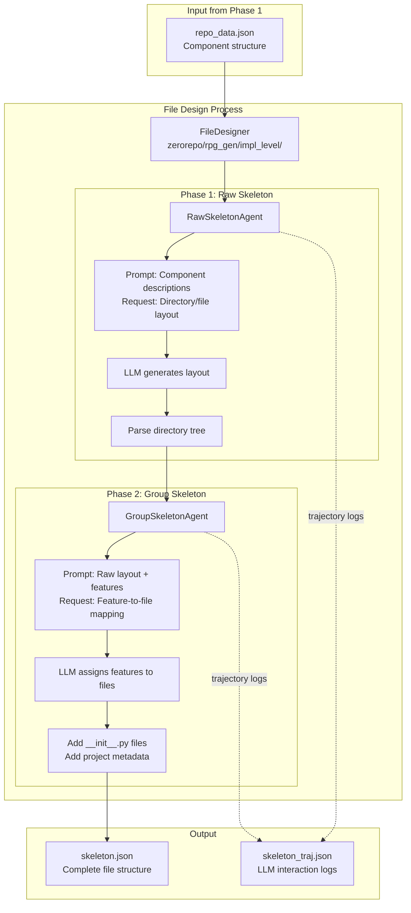
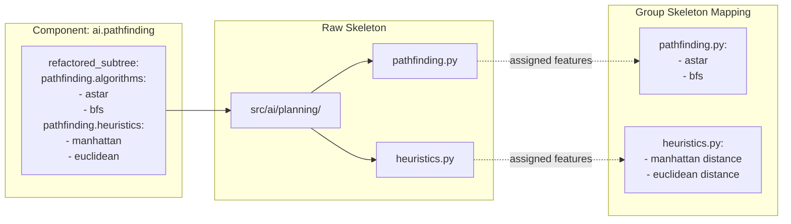
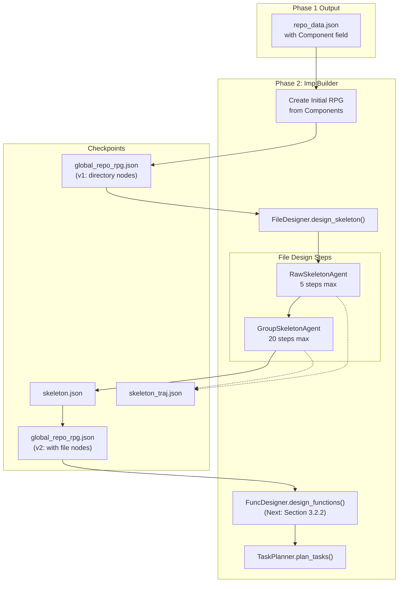
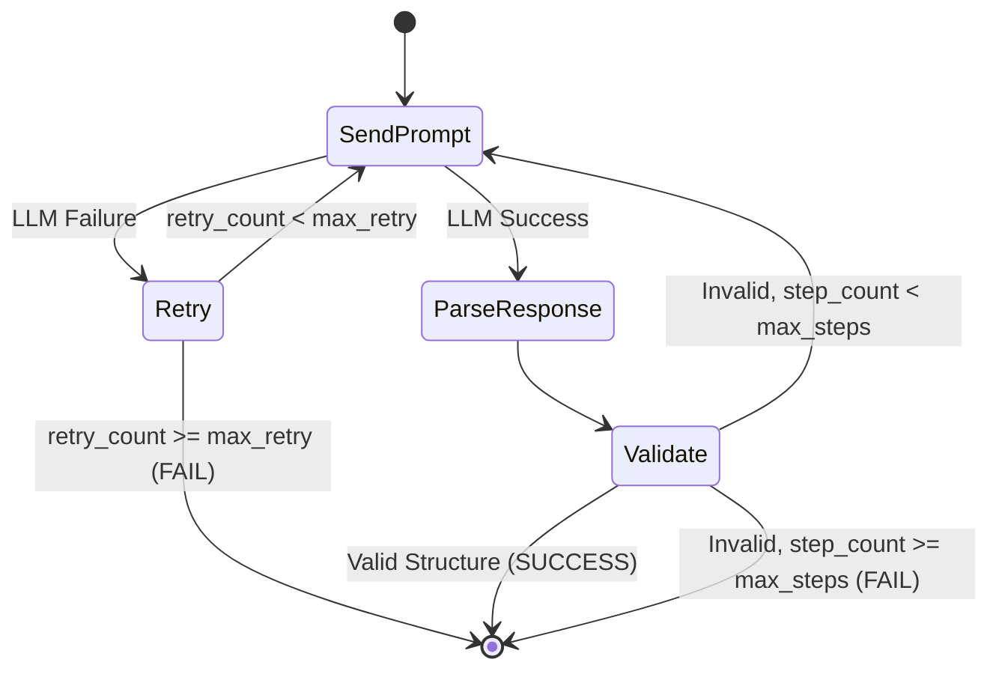

<!-- source: DeepWiki mcp.deepwiki.com · repo microsoft/RPG-ZeroRepo · extra page File Design Process · fetched 2026-10-26 -->

# File Design Process

<details>
<summary>Relevant source files</summary>

The following files were used as context for generating this wiki page:

- [README.md](README.md)
- [configs/checkpoint_config.yaml](configs/checkpoint_config.yaml)
- [configs/file_design_config.yaml](configs/file_design_config.yaml)

</details>


## Purpose and Scope

The File Design Process is the first step in Phase 2 (Architecture Design) that transforms the logical component structure from Phase 1 into a concrete file and directory layout. This process determines which files will exist in the repository, how they are organized, and which features each file will implement.

For information about how function signatures and interfaces are then designed for these files, see [Function Design Process](#3.2.2). For the overall Phase 2 architecture design workflow, see [Phase 2: Architecture Design](#3.2).

**Sources:** [README.md:176-220](), [configs/file_design_config.yaml:1-21]()

---

## Overview

The file design process consists of two sequential sub-phases, each performed by a specialized agent:

1. **Raw Skeleton Generation** - `RawSkeletonAgent` creates a high-level file/directory structure based on component descriptions
2. **Group Skeleton Generation** - `GroupSkeletonAgent` refines the structure by assigning specific features to files and adding necessary infrastructure files (`__init__.py`, configuration files, etc.)

The process is orchestrated by the `FileDesigner` class in the `ImplBuilder` pipeline and produces `skeleton.json`, which becomes the foundation for subsequent function interface design.

**Sources:** [README.md:189-220]()

---

## Input: Component Structure

The file design process receives the `Component` data structure from Phase 1's Feature Refactoring step. Each component contains:

| Field | Description | Example |
|-------|-------------|---------|
| `name` | Component identifier (becomes directory) | `"gameplay.core"` |
| `refactored_subtree` | Hierarchical feature tree for this component | `{"gameplay": {"rules": ["movement", "collision"]}}` |

Example input structure from `repo_data.json`:

```json
{
  "Component": [
    {
      "name": "ai.pathfinding",
      "refactored_subtree": {
        "pathfinding": {
          "algorithms": ["astar", "bfs flood fill"],
          "heuristics": ["manhattan distance", "euclidean"]
        }
      }
    }
  ]
}
```

**Sources:** [README.md:152-172]()

---

## Component-to-File Transformation Flow



**Figure 1: File Design Process Data Flow**

**Sources:** [README.md:189-220](), [configs/file_design_config.yaml:1-21]()

---

## Phase 1: Raw Skeleton Generation

### RawSkeletonAgent

The `RawSkeletonAgent` performs the initial layout design by asking an LLM to create a directory and file structure that logically organizes the components and their features.

**Configuration Parameters** (from `file_design_config.yaml`):

| Parameter | Default | Description |
|-----------|---------|-------------|
| `max_steps` | 5 | Maximum design iteration steps |
| `max_retry` | 3 | Retry attempts for LLM failures |
| `max_review_times` | 0 | Number of self-review cycles |
| `design_context_window` | 10 | Context window size for design prompts |
| `review_context_window` | 10 | Context window size for review prompts |

**Process:**

1. **Prompt Construction** - Builds a prompt containing:
   - Repository name and purpose
   - All component names and their feature subtrees
   - Instructions to create a Python project structure with `src/` and `tests/` directories

2. **LLM Invocation** - Sends prompt to configured LLM model (from `zerorepo_config.yaml`)

3. **Response Parsing** - Extracts directory tree structure from LLM response

4. **Validation** - Ensures:
   - All components are represented as directories
   - Project follows Python packaging conventions
   - Essential files are present (though not required at this stage)

**Example Output Structure:**

```
SnakeGame/
├── src/
│   ├── ai/
│   │   ├── analysis.py
│   │   └── planning/
│   │       ├── pathfinding.py
│   │       └── heuristics.py
│   ├── gameplay/
│   │   └── rules/
│   │       ├── movement.py
│   │       └── collision.py
│   └── data/
│       └── model/
│           └── cache.py
└── tests/
    └── (mirrored structure)
```

**Sources:** [configs/file_design_config.yaml:3-9](), [README.md:189-220]()

---

## Phase 2: Group Skeleton Generation

### GroupSkeletonAgent

The `GroupSkeletonAgent` refines the raw skeleton by explicitly mapping features to files and adding infrastructure components needed for a complete Python project.

**Configuration Parameters** (from `file_design_config.yaml`):

| Parameter | Default | Description |
|-----------|---------|-------------|
| `max_steps` | 20 | Maximum refinement iteration steps (more than raw) |
| `max_retry` | 3 | Retry attempts for LLM failures |
| `max_review_times` | 0 | Number of self-review cycles |
| `design_context_window` | 20 | Context window size (larger than raw) |
| `review_context_window` | 10 | Context window size for review prompts |

**Process:**

1. **Feature Assignment** - For each file in the raw skeleton:
   - Identifies which features from the component's `refactored_subtree` should be implemented in that file
   - Creates explicit `file_path` → `feature_list` mappings

2. **Infrastructure Addition** - Adds essential Python project files:
   - `__init__.py` in every package directory
   - `pyproject.toml` or `setup.py` for package metadata
   - `README.md` for project documentation
   - `.gitignore` for version control
   - Optional: `requirements.txt`, `pytest.ini`, etc.

3. **Test Structure Mirroring** - Ensures `tests/` directory mirrors `src/` structure:
   - For `src/ai/planning/pathfinding.py`, creates `tests/ai/planning/test_pathfinding.py`
   - Adds `__init__.py` files in test directories

4. **Validation** - Verifies:
   - All features from all components are assigned to at least one file
   - No orphaned files without feature assignments
   - Package structure is complete and importable

**Sources:** [configs/file_design_config.yaml:11-17](), [README.md:194-220]()

---

## Feature-to-File Mapping Structure



**Figure 2: Feature Assignment from Component to Files**

**Sources:** [README.md:194-220]()

---

## Output: skeleton.json Structure

The `skeleton.json` file contains the complete file structure with feature assignments:

```json
{
  "repo_skeleton": {
    "src/ai/planning/pathfinding.py": {
      "features": ["astar algorithm", "bfs flood fill"],
      "component": "ai.pathfinding",
      "file_type": "source"
    },
    "src/ai/planning/heuristics.py": {
      "features": ["manhattan distance heuristic", "euclidean distance"],
      "component": "ai.pathfinding",
      "file_type": "source"
    },
    "src/ai/planning/__init__.py": {
      "features": [],
      "component": "ai.pathfinding",
      "file_type": "package_init"
    },
    "tests/ai/planning/test_pathfinding.py": {
      "features": ["astar algorithm", "bfs flood fill"],
      "component": "ai.pathfinding",
      "file_type": "test"
    },
    "pyproject.toml": {
      "features": [],
      "component": null,
      "file_type": "metadata"
    }
  },
  "file_count": 76,
  "component_mapping": {
    "ai.pathfinding": ["src/ai/planning/pathfinding.py", "src/ai/planning/heuristics.py"],
    "gameplay.core": ["src/gameplay/rules/movement.py", "src/gameplay/rules/collision.py"]
  }
}
```

**Key Fields:**

| Field | Description |
|-------|-------------|
| `repo_skeleton` | Dictionary mapping file paths to their metadata |
| `features` | List of feature strings this file will implement |
| `component` | Component this file belongs to (null for infrastructure) |
| `file_type` | Category: `"source"`, `"test"`, `"package_init"`, `"metadata"` |
| `file_count` | Total number of files in the skeleton |
| `component_mapping` | Reverse index from components to their files |

**Sources:** [README.md:218-220]()

---

## Configuration Details

The file design process is configured through `file_design_config.yaml`, which is referenced by the main `zerorepo_config.yaml`:

```yaml
impl_level:
  file_design_cfg_path: "configs/file_design_config.yaml"
```

### Raw Skeleton Configuration

```yaml
raw_skeleton:
  max_steps: 5              # LLM can iterate up to 5 times
  max_retry: 3              # Retry failed LLM calls 3 times
  max_review_times: 0       # No self-review (disabled)
  design_context_window: 10 # Include 10 messages in context
  review_context_window: 10
```

The smaller `max_steps` value (5 vs 20 for group skeleton) reflects that raw layout design is typically simpler than feature assignment.

### Group Skeleton Configuration

```yaml
group_skeleton:
  max_steps: 20             # More iterations for refinement
  max_retry: 3
  max_review_times: 0       # Review disabled for efficiency
  design_context_window: 20 # Larger context for feature mapping
  review_context_window: 10
```

The larger `max_steps` (20) and `design_context_window` (20) accommodate the more complex task of assigning dozens or hundreds of features to specific files.

**Sources:** [configs/file_design_config.yaml:1-21]()

---

## Integration with Phase 2 Pipeline



**Figure 3: File Design Process in Phase 2 Context**

The file design process:
1. Receives `repo_data.json` and initial `global_repo_rpg.json` (with component nodes only)
2. Produces `skeleton.json` with complete file structure
3. Updates `global_repo_rpg.json` to include file nodes
4. Passes control to `FuncDesigner` for interface design

**Sources:** [README.md:176-281](), [configs/checkpoint_config.yaml:9-13]()

---

## Saved Checkpoint Files

The file design process produces two checkpoint files:

### skeleton.json

Location: `checkpoints/skeleton.json`

Contains the complete file structure with feature assignments as shown in the [Output section](#output-skeletonjson-structure) above. This file is loaded by:
- `FuncDesigner` to determine which files need interface design
- `TaskPlanner` to organize implementation batches

### skeleton_traj.json

Location: `checkpoints/skeleton_traj.json`

Contains the LLM interaction trajectory for debugging and analysis:

```json
{
  "raw_skeleton_trajectory": [
    {
      "step": 1,
      "prompt": "Generate a file layout for components: ai.pathfinding, gameplay.core...",
      "response": "```\nSnakeGame/\n├── src/\n│   ├── ai/\n...",
      "parsed_structure": { "src/ai/planning/pathfinding.py": {} }
    }
  ],
  "group_skeleton_trajectory": [
    {
      "step": 1,
      "prompt": "Assign features to files in the following structure...",
      "response": "pathfinding.py should implement: astar, bfs...",
      "feature_assignments": { "src/ai/planning/pathfinding.py": ["astar", "bfs"] }
    }
  ],
  "total_llm_calls": 6,
  "total_tokens": 45230
}
```

**Sources:** [README.md:218-220](), [configs/checkpoint_config.yaml:10-11]()

---

## Design Decisions and Rationale

### Two-Phase Approach

The separation into raw skeleton and group skeleton phases serves distinct purposes:

1. **Raw Skeleton** focuses purely on structural organization:
   - Directory hierarchy
   - File naming conventions
   - Module organization patterns
   - No feature-level details required

2. **Group Skeleton** focuses on content planning:
   - Which features go where
   - Granularity of implementation units
   - Test coverage mapping
   - Infrastructure file generation

This separation allows the LLM to:
- First think about high-level architecture without being overwhelmed by feature details
- Then perform detailed feature-to-file mapping with the structure already determined

### Why max_steps Differs

| Agent | max_steps | Reasoning |
|-------|-----------|-----------|
| `RawSkeletonAgent` | 5 | Directory structure converges quickly; most repos follow similar patterns (src/, tests/, etc.) |
| `GroupSkeletonAgent` | 20 | Feature assignment requires multiple iterations to balance file sizes, resolve ambiguities, and optimize cohesion |

### Infrastructure File Addition

The `GroupSkeletonAgent` automatically adds infrastructure files because:
- They are boilerplate and don't require feature-level planning
- Their presence is required for Python package imports
- Adding them early ensures the RPG is complete before function design

**Sources:** [configs/file_design_config.yaml:3-17]()

---

## Error Handling and Retry Logic

Both agents implement retry logic for robustness:



**Figure 4: File Design Agent Retry State Machine**

**Failure Scenarios:**

| Error Type | Handling |
|------------|----------|
| LLM API timeout | Retry up to `max_retry` times (3) |
| Invalid response format | Parse error, retry in next step |
| Missing required structure | Validation fails, agent regenerates with feedback |
| Unassigned features | `GroupSkeletonAgent` receives explicit error message in next prompt |

**Sources:** [configs/file_design_config.yaml:5-6,14-15]()

---

## Example: Complete File Design Flow

**Input:** Component `ai.pathfinding` with features:
- astar algorithm
- bfs flood fill  
- manhattan distance heuristic
- euclidean distance heuristic

**Raw Skeleton Output:**
```
src/ai/
├── planning/
│   ├── pathfinding.py
│   └── heuristics.py
└── analysis.py
```

**Group Skeleton Output:**
```json
{
  "src/ai/planning/pathfinding.py": {
    "features": ["astar algorithm", "bfs flood fill"],
    "component": "ai.pathfinding"
  },
  "src/ai/planning/heuristics.py": {
    "features": ["manhattan distance heuristic", "euclidean distance heuristic"],
    "component": "ai.pathfinding"
  },
  "src/ai/planning/__init__.py": {
    "features": [],
    "component": "ai.pathfinding"
  },
  "src/ai/__init__.py": {
    "features": [],
    "component": "ai.pathfinding"
  },
  "tests/ai/planning/test_pathfinding.py": {
    "features": ["astar algorithm", "bfs flood fill"],
    "component": "ai.pathfinding"
  },
  "tests/ai/planning/test_heuristics.py": {
    "features": ["manhattan distance heuristic", "euclidean distance heuristic"],
    "component": "ai.pathfinding"
  }
}
```

Notice that `GroupSkeletonAgent`:
- Split algorithm features and heuristic features into logical files
- Added `__init__.py` files for Python package structure
- Created matching test files with same feature assignments
- Maintained component traceability

**Sources:** [README.md:194-220]()

---

## Relationship to Global Repository Planning Graph

The file design process updates the `global_repo_rpg.json` by adding file-level nodes:

**Before File Design** (after InitRPG):
```json
{
  "nodes": [
    {"id": "component_ai.pathfinding", "type": "component", "name": "ai.pathfinding"}
  ]
}
```

**After File Design**:
```json
{
  "nodes": [
    {"id": "component_ai.pathfinding", "type": "component", "name": "ai.pathfinding"},
    {"id": "file_src/ai/planning/pathfinding.py", "type": "file", "component": "ai.pathfinding"},
    {"id": "file_src/ai/planning/heuristics.py", "type": "file", "component": "ai.pathfinding"}
  ],
  "edges": [
    {"from": "component_ai.pathfinding", "to": "file_src/ai/planning/pathfinding.py", "type": "contains"},
    {"from": "component_ai.pathfinding", "to": "file_src/ai/planning/heuristics.py", "type": "contains"}
  ]
}
```

This enriched RPG is then used by the Function Design Process (see [Function Design Process](#3.2.2)) to add class and function nodes with full signatures.

**Sources:** [README.md:183-188](), [configs/checkpoint_config.yaml:15-16]()

---

