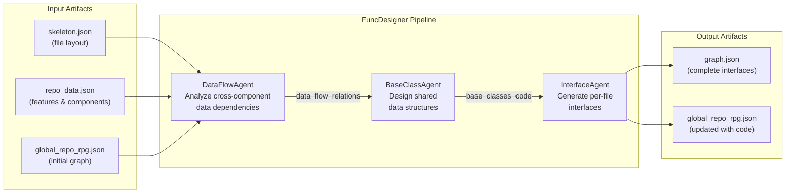
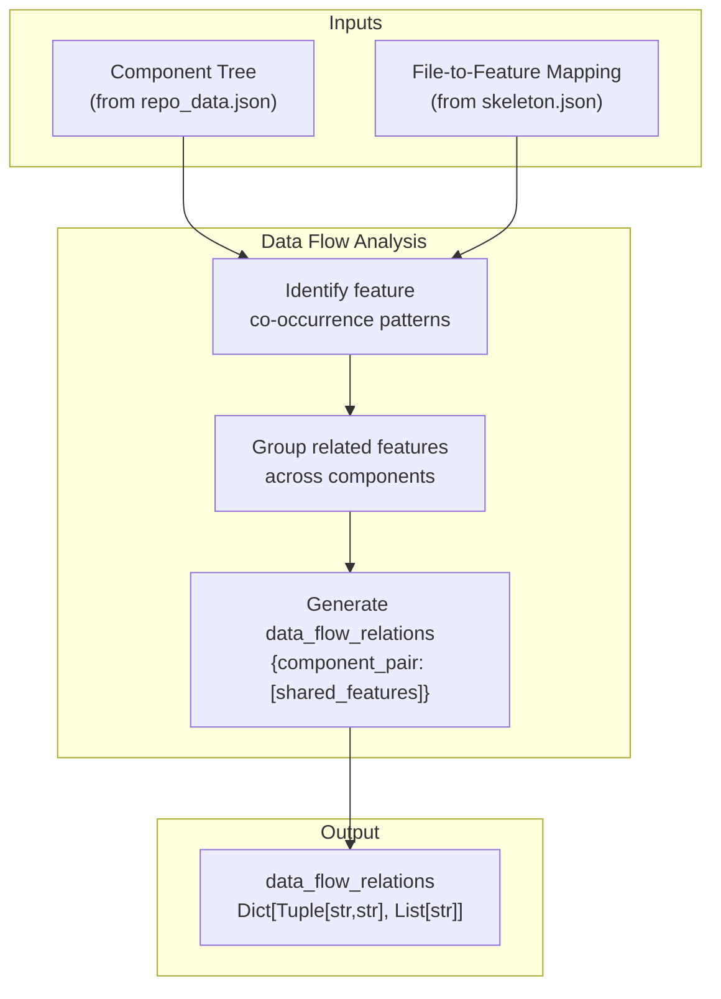
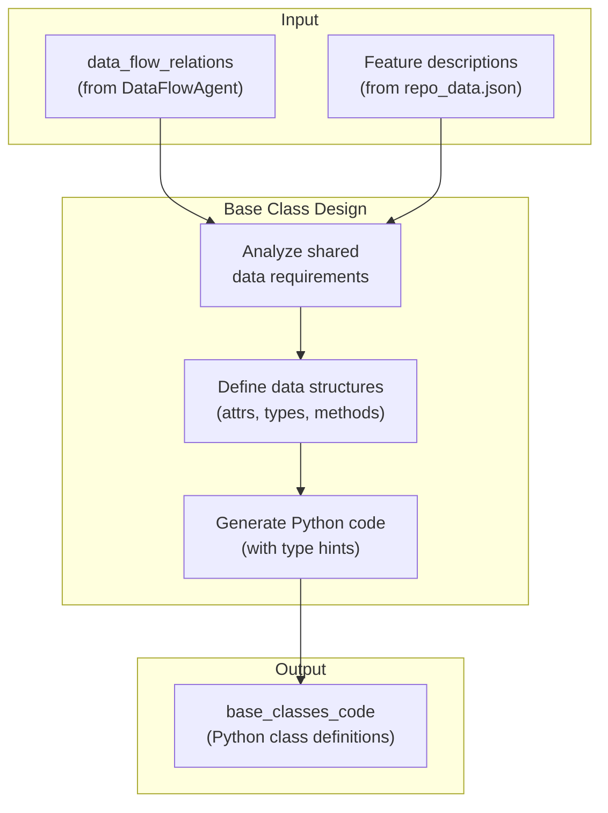
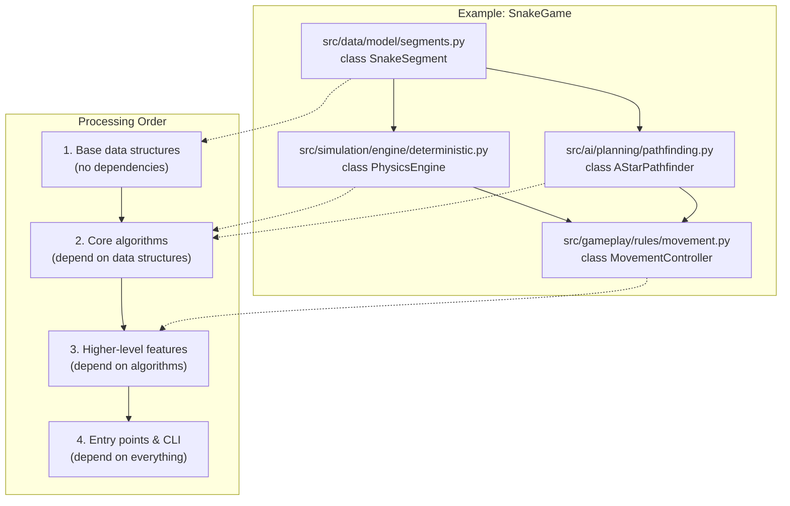
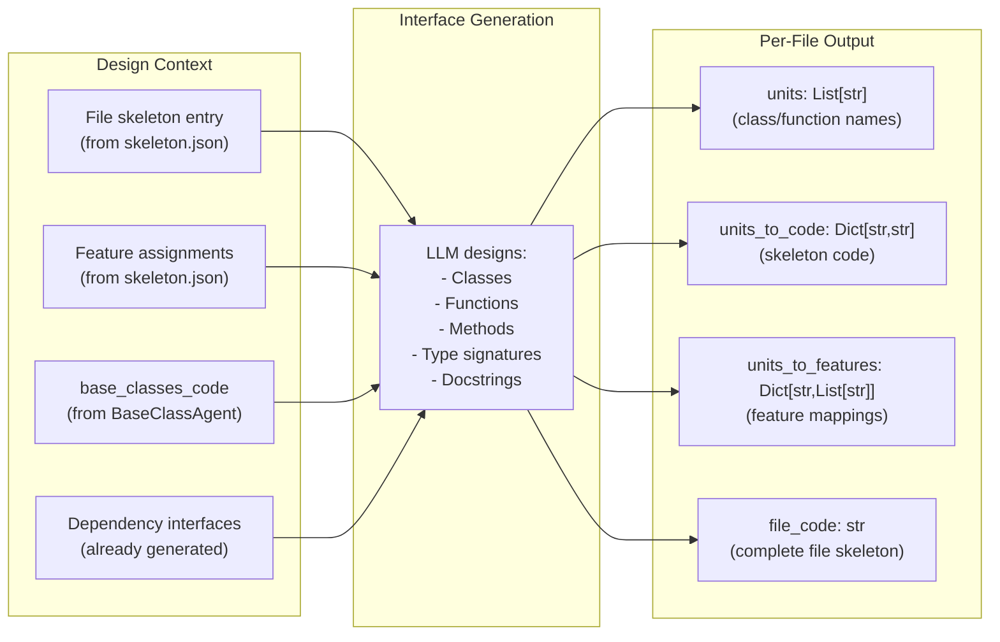
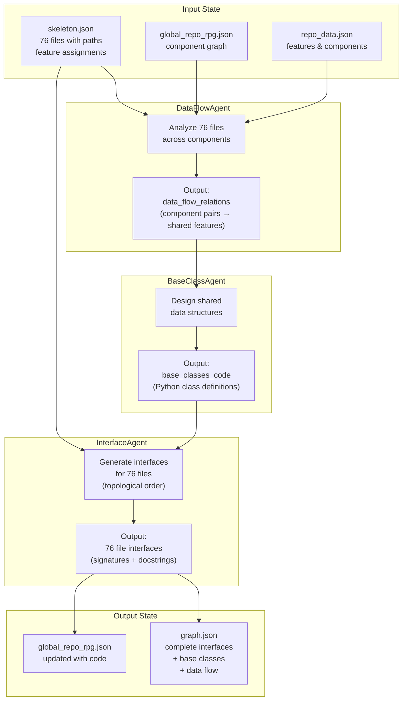
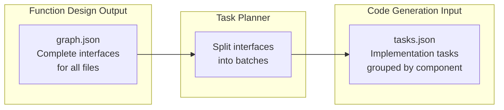

<!-- source: DeepWiki mcp.deepwiki.com · repo microsoft/RPG-ZeroRepo · extra page Function Design Process · fetched 2026-10-26 -->

# Function Design Process

<details>
<summary>Relevant source files</summary>

The following files were used as context for generating this wiki page:

- [README.md](README.md)
- [configs/checkpoint_config.yaml](configs/checkpoint_config.yaml)
- [configs/func_design_config.yaml](configs/func_design_config.yaml)

</details>


## Purpose and Scope

This document describes the **Function Design Process** in Phase 2 of the RPG-ZeroRepo pipeline. This process takes the file skeleton produced by the File Design Process (see [3.2.1](#3.2.1)) and generates complete interface definitions with function signatures, type hints, docstrings, and data structures for every file in the repository.

The Function Design Process consists of three sequential sub-phases executed by the `FuncDesigner` component:
1. **Data Flow Analysis** - identifies cross-component data dependencies
2. **Base Class Design** - designs shared data structures and abstract base classes
3. **Interface Design** - generates complete interfaces for each file in topological order

For information about the overall Phase 2 architecture design flow, see [3.2](#3.2). For details on the subsequent task planning step, see the overall Phase 3 documentation at [3.3](#3.3).

**Sources:** [README.md:221-246]()

---

## Three-Agent Pipeline Architecture

### Pipeline Flow Diagram



**Description:** The `FuncDesigner` orchestrates three specialized agents that run sequentially. `DataFlowAgent` analyzes the skeleton to identify which components exchange data. `BaseClassAgent` uses these dependencies to design shared data structures. `InterfaceAgent` then generates complete interfaces for each file, processing files in topological order based on their dependencies.

**Sources:** [README.md:221-246](), [configs/func_design_config.yaml:1-24]()

---

## Data Flow Agent

### Purpose

`DataFlowAgent` analyzes the component structure and feature distribution across files to identify **data flow relations** between components. These relations capture which components need to exchange data structures with each other, informing the design of shared data types in the next phase.

### Analysis Process



**Description:** The agent examines which features appear in multiple components and determines logical data flow relationships. For example, if the `gameplay.core` component has movement features and the `simulation.engine` component has physics features, the agent identifies that game state data must flow between them.

### Output Format

The `data_flow_relations` structure maps component pairs to the features they share:

```json
{
  "data_flow_relations": {
    "('gameplay.core', 'simulation.engine')": [
      "game state synchronization",
      "collision detection results",
      "entity position updates"
    ],
    "('data.model', 'ai.pathfinding')": [
      "grid occupancy data",
      "snake body segment positions"
    ]
  }
}
```

This output is stored in [checkpoints/graph.json]() and passed to `BaseClassAgent`.

### Configuration Parameters

```yaml
data_flow:
  max_steps: 10                    # Maximum LLM interaction steps
  max_review_times: 0              # Review iterations (0 = no review)
  max_retry: 3                     # Retry attempts on failure
  design_context_window: 30        # Context size for design prompts
  review_context_window: 10        # Context size for review prompts
```

**Sources:** [README.md:221-246](), [configs/func_design_config.yaml:2-7]()

---

## Base Class Agent

### Purpose

`BaseClassAgent` designs **shared data structures and abstract base classes** that multiple components will use. It uses the data flow relations from `DataFlowAgent` to determine which data types need to be shared and designs Python classes with appropriate attributes and methods.

### Design Process



**Description:** The agent examines data flow relations and determines what shared data structures are needed. For each identified data type, it generates a complete Python class definition with typed attributes, initialization methods, and common operations.

### Output Format

The `base_classes_code` contains complete Python definitions:

```python
# Example output from BaseClassAgent
base_classes_code = """
from dataclasses import dataclass
from typing import List, Tuple

@dataclass
class Position:
    '''Represents a 2D grid position.'''
    x: int
    y: int
    
    def __add__(self, other: 'Position') -> 'Position':
        return Position(self.x + other.x, self.y + other.y)

@dataclass
class SnakeSegment:
    '''Represents a single segment of the snake's body.'''
    position: Position
    direction: Tuple[int, int]
    timestamp: float

class GameState:
    '''Central game state shared between gameplay and simulation.'''
    def __init__(self):
        self.snake_positions: List[List[Position]] = []
        self.food_position: Position = Position(0, 0)
        self.score: int = 0
"""
```

This code is stored in [checkpoints/graph.json]() under the `base_classes_code` key and becomes available to `InterfaceAgent` for use in interface definitions.

### Configuration Parameters

```yaml
base_classes:
  max_steps: 10                    # Maximum LLM interaction steps
  max_review_times: 0              # Review iterations (0 = no review)
  max_retry: 3                     # Retry attempts on failure
  design_context_window: 30        # Context size for design prompts
  review_context_window: 10        # Context size for review prompts
```

**Sources:** [README.md:221-246](), [configs/func_design_config.yaml:9-14]()

---

## Interface Agent

### Purpose

`InterfaceAgent` generates **complete interface definitions** for every file in the repository. For each file, it designs all classes, functions, and methods with full signatures, type hints, docstrings, and skeleton implementations (using `pass` or `...`).

### Topological Processing

The agent processes files in **topological order** based on import dependencies:



**Description:** Files are ordered such that a file is processed only after all files it depends on have been processed. This ensures that when generating interfaces, the agent has access to type definitions from dependencies.

### Design Process Per File

For each file in topological order:



**Description:** For each file, the agent receives context about what features the file should implement, what base classes are available, and what interfaces its dependencies expose. The LLM generates complete interface definitions with detailed docstrings explaining the purpose of each class and function.

### Output Format

The output is structured per file in [checkpoints/graph.json]():

```json
{
  "src/io/persistence/serialization.py": {
    "file_code": "class HighScoreBinarySerializer:\n    '''Serializes high score data to compact binary format.'''\n    \n    def serialize(self, entries: List[HighScoreEntry]) -> bytes:\n        '''Convert high score entries to binary format.\n        \n        Args:\n            entries: List of high score entries to serialize\n            \n        Returns:\n            Binary representation of the entries\n        '''\n        ...\n    \n    def deserialize(self, data: bytes) -> List[HighScoreEntry]:\n        '''Parse binary data into high score entries.\n        \n        Args:\n            data: Binary data to parse\n            \n        Returns:\n            List of deserialized high score entries\n        '''\n        ...",
    "units": [
      "class HighScoreBinarySerializer"
    ],
    "units_to_features": {
      "class HighScoreBinarySerializer": [
        "high score binary serialization",
        "compact data encoding",
        "cross-platform compatibility"
      ]
    },
    "units_to_code": {
      "class HighScoreBinarySerializer": "class HighScoreBinarySerializer:\n    def serialize(self, entries: List[HighScoreEntry]) -> bytes:\n        ...\n    def deserialize(self, data: bytes) -> List[HighScoreEntry]:\n        ..."
    }
  }
}
```

### RPG Update

After generating all interfaces, `InterfaceAgent` updates [checkpoints/global_repo_rpg.json]() to include the interface code in the graph structure. Each file node in the RPG is annotated with its generated interface definitions.

### Configuration Parameters

```yaml
interfaces:
  max_steps: 30                    # Maximum LLM interaction steps (higher for complex files)
  max_review_times: 0              # Review iterations (0 = no review)
  max_retry: 3                     # Retry attempts on failure
  design_context_window: 30        # Context size for design prompts
  review_context_window: 10        # Context size for review prompts
```

**Sources:** [README.md:221-246](), [configs/func_design_config.yaml:16-21]()

---

## Configuration Reference

### Overall Structure

The function design configuration is defined in [configs/func_design_config.yaml]() with separate sections for each agent:

| Agent | Config Section | Purpose |
|-------|---------------|---------|
| `DataFlowAgent` | `data_flow` | Controls data dependency analysis |
| `BaseClassAgent` | `base_classes` | Controls shared structure design |
| `InterfaceAgent` | `interfaces` | Controls per-file interface generation |

### Common Parameters

All three agents share the same configuration parameters:

| Parameter | Type | Default | Description |
|-----------|------|---------|-------------|
| `max_steps` | int | varies | Maximum number of LLM interaction steps allowed |
| `max_review_times` | int | 0 | Number of self-review iterations (0 = no review) |
| `max_retry` | int | 3 | Retry attempts if LLM call fails |
| `design_context_window` | int | 30 | Number of context examples provided in design prompts |
| `review_context_window` | int | 10 | Number of context examples provided in review prompts |

### Recommended Values

```yaml
data_flow:
  max_steps: 10          # Data flow analysis is typically straightforward

base_classes:
  max_steps: 10          # Base class design has limited scope

interfaces:
  max_steps: 30          # Interface design is most complex, needs more steps
```

**Sources:** [configs/func_design_config.yaml:1-24]()

---

## Complete Pipeline Flow

### End-to-End Data Transformation



**Description:** The complete function design process transforms a bare file skeleton into a repository with full interface definitions. Each agent builds on the previous agent's output, culminating in [checkpoints/graph.json]() which contains everything needed for code generation in Phase 3.

**Sources:** [README.md:221-246](), [README.md:175-281]()

---

## Integration with Task Planning

The output of the Function Design Process directly feeds into the **Task Planner** (see [3.3](#3.3)), which splits the interface definitions into implementation batches:



Each task in [checkpoints/tasks.json]() includes:
- `units_key`: List of classes/functions to implement
- `unit_to_code`: Skeleton code from `InterfaceAgent`
- `unit_to_features`: Feature descriptions for context

**Sources:** [README.md:248-281]()

---

## Checkpoint Files

### Written Files

| File | Content | Purpose |
|------|---------|---------|
| [checkpoints/graph.json]() | Complete interface definitions | Contains `data_flow_relations`, `base_classes_code`, and per-file interfaces |
| [checkpoints/global_repo_rpg.json]() | Updated RPG with code | Repository graph annotated with interface definitions |

### Read Files

| File | Content | Purpose |
|------|---------|---------|
| [checkpoints/skeleton.json]() | File layout | Provides file paths and feature assignments |
| [checkpoints/repo_data.json]() | Features & components | Provides feature descriptions and component structure |
| [checkpoints/global_repo_rpg.json]() | Initial RPG | Provides component graph structure |

**Sources:** [README.md:383-400](), [configs/checkpoint_config.yaml:1-27]()

---

