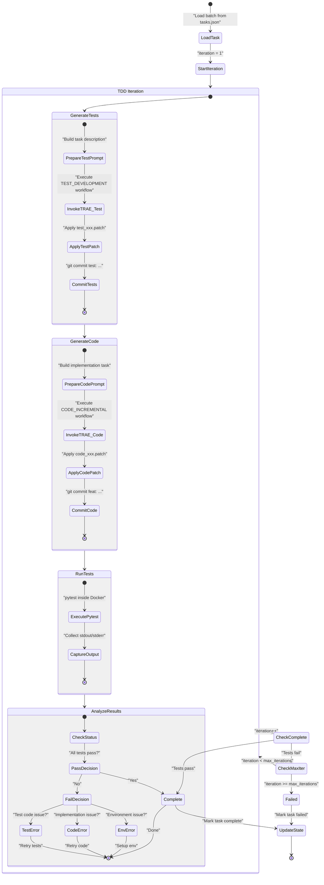
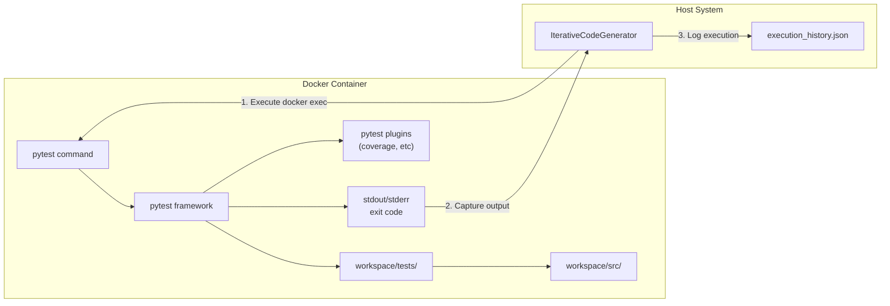
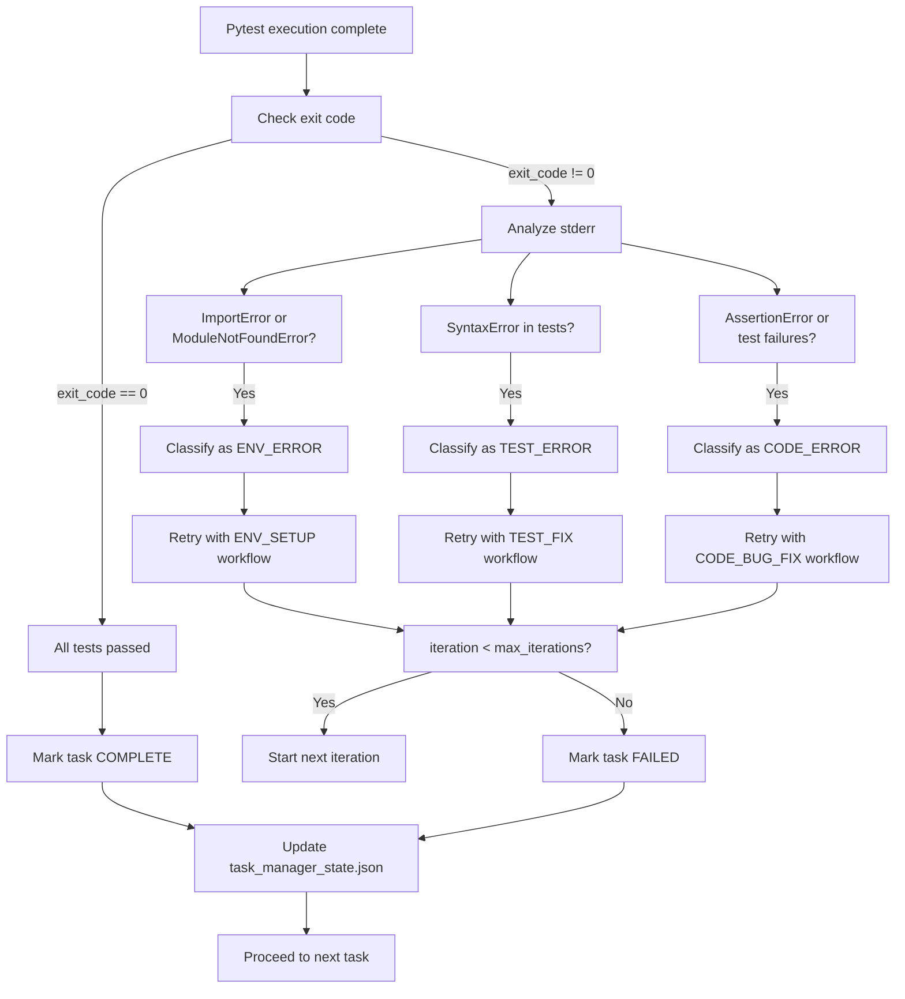
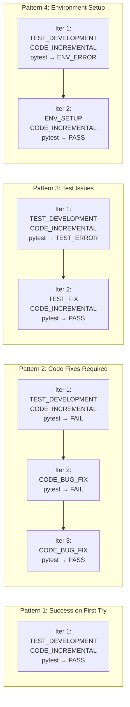
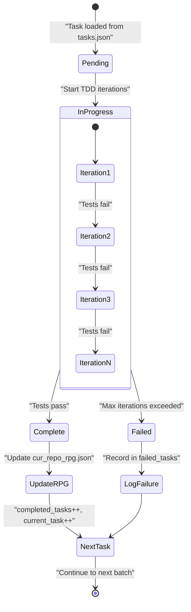

<!-- source: DeepWiki mcp.deepwiki.com · repo microsoft/RPG-ZeroRepo · extra page Test-Driven Development Workflow · fetched 2026-10-26 -->

# Test-Driven Development Workflow

<details>
<summary>Relevant source files</summary>

The following files were used as context for generating this wiki page:

- [README.md](README.md)
- [configs/checkpoint_config.yaml](configs/checkpoint_config.yaml)
- [configs/zerorepo_config.yaml](configs/zerorepo_config.yaml)

</details>


## Purpose and Scope

This document describes the iterative test-driven development (TDD) loop executed by the `IterativeCodeGenerator` during Phase 3 code generation. The TDD workflow implements a systematic cycle where tests are written first, followed by implementation code, followed by test execution. Based on test results, the system automatically decides whether to complete the task, regenerate tests, or regenerate implementation code.

For overall Phase 3 architecture including Docker container setup and TRAE agent integration, see [Phase 3: Code Generation](#3.3). For detailed documentation of workflow types (`TEST_DEVELOPMENT`, `CODE_INCREMENTAL`, `TEST_FIX`, `CODE_BUG_FIX`, `ENV_SETUP`) and error handling strategies, see [Workflow Types and Error Handling](#3.3.2).

**Sources**: [README.md:284-351]()

---

## TDD Loop Architecture

The TDD workflow operates on individual task batches from `tasks.json`. Each batch typically represents a single file with one or more units (classes/functions) to implement. The system executes up to `max_iterations` cycles per batch, with each iteration potentially regenerating tests or code based on execution results.

### Loop Structure Diagram



**Sources**: [README.md:289-323](), [configs/zerorepo_config.yaml:69-71]()

---

## Step 1: Test Generation

The first step in each TDD iteration generates test files using the `TEST_DEVELOPMENT` workflow type. This workflow instructs the TRAE agent to write pytest-compatible tests that validate the units specified in the task batch.

### Test Generation Process

| Stage | Description | Output |
|-------|-------------|--------|
| **Task Preparation** | Build task description including unit skeletons, feature descriptions, and existing repository context | Task text file |
| **TRAE Invocation** | Execute trae-agent inside Docker with `TEST_DEVELOPMENT` workflow | Test patch + trajectory JSON |
| **Patch Application** | Apply unified diff patch to create/modify test files in `workspace/tests/` | Modified test files |
| **Git Commit** | Commit test changes with conventional commit message | Git history entry |

### Test Task Structure

The task description sent to the TRAE agent includes:

- **Unit Skeletons**: Function/class signatures with type hints and docstrings from `graph.json`
- **Feature Descriptions**: Natural language descriptions of what each unit should do
- **Repository Context**: Existing file structure, dependencies, and design patterns
- **Testing Requirements**: Pytest conventions, coverage expectations, assertion patterns

### Test Patch Output

Each test generation produces artifacts in `results/test_gen_<timestamp>/`:

```
results/test_gen_1770643795/
├── task.txt                      # Task description sent to agent
├── test_gen_1770643795.json      # Full LLM interaction trajectory
└── test_gen_1770643795.patch     # Unified diff for test files
```

The patch is applied to the workspace using standard git-apply mechanisms, followed by a git commit with a message generated by a separate LLM call, following the pattern:

```
test: add unit tests for <UnitName>
```

**Sources**: [README.md:294-300](), [README.md:327-340](), [README.md:344-350]()

---

## Step 2: Code Implementation

After tests are committed, the second step generates implementation code using the `CODE_INCREMENTAL` workflow type. This workflow instructs the TRAE agent to implement the unit skeletons to satisfy the newly created tests.

### Code Generation Process

| Stage | Description | Output |
|-------|-------------|--------|
| **Task Preparation** | Build implementation task including unit skeletons, test file references, and error context (if retry) | Task text file |
| **TRAE Invocation** | Execute trae-agent inside Docker with `CODE_INCREMENTAL` workflow | Code patch + trajectory JSON |
| **Patch Application** | Apply unified diff patch to create/modify source files in `workspace/src/` | Modified source files |
| **Git Commit** | Commit implementation changes with conventional commit message | Git history entry |

### Implementation Task Context

The task description for code generation includes:

- **Unit Skeletons**: Same signatures from test generation, ensuring consistency
- **Test File Paths**: References to the just-committed test files
- **Previous Failures** (if retry): Pytest output showing which assertions failed
- **Dependency Context**: Imported modules, base classes, data structures already implemented

### Code Patch Output

Each code generation produces artifacts in `results/code_gen_<timestamp>/`:

```
results/code_gen_1770644020/
├── task.txt                      # Implementation task description
├── code_gen_1770644020.json      # Full LLM interaction trajectory
└── code_gen_1770644020.patch     # Unified diff for source files
```

The patch is applied and committed with a message following the pattern:

```
feat: implement <UnitName> <brief description>
```

**Sources**: [README.md:300-302](), [README.md:327-340](), [README.md:344-350]()

---

## Step 3: Test Execution

After both tests and implementation are committed, the system executes pytest inside the Docker container to validate the implementation against the tests.

### Pytest Execution Details



### Pytest Command

The system executes a command similar to:

```bash
pytest workspace/tests/ -v --tb=short --color=no
```

Key parameters:
- `-v`: Verbose output showing individual test results
- `--tb=short`: Shortened traceback format for failures
- `--color=no`: Plain text output for parsing

### Output Capture

The execution captures:

| Output Stream | Content | Purpose |
|--------------|---------|---------|
| **stdout** | Test names, pass/fail status, assertion messages | Result classification |
| **stderr** | Import errors, syntax errors, warnings | Error type detection |
| **Exit Code** | 0 (pass) or non-zero (fail) | Quick pass/fail determination |
| **Execution Time** | Wall clock time for pytest run | Performance tracking |

All captured output is stored in `execution_history.json` for later analysis and debugging.

**Sources**: [README.md:304-306]()

---

## Step 4: Result Analysis and Retry Logic

After pytest execution, the system analyzes the output to determine the next action. The analysis classifies failures into distinct categories that guide retry behavior.

### Result Classification Decision Tree



### Error Classification Rules

| Error Type | Detection Pattern | Retry Workflow | Example |
|------------|------------------|----------------|---------|
| **ENV_ERROR** | `ImportError`, `ModuleNotFoundError` in stderr | `ENV_SETUP` | Missing package like `numpy` |
| **TEST_ERROR** | `SyntaxError`, `NameError` in test files | `TEST_FIX` | Invalid pytest syntax |
| **CODE_ERROR** | `AssertionError`, failed test cases | `CODE_BUG_FIX` | Implementation doesn't match test expectations |

### Retry Workflow Transitions

When a retry is needed, the system transitions to a specialized workflow:

1. **ENV_SETUP**: TRAE agent uses bash tool to install packages via pip/apt
2. **TEST_FIX**: TRAE agent regenerates test files, provided with error messages
3. **CODE_BUG_FIX**: TRAE agent modifies implementation, provided with failing test output

Each retry workflow receives the full error context from the previous attempt, enabling targeted fixes.

**Sources**: [README.md:307-312](), [README.md:317-324]()

---

## Iteration Management

The TDD loop executes up to `max_iterations` times per task batch, controlled by `iteration_state.json` checkpoint file.

### Iteration State Tracking

The `iteration_state.json` file maintains the current state within a task batch:

```json
{
  "current_task_id": "src_ai_pathfinding_astar.py_...",
  "current_iteration": 3,
  "max_iterations": 5,
  "iteration_history": [
    {
      "iteration": 1,
      "test_workflow": "TEST_DEVELOPMENT",
      "test_result": "success",
      "code_workflow": "CODE_INCREMENTAL", 
      "code_result": "success",
      "pytest_exit_code": 1,
      "error_type": "CODE_ERROR",
      "action": "retry_code"
    },
    {
      "iteration": 2,
      "test_workflow": null,
      "code_workflow": "CODE_BUG_FIX",
      "code_result": "success",
      "pytest_exit_code": 1,
      "error_type": "CODE_ERROR",
      "action": "retry_code"
    },
    {
      "iteration": 3,
      "test_workflow": null,
      "code_workflow": "CODE_BUG_FIX",
      "code_result": "success",
      "pytest_exit_code": 0,
      "error_type": null,
      "action": "complete"
    }
  ]
}
```

### Iteration Control Parameters

| Parameter | Configuration Location | Default | Description |
|-----------|----------------------|---------|-------------|
| `max_iterations` | `zerorepo_config.yaml`: `code_generation.trae_agent.max_iterations` | 5 | Maximum TDD cycles per task |
| `max_retries_per_workflow` | `zerorepo_config.yaml`: `code_generation.trae_agent.max_retries_per_workflow` | 3 | Maximum retries for a single workflow execution |
| `workflow_timeout` | `zerorepo_config.yaml`: `code_generation.trae_agent.workflow_timeout` | 1800 | Timeout in seconds for TRAE agent execution |

### Termination Conditions

The iteration loop terminates when:

1. **Success**: All tests pass (pytest exit code 0)
2. **Max Iterations**: Reached `max_iterations` without passing tests → task marked as **FAILED**
3. **Workflow Failure**: TRAE agent execution fails `max_retries_per_workflow` times → task marked as **FAILED**
4. **Timeout**: Workflow exceeds `workflow_timeout` → task marked as **FAILED**

Failed tasks are recorded in `task_manager_state.json` under `failed_tasks` for later inspection or manual intervention.

**Sources**: [configs/zerorepo_config.yaml:69-71](), [configs/checkpoint_config.yaml:20-21]()

---

## Iteration Patterns and Common Scenarios

### Typical Iteration Patterns



### Pattern 1: Success on First Try (Ideal Case)

```
Iteration 1:
  1. Generate tests (TEST_DEVELOPMENT)
  2. Generate code (CODE_INCREMENTAL)
  3. Run pytest → All pass
  Result: Task complete in 1 iteration
```

This occurs when the TRAE agent generates both correct tests and correct implementation on the first attempt. Most common for simple utility functions with clear specifications.

### Pattern 2: Code Fixes Required (Common)

```
Iteration 1:
  1. Generate tests (TEST_DEVELOPMENT) 
  2. Generate code (CODE_INCREMENTAL)
  3. Run pytest → AssertionError
  Result: CODE_ERROR → retry code

Iteration 2:
  1. Fix code (CODE_BUG_FIX) with error context
  2. Run pytest → Still failing
  Result: CODE_ERROR → retry code again

Iteration 3:
  1. Fix code (CODE_BUG_FIX) with accumulated error context
  2. Run pytest → All pass
  Result: Task complete in 3 iterations
```

This is the most common pattern, especially for complex logic with edge cases. The agent learns from each failure and refines the implementation.

### Pattern 3: Test Issues (Occasional)

```
Iteration 1:
  1. Generate tests (TEST_DEVELOPMENT)
  2. Generate code (CODE_INCREMENTAL)
  3. Run pytest → SyntaxError in test file
  Result: TEST_ERROR → regenerate tests

Iteration 2:
  1. Regenerate tests (TEST_FIX)
  2. Regenerate code (CODE_INCREMENTAL)
  3. Run pytest → All pass
  Result: Task complete in 2 iterations
```

Less common, but occurs when the test generation produces invalid pytest syntax or references non-existent imports.

### Pattern 4: Environment Setup (Rare)

```
Iteration 1:
  1. Generate tests (TEST_DEVELOPMENT)
  2. Generate code (CODE_INCREMENTAL)
  3. Run pytest → ImportError: No module named 'xyz'
  Result: ENV_ERROR → setup environment

Iteration 2:
  1. Install package (ENV_SETUP)
  2. Regenerate code (CODE_INCREMENTAL)
  3. Run pytest → All pass
  Result: Task complete in 2 iterations
```

Rare in practice since the base Docker image includes common packages. May occur for specialized libraries not in `requirements.txt`.

**Sources**: [README.md:289-312](), [README.md:317-324]()

---

## Output Artifacts and Traceability

The TDD workflow generates comprehensive artifacts that enable full traceability of the generation process.

### Directory Structure

```
results/
├── test_gen_1770643795/
│   ├── task.txt                      # Task description for test generation
│   ├── test_gen_1770643795.json      # LLM interaction trajectory
│   └── test_gen_1770643795.patch     # Unified diff for test files
├── code_gen_1770644020/
│   ├── task.txt                      # Task description for code generation
│   ├── code_gen_1770644020.json      # LLM interaction trajectory
│   └── code_gen_1770644020.patch     # Unified diff for source files
├── code_gen_1770644315/              # Retry attempt
│   ├── task.txt
│   ├── code_gen_1770644315.json
│   └── code_gen_1770644315.patch
└── ...
```

### Trajectory JSON Structure

Each `.json` file contains the complete LLM interaction:

```json
{
  "task_id": "src_ai_pathfinding_astar.py_...",
  "workflow_type": "CODE_INCREMENTAL",
  "model": "gpt-5-mini-20250807",
  "start_time": "2026-02-09T14:23:15",
  "end_time": "2026-02-09T14:25:42",
  "steps": [
    {
      "step": 1,
      "tool": "str_replace_based_edit_tool",
      "action": "create_file",
      "file_path": "src/ai/pathfinding/astar.py",
      "content": "...",
      "observation": "File created successfully"
    },
    {
      "step": 2,
      "tool": "bash",
      "command": "git add src/ai/pathfinding/astar.py",
      "output": ""
    },
    // ... more steps
  ],
  "llm_calls": [
    {
      "call_index": 0,
      "prompt_tokens": 3421,
      "completion_tokens": 856,
      "model": "gpt-5-mini-20250807",
      "temperature": 0.0
    }
  ],
  "result": "success",
  "exit_code": 0
}
```

### Checkpoint Files Updated

| File | Content | Update Frequency |
|------|---------|------------------|
| `iteration_state.json` | Current iteration number, history | After each iteration |
| `execution_history.json` | Flat list of all workflow executions | After each TRAE invocation |
| `batch_trajectory.json` | Per-batch execution records with commits | After each batch completion |
| `task_manager_state.json` | Task completion status, current task | After each task |
| `cur_repo_rpg.json` | RPG updated with implementation status | After each task |

### Git History Traceability

The workspace repository maintains a detailed git history:

```bash
$ cd workspace && git log --oneline
a3f5c2b feat: implement AStarPathfinder with heap optimization
b8e4d1a test: add unit tests for AStarPathfinder
c9f6e2d feat: implement GridOccupancyMap compact storage
d1a7f3e test: add tests for GridOccupancyMap
...
```

Each commit links to the corresponding patch file via the timestamp in the commit message or can be cross-referenced through `batch_trajectory.json`.

**Sources**: [README.md:327-340](), [configs/checkpoint_config.yaml:19-22]()

---

## Integration with Task Manager

The TDD workflow integrates with the broader task execution system through the `task_manager_state.json` checkpoint.

### Task State Transitions



### Task Manager State Updates

After each task completion (success or failure), `task_manager_state.json` is updated:

```json
{
  "feature_selection": true,
  "feature_refactoring": true,
  "build_skeleton": true,
  "build_function": true,
  "plan_tasks": true,
  "code_generation": true,
  
  "current_task": {
    "subtree": "ai.pathfinding",
    "file_path": "src/ai/opponent/strategies.py",
    "task_id": "src_ai_opponent_strategies.py_..."
  },
  
  "completed_tasks": [
    "src_ai_pathfinding_astar.py_...",
    "src_data_model_grid.py_...",
    // ... 45 more completed tasks
  ],
  
  "failed_tasks": [
    {
      "task_id": "src_network_transport_reliability.py_...",
      "reason": "max_iterations_exceeded",
      "final_error": "CODE_ERROR: AssertionError in test_packet_retransmission",
      "iterations_attempted": 5
    }
  ],
  
  "last_updated": "2026-02-09T15:34:22"
}
```

Failed tasks can be manually inspected by examining:
1. The task description in `tasks.json`
2. The iteration history in `iteration_state.json`
3. The patches and trajectories in `results/`
4. The git history in `workspace/.git`

**Sources**: [README.md:356-379](), [configs/checkpoint_config.yaml:7]()

---

## Resume Capability

The TDD workflow is fully resumable. If the pipeline is interrupted (system crash, user interrupt, timeout), rerunning with `--resume` flag continues from the exact point of interruption.

### Resume Mechanics

When `--resume` is specified:

1. Load `task_manager_state.json` to determine phase progress
2. Load `completed_tasks` list to skip finished tasks
3. Load `iteration_state.json` for the current task (if mid-task)
4. Resume from:
   - Next uncompleted task (if previous task finished)
   - Next iteration (if mid-task)
   - Same iteration (if TRAE agent was interrupted)

### Resumption Example

```bash
# Initial run - interrupted at task 47/120
$ python main.py --config configs/zerorepo_config.yaml \
    --checkpoint ../my_project/checkpoints \
    --repo ../my_project/workspace \
    --phase all

[... runs 46 tasks successfully ...]
[... starts task 47, iteration 2 ...]
^C Interrupted!

# Resume - continues from task 47, iteration 2
$ python main.py --config configs/zerorepo_config.yaml \
    --checkpoint ../my_project/checkpoints \
    --repo ../my_project/workspace \
    --phase all \
    --resume

Resuming from checkpoint...
Skipping 46 completed tasks...
Continuing task 47: src/network/transport/reliability.py
  Starting from iteration 2...
```

The system guarantees no duplicate work is performed and no state is lost during interruption.

**Sources**: [README.md:356-379](), [README.md:82]()

---

