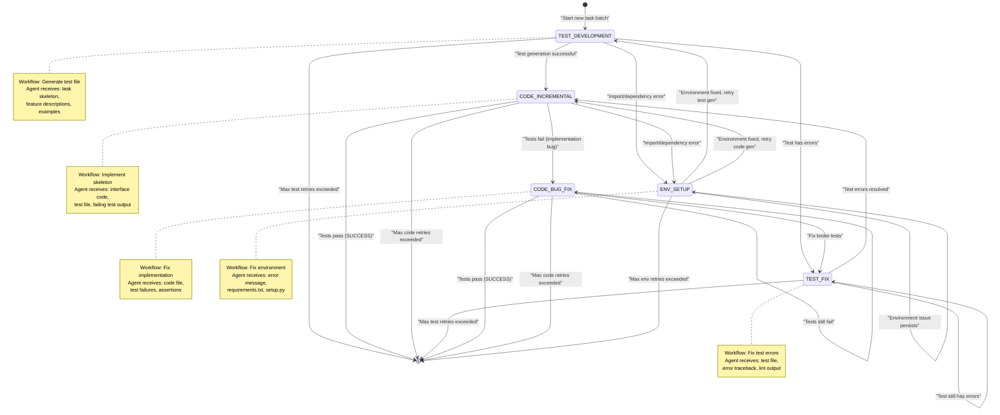
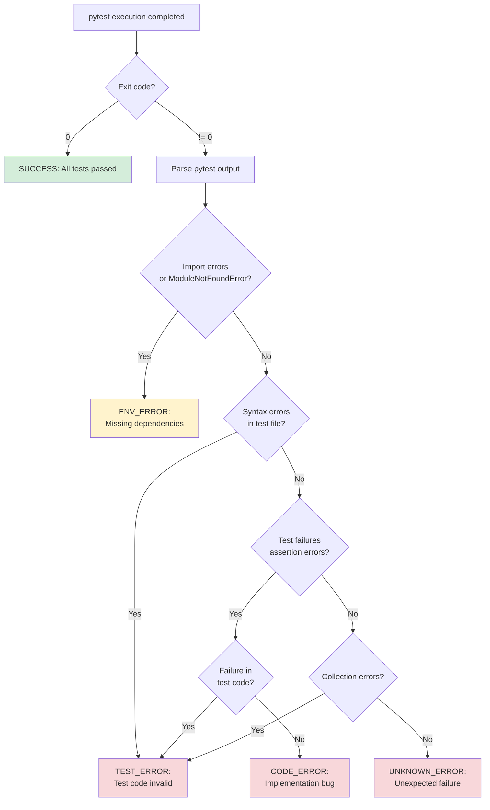
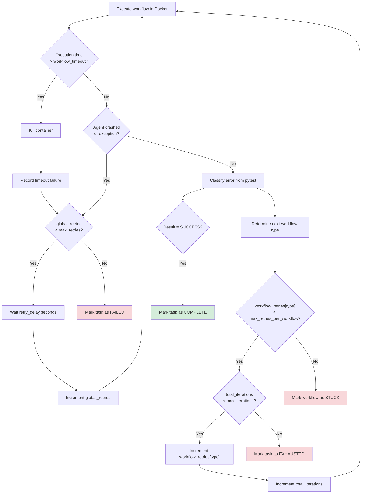
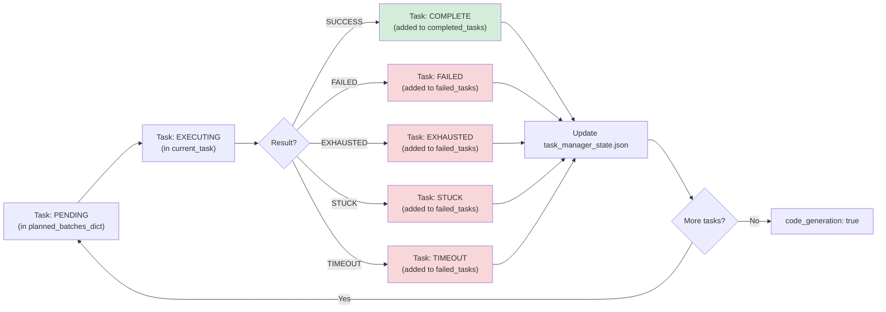
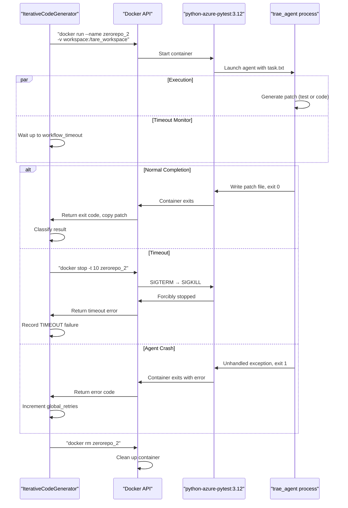

<!-- source: DeepWiki mcp.deepwiki.com · repo microsoft/RPG-ZeroRepo · extra page Workflow Types and Error Handling · fetched 2026-10-26 -->

# Workflow Types and Error Handling

<details>
<summary>Relevant source files</summary>

The following files were used as context for generating this wiki page:

- [README.md](README.md)
- [configs/trae_config.yaml](configs/trae_config.yaml)
- [configs/zerorepo_config.yaml](configs/zerorepo_config.yaml)

</details>


## Purpose and Scope

This page documents the workflow execution system used during Phase 3 code generation, specifically focusing on the five workflow types that the TRAE agent executes and the error handling mechanisms that enable automatic recovery from failures. This page covers the iterative loop mechanics, error classification, retry logic, and state persistence.

For information about the overall TDD workflow and test-code generation cycle, see [Test-Driven Development Workflow](#3.3.1). For information about the TRAE agent's tools and capabilities, see [TRAE Agent](#6.2).

**Sources:** [README.md:284-351](), [configs/zerorepo_config.yaml:53-72]()

---

## Workflow Type Overview

The code generation phase uses five distinct workflow types, each designed to handle a specific stage or failure mode in the TDD loop. Each workflow type determines what instructions are sent to the TRAE agent and what success criteria are evaluated.

### Workflow Type Definitions

| Workflow Type | Purpose | Trigger Condition | Success Criteria |
|---------------|---------|-------------------|------------------|
| `TEST_DEVELOPMENT` | Generate initial test file from requirements | First iteration of a task batch | Test file created, syntactically valid |
| `CODE_INCREMENTAL` | Implement code to satisfy interface skeleton | First iteration after successful test generation | Code implements required units, passes tests |
| `TEST_FIX` | Repair broken or invalid test code | Test execution fails with test errors (syntax, import, assertion logic errors) | Tests execute without test-side errors |
| `CODE_BUG_FIX` | Fix implementation bugs revealed by tests | Tests execute but fail due to incorrect implementation behavior | Tests pass |
| `ENV_SETUP` | Install dependencies or fix environment issues | Import errors, missing packages detected | Environment issue resolved |

The workflow type selection is deterministic based on the current state of the iteration and the error classification from the previous attempt.

**Sources:** [README.md:316-324](), [configs/zerorepo_config.yaml:63-71]()

---

## Workflow State Machine

The following diagram shows how workflow types transition based on execution results.

**Diagram: Workflow Type State Machine**



**Sources:** [README.md:291-313](), [configs/zerorepo_config.yaml:69-70]()

---

## Error Detection and Classification

After each TRAE agent execution, the system analyzes the pytest output and execution logs to classify the result into one of three error categories or success.

### Error Classification Logic

**Diagram: Error Classification Decision Tree**



### Error Type Characteristics

| Error Type | Detection Pattern | Example Scenario | Next Workflow |
|------------|------------------|------------------|---------------|
| `ENV_ERROR` | `ModuleNotFoundError`, `ImportError` in traceback | Missing `numpy`, `pytest-mock` not installed | `ENV_SETUP` |
| `TEST_ERROR` | Syntax error in `test_*.py`, collection failure, fixture error | Invalid test syntax, undefined fixture, malformed assertion | `TEST_FIX` |
| `CODE_ERROR` | Assertion failure, attribute error in source code | Function returns wrong value, method not implemented | `CODE_BUG_FIX` |
| `SUCCESS` | Exit code 0, all tests passed | Implementation correct | Task complete |

**Sources:** [README.md:295-312](), [configs/trae_config.yaml:1-28]()

---

## Retry Mechanism Configuration

The retry system has three configurable limits to prevent infinite loops while allowing reasonable recovery attempts.

### Retry Parameters

**Configuration in `zerorepo_config.yaml`:**

```yaml
code_generation:
  trae_agent:
    max_iterations: 5              # Total iteration budget per task batch
    max_retries_per_workflow: 3    # Max consecutive retries for same workflow type
    workflow_timeout: 1800          # Timeout per workflow execution (seconds)
    max_retries: 3                  # Global retry limit for agent failures
    retry_delay: 5                  # Wait time between retries (seconds)
```

### Retry Logic Behavior

**Diagram: Retry Decision Logic**



### Retry Counter Management

The system maintains three separate retry counters per task batch:

1. **`total_iterations`**: Increments on every workflow execution (limit: `max_iterations`)
2. **`workflow_retries[workflow_type]`**: Tracks consecutive attempts for each workflow type (limit: `max_retries_per_workflow`)
3. **`global_retries`**: Tracks agent-level failures like crashes or network errors (limit: `max_retries`)

When a workflow type changes (e.g., `TEST_FIX` → `CODE_INCREMENTAL`), the `workflow_retries` counter for the new type starts fresh, but `total_iterations` continues incrementing.

**Sources:** [configs/zerorepo_config.yaml:63-71]()

---

## Iteration State Persistence

All iteration state is persisted to enable resume capability and post-execution analysis.

### State Files

| File | Location | Content | Updated When |
|------|----------|---------|--------------|
| `iteration_state.json` | `checkpoints/` | Current iteration number, workflow type, retry counts for active batch | After each workflow execution |
| `execution_history.json` | `checkpoints/` | Flat list of all workflow executions with timestamps, results, errors | After each workflow execution |
| `batch_trajectory.json` | `checkpoints/` | Per-batch execution records grouped by batch ID, includes commit SHAs | After batch completion |
| `task_manager_state.json` | `checkpoints/` | Overall task progress: completed, failed, current task | After batch completion or failure |

### Iteration State Schema

```json
// iteration_state.json example
{
  "task_id": "src_io_persistence_serialization.py_HighScoreBinarySerializer",
  "batch_id": "io.input_persistence",
  "current_iteration": 3,
  "total_iterations": 3,
  "current_workflow": "CODE_BUG_FIX",
  "workflow_retries": {
    "TEST_DEVELOPMENT": 0,
    "CODE_INCREMENTAL": 1,
    "TEST_FIX": 0,
    "CODE_BUG_FIX": 2,
    "ENV_SETUP": 0
  },
  "global_retries": 0,
  "last_error_type": "CODE_ERROR",
  "last_error_message": "AssertionError: Expected 8 bytes, got 10",
  "test_patch_path": "results/test_gen_1770643795/test_gen_1770643795.patch",
  "code_patch_path": "results/code_gen_1770644020/code_gen_1770644020.patch",
  "last_commit_sha": "a3f2e1d8c9b0a1f2e3d4c5b6a7f8e9d0c1b2a3f4",
  "started_at": "2026-02-09T13:45:12",
  "last_updated": "2026-02-09T13:52:30"
}
```

**Sources:** [README.md:395-399](), [configs/zerorepo_config.yaml:63-71]()

---

## Failure Modes and Recovery

### Task Completion States

When a task batch completes (successfully or not), it is marked with one of the following states in `task_manager_state.json`:

| State | Meaning | Recovery Action |
|-------|---------|-----------------|
| `COMPLETE` | All tests pass, batch succeeded | None needed, proceed to next batch |
| `FAILED` | Agent crashed or non-recoverable error | Manual intervention required, or skip with `--skip-failed` |
| `EXHAUSTED` | Hit `max_iterations` limit without success | Review task complexity, increase limits, or manual completion |
| `STUCK` | Hit `max_retries_per_workflow` for a workflow type | Review error patterns, may indicate task specification issue |
| `TIMEOUT` | Hit `workflow_timeout` on execution | Review task scope, increase timeout, or check for infinite loops |

### Task Manager State Update

**Diagram: Task State Tracking**



### Resume Behavior

When resuming with `--resume`:

1. System reads `task_manager_state.json` to determine completion status
2. Skips all batches in `completed_tasks` array
3. Loads `iteration_state.json` for the `current_task` if it exists (partial completion)
4. Retries tasks in `failed_tasks` if `--retry-failed` flag is set
5. Continues from next pending batch otherwise

**Sources:** [README.md:354-380](), [configs/zerorepo_config.yaml:63-71]()

---

## Timeout and Resource Management

### Workflow Timeout Enforcement

The `workflow_timeout` parameter (default: 1800 seconds / 30 minutes) prevents runaway executions. When a timeout occurs:

1. Docker container is forcibly stopped via `docker stop`
2. Partial results are discarded (no patch files saved)
3. Timeout is recorded in `execution_history.json`
4. Retry logic determines if another attempt should be made

### Container Lifecycle

**Diagram: Docker Container Management Per Workflow**



**Sources:** [configs/zerorepo_config.yaml:54-61](), [configs/trae_config.yaml:1-28]()

---

## Best Practices for Configuration

### Recommended Parameter Tuning

| Scenario | Recommended Settings | Rationale |
|----------|---------------------|-----------|
| **Simple utility functions** | `max_iterations: 3`<br/>`max_retries_per_workflow: 2` | Straightforward tasks should converge quickly |
| **Complex algorithms** | `max_iterations: 7`<br/>`max_retries_per_workflow: 3`<br/>`workflow_timeout: 2400` | More iteration budget for complex logic |
| **Large file batches** | `workflow_timeout: 3600` | Large files take longer to generate and test |
| **Network-dependent tests** | `max_retries: 5`<br/>`retry_delay: 10` | Allow recovery from transient network issues |
| **Resource-constrained environments** | `workflow_timeout: 900`<br/>Reduce parallel batches | Prevent OOM or disk exhaustion |

### Common Failure Patterns

| Pattern | Symptom | Solution |
|---------|---------|----------|
| **Flapping between `TEST_FIX` and `CODE_BUG_FIX`** | `workflow_retries` maxed for both | Test and implementation have incompatible assumptions; review task specification |
| **Repeated `ENV_ERROR`** | Multiple `ENV_SETUP` attempts fail | Missing system dependencies or incompatible package versions; check Dockerfile |
| **All batches hit `TIMEOUT`** | Every task times out | Model too slow, tasks too complex, or infinite loops; reduce task scope or increase timeout |
| **High `global_retries` count** | Frequent agent crashes | LLM API issues, container stability problems, or memory exhaustion |

**Sources:** [configs/zerorepo_config.yaml:63-71](), [README.md:291-351]()

---

