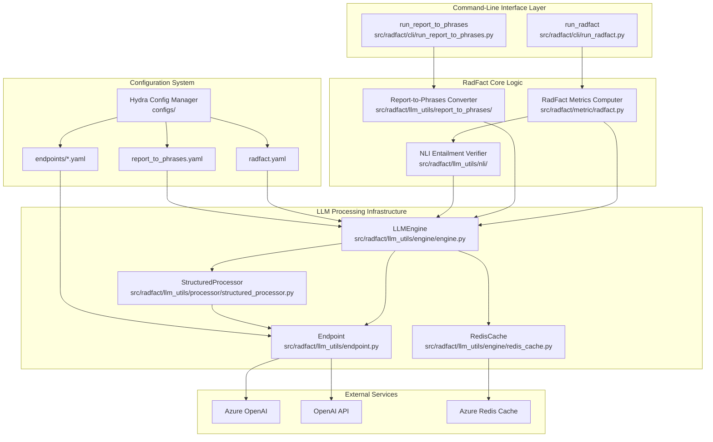
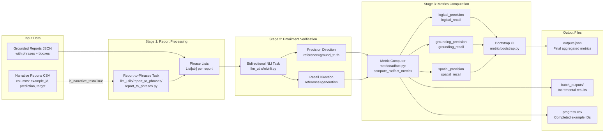
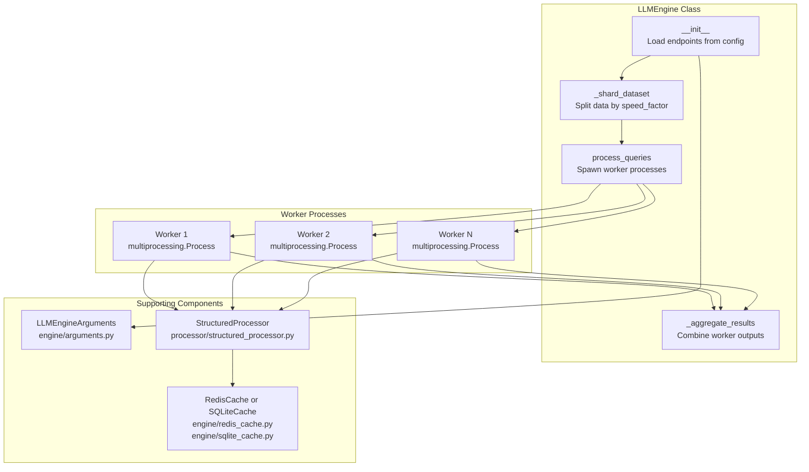
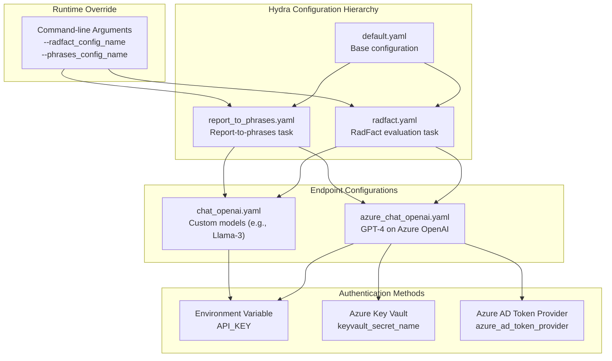

<!-- source: DeepWiki mcp.deepwiki.com · repo microsoft/RadFact · page 1 Home · fetched 2026-10-26 -->

# Home

<details>
<summary>Relevant source files</summary>

The following files were used as context for generating this wiki page:

- [README.md](README.md)
- [pyproject.toml](pyproject.toml)

</details>


## Purpose and Scope

This wiki documents RadFact, an LLM-based evaluation framework for AI-generated radiology reports. RadFact provides a suite of six metrics to evaluate both text-only and grounded (bounding-box annotated) radiology reports against ground-truth references using large language model entailment verification.

For installation and setup instructions, see [Getting Started](#2). For detailed architectural information, see [Architecture](#5). For usage instructions, see [User Guide](#4).

**Sources**: [README.md:1-6]()

## What is RadFact?

RadFact is an automated evaluation metric that measures the quality of AI-generated radiology reports by comparing them to ground-truth references. Unlike traditional lexical metrics (BLEU, ROUGE), RadFact leverages the logical reasoning capabilities of large language models to determine semantic entailment between reports.

### Problem Statement

Evaluating generated medical reports requires understanding whether findings are:
- **Factually correct** (no hallucinations)
- **Complete** (no omissions)  
- **Properly grounded** (bounding boxes correctly localize findings)

Traditional metrics fail at this because they measure surface-level text similarity rather than semantic correctness.

### RadFact Metrics

RadFact provides six metrics organized into three categories:

| Category | Precision Metric | Recall Metric | Evaluates |
|----------|------------------|---------------|-----------|
| **Logical** | Fraction of generated sentences entailed by ground-truth | Fraction of ground-truth sentences entailed by generation | Text-only correctness and completeness |
| **Grounding** | Fraction of correctly-generated findings also correctly grounded | Fraction of correctly-captured findings also correctly grounded | Grounding quality for correct findings |
| **Spatial** | Fraction of all grounded generations both logically and spatially entailed | Fraction of all grounded ground-truths both logically and spatially entailed | Overall grounding performance |

Precision metrics use ground-truth as reference; recall metrics use generation as reference. This bidirectional evaluation captures both hallucinations (low precision) and omissions (low recall).

**Sources**: [README.md:190-222]()

## System Architecture Overview

RadFact is organized into four major layers: user interface, core evaluation logic, LLM processing infrastructure, and external services.

### High-Level Component Structure



**Description**: This diagram shows how RadFact's major components relate to actual code files. The CLI layer provides two entry points (`run_radfact` and `run_report_to_phrases`) that invoke the core evaluation logic. The `LLMEngine` class orchestrates parallel LLM queries across multiple endpoints, using `StructuredProcessor` for prompt management and `RedisCache` for response caching. Configuration is managed via Hydra with task-specific YAML files.

**Sources**: [README.md:1-100](), [src/radfact/llm_utils/engine/engine.py](), [src/radfact/llm_utils/processor/structured_processor.py](), [src/radfact/llm_utils/engine/redis_cache.py](), [pyproject.toml:86-88]()

### Evaluation Pipeline Data Flow



**Description**: This diagram illustrates the three-stage evaluation pipeline with exact code file locations. Stage 1 converts narrative reports to phrase lists using `report_to_phrases.py`. Stage 2 performs bidirectional entailment verification via `nli.py`, checking both precision (using ground-truth as reference) and recall (using generation as reference). Stage 3 computes the six metrics in `radfact.py` and optionally generates bootstrap confidence intervals. Results are written incrementally to `batch_outputs/` and aggregated into `outputs.json`.

**Sources**: [README.md:131-189](), [README.md:190-222](), [src/radfact/metric/radfact.py](), [src/radfact/llm_utils/nli/nli.py](), [src/radfact/llm_utils/report_to_phrases/report_to_phrases.py]()

## Key Components

### CLI Entry Points

RadFact provides two command-line tools defined in [pyproject.toml:86-88]():

- **`run_radfact`**: Main evaluation command that computes all six RadFact metrics
  - Implementation: [src/radfact/cli/run_radfact.py]()
  - Accepts CSV (narrative reports) or JSON (grounded reports)
  - Supports optional bootstrapping for confidence intervals
  
- **`run_report_to_phrases`**: Standalone report-to-phrases conversion
  - Implementation: [src/radfact/cli/run_report_to_phrases.py]()
  - Useful for pre-processing narrative reports offline

**Sources**: [pyproject.toml:86-88](), [README.md:131-189]()

### Core Evaluation Logic

The `radfact.metric` module implements metric computation:

- **`RadFact` class** [src/radfact/metric/radfact.py](): Main orchestrator that coordinates report-to-phrases conversion and entailment verification
- **`compute_radfact_metrics()` function**: Computes the six metrics from entailment results
- **`bootstrap.py`**: Implements bootstrap resampling for confidence intervals

**Sources**: [src/radfact/metric/radfact.py]()

### LLM Processing Infrastructure

The `radfact.llm_utils` package provides the LLM processing infrastructure:

#### LLMEngine: Parallel Processing Orchestrator

The `LLMEngine` class [src/radfact/llm_utils/engine/engine.py]() manages parallel processing across multiple LLM endpoints:



**Description**: The `LLMEngine` shards the input dataset across available endpoints based on their `speed_factor` configuration parameter. Each worker process runs independently, using a `StructuredProcessor` instance to query its assigned endpoint. The cache is shared across workers to avoid redundant API calls. Results are incrementally saved and aggregated at completion.

**Sources**: [src/radfact/llm_utils/engine/engine.py](), [src/radfact/llm_utils/engine/arguments.py]()

#### StructuredProcessor: Prompt and Response Handler

The `StructuredProcessor` class [src/radfact/llm_utils/processor/structured_processor.py]() handles:
- **Prompt formatting**: Combines system message, few-shot examples, and query
- **LLM invocation**: Calls LangChain chat models
- **Response parsing**: Extracts structured outputs from LLM responses
- **Retry logic**: Handles transient failures

**Sources**: [src/radfact/llm_utils/processor/structured_processor.py]()

#### Caching System

Two cache implementations are provided:
- **`RedisCache`** [src/radfact/llm_utils/engine/redis_cache.py](): Distributed cache using Azure Redis Cache, suitable for production
- **`SQLiteCache`** [src/radfact/llm_utils/engine/sqlite_cache.py](): Local file-based cache, suitable for development

Both implement endpoint URL normalization to maximize cache hits across different Azure regions.

**Sources**: [src/radfact/llm_utils/engine/redis_cache.py](), [src/radfact/llm_utils/engine/sqlite_cache.py]()

### Configuration System

RadFact uses Hydra for hierarchical configuration management [configs/]():



**Description**: Configuration files are organized hierarchically. Task-specific configs (`radfact.yaml`, `report_to_phrases.yaml`) inherit from `default.yaml` and specify which endpoint configurations to use. Endpoint configs define the LLM URL, deployment name, and authentication method. Users can override any configuration via command-line arguments.

**Sources**: [configs/default.yaml](), [configs/radfact.yaml](), [configs/report_to_phrases.yaml](), [configs/endpoints/](), [README.md:48-93]()

## Execution Flow

The typical execution flow for evaluating a set of reports:

1. **User invokes CLI**: `run_radfact --input_path data.csv --is_narrative_text`
2. **Hydra loads configuration**: Reads `configs/radfact.yaml` and endpoint configs
3. **RadFact initializes**: Creates `RadFact` instance with LLM endpoints
4. **Stage 1 (if narrative)**: Converts reports to phrases using `report_to_phrases` task
5. **Stage 2**: Performs bidirectional entailment verification using `nli` task
   - Precision direction: ground-truth as reference
   - Recall direction: generation as reference
6. **Stage 3**: Computes six metrics from entailment results
7. **Bootstrap (optional)**: Generates confidence intervals via resampling
8. **Output**: Writes `outputs.json` with metrics and CI

Throughout execution, the `LLMEngine`:
- Shards data across endpoints based on `speed_factor`
- Spawns parallel workers (one per endpoint)
- Checks cache before making LLM API calls
- Writes incremental results to `batch_outputs/` and `progress.csv`
- Aggregates worker outputs into final `outputs.json`

**Sources**: [README.md:131-189](), [src/radfact/llm_utils/engine/engine.py]()

## External Dependencies

RadFact integrates with several external services and libraries:

### Azure Services
- **Azure OpenAI**: LLM endpoints for GPT-4 models
- **Azure Redis Cache**: Distributed caching for LLM responses
- **Azure Key Vault**: Secure credential storage
- **Azure ML**: Optional experiment tracking via MLflow

### Key Python Libraries
- **LangChain** (0.2.17): LLM orchestration and chat model abstractions
- **Hydra** (1.3.2): Hierarchical configuration management
- **Pandas/NumPy**: Data manipulation and metrics computation
- **Redis**: Cache client library

**Sources**: [pyproject.toml:41-60](), [README.md:48-93]()

## Output Structure

RadFact produces a structured output directory for each run:

```
outputs/radfact/run_YYYYMMDD_HHMMSS/
├── batch_outputs/           # Incremental results per batch
│   ├── outputs_0_100.json
│   ├── outputs_100_200.json
│   └── ...
├── progress/                # Progress tracking per worker
│   ├── subset_0_500.csv
│   └── ...
├── skipped/                 # Failed queries per worker
│   ├── subset_0_500.csv
│   └── ...
├── outputs.json            # Final aggregated metrics
├── progress.csv            # Aggregated progress
└── skipped.csv             # Aggregated failures
```

The `outputs.json` file contains:
- Six RadFact metrics (with optional bootstrap confidence intervals)
- Per-example entailment results
- `num_llm_failures`: Count of queries that failed

**Sources**: [README.md:100-130]()

## Next Steps

- **To install RadFact**: See [Installation](#2.1)
- **To run your first evaluation**: See [Quick Start](#2.2)
- **To configure LLM endpoints**: See [Configuration Setup](#2.3)
- **To understand the metrics**: See [RadFact Metrics](#3.1)
- **To learn about the architecture**: See [Architecture](#5)

**Sources**: [README.md:1-274]()

---

