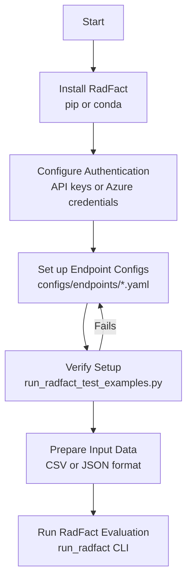
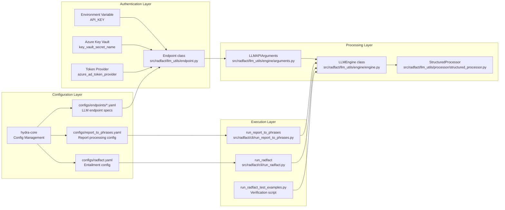
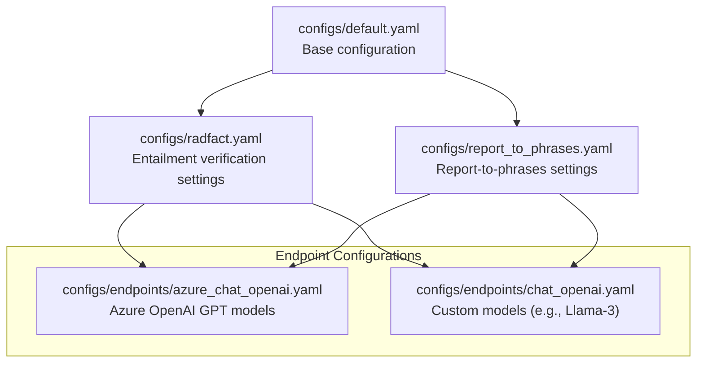
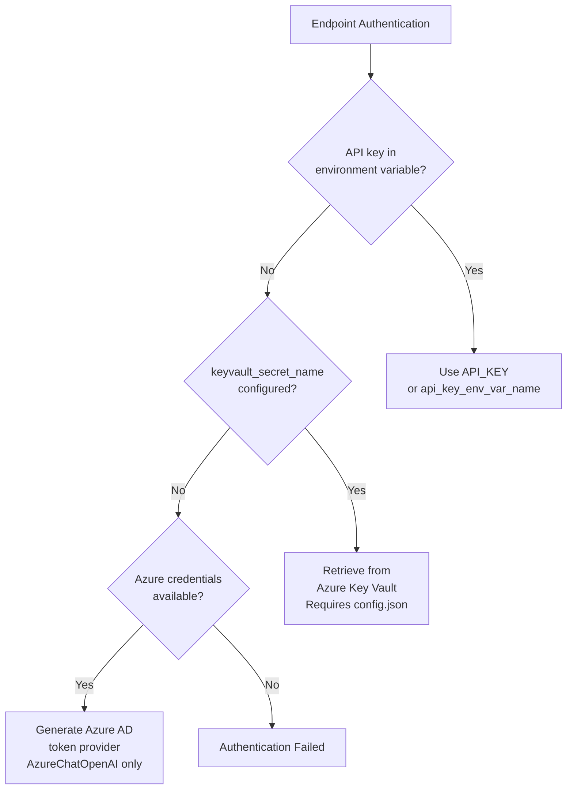

<!-- source: DeepWiki mcp.deepwiki.com · repo microsoft/RadFact · page 2 Getting Started · fetched 2026-10-26 -->

# Getting Started

<details>
<summary>Relevant source files</summary>

The following files were used as context for generating this wiki page:

- [Makefile](Makefile)
- [README.md](README.md)
- [dev_environment.yaml](dev_environment.yaml)

</details>


This page provides an overview of the steps required to set up and run RadFact for the first time. It covers installation, endpoint configuration, and running your first evaluation. For detailed instructions on each step, refer to the child pages: [Installation](#2.1), [Quick Start](#2.2), and [Configuration Setup](#2.3).

RadFact is designed to evaluate AI-generated radiology reports using large language models (LLMs) for entailment verification. Before you can run evaluations, you must install dependencies, configure LLM endpoints with authentication, and prepare your input data.

## Setup Workflow

The following diagram shows the high-level workflow for getting RadFact operational:



**Sources**: [README.md:25-98]()

Each step in this workflow is critical:

1. **Installation**: Install the `radfact` package and its dependencies
2. **Authentication**: Set up credentials for accessing LLM endpoints  
3. **Endpoint Configuration**: Configure which LLM(s) to use via YAML files
4. **Verification**: Confirm endpoints work correctly with test examples
5. **Data Preparation**: Format your reports according to expected schemas
6. **Execution**: Run evaluations using the CLI commands

## Prerequisites

Before beginning, ensure you have:

| Requirement | Description | Notes |
|-------------|-------------|-------|
| Python 3.10+ | Python runtime environment | Required by dependencies |
| LLM API Access | Access to Azure OpenAI or compatible endpoint | GPT-4 or Llama-3-70B recommended |
| API Credentials | API keys or Azure authentication | See [Configuration Setup](#2.3) |
| Input Data | Radiology reports in CSV or JSON format | See [Input Data Formats](#4.3) |

**Sources**: [README.md:27-46](), [dev_environment.yaml:24]()

## Key Components and Code Entities

The following diagram maps the setup workflow to specific code entities and configuration files in the RadFact codebase:



**Sources**: [README.md:48-93](), [src/radfact/llm_utils/endpoint.py:38](), [src/radfact/llm_utils/engine/arguments.py]()

### Component Descriptions

| Component | File Path | Purpose |
|-----------|-----------|---------|
| `run_radfact` | [src/radfact/cli/run_radfact.py]() | Main CLI for running RadFact evaluations |
| `run_report_to_phrases` | [src/radfact/cli/run_report_to_phrases.py]() | CLI for converting narrative reports to phrases |
| `LLMEngine` | [src/radfact/llm_utils/engine/engine.py:50]() | Orchestrates parallel LLM processing across endpoints |
| `StructuredProcessor` | [src/radfact/llm_utils/processor/structured_processor.py]() | Handles prompt construction and LLM query/response parsing |
| `Endpoint` | [src/radfact/llm_utils/endpoint.py:38]() | Manages endpoint configuration and authentication |
| `LLMAPIArguments` | [src/radfact/llm_utils/engine/arguments.py]() | Configures LLM API parameters from endpoint objects |

**Sources**: [README.md:64](), [README.md:100]()

## Configuration Files

RadFact uses Hydra for hierarchical configuration management. The key configuration files are:



**Sources**: [README.md:66-93]()

### Endpoint Configuration Structure

Each endpoint configuration file in `configs/endpoints/` follows this structure:

| Field | Type | Description | Example |
|-------|------|-------------|---------|
| `type` | string | Endpoint type | `"AZURE_CHAT_OPENAI"` or `"CHAT_OPENAI"` |
| `url` | string | API endpoint URL | `"https://...openai.azure.com"` |
| `deployment_name` | string | Model deployment name | `"gpt-4"` or `"llama3-70b"` |
| `api_key_env_var_name` | string | Environment variable for API key | `"API_KEY"` (default) |
| `keyvault_secret_name` | string | Optional Azure Key Vault secret name | For production deployments |
| `speed_factor` | float | Relative speed for load balancing | `1.0` (default) |
| `num_parallel_processes` | int | Parallel workers per endpoint | `10` |

**Sources**: [README.md:70-88]()

## Authentication Methods

RadFact supports three authentication methods, checked in this order:



**Sources**: [README.md:54-63]()

### Method 1: Environment Variable (Simplest)

Set an environment variable with your API key:

```bash
export API_KEY="your-api-key-here"
```

If using multiple endpoints with different keys, specify unique environment variable names in each endpoint config via `api_key_env_var_name`.

### Method 2: Azure Key Vault (Recommended for Production)

Requires:
1. An `config.json` file in the repository root with keys: `subscription_id`, `resource_group`, `workspace_name`
2. The `key_vault_secret_name` field specified in the endpoint configuration

The `Endpoint` class at [src/radfact/llm_utils/endpoint.py:38]() retrieves secrets from the default Key Vault of the AzureML workspace.

### Method 3: Azure Token Provider (Fallback)

If neither API key method is configured, RadFact falls back to token-based authentication using Azure AD credentials. This only works with `AzureChatOpenAI` endpoints and requires proper Azure credentials to be available in the environment.

**Sources**: [README.md:54-64](), [src/radfact/llm_utils/endpoint.py:38]()

## Verification Step

Before running full evaluations, verify your endpoint configuration is working correctly:

```bash
python src/radfact/cli/run_radfact_test_examples.py
```

This script runs a small set of test examples through the entailment verification pipeline. The expected results were obtained using `Llama-3-70B-Instruct`. If results differ significantly from expectations, your LLM may not be suitable for RadFact evaluation.

**Note**: This only tests entailment verification, not the report-to-phrases conversion step.

**Sources**: [README.md:94-98]()

## Command-Line Interface

Once setup is complete, RadFact provides two main CLI commands:

### `run_radfact` - Run Evaluations

For narrative (non-grounded) reports:
```bash
run_radfact --input_path examples/findings_generation_examples.csv --is_narrative_text
```

For grounded reports with bounding boxes:
```bash
run_radfact --input_path examples/grounded_reporting_examples.json
```

### `run_report_to_phrases` - Convert Reports to Phrases

For narrative reports that need to be converted to structured phrases:
```bash
run_report_to_phrases dataset.csv_path=path/to/reports.csv
```

See [Quick Start](#2.2) for detailed examples and [CLI Commands](#8.1) for complete reference documentation.

**Sources**: [README.md:132-189]()

## Output Directory Structure

RadFact creates a timestamped output directory for each run. The `LLMEngine` class manages batch processing and intermediate result caching:

```
outputs/radfact/run_20240814_075225/
├── batch_outputs/           # Intermediate results per batch
│   ├── outputs_0_100.json
│   └── outputs_1000_1100.json
├── progress/                # Processing progress per endpoint
│   ├── subset_0_240.csv
│   └── subset_800_1100.csv
├── skipped/                 # Failed queries (set as NOT ENTAILED)
│   ├── subset_0_240.csv
│   └── subset_800_1100.csv
├── outputs.json             # Final aggregated results
├── progress.csv             # Overall progress tracking
└── skipped.csv              # Overall skipped examples
```

**Sources**: [README.md:100-129]()

The `outputs.json` file contains the final metrics. The `skipped.csv` file tracks any LLM failures - if this is large, results may not be reliable. RadFact defaults to marking failed queries as NOT ENTAILED.

## Next Steps

Now that you understand the setup workflow and key components:

1. **[Installation](#2.1)**: Install RadFact using pip or conda
2. **[Quick Start](#2.2)**: Run your first evaluation with example data  
3. **[Configuration Setup](#2.3)**: Configure LLM endpoints and authentication in detail

For understanding what RadFact computes, see [Core Concepts](#3). For details on input formats, see [Input Data Formats](#4.3).

**Sources**: [README.md:7-23]()

---

