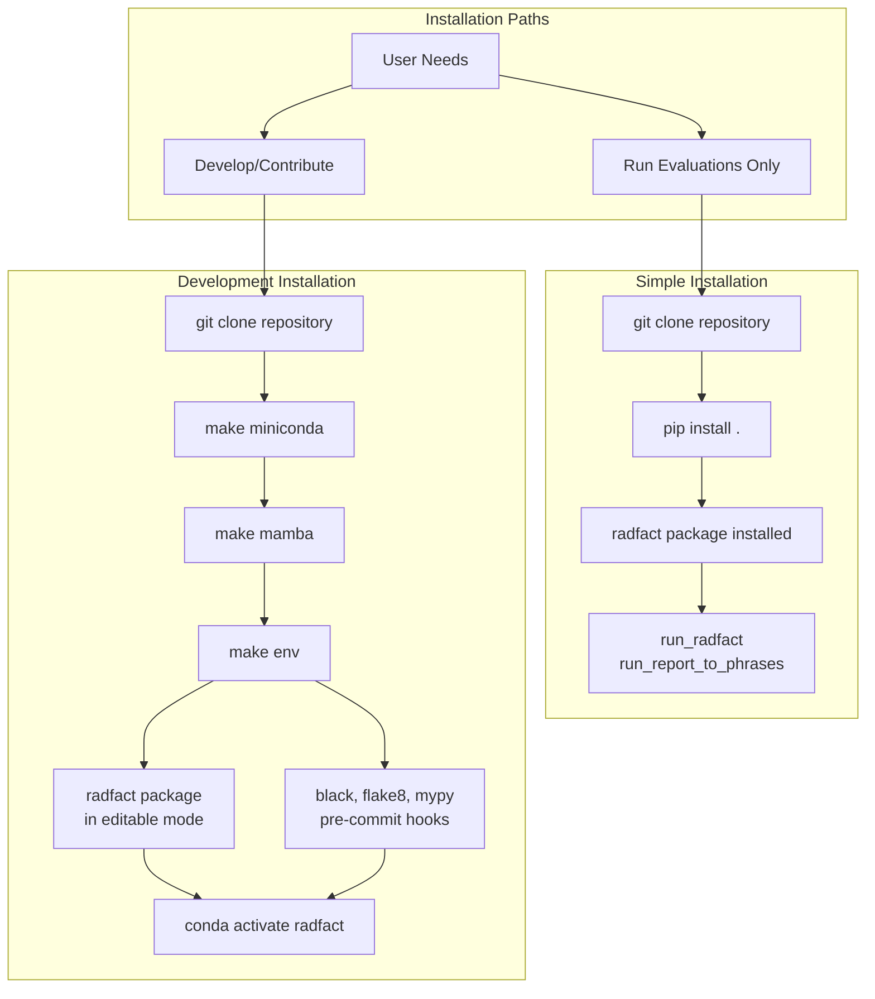
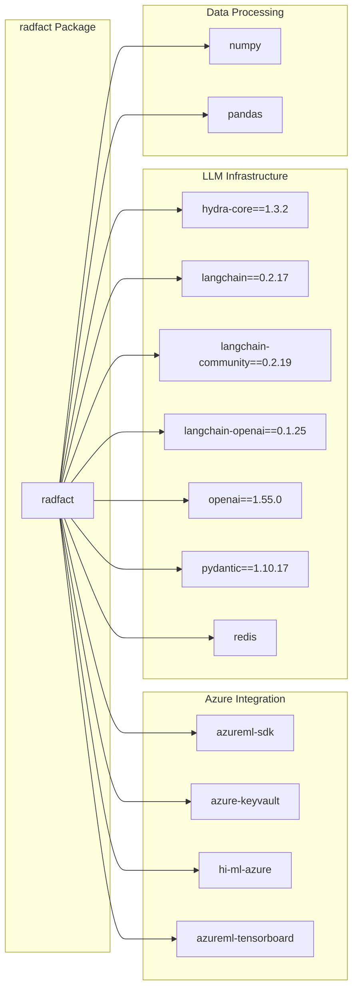
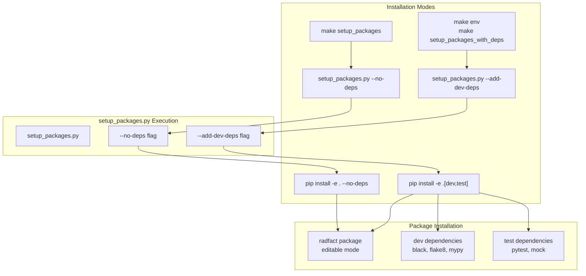
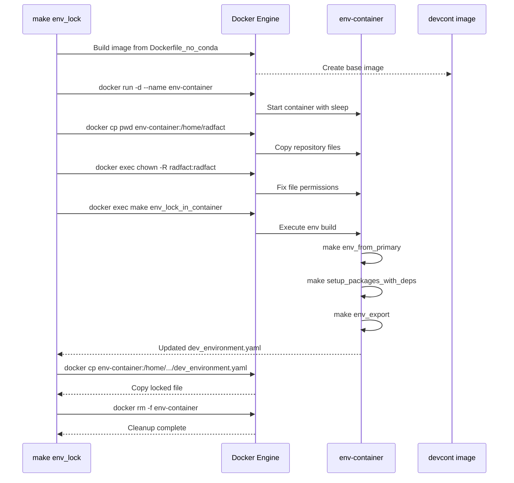
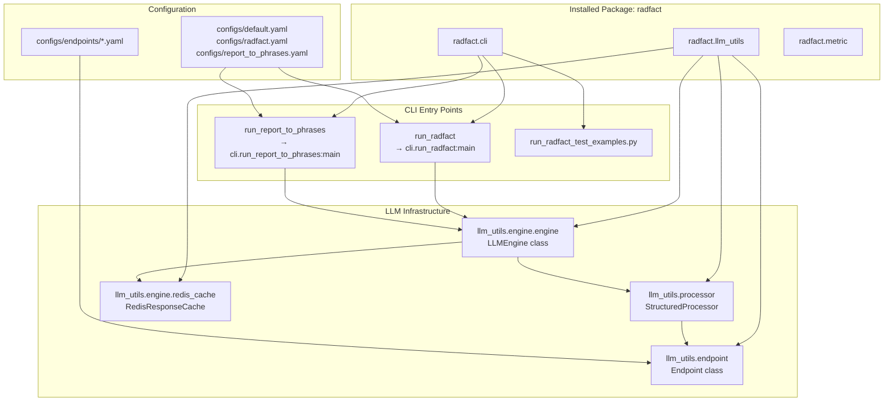

<!-- source: DeepWiki mcp.deepwiki.com · repo microsoft/RadFact · page 2.1 Installation · fetched 2026-10-26 -->

# Installation

<details>
<summary>Relevant source files</summary>

The following files were used as context for generating this wiki page:

- [Makefile](Makefile)
- [README.md](README.md)
- [dev_environment.yaml](dev_environment.yaml)
- [pyproject.toml](pyproject.toml)

</details>


This document provides detailed instructions for installing RadFact and setting up your environment. It covers both quick installation for evaluation use and full development setup for contributors.

For information about configuring LLM endpoints and authentication after installation, see [Configuration Setup](#2.3). To start running evaluations immediately after installation, see [Quick Start](#2.2).

## Prerequisites

RadFact requires Python 3.10 or higher. The system has been tested on Linux environments and requires the following base dependencies:

- Python 3.10+
- pip 23.0.1 or higher (for simple installation)
- conda/mamba (optional, for development setup)
- Docker (optional, for environment locking)

**Sources:** [README.md:27-46](), [pyproject.toml:33](), [dev_environment.yaml:24]()

## Installation Methods Overview



**RadFact Installation Decision Tree**

**Sources:** [README.md:27-46](), [Makefile:11-46]()

## Simple Installation (pip)

For users who want to run RadFact evaluations without modifying the codebase:

### Step 1: Clone the Repository

```bash
git clone https://github.com/microsoft/RadFact
cd RadFact
```

### Step 2: Install with pip

```bash
pip install .
```

This installs the `radfact` package and all runtime dependencies defined in [pyproject.toml:41-60](). The installation creates two CLI entry points:

| Command | Entry Point Definition | Source File |
|---------|----------------------|-------------|
| `run_radfact` | `radfact.cli.run_radfact:main` | [src/radfact/cli/run_radfact.py]() |
| `run_report_to_phrases` | `radfact.cli.run_report_to_phrases:main` | [src/radfact/cli/run_report_to_phrases.py]() |

**Sources:** [README.md:29-35](), [pyproject.toml:86-88]()

### Core Dependencies Installed



**Package Dependency Structure from pyproject.toml**

**Sources:** [pyproject.toml:41-60]()

## Development Installation (Conda)

For contributors who need a reproducible development environment with code quality tools:

### Step 1: Install Miniconda

If you don't have conda installed:

```bash
make miniconda
```

This downloads and installs Miniconda3-latest from [Makefile:11-13](). The installer script will be placed in the current directory.

**Sources:** [Makefile:11-13](), [README.md:40]()

### Step 2: Install Mamba (Fast Solver)

```bash
make mamba
```

This installs the libmamba solver for faster dependency resolution, as defined in [Makefile:16-19](). It updates the base conda environment and configures conda to use the libmamba solver.

**Sources:** [Makefile:16-19](), [README.md:41]()

### Step 3: Create the Conda Environment

```bash
make env
conda activate radfact
```

The `make env` target executes the following steps from [Makefile:22-28]():

1. Removes any existing `radfact` environment
2. Creates a new environment from [dev_environment.yaml]()
3. Installs the radfact package in editable mode via `setup_packages_with_deps`

**Sources:** [Makefile:22-28](), [README.md:42-46]()

### Environment Contents

The [dev_environment.yaml]() defines a locked environment with 370+ packages. Key components include:

| Category | Key Packages | Purpose |
|----------|-------------|---------|
| **Base** | python=3.10.15, pip, setuptools | Core Python environment |
| **Azure** | azure-cli, azure-identity, azure-ai-ml | Azure service integration |
| **LLM** | langchain, openai, tiktoken | LLM API interaction |
| **Development** | black, flake8, mypy, pre-commit | Code quality tools |
| **ML/Data** | numpy, pandas, scikit-learn, mlflow | Data processing and experiment tracking |
| **Testing** | pytest, mock, pytest-lazy-fixture | Test infrastructure |

**Sources:** [dev_environment.yaml:1-370]()

### Editable Installation Details



**Package Installation Flow via setup_packages.py**

The editable installation allows you to modify the source code without reinstalling. Changes to Python files in [src/radfact/]() are immediately reflected when running `run_radfact` or `run_report_to_phrases`.

**Sources:** [Makefile:40-46](), [README.md:46](), [pyproject.toml:62-82]()

## Environment Locking (Advanced)

For maintainers who need to update the locked environment file:

### Docker-Based Locking Process

```bash
make env_lock
```

This executes a multi-step process defined in [Makefile:70-87]():



**Docker-Based Environment Locking Process**

The locking process:
1. Builds a Docker image from [Dockerfile_no_conda]()
2. Creates an environment from [primary_deps.yaml]()
3. Installs all packages with their dependencies
4. Exports the complete locked environment to [dev_environment.yaml]()

**Sources:** [Makefile:67-87]()

### Environment Export Mechanism

The `env_export` target ([Makefile:61-63]()) filters out local packages from the conda export:

```bash
conda env export --no-builds -n radfact | \
    grep -v "^prefix" | \
    grep -Ev "\s(azure-utils|llm-utils|radfact)==" \
    >> dev_environment.yaml
```

This ensures that only external dependencies are locked, not the radfact package itself which is installed in editable mode.

**Sources:** [Makefile:50-63]()

## Installation Verification

After installation, verify that the CLI commands are available:

```bash
run_radfact --help
run_report_to_phrases --help
```

These commands should display help text defined in [src/radfact/cli/run_radfact.py]() and [src/radfact/cli/run_report_to_phrases.py]() respectively.

For a quick test of the entailment verification system, run:

```bash
python src/radfact/cli/run_radfact_test_examples.py
```

This executes test cases with known expected outputs using the configured LLM endpoint. Note that this requires endpoint configuration to be completed (see [Configuration Setup](#2.3)).

**Sources:** [README.md:94-98](), [README.md:136-160]()

## Package Structure



**Installed Package Structure and Entry Points**

**Sources:** [pyproject.toml:86-88](), [README.md:136-189]()

## Troubleshooting

### Common Installation Issues

| Issue | Symptom | Solution |
|-------|---------|----------|
| **Missing Python version** | `python: command not found` | Install Python 3.10+ or activate conda environment |
| **Permission errors** | `Permission denied` during pip install | Use `pip install --user .` or virtual environment |
| **Conda solver timeout** | Environment creation hangs | Run `make mamba` to install faster libmamba solver |
| **Docker permission denied** | `make env_lock` fails with permission error | Add user to docker group or use `sudo` |
| **Import errors after install** | `ModuleNotFoundError: radfact` | Verify installation with `pip list \| grep radfact` |

### Verifying Dependency Installation

Check that key dependencies are installed:

```bash
python -c "import langchain; print(langchain.__version__)"  # Should be 0.2.17
python -c "import hydra; print(hydra.__version__)"          # Should be 1.3.2
python -c "import openai; print(openai.__version__)"        # Should be 1.55.0
```

**Sources:** [pyproject.toml:49-54](), [dev_environment.yaml:209-266]()

### Development Tools Verification

If using the development installation, verify code quality tools:

```bash
make blackcheck  # Run black in check mode
make flake8      # Run flake8 linter
make mypy        # Run mypy type checker
```

These commands are defined in [Makefile:101-117]() and should execute without errors on a fresh installation.

**Sources:** [Makefile:101-117]()

## Next Steps

After successful installation:

1. **Quick Start**: Run your first evaluation → See [Quick Start](#2.2)
2. **Configure Endpoints**: Set up LLM access → See [Configuration Setup](#2.3)
3. **Development**: Set up code quality tools → See [Development Setup](#7.1)

**Sources:** [README.md:7-24]()

---

