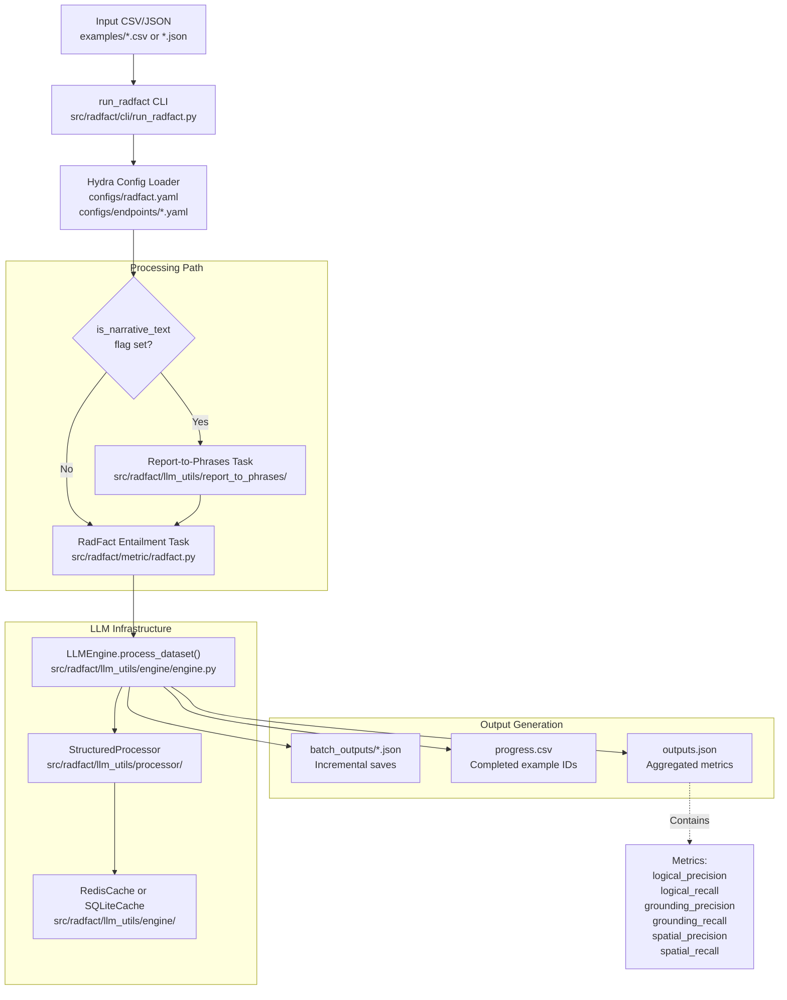
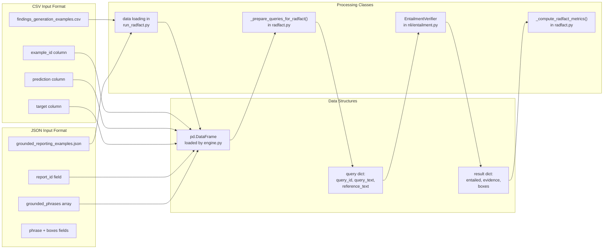

<!-- source: DeepWiki mcp.deepwiki.com · repo microsoft/RadFact · page 2.2 Quick Start · fetched 2026-10-26 -->

# Quick Start

<details>
<summary>Relevant source files</summary>

The following files were used as context for generating this wiki page:

- [README.md](README.md)
- [configs/radfact.yaml](configs/radfact.yaml)
- [examples/findings_generation_examples.csv](examples/findings_generation_examples.csv)

</details>


This guide walks you through running your first RadFact evaluation using the provided example datasets. You will learn how to evaluate both narrative radiology reports and grounded reports with bounding boxes, and understand the basic output format.

**Prerequisites**: This guide assumes you have completed [Installation](#2.1). For detailed endpoint configuration, see [Configuration Setup](#2.3).

**Scope**: This guide covers the minimal steps to run RadFact on example data. For detailed configuration options, input format specifications, and metric interpretation, see the [User Guide](#4) section.

---

## Example Datasets

RadFact includes two example datasets demonstrating different input formats:

| File | Type | Description | Columns/Fields |
|------|------|-------------|----------------|
| `examples/findings_generation_examples.csv` | Narrative reports | CSV with 19 example pairs of predicted and ground-truth radiology findings | `example_id`, `prediction`, `target` |
| `examples/grounded_reporting_examples.json` | Grounded reports | JSON with phrases and bounding boxes | `report_id`, `grounded_phrases` array with `phrase` and `boxes` |

**Sources**: [examples/findings_generation_examples.csv:1-22](), [README.md:174-174]()

---

## Running Your First Evaluation: Narrative Reports

The simplest way to run RadFact is with narrative text reports. This uses the `run_radfact` command with the `--is_narrative_text` flag:

```bash
run_radfact \
  --input_path examples/findings_generation_examples.csv \
  --is_narrative_text \
  --output_dir outputs/my_first_run
```

This command:
1. Reads the CSV file containing predicted and target reports
2. Converts each narrative report into structured phrases using an LLM
3. Performs bidirectional entailment verification
4. Computes logical precision and recall metrics
5. Saves results to `outputs/my_first_run/outputs.json`

**Expected output structure**:
```
outputs/my_first_run/
├── batch_outputs/          # Incremental results per batch
│   └── outputs_0_19.json
├── progress/               # Processing progress per worker
│   └── subset_0_19.csv
├── outputs.json           # Final aggregated metrics
└── progress.csv           # Overall progress tracking
```

**Sources**: [README.md:162-166](), [README.md:136-160]()

---

## Running a Grounded Report Evaluation

To evaluate reports that include bounding box annotations, omit the `--is_narrative_text` flag:

```bash
run_radfact \
  --input_path examples/grounded_reporting_examples.json \
  --output_dir outputs/grounded_run
```

This evaluates both textual correctness and grounding quality, producing all six RadFact metrics:
- Logical precision/recall (text-only)
- Grounding precision/recall (grounding quality of entailed sentences)
- Spatial precision/recall (combined text and grounding)

**Sources**: [README.md:168-172](), [README.md:197-206]()

---

## Execution Flow: From Input to Metrics

The following diagram shows how the `run_radfact` CLI processes your data through the RadFact pipeline:



**Key code entities**:
- CLI entry point: [src/radfact/cli/run_radfact.py]()
- Configuration loading: [configs/radfact.yaml:1-7]()
- Report-to-phrases conversion: [src/radfact/llm_utils/report_to_phrases/]()
- RadFact metric computation: [src/radfact/metric/radfact.py]()
- Parallel processing engine: [src/radfact/llm_utils/engine/engine.py:50-]()

**Sources**: [README.md:132-178](), [README.md:190-222]()

---

## Understanding the Output

The primary output is `outputs.json`, which contains:

```json
{
  "logical_precision": 0.85,
  "logical_recall": 0.78,
  "grounding_precision": 0.92,
  "grounding_recall": 0.88,
  "spatial_precision": 0.80,
  "spatial_recall": 0.71,
  "num_llm_failures": 2,
  "bootstrap_ci": {
    "logical_precision": [0.82, 0.88],
    "logical_recall": [0.74, 0.82]
  }
}
```

**Key fields**:
- **logical_precision**: Fraction of generated sentences entailed by ground truth
- **logical_recall**: Fraction of ground-truth sentences entailed by generated report
- **grounding_precision/recall**: Grounding quality for logically entailed sentences (grounded reports only)
- **spatial_precision/recall**: Combined text and grounding quality (grounded reports only)
- **num_llm_failures**: Count of queries where the LLM failed (these default to NOT ENTAILED)
- **bootstrap_ci**: 95% confidence intervals (if `--bootstrap_samples > 0`)

⚠️ **Important**: If `num_llm_failures` is high, the results may be unreliable. Failed examples are logged and saved in the `skipped/` directory.

**Sources**: [README.md:176-178](), [README.md:197-207]()

---

## Data Flow: Input Format to Code Processing

This diagram maps the input data structure to the code entities that process them:



**Key code mappings**:
- CSV columns → pandas DataFrame: Loaded by CLI and passed to engine
- `query_text` / `reference_text` fields: Created by `_prepare_queries_for_radfact()` in [src/radfact/metric/radfact.py]()
- `entailed` / `evidence` results: Returned by `EntailmentVerifier` in [src/radfact/llm_utils/nli/entailment.py]()
- Final metrics: Computed by `_compute_radfact_metrics()` in [src/radfact/metric/radfact.py]()

**Sources**: [README.md:143-148](), [README.md:174-174](), [src/radfact/cli/run_radfact.py]()

---

## Controlling Bootstrap Confidence Intervals

By default, RadFact computes 95% confidence intervals using 500 bootstrap samples:

```bash
# Default: 500 bootstrap samples
run_radfact --input_path examples/findings_generation_examples.csv --is_narrative_text

# Custom number of samples
run_radfact --input_path examples/findings_generation_examples.csv \
  --is_narrative_text \
  --bootstrap_samples 1000

# Disable bootstrapping for faster execution
run_radfact --input_path examples/findings_generation_examples.csv \
  --is_narrative_text \
  --bootstrap_samples 0
```

**Sources**: [README.md:158-160](), [README.md:176-176]()

---

## Common Issues During First Run

### Authentication Errors

If you see authentication errors, you need to configure your LLM endpoints:

```bash
# Quick fix: Set API key as environment variable
export API_KEY="your-api-key-here"

# Then rerun
run_radfact --input_path examples/findings_generation_examples.csv --is_narrative_text
```

For detailed endpoint configuration including Azure OpenAI, Key Vault, and token-based authentication, see [Configuration Setup](#2.3) and [Endpoint Configuration](#6.2).

### LLM Failures

Monitor the `num_llm_failures` field in `outputs.json`. If this number is high:
1. Check endpoint rate limits and timeout settings
2. Review logs for specific error messages
3. Examine the `skipped/` directory to see which examples failed

**Sources**: [README.md:178-178](), [README.md:54-64]()

---

## Verifying Entailment Quality

Before running large evaluations, verify that your LLM performs entailment verification correctly:

```bash
python src/radfact/cli/run_radfact_test_examples.py
```

This script runs on curated test examples with expected results. If your LLM produces significantly different results, it may not be suitable for RadFact evaluation.

**Note**: This test validates entailment verification only, not the report-to-phrases conversion step.

**Sources**: [README.md:94-98]()

---

## Next Steps

After completing your first evaluation:

1. **Configure endpoints**: Set up Azure OpenAI or custom LLM endpoints - see [Configuration Setup](#2.3)
2. **Understand metrics**: Learn what each RadFact metric measures - see [RadFact Metrics](#3.1)
3. **Prepare your data**: Format your own reports for evaluation - see [Input Data Formats](#4.3)
4. **Customize processing**: Adjust batch sizes, parallel workers, and LLM parameters - see [Configuration Reference](#8.2)

For a deeper understanding of how RadFact performs entailment verification and computes metrics, see [Evaluation Pipeline](#3.2) and [Entailment Verification](#3.3).

**Sources**: [README.md:25-189]()

---

