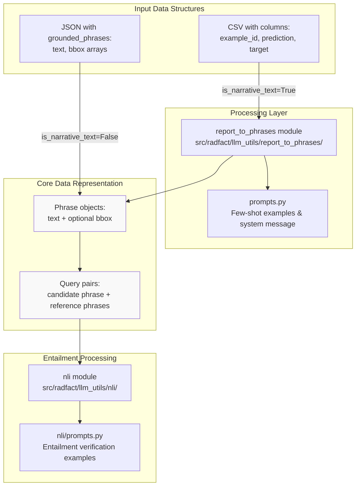
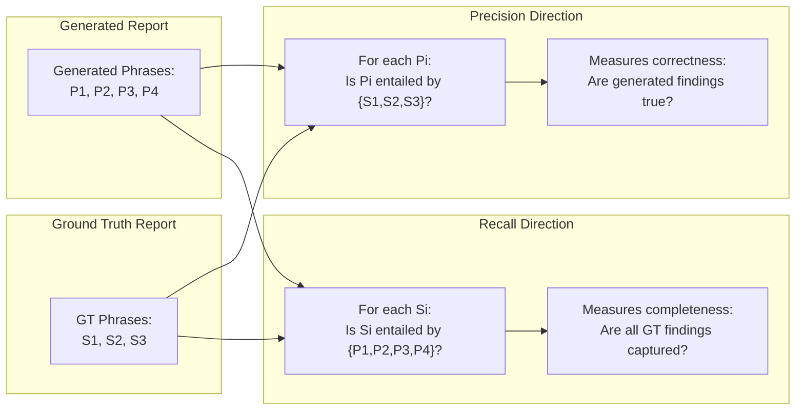
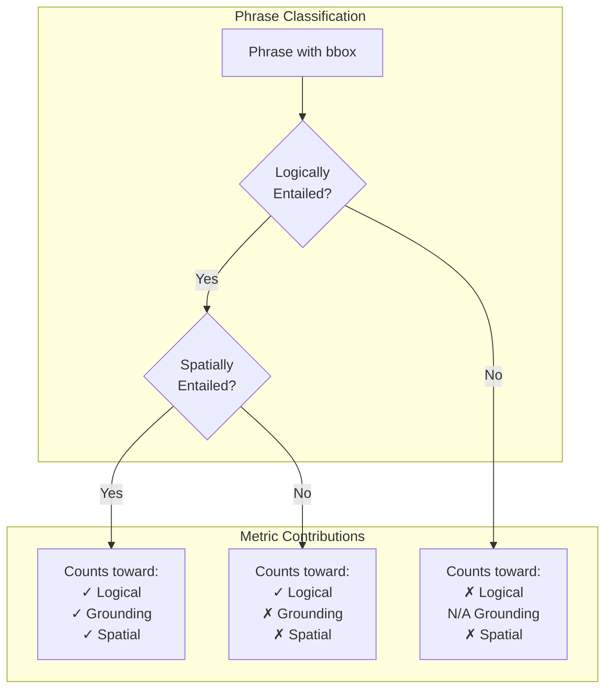
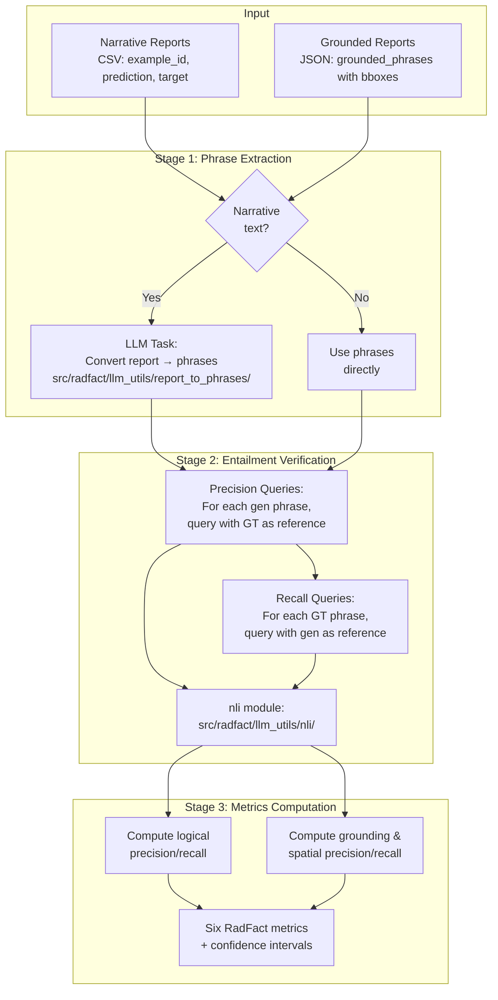
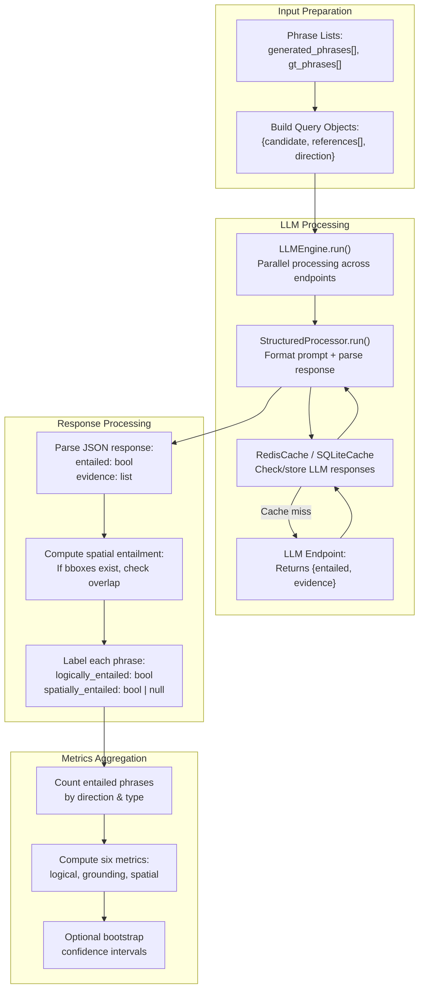

<!-- source: DeepWiki mcp.deepwiki.com · repo microsoft/RadFact · page 3 Core Concepts · fetched 2026-10-26 -->

# Core Concepts

<details>
<summary>Relevant source files</summary>

The following files were used as context for generating this wiki page:

- [README.md](README.md)

</details>


## Purpose and Scope

This page introduces the fundamental concepts underlying the RadFact evaluation framework. It covers the core principles of entailment-based evaluation, report representations, and how RadFact computes metrics at multiple levels (logical, grounding, and spatial). For detailed explanations of specific metrics and their computation, see [RadFact Metrics](#3.1). For implementation details of the evaluation stages, see [Evaluation Pipeline](#3.2) and [Entailment Verification](#3.3).

## Report Representation

RadFact evaluates AI-generated radiology reports against ground-truth references. Reports exist in two fundamental formats:

| Format | Structure | Use Case | Example Source |
|--------|-----------|----------|----------------|
| **Narrative Text** | Unstructured paragraph(s) with multiple findings | Traditional radiology report generation | [examples/findings_generation_examples.csv:1-10]() |
| **Grounded Phrases** | List of structured sentences, each describing one finding with optional bounding boxes | Grounded report generation with spatial localization | [examples/grounded_reporting_examples.json:1-50]() |

### Phrase Structure

RadFact operates on **phrases** as the atomic unit of evaluation. A phrase is a single sentence describing at most one finding. This representation enables precise entailment verification at the finding level.

```
Narrative Report:
"There is a large consolidation in the right lower lobe. No pleural effusion is seen."

↓ Converted to Phrases ↓

Phrase List:
1. "There is a large consolidation in the right lower lobe."
2. "No pleural effusion is seen."
```

For grounded reports, each phrase may include bounding box coordinates:

```json
{
  "text": "There is a large consolidation in the right lower lobe.",
  "bbox": [[x1, y1], [x2, y2], [x3, y3], [x4, y4]]
}
```

**Sources**: [README.md:1-6](), [README.md:190-223](), [examples/findings_generation_examples.csv](), [examples/grounded_reporting_examples.json]()

### Code Representation

The following diagram maps report concepts to their code entity representations:



**Sources**: [README.md:144-174](), [src/radfact/llm_utils/report_to_phrases/](), [src/radfact/llm_utils/nli/]()

## Entailment-Based Evaluation

RadFact's core innovation is using **logical entailment verification** via large language models to evaluate report quality. Entailment is a logical relationship where one statement (the premise) necessarily implies another statement (the hypothesis).

### Entailment Definition

Given:
- **Reference sentences**: Ground-truth findings from the reference report
- **Candidate sentence**: A finding from the generated report

A candidate sentence is **logically entailed** if its meaning is necessarily implied by the reference sentences. The LLM determines entailment and provides **evidence** (which reference sentences support the candidate).

**Example**:
```
Reference: "Moderate cardiomegaly is present."
Candidate: "The heart is enlarged."
Result: ENTAILED (evidence: "Moderate cardiomegaly is present.")
```

**Sources**: [README.md:190-223]()

### Bidirectional Evaluation

RadFact computes entailment in **both directions** to capture precision and recall:



**Sources**: [README.md:194-195](), [README.md:198-206]()

### Entailment Query Structure

Each entailment query follows this pattern:

```
System Message: [Few-shot examples of entailment verification]

Query:
Candidate: "There is a large consolidation in the right lower lobe."
Reference: [
  "No acute cardiopulmonary process.",
  "The lungs are clear bilaterally.",
  "Heart size is normal."
]
Question: Is the candidate sentence entailed? If yes, provide evidence.

Response:
{
  "entailed": false,
  "evidence": []
}
```

The LLM is instructed to return structured JSON with `entailed` (boolean) and `evidence` (list of supporting reference sentences).

**Sources**: [README.md:216-220](), [src/radfact/llm_utils/nli/prompts.py]()

## Evaluation Levels

RadFact evaluates reports at three hierarchical levels, producing six distinct metrics:

### 1. Logical Level (Text-Only)

**Logical entailment** considers only the textual content, ignoring any spatial information:

- **Logical Precision**: Fraction of generated phrases logically entailed by ground-truth
- **Logical Recall**: Fraction of ground-truth phrases logically entailed by generated report

These metrics apply to **all reports** (both narrative and grounded).

### 2. Grounding Level (Conditional)

**Grounding entailment** evaluates spatial localization quality for findings that are **already logically entailed**:

- **Grounding Precision**: Of logically-entailed generated phrases with boxes, what fraction has correct spatial localization?
- **Grounding Recall**: Of logically-entailed ground-truth phrases with boxes, what fraction has correct spatial localization?

### 3. Spatial Level (Unconditional)

**Spatial entailment** combines logical and spatial requirements for **all grounded phrases**:

- **Spatial Precision**: Fraction of all generated grounded phrases that are both logically AND spatially entailed
- **Spatial Recall**: Fraction of all ground-truth grounded phrases that are both logically AND spatially entailed



**Sources**: [README.md:196-208](), [README.md:220-222]()

### Spatial Entailment Definition

A phrase with bounding box is **spatially entailed** if:

1. It is **logically entailed** (has evidence sentences)
2. Its bounding box has **pixel precision ≥ 0.5** with respect to the union of evidence bounding boxes

Pixel precision is computed as:
```
pixel_precision = area(candidate_bbox ∩ union_evidence_bboxes) / area(candidate_bbox)
```

If ≥50% of the candidate box's pixels fall within the evidence boxes, spatial entailment is satisfied.

**Sources**: [README.md:218-221]()

## RadFact Metrics Summary

The six metrics provide complementary views of report quality:

| Metric | Formula | Interpretation | Applies To |
|--------|---------|----------------|------------|
| **Logical Precision** | #logically_entailed_generated / #generated | Truthfulness: no hallucinations | All reports |
| **Logical Recall** | #logically_entailed_gt / #gt | Completeness: no omissions | All reports |
| **Grounding Precision** | #spatially_entailed_generated / #logically_entailed_generated_with_boxes | Of correct findings, how many are well-grounded? | Grounded reports |
| **Grounding Recall** | #spatially_entailed_gt / #logically_entailed_gt_with_boxes | Of captured findings, how many are well-grounded? | Grounded reports |
| **Spatial Precision** | #spatially_entailed_generated / #generated_with_boxes | Penalizes boxes on incorrect/extra findings | Grounded reports |
| **Spatial Recall** | #spatially_entailed_gt / #gt_with_boxes | Penalizes missing boxes or incorrect findings | Grounded reports |

**Sources**: [README.md:196-208]()

## Processing Pipeline Overview

RadFact's evaluation pipeline consists of two main stages:



**Sources**: [README.md:190-223](), [README.md:132-178]()

### Code Entity Mapping

The following table maps pipeline stages to their code implementations:

| Pipeline Stage | Primary Module/File | Key Classes/Functions | Configuration |
|----------------|---------------------|----------------------|---------------|
| CLI Entry | [src/radfact/cli/run_radfact.py]() | `main()` function | [configs/radfact.yaml]() |
| Phrase Extraction | [src/radfact/llm_utils/report_to_phrases/]() | Processor with prompts | [configs/report_to_phrases.yaml]() |
| Entailment Verification | [src/radfact/llm_utils/nli/]() | NLI processor with prompts | Part of radfact.yaml |
| LLM Orchestration | [src/radfact/llm_utils/engine/engine.py]() | `LLMEngine` class | `endpoints` config section |
| Structured Queries | [src/radfact/llm_utils/processor/structured_processor.py]() | `StructuredProcessor` class | `llm_api_args` section |
| Metrics Computation | [src/radfact/]() | Core RadFact logic | `bootstrap_samples` parameter |

**Sources**: [src/radfact/cli/run_radfact.py](), [configs/radfact.yaml](), [configs/report_to_phrases.yaml]()

## Data Structures

### Query-Response Flow

The following diagram shows how data flows through the entailment verification process:



**Sources**: [src/radfact/llm_utils/engine/engine.py](), [src/radfact/llm_utils/processor/structured_processor.py](), [README.md:100-130]()

### Intermediate Outputs

During processing, RadFact creates several intermediate data structures:

```
Phrase Object:
{
  "text": str,
  "bbox": [[x1,y1], [x2,y2], [x3,y3], [x4,y4]] | null
}

Query Object:
{
  "query_id": str,
  "candidate": Phrase,
  "references": [Phrase, ...],
  "direction": "precision" | "recall"
}

Entailment Result:
{
  "query_id": str,
  "entailed": bool,
  "evidence": [str, ...],  // Evidence phrase texts
  "evidence_bboxes": [bbox, ...] | null,
  "spatially_entailed": bool | null  // null if no bboxes
}
```

**Sources**: [README.md:216-222]()

## Key Design Principles

### 1. Few-Shot Learning

RadFact uses ~10 few-shot examples for both report-to-phrases conversion and entailment verification. This approach:
- Provides clear task specification to the LLM
- Handles domain-specific medical terminology
- Establishes consistent output formatting

**Sources**: [README.md:210-228]()

### 2. Structured Output

All LLM queries expect JSON-formatted responses with defined schemas. The `StructuredProcessor` class handles:
- Prompt formatting with few-shot examples
- Output parsing and validation
- Error handling for malformed responses

**Sources**: [src/radfact/llm_utils/processor/structured_processor.py]()

### 3. Failure Handling

When LLM queries fail (timeout, rate limit, parsing error), RadFact defaults to marking the phrase as **NOT ENTAILED**. This conservative approach:
- Prevents artificially inflated metrics
- Ensures reproducibility
- Tracks failures in `num_llm_failures` output field

The number of failures should be monitored; high failure rates indicate unreliable results.

**Sources**: [README.md:178]()

### 4. Caching for Efficiency

All LLM responses are cached (Redis or SQLite) with endpoint-normalized keys. This:
- Reduces API costs for repeated queries
- Enables interrupted processing resumption
- Supports incremental dataset evaluation

**Sources**: [README.md:100-130](), [src/radfact/llm_utils/engine/redis_cache.py]()

## Relationship to Other Components

This page introduced the core concepts. For implementation details, see:

- **[RadFact Metrics](#3.1)**: Detailed metric definitions, formulas, and interpretation
- **[Evaluation Pipeline](#3.2)**: Step-by-step pipeline execution and data flow
- **[Entailment Verification](#3.3)**: Deep dive into LLM-based entailment logic
- **[LLM Engine](#5.2)**: Parallel processing architecture for LLM queries
- **[Structured Processor](#5.3)**: Prompt engineering and response parsing
- **[Input Data Formats](#4.3)**: Detailed specifications for CSV and JSON inputs

**Sources**: Table of Contents structure

---

