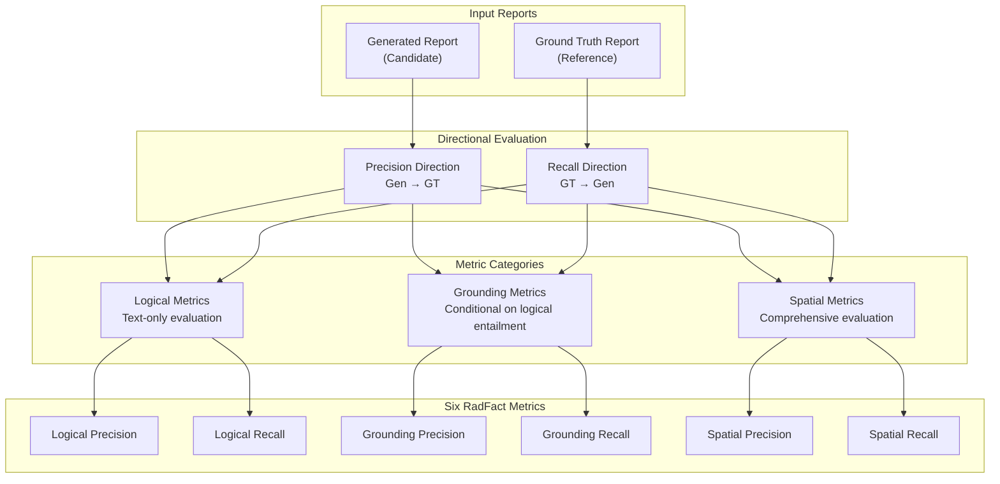
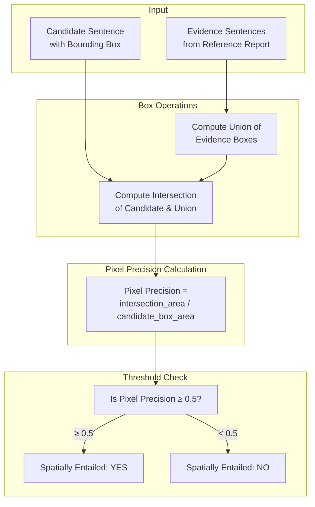
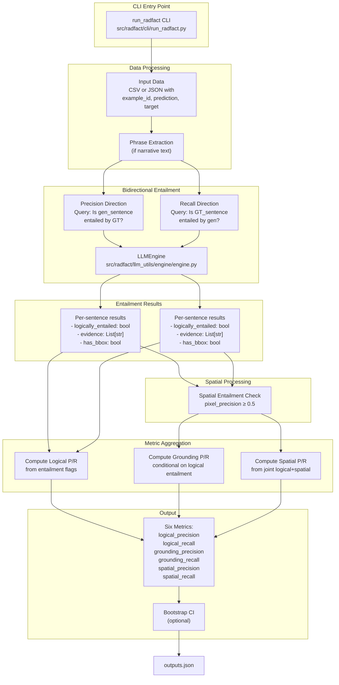
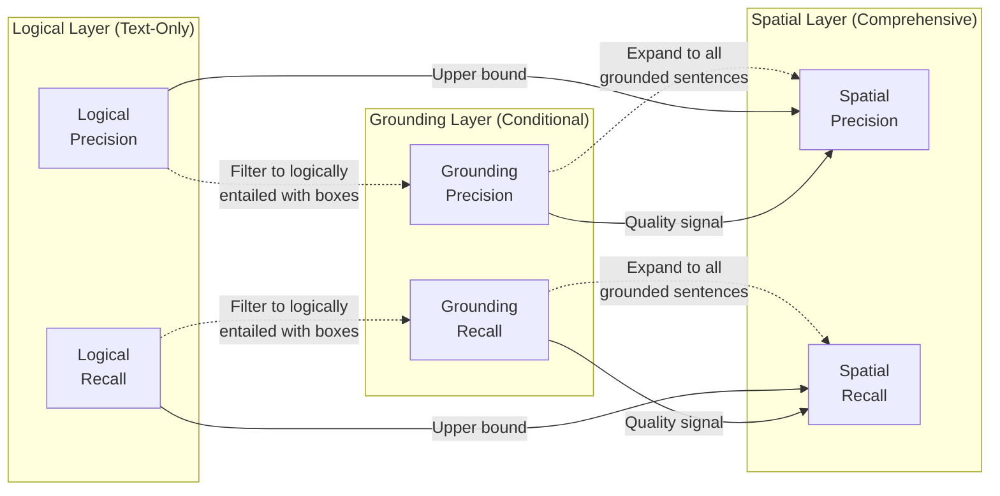

<!-- source: DeepWiki mcp.deepwiki.com · repo microsoft/RadFact · page 3.1 RadFact Metrics · fetched 2026-10-26 -->

# RadFact Metrics

<details>
<summary>Relevant source files</summary>

The following files were used as context for generating this wiki page:

- [README.md](README.md)

</details>


## Purpose and Scope

This page provides a detailed technical explanation of the six metrics that comprise the RadFact evaluation suite: logical precision/recall, grounding precision/recall, and spatial precision/recall. These metrics quantify the quality of AI-generated radiology reports by evaluating both textual correctness and spatial grounding accuracy.

For information about how these metrics are computed through the evaluation pipeline, see [Evaluation Pipeline](#3.2). For details on the entailment verification mechanism that underlies metric computation, see [Entailment Verification](#3.3).

**Sources:** [README.md:1-228]()

## Metrics Overview

RadFact is not a single metric but a suite of six complementary measures that capture different aspects of report quality. The metrics are organized into three categories:

1. **Logical metrics** (text-only): Evaluate semantic correctness and completeness without considering spatial grounding
2. **Grounding metrics** (conditional): Evaluate grounding quality specifically for sentences that are logically correct
3. **Spatial metrics** (comprehensive): Evaluate both logical and spatial correctness together for all grounded sentences



**Title:** RadFact Metrics Taxonomy

**Sources:** [README.md:196-209]()

## Metric Definitions Table

The following table provides formal definitions and interpretations for each metric:

| Metric | Definition | Interpretation | Requires Grounding |
|--------|-----------|----------------|-------------------|
| **Logical Precision** | Fraction of generated sentences that are logically entailed by the ground-truth report | Measures truthfulness: penalizes incorrect or fabricated findings | No |
| **Logical Recall** | Fraction of ground-truth sentences that are logically entailed by the generated report | Measures completeness: penalizes missed or omitted findings | No |
| **Grounding Precision** | Among logically-entailed generated sentences with boxes, fraction that are also spatially entailed | For correctly-generated findings, how often are boxes also correct? | Yes |
| **Grounding Recall** | Among logically-entailed ground-truth sentences with boxes, fraction that are also spatially entailed | For correctly-captured findings, how often are boxes also correct? | Yes |
| **Spatial Precision** | Fraction of all grounded generated sentences that are both logically AND spatially entailed | Captures both incorrect boxes and boxes for incorrect sentences | Yes |
| **Spatial Recall** | Fraction of all grounded ground-truth sentences that are both logically AND spatially entailed | Captures both missing boxes and missed findings entirely | Yes |

**Sources:** [README.md:196-209]()

## Logical Metrics

### Logical Precision

Logical precision measures the **truthfulness** of generated reports by computing the fraction of generated sentences that are logically supported by the ground-truth report.

**Formal Definition:**
```
Logical Precision = (# generated sentences entailed by GT) / (# total generated sentences)
```

**What it captures:**
- Incorrectly generated findings (hallucinations)
- Findings that contradict the ground truth
- Extraneous or fabricated observations

**What it does NOT consider:**
- Spatial grounding information (bounding boxes)
- Completeness of the report

**Directional evaluation:** Uses the ground-truth report as the reference and queries whether each generated sentence is entailed by any sentence(s) in the ground truth.

**Sources:** [README.md:200]()

### Logical Recall

Logical recall measures the **completeness** of generated reports by computing the fraction of ground-truth sentences that are logically captured in the generated report.

**Formal Definition:**
```
Logical Recall = (# GT sentences entailed by generated) / (# total GT sentences)
```

**What it captures:**
- Missing findings from the report
- Incomplete descriptions
- Omitted observations present in ground truth

**What it does NOT consider:**
- Spatial grounding information (bounding boxes)
- Correctness of additional generated content

**Directional evaluation:** Uses the generated report as the reference and queries whether each ground-truth sentence is entailed by any sentence(s) in the generated report.

**Sources:** [README.md:201]()

## Grounding Metrics

Grounding metrics evaluate the quality of spatial localization (bounding boxes) **conditional on logical correctness**. These metrics only consider sentences that were already determined to be logically entailed.

### Grounding Precision

**Formal Definition:**
```
Grounding Precision = (# logically-entailed generated sentences with spatially-correct boxes) / 
                      (# logically-entailed generated sentences with boxes)
```

**What it captures:**
- Among correctly-generated findings, how often are the bounding boxes also correct?
- Quality of box placement for truthful statements

**Denominator:** Only includes generated sentences that are:
1. Logically entailed by the ground truth
2. Have associated bounding boxes

**Sources:** [README.md:202]()

### Grounding Recall

**Formal Definition:**
```
Grounding Recall = (# logically-entailed GT sentences with spatially-correct boxes) / 
                   (# logically-entailed GT sentences with boxes)
```

**What it captures:**
- Among correctly-captured findings, how often are the bounding boxes also correct?
- Quality of box placement for findings that were successfully described

**Denominator:** Only includes ground-truth sentences that are:
1. Logically entailed by the generated report
2. Have associated bounding boxes

**Sources:** [README.md:203]()

## Spatial Metrics

Spatial metrics provide a **comprehensive evaluation** of both logical and spatial correctness together. Unlike grounding metrics, these consider ALL grounded sentences, including those that are logically incorrect.

### Spatial Precision

**Formal Definition:**
```
Spatial Precision = (# generated sentences both logically AND spatially entailed) / 
                    (# all grounded generated sentences)
```

**What it captures:**
- Unnecessary bounding boxes for incorrect or fabricated findings
- Boxes associated with logically-incorrect sentences
- Overall precision when considering both text and boxes together

**Why it matters:** Grounding precision alone doesn't penalize extraneous boxes on incorrect sentences (e.g., boxes for hallucinated findings). Spatial precision captures this by using all grounded sentences as the denominator.

**Sources:** [README.md:204]()

### Spatial Recall

**Formal Definition:**
```
Spatial Recall = (# GT sentences both logically AND spatially entailed) / 
                 (# all grounded GT sentences)
```

**What it captures:**
- Missing bounding boxes for findings in the reference
- Findings that were either described incorrectly OR not described at all
- Overall recall when considering both text and boxes together

**Why it matters:** Grounding recall alone doesn't capture failures where a finding is entirely missed or incorrectly described. Spatial recall captures this by using all grounded ground-truth sentences as the denominator.

**Sources:** [README.md:205]()

## Spatial Entailment Computation

Spatial entailment is a key component of grounding and spatial metrics. A sentence with a bounding box is considered spatially entailed when its box is **sufficiently contained** within the union of boxes from its supporting evidence sentences.



**Title:** Spatial Entailment Decision Process

**Implementation details:**
- A candidate box must have at least 50% of its pixels within the union of evidence boxes
- The pixel precision threshold of 0.5 is fixed in the implementation
- Boxes are represented as coordinates on the radiology image
- Evidence sentences are identified during the entailment verification step

**Sources:** [README.md:219-220]()

## Metric Computation Flow

The following diagram bridges natural language concepts to the code entities that implement the metric computation:



**Title:** Code-Level Metric Computation Pipeline

**Sources:** [README.md:132-179](), [README.md:216-221]()

## Metric Relationships

Understanding how the six metrics relate to each other is crucial for interpreting results:



**Title:** Metric Relationships and Dependencies

**Key relationships:**
- **Spatial Precision ≤ Logical Precision**: Every spatially-entailed sentence must also be logically-entailed
- **Spatial Recall ≤ Logical Recall**: Every spatially-entailed sentence must also be logically-entailed
- **Grounding metrics have restricted denominators**: Only consider logically-correct sentences with boxes
- **Spatial metrics have comprehensive denominators**: Consider all sentences with boxes

**Sources:** [README.md:196-209]()

## Bootstrap Confidence Intervals

RadFact computes bootstrap confidence intervals for all six metrics to quantify statistical uncertainty in the evaluation.

**Implementation:**
- Controlled via `--bootstrap_samples` CLI argument (default: 500)
- Set to 0 to disable bootstrapping
- Uses standard bootstrap resampling with replacement
- Provides 95% confidence intervals by default

**Output format:**
```json
{
  "logical_precision": 0.85,
  "logical_precision_ci_lower": 0.82,
  "logical_precision_ci_upper": 0.88,
  "logical_recall": 0.78,
  "logical_recall_ci_lower": 0.74,
  "logical_recall_ci_upper": 0.82,
  ...
}
```

**Sources:** [README.md:158-159](), [README.md:176]()

## Handling LLM Failures

When the LLM performing entailment verification fails (due to timeouts, rate limits, or other errors), RadFact adopts a **conservative fallback strategy**:

**Default behavior:** Failed queries are set as **NOT ENTAILED**

**Rationale:** This conservative approach prevents artificially inflated metrics due to missing data

**Monitoring:**
- The `num_llm_failures` key in the output JSON tracks the number of failures
- Failed queries are logged with warnings: `WARNING: No response for example {query_id}. Setting as NOT ENTAILED`
- Failed queries are saved in the `skipped/` directory under the run folder

**When to be concerned:** If a significant number of queries fail, the metrics may be unreliable and the evaluation should be re-run or investigated.

**Sources:** [README.md:178]()

## Metric Computation Example

Consider a simple example to illustrate how metrics are computed:

**Ground Truth Report (3 sentences):**
1. "Small left pleural effusion." [bbox: (10,20,50,60)]
2. "Cardiomegaly."
3. "No pneumothorax."

**Generated Report (3 sentences):**
1. "Small left pleural effusion." [bbox: (12,22,48,58)]
2. "Enlarged cardiac silhouette."
3. "Right lower lobe consolidation." [bbox: (70,80,90,100)]

**After entailment verification:**

| Direction | Sentence | Logically Entailed | Has Box | Spatially Entailed |
|-----------|----------|-------------------|---------|-------------------|
| Precision (Gen→GT) | Gen sentence 1 | ✓ | ✓ | ✓ (overlap with GT #1) |
| Precision | Gen sentence 2 | ✓ | ✗ | N/A |
| Precision | Gen sentence 3 | ✗ | ✓ | ✗ |
| Recall (GT→Gen) | GT sentence 1 | ✓ | ✓ | ✓ (overlap with Gen #1) |
| Recall | GT sentence 2 | ✓ | ✗ | N/A |
| Recall | GT sentence 3 | ✗ | ✗ | N/A |

**Metric calculations:**
- **Logical Precision**: 2/3 = 0.667 (sentences 1 & 2 entailed)
- **Logical Recall**: 2/3 = 0.667 (sentences 1 & 2 entailed)
- **Grounding Precision**: 1/1 = 1.0 (only sentence 1 is logically entailed with box, and it's spatially entailed)
- **Grounding Recall**: 1/1 = 1.0 (only sentence 1 is logically entailed with box, and it's spatially entailed)
- **Spatial Precision**: 1/2 = 0.5 (sentence 1 passes both checks, sentence 3 fails; denominator = 2 grounded gen sentences)
- **Spatial Recall**: 1/1 = 1.0 (sentence 1 passes both checks; denominator = 1 grounded GT sentence)

**Sources:** [README.md:196-221]()

---

