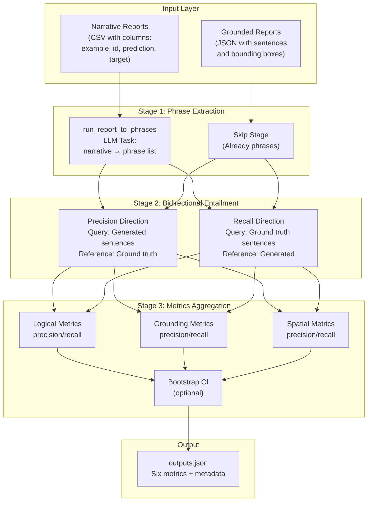
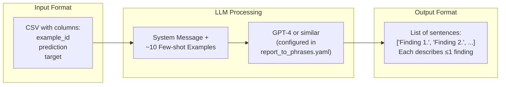
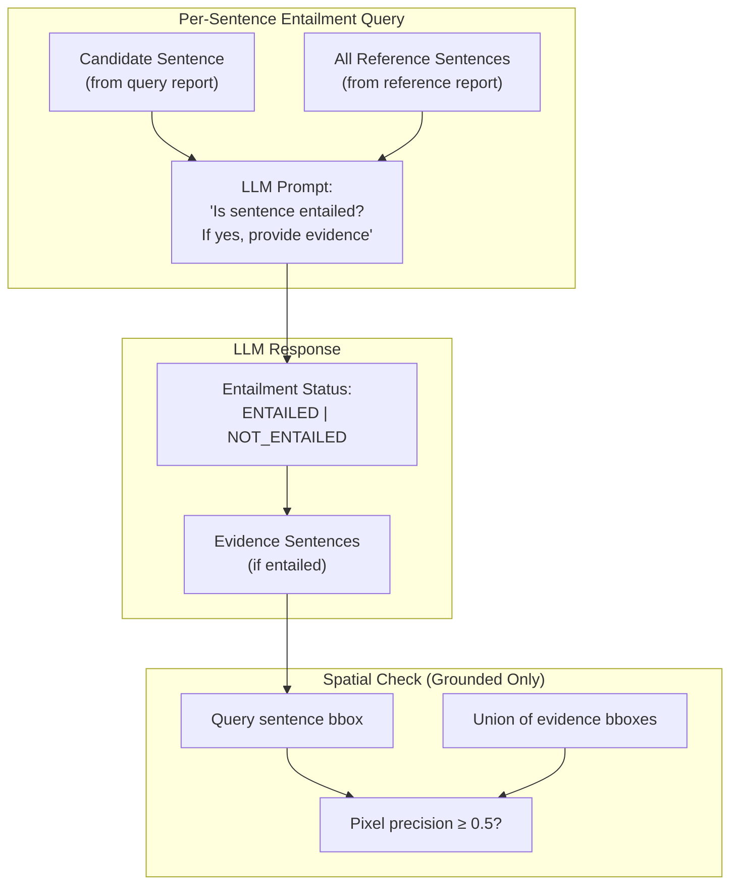
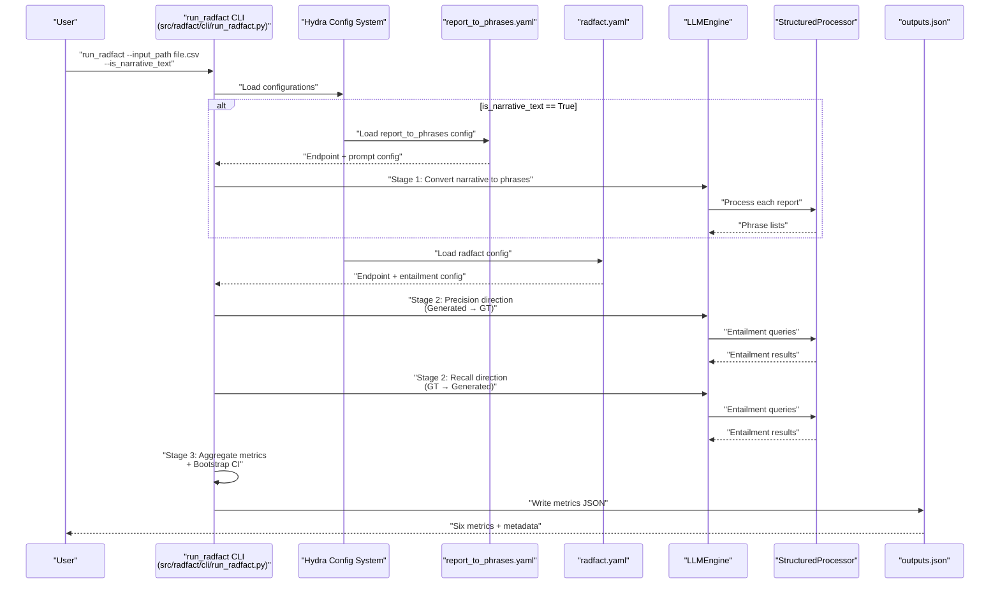
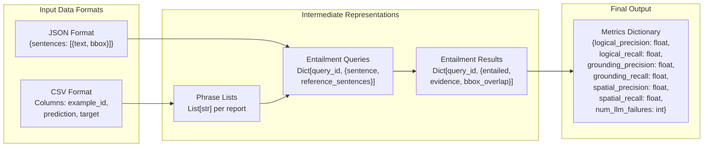

<!-- source: DeepWiki mcp.deepwiki.com · repo microsoft/RadFact · page 3.2 Evaluation Pipeline · fetched 2026-10-26 -->

# Evaluation Pipeline

<details>
<summary>Relevant source files</summary>

The following files were used as context for generating this wiki page:

- [README.md](README.md)
- [configs/radfact.yaml](configs/radfact.yaml)
- [configs/report_to_phrases.yaml](configs/report_to_phrases.yaml)

</details>


## Purpose and Scope

This document describes the RadFact evaluation pipeline architecture, including the two-stage processing flow (report-to-phrases conversion and entailment verification), data transformations, and how the pipeline handles both grounded and non-grounded radiology reports. 

For detailed explanations of the six RadFact metrics computed by this pipeline, see [RadFact Metrics](#3.1). For a deep dive into the entailment verification algorithms and LLM prompting strategies, see [Entailment Verification](#3.3). For practical instructions on running the pipeline, see [Running RadFact Evaluation](#4.1).

## Pipeline Architecture

RadFact implements a multi-stage evaluation pipeline that processes radiology reports through distinct transformation stages. The pipeline architecture varies based on whether the input is narrative text or structured grounded phrases.



**Sources**: [README.md:190-222](), Diagram 2 from system overview

## Stage 1: Report to Phrases Conversion

The first stage converts narrative radiology reports into structured lists of individual sentences, where each sentence describes at most one finding. This stage is **conditionally executed** based on the `--is_narrative_text` flag in the `run_radfact` CLI command.

### When Stage 1 is Required

| Input Type | Stage 1 Execution | Configuration |
|------------|-------------------|---------------|
| Narrative findings text (CSV) | **Required** | `run_radfact --input_path file.csv --is_narrative_text` |
| Grounded phrases (JSON) | **Skipped** | `run_radfact --input_path file.json` |

### Report to Phrases Task Configuration

The conversion task is configured via [configs/report_to_phrases.yaml:1-11]() which specifies:
- The LLM endpoint to use (typically Azure OpenAI GPT-4)
- Few-shot examples for the conversion task
- Output format requirements



The standalone CLI command `run_report_to_phrases` [README.md:180-189]() can execute this stage independently:

```bash
run_report_to_phrases dataset.csv_path=<path_to_reports>
```

This allows offline preprocessing of narrative reports before running the full evaluation pipeline.

**Sources**: [README.md:180-189](), [README.md:212-213](), [configs/report_to_phrases.yaml:1-11]()

## Stage 2: Bidirectional Entailment Verification

The core of the RadFact pipeline performs entailment verification in **two directions** to compute both precision and recall metrics. This bidirectional approach distinguishes RadFact from single-direction evaluation metrics.

### Precision Direction

In the precision direction, the pipeline verifies whether sentences in the **generated report** are entailed by the **ground truth report**. This measures correctness and penalizes hallucinations.

```
Query Report: Generated sentences (predictions)
Reference Report: Ground truth sentences (targets)
Question: "Is each generated sentence logically supported by the ground truth?"
```

### Recall Direction

In the recall direction, the pipeline verifies whether sentences in the **ground truth report** are entailed by the **generated report**. This measures completeness and penalizes omissions.

```
Query Report: Ground truth sentences (targets)
Reference Report: Generated sentences (predictions)
Question: "Is each ground truth sentence captured by the generated report?"
```

### Entailment Query Structure

For each sentence in the query report, the pipeline:
1. Constructs an LLM prompt with the sentence and all reference report sentences
2. Queries the LLM (configured in [configs/radfact.yaml:1-7]()): "Is this sentence entailed?"
3. If entailed, requests supporting evidence sentences from the reference report
4. For grounded reports, checks spatial entailment using bounding box overlap



**Sources**: [README.md:209-222](), [README.md:216-220]()

## Stage 3: Metrics Computation and Aggregation

After both entailment directions complete, the pipeline aggregates the per-sentence results into six RadFact metrics. Each sentence is labeled with:
- **Logical entailment**: ENTAILED or NOT_ENTAILED
- **Spatial entailment**: ENTAILED, NOT_ENTAILED, or NOT_APPLICABLE (if no bounding box)

### Metrics Computation Logic

| Metric | Numerator | Denominator | Grounding Required |
|--------|-----------|-------------|-------------------|
| **Logical Precision** | Generated sentences that are logically entailed | All generated sentences | No |
| **Logical Recall** | Ground truth sentences that are logically entailed | All ground truth sentences | No |
| **Grounding Precision** | Generated sentences that are both logically AND spatially entailed | Generated sentences that are logically entailed (with bboxes) | Yes |
| **Grounding Recall** | Ground truth sentences that are both logically AND spatially entailed | Ground truth sentences that are logically entailed (with bboxes) | Yes |
| **Spatial Precision** | Generated sentences that are both logically AND spatially entailed | All generated sentences (with bboxes) | Yes |
| **Spatial Recall** | Ground truth sentences that are both logically AND spatially entailed | All ground truth sentences (with bboxes) | Yes |

### Bootstrap Confidence Intervals

The pipeline optionally computes bootstrap confidence intervals for each metric via the `--bootstrap_samples` parameter [README.md:158-159]():

```bash
run_radfact --input_path file.csv --bootstrap_samples 500
```

Setting `--bootstrap_samples 0` disables bootstrapping. The default value is 500 samples.

**Sources**: [README.md:158-159](), [README.md:198-208]()

## Pipeline Execution Flow with CLI and Configuration

The following diagram maps the execution flow from CLI invocation through configuration loading to processing completion, using actual code entities from the codebase.



### Configuration Override Mechanism

The pipeline uses [Hydra configuration management]() with hierarchical overrides:

1. **Base configuration**: [configs/default.yaml]() (not shown but referenced)
2. **Task-specific configuration**: 
   - [configs/radfact.yaml:1-7]() for entailment verification
   - [configs/report_to_phrases.yaml:1-11]() for phrase conversion
3. **Endpoint configuration**: Override via `endpoints: <name>`
   - `azure_chat_openai` for GPT-4 models
   - `chat_openai` for custom models (e.g., Llama-3)

**Sources**: [README.md:132-160](), [configs/radfact.yaml:1-7](), [configs/report_to_phrases.yaml:1-11]()

## Data Transformations Through the Pipeline

The pipeline transforms data through multiple representations. Understanding these transformations is essential for interpreting intermediate outputs and debugging.



### Key Data Structures

**Phrase List Format** (after Stage 1):
```
[
  "Small bilateral pleural effusions.",
  "Mild pulmonary edema.",
  "No pneumothorax."
]
```

**Grounded Report Format** (JSON input):
```json
{
  "example_id": "001",
  "prediction": {
    "sentences": [
      {"text": "Small bilateral pleural effusions.", "bbox": [x, y, w, h]},
      {"text": "Mild pulmonary edema.", "bbox": null}
    ]
  },
  "target": {
    "sentences": [...]
  }
}
```

**Sources**: [README.md:144-148](), [README.md:162-174]()

## Error Handling and Skipped Queries

The pipeline implements fault-tolerant processing with explicit handling of LLM failures. When the LLM endpoint fails to respond (due to timeouts, rate limits, or other errors), the pipeline adopts a conservative default behavior.

### Default Behavior for Failed Queries

⚠️ **Important**: Failed queries are treated as **NOT_ENTAILED** by default [README.md:178](). This conservative approach prevents artificially inflating metrics when the LLM is unavailable, but may underestimate performance if failures are frequent.

### Failure Tracking

The pipeline tracks failures in multiple locations:
- **Runtime**: Warning logs for each failure: `WARNING: No response for example {query_id}. Setting as NOT ENTAILED`
- **Intermediate storage**: `outputs/radfact/run_<timestamp>/skipped/` directory contains failed queries per worker
- **Final output**: `outputs.json` includes `num_llm_failures` field with total failure count
- **Summary file**: `skipped.csv` aggregates all skipped queries across workers

The directory structure for a run is [README.md:102-129]():

```
outputs/radfact/run_20240814_075225/
├── batch_outputs/          # Incremental results per batch
├── progress/               # Completed query IDs per worker
├── skipped/                # Failed queries per worker
├── outputs.json           # Final aggregated metrics
├── progress.csv           # Overall progress tracking
└── skipped.csv            # All skipped queries
```

**Sources**: [README.md:178-179](), [README.md:102-129]()

## Pipeline Resumability and Incremental Processing

The pipeline writes intermediate results incrementally, enabling fault tolerance and resumability. The `LLMEngine` class manages batch processing with automatic progress tracking [README.md:100-103]().

### Incremental Output Strategy

1. **Batch outputs**: Results saved in chunks to `batch_outputs/outputs_{start}_{end}.json`
2. **Progress tracking**: Each worker maintains `progress/subset_{start}_{end}.csv` with completed query IDs
3. **Final aggregation**: Engine aggregates all batch outputs into `outputs.json` after all workers complete

This architecture allows the pipeline to recover from interruptions by resuming from the last completed batch rather than reprocessing the entire dataset.

**Sources**: [README.md:100-130]()

---

