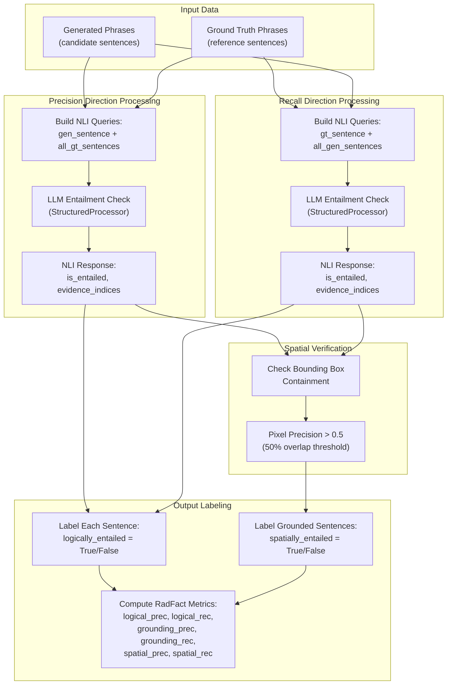
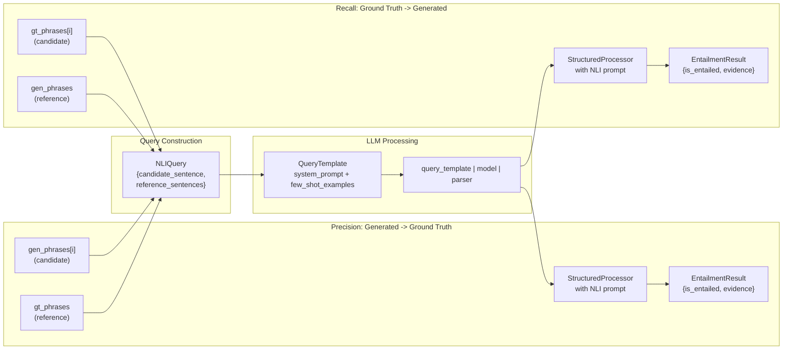
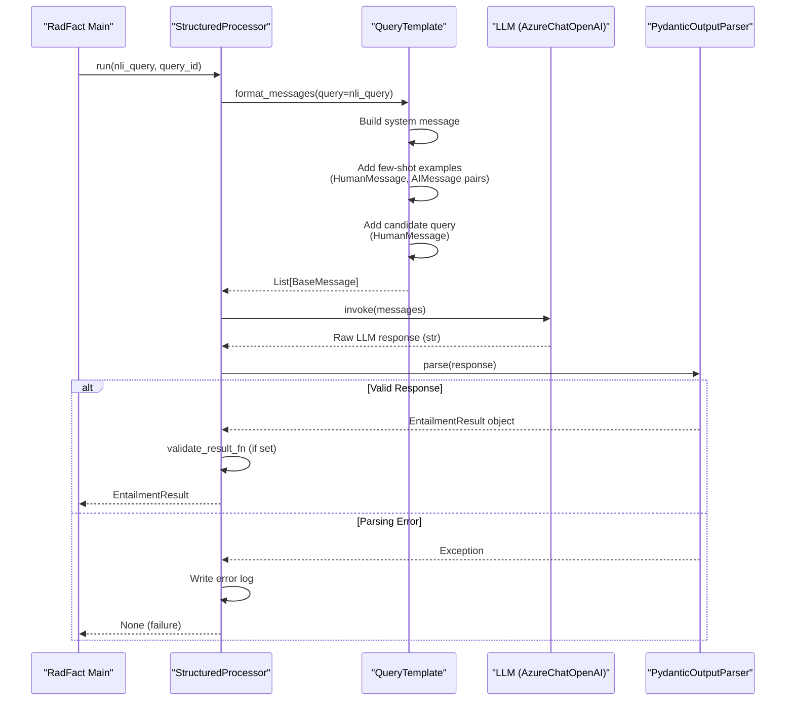
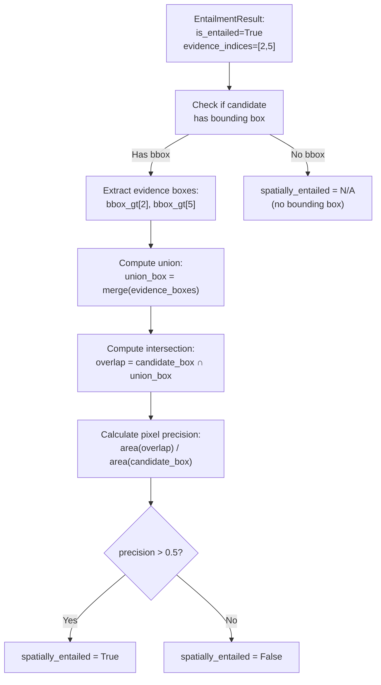
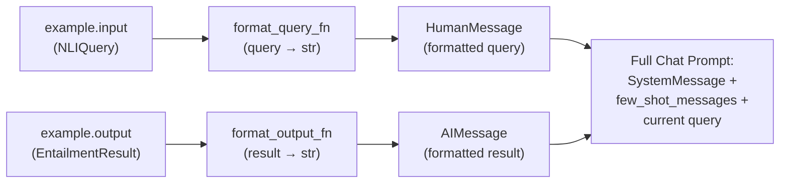
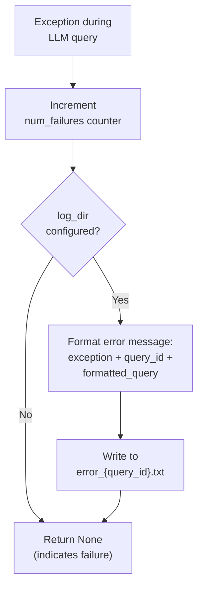

<!-- source: DeepWiki mcp.deepwiki.com · repo microsoft/RadFact · page 3.3 Entailment Verification · fetched 2026-10-26 -->

# Entailment Verification

<details>
<summary>Relevant source files</summary>

The following files were used as context for generating this wiki page:

- [README.md](README.md)
- [src/radfact/llm_utils/processor/structured_processor.py](src/radfact/llm_utils/processor/structured_processor.py)

</details>


## Purpose and Scope

This page provides a detailed technical explanation of how RadFact performs entailment verification using large language models (LLMs). Entailment verification is the core mechanism that determines whether sentences in generated reports are logically supported by ground-truth reports, and whether bounding boxes are spatially consistent.

For information about the metrics computed from entailment results, see [RadFact Metrics](#3.1). For an overview of how entailment verification fits into the complete evaluation workflow, see [Evaluation Pipeline](#3.2). For implementation details of the parallel processing infrastructure that executes entailment queries, see [LLM Engine](#5.2).

---

## Overview

Entailment verification is a bidirectional natural language inference (NLI) task that determines whether statements in one report are logically supported by statements in another report. RadFact uses an LLM configured with few-shot examples to perform this verification, querying the model with candidate sentences and reference reports to determine entailment status and evidence.

The verification process operates in two directions:

1. **Precision Direction**: Generated report sentences → Ground-truth report (reference)
2. **Recall Direction**: Ground-truth report sentences → Generated report (reference)

For grounded reports containing bounding boxes, RadFact additionally verifies **spatial entailment** by checking whether bounding boxes associated with entailed sentences are geometrically consistent with the evidence boxes.

**Sources**: [README.md:194-222]()

---

## Entailment Verification Workflow

The following diagram illustrates the complete entailment verification process from input phrases to computed metrics:



**Sources**: [README.md:194-222]()

---

## Bidirectional Entailment Architecture

RadFact performs entailment verification bidirectionally to capture both precision and recall aspects of report quality. The following diagram maps the conceptual process to the actual code structures:



**Key Code Entities**:
- `StructuredProcessor[QueryT, ResultT]` in [src/radfact/llm_utils/processor/structured_processor.py:114]()
- `QueryTemplate` in [src/radfact/llm_utils/processor/structured_processor.py:58]()
- Few-shot examples referenced in [README.md:227]() from `llm_utils.nli.prompts`

**Sources**: [README.md:194-222](), [src/radfact/llm_utils/processor/structured_processor.py:114-234]()

---

## Logical Entailment Verification

### Query Format

For each candidate sentence, RadFact constructs a Natural Language Inference (NLI) query containing:

1. **Candidate Sentence**: The sentence being evaluated for entailment
2. **Reference Sentences**: All sentences from the reference report
3. **System Prompt**: Instructions describing the entailment verification task
4. **Few-Shot Examples**: Approximately 10 hand-labeled examples demonstrating the task

The query asks the LLM: "Is this candidate sentence entailed by the reference sentences? If yes, which reference sentences provide supporting evidence?"

### Response Format

The LLM returns a structured response (typically JSON or YAML) containing:

| Field | Type | Description |
|-------|------|-------------|
| `is_entailed` | `bool` | Whether the candidate sentence is logically entailed |
| `evidence_indices` | `list[int]` | Indices of reference sentences that support the entailment (if entailed) |
| `explanation` | `str` (optional) | Reasoning for the entailment decision |

### Processing Pipeline



**Key Methods**:
- `StructuredProcessor.run()` in [src/radfact/llm_utils/processor/structured_processor.py:208]()
- `QueryTemplate.format_messages()` in [src/radfact/llm_utils/processor/structured_processor.py:99]()
- `QueryTemplate.prepare_few_shot_examples()` in [src/radfact/llm_utils/processor/structured_processor.py:83]()

**Sources**: [src/radfact/llm_utils/processor/structured_processor.py:58-234](), [README.md:211-219]()

---

## Spatial Entailment Verification

For grounded reports where sentences have associated bounding boxes, RadFact performs spatial entailment verification after logical entailment is confirmed.

### Spatial Entailment Definition

A candidate sentence with bounding box is **spatially entailed** if:

1. The sentence is **logically entailed** (determined by LLM)
2. The sentence has an associated bounding box
3. The candidate bounding box is **sufficiently contained** within the union of evidence bounding boxes

### Geometric Containment Calculation

RadFact uses a **pixel precision threshold** of 0.5 to determine spatial entailment:

```
pixel_precision = area(candidate_box ∩ union(evidence_boxes)) / area(candidate_box)

spatially_entailed = (pixel_precision > 0.5)
```

This means at least 50% of the pixels in the candidate bounding box must overlap with evidence boxes for spatial entailment to be satisfied.

### Spatial Verification Process



**Sources**: [README.md:217-221]()

---

## Few-Shot Examples and Prompts

### System Prompt Structure

The system prompt for entailment verification consists of:

1. **Task Description**: Clear instructions on what entailment means in the medical reporting context
2. **Output Schema**: JSON/YAML schema for the expected response format (added by `PydanticOutputParser`)
3. **Guidelines**: Specific rules for determining entailment (e.g., handling negations, specificity requirements)

### Few-Shot Example Format

Each few-shot example in the prompt is formatted as a pair of messages:

| Message Type | Content |
|--------------|---------|
| `HumanMessage` | Formatted NLI query with candidate sentence and reference sentences |
| `AIMessage` | Expected structured response (entailment result with evidence) |

The few-shot examples are sourced from a private dataset ("USMix") and manually labeled by a consultant radiologist. They demonstrate:
- Positive entailment cases with evidence selection
- Negative entailment cases (contradictions, lack of support)
- Edge cases (partial matches, specificity mismatches)

### Example Construction in Code



**Key Methods**:
- `QueryTemplate.prepare_few_shot_examples()` in [src/radfact/llm_utils/processor/structured_processor.py:83-97]()
- `format_query_fn` and `format_output_fn` configured in [src/radfact/llm_utils/processor/structured_processor.py:125-126]()

**Sources**: [README.md:223-228](), [src/radfact/llm_utils/processor/structured_processor.py:83-111]()

---

## Output Parsing and Validation

### Parser Configuration

The `StructuredProcessor` supports two output formats:

| Format | Parser Class | Use Case |
|--------|-------------|----------|
| JSON | `PydanticOutputParser` | Default format, strict schema validation |
| YAML | `YamlOutputParser` | Alternative format, more human-readable |

The parser is configured in [src/radfact/llm_utils/processor/structured_processor.py:169-178]():

```python
match self.output_format:
    case FormatStyleOptions.YAML:
        self.parser = YamlOutputParser(pydantic_object=result_type)
    case FormatStyleOptions.JSON:
        self.parser = PydanticOutputParser(pydantic_object=result_type)
```

### Parsing Chain

The complete processing chain is assembled using LangChain's pipe operator:

```python
chain = self.query_template | self.model | self.parser
response: ResultT = chain.invoke({_QUERY_KEY: query})
```

This chain:
1. Formats the query into chat messages (`query_template`)
2. Sends messages to the LLM (`model`)
3. Parses the response into a structured Pydantic object (`parser`)

### Validation

After parsing, an optional `validate_result_fn` can perform additional validation:

```python
if self.validate_result_fn:
    self.validate_result_fn(query, response)
```

This allows for task-specific validation beyond schema compliance, such as:
- Verifying evidence indices are within valid range
- Checking logical consistency between fields
- Ensuring required fields are not empty

**Sources**: [src/radfact/llm_utils/processor/structured_processor.py:208-220](), [src/radfact/llm_utils/processor/structured_processor.py:169-178]()

---

## Error Handling and Failure Modes

### Failure Classification

When entailment verification fails, RadFact tracks failures and applies default behavior:

| Failure Type | Cause | Default Behavior |
|--------------|-------|------------------|
| Parsing Error | LLM output doesn't match schema | Set as **NOT ENTAILED** |
| Timeout | LLM request exceeds time limit | Set as **NOT ENTAILED** |
| Rate Limit | API quota exceeded | Set as **NOT ENTAILED** |
| Validation Error | Output fails custom validation | Set as **NOT ENTAILED** |

### Error Logging

The `StructuredProcessor` maintains error statistics and optionally writes detailed error logs:



**Error Log Contents** (written to `log_dir/error_{query_id}.txt`):
- Exception type and message
- Query ID for tracking
- Formatted query text sent to LLM
- Stack trace (if available)

**Statistics Tracking**:
- `num_failures`: Count of failed queries in [src/radfact/llm_utils/processor/structured_processor.py:193]()
- `num_success`: Count of successful queries in [src/radfact/llm_utils/processor/structured_processor.py:194]()
- Retrieved via `get_processor_stats()` in [src/radfact/llm_utils/processor/structured_processor.py:222]()

### Warning Messages

RadFact logs warnings for failed queries:

```
WARNING: No response for example {query_id}. Setting as NOT ENTAILED
```

The total number of failures is reported in the final metrics dictionary under the key `num_llm_failures`.

**Sources**: [src/radfact/llm_utils/processor/structured_processor.py:199-220](), [README.md:178]()

---

## Configuration

### LLM Selection for Entailment

The LLM used for entailment verification is configured in `configs/radfact.yaml` under the `override endpoints` section. According to the MAIRA-2 paper, RadFact uses `LLama-3-70B-Instruct` for this task, configured as a `ChatOpenAI` endpoint.

### Key Parameters

| Parameter | Location | Description | Default |
|-----------|----------|-------------|---------|
| `temperature` | Endpoint config | Controls randomness of LLM outputs | Task-dependent |
| `max_tokens` | Endpoint config | Maximum response length | Task-dependent |
| `use_schema_in_system_prompt` | Processor init | Whether to include schema in prompt | `True` |
| `output_format` | Processor init | Output format (JSON/YAML) | `FormatStyleOptions.JSON` |
| `few_shot_examples` | Processor init | Examples for in-context learning | Task-specific |

### Model Requirements

For reliable entailment verification, the LLM must:
1. Support structured output generation (JSON/YAML)
2. Perform well on natural language inference tasks
3. Handle medical terminology accurately
4. Follow few-shot examples consistently

**Verification Test**: Run `python src/radfact/cli/run_radfact_test_examples.py` to confirm the configured LLM produces expected entailment results on test cases.

**Sources**: [README.md:89-97](), [src/radfact/llm_utils/processor/structured_processor.py:120-153]()

---

## Summary

Entailment verification is the core mechanism that powers RadFact's evaluation capabilities. By leveraging LLMs with carefully constructed few-shot prompts, RadFact determines:

1. **Logical Entailment**: Whether candidate sentences are supported by reference sentences
2. **Evidence Extraction**: Which specific reference sentences provide support
3. **Spatial Entailment**: Whether bounding boxes are geometrically consistent (for grounded reports)

The implementation uses the `StructuredProcessor` class to handle LLM interactions with robust error handling, structured output parsing, and comprehensive logging. The bidirectional verification approach (precision and recall directions) enables computation of the six RadFact metrics that capture different aspects of report quality.

**Sources**: [README.md:194-228](), [src/radfact/llm_utils/processor/structured_processor.py:114-234]()

---

