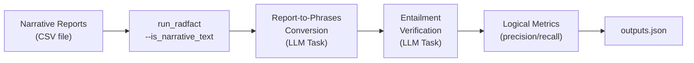
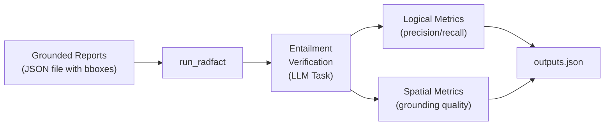
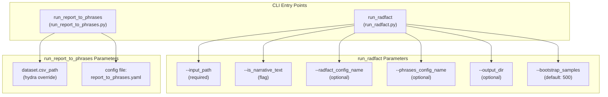
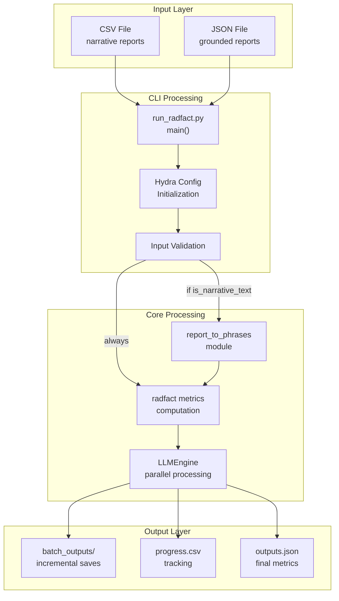

<!-- source: DeepWiki mcp.deepwiki.com · repo microsoft/RadFact · page 4 User Guide · fetched 2026-10-26 -->

# User Guide

<details>
<summary>Relevant source files</summary>

The following files were used as context for generating this wiki page:

- [README.md](README.md)
- [pyproject.toml](pyproject.toml)

</details>


This guide provides practical instructions for using RadFact to evaluate AI-generated radiology reports. It covers the main workflows, CLI commands, and usage patterns for different evaluation scenarios.

**Scope**: This page provides an overview of RadFact usage workflows and CLI tools. For detailed instructions on specific tasks, see the child pages: [Running RadFact Evaluation](#4.1), [Report to Phrases Conversion](#4.2), [Input Data Formats](#4.3), and [Understanding Outputs](#4.4). For initial setup instructions, see [Getting Started](#2).

## Overview of Usage Scenarios

RadFact supports two primary evaluation scenarios, each with a different input format and processing pipeline:

| Scenario | Input Type | Input Format | Processing Steps | Use Case |
|----------|-----------|--------------|------------------|----------|
| **Narrative Report Evaluation** | Unstructured narrative text | CSV with columns: `example_id`, `prediction`, `target` | 1. Convert reports to phrases<br/>2. Perform entailment verification | Evaluating traditional report generation systems that produce paragraph-style findings |
| **Grounded Report Evaluation** | Structured phrases with bounding boxes | JSON with phrase lists and bbox coordinates | 1. Perform entailment verification (phrases already structured) | Evaluating grounded reporting systems that produce findings with spatial annotations |

**Sources**: [README.md:162-174](), [README.md:3-6]()

## Basic Workflows

### Workflow for Narrative Reports



**Workflow for Narrative Reports**: The system first converts narrative reports into structured phrase lists using an LLM, then performs bidirectional entailment verification. This produces logical precision and recall metrics only (no grounding metrics since there are no bounding boxes).

**Sources**: [README.md:162-166](), [README.md:89-92]()

### Workflow for Grounded Reports



**Workflow for Grounded Reports**: The system directly performs entailment verification on pre-structured phrases (with optional bounding boxes), computing all six RadFact metrics: logical precision/recall, grounding precision/recall, and spatial precision/recall.

**Sources**: [README.md:168-172](), [README.md:196-206]()

## CLI Commands Overview

RadFact provides two main CLI entry points defined in [pyproject.toml:86-88]():



**CLI Commands Structure**: The `run_radfact` command serves as the primary evaluation tool, while `run_report_to_phrases` is a standalone utility for preprocessing narrative reports offline. Both commands utilize Hydra for configuration management.

**Sources**: [README.md:136-160](), [README.md:182-188](), [pyproject.toml:86-88]()

### Command: `run_radfact`

The main evaluation command that computes RadFact metrics for a dataset.

**Basic Usage**:

```bash
# Narrative reports (requires report-to-phrases conversion)
run_radfact --input_path findings_generation_examples.csv --is_narrative_text

# Grounded reports (pre-structured phrases with bboxes)
run_radfact --input_path grounded_reporting_examples.json
```

**Key Parameters**:

| Parameter | Type | Required | Description |
|-----------|------|----------|-------------|
| `--input_path` | string | Yes | Path to CSV (narrative) or JSON (grounded) input file |
| `--is_narrative_text` | flag | No | Set when input contains narrative text requiring phrase conversion |
| `--radfact_config_name` | string | No | Custom config for entailment verification (default: `radfact.yaml`) |
| `--phrases_config_name` | string | No | Custom config for report-to-phrases conversion (default: `report_to_phrases.yaml`) |
| `--output_dir` | string | No | Directory for output files (default: `outputs/radfact/`) |
| `--bootstrap_samples` | int | No | Number of bootstrap samples for confidence intervals (default: 500, set 0 to disable) |

**Sources**: [README.md:136-160]()

### Command: `run_report_to_phrases`

A standalone utility for converting narrative reports into structured phrase lists, which can be run offline before RadFact evaluation.

**Basic Usage**:

```bash
run_report_to_phrases dataset.csv_path=/path/to/reports.csv
```

**Configuration**: This command uses Hydra overrides and is configured via [configs/report_to_phrases.yaml](). The primary parameter is `dataset.csv_path` which specifies the input CSV file containing narrative reports.

**Sources**: [README.md:182-188]()

## Typical Usage Patterns

### Pattern 1: Quick Evaluation of Narrative Reports

Use this pattern when you have narrative findings and want immediate results with default settings:

```bash
run_radfact \
  --input_path examples/findings_generation_examples.csv \
  --is_narrative_text
```

This executes both report-to-phrases conversion and entailment verification in a single pipeline.

**Sources**: [README.md:164-166]()

### Pattern 2: Two-Stage Evaluation (Preprocess Then Evaluate)

Use this pattern for large datasets where you want to cache the phrase conversion results:

```bash
# Stage 1: Convert reports to phrases
run_report_to_phrases dataset.csv_path=my_reports.csv

# Stage 2: Evaluate using pre-converted phrases
run_radfact --input_path outputs/report_to_phrases/run_*/outputs.json
```

This approach allows inspection and validation of the phrase conversion before running the more expensive entailment verification.

**Sources**: [README.md:180-188]()

### Pattern 3: Grounded Report Evaluation

Use this pattern when evaluating systems that produce bounding boxes:

```bash
run_radfact \
  --input_path examples/grounded_reporting_examples.json \
  --output_dir my_evaluation_results/
```

This computes all six RadFact metrics including grounding and spatial metrics.

**Sources**: [README.md:168-172]()

### Pattern 4: Evaluation Without Confidence Intervals

Use this pattern for faster evaluation when statistical significance testing is not required:

```bash
run_radfact \
  --input_path data.json \
  --bootstrap_samples 0
```

This skips bootstrap sampling, significantly reducing computation time.

**Sources**: [README.md:176-177]()

## Data Flow Through CLI Commands



**Data Flow Architecture**: The CLI commands parse inputs, initialize Hydra configurations, validate input formats, then route data through the appropriate processing modules. The `LLMEngine` orchestrates parallel LLM calls and manages incremental output persistence.

**Sources**: [README.md:100-130](), [pyproject.toml:86-88]()

## Prerequisites and Setup

Before using RadFact CLI commands, ensure the following are configured:

1. **LLM Endpoints**: At least one endpoint must be configured in [configs/endpoints/](). See [Configuration Setup](#2.3) for details.

2. **Authentication**: API keys or Azure credentials must be available. See [Authentication](#6.3) for options.

3. **Installation**: The `radfact` package must be installed: `pip install .` or via conda environment. See [Installation](#2.1).

4. **Test Verification**: Run `python src/radfact/cli/run_radfact_test_examples.py` to confirm entailment verification is working correctly with your endpoints.

**Sources**: [README.md:48-98]()

## Error Handling and Warnings

RadFact implements defensive error handling for LLM failures:

**⚠️ LLM Failures**: When an LLM query fails (due to timeouts, rate limits, or errors), RadFact sets the entailment result as **NOT ENTAILED** by default. The system tracks these failures in:

- `skipped/` directory under the run folder
- `num_llm_failures` key in the output metrics
- Warning logs: `WARNING: No response for example {query_id}. Setting as NOT ENTAILED`

**Impact**: If a significant number of queries fail, results will not be reliable. Always check the `num_llm_failures` count in your output.

**Sources**: [README.md:178-179]()

## Next Steps

For detailed information on specific aspects of using RadFact:

- **[Running RadFact Evaluation](#4.1)**: Complete guide to the `run_radfact` CLI with all parameters and examples
- **[Report to Phrases Conversion](#4.2)**: Detailed usage of `run_report_to_phrases` and configuration options
- **[Input Data Formats](#4.3)**: Specifications for CSV and JSON input formats
- **[Understanding Outputs](#4.4)**: Interpreting metrics, confidence intervals, and output files

For configuration and deployment topics:

- **[Configuration Setup](#2.3)**: Initial endpoint and authentication setup
- **[Endpoint Configuration](#6.2)**: Advanced endpoint configuration for multiple LLMs
- **[Processing Parameters](#6.4)**: Tuning LLM parameters and parallel processing settings

---

