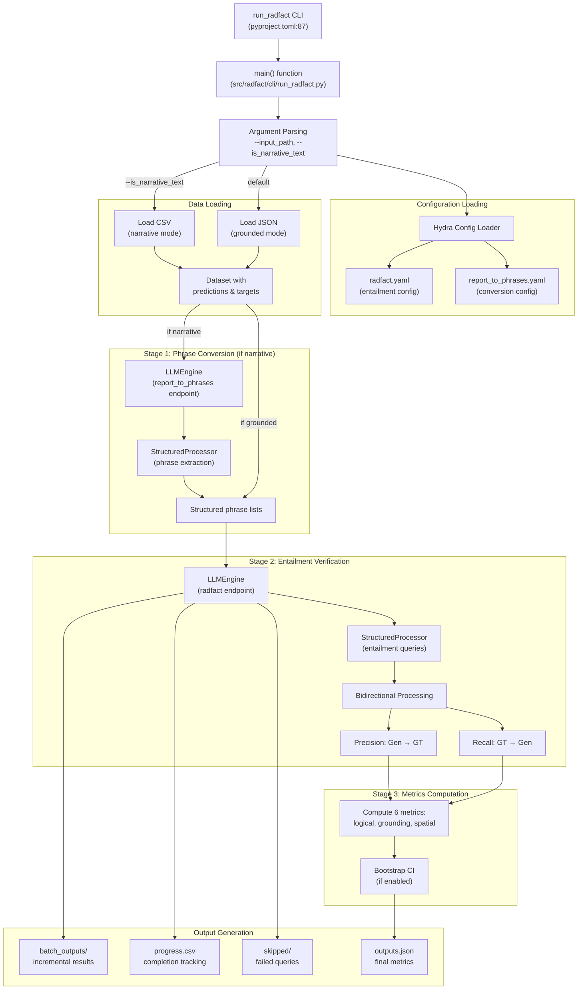
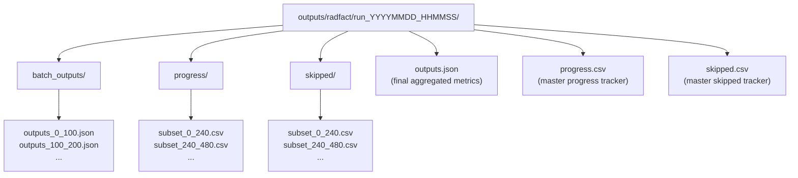
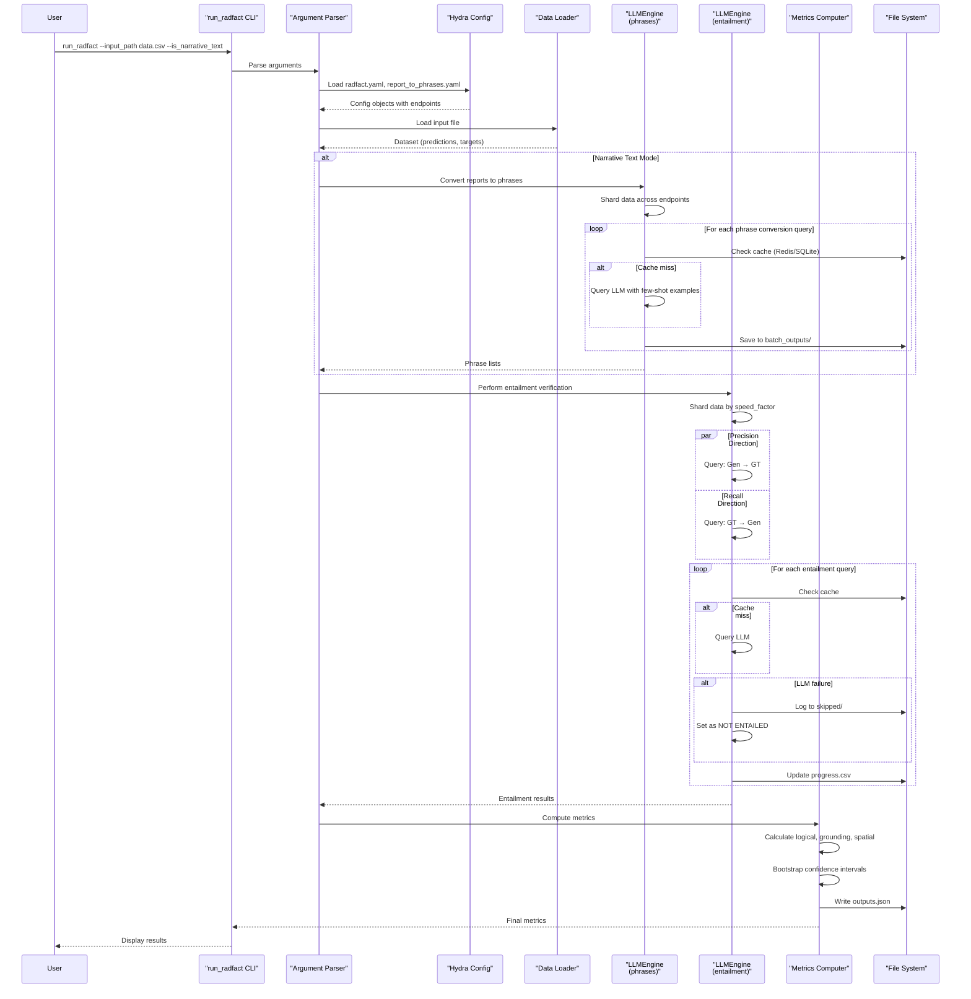

<!-- source: DeepWiki mcp.deepwiki.com · repo microsoft/RadFact · page 4.1 Running RadFact Evaluation · fetched 2026-10-26 -->

# Running RadFact Evaluation

<details>
<summary>Relevant source files</summary>

The following files were used as context for generating this wiki page:

- [.vscode/launch.json](.vscode/launch.json)
- [README.md](README.md)
- [pyproject.toml](pyproject.toml)

</details>


This page provides a complete guide to running the RadFact evaluation using the `run_radfact` CLI command. It covers command syntax, execution modes, configuration options, and the evaluation workflow from input to output.

For information about preprocessing narrative reports into phrases, see [Report to Phrases Conversion](#4.2). For detailed specifications of input file formats, see [Input Data Formats](#4.3). For interpreting the evaluation results, see [Understanding Outputs](#4.4).

## Overview

The `run_radfact` command is the primary entry point for evaluating radiology reports using RadFact metrics. It accepts either narrative text reports (which are first converted to phrases) or pre-structured grounded reports (already formatted as phrase lists with optional bounding boxes), performs bidirectional entailment verification using LLMs, and outputs a comprehensive set of precision and recall metrics.

The command is registered as a console script in [pyproject.toml:87]() and invokes `radfact.cli.run_radfact:main`.

**Sources**: [README.md:132-179](), [pyproject.toml:86-88]()

## Command Syntax and Arguments

The `run_radfact` command provides several configuration options through command-line arguments:

```bash
run_radfact --input_path <path> [options]
```

### Required Arguments

| Argument | Description |
|----------|-------------|
| `--input_path` | Path to CSV file (for narrative text) or JSON file (for grounded reports) containing the samples to evaluate |

### Optional Arguments

| Argument | Default | Description |
|----------|---------|-------------|
| `--is_narrative_text` | `False` | Flag indicating input contains narrative text reports that need phrase conversion |
| `--radfact_config_name` | `radfact` | Name of the Hydra config file for entailment verification (in `configs/` directory) |
| `--phrases_config_name` | `report_to_phrases` | Name of the Hydra config file for report-to-phrases conversion |
| `--output_dir` | `outputs/radfact/` | Directory where results and intermediate files will be saved |
| `--bootstrap_samples` | `500` | Number of bootstrap samples for confidence interval computation (set to 0 to disable) |

**Sources**: [README.md:136-160]()

## Execution Modes

RadFact supports two distinct execution modes based on the input data type:

### Mode 1: Narrative Text Evaluation

For ungrounded narrative reports (e.g., free-text findings sections):

```bash
run_radfact --input_path examples/findings_generation_examples.csv --is_narrative_text
```

This mode performs two-stage processing:
1. **Report-to-Phrases Conversion**: Uses an LLM to split narrative reports into individual sentences
2. **Entailment Verification**: Evaluates logical precision and recall

Expected input format: CSV with columns `example_id`, `prediction`, `target`.

### Mode 2: Grounded Report Evaluation

For grounded reports (phrase lists with bounding boxes):

```bash
run_radfact --input_path examples/grounded_reporting_examples.json
```

This mode skips phrase conversion and directly performs entailment verification with spatial grounding evaluation, producing all six RadFact metrics (logical, grounding, and spatial precision/recall).

Expected input format: JSON with structured phrase lists and bounding box annotations.

**Sources**: [README.md:162-174](), [.vscode/launch.json:41-51]()

## Execution Flow

The following diagram illustrates the complete execution flow from CLI invocation to final output generation:

### RadFact Execution Pipeline



**Sources**: [README.md:132-179](), [.vscode/launch.json:41-51](), Diagram 2 and Diagram 6 from system overview

## Configuration and Customization

### Using Custom Configuration Files

RadFact uses Hydra for configuration management. You can provide custom config files for different aspects of the evaluation:

```bash
run_radfact --input_path data.csv \
  --radfact_config_name my_custom_radfact \
  --phrases_config_name my_custom_phrases
```

Custom config files must:
- Follow the same structure as [configs/radfact.yaml]() and [configs/report_to_phrases.yaml]()
- Be placed in the `configs/` directory for Hydra to locate them
- Specify endpoint configurations under `override endpoints:`

### Controlling Bootstrap Sampling

Confidence intervals are computed using bootstrapping by default with 500 samples. To adjust:

```bash
# Use 1000 bootstrap samples
run_radfact --input_path data.csv --bootstrap_samples 1000

# Disable bootstrapping
run_radfact --input_path data.csv --bootstrap_samples 0
```

**Sources**: [README.md:149-158](), [README.md:176]()

## Output Directory Structure

When executing RadFact, outputs are organized in a timestamped run directory:

### Output Directory Layout



| File/Directory | Purpose |
|----------------|---------|
| `outputs.json` | Final aggregated metrics for all samples |
| `progress.csv` | Master tracking of completed samples across all endpoints |
| `skipped.csv` | Master tracking of failed/skipped samples |
| `batch_outputs/` | Incremental results saved per batch for fault tolerance |
| `progress/` | Per-endpoint progress tracking files |
| `skipped/` | Per-endpoint skipped query records |

The batch outputs enable resumption if processing is interrupted, as the `LLMEngine` can skip already-completed samples based on the progress files.

**Sources**: [README.md:102-129]()

## Error Handling and LLM Failures

⚠️ **Important**: When the LLM performing entailment verification fails to respond (due to timeouts, rate limits, or other endpoint issues), RadFact defaults to treating these queries as **NOT ENTAILED**.

### Monitoring Failures

The system tracks failures in multiple locations:

1. **Console Warnings**: During execution, you'll see warnings like:
   ```
   WARNING: No response for example {query_id}. Setting as NOT ENTAILED
   ```

2. **Final Metrics**: The `outputs.json` file contains `num_llm_failures` indicating the total count of failed queries

3. **Skipped Directory**: Failed queries are logged to `skipped/` with details for review

### Impact on Results

If a significant number of queries fail, the evaluation results will be unreliable because:
- Failed precision queries artificially lower precision scores (incorrect findings treated as not entailed)
- Failed recall queries artificially lower recall scores (missed findings treated as not captured)

**Best Practices**:
- Monitor the `num_llm_failures` value in `outputs.json`
- Review the `skipped.csv` file to identify patterns in failures
- Consider re-running with different endpoint configurations if failures are excessive
- Ensure endpoint rate limits and timeouts are appropriately configured (see [Configuration Setup](#2.3))

**Sources**: [README.md:178]()

## Debug and Development Configurations

For development and debugging, VS Code launch configurations are provided:

### Debug Configuration

```json
{
    "name": "Debug run_radfact",
    "program": "src/radfact/cli/run_radfact.py",
    "args": [
        "--input_path=examples/findings_generation_examples.csv",
        "--is_narrative_text"
    ]
}
```

This allows stepping through the execution with breakpoints. The configuration uses `"justMyCode": false` to enable debugging into library code.

**Sources**: [.vscode/launch.json:41-51]()

## Example Invocations

### Complete Example: Narrative Text with Custom Bootstrap

```bash
run_radfact \
  --input_path data/patient_findings.csv \
  --is_narrative_text \
  --output_dir custom_outputs/ \
  --bootstrap_samples 1000 \
  --radfact_config_name radfact \
  --phrases_config_name report_to_phrases
```

### Complete Example: Grounded Reports with No Bootstrap

```bash
run_radfact \
  --input_path data/grounded_reports.json \
  --bootstrap_samples 0 \
  --output_dir results/no_bootstrap/
```

### Minimal Example: Using All Defaults

```bash
run_radfact --input_path examples/grounded_reporting_examples.json
```

This uses default configurations from [configs/radfact.yaml]() and [configs/report_to_phrases.yaml](), saves to `outputs/radfact/`, and computes 500 bootstrap samples.

**Sources**: [README.md:162-173](), [.vscode/launch.json:41-51]()

## Execution Workflow Summary

The following sequence diagram shows the detailed interaction between components during a typical RadFact evaluation:

### Component Interaction Sequence



**Sources**: [README.md:132-179](), Diagram 6 from system overview

---

