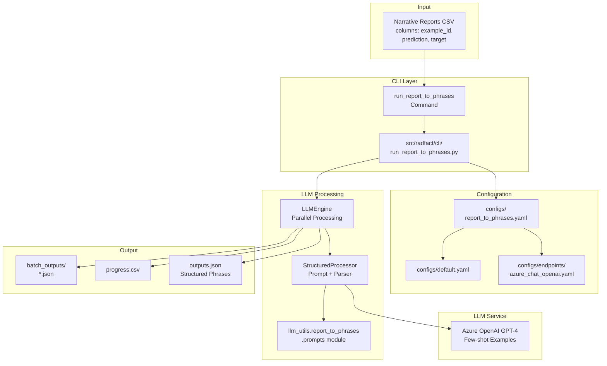
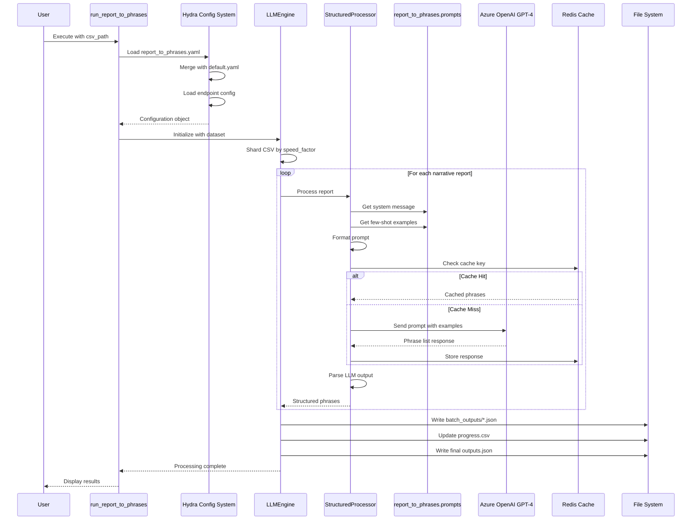
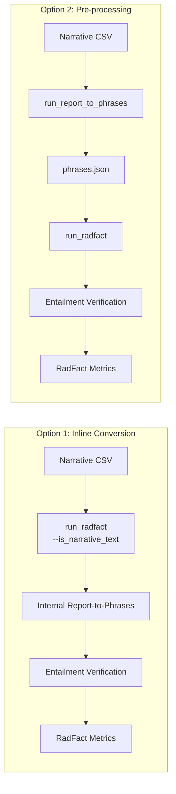

<!-- source: DeepWiki mcp.deepwiki.com · repo microsoft/RadFact · page 4.2 Report to Phrases Conversion · fetched 2026-10-26 -->

# Report to Phrases Conversion

<details>
<summary>Relevant source files</summary>

The following files were used as context for generating this wiki page:

- [README.md](README.md)
- [configs/report_to_phrases.yaml](configs/report_to_phrases.yaml)
- [pyproject.toml](pyproject.toml)

</details>


## Purpose and Scope

This page describes the report-to-phrases conversion system in RadFact, which transforms narrative radiology reports into structured lists of individual sentences. This preprocessing step is required when evaluating narrative (ungrounded) radiology reports and can be performed as a standalone operation before running RadFact evaluation.

For information about running the complete RadFact evaluation pipeline, see [Running RadFact Evaluation](#4.1). For details about the overall evaluation pipeline architecture, see [Evaluation Pipeline](#3.2). For input data format specifications, see [Input Data Formats](#4.3).

**Sources:** [README.md:1-274](), [configs/report_to_phrases.yaml:1-11]()

---

## Overview

Report-to-phrases conversion is an LLM-powered preprocessing step that breaks down narrative radiology reports into individual sentences, where each sentence describes at most one finding. This structured format is necessary for RadFact's entailment verification system to operate effectively.

### When Report-to-Phrases Conversion is Required

| Scenario | Conversion Required? | Reason |
|----------|---------------------|---------|
| Narrative findings reports (CSV input) | ✅ Yes | Reports must be split into individual sentences for entailment verification |
| Grounded reports with phrase lists (JSON input) | ❌ No | Reports are already formatted as structured phrase lists |
| Pre-processed phrase lists | ❌ No | Phrases are already in the required format |

**Sources:** [README.md:162-173](), [README.md:213-214]()

---

## System Architecture

The report-to-phrases conversion system operates as a specialized instance of the LLM processing infrastructure, using few-shot prompting to guide an LLM in breaking down narrative text.



**Diagram: Report-to-Phrases Conversion System Architecture**

This diagram shows the complete flow from narrative CSV input through the CLI, configuration system, LLM processing infrastructure, and final output generation. The system reuses the core `LLMEngine` and `StructuredProcessor` components but configures them specifically for the phrase extraction task.

**Sources:** [README.md:180-189](), [configs/report_to_phrases.yaml:1-11](), [pyproject.toml:87-88]()

---

## Technical Implementation

### Processing Flow



**Diagram: Report-to-Phrases Processing Sequence**

This sequence diagram illustrates the detailed processing flow, showing how narrative reports are transformed into phrase lists through LLM interaction with caching optimization.

**Sources:** [README.md:100-129](), [README.md:180-189]()

---

## Using the CLI

The `run_report_to_phrases` command provides a straightforward interface for converting narrative reports to phrase lists.

### Basic Usage

```bash
run_report_to_phrases dataset.csv_path=<path_to_reports.csv>
```

The command invokes the script at [src/radfact/cli/run_report_to_phrases.py]() and uses Hydra for configuration management. The `dataset.csv_path` parameter overrides the default path specified in [configs/report_to_phrases.yaml:10]().

### Input Requirements

The input CSV file must contain the following columns:

| Column | Description | Required |
|--------|-------------|----------|
| `example_id` | Unique identifier for each report | ✅ Yes |
| `prediction` | Generated/predicted report text (narrative) | ✅ Yes |
| `target` | Ground truth reference report text (narrative) | ✅ Yes |

Example format (see [examples/findings_generation_examples.csv]()):

```csv
example_id,prediction,target
report_001,"The heart is normal in size. No pleural effusion.","Heart size normal. Lungs are clear."
report_002,"Mild cardiomegaly noted. Clear lungs.","Cardiomegaly present. No infiltrate."
```

**Sources:** [README.md:180-189](), [README.md:144-146]()

---

## Configuration

### Configuration File Structure

The report-to-phrases system uses a hierarchical configuration structure with Hydra:

```yaml
# configs/report_to_phrases.yaml
defaults:
  - default                              # Base configuration
  - override endpoints: azure_chat_openai  # Endpoint selection
  - _self_                               # Current file overrides

dataset:
  name: reports_to_phrases
  csv_path: "<your_path_to_cxr_reports>"
```

**Configuration layers:**

1. **Base configuration** ([configs/default.yaml]()): Defines shared LLM parameters and engine settings
2. **Endpoint configuration** ([configs/endpoints/azure_chat_openai.yaml]()): Specifies LLM endpoint details
3. **Task configuration** ([configs/report_to_phrases.yaml:1-11]()): Task-specific overrides

**Sources:** [configs/report_to_phrases.yaml:1-11](), [README.md:66-93]()

### Endpoint Selection

The default configuration uses `azure_chat_openai` for GPT-4 models. According to the MAIRA-2 paper, GPT-4 was used for this task. The endpoint can be changed by modifying line 5 in [configs/report_to_phrases.yaml:5]():

```yaml
- override endpoints: chat_openai  # For custom OpenAI-compatible models
```

### Command-Line Overrides

Hydra allows runtime configuration overrides:

```bash
# Override dataset path
run_report_to_phrases dataset.csv_path=/path/to/data.csv

# Override endpoint configuration
run_report_to_phrases endpoints=chat_openai

# Override multiple parameters
run_report_to_phrases dataset.csv_path=/data/reports.csv \
                      llm_api_args.temperature=0.0 \
                      llm_engine_args.batch_size=50
```

**Sources:** [configs/report_to_phrases.yaml:1-11](), [README.md:66-93]()

---

## Few-Shot Prompting

The report-to-phrases conversion uses few-shot learning to guide the LLM in properly segmenting reports. The prompts are defined in the `llm_utils.report_to_phrases.prompts` module.

### Prompt Components

| Component | Purpose | Location |
|-----------|---------|----------|
| System message | Instructs LLM on the task and desired output format | `llm_utils.report_to_phrases.prompts` |
| Few-shot examples | ~10 examples showing narrative reports → phrase lists | `llm_utils.report_to_phrases.prompts` |
| Input template | Formats the narrative report for processing | `StructuredProcessor` |

### Example Format

The few-shot examples demonstrate the desired transformation:

**Input (Narrative):**
```
The heart is enlarged. There is pulmonary edema. A small left pleural effusion is present.
```

**Output (Phrases):**
```json
[
  "The heart is enlarged.",
  "There is pulmonary edema.",
  "A small left pleural effusion is present."
]
```

Each phrase describes at most one finding and is grammatically complete.

**Sources:** [README.md:223-226]()

---

## Output Format

### Directory Structure

The conversion process generates outputs with the following structure:

```
outputs/report_to_phrases/run_<timestamp>/
├── batch_outputs/
│   ├── outputs_0_100.json
│   ├── outputs_100_200.json
│   └── ...
├── progress/
│   ├── subset_0_240.csv
│   └── ...
├── skipped/
│   ├── subset_0_240.csv
│   └── ...
├── outputs.json              # Final aggregated results
├── progress.csv              # Overall progress tracking
└── skipped.csv               # Failed conversions
```

**Sources:** [README.md:102-129]()

### Output Schema

The final `outputs.json` file contains structured phrase data for each input report:

```json
{
  "report_001": {
    "example_id": "report_001",
    "prediction_phrases": [
      "The heart is normal in size.",
      "No pleural effusion is seen."
    ],
    "target_phrases": [
      "Heart size is within normal limits.",
      "The lungs are clear."
    ],
    "metadata": {
      "timestamp": "2024-08-14T07:52:25",
      "llm_model": "gpt-4",
      "processing_time_ms": 1250
    }
  }
}
```

### Key Fields

| Field | Type | Description |
|-------|------|-------------|
| `example_id` | string | Unique identifier from input CSV |
| `prediction_phrases` | list[string] | Structured phrases from the `prediction` column |
| `target_phrases` | list[string] | Structured phrases from the `target` column |
| `metadata` | object | Processing metadata including timestamp and model |

**Sources:** [README.md:102-129]()

---

## Integration with RadFact Evaluation

Once reports are converted to phrases, the output can be used directly in RadFact evaluation.

### Workflow Options



**Diagram: Integration Workflow Options**

### Option 1: Inline Conversion (Recommended for Initial Use)

```bash
run_radfact --input_path reports.csv --is_narrative_text
```

This approach performs report-to-phrases conversion automatically as part of the RadFact evaluation. The `--is_narrative_text` flag triggers the conversion step using the configuration from [configs/report_to_phrases.yaml]().

**Advantages:**
- Single command execution
- Automatic integration
- Simpler workflow

**Sources:** [README.md:162-166](), [README.md:89-92]()

### Option 2: Separate Pre-processing (Recommended for Production)

```bash
# Step 1: Convert reports to phrases
run_report_to_phrases dataset.csv_path=reports.csv

# Step 2: Run RadFact with phrase output
run_radfact --input_path outputs/report_to_phrases/run_<timestamp>/outputs.json
```

This approach separates the conversion and evaluation steps, allowing for intermediate inspection and caching.

**Advantages:**
- Inspect phrase quality before evaluation
- Reuse converted phrases for multiple evaluations
- Better error handling and debugging
- Production-friendly workflow

**Sources:** [README.md:180-189](), [README.md:168-172]()

---

## Handling Failures

The LLM-based conversion process may fail for some reports due to endpoint timeouts, rate limits, or parsing errors.

### Failure Tracking

| File | Purpose | Format |
|------|---------|--------|
| `skipped.csv` | Top-level summary of all failed conversions | CSV with `example_id` |
| `skipped/subset_*.csv` | Worker-specific failure logs | CSV with `example_id` and error details |
| `progress.csv` | Successfully processed reports | CSV with `example_id` |

### Handling Strategy

When a conversion fails:

1. **Default behavior**: The report is marked as skipped and excluded from evaluation
2. **Warning logged**: `WARNING: No response for example {example_id}. Report skipped.`
3. **Tracking**: The `example_id` is recorded in `skipped.csv`

### Recovery

To retry failed conversions:

```bash
# Resume processing from the same run directory
run_report_to_phrases dataset.csv_path=reports.csv \
                      llm_engine_args.output_dir=outputs/report_to_phrases/run_<timestamp>
```

The engine automatically skips completed examples based on `progress.csv` and retries only the failed ones.

**Sources:** [README.md:178](), [README.md:118-129]()

---

## Performance Considerations

### Parallel Processing

The report-to-phrases conversion leverages the `LLMEngine` for parallel processing across multiple endpoints and workers. Configuration is controlled through endpoint settings:

```yaml
# configs/endpoints/azure_chat_openai.yaml
ENDPOINT_EXAMPLE:
  speed_factor: 1.0              # Relative endpoint speed
  num_parallel_processes: 10      # Parallel workers per endpoint
```

**Key parameters:**
- `speed_factor`: Controls data sharding proportionally across endpoints
- `num_parallel_processes`: Number of concurrent requests per endpoint

**Sources:** [README.md:86-87](), [README.md:100-129]()

### Caching

Response caching significantly reduces processing time and cost for repeated conversions. The system uses Redis or SQLite to cache LLM responses.

**Cache key structure:**
```
report_to_phrases:<endpoint_normalized_url>:<report_text_hash>
```

Caching is transparent and automatic. Cached responses are retrieved instantly, bypassing the LLM entirely.

**Sources:** [README.md:100-102]()

### Throughput Estimation

Typical processing rates (approximate):

| Configuration | Reports/Minute | Notes |
|---------------|----------------|-------|
| Single endpoint, 1 worker | 5-10 | Sequential processing |
| Single endpoint, 10 workers | 40-60 | Parallel processing |
| Multiple endpoints, 10 workers each | 80-120+ | Multi-endpoint sharding |

Actual throughput depends on endpoint latency, report length, and rate limits.

**Sources:** [README.md:100-102]()

---

## Sources Summary

This page was informed by the following primary sources:
- [README.md:1-274]() - Overall system documentation
- [configs/report_to_phrases.yaml:1-11]() - Task configuration
- [pyproject.toml:87-88]() - CLI command definition

---

