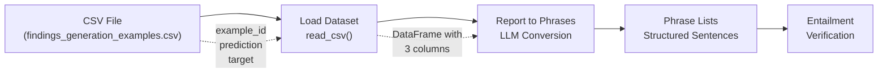
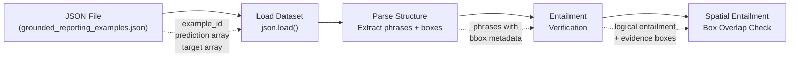
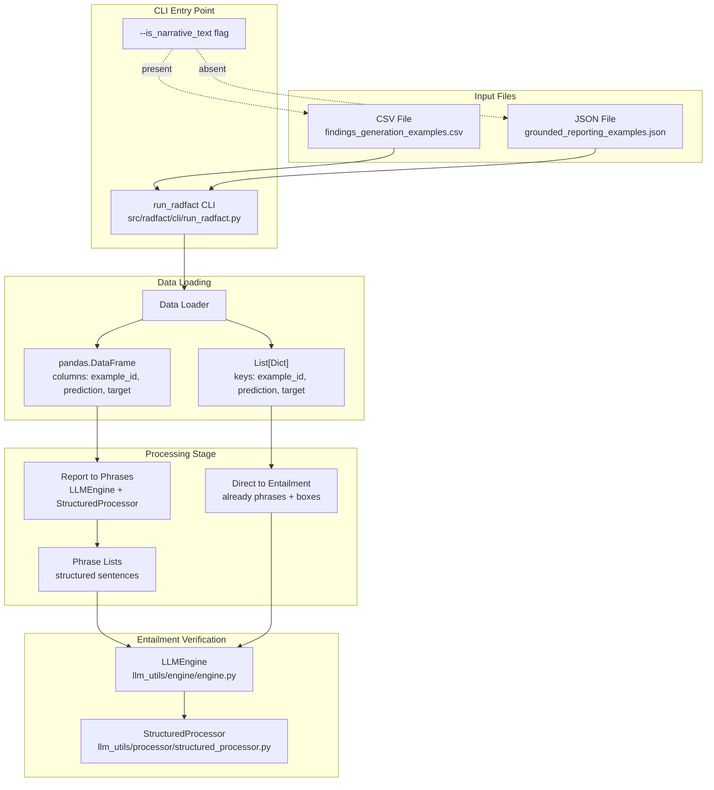
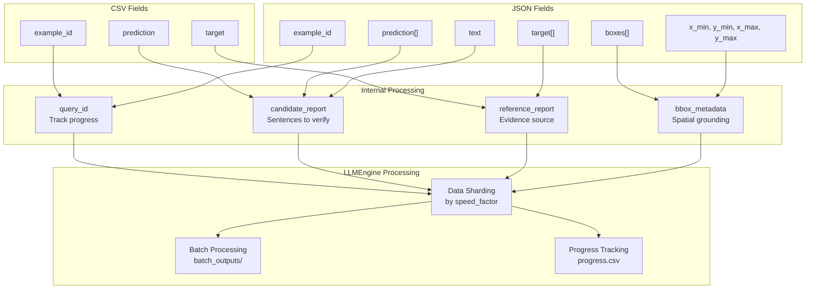

<!-- source: DeepWiki mcp.deepwiki.com · repo microsoft/RadFact · page 4.3 Input Data Formats · fetched 2026-10-26 -->

# Input Data Formats

<details>
<summary>Relevant source files</summary>

The following files were used as context for generating this wiki page:

- [README.md](README.md)
- [examples/findings_generation_examples.csv](examples/findings_generation_examples.csv)

</details>


## Purpose and Scope

This document specifies the expected input data formats for RadFact evaluation. RadFact accepts two distinct input formats depending on whether the reports include spatial grounding information (bounding boxes). This page covers the structure, required fields, and format specifications for both narrative and grounded reports.

For information about running RadFact with these inputs, see [Running RadFact Evaluation](#4.1). For details on converting narrative reports to phrase lists, see [Report to Phrases Conversion](#4.2). For interpreting the outputs produced by RadFact, see [Understanding Outputs](#4.4).

---

## Overview of Input Types

RadFact supports two input formats, each serving different evaluation scenarios:

| Input Type | Format | Use Case | Required Fields | Grounding Support |
|------------|--------|----------|-----------------|-------------------|
| **Narrative Reports** | CSV | Traditional report generation evaluation without spatial grounding | `example_id`, `prediction`, `target` | ❌ |
| **Grounded Reports** | JSON | Grounded report generation evaluation with bounding boxes | `example_id`, `prediction`, `target`, plus bounding box metadata | ✔️ |

The input type is specified via the `--is_narrative_text` flag when invoking the `run_radfact` CLI command [README.md:144-147](). When this flag is present, RadFact expects a CSV file with narrative text. When absent, RadFact expects a JSON file with grounded phrases and bounding boxes.

**Sources:** [README.md:144-174]()

---

## Narrative Reports Format (CSV)

### File Structure

Narrative reports are provided as CSV files with three required columns. Each row represents one evaluation example containing a generated report (`prediction`) and its corresponding ground truth report (`target`).

```csv
example_id,prediction,target
0,"Generated report text...","Ground truth report text..."
1,"Another generated report...","Another ground truth report..."
```

### Field Specifications

| Field | Type | Description | Constraints |
|-------|------|-------------|-------------|
| `example_id` | Integer or String | Unique identifier for the evaluation sample | Must be unique within the dataset |
| `prediction` | String | The model-generated radiology report (narrative text) | Free-form text; will be converted to phrases by RadFact |
| `target` | String | The ground truth radiology report (narrative text) | Free-form text; will be converted to phrases by RadFact |

### Processing Pipeline

When narrative CSV files are provided with the `--is_narrative_text` flag, RadFact performs an initial conversion step to transform the free-form narrative text into structured phrase lists. This conversion uses an LLM configured in [configs/report_to_phrases.yaml]().



### Example Format

The following example from [examples/findings_generation_examples.csv]() demonstrates the expected CSV structure:

```csv
example_id,prediction,target
0,"The lungs are well expanded. Noted presence of the large nodular density in the right midlung field measuring 3.5 x 3.5 cm. This is a new finding. The cardiac size is mildly enlarged. With mild atherosclerotic changes of the aorta.","The bony structures are intact. Degenerative changes spine noted. There is indistinctness of the right hemidiaphragm suggesting subpulmonic effusion. Ovoid density superimposed lung fields in the mid and lower lung fields."
3,"The heart, lungs and mediastinal structures are within normal limits. There are no osseous abnormalities.","The heart, lungs and mediastinal structures are within normal limits. There are no osseous abnormalities."
```

**Sources:** [README.md:162-174](), [examples/findings_generation_examples.csv:1-22]()

---

## Grounded Reports Format (JSON)

### File Structure

Grounded reports are provided as JSON files where reports are already structured as phrase lists, with each phrase potentially associated with one or more bounding boxes indicating spatial grounding on the corresponding radiology image.

The JSON file contains an array of objects, each representing one evaluation example with structured phrases and bounding box coordinates.

### Field Specifications

Each JSON object in the array must contain the following structure:

| Field | Type | Description | Required |
|-------|------|-------------|----------|
| `example_id` | String/Integer | Unique identifier for the evaluation sample | ✔️ |
| `prediction` | Array of Objects | List of predicted phrases with optional bounding boxes | ✔️ |
| `prediction[].text` | String | The phrase text describing a finding | ✔️ |
| `prediction[].boxes` | Array of Objects | Bounding boxes grounding this phrase (empty array if no grounding) | ✔️ |
| `target` | Array of Objects | List of ground truth phrases with optional bounding boxes | ✔️ |
| `target[].text` | String | The phrase text describing a finding | ✔️ |
| `target[].boxes` | Array of Objects | Bounding boxes grounding this phrase (empty array if no grounding) | ✔️ |

### Bounding Box Format

Each bounding box object within the `boxes` array contains pixel coordinates defining a rectangular region:

| Field | Type | Description | Units |
|-------|------|-------------|-------|
| `x_min` | Float | Left edge of the bounding box | Pixels |
| `y_min` | Float | Top edge of the bounding box | Pixels |
| `x_max` | Float | Right edge of the bounding box | Pixels |
| `y_max` | Float | Bottom edge of the bounding box | Pixels |

Coordinates follow the image coordinate system where (0, 0) is the top-left corner of the image.

### Conceptual Structure

```json
[
  {
    "example_id": "sample_001",
    "prediction": [
      {
        "text": "Small nodule in the right upper lobe",
        "boxes": [
          {"x_min": 120.5, "y_min": 80.3, "x_max": 145.7, "y_max": 105.2}
        ]
      },
      {
        "text": "Cardiac size is normal",
        "boxes": []
      }
    ],
    "target": [
      {
        "text": "Nodular opacity right upper lobe measuring 2 cm",
        "boxes": [
          {"x_min": 118.0, "y_min": 78.5, "x_max": 148.2, "y_max": 108.1}
        ]
      },
      {
        "text": "Heart size within normal limits",
        "boxes": []
      }
    ]
  }
]
```

### Processing Pipeline

Grounded reports bypass the report-to-phrases conversion step since they are already structured as phrase lists. They proceed directly to entailment verification.



**Sources:** [README.md:168-174]()

---

## Data Flow from Input to Processing

The following diagram shows how input files map to code entities and processing stages in the RadFact pipeline:



**Sources:** [README.md:132-174]()

---

## Field-to-Code Mapping

Understanding how input fields map to internal data structures helps ensure correct data preparation:



**Sources:** [README.md:100-129]()

---

## Common Requirements

### File Encoding
- All input files must use UTF-8 encoding
- Line endings can be Unix (LF) or Windows (CRLF)

### Data Validation
- All `example_id` values must be unique within a dataset
- Empty or null values in `prediction` or `target` fields may cause processing errors
- For grounded reports, the `boxes` array can be empty (indicating no grounding for that phrase)
- Bounding box coordinates must satisfy: `x_min < x_max` and `y_min < y_max`

### Size Considerations
- Large datasets are automatically sharded by the `LLMEngine` across available endpoints [README.md:100-129]()
- Progress is tracked incrementally in `progress.csv` to support resumption after interruptions
- Batch outputs are written to `batch_outputs/` directory for fault tolerance

### Processing Behavior
- **CSV with narrative text:** Requires the `--is_narrative_text` flag. RadFact first converts each report to a phrase list using an LLM configured in [configs/report_to_phrases.yaml]()
- **JSON with grounded phrases:** Omit the `--is_narrative_text` flag. RadFact directly performs entailment verification
- Failed LLM queries during processing are marked as "not entailed" by default, with warnings logged and failures tracked in `skipped/` directory [README.md:178]()

**Sources:** [README.md:132-178]()

---

## Example File Locations

RadFact provides example input files demonstrating both formats:

| Format | Example File | Location |
|--------|-------------|----------|
| Narrative Reports (CSV) | `findings_generation_examples.csv` | [examples/findings_generation_examples.csv]() |
| Grounded Reports (JSON) | `grounded_reporting_examples.json` | [examples/grounded_reporting_examples.json]() |

These examples can be used to test RadFact installation and configuration:

```bash
# Test with narrative reports
run_radfact --input_path examples/findings_generation_examples.csv --is_narrative_text

# Test with grounded reports
run_radfact --input_path examples/grounded_reporting_examples.json
```

**Sources:** [README.md:174](), [examples/findings_generation_examples.csv:1-22]()

---

