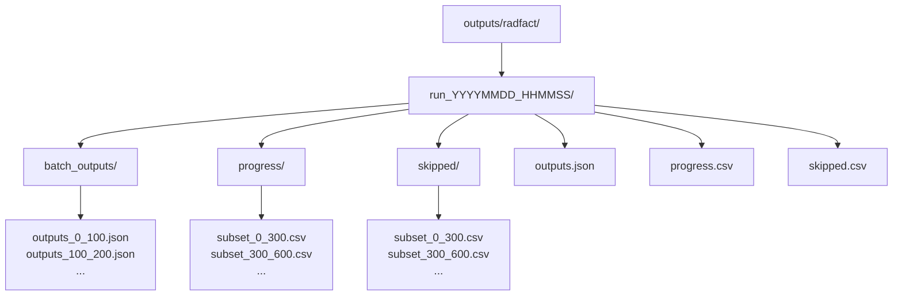
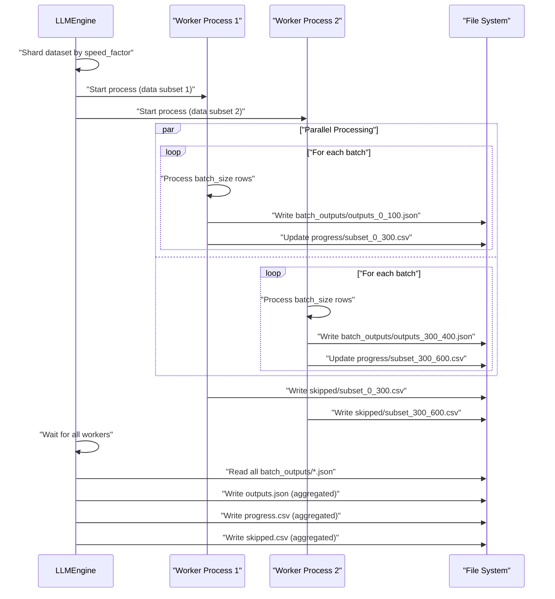
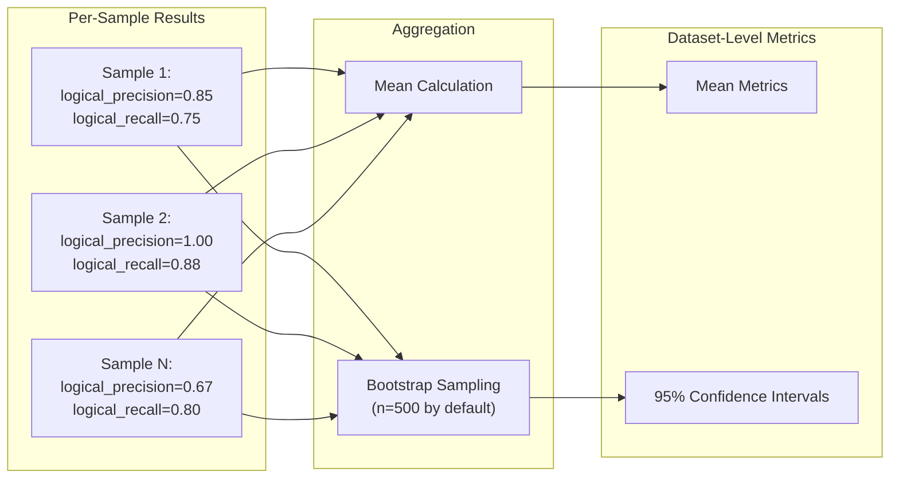
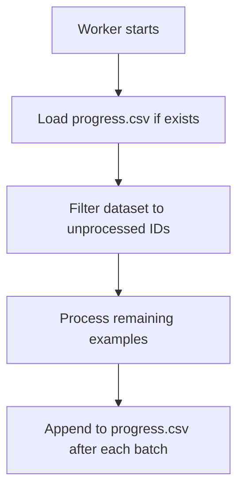
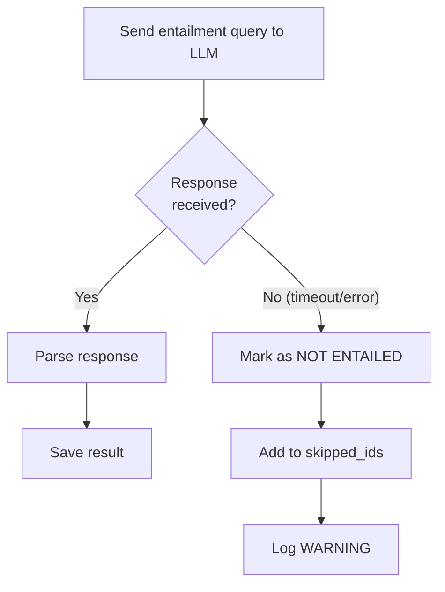
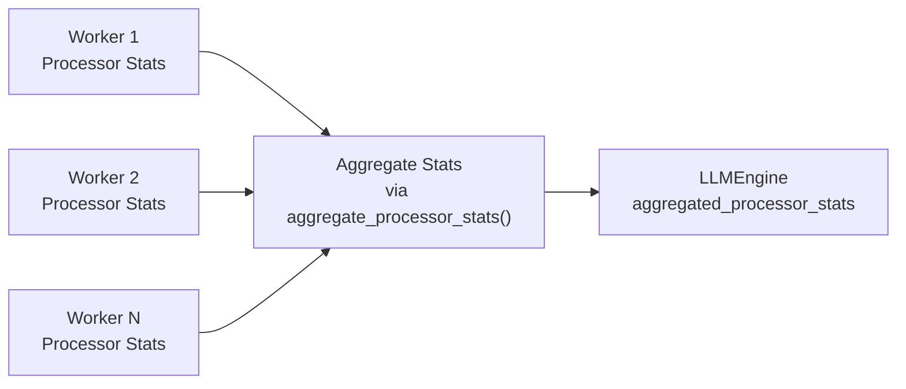

<!-- source: DeepWiki mcp.deepwiki.com · repo microsoft/RadFact · page 4.4 Understanding Outputs · fetched 2026-10-26 -->

# Understanding Outputs

<details>
<summary>Relevant source files</summary>

The following files were used as context for generating this wiki page:

- [README.md](README.md)
- [src/radfact/llm_utils/engine/engine.py](src/radfact/llm_utils/engine/engine.py)

</details>


This document explains how to interpret the output files generated by RadFact evaluation runs. After running `run_radfact`, you will find several files and directories containing intermediate results, final metrics, progress tracking, and failure information.

For information about running RadFact evaluations, see [Running RadFact Evaluation](#4.1). For details about the metrics themselves, see [RadFact Metrics](#3.1).

---

## Output Directory Structure

RadFact organizes all outputs under a timestamped run directory. The structure is created by the `LLMEngine` class and provides fault tolerance through incremental saving.



**Directory Structure**

| Directory/File | Purpose | Created By |
|---------------|---------|------------|
| `outputs/radfact/` | Root output directory | CLI configuration |
| `run_YYYYMMDD_HHMMSS/` | Timestamped run directory | `LLMEngine.get_run_id()` |
| `batch_outputs/` | Incremental batch results | `LLMEngine.batch_output_folder` |
| `progress/` | Per-worker progress tracking | `DataSubset.save_progress()` |
| `skipped/` | Per-worker failure tracking | `DataSubset.save_skipped()` |
| `outputs.json` | Final aggregated results | `LLMEngine.aggregate_outputs()` |
| `progress.csv` | Aggregated progress across workers | `LLMEngine.aggregate_status_csvs()` |
| `skipped.csv` | Aggregated failures across workers | `LLMEngine.aggregate_status_csvs()` |

**Sources**: [src/radfact/llm_utils/engine/engine.py:50-127](), [README.md:102-130]()

---

## Output Generation Flow

The following diagram shows how RadFact generates outputs through parallel processing:



**Sources**: [src/radfact/llm_utils/engine/engine.py:338-362](), [src/radfact/llm_utils/engine/engine.py:262-296]()

---

## The outputs.json File

The `outputs.json` file is the primary output containing all evaluation results. Its structure depends on whether you evaluated narrative reports or grounded reports.

### Structure for Narrative Reports

```json
[
  {
    "example_id": "sample_001",
    "logical_precision": 0.857,
    "logical_recall": 0.750,
    "num_generated_phrases": 7,
    "num_ground_truth_phrases": 8,
    "num_llm_failures": 0
  },
  {
    "example_id": "sample_002",
    "logical_precision": 1.000,
    "logical_recall": 0.875,
    "num_generated_phrases": 4,
    "num_ground_truth_phrases": 8,
    "num_llm_failures": 0
  }
]
```

### Structure for Grounded Reports

For grounded reports with bounding boxes, the output includes additional spatial metrics:

```json
[
  {
    "example_id": "sample_001",
    "logical_precision": 0.857,
    "logical_recall": 0.750,
    "grounding_precision": 0.833,
    "grounding_recall": 0.667,
    "spatial_precision": 0.714,
    "spatial_recall": 0.500,
    "num_generated_phrases": 7,
    "num_ground_truth_phrases": 8,
    "num_llm_failures": 0
  }
]
```

### Per-Sample Metrics Fields

| Field | Type | Description |
|-------|------|-------------|
| `example_id` | string | Unique identifier matching input data |
| `logical_precision` | float | Fraction of generated phrases entailed by ground truth |
| `logical_recall` | float | Fraction of ground truth phrases entailed by generated report |
| `grounding_precision` | float | Fraction of logically-entailed generated phrases also spatially entailed |
| `grounding_recall` | float | Fraction of logically-entailed ground truth phrases also spatially entailed |
| `spatial_precision` | float | Fraction of all generated phrases both logically and spatially entailed |
| `spatial_recall` | float | Fraction of all ground truth phrases both logically and spatially entailed |
| `num_generated_phrases` | int | Total number of phrases in generated report |
| `num_ground_truth_phrases` | int | Total number of phrases in ground truth report |
| `num_llm_failures` | int | Number of entailment queries that failed for this sample |

**Sources**: [README.md:196-206](), [src/radfact/llm_utils/engine/engine.py:298-311]()

---

## Metrics Computation and Aggregation

The individual per-sample metrics in `outputs.json` can be aggregated to compute dataset-level statistics. The CLI automatically computes bootstrapped confidence intervals for these aggregated metrics.



### Bootstrap Confidence Intervals

By default, RadFact computes 95% confidence intervals using 500 bootstrap samples. This can be configured via the `--bootstrap_samples` CLI argument:

```bash
# Default: 500 bootstrap samples
run_radfact --input_path data.csv --is_narrative_text

# Custom: 1000 bootstrap samples
run_radfact --input_path data.csv --is_narrative_text --bootstrap_samples 1000

# Disable bootstrapping
run_radfact --input_path data.csv --is_narrative_text --bootstrap_samples 0
```

The confidence intervals are displayed in the console output and can be used to assess the statistical significance of differences between systems.

**Sources**: [README.md:137-178](), [README.md:175-178]()

---

## Progress Tracking

The `progress.csv` file tracks which examples have been successfully processed. This enables resumability if processing is interrupted.

### Progress File Structure

```csv
example_id
sample_001
sample_002
sample_003
```

The file contains a single column listing the IDs of all successfully processed examples. The `DataSubset` class uses this to skip already-processed examples on resume:



**Key Implementation Details**:
- Progress is saved after each batch via `on_batch_end()` at [src/radfact/llm_utils/engine/engine.py:245-255]()
- Individual workers maintain their own progress files in the `progress/` directory
- Final aggregation combines all worker progress files into a single `progress.csv`
- The `DataSubset` class tracks processed IDs in memory via the `processed_ids` set

**Sources**: [src/radfact/llm_utils/engine/engine.py:227-233](), [src/radfact/llm_utils/engine/data_subset.py]()

---

## Understanding Failures and Skipped Items

RadFact may skip examples due to LLM endpoint failures (timeouts, rate limits, etc.). Understanding these failures is critical for interpreting results.

### The skipped.csv File

```csv
example_id
sample_042
sample_137
```

This file lists all examples that were skipped due to processing failures. Each worker maintains its own skipped file, which are aggregated at the end.

### Failure Handling Strategy



**Important**: When an LLM query fails, RadFact defaults to treating the query as **NOT ENTAILED**. This is a conservative approach that may bias results.

### Interpreting num_llm_failures

The `num_llm_failures` field in `outputs.json` indicates how many entailment queries failed for each example. High failure counts suggest:

1. **Endpoint Issues**: Timeouts, rate limits, or connectivity problems
2. **Query Complexity**: Very long reports may exceed token limits
3. **Reliability Concerns**: Results may not be trustworthy if many failures occurred

**Warning from Documentation**: If failures occur in a significant number of cases, the results will not be reliable. The aggregated `num_llm_failures` across all samples should be checked.

**Sources**: [README.md:177-178](), [src/radfact/llm_utils/engine/engine.py:240-243]()

---

## Batch Output Files

The `batch_outputs/` directory contains incremental results saved after each batch. These files serve as checkpoints and are aggregated into the final `outputs.json`.

### Batch File Naming Convention

Files are named using the pattern: `outputs_{start_index}_{end_index}.json`

Example:
```
batch_outputs/
├── outputs_0_100.json      # First batch (rows 0-99)
├── outputs_100_200.json    # Second batch (rows 100-199)
├── outputs_200_300.json    # Third batch (rows 200-299)
└── outputs_300_350.json    # Final partial batch
```

### Batch Processing Configuration

The batch size is controlled by the `processing.batch_size` configuration parameter:

```yaml
# configs/radfact.yaml
processing:
  batch_size: 100  # Save progress every 100 examples
```

**Trade-offs**:
- **Larger batches**: Fewer file writes, less overhead, but more work lost on failure
- **Smaller batches**: More frequent checkpointing, safer, but more I/O overhead

**Sources**: [src/radfact/llm_utils/engine/engine.py:245-255](), [README.md:102-130]()

---

## Processor Statistics

The `LLMEngine` aggregates statistics from all workers after processing completes. These statistics are stored in `aggregated_processor_stats` and provide insights into LLM behavior.

### Statistics Collection



### Typical Processor Statistics

The `StructuredProcessor` may track:
- Total number of queries sent
- Total tokens consumed
- Average response time
- Cache hit rate (if caching enabled)
- Parse success rate

These statistics are processor-specific and collected via the `get_processor_stats()` method defined in the `BaseProcessor` interface.

**Sources**: [src/radfact/llm_utils/engine/engine.py:324-333](), [src/radfact/llm_utils/processor/base_processor.py]()

---

## Output Location Configuration

By default, outputs are saved to `outputs/radfact/` relative to the current working directory. This can be customized via the `--output_dir` CLI argument:

```bash
# Default location
run_radfact --input_path data.csv --is_narrative_text
# Outputs to: outputs/radfact/run_YYYYMMDD_HHMMSS/

# Custom location
run_radfact --input_path data.csv --is_narrative_text --output_dir /path/to/custom/dir
# Outputs to: /path/to/custom/dir/run_YYYYMMDD_HHMMSS/
```

The `LLMEngine` supports two output folders:
- `progress_output_folder`: Where incremental results are saved during processing
- `final_output_folder`: Optional separate location for the final `outputs.json`

If `final_output_folder` is not specified, the final output is also saved to `progress_output_folder`.

**Sources**: [src/radfact/llm_utils/engine/engine.py:65-107](), [src/radfact/llm_utils/engine/engine.py:304-311]()

---

## Reading Outputs Programmatically

To analyze outputs in Python:

```python
import json
import pandas as pd

# Load final results
with open('outputs/radfact/run_20240814_075225/outputs.json', 'r') as f:
    results = json.load(f)

# Convert to DataFrame for analysis
df = pd.DataFrame(results)

# Compute aggregate metrics
mean_logical_precision = df['logical_precision'].mean()
mean_logical_recall = df['logical_recall'].mean()

# Check for high failure rates
high_failure_samples = df[df['num_llm_failures'] > 3]
total_failures = df['num_llm_failures'].sum()

print(f"Mean Logical Precision: {mean_logical_precision:.3f}")
print(f"Mean Logical Recall: {mean_logical_recall:.3f}")
print(f"Total LLM Failures: {total_failures}")
print(f"Samples with >3 failures: {len(high_failure_samples)}")
```

**Sources**: [src/radfact/llm_utils/engine/engine.py:298-311]()

---

## Troubleshooting Output Issues

### Missing outputs.json

**Symptom**: The run directory exists but `outputs.json` is missing.

**Cause**: Processing was interrupted before aggregation completed.

**Solution**: Check `batch_outputs/` for partial results. If present, these can be manually aggregated.

### High num_llm_failures

**Symptom**: Many samples have `num_llm_failures > 0`.

**Causes**:
1. Endpoint rate limits being exceeded
2. Network connectivity issues
3. Timeout settings too aggressive
4. Invalid authentication credentials

**Solution**: 
- Review `skipped.csv` to identify affected samples
- Check endpoint logs for error messages
- Increase `num_parallel_processes` carefully (may worsen rate limiting)
- Verify authentication setup (see [Authentication](#6.3))

### Incomplete Progress

**Symptom**: `progress.csv` shows fewer examples than expected.

**Cause**: Processing still in progress or crashed before completion.

**Solution**: 
- Check if worker processes are still running
- Review logs for crash information
- Restart the run (it will resume from `progress.csv`)

**Sources**: [README.md:177-178](), [src/radfact/llm_utils/engine/engine.py:324-333]()

---

