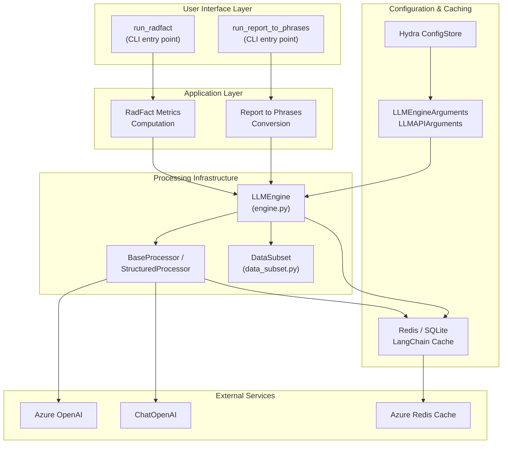
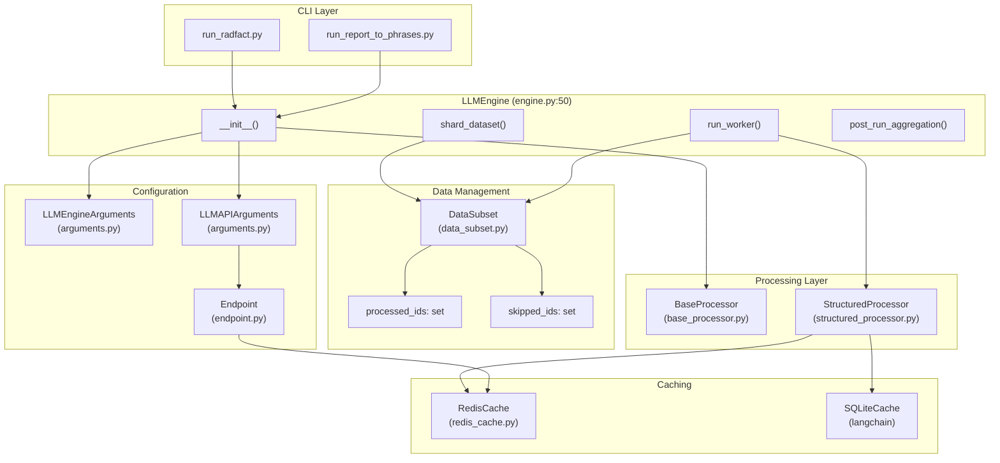
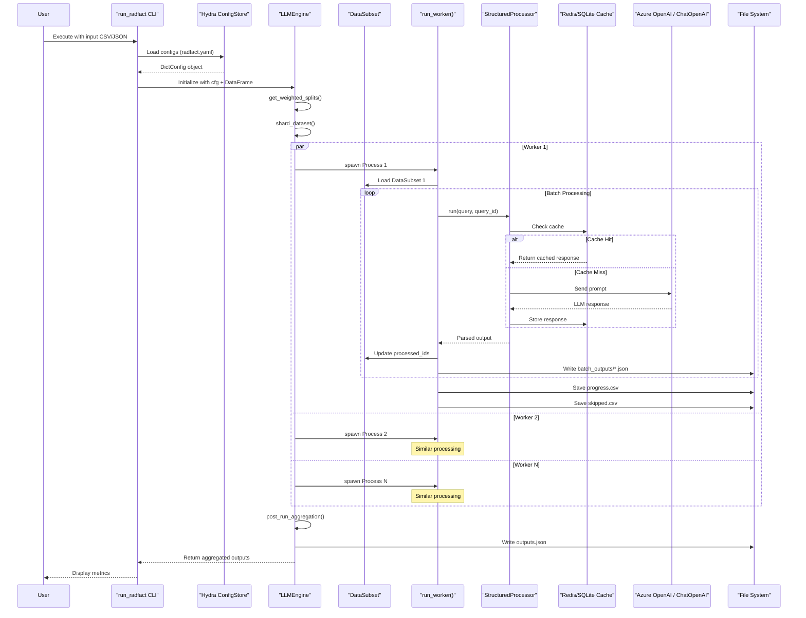
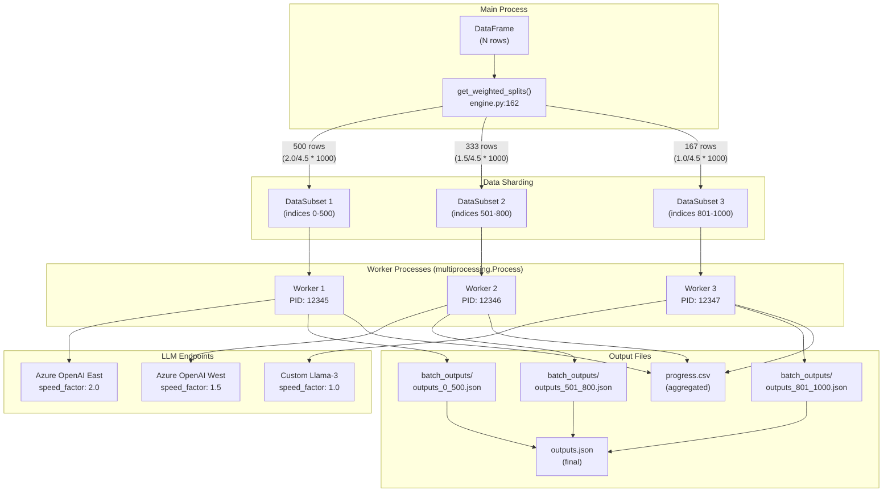
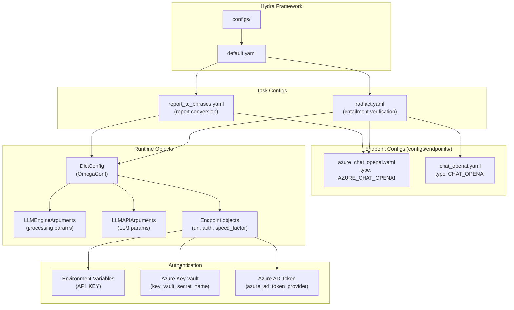

<!-- source: DeepWiki mcp.deepwiki.com · repo microsoft/RadFact · page 5 Architecture · fetched 2026-10-26 -->

# Architecture

<details>
<summary>Relevant source files</summary>

The following files were used as context for generating this wiki page:

- [README.md](README.md)
- [src/radfact/llm_utils/engine/engine.py](src/radfact/llm_utils/engine/engine.py)

</details>


This document provides a technical overview of RadFact's internal architecture, focusing on the major components, their relationships, and how data flows through the system. This page covers the high-level structure and design patterns. For detailed information about specific subsystems, see:

- [System Overview](#5.1) - Visual representation of component interactions
- [LLM Engine](#5.2) - Details on parallel processing orchestration
- [Structured Processor](#5.3) - LLM interaction and prompt handling
- [Caching System](#5.4) - Redis and SQLite caching implementation
- [Parallel Processing](#5.5) - Data sharding and worker management
- [Azure Integration](#5.6) - Azure service integration patterns

## Architectural Principles

RadFact is designed around three core principles:

1. **Parallel Processing**: Data is sharded across multiple LLM endpoints based on throughput, enabling efficient processing of large datasets
2. **Fault Tolerance**: Incremental progress tracking and caching ensure that failed runs can be resumed without losing work
3. **Configuration-Driven**: Hydra-based configuration management allows flexible deployment across different LLM providers and environments

**Sources**: [README.md:1-275](), [src/radfact/llm_utils/engine/engine.py:50-362]()

## Layered Architecture

The system is organized into five distinct architectural layers:



**Layer 1 - User Interface**: Command-line entry points that parse arguments and initialize the application. Implemented in [src/radfact/cli/run_radfact.py]() and [src/radfact/cli/run_report_to_phrases.py]().

**Layer 2 - Application Logic**: Task-specific business logic for computing RadFact metrics or converting reports to phrases. These modules orchestrate the overall evaluation workflow.

**Layer 3 - Processing Infrastructure**: Core execution engine that handles parallel processing, data sharding, and batch management. The `LLMEngine` class coordinates multiple workers, each processing a `DataSubset`.

**Layer 4 - Configuration & Caching**: Configuration management via Hydra and response caching via LangChain. The `LLMEngineArguments` and `LLMAPIArguments` classes encapsulate processing parameters.

**Layer 5 - External Services**: LLM providers and caching infrastructure. Supports both Azure OpenAI and standard OpenAI-compatible endpoints.

**Sources**: [README.md:1-275](), [src/radfact/llm_utils/engine/engine.py:1-362]()

## Core Component Architecture

The following diagram maps the major classes and their relationships:



| Component | File Path | Key Responsibilities |
|-----------|-----------|---------------------|
| `LLMEngine` | [src/radfact/llm_utils/engine/engine.py:50-362]() | Orchestrates parallel processing, manages workers, aggregates results |
| `BaseProcessor` | [src/radfact/llm_utils/processor/base_processor.py]() | Abstract interface for LLM query processing |
| `StructuredProcessor` | [src/radfact/llm_utils/processor/structured_processor.py]() | Concrete processor with prompt templates and output parsing |
| `DataSubset` | [src/radfact/llm_utils/engine/data_subset.py]() | Manages a shard of data with progress tracking |
| `Endpoint` | [src/radfact/llm_utils/endpoint.py]() | Encapsulates LLM endpoint configuration and authentication |
| `LLMEngineArguments` | [src/radfact/llm_utils/engine/arguments.py]() | Processing parameters (batch size, output file, etc.) |
| `LLMAPIArguments` | [src/radfact/llm_utils/engine/arguments.py]() | LLM-specific parameters (temperature, max_tokens, etc.) |

**Sources**: [src/radfact/llm_utils/engine/engine.py:1-362](), [README.md:48-130]()

## Data Flow Architecture

The following sequence shows how data flows from user input to final metrics output:



**Key Data Flow Stages**:

1. **Configuration Loading** ([line 67-91](src/radfact/llm_utils/engine/engine.py:67-91)): Hydra loads task-specific config and endpoint definitions
2. **Dataset Sharding** ([line 193-216](src/radfact/llm_utils/engine/engine.py:193-216)): Dataset split proportionally based on endpoint `speed_factor`
3. **Parallel Worker Execution** ([line 262-296](src/radfact/llm_utils/engine/engine.py:262-296)): Each worker processes its assigned `DataSubset`
4. **Cache-Aware Processing**: LLM queries check cache first to avoid redundant API calls
5. **Incremental Persistence**: Results written to `batch_outputs/` after each batch
6. **Progress Tracking**: `processed_ids` and `skipped_ids` tracked per worker
7. **Final Aggregation** ([line 298-334](src/radfact/llm_utils/engine/engine.py:298-334)): All batch outputs merged into single `outputs.json`

**Sources**: [src/radfact/llm_utils/engine/engine.py:262-362](), [README.md:100-130]()

## Parallel Processing Model

RadFact uses a multi-process architecture for parallel execution:



**Parallel Processing Implementation Details**:

- **Process Spawning** ([line 349-358](src/radfact/llm_utils/engine/engine.py:349-358)): Uses `multiprocessing.Process` for true parallelism
- **Data Sharding Algorithm** ([line 162-178](src/radfact/llm_utils/engine/engine.py:162-178)): Proportional assignment based on `speed_factor` with remainder distribution
- **Worker Isolation**: Each worker has its own `DataSubset`, preventing race conditions
- **Shared State**: `multiprocessing.Manager.dict()` used for returning results ([line 103-106](src/radfact/llm_utils/engine/engine.py:103-106))
- **Progress Tracking**: Per-worker CSV files aggregated at end ([line 324-328](src/radfact/llm_utils/engine/engine.py:324-328))
- **Batch Processing** ([line 269-292](src/radfact/llm_utils/engine/engine.py:269-292)): Reduces memory footprint and enables incremental saves

**Sources**: [src/radfact/llm_utils/engine/engine.py:162-362](), [README.md:100-130]()

## Configuration Architecture

RadFact uses Hydra for hierarchical configuration management:



**Configuration Hierarchy**:

| Level | Files | Purpose |
|-------|-------|---------|
| Base | [configs/default.yaml]() | Shared defaults for all tasks |
| Task | [configs/radfact.yaml](), [configs/report_to_phrases.yaml]() | Task-specific overrides (which endpoint, output files) |
| Endpoint | [configs/endpoints/*.yaml]() | LLM endpoint definitions (URL, auth, throughput) |

**Key Configuration Classes**:

- `LLMEngineArguments` ([src/radfact/llm_utils/engine/arguments.py]()):
  - `batch_size`: Number of rows processed before saving
  - `start_index` / `end_index`: Dataset slice to process
  - `output_filename`: Final output file name
  
- `LLMAPIArguments` ([src/radfact/llm_utils/engine/arguments.py]()):
  - `temperature`: LLM temperature parameter
  - `max_tokens`: Maximum response length
  - `model_name`: Specific model deployment

- `Endpoint` ([src/radfact/llm_utils/endpoint.py:38]()):
  - `url`: Base URL for API
  - `deployment_name`: Model deployment identifier
  - `speed_factor`: Relative throughput for sharding
  - `num_parallel_processes`: Endpoint-specific parallelism
  - `redis_cache`: Redis cache name for this endpoint

**Sources**: [README.md:48-93](), [src/radfact/llm_utils/engine/arguments.py](), [src/radfact/llm_utils/endpoint.py]()

## File System Organization

The system produces a structured output directory hierarchy:

```
outputs/radfact/
└── run_20240814_075225/          # Run ID with timestamp
    ├── batch_outputs/             # Incremental batch results
    │   ├── outputs_0_100.json
    │   ├── outputs_100_200.json
    │   └── outputs_200_300.json
    ├── progress/                  # Per-worker progress files
    │   ├── subset_0_150.csv       # Worker 1 progress
    │   ├── subset_150_250.csv     # Worker 2 progress
    │   └── subset_250_300.csv     # Worker 3 progress
    ├── skipped/                   # Per-worker skipped IDs
    │   ├── subset_0_150.csv
    │   ├── subset_150_250.csv
    │   └── subset_250_300.csv
    ├── outputs.json               # Final aggregated results
    ├── progress.csv               # Aggregated progress
    └── skipped.csv                # Aggregated skipped IDs
```

**File Generation Logic**:

- **Run ID** ([line 158-160](src/radfact/llm_utils/engine/engine.py:158-160)): Timestamp-based unique identifier
- **Batch Outputs** ([line 245-255](src/radfact/llm_utils/engine/engine.py:245-255)): Written after each batch completes
- **Progress Tracking** ([line 229-233](src/radfact/llm_utils/engine/engine.py:229-233)): Per-worker CSV files with processed IDs
- **Final Aggregation** ([line 298-311](src/radfact/llm_utils/engine/engine.py:298-311)): All batch files merged into `outputs.json`

**Sources**: [README.md:100-130](), [src/radfact/llm_utils/engine/engine.py:38-127]()

## Extension Points

The architecture provides several extension points for customization:

1. **Custom Processors**: Implement `BaseProcessor` interface for new LLM interaction patterns
2. **Endpoint Types**: Add new endpoint types by extending `Endpoint` class and updating configuration schema
3. **Cache Backends**: Switch between Redis, SQLite, or implement custom cache via LangChain interface
4. **Output Formats**: Override `on_batch_end()` and `aggregate_outputs()` for custom output handling
5. **Progress Callbacks**: Implement custom logging by overriding `on_processing_step()` and `on_skip_step()`

For implementation details of each subsystem, refer to the relevant sub-pages listed at the beginning of this document.

**Sources**: [src/radfact/llm_utils/engine/engine.py:50-362](), [src/radfact/llm_utils/processor/base_processor.py]()

---

