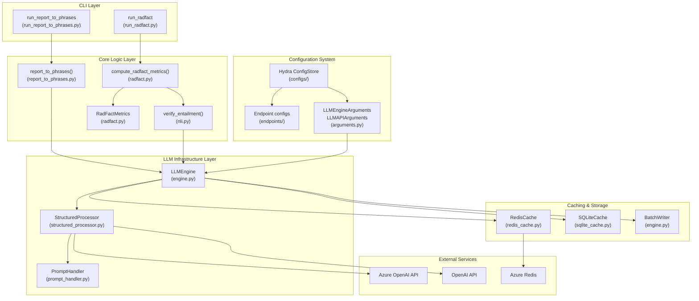
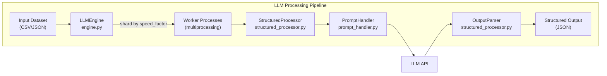
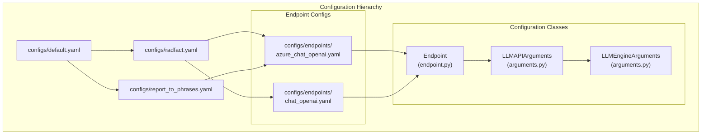
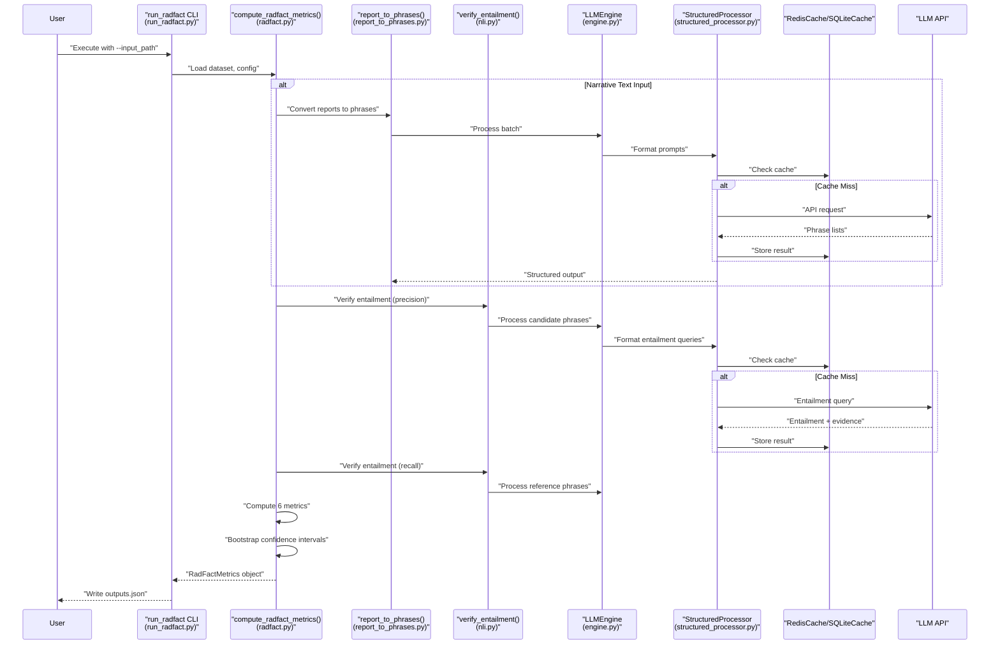
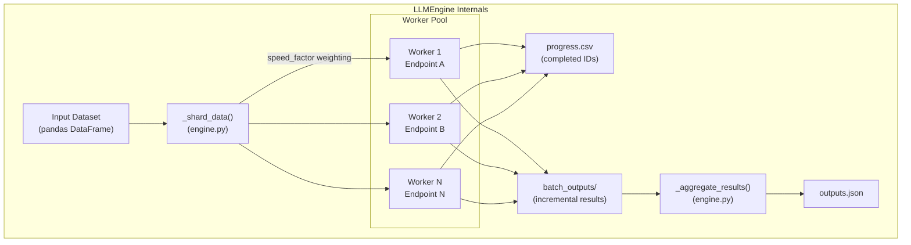
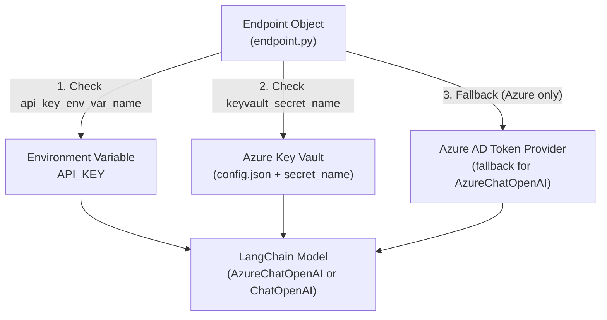
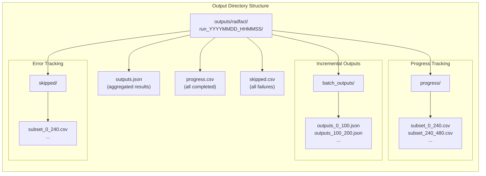

<!-- source: DeepWiki mcp.deepwiki.com · repo microsoft/RadFact · page 5.1 System Overview · fetched 2026-10-26 -->

# System Overview

<details>
<summary>Relevant source files</summary>

The following files were used as context for generating this wiki page:

- [README.md](README.md)
- [dev_environment.yaml](dev_environment.yaml)
- [pyproject.toml](pyproject.toml)

</details>


## Purpose and Scope

This page provides a high-level technical overview of RadFact's architecture, describing how major components interact to evaluate radiology reports. It covers the system's layered structure, data flow, and key subsystems. For detailed information about specific components:

- For LLM parallel processing implementation details, see [LLM Engine](#5.2)
- For prompt handling and output parsing, see [Structured Processor](#5.3)
- For response caching mechanisms, see [Caching System](#5.4)
- For data sharding and worker coordination, see [Parallel Processing](#5.5)
- For Azure service integration, see [Azure Integration](#5.6)

---

## System Architecture

RadFact is structured as a multi-layered system with clear separation between user interface, business logic, infrastructure, and external services. The architecture supports both standalone and Azure-integrated deployments.



**Sources:** [README.md:1-275](), [src/radfact/cli/run_radfact.py](), [src/radfact/cli/run_report_to_phrases.py](), [src/radfact/llm_utils/engine/engine.py]()

---

## Component Layers

### CLI Layer

The system exposes two command-line entry points defined in [pyproject.toml:86-88]():

| Command | Entry Point | Purpose |
|---------|------------|---------|
| `run_radfact` | `radfact.cli.run_radfact:main` | Computes RadFact metrics for evaluation |
| `run_report_to_phrases` | `radfact.cli.run_report_to_phrases:main` | Converts narrative reports to phrase lists |

Both CLIs use Hydra for configuration management, loading settings from [configs/radfact.yaml]() and [configs/report_to_phrases.yaml]() respectively.

**Sources:** [pyproject.toml:86-88](), [README.md:132-189]()

### Core Logic Layer

The core evaluation logic resides in [src/radfact/metric/](). Key components include:

- **`compute_radfact_metrics()`** in [src/radfact/metric/radfact.py](): Orchestrates the two-stage evaluation pipeline
- **`verify_entailment()`** in [src/radfact/llm_utils/nli/nli.py](): Performs bidirectional entailment verification using LLMs
- **`report_to_phrases()`** in [src/radfact/llm_utils/report_to_phrases/report_to_phrases.py](): Converts narrative reports to structured phrases
- **`RadFactMetrics`** class: Data structure holding the six computed metrics (logical precision/recall, grounding precision/recall, spatial precision/recall)

**Sources:** [README.md:190-228](), [src/radfact/metric/radfact.py](), [src/radfact/llm_utils/nli/nli.py]()

### LLM Infrastructure Layer

The LLM infrastructure provides parallel processing, caching, and prompt management:



- **`LLMEngine`** [src/radfact/llm_utils/engine/engine.py:50](): Manages parallel workers, data sharding, and result aggregation
- **`StructuredProcessor`** [src/radfact/llm_utils/processor/structured_processor.py](): Handles LLM API calls with retry logic and structured output parsing
- **`PromptHandler`**: Formats prompts with few-shot examples and system messages

**Sources:** [src/radfact/llm_utils/engine/engine.py](), [src/radfact/llm_utils/processor/structured_processor.py](), [README.md:100-129]()

### Caching Layer

Two caching implementations optimize LLM API costs and latency:

| Cache Type | Implementation | Use Case |
|------------|---------------|----------|
| **RedisCache** | [src/radfact/llm_utils/engine/redis_cache.py]() | Distributed caching for Azure deployments |
| **SQLiteCache** | [src/radfact/llm_utils/engine/sqlite_cache.py]() | Local caching for development/testing |

Both implement endpoint URL normalization to maximize cache hits across different Azure regions [src/radfact/llm_utils/engine/redis_cache.py]().

**Sources:** [src/radfact/llm_utils/engine/redis_cache.py](), [src/radfact/llm_utils/engine/sqlite_cache.py](), [README.md:100-129]()

### Configuration System

RadFact uses Hydra for hierarchical configuration management:



Configuration objects defined in [src/radfact/llm_utils/engine/arguments.py]() provide type-safe access to settings. The `Endpoint` class [src/radfact/llm_utils/endpoint.py:38]() handles authentication across multiple methods.

**Sources:** [README.md:48-92](), [src/radfact/llm_utils/engine/arguments.py](), [src/radfact/llm_utils/endpoint.py](), [configs/]()

---

## Data Flow Through the System

The following diagram shows how data flows from input to final metrics output:



**Sources:** [README.md:190-228](), [src/radfact/cli/run_radfact.py](), [src/radfact/metric/radfact.py](), [src/radfact/llm_utils/engine/engine.py]()

---

## Key Subsystems and Code Mappings

### Parallel Processing Subsystem

The `LLMEngine` class coordinates parallel processing across multiple endpoints:



Key methods in [src/radfact/llm_utils/engine/engine.py:50]():
- `_shard_data()`: Partitions dataset proportional to endpoint `speed_factor`
- `_run_worker()`: Executes queries for a data subset
- `_aggregate_results()`: Merges worker outputs into final results

**Sources:** [src/radfact/llm_utils/engine/engine.py](), [README.md:100-129]()

### Authentication and Endpoint Management

The `Endpoint` class [src/radfact/llm_utils/endpoint.py:38]() supports three authentication tiers:



Configuration in [configs/endpoints/]() specifies:
- `type`: "AZURE_CHAT_OPENAI" or "CHAT_OPENAI"
- `url`: API endpoint URL
- `deployment_name`: Model deployment identifier
- `api_key_env_var_name`: Environment variable for API key
- `keyvault_secret_name`: Azure Key Vault secret name (optional)
- `speed_factor`: Relative throughput for data sharding
- `num_parallel_processes`: Parallel request limit per endpoint

**Sources:** [src/radfact/llm_utils/endpoint.py:38](), [src/radfact/llm_utils/engine/arguments.py](), [README.md:54-92]()

### Output Management and Fault Tolerance

The engine implements incremental saving for fault tolerance:



The `BatchWriter` in [src/radfact/llm_utils/engine/engine.py]() handles incremental writes. Workers checkpoint progress to enable resumption after failures.

**Sources:** [README.md:100-129](), [src/radfact/llm_utils/engine/engine.py]()

---

## Integration Points

### LangChain Integration

RadFact integrates with LangChain v0.2.17 for LLM abstraction:

- **`AzureChatOpenAI`**: For Azure-deployed GPT models
- **`ChatOpenAI`**: For custom deployments (e.g., Llama-3 on Azure)

Dependencies specified in [pyproject.toml:41-60]():
```
langchain==0.2.17
langchain-community==0.2.19
langchain-openai==0.1.25
openai==1.55.0
```

**Sources:** [pyproject.toml:41-60](), [README.md:48-53]()

### Azure ML Integration

The system integrates with Azure ML workspace via [dev_environment.yaml:44-154]():

- **`azureml-sdk==1.58.0`**: Workspace management
- **`azureml-mlflow==1.58.0.post3`**: Experiment tracking
- **`azure-identity==1.14.1`**: Authentication
- **`azure-keyvault==4.2.0`**: Secret management

Workspace configuration loaded from `config.json` in project root [src/radfact/llm_utils/endpoint.py:38]().

**Sources:** [dev_environment.yaml:44-154](), [pyproject.toml:41-60](), [src/radfact/llm_utils/endpoint.py:38]()

---

## Summary

RadFact's architecture provides:

1. **Modularity**: Clear separation between CLI, business logic, infrastructure, and external services
2. **Scalability**: Parallel processing across multiple LLM endpoints with proportional load distribution
3. **Fault Tolerance**: Incremental output saving and progress tracking enable resumption after failures
4. **Flexibility**: Hydra-based configuration supports diverse deployment scenarios
5. **Cost Optimization**: Redis/SQLite caching minimizes redundant LLM API calls
6. **Azure Integration**: Native support for Azure OpenAI, Key Vault, Redis, and ML services

The system is designed to process large-scale radiology report evaluations efficiently while maintaining reliability and cost-effectiveness.

**Sources:** [README.md:1-275](), [src/radfact/llm_utils/engine/engine.py](), [src/radfact/llm_utils/processor/structured_processor.py](), [pyproject.toml:1-89]()

---

