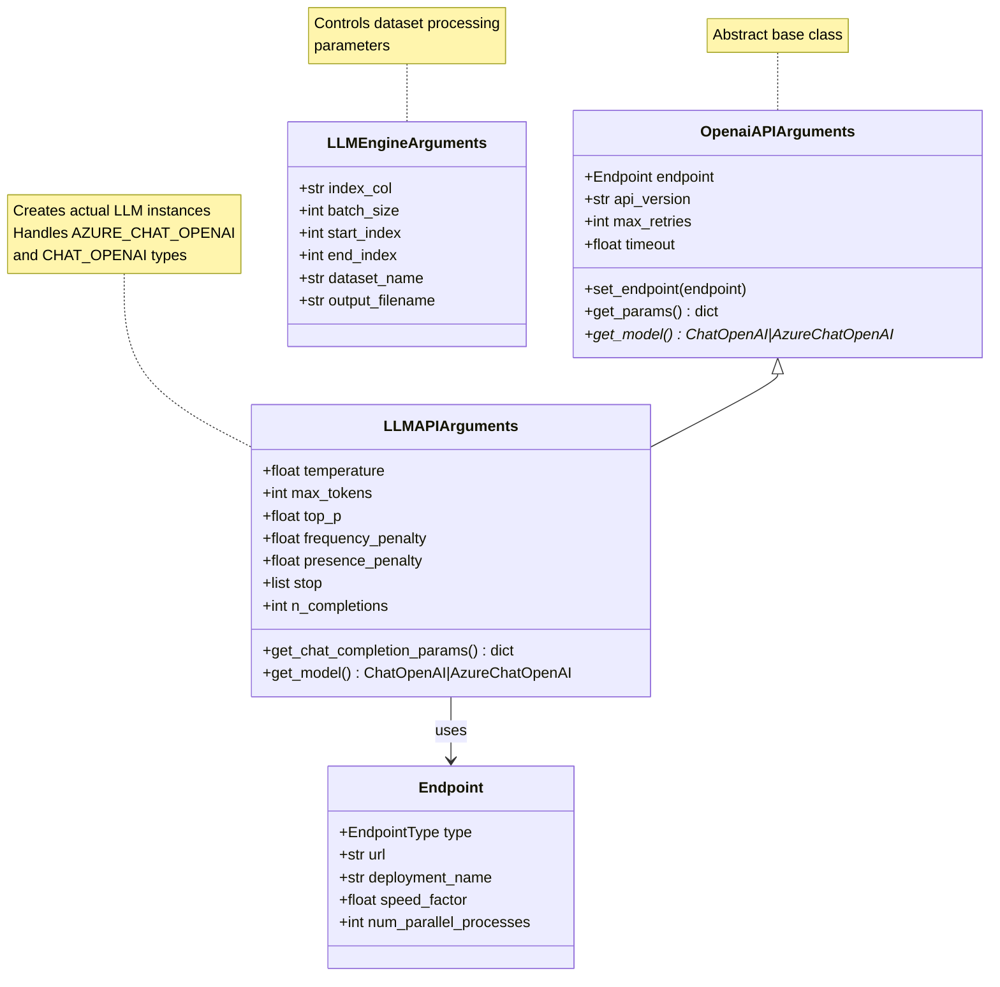
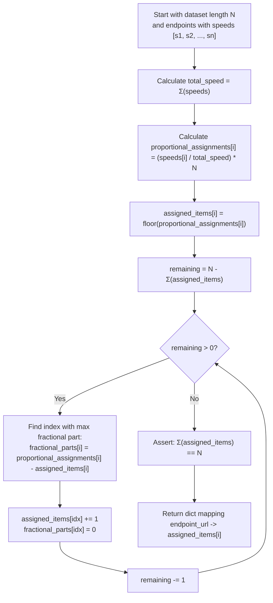
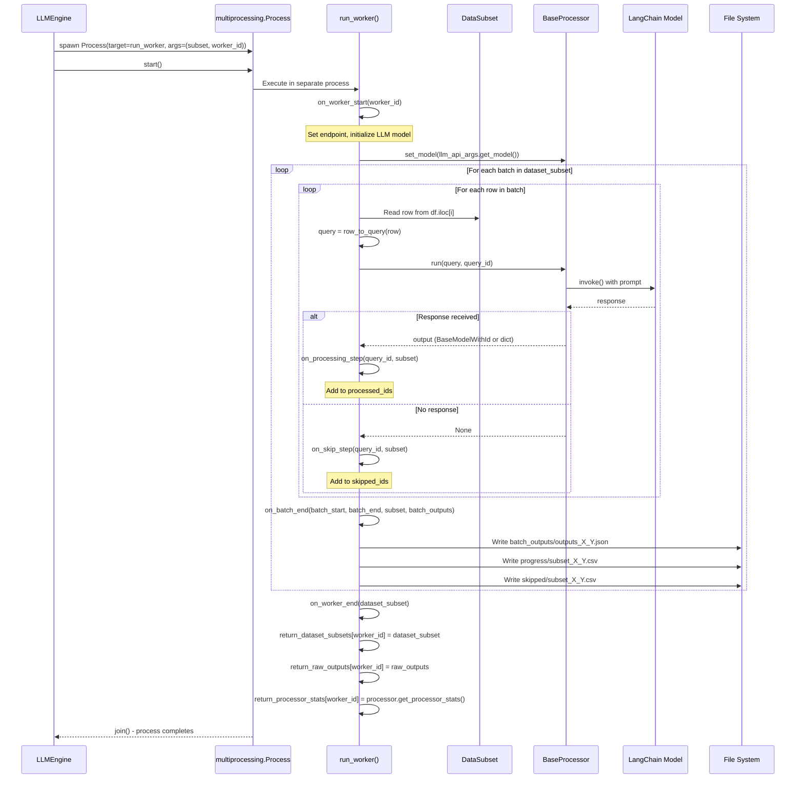
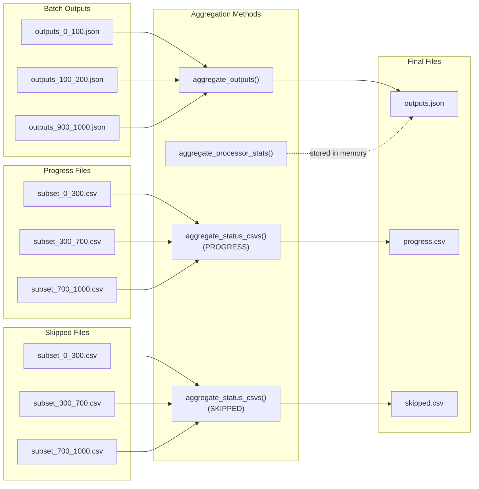

<!-- source: DeepWiki mcp.deepwiki.com · repo microsoft/RadFact · page 5.2 LLM Engine · fetched 2026-10-26 -->

# LLM Engine

<details>
<summary>Relevant source files</summary>

The following files were used as context for generating this wiki page:

- [README.md](README.md)
- [src/radfact/llm_utils/engine/arguments.py](src/radfact/llm_utils/engine/arguments.py)
- [src/radfact/llm_utils/engine/engine.py](src/radfact/llm_utils/engine/engine.py)

</details>


## Purpose and Scope

The LLM Engine is RadFact's parallel processing infrastructure that orchestrates LLM API calls across multiple endpoints. It handles dataset sharding, worker process management, result aggregation, and fault tolerance through incremental output saves and progress tracking. This document covers the `LLMEngine` class and its associated argument classes that enable efficient, large-scale LLM processing.

For information about the specific processor that handles individual LLM queries, see [Structured Processor](#5.3). For details on the caching layer, see [Caching System](#5.4). For an overview of the complete parallel processing strategy, see [Parallel Processing](#5.5).

**Sources:** [src/radfact/llm_utils/engine/engine.py:1-362](), [README.md:100-130]()

## System Architecture

The LLM Engine implements a multi-process architecture where a single `LLMEngine` instance spawns multiple worker processes, each assigned to a specific endpoint. Data is sharded proportionally based on endpoint speed factors, and workers process their assigned subsets independently.

```mermaid
graph TB
    subgraph "Main Process"
        Engine["LLMEngine"]
        Config["DictConfig<br/>(from Hydra)"]
        DataFrame["pd.DataFrame<br/>(input dataset)"]
        ShardingLogic["get_weighted_splits()<br/>shard_dataset()"]
    end
    
    subgraph "Worker Processes (multiprocessing.Process)"
        Worker1["run_worker()<br/>Process 1"]
        Worker2["run_worker()<br/>Process 2"]
        WorkerN["run_worker()<br/>Process N"]
    end
    
    subgraph "Per-Worker State"
        DS1["DataSubset<br/>start=0, end=300"]
        DS2["DataSubset<br/>start=300, end=700"]
        DSN["DataSubset<br/>start=700, end=1000"]
        
        Proc1["BaseProcessor<br/>+ LLM Model 1"]
        Proc2["BaseProcessor<br/>+ LLM Model 2"]
        ProcN["BaseProcessor<br/>+ LLM Model N"]
    end
    
    subgraph "Shared State (multiprocessing.Manager)"
        ReturnSubsets["return_dataset_subsets<br/>manager.dict()"]
        ReturnOutputs["return_raw_outputs<br/>manager.dict()"]
        ReturnStats["return_processor_stats<br/>manager.dict()"]
    end
    
    subgraph "File System Outputs"
        BatchFolder["batch_outputs/<br/>outputs_0_100.json<br/>outputs_100_200.json"]
        ProgressFolder["progress/<br/>subset_0_300.csv<br/>subset_300_700.csv"]
        SkippedFolder["skipped/<br/>subset_0_300.csv<br/>subset_300_700.csv"]
        FinalOutput["outputs.json<br/>(aggregated)"]
    end
    
    Config --> Engine
    DataFrame --> Engine
    Engine --> ShardingLogic
    
    ShardingLogic --> DS1
    ShardingLogic --> DS2
    ShardingLogic --> DSN
    
    Engine -->|"spawn & start()"| Worker1
    Engine -->|"spawn & start()"| Worker2
    Engine -->|"spawn & start()"| WorkerN
    
    Worker1 --> DS1
    Worker1 --> Proc1
    Worker2 --> DS2
    Worker2 --> Proc2
    WorkerN --> DSN
    WorkerN --> ProcN
    
    Worker1 -->|"write results"| ReturnSubsets
    Worker1 -->|"write results"| ReturnOutputs
    Worker1 -->|"write results"| ReturnStats
    Worker2 --> ReturnSubsets
    Worker2 --> ReturnOutputs
    Worker2 --> ReturnStats
    WorkerN --> ReturnSubsets
    WorkerN --> ReturnOutputs
    WorkerN --> ReturnStats
    
    Worker1 -->|"incremental save"| BatchFolder
    Worker2 -->|"incremental save"| BatchFolder
    WorkerN -->|"incremental save"| BatchFolder
    
    DS1 -->|"save_progress()"| ProgressFolder
    DS1 -->|"save_skipped()"| SkippedFolder
    DS2 --> ProgressFolder
    DS2 --> SkippedFolder
    DSN --> ProgressFolder
    DSN --> SkippedFolder
    
    Engine -->|"post_run_aggregation()"| FinalOutput
    BatchFolder -->|"aggregate_outputs()"| FinalOutput
```



**Sources:** [src/radfact/llm_utils/engine/engine.py:50-362](), [src/radfact/llm_utils/engine/engine.py:103-106]()

## Core Components

### LLMEngine Class

The `LLMEngine` class is defined at [src/radfact/llm_utils/engine/engine.py:50-362]() and serves as the orchestrator for all parallel LLM processing operations.

| Property/Method | Purpose | Return Type |
|----------------|---------|-------------|
| `__init__()` | Initialize engine with config, processor, dataset, and output folders | `None` |
| `run()` | Execute complete parallel processing pipeline | `Any` (list of processor outputs) |
| `shard_dataset()` | Divide dataset across endpoints by speed factor | `DictOfShards` |
| `run_worker()` | Process assigned data subset in a worker process | `None` |
| `aggregate_outputs()` | Combine batch outputs into final JSON file | `int` (num processed) |
| `run_output_folder` | Property returning the run-specific output directory | `Path` |
| `batch_output_folder` | Property returning the batch outputs subdirectory | `Path` |

**Key initialization parameters:**

```python
def __init__(
    self,
    cfg: DictConfig,                    # Hydra configuration
    processor: BaseProcessor[Any, Any], # Processor handling LLM queries
    dataset_df: pd.DataFrame,           # Input data
    progress_output_folder: Path,       # Incremental saves location
    final_output_folder: Path | None,   # Final aggregated output location
    row_to_query_fn: Callable,          # Transform DataFrame row to query
    verbose: bool = False
)
```

**Sources:** [src/radfact/llm_utils/engine/engine.py:50-107]()

### LLMAPIArguments Class

The `LLMAPIArguments` class at [src/radfact/llm_utils/engine/arguments.py:76-117]() encapsulates LLM API configuration and creates `ChatOpenAI` or `AzureChatOpenAI` model instances.



**Configuration mapping:**

The `get_params()` method at [src/radfact/llm_utils/engine/arguments.py:32-67]() maps internal configuration to LangChain API parameters:

| EndpointType | Required Parameters | Authentication |
|--------------|-------------------|----------------|
| `AZURE_CHAT_OPENAI` | `deployment_name`, `azure_endpoint`, `openai_api_version` | `openai_api_key` or `azure_ad_token_provider` |
| `CHAT_OPENAI` | `model`, `base_url` | `openai_api_key` |

**Sources:** [src/radfact/llm_utils/engine/arguments.py:1-136]()

### LLMEngineArguments Class

The `LLMEngineArguments` class at [src/radfact/llm_utils/engine/arguments.py:120-136]() controls dataset processing behavior:

| Field | Default | Purpose |
|-------|---------|---------|
| `index_col` | (required) | Column name for unique row identifiers |
| `batch_size` | 100 | Number of rows processed before incremental save |
| `start_index` | 0 | Starting row for dataset slice |
| `end_index` | `None` | Ending row for dataset slice (None = end of dataset) |
| `dataset_name` | `None` | Optional dataset identifier |
| `output_filename` | `"output.json"` | Name for final aggregated output file |

**Sources:** [src/radfact/llm_utils/engine/arguments.py:120-136]()

## Data Sharding Strategy

The LLM Engine implements proportional data sharding based on endpoint speed factors, ensuring efficient workload distribution across heterogeneous endpoints.

### Weighted Splitting Algorithm

The `get_weighted_splits()` method at [src/radfact/llm_utils/engine/engine.py:162-178]() implements a proportional allocation algorithm:



**Example:**
- Dataset: 1000 rows
- Endpoints: 
  - A (speed_factor=2.0) → 400 rows
  - B (speed_factor=3.0) → 600 rows
  - Total speed = 5.0

**Sources:** [src/radfact/llm_utils/engine/engine.py:162-178]()

### Dataset Sharding Implementation

The `shard_dataset()` method at [src/radfact/llm_utils/engine/engine.py:193-216]() creates `DataSubset` instances for each endpoint:

```python
def shard_dataset(self) -> DictOfShards:
    weighted_splits = self.get_weighted_splits()
    i_start = 0
    dataset_shards: DictOfShards = {}
    for url, split_size in weighted_splits.items():
        i_end = i_start + split_size
        dataset_shards[url] = DataSubset(
            df=self.dataset_df.iloc[i_start:i_end],
            start_index=i_start,
            end_index=i_end,
            index_col=self.processing_args.index_col,
            output_folder=self.run_output_folder,
        )
        i_start = i_end
```

**Validation:** Two validation checks ensure correctness:
- `validate_sharding_overlap()` at [src/radfact/llm_utils/engine/engine.py:180-185]() ensures no overlapping indices between shards
- `validate_sharding_length()` at [src/radfact/llm_utils/engine/engine.py:187-191]() verifies total shard length equals dataset length

**Sources:** [src/radfact/llm_utils/engine/engine.py:180-216]()

## Worker Process Lifecycle

Each worker process follows a structured lifecycle with initialization, processing, and cleanup phases.



**Sources:** [src/radfact/llm_utils/engine/engine.py:262-296]()

### Worker Initialization

The `on_worker_start()` method at [src/radfact/llm_utils/engine/engine.py:218-225]() configures the worker's LLM endpoint:

```python
def on_worker_start(self, worker_id: str) -> None:
    endpoint = self.endpoints[worker_id]
    logger.info(f"Started process {os.getpid()} for endpoint {endpoint.url} "
                f"with speed factor {endpoint.speed_factor}")
    self.llm_api_args.set_endpoint(endpoint)
    self.processor.set_model(model=self.llm_api_args.get_model())
```

**Sources:** [src/radfact/llm_utils/engine/engine.py:218-225]()

### Batch Processing Loop

The main processing loop at [src/radfact/llm_utils/engine/engine.py:267-292]() iterates through batches:

```python
for i in range(0, len(dataset_subset) + batch_size, batch_size):
    j = min(i + batch_size, len(dataset_subset))
    batch = dataset_subset.df.iloc[i:j]
    batch_outputs: OutputsType = []
    
    for _, row in tqdm(batch.iterrows(), total=len(batch), desc=worker_id):
        query = self.row_to_query(row)
        query_id = row[dataset_subset.index_col]
        output = self.processor.run(query=query, query_id=query_id)
        
        if output is not None:
            # Process successful output
            raw_outputs.append(output)
            output_dict = output.dict() if isinstance(output, BaseModel) else output.copy()
            output_dict[dataset_subset.index_col] = query_id
            batch_outputs.append(output_dict)
            self.on_processing_step(processed_id=query_id, dataset_subset=dataset_subset)
        else:
            # Handle failed query
            self.on_skip_step(skipped_id=query_id, dataset_subset=dataset_subset)
    
    self.on_batch_end(i, j, dataset_subset, batch_outputs)
```

**Sources:** [src/radfact/llm_utils/engine/engine.py:267-292]()

### Progress Tracking

Three callback methods track progress and handle failures:

| Method | Trigger | Action |
|--------|---------|--------|
| `on_processing_step()` | Successful query | Add `query_id` to `dataset_subset.processed_ids` |
| `on_skip_step()` | Failed query | Add `query_id` to `dataset_subset.skipped_ids` |
| `on_batch_end()` | End of batch | Save batch outputs and progress CSVs |

**Sources:** [src/radfact/llm_utils/engine/engine.py:235-256]()

## Output Management

The LLM Engine maintains a structured output directory hierarchy for incremental saves and final aggregation.

### Output Directory Structure

The `run_output_folder` property at [src/radfact/llm_utils/engine/engine.py:114-127]() creates a timestamped run directory:

```
outputs/radfact/run_20240814_075225/
├── batch_outputs/
│   ├── outputs_0_100.json
│   ├── outputs_100_200.json
│   └── outputs_900_1000.json
├── progress/
│   ├── subset_0_300.csv
│   ├── subset_300_700.csv
│   └── subset_700_1000.csv
├── skipped/
│   ├── subset_0_300.csv
│   ├── subset_300_700.csv
│   └── subset_700_1000.csv
├── outputs.json          # Final aggregated output
├── progress.csv          # Aggregated progress
└── skipped.csv           # Aggregated skipped IDs
```

**Key constants:**
- `OUTPUT_FILES_PREFIX = "outputs"` at [src/radfact/llm_utils/engine/engine.py:59]()
- `PROGRESS_FILENAME = "progress.csv"` at [src/radfact/llm_utils/engine/engine.py:60]()
- `SKIPPED_FILENAME = "skipped.csv"` at [src/radfact/llm_utils/engine/engine.py:62]()

**Sources:** [src/radfact/llm_utils/engine/engine.py:59-127](), [README.md:100-130]()

### Incremental Batch Saves

The `on_batch_end()` method at [src/radfact/llm_utils/engine/engine.py:245-256]() performs incremental saves:

```python
def on_batch_end(self, batch_start: int, batch_end: int, 
                 dataset_subset: DataSubset, batch_outputs: list[dict[str, Any]]) -> None:
    if len(batch_outputs) > 0:
        start = dataset_subset.start_index + batch_start
        end = dataset_subset.start_index + batch_end
        output_file = self.batch_output_folder / f"{self.OUTPUT_FILES_PREFIX}_{start}_{end}.json"
        
        with output_file.open("w", encoding="utf-8") as f:
            json.dump(batch_outputs, f, **self.json_args)
        
        dataset_subset.save_progress()
        dataset_subset.save_skipped()
```

**Benefits:**
- **Fault tolerance**: Progress preserved across crashes/interruptions
- **Memory efficiency**: Batch outputs flushed to disk regularly
- **Monitoring**: Real-time progress tracking via filesystem

**Sources:** [src/radfact/llm_utils/engine/engine.py:245-256]()

### Post-Run Aggregation

The `post_run_aggregation()` method at [src/radfact/llm_utils/engine/engine.py:324-333]() combines all outputs:



**Implementation:**

```python
def post_run_aggregation(self) -> None:
    len_aggregate = self.aggregate_outputs()
    self.aggregated_processor_stats = self.processor.aggregate_processor_stats(
        dict(self.return_processor_stats)
    )
    self.aggregate_status_csvs(self.PROGRESS_FILE_ATTRIBUTE, self.PROGRESS_FILENAME)
    self.aggregate_status_csvs(self.SKIPPED_FILE_ATTRIBUTE, self.SKIPPED_FILENAME)
    
    len_processed = sum(
        len(dataset_subset.processed_ids) 
        for dataset_subset in self.return_dataset_subsets.values()
    )
    assert len_aggregate == len_processed
```

**Sources:** [src/radfact/llm_utils/engine/engine.py:298-333]()

## Cache Configuration

The LLM Engine supports three caching modes configured via the `langchain_cache_type` parameter:

### Cache Types

The `set_llm_cache()` method at [src/radfact/llm_utils/engine/engine.py:132-156]() configures the global LangChain cache:

| Cache Type | Implementation | Use Case |
|-----------|---------------|----------|
| `None` or `""` | No caching | Testing, debugging |
| `"redis"` | `RedisCache` via `get_redis_cache()` | Production (distributed, persistent) |
| `"sqlite"` | `SQLiteCache` | Development (local, file-based) |

**Redis cache initialization:**

```python
case "redis":
    redis_cache_per_endpoint = {
        name: endpoint.redis_cache 
        for name, endpoint in self.endpoints.items()
    }
    unique_cache_names = set(redis_cache_per_endpoint.values())
    if len(unique_cache_names) > 1:
        raise ValueError("Expected all endpoints to have the same cache")
    
    redis_cache_name = next(iter(unique_cache_names))
    if len(redis_cache_name) > 0:
        try:
            set_llm_cache(get_redis_cache(redis_cache_name=redis_cache_name))
        except Exception:
            logger.warning("Failed to connect to Redis cache. Continuing without cache.")
```

**Key constraint:** All endpoints must share the same Redis cache instance for consistency.

**Sources:** [src/radfact/llm_utils/engine/engine.py:132-156](), [README.md:48-98]()

## Integration Points

### Endpoint Configuration

The `LLMEngine` retrieves endpoints via utility functions:

```python
self.endpoints = get_endpoints_dict_sorted_by_speed(cfg, descending=False)
self.endpoints = replicate_same_endpoint_n_times(self.endpoints)
```

- `get_endpoints_dict_sorted_by_speed()`: Sorts endpoints by `speed_factor` (slowest first)
- `replicate_same_endpoint_n_times()`: Replicates endpoints with `num_parallel_processes > 1`

**Sources:** [src/radfact/llm_utils/engine/engine.py:85-86]()

### Processor Integration

The engine accepts any `BaseProcessor[Any, Any]` implementation and calls:

| Method | When Called | Purpose |
|--------|-------------|---------|
| `set_model(model)` | Worker initialization | Configure processor with endpoint-specific LLM |
| `run(query, query_id)` | Each data row | Execute LLM query and return structured output |
| `get_processor_stats()` | Worker completion | Retrieve processor-specific metrics |
| `aggregate_processor_stats(stats_dict)` | Post-run | Combine statistics from all workers |

**Sources:** [src/radfact/llm_utils/engine/engine.py:225](), [src/radfact/llm_utils/engine/engine.py:277](), [src/radfact/llm_utils/engine/engine.py:296](), [src/radfact/llm_utils/engine/engine.py:326]()

### Multiprocessing Shared State

The engine uses `multiprocessing.Manager()` to share results between workers:

```python
manager = multiprocessing.Manager()
self.return_dataset_subsets = manager.dict()  # Worker ID -> DataSubset
self.return_raw_outputs = manager.dict()      # Worker ID -> list[outputs]
self.return_processor_stats = manager.dict()  # Worker ID -> stats dict
```

Workers write to these dictionaries at [src/radfact/llm_utils/engine/engine.py:294-296]():

```python
self.return_dataset_subsets[worker_id] = dataset_subset
self.return_raw_outputs[worker_id] = raw_outputs
self.return_processor_stats[worker_id] = self.processor.get_processor_stats()
```

**Sources:** [src/radfact/llm_utils/engine/engine.py:103-106](), [src/radfact/llm_utils/engine/engine.py:294-296]()

### CLI Integration

The engine is invoked from CLI scripts:

```python
# From run_radfact.py or run_report_to_phrases.py
engine = LLMEngine(
    cfg=cfg,
    processor=structured_processor,
    dataset_df=df,
    progress_output_folder=Path("outputs") / task_name,
    final_output_folder=Path(cfg.output_dir) if cfg.output_dir else None,
    row_to_query_fn=lambda row: format_query(row),
    verbose=True
)

outputs = engine.run()  # Returns list of processor outputs
```

**Sources:** [README.md:131-189]()

## Error Handling and Fault Tolerance

### Failed Query Handling

When `processor.run()` returns `None` (indicating LLM failure), the engine:

1. Adds the `query_id` to `dataset_subset.skipped_ids` at [src/radfact/llm_utils/engine/engine.py:291]()
2. Saves the skipped ID to `skipped/subset_X_Y.csv`
3. Continues processing remaining queries

**Warning from README:** *"Some queries may fail due to the endpoint limitations (timeouts, rate limits, etc.). When the LLM performing entailment verification fails, we set these examples as not-entailed by default. If this occurs in a significant number of cases, the results will not be reliable."*

**Sources:** [src/radfact/llm_utils/engine/engine.py:290-291](), [README.md:178]()

### Resumability

The engine supports resuming interrupted runs:

- Progress tracking via `progress.csv` enables skipping already-processed IDs
- Batch outputs persist on disk, allowing partial result recovery
- Each run gets a unique timestamped directory (`run_YYYYMMDD_HHMMSS`)

**Sources:** [README.md:100-130]()

## Configuration Example

Typical configuration in `configs/radfact.yaml`:

```yaml
processing:
  index_col: "example_id"
  batch_size: 100
  output_filename: "outputs.json"

llm_api:
  temperature: 0.0
  max_tokens: 1024
  timeout: 120.0

langchain_cache_type: "redis"

endpoints:
  override: azure_chat_openai  # Or chat_openai
```

**Sources:** [README.md:66-92](), [src/radfact/llm_utils/engine/arguments.py:1-136]()

---

