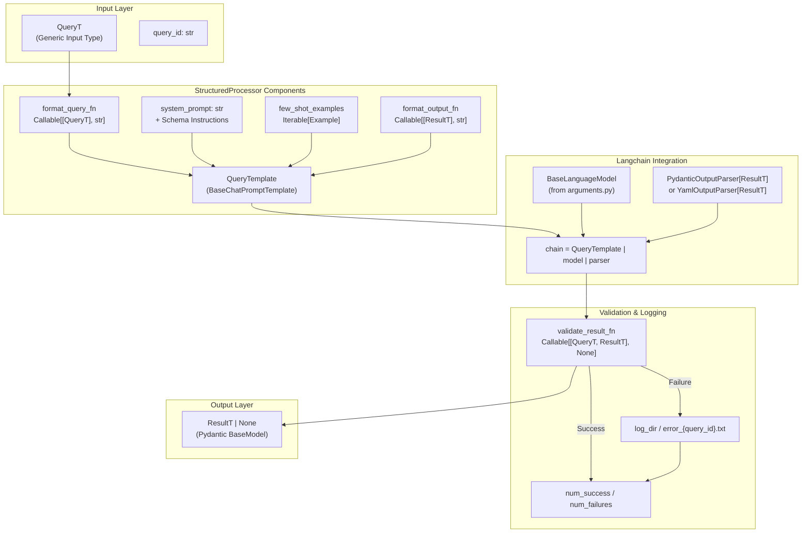
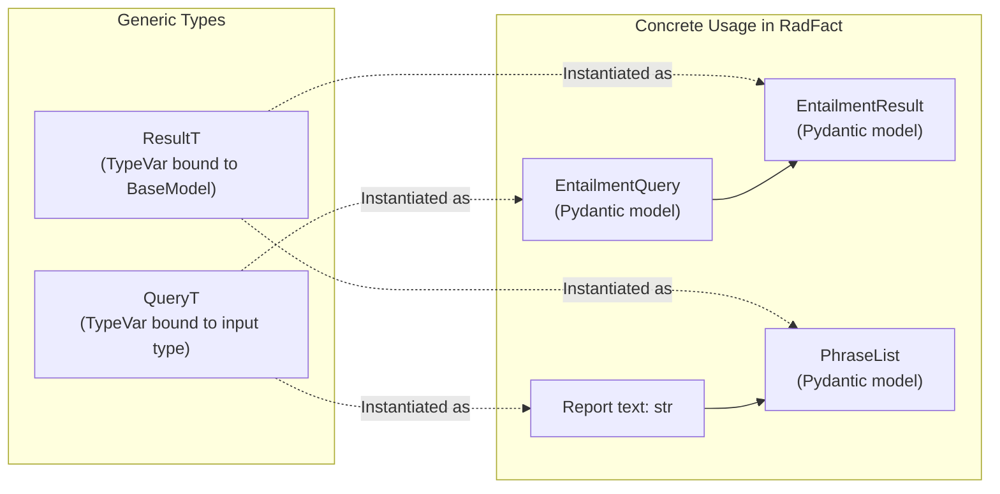
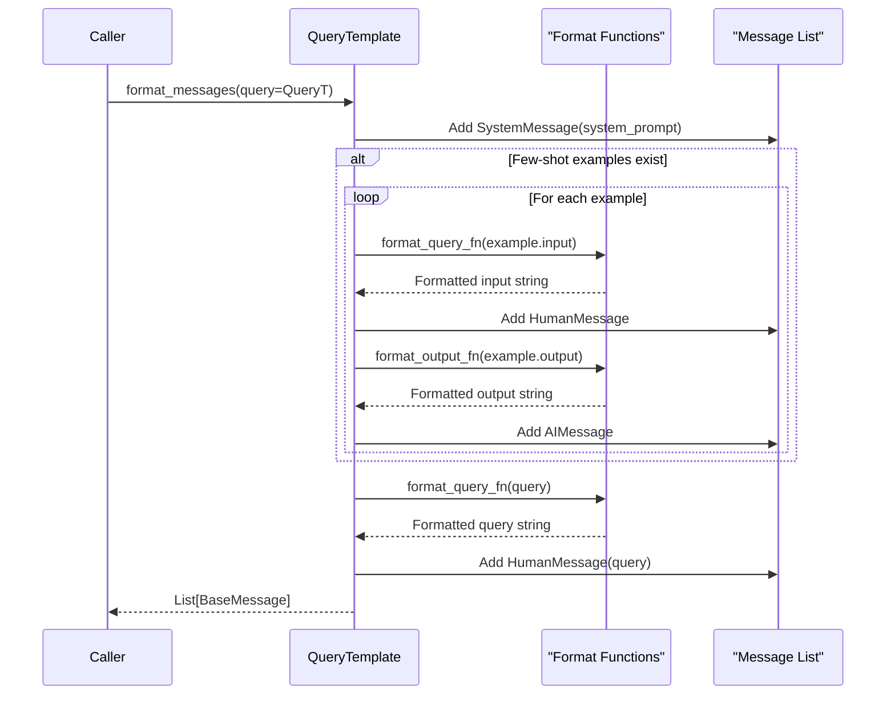
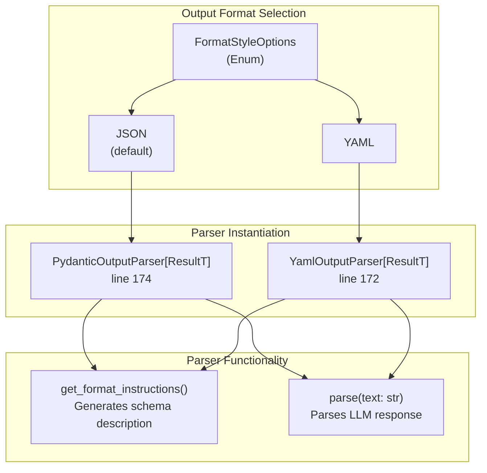
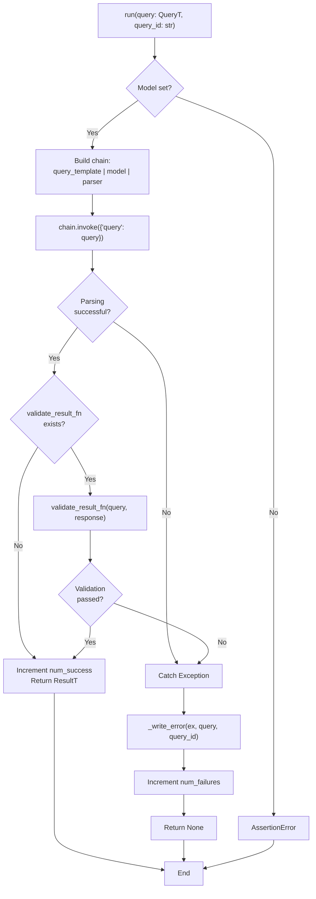
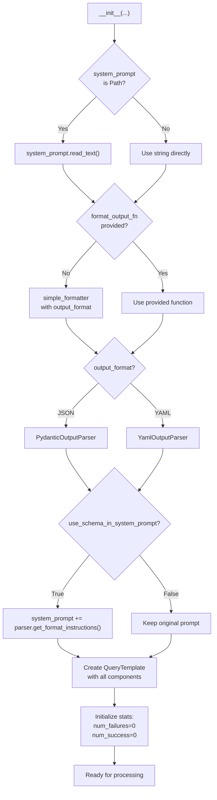
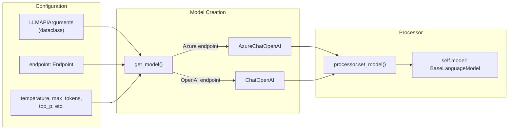
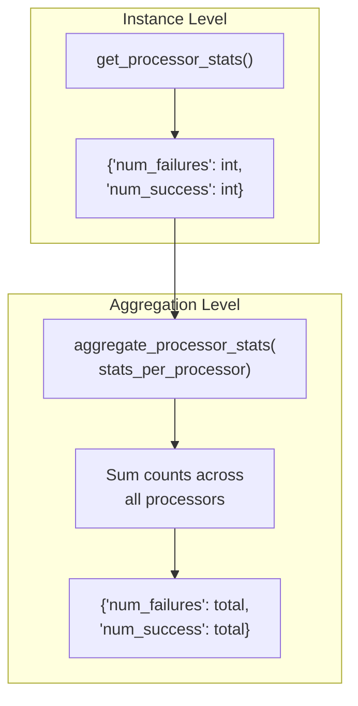

<!-- source: DeepWiki mcp.deepwiki.com · repo microsoft/RadFact · page 5.3 Structured Processor · fetched 2026-10-26 -->

# Structured Processor

<details>
<summary>Relevant source files</summary>

The following files were used as context for generating this wiki page:

- [src/radfact/llm_utils/engine/arguments.py](src/radfact/llm_utils/engine/arguments.py)
- [src/radfact/llm_utils/processor/structured_processor.py](src/radfact/llm_utils/processor/structured_processor.py)

</details>


## Purpose and Scope

The `StructuredProcessor` is a core component responsible for managing LLM interactions with structured input/output requirements. It handles prompt construction, few-shot example formatting, LLM invocation, response parsing into Pydantic models, and error handling. This processor enables RadFact's entailment verification and report-to-phrases conversion tasks by providing a robust interface between application logic and language models.

For information about how multiple `StructuredProcessor` instances are orchestrated in parallel, see [LLM Engine](#5.2). For details on caching LLM responses, see [Caching System](#5.4).

**Sources**: [src/radfact/llm_utils/processor/structured_processor.py:1-234]()

---

## Core Responsibilities

The `StructuredProcessor` class provides the following functionality:

| Responsibility | Description | Key Code |
|---|---|---|
| **Query Formatting** | Transforms typed input queries into formatted prompts | `format_query_fn` parameter |
| **Prompt Construction** | Assembles system prompts, few-shot examples, and queries | `QueryTemplate.format_messages()` |
| **LLM Invocation** | Executes the constructed prompt against a language model | `chain.invoke()` in `run()` |
| **Response Parsing** | Parses LLM responses into structured Pydantic models | `PydanticOutputParser` / `YamlOutputParser` |
| **Validation** | Validates parsed results against custom rules | `validate_result_fn` parameter |
| **Error Handling** | Logs failures and returns None for failed queries | `_write_error()` method |
| **Statistics Tracking** | Maintains success/failure counts | `num_success`, `num_failures` |

**Sources**: [src/radfact/llm_utils/processor/structured_processor.py:114-234]()

---

## Architecture Overview

The following diagram shows how the `StructuredProcessor` components interact to process a single query:



**Sources**: [src/radfact/llm_utils/processor/structured_processor.py:114-234]()

---

## Generic Type System

The `StructuredProcessor` uses Python generics to provide type safety for different query/result pairs:



The `QueryT` type parameter can be any type (e.g., `str`, `pd.Series`, or a Pydantic `BaseModel`), while `ResultT` must be a Pydantic `BaseModel` to enable structured parsing.

**Sources**: [src/radfact/llm_utils/processor/structured_processor.py:10-24]()

---

## QueryTemplate Component

The `QueryTemplate` class ([src/radfact/llm_utils/processor/structured_processor.py:58-112]()) extends Langchain's `BaseChatPromptTemplate` to construct chat-based prompts:

### Message Assembly



### Key Methods

| Method | Purpose | Returns |
|---|---|---|
| `format_messages()` | Assembles complete prompt from system prompt, examples, and query | `list[BaseMessage]` |
| `prepare_few_shot_examples()` | Converts examples into HumanMessage/AIMessage pairs | `list[BaseMessage]` |

**Sources**: [src/radfact/llm_utils/processor/structured_processor.py:58-112]()

---

## Output Parsing

The processor supports two output formats, determined by the `output_format` parameter:



Both parsers provide:
- **Schema generation**: `get_format_instructions()` produces a string describing the expected output structure, appended to the system prompt ([line 180-181]())
- **Response parsing**: Converts the LLM's text response into a `ResultT` instance, raising exceptions on malformed output

**Sources**: [src/radfact/llm_utils/processor/structured_processor.py:28-49, 169-182]()

---

## Processing Flow

The `run()` method ([src/radfact/llm_utils/processor/structured_processor.py:208-220]()) executes the complete processing pipeline:



### Error Logging

When processing fails, the `_write_error()` method ([line 199-206]()) creates detailed error logs:

| Condition | Behavior |
|---|---|
| `log_dir` is set | Writes `error_{query_id}.txt` containing exception and formatted query |
| `log_dir` is None | Only logs to stdout (via implicit exception handling) |

**Sources**: [src/radfact/llm_utils/processor/structured_processor.py:199-220]()

---

## Initialization and Configuration

The `StructuredProcessor` constructor accepts the following parameters:

### Required Parameters

| Parameter | Type | Purpose |
|---|---|---|
| `query_type` | `type[QueryT]` | Type of input query for type checking |
| `result_type` | `type[ResultT]` | Pydantic model class for structured output |
| `system_prompt` | `str \| Path` | Instructions for the LLM (file path or string) |
| `format_query_fn` | `Callable[[QueryT], str]` | Function to convert query to human message |

### Optional Parameters

| Parameter | Type | Default | Purpose |
|---|---|---|---|
| `format_output_fn` | `Callable[[ResultT], str] \| None` | `None` | Custom output formatter (defaults to JSON/YAML) |
| `model` | `BaseLanguageModel \| None` | `None` | Langchain model (can be set later via `set_model()`) |
| `log_dir` | `Path \| None` | `None` | Directory for error logs |
| `few_shot_examples` | `Iterable[Example] \| None` | `None` | Examples to include in prompt |
| `validate_result_fn` | `Callable \| None` | `None` | Custom validation logic |
| `use_schema_in_system_prompt` | `bool` | `True` | Append schema to system prompt |
| `output_format` | `FormatStyleOptions` | `JSON` | Output format (JSON or YAML) |

### Initialization Flow



**Sources**: [src/radfact/llm_utils/processor/structured_processor.py:120-195]()

---

## Integration with LLMEngine

The `StructuredProcessor` is instantiated and managed by the `LLMEngine` (see [LLM Engine](#5.2)). The engine:

1. Creates processor instances with task-specific configurations
2. Calls `set_model()` to inject the appropriate language model from `LLMAPIArguments`
3. Invokes `run()` for each query in the dataset
4. Collects statistics via `get_processor_stats()` and `aggregate_processor_stats()`

### Model Injection from Arguments

The language model is constructed from `LLMAPIArguments` ([src/radfact/llm_utils/engine/arguments.py:76-117]()):



The `LLMAPIArguments` class provides:
- **Endpoint configuration**: Azure or standard OpenAI endpoints
- **API parameters**: Temperature, max_tokens, top_p, etc.
- **Authentication**: API keys or Azure AD token providers
- **Retry logic**: Configurable max_retries and timeout

**Sources**: [src/radfact/llm_utils/engine/arguments.py:76-117](), [src/radfact/llm_utils/processor/structured_processor.py:196-197]()

---

## Statistics and Monitoring

The processor tracks processing outcomes through simple counters:

### Statistics Collection

| Attribute | Type | Purpose |
|---|---|---|
| `num_success` | `int` | Count of successfully processed queries |
| `num_failures` | `int` | Count of failed queries (parsing or validation errors) |

### Statistics Methods



The `aggregate_processor_stats()` method ([line 228-233]()) is used by the `LLMEngine` to combine statistics from multiple worker processes running in parallel.

**Sources**: [src/radfact/llm_utils/processor/structured_processor.py:222-234]()

---

## Example Component Interfaces

The `Example` protocol ([line 51-55]()) defines the interface for few-shot examples:

```python
class Example(Protocol, Generic[QueryT, ResultT]):
    input: QueryT
    output: ResultT
```

Any object with `input` and `output` attributes can serve as a few-shot example. The processor uses `format_query_fn` to format `input` and `format_output_fn` to format `output` when constructing the prompt.

**Sources**: [src/radfact/llm_utils/processor/structured_processor.py:51-55]()

---

## Code Entity Reference

### Main Classes

| Class | Location | Purpose |
|---|---|---|
| `StructuredProcessor[QueryT, ResultT]` | [structured_processor.py:114]() | Main processor class |
| `QueryTemplate[QueryT, ResultT]` | [structured_processor.py:58]() | Prompt template with few-shot support |
| `Example[QueryT, ResultT]` | [structured_processor.py:51]() | Protocol for few-shot examples |
| `FormatStyleOptions` | [structured_processor.py:28]() | Enum for JSON/YAML output formats |
| `LLMAPIArguments` | [arguments.py:76]() | Configuration for language model |

### Key Methods

| Method | Class | Purpose |
|---|---|---|
| `run(query, query_id)` | `StructuredProcessor` | Process a single query |
| `format_messages(**kwargs)` | `QueryTemplate` | Assemble complete prompt |
| `prepare_few_shot_examples(examples)` | `QueryTemplate` | Convert examples to messages |
| `get_processor_stats()` | `StructuredProcessor` | Retrieve success/failure counts |
| `set_model(model)` | `StructuredProcessor` | Inject language model |

### Key Constants

| Constant | Value | Purpose |
|---|---|---|
| `_QUERY_KEY` | `"query"` | Dict key for query in prompt template |
| `NUM_FAILURES` | `"num_failures"` | Stats dict key |
| `NUM_SUCCESS` | `"num_success"` | Stats dict key |

**Sources**: [src/radfact/llm_utils/processor/structured_processor.py:1-234](), [src/radfact/llm_utils/engine/arguments.py:76-117]()

---

