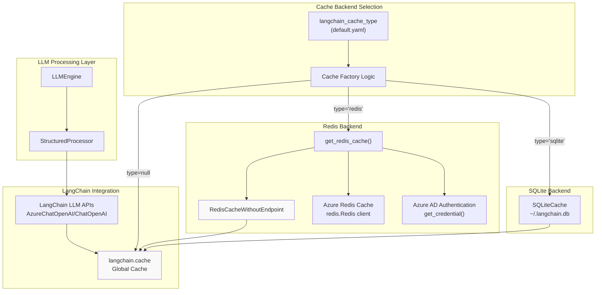
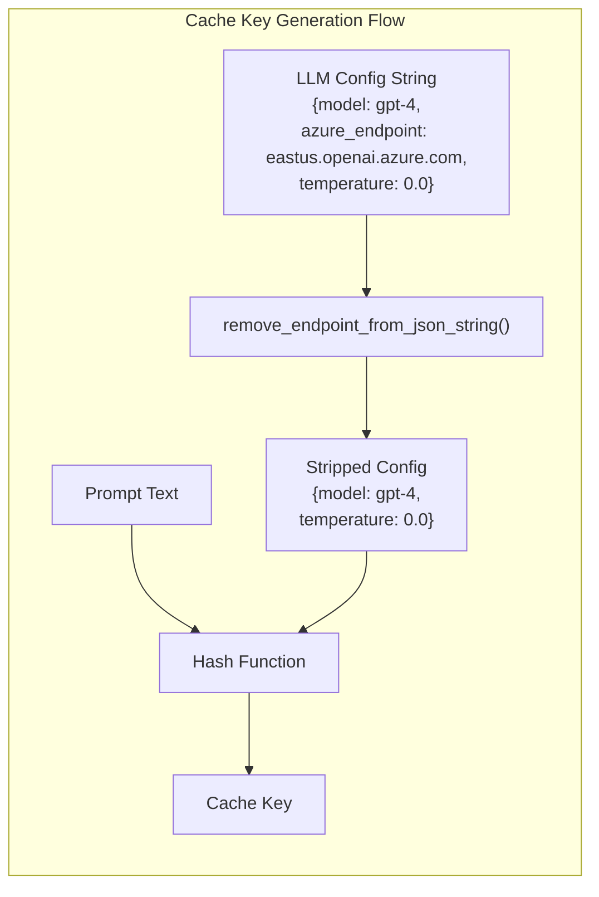
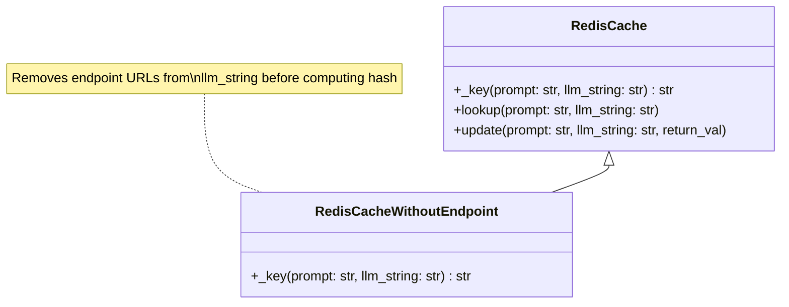
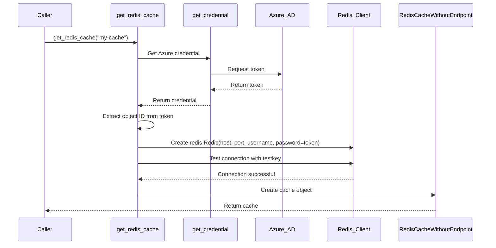
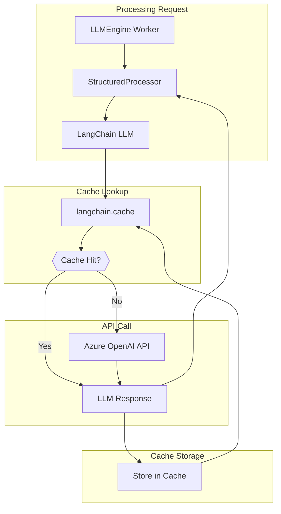

<!-- source: DeepWiki mcp.deepwiki.com · repo microsoft/RadFact · page 5.4 Caching System · fetched 2026-10-26 -->

# Caching System

<details>
<summary>Relevant source files</summary>

The following files were used as context for generating this wiki page:

- [README.md](README.md)
- [configs/default.yaml](configs/default.yaml)
- [src/radfact/llm_utils/engine/redis_cache.py](src/radfact/llm_utils/engine/redis_cache.py)

</details>


## Purpose and Scope

This document describes the caching infrastructure used by RadFact to optimize Large Language Model (LLM) API calls. The caching system stores LLM responses to avoid redundant API requests, reducing costs and improving processing speed.

For information about how the caching system integrates with the broader LLM processing infrastructure, see [LLM Engine](#5.2) and [Structured Processor](#5.3). For Azure-specific integration details, see [Azure Integration](#5.6).

**Sources**: [src/radfact/llm_utils/engine/redis_cache.py:1-61](), [configs/default.yaml:24-27]()

---

## Overview

The caching system intercepts LLM API calls and stores responses based on the prompt and model configuration. When the same prompt is encountered again with the same model settings, the cached response is returned instead of making a new API call. This is particularly valuable for RadFact because:

1. **Cost Reduction**: LLM API calls are expensive. Caching eliminates redundant calls during re-runs or when processing datasets with duplicate examples
2. **Speed**: Cached responses are retrieved in milliseconds versus seconds for API calls
3. **Reproducibility**: Cached responses ensure consistent results across multiple evaluation runs
4. **Fault Tolerance**: When resuming failed processing jobs, completed queries are retrieved from cache

The system supports two backend implementations:
- **Redis Cache**: Distributed cache suitable for production Azure deployments, shared across multiple processing runs
- **SQLite Cache**: Local file-based cache at `~/.langchain.db` for development environments

**Sources**: [README.md:100-130](), [configs/default.yaml:24-27]()

---

## Cache Architecture



**Diagram: Cache Architecture and Backend Selection**

The caching system integrates with LangChain's global cache mechanism. The `langchain_cache_type` configuration parameter determines which backend is used. When set to `"redis"`, the system instantiates a `RedisCacheWithoutEndpoint` object connected to Azure Redis. When set to `"sqlite"`, LangChain uses its built-in SQLite cache. When set to `null` (default), no caching is used.

**Sources**: [src/radfact/llm_utils/engine/redis_cache.py:24-61](), [configs/default.yaml:24-27]()

---

## Cache Backend Comparison

| Feature | Redis Cache | SQLite Cache | No Cache |
|---------|-------------|--------------|----------|
| **Backend Class** | `RedisCacheWithoutEndpoint` | `langchain_community.cache.SQLiteCache` | N/A |
| **Configuration Value** | `langchain_cache_type: "redis"` | `langchain_cache_type: "sqlite"` | `langchain_cache_type: null` |
| **Storage Location** | Azure Redis service | `~/.langchain.db` file | N/A |
| **Shared Across Runs** | ✅ Yes (distributed) | ❌ No (per-machine) | N/A |
| **Authentication** | Azure AD tokens | None | N/A |
| **Use Case** | Production, AzureML experiments | Local development | Testing with fresh responses |
| **Setup Complexity** | High (Azure resources) | Low (automatic) | None |

**Sources**: [configs/default.yaml:24-27](), [src/radfact/llm_utils/engine/redis_cache.py:35-61]()

---

## Cache Key Generation and Endpoint Normalization

### Standard LangChain Cache Keys

LangChain generates cache keys by hashing the combination of:
1. The prompt text sent to the LLM
2. The LLM configuration string (serialized JSON containing model parameters)

This approach creates a problem for RadFact when using multiple Azure OpenAI endpoints across different regions: each endpoint has a different URL, causing the LLM configuration string to differ even when all other parameters are identical.

### Endpoint Normalization

The `RedisCacheWithoutEndpoint` class solves this by removing endpoint URLs from cache keys:



**Diagram: Cache Key Normalization Process**

The `remove_endpoint_from_json_string()` function uses a regex pattern to strip the `azure_endpoint` (for `AzureChatOpenAI`) or `api_endpoint` (for `ChatOpenAI`) fields from the LLM configuration string before hashing. This ensures that queries to `gpt-4-eastus` and `gpt-4-westus` can share cached responses.

**Sources**: [src/radfact/llm_utils/engine/redis_cache.py:17-32]()

### Implementation Details

The `RedisCacheWithoutEndpoint` class overrides the `_key()` static method:



**Diagram: RedisCacheWithoutEndpoint Class Hierarchy**

The implementation at [src/radfact/llm_utils/engine/redis_cache.py:28-32]() delegates to the parent class's `_key()` method after removing endpoint information:

```python
@staticmethod
def _key(prompt: str, llm_string: str) -> str:
    return RedisCache._key(prompt, remove_endpoint_from_json_string(llm_string))
```

The regex pattern at [src/radfact/llm_utils/engine/redis_cache.py:20]() matches both endpoint formats:
- `"azure_endpoint": "https://..."` (used by `AzureChatOpenAI`)
- `"api_endpoint": "https://..."` (used by `ChatOpenAI`)

**Sources**: [src/radfact/llm_utils/engine/redis_cache.py:17-32]()

---

## Azure Redis Integration

### Connection Setup

The `get_redis_cache()` function establishes connections to Azure Redis using Azure AD authentication:



**Diagram: Azure Redis Connection Establishment**

The connection process at [src/radfact/llm_utils/engine/redis_cache.py:35-61]() involves several steps:

1. **Credential Acquisition**: Uses `get_credential()` from [radfact.azure_utils.auth]() to obtain Azure credentials (managed identity in AzureML, default credentials locally)
2. **Token Generation**: Requests an access token for the `https://redis.azure.com/.default` scope
3. **Username Extraction**: Parses the Azure AD object ID from the token using `extract_object_id_from_token()`
4. **Client Creation**: Instantiates `redis.Redis` with SSL enabled on port 6380
5. **Connection Test**: Writes a test key-value pair to verify authentication
6. **Cache Wrapper**: Returns a `RedisCacheWithoutEndpoint` instance wrapping the Redis client

**Sources**: [src/radfact/llm_utils/engine/redis_cache.py:35-61]()

### Authentication Flow

Azure Redis authentication uses token-based access control:

| Component | Purpose | Code Reference |
|-----------|---------|----------------|
| `get_credential()` | Obtains Azure credential (managed identity or default) | [radfact.azure_utils.auth]() |
| `extract_object_id_from_token()` | Parses OID field from JWT token to get username | [radfact.azure_utils.auth]() |
| Redis username | Azure AD object ID of the authenticated identity | [src/radfact/llm_utils/engine/redis_cache.py:46]() |
| Redis password | Azure AD access token | [src/radfact/llm_utils/engine/redis_cache.py:52]() |
| Redis URL | `{redis_cache_name}.redis.cache.windows.net` | [src/radfact/llm_utils/engine/redis_cache.py:47]() |

The Redis client configuration at [src/radfact/llm_utils/engine/redis_cache.py:49-55]() uses:
- Port 6380 (standard Azure Redis SSL port)
- SSL enabled (`ssl=True`)
- Token-based authentication (no API key needed)

**Sources**: [src/radfact/llm_utils/engine/redis_cache.py:35-61]()

---

## Configuration

### Cache Type Configuration

The cache backend is configured via the `langchain_cache_type` parameter in [configs/default.yaml:24-27]():

```yaml
# The type of cache that should be set for langchain. This can be either "redis" or "sqlite".
# Sqlite cache is useful for local development, it will be written to ~/.langchain.db
# Redis cache is useful to share state across many evaluation runs in AzureML
langchain_cache_type: null
```

The configuration accepts three values:
- `"redis"`: Use Azure Redis cache (requires Azure resources)
- `"sqlite"`: Use local SQLite cache at `~/.langchain.db`
- `null`: Disable caching (default)

**Sources**: [configs/default.yaml:24-27]()

### Azure Redis Configuration

When using Redis caching, the system requires:

| Requirement | Description | How to Provide |
|-------------|-------------|----------------|
| Azure Credentials | Managed identity (AzureML) or default Azure credentials (local) | Azure CLI login or managed identity |
| Redis Cache Name | Name of the Azure Redis instance (without `.redis.cache.windows.net` suffix) | Passed to `get_redis_cache()` function |
| Network Access | Access to `*.redis.cache.windows.net:6380` | Azure VNet or public endpoint |
| Azure Permissions | Permissions to generate tokens for Redis scope | Azure RBAC roles |

The Redis cache name is passed directly to the `get_redis_cache()` function, typically during LLM engine initialization.

**Sources**: [src/radfact/llm_utils/engine/redis_cache.py:35-42]()

---

## Cache Behavior in LLM Processing

### Integration with LLMEngine

The caching system is transparent to the core processing logic. The `LLMEngine` and `StructuredProcessor` interact with LangChain's LLM APIs, which automatically check the global cache:



**Diagram: Cache Integration in Request Flow**

The cache operates at the LangChain level, meaning all LLM calls benefit from caching without explicit cache checks in RadFact code. The integration is configured globally before processing begins.

**Sources**: [README.md:100-130](), [src/radfact/llm_utils/engine/redis_cache.py:1-61]()

### Cache Effectiveness

The endpoint normalization feature significantly improves cache hit rates:

**Without Endpoint Normalization**:
- Request to `gpt-4` on East US endpoint: Cache miss
- Request to `gpt-4` on West US endpoint: Cache miss (different endpoint URL in key)
- **Hit Rate Impact**: Divided by number of unique endpoints

**With Endpoint Normalization**:
- Request to `gpt-4` on East US endpoint: Cache miss
- Request to `gpt-4` on West US endpoint: Cache hit (endpoint URL removed from key)
- **Hit Rate Impact**: Maximized across all endpoints with same model

This is particularly valuable when using the `LLMEngine` with multiple endpoints configured via `speed_factor`, as described in [Parallel Processing](#5.5).

**Sources**: [src/radfact/llm_utils/engine/redis_cache.py:17-32]()

### Cost and Performance Impact

The caching system provides substantial benefits during RadFact evaluation:

| Scenario | Without Cache | With Cache |
|----------|---------------|------------|
| **Re-running same dataset** | Full API costs | Near-zero cost (cache hits) |
| **Resuming failed jobs** | Reprocess completed items | Skip completed items via cache |
| **Multiple endpoints** | Duplicate calls across endpoints | Shared cache across endpoints |
| **Bootstrap iterations** | N × cost for N bootstrap samples | ~1× cost (samples share prompts) |
| **Response time** | Seconds per query | Milliseconds per cache hit |

The `num_llm_failures` metric in the outputs indicates queries that failed and were set as not-entailed. These failures are **not cached**, ensuring that transient errors can be retried on subsequent runs.

**Sources**: [README.md:178]()

---

## Summary

The RadFact caching system provides:

1. **Dual Backend Support**: Redis for distributed Azure scenarios, SQLite for local development
2. **Endpoint Normalization**: Maximizes cache hits across multiple Azure regions by removing endpoint URLs from cache keys
3. **Azure AD Integration**: Secure token-based authentication for Azure Redis
4. **Transparent Operation**: Integrates with LangChain's global cache, requiring no changes to processing logic
5. **Cost Optimization**: Eliminates redundant LLM API calls, particularly valuable for large-scale evaluations

The key implementation classes are:
- `RedisCacheWithoutEndpoint` at [src/radfact/llm_utils/engine/redis_cache.py:24-33]()
- `get_redis_cache()` at [src/radfact/llm_utils/engine/redis_cache.py:35-61]()
- `remove_endpoint_from_json_string()` at [src/radfact/llm_utils/engine/redis_cache.py:17-21]()

Configuration is managed through [configs/default.yaml:24-27]() via the `langchain_cache_type` parameter.

**Sources**: [src/radfact/llm_utils/engine/redis_cache.py:1-61](), [configs/default.yaml:24-27](), [README.md:100-130]()

---

