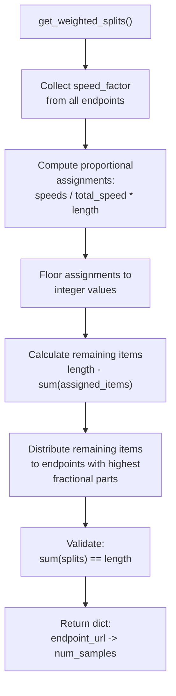
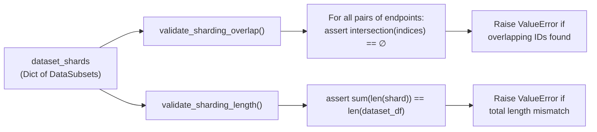
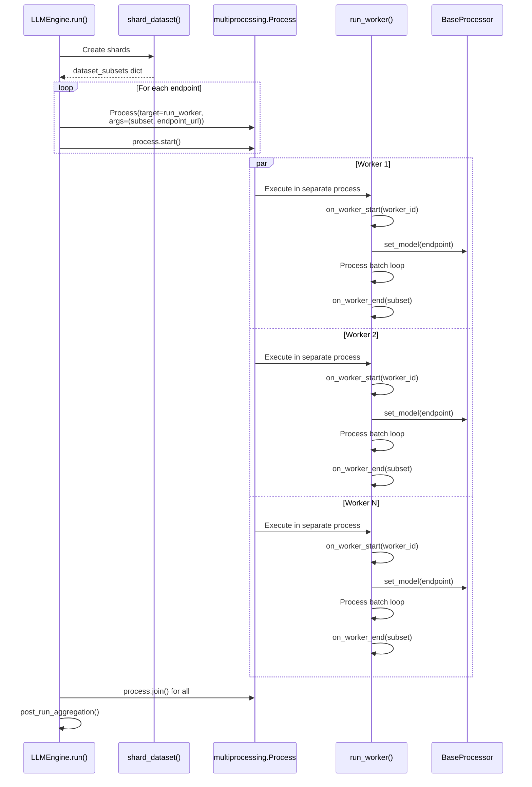
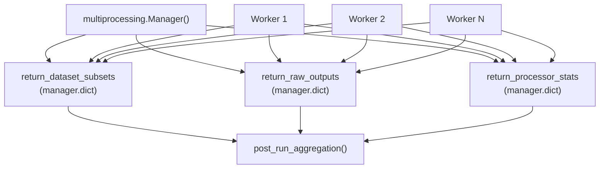
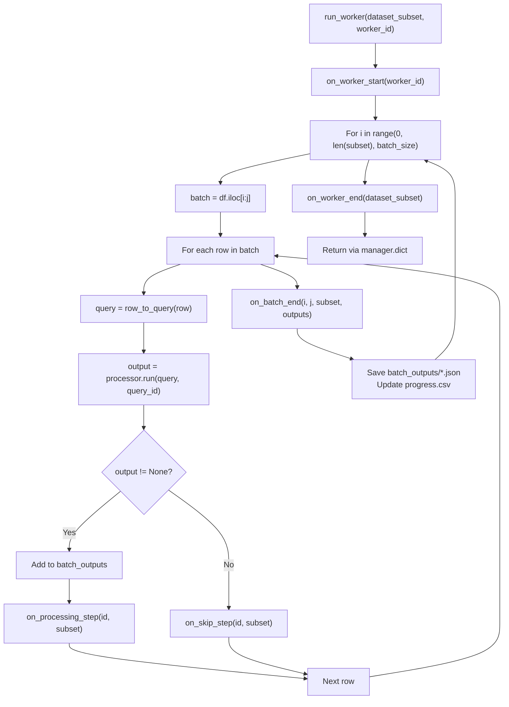
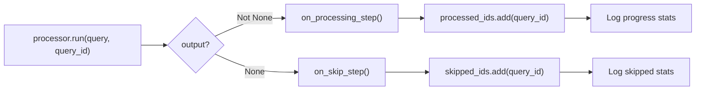
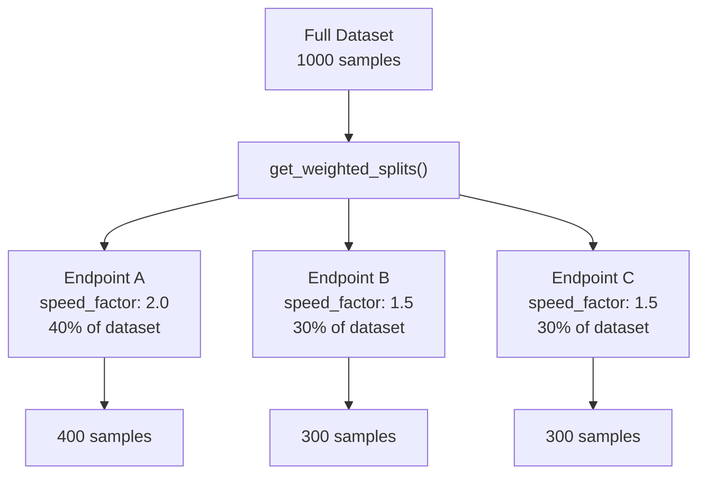
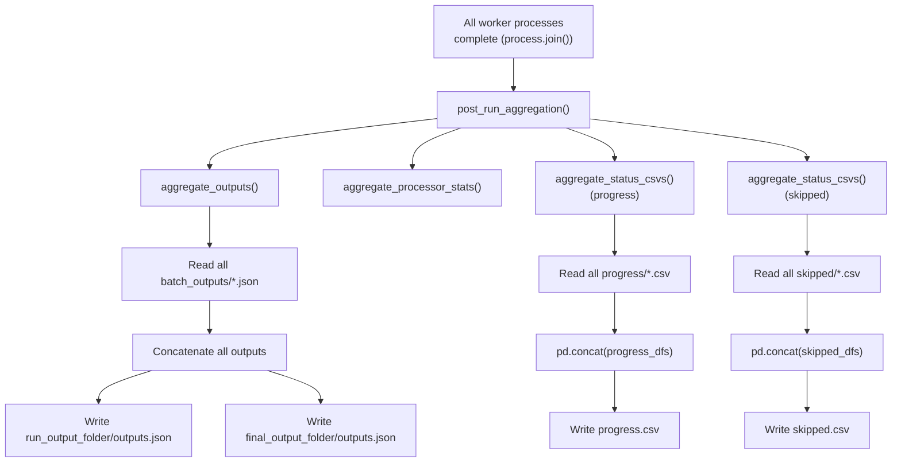
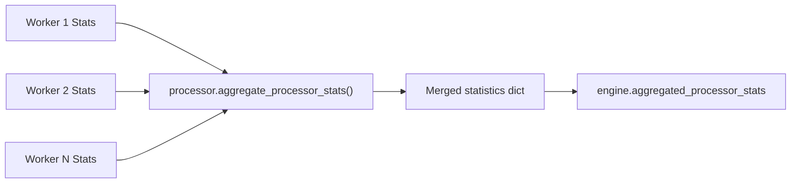

<!-- source: DeepWiki mcp.deepwiki.com · repo microsoft/RadFact · page 5.5 Parallel Processing · fetched 2026-10-26 -->

# Parallel Processing

<details>
<summary>Relevant source files</summary>

The following files were used as context for generating this wiki page:

- [README.md](README.md)
- [src/radfact/llm_utils/engine/engine.py](src/radfact/llm_utils/engine/engine.py)

</details>


This document describes the parallel processing mechanisms used by RadFact to efficiently process large datasets across multiple LLM endpoints. It covers the data sharding algorithm, worker process management, incremental batch processing, and throughput optimization strategies. For an overview of the `LLMEngine` architecture and its responsibilities, see [LLM Engine](#5.2). For details on caching mechanisms that complement parallel processing, see [Caching System](#5.4).

## Overview

The parallel processing system enables RadFact to distribute workload across multiple LLM endpoints based on their relative throughput, spawn independent worker processes for each endpoint, and aggregate results while maintaining fault tolerance. The core implementation resides in the `LLMEngine` class [src/radfact/llm_utils/engine/engine.py:50-362]().

**Sources:** [src/radfact/llm_utils/engine/engine.py:50-362]()

## Data Sharding Algorithm

The data sharding algorithm distributes the input dataset across multiple endpoints proportionally to their `speed_factor` configuration parameter. This ensures that faster endpoints receive more data to process, optimizing overall throughput.

### Weighted Split Computation

The `get_weighted_splits()` method [src/radfact/llm_utils/engine/engine.py:162-178]() implements a proportional allocation algorithm:



The algorithm ensures:
1. Each endpoint receives work proportional to its `speed_factor`
2. All samples are assigned (no remainder)
3. Integer assignments are computed using a fractional part prioritization strategy

**Sources:** [src/radfact/llm_utils/engine/engine.py:162-178]()

### Dataset Sharding Process

The `shard_dataset()` method [src/radfact/llm_utils/engine/engine.py:193-216]() creates `DataSubset` objects for each endpoint:

| Step | Method | Purpose |
|------|--------|---------|
| 1. Compute splits | `get_weighted_splits()` | Determine sample count per endpoint |
| 2. Create subsets | `DataSubset.__init__()` | Wrap DataFrame slice with metadata |
| 3. Validate overlap | `validate_sharding_overlap()` | Ensure disjoint subsets |
| 4. Validate length | `validate_sharding_length()` | Confirm total length matches |

Each `DataSubset` [src/radfact/llm_utils/engine/data_subset.py]() contains:
- A DataFrame slice (`df`)
- Start and end indices in the original dataset
- Sets for tracking `processed_ids` and `skipped_ids`
- Output folder paths for progress and skipped files

**Sources:** [src/radfact/llm_utils/engine/engine.py:193-216](), [README.md:86-87]()

### Sharding Validation

Two validation checks ensure data integrity:



**Sources:** [src/radfact/llm_utils/engine/engine.py:180-192]()

## Worker Process Architecture

RadFact uses Python's `multiprocessing` module to spawn independent worker processes for each endpoint. Each worker operates on its assigned `DataSubset` without shared state.

### Process Creation and Lifecycle



The `run()` method [src/radfact/llm_utils/engine/engine.py:338-361]() orchestrates the parallel execution:

1. Creates a list of `multiprocessing.Process` objects
2. Starts all processes
3. Waits for completion using `process.join()`
4. Aggregates results

**Sources:** [src/radfact/llm_utils/engine/engine.py:338-361]()

### Worker Initialization

The `on_worker_start()` method [src/radfact/llm_utils/engine/engine.py:218-225]() configures each worker:

```python
# Simplified logic from engine.py:218-225
def on_worker_start(self, worker_id: str) -> None:
    endpoint = self.endpoints[worker_id]
    self.llm_api_args.set_endpoint(endpoint)
    self.processor.set_model(model=self.llm_api_args.get_model())
```

Each worker receives:
- A unique `worker_id` (endpoint URL)
- An isolated `BaseProcessor` instance
- LLM API configuration via `LLMAPIArguments`

**Sources:** [src/radfact/llm_utils/engine/engine.py:218-225]()

### Inter-Process Communication

The engine uses a `multiprocessing.Manager()` to share results between workers and the main process:



The three managed dictionaries store:
- `return_dataset_subsets`: Final `DataSubset` objects with progress tracking
- `return_raw_outputs`: Unprocessed output objects from the processor
- `return_processor_stats`: Statistics from each processor instance

**Sources:** [src/radfact/llm_utils/engine/engine.py:103-106](), [src/radfact/llm_utils/engine/engine.py:294-296]()

## Incremental Processing and Fault Tolerance

The worker processing loop implements incremental batch processing with automatic checkpointing to enable fault tolerance and progress resumption.

### Batch Processing Loop

The `run_worker()` method [src/radfact/llm_utils/engine/engine.py:262-296]() processes data in batches:



Key batch processing parameters from configuration:
- `batch_size`: Number of samples processed before checkpointing [src/radfact/llm_utils/engine/engine.py:267]()
- `index_col`: Column name for unique identifiers [src/radfact/llm_utils/engine/engine.py:207]()

**Sources:** [src/radfact/llm_utils/engine/engine.py:262-296]()

### Incremental Checkpointing

The `on_batch_end()` method [src/radfact/llm_utils/engine/engine.py:245-255]() saves intermediate results:

| Output Type | File Pattern | Content | Purpose |
|-------------|-------------|---------|---------|
| Batch outputs | `batch_outputs/outputs_{start}_{end}.json` | Processed results for range | Recovery on failure |
| Progress CSV | `progress/subset_{start}_{end}.csv` | Successfully processed IDs | Track completion |
| Skipped CSV | `skipped/subset_{start}_{end}.csv` | Failed/skipped IDs | Error tracking |

Each batch write is atomic, enabling the system to resume from the last completed batch if a worker crashes.

**Sources:** [src/radfact/llm_utils/engine/engine.py:245-255](), [README.md:102-129]()

### Progress Tracking

The engine maintains two sets per `DataSubset`:

```python
# From DataSubset class (referenced in engine.py)
processed_ids: set[str]  # Successfully processed query IDs
skipped_ids: set[str]    # Failed or skipped query IDs
```

The `on_processing_step()` and `on_skip_step()` methods [src/radfact/llm_utils/engine/engine.py:235-243]() update these sets after each query:



**Sources:** [src/radfact/llm_utils/engine/engine.py:235-243]()

## Throughput Management

The parallel processing system optimizes throughput through multiple mechanisms:

### Speed Factor Configuration

Each endpoint defines a `speed_factor` parameter [README.md:86-87]() that represents its relative throughput. The sharding algorithm uses this to allocate work proportionally:



This ensures faster endpoints are not idle while slower ones process data.

**Sources:** [README.md:86-87](), [src/radfact/llm_utils/engine/engine.py:162-178]()

### Endpoint Replication

The `replicate_same_endpoint_n_times()` function [src/radfact/llm_utils/engine/endpoint_utils.py]() creates multiple worker processes for a single endpoint based on `num_parallel_processes`:

```python
# Simplified logic
if endpoint.num_parallel_processes > 1:
    for i in range(endpoint.num_parallel_processes):
        replicated_endpoints[f"{url}_replica_{i}"] = endpoint.copy()
```

This enables parallel queries to the same endpoint, further increasing throughput for endpoints that support concurrent connections.

**Sources:** [src/radfact/llm_utils/engine/engine.py:86](), [README.md:87]()

### Endpoint Sorting

The `get_endpoints_dict_sorted_by_speed()` function [src/radfact/llm_utils/engine/endpoint_utils.py]() sorts endpoints by `speed_factor` in ascending order (slowest first) [src/radfact/llm_utils/engine/engine.py:85](). This ensures consistent ordering during sharding.

**Sources:** [src/radfact/llm_utils/engine/engine.py:85]()

## Result Aggregation

After all workers complete, the engine aggregates results from distributed worker outputs into unified files.

### Aggregation Pipeline



The `post_run_aggregation()` method [src/radfact/llm_utils/engine/engine.py:324-333]() coordinates this process and validates that the aggregated output count matches the processed count across all workers.

**Sources:** [src/radfact/llm_utils/engine/engine.py:324-333]()

### Output File Structure

The final aggregated outputs are written to two locations:

1. **Run output folder** (`outputs/radfact/run_YYYYMMDD_HHMMSS/`):
   - `outputs.json`: All processed results
   - `progress.csv`: All successfully processed IDs
   - `skipped.csv`: All failed/skipped IDs
   - `batch_outputs/`: Individual batch files (preserved)

2. **Final output folder** (optional, user-specified):
   - `outputs.json`: Copy of aggregated results

The output filename is configurable via `processing.output_filename` [src/radfact/llm_utils/engine/engine.py:308]().

**Sources:** [src/radfact/llm_utils/engine/engine.py:298-311](), [README.md:102-129]()

### Statistics Aggregation

The `aggregate_processor_stats()` method collects statistics from all processor instances:



This allows tracking metrics like cache hit rates, total API calls, and processing times across all workers.

**Sources:** [src/radfact/llm_utils/engine/engine.py:326]()

---

