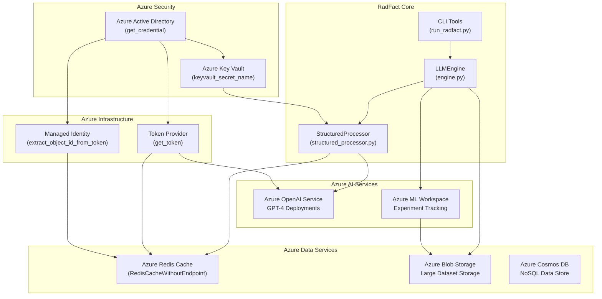
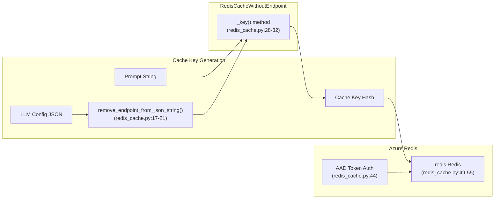
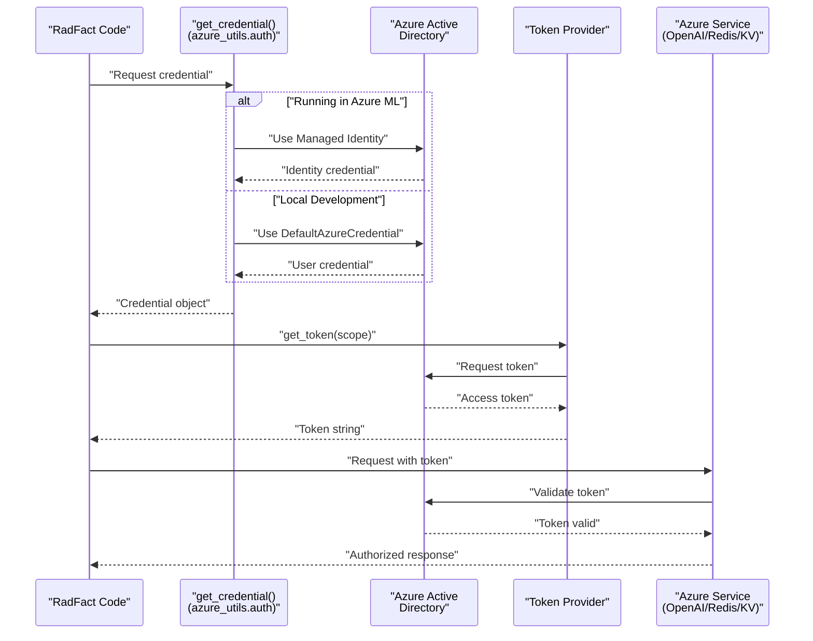

<!-- source: DeepWiki mcp.deepwiki.com · repo microsoft/RadFact · page 5.6 Azure Integration · fetched 2026-10-26 -->

# Azure Integration

<details>
<summary>Relevant source files</summary>

The following files were used as context for generating this wiki page:

- [configs/endpoints/azure_chat_openai.yaml](configs/endpoints/azure_chat_openai.yaml)
- [dev_environment.yaml](dev_environment.yaml)
- [src/radfact/llm_utils/engine/redis_cache.py](src/radfact/llm_utils/engine/redis_cache.py)

</details>


## Purpose and Scope

This document describes how RadFact integrates with Microsoft Azure cloud services to provide production-ready LLM evaluation capabilities. RadFact leverages multiple Azure services for LLM inference, caching, authentication, and experiment tracking.

For information about configuring specific Azure endpoints, see [Endpoint Configuration](#6.2). For authentication setup details, see [Authentication](#6.3). For the overall system architecture, see [System Overview](#5.1).

**Sources:** README.md, dev_environment.yaml

---

## Azure Services Architecture

The following diagram shows the Azure services RadFact integrates with and their relationships to core system components:



**Sources:** dev_environment.yaml:44-151, redis_cache.py:1-61, configs/endpoints/azure_chat_openai.yaml:1-40

---

## Azure OpenAI Integration

RadFact uses Azure OpenAI Service to access GPT-4 models for entailment verification and report-to-phrases conversion. The integration supports multiple Azure OpenAI deployments across different regions.

### Configuration Structure

Azure OpenAI endpoints are configured via [configs/endpoints/azure_chat_openai.yaml:1-40](). Each endpoint specifies:

| Parameter | Description | Example |
|-----------|-------------|---------|
| `type` | Endpoint type identifier | `"AZURE_CHAT_OPENAI"` |
| `url` | Azure OpenAI endpoint URL | `"https://your-resource.openai.azure.com"` |
| `deployment_name` | Model deployment name | `"gpt-4"` |
| `api_key_env_var_name` | Environment variable for API key | `"API_KEY_AZURE_0"` |
| `keyvault_secret_name` | Key Vault secret name (optional) | `"openai-api-key"` |
| `speed_factor` | Relative throughput weight | `1.0` |
| `num_parallel_processes` | Parallel workers per endpoint | `1` |

### Multi-Region Support

RadFact can distribute load across multiple Azure OpenAI deployments in different regions. The `LLMEngine` shards data based on `speed_factor` values to optimize throughput:

```yaml
ENDPOINT_0:
  type: "AZURE_CHAT_OPENAI"
  url: "https://eastus-resource.openai.azure.com"
  deployment_name: "gpt-4"
  speed_factor: 1.0

ENDPOINT_1:
  type: "AZURE_CHAT_OPENAI"
  url: "https://westus-resource.openai.azure.com"
  deployment_name: "gpt-4"
  speed_factor: 1.33
```

**Sources:** configs/endpoints/azure_chat_openai.yaml:1-40, README.md

---

## Azure Redis Cache Integration

RadFact uses Azure Redis Cache to store LLM responses and avoid redundant API calls. The caching implementation is in [src/radfact/llm_utils/engine/redis_cache.py:1-61]().

### RedisCacheWithoutEndpoint Class

The `RedisCacheWithoutEndpoint` class extends LangChain's `RedisCache` to normalize cache keys across different Azure OpenAI endpoints:



### Endpoint Normalization

The `remove_endpoint_from_json_string()` function [redis_cache.py:17-21]() strips endpoint URLs from cache keys:

```python
# Pattern matches both AzureOpenAI and ChatOpenAI endpoint formats
pattern = r'"(azure|api)_endpoint": "https://[^"]+"'
return re.sub(pattern, "", llm_string)
```

This ensures cache hits occur regardless of which regional Azure OpenAI endpoint served the original request.

### Authentication to Redis

The `get_redis_cache()` function [redis_cache.py:35-61]() establishes authenticated connections:

1. **Get Azure Credential**: Calls `get_credential()` from `azure_utils.auth`
2. **Request Token**: Obtains token for `https://redis.azure.com/.default` scope [redis_cache.py:44]()
3. **Extract Username**: Uses `extract_object_id_from_token()` to get managed identity OID [redis_cache.py:46]()
4. **Connect**: Creates `redis.Redis` client with SSL and token authentication [redis_cache.py:49-55]()

### Connection Configuration

```python
redis_client = redis.Redis(
    host=f"{redis_cache_name}.redis.cache.windows.net",
    port=6380,
    password=token,  # AAD token
    username=redis_username,  # Object ID
    ssl=True,
)
```

**Sources:** src/radfact/llm_utils/engine/redis_cache.py:1-61

---

## Azure Key Vault Integration

Azure Key Vault provides secure storage for API keys and secrets. RadFact supports reading Azure OpenAI API keys from Key Vault as an alternative to environment variables.

### Configuration

In endpoint configuration [configs/endpoints/azure_chat_openai.yaml:11-12](), specify the secret name:

```yaml
ENDPOINT_0:
  type: "AZURE_CHAT_OPENAI"
  url: "https://your-resource.openai.azure.com"
  deployment_name: "gpt-4"
  keyvault_secret_name: "openai-api-key"  # Retrieves from Key Vault
```

### Authentication Fallback Chain

When `keyvault_secret_name` is set, the system uses Azure AD authentication to access Key Vault. If Key Vault is not configured, RadFact falls back to:

1. Environment variable specified by `api_key_env_var_name`
2. Azure AD token provider (for Azure OpenAI endpoints)

**Sources:** configs/endpoints/azure_chat_openai.yaml:11-12, README.md

---

## Azure Active Directory Authentication

Azure AD provides unified authentication across all Azure services. RadFact uses Azure AD for:

- Azure OpenAI API authentication (token-based)
- Azure Redis Cache access (managed identity)
- Azure Key Vault secret retrieval
- Azure ML workspace access

### Authentication Flow



### Token Extraction

For Azure Redis, the managed identity object ID is extracted from the token [redis_cache.py:46]():

```python
redis_username = extract_object_id_from_token(token)
```

This object ID serves as the Redis username when using Azure AD authentication.

### Credential Types

| Environment | Credential Type | Usage |
|-------------|----------------|-------|
| Azure ML Compute | `ManagedIdentityCredential` | Automatic, no configuration needed |
| Local Development | `DefaultAzureCredential` | Uses Azure CLI or Visual Studio login |
| CI/CD Pipeline | `ClientSecretCredential` | Service principal with client secret |

**Sources:** src/radfact/llm_utils/engine/redis_cache.py:43-48, README.md

---

## Azure ML Integration

RadFact integrates with Azure Machine Learning for experiment tracking and large-scale evaluation runs.

### Dependencies

The following Azure ML packages are included [dev_environment.yaml:139-154]():

| Package | Purpose |
|---------|---------|
| `azure-ai-ml==1.22.4` | Azure ML SDK v2 |
| `azureml-core==1.58.0` | Core Azure ML functionality |
| `azureml-mlflow==1.58.0.post3` | MLflow integration |
| `azureml-pipeline==1.58.0` | Pipeline orchestration |
| `azureml-sdk==1.58.0` | Complete SDK |

### MLflow Integration

RadFact can log metrics to Azure ML via MLflow [dev_environment.yaml:250-251]():

```python
# MLflow packages
mlflow==2.15.1
mlflow-skinny==2.15.1
```

Experiments tracked in MLflow are automatically synced to the Azure ML workspace.

### Storage Integration

Azure Blob Storage is used for:
- Large input datasets via `azure-storage-blob==12.19.0` [dev_environment.yaml:131]()
- Incremental batch outputs
- Final results aggregation

**Sources:** dev_environment.yaml:44-154, dev_environment.yaml:250-251

---

## Configuration Patterns

### Environment Variables

Azure integration requires specific environment variables for non-managed identity scenarios:

| Variable Pattern | Purpose | Example |
|-----------------|---------|---------|
| `API_KEY_AZURE_N` | Azure OpenAI API key for endpoint N | `API_KEY_AZURE_0` |
| `AZURE_TENANT_ID` | Azure AD tenant (optional) | `"12345678-..."` |
| `AZURE_CLIENT_ID` | Service principal ID (optional) | `"87654321-..."` |
| `AZURE_CLIENT_SECRET` | Service principal secret (optional) | `"secret123"` |

### Managed Identity

When running on Azure ML compute, managed identity is automatically configured and no environment variables are needed. The system detects the compute context and uses the compute's managed identity.

### Multi-Endpoint Configuration

For load distribution across multiple Azure OpenAI deployments:

```yaml
ENDPOINT_0:
  type: "AZURE_CHAT_OPENAI"
  url: "https://eastus.openai.azure.com"
  speed_factor: 1.0
  num_parallel_processes: 2

ENDPOINT_1:
  type: "AZURE_CHAT_OPENAI"
  url: "https://westus.openai.azure.com"
  speed_factor: 1.5
  num_parallel_processes: 3
```

The `LLMEngine` allocates data proportionally: if total speed factor is 2.5, endpoint 0 gets 40% (1.0/2.5) and endpoint 1 gets 60% (1.5/2.5) of the workload.

**Sources:** configs/endpoints/azure_chat_openai.yaml:1-40, README.md

---

## Azure Service Dependencies

### Core Azure Packages

RadFact depends on the following Azure SDK packages [dev_environment.yaml:44-151]():

```
azure-core==1.32.0           # Core Azure functionality
azure-identity==1.14.1       # Authentication
azure-common==1.1.28         # Common utilities
```

### Service-Specific Packages

```
azure-ai-ml==1.22.4          # Azure ML SDK
azure-keyvault==4.2.0        # Key Vault (meta-package)
azure-keyvault-secrets==4.7.0  # Secret management
azure-storage-blob==12.19.0  # Blob storage
azure-cosmos==3.2.0          # Cosmos DB
```

### Management Packages

Over 70 `azure-mgmt-*` packages are included for comprehensive Azure resource management capabilities, though most are transitive dependencies from the Azure CLI installation.

**Sources:** dev_environment.yaml:44-151

---

## Authentication Methods Comparison

The following table summarizes the three supported authentication methods:

| Method | Configuration | Use Case | Security Level |
|--------|--------------|----------|----------------|
| **Environment Variable** | `api_key_env_var_name: "API_KEY_AZURE_0"` | Local development, simple setups | Medium - keys in environment |
| **Key Vault** | `keyvault_secret_name: "openai-key"` | Production, centralized secret management | High - secrets in Key Vault |
| **Token Provider** | No configuration needed | Azure ML, managed identity scenarios | Highest - no static credentials |

The authentication method is selected via configuration in [configs/endpoints/azure_chat_openai.yaml:6-14]():

```yaml
# Priority order (first available is used):
# 1. api_key_env_var_name (if set and variable exists)
# 2. keyvault_secret_name (if set and accessible)
# 3. Token provider fallback (Azure AD authentication)
```

**Sources:** configs/endpoints/azure_chat_openai.yaml:6-14, README.md

---

## Related Pages

- [Configuration System](#6.1) - Hydra configuration management
- [Endpoint Configuration](#6.2) - Detailed endpoint setup
- [Authentication](#6.3) - Authentication setup guide
- [Caching System](#5.4) - Redis and SQLite caching
- [LLM Engine](#5.2) - Parallel processing architecture

---

