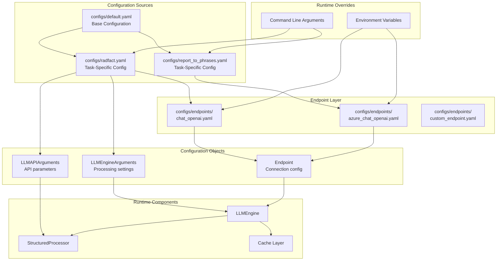
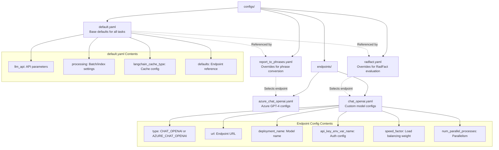
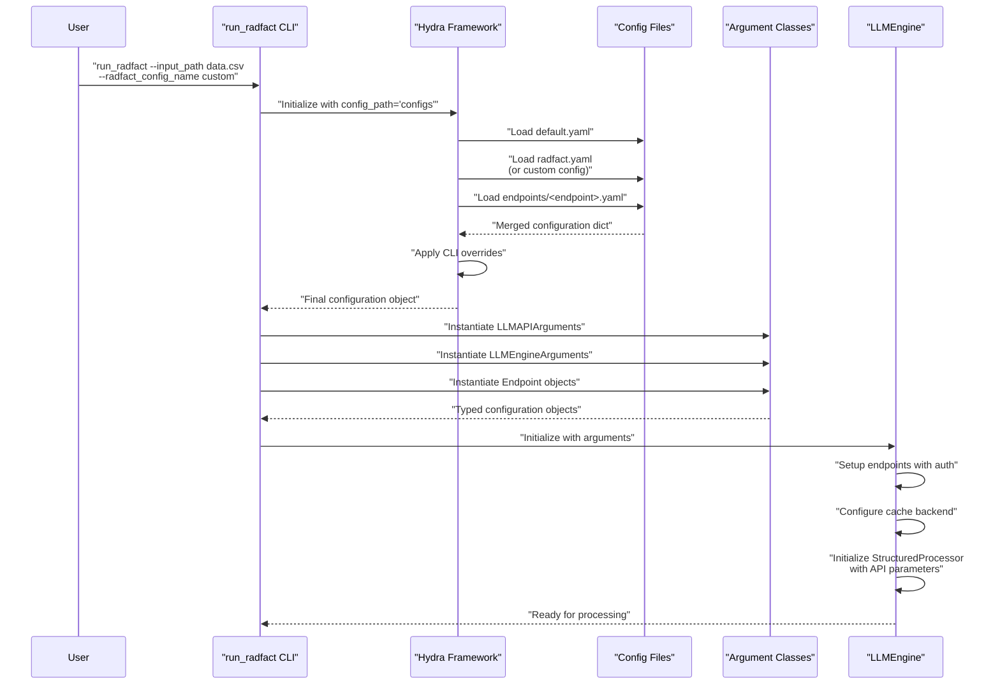
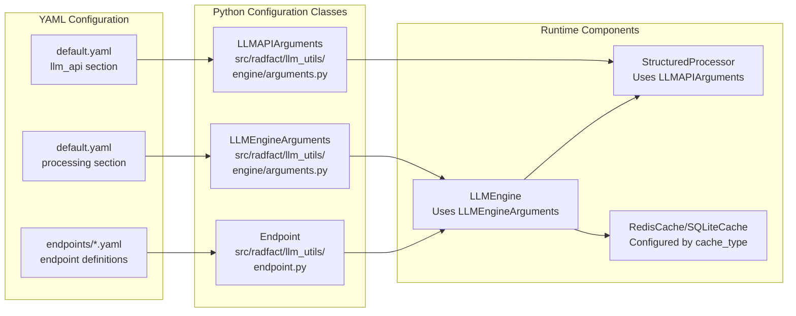

<!-- source: DeepWiki mcp.deepwiki.com · repo microsoft/RadFact · page 6 Configuration · fetched 2026-10-26 -->

# Configuration

<details>
<summary>Relevant source files</summary>

The following files were used as context for generating this wiki page:

- [README.md](README.md)
- [configs/default.yaml](configs/default.yaml)
- [configs/radfact.yaml](configs/radfact.yaml)

</details>


RadFact uses a hierarchical configuration system based on [Hydra](https://hydra.cc/) to manage all aspects of the evaluation pipeline. Configuration controls LLM endpoints, API parameters, processing settings, authentication methods, and caching strategies. This page provides an overview of RadFact's configuration architecture and the key configuration domains.

For detailed information about specific configuration aspects:
- Hydra configuration management and override mechanisms: see [Configuration System](#6.1)
- LLM endpoint setup and selection: see [Endpoint Configuration](#6.2)
- Authentication methods and credential management: see [Authentication](#6.3)
- LLM and processing parameter tuning: see [Processing Parameters](#6.4)

## Configuration Architecture

RadFact's configuration system is designed to support multiple deployment scenarios (local development, Azure production, multi-endpoint processing) while maintaining sensible defaults. The architecture separates concerns into distinct configuration layers.



**Sources**: [README.md:48-93](), [configs/default.yaml](), [configs/radfact.yaml](), Diagram 4 (Configuration and Deployment Ecosystem)

## Configuration File Hierarchy

RadFact organizes configuration files in a hierarchical structure where more specific configurations override general defaults. This enables task-specific settings while maintaining a single source of truth for common parameters.



**Sources**: [README.md:66-93](), [configs/default.yaml](), [configs/radfact.yaml](), [configs/endpoints/]()

## Key Configuration Domains

RadFact's configuration is organized into four primary domains, each controlling a distinct aspect of the system's behavior.

### LLM API Parameters

Configuration for LLM API calls, defined in the `llm_api` section of [configs/default.yaml:5-16]():

| Parameter | Default | Description |
|-----------|---------|-------------|
| `api_version` | `"2023-07-01-preview"` | Azure OpenAI API version |
| `max_retries` | `10` | Maximum retry attempts for failed API calls |
| `temperature` | `0.0` | Sampling temperature (0.0 for deterministic) |
| `max_tokens` | `1024` | Maximum tokens in LLM response |
| `n_completions` | `1` | Number of completions to generate |
| `top_p` | `1.0` | Nucleus sampling probability |
| `frequency_penalty` | `0.0` | Penalty for token frequency |
| `presence_penalty` | `0.0` | Penalty for token presence |
| `stop` | `null` | Stop sequences for generation |
| `timeout` | `null` | Request timeout in seconds |

These parameters are consumed by the `LLMAPIArguments` class in [src/radfact/llm_utils/engine/arguments.py]() and passed to `StructuredProcessor`.

**Sources**: [configs/default.yaml:5-16](), [README.md:64]()

### Processing Parameters

Configuration for data processing and output management, defined in the `processing` section of [configs/default.yaml:17-23]():

| Parameter | Default | Description |
|-----------|---------|-------------|
| `index_col` | `"study_id"` | Column name used as unique identifier |
| `batch_size` | `100` | Number of records per output batch file |
| `start_index` | `0` | Starting index for processing subset |
| `end_index` | `null` | Ending index (null = process all) |
| `output_filename` | `"outputs.json"` | Final aggregated output filename |

These parameters control how `LLMEngine` shards data, manages batch outputs, and tracks progress.

**Sources**: [configs/default.yaml:17-23](), [README.md:101-129]()

### Endpoint Configuration

Each endpoint configuration file in [configs/endpoints/]() defines connection parameters for a specific LLM deployment:

```yaml
ENDPOINT_EXAMPLE:
  type: "CHAT_OPENAI"  # or "AZURE_CHAT_OPENAI"
  url: "<endpoint_url>"
  deployment_name: "llama3-70b"
  api_key_env_var_name: "API_KEY"
  keyvault_secret_name: "<secret_name>"
  speed_factor: 1.0
  num_parallel_processes: 10
```

The `type` field determines which LangChain integration to use:
- `AZURE_CHAT_OPENAI`: For Azure-hosted GPT models (supports Azure AD authentication)
- `CHAT_OPENAI`: For custom OpenAI-compatible endpoints (e.g., Llama-3 deployments)

**Sources**: [README.md:70-88]()

### Cache Configuration

RadFact supports two caching backends, controlled by `langchain_cache_type` in [configs/default.yaml:27]():

| Value | Backend | Use Case |
|-------|---------|----------|
| `null` | No cache | Disable caching entirely |
| `"sqlite"` | SQLite file (`~/.langchain.db`) | Local development |
| `"redis"` | Redis server | Distributed caching in Azure |

The cache implementation normalizes endpoint URLs to maximize cache hits across different Azure regions, as implemented in [src/radfact/llm_utils/engine/redis_cache.py]().

**Sources**: [configs/default.yaml:24-27](), Diagram 3 (Caching & Auth section)

## Configuration Loading Process

The following sequence shows how configuration is loaded and applied during RadFact execution:



**Sources**: [README.md:48-93](), Diagram 6 (System Execution Flow)

## Configuration Override Patterns

Hydra supports multiple methods for overriding configuration values at runtime. These patterns enable flexible deployment without modifying configuration files.

### Task-Specific Defaults

Each task has its own configuration file that overrides the base defaults. The `radfact.yaml` and `report_to_phrases.yaml` files use different endpoints:

```yaml
# configs/radfact.yaml
defaults:
  - default
  - override endpoints: chat_openai  # Use custom Llama-3 endpoint
  - _self_
```

```yaml
# configs/report_to_phrases.yaml
defaults:
  - default
  - override endpoints: azure_chat_openai  # Use Azure GPT-4
  - _self_
```

**Sources**: [configs/radfact.yaml](), [README.md:89-92]()

### Command-Line Overrides

Users can override any configuration parameter via CLI arguments:

```bash
# Use a different config file
run_radfact --input_path data.csv --radfact_config_name custom_radfact

# Override processing parameters (Hydra syntax)
run_radfact --input_path data.csv processing.batch_size=200

# Override LLM parameters
run_radfact --input_path data.csv llm_api.temperature=0.1 llm_api.max_tokens=2048
```

**Sources**: [README.md:132-160]()

### Multi-Endpoint Configuration

When using multiple endpoints for parallel processing, each endpoint can have different settings:

```yaml
# configs/endpoints/custom_multi_endpoint.yaml
ENDPOINT_A:
  type: "AZURE_CHAT_OPENAI"
  url: "https://eastus.api.cognitive.microsoft.com/"
  deployment_name: "gpt-4"
  speed_factor: 2.0  # Faster endpoint gets 2x the data
  num_parallel_processes: 20

ENDPOINT_B:
  type: "CHAT_OPENAI"
  url: "https://custom-llama.example.com/"
  deployment_name: "llama3-70b"
  speed_factor: 1.0
  num_parallel_processes: 10
```

The `LLMEngine` uses `speed_factor` to distribute data proportionally across endpoints, as shown in [src/radfact/llm_utils/engine/engine.py]().

**Sources**: [README.md:86-87](), [README.md:100-129](), Diagram 3 (Data Sharding section)

## Configuration Objects and Code Integration

RadFact translates YAML configuration into typed Python objects that are used throughout the codebase:



The `Endpoint` class in [src/radfact/llm_utils/endpoint.py]() handles authentication setup based on the configuration, choosing between API key, Key Vault, or token-based authentication. The `LLMAPIArguments` and `LLMEngineArguments` classes in [src/radfact/llm_utils/engine/arguments.py]() provide typed interfaces to configuration data, enabling IDE autocomplete and type checking.

**Sources**: [README.md:64](), [src/radfact/llm_utils/endpoint.py:38](), [src/radfact/llm_utils/engine/arguments.py]()

---

