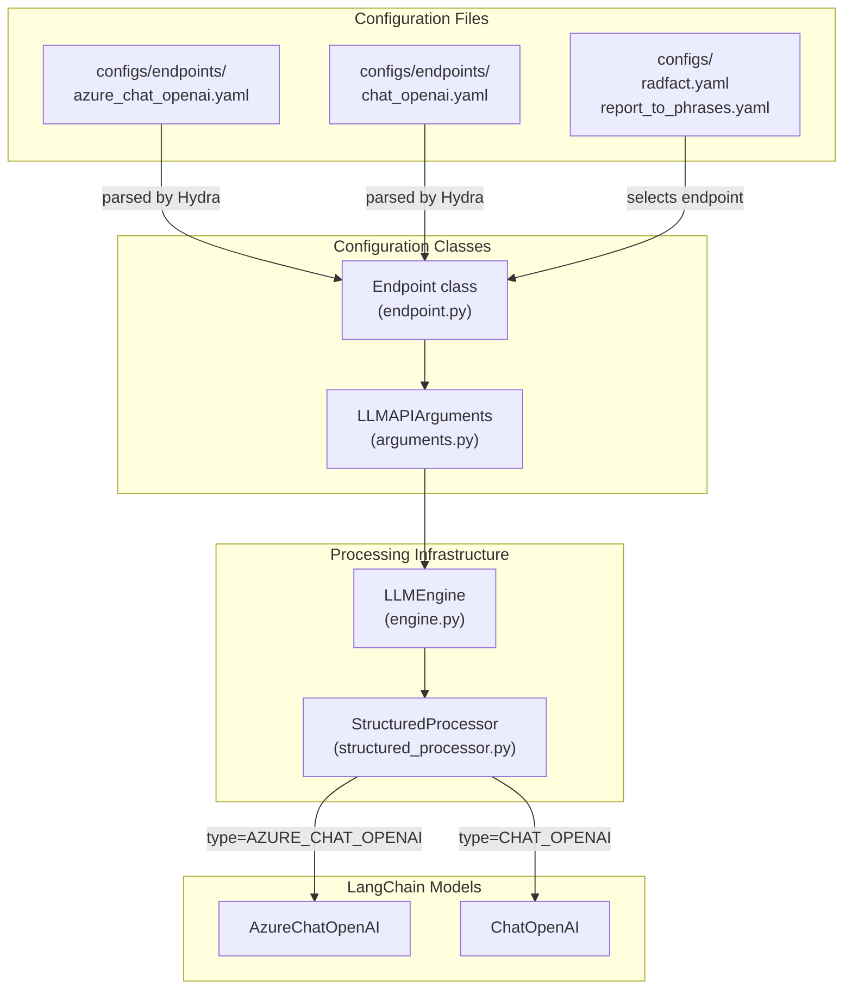
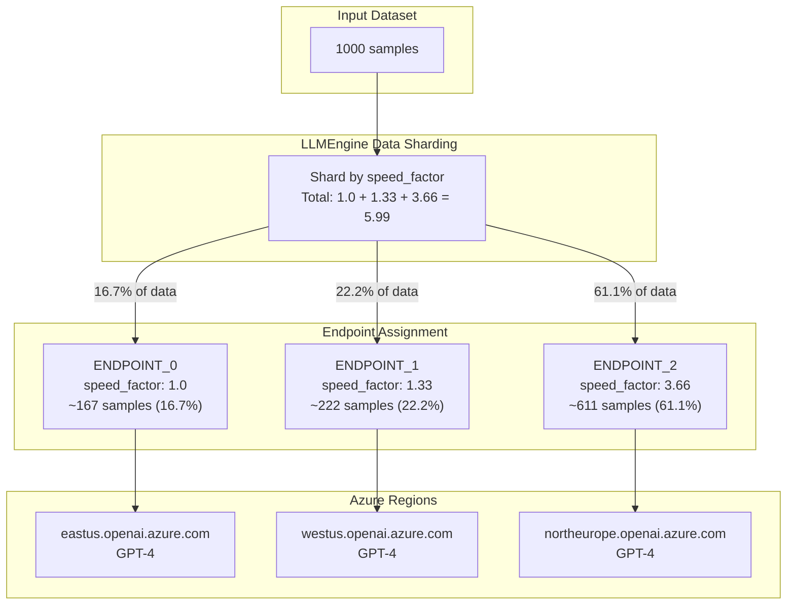
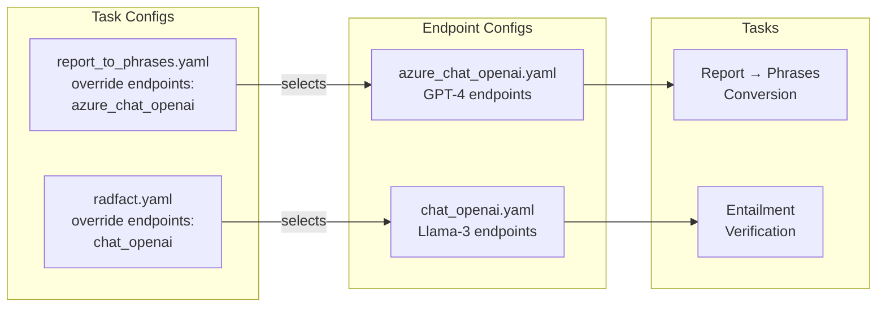
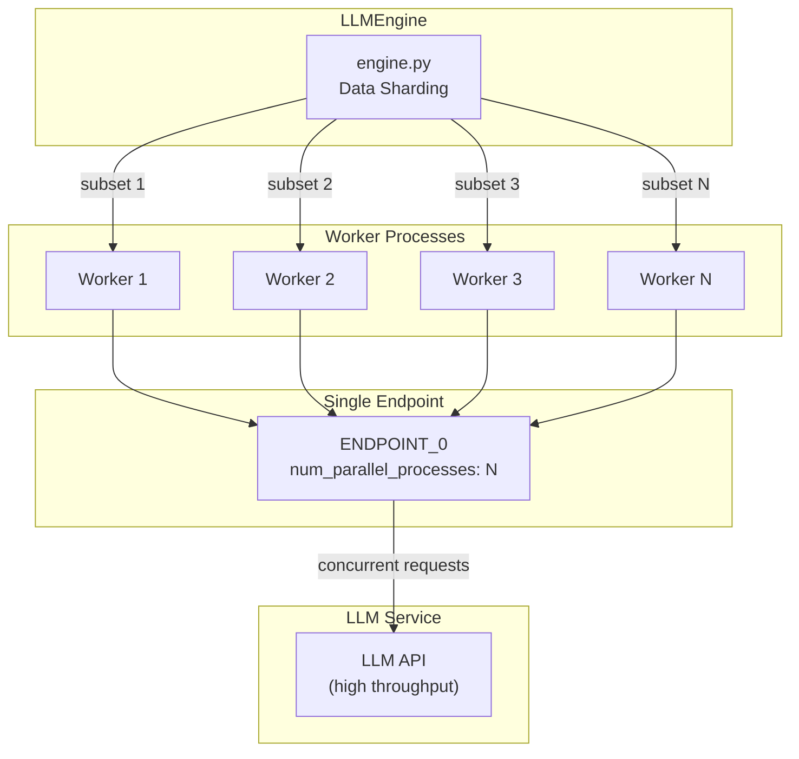

<!-- source: DeepWiki mcp.deepwiki.com · repo microsoft/RadFact · page 6.2 Endpoint Configuration · fetched 2026-10-26 -->

# Endpoint Configuration

<details>
<summary>Relevant source files</summary>

The following files were used as context for generating this wiki page:

- [README.md](README.md)
- [configs/endpoints/azure_chat_openai.yaml](configs/endpoints/azure_chat_openai.yaml)
- [configs/endpoints/chat_openai.yaml](configs/endpoints/chat_openai.yaml)

</details>


This page describes how to configure LLM endpoints for use with RadFact. Endpoints define the LLM services that RadFact will query for report-to-phrases conversion and entailment verification tasks.

For information about authentication methods (API keys, Azure Key Vault, token providers), see [Authentication](#6.3). For information about LLM processing parameters (temperature, max_tokens, batch_size), see [Processing Parameters](#6.4). For information about the Hydra configuration system and override mechanisms, see [Configuration System](#6.1).

## Overview

RadFact supports two types of LLM endpoints through the LangChain library:

| Endpoint Type | LangChain Class | Typical Use Case |
|--------------|----------------|------------------|
| `AZURE_CHAT_OPENAI` | `AzureChatOpenAI` | GPT models deployed on Azure OpenAI Service |
| `CHAT_OPENAI` | `ChatOpenAI` | Custom deployed models (e.g., Llama-3) or standard OpenAI API |

Endpoint configurations are stored as YAML files in [configs/endpoints/]() and are referenced by task-specific configuration files ([configs/radfact.yaml](), [configs/report_to_phrases.yaml]()). The [Endpoint]() class in [src/radfact/llm_utils/endpoint.py]() represents individual endpoint configurations, while [LLMAPIArguments]() in [src/radfact/llm_utils/engine/arguments.py]() consumes these configurations for use by the [LLMEngine]().



**Endpoint Configuration Flow**

**Sources:** [README.md:48-93](), [src/radfact/llm_utils/endpoint.py](), [src/radfact/llm_utils/engine/arguments.py]()

## Endpoint Types

### AZURE_CHAT_OPENAI

The `AZURE_CHAT_OPENAI` endpoint type is used for GPT models deployed on Azure OpenAI Service. This endpoint type uses the LangChain `AzureChatOpenAI` class and supports Azure-specific authentication methods including API keys, Azure Key Vault secrets, and Azure AD token providers.

**Typical models:** GPT-4, GPT-3.5-turbo deployed on Azure

**Configuration example:**
```yaml
ENDPOINT_0:
  type: "AZURE_CHAT_OPENAI"
  url: "https://your-resource.openai.azure.com/"
  deployment_name: "gpt-4"
  api_key_env_var_name: "API_KEY_AZURE_0"
  speed_factor: 1.0
  num_parallel_processes: 1
```

**Sources:** [configs/endpoints/azure_chat_openai.yaml:1-24](), [README.md:52]()

### CHAT_OPENAI

The `CHAT_OPENAI` endpoint type is used for custom deployed models or standard OpenAI API endpoints. This endpoint type uses the LangChain `ChatOpenAI` class and is suitable for models like Llama-3 deployed on Azure or other cloud platforms.

**Typical models:** Llama-3-70B-Instruct, custom fine-tuned models, standard OpenAI models

**Configuration example:**
```yaml
ENDPOINT_0:
  type: "CHAT_OPENAI"
  url: "https://your-custom-endpoint.com/"
  deployment_name: "llama3-70b"
  api_key_env_var_name: "API_KEY_CHAT_0"
  speed_factor: 1.0
  num_parallel_processes: 10
```

**Sources:** [configs/endpoints/chat_openai.yaml:1-23](), [README.md:52]()

## Configuration File Structure

### Location

Endpoint configuration files are located in [configs/endpoints/](). The directory contains two template files:

- [configs/endpoints/azure_chat_openai.yaml]() - Template for Azure OpenAI endpoints
- [configs/endpoints/chat_openai.yaml]() - Template for custom OpenAI endpoints

Users should copy and modify these templates with their own endpoint details.

**Sources:** [README.md:68]()

### Required Fields

Each endpoint configuration must include the following fields:

| Field | Type | Description |
|-------|------|-------------|
| `type` | string | Either `"AZURE_CHAT_OPENAI"` or `"CHAT_OPENAI"` |
| `url` | string | The base URL of the endpoint |
| `deployment_name` | string | The name of the model deployment |

### Optional Fields

| Field | Type | Default | Description |
|-------|------|---------|-------------|
| `api_key_env_var_name` | string | `"API_KEY"` | Environment variable name containing the API key |
| `keyvault_secret_name` | string | `null` | Azure Key Vault secret name for the API key |
| `speed_factor` | float | `1.0` | Relative speed for data sharding across endpoints |
| `num_parallel_processes` | int | `1` | Number of parallel processes for this endpoint |

**Sources:** [configs/endpoints/azure_chat_openai.yaml:1-23](), [configs/endpoints/chat_openai.yaml:1-23](), [README.md:73-87]()

## Single Endpoint Configuration

A minimal single endpoint configuration defines one endpoint that RadFact will use for all LLM queries. The [LLMEngine]() will process all data sequentially through this endpoint unless `num_parallel_processes` is set to a value greater than 1.

### Azure OpenAI Example

```yaml
ENDPOINT_0:
  type: "AZURE_CHAT_OPENAI"
  url: "https://eastus.api.cognitive.microsoft.com/"
  deployment_name: "gpt-4"
  api_key_env_var_name: "API_KEY"
  speed_factor: 1.0
  num_parallel_processes: 5
```

This configuration defines a single Azure GPT-4 endpoint with 5 parallel processes. All data will be processed through this endpoint with parallelism.

### Custom Model Example

```yaml
ENDPOINT_0:
  type: "CHAT_OPENAI"
  url: "https://my-llama-deployment.com/"
  deployment_name: "llama3-70b"
  api_key_env_var_name: "API_KEY"
  speed_factor: 1.0
  num_parallel_processes: 10
```

This configuration defines a single Llama-3 endpoint with 10 parallel processes.

**Sources:** [configs/endpoints/azure_chat_openai.yaml:1-23](), [configs/endpoints/chat_openai.yaml:1-23]()

## Multiple Endpoint Configuration

RadFact supports configuring multiple endpoints for parallel processing across different LLM services or regions. The [LLMEngine]() shards the input data across endpoints proportionally based on their `speed_factor` values.

### Configuration Structure

Multiple endpoints are defined in the same YAML file with unique identifiers:

```yaml
ENDPOINT_0:
  type: "AZURE_CHAT_OPENAI"
  url: "https://eastus.openai.azure.com/"
  deployment_name: "gpt-4"
  api_key_env_var_name: "API_KEY_AZURE_EAST"
  speed_factor: 1.0
  num_parallel_processes: 1

ENDPOINT_1:
  type: "AZURE_CHAT_OPENAI"
  url: "https://westus.openai.azure.com/"
  deployment_name: "gpt-4"
  api_key_env_var_name: "API_KEY_AZURE_WEST"
  speed_factor: 1.33
  num_parallel_processes: 1

ENDPOINT_2:
  type: "AZURE_CHAT_OPENAI"
  url: "https://northeurope.openai.azure.com/"
  deployment_name: "gpt-4"
  api_key_env_var_name: "API_KEY_AZURE_EU"
  speed_factor: 3.66
  num_parallel_processes: 1
```



**Data Sharding Across Multiple Endpoints**

### Speed Factor Calculation

The `speed_factor` determines the proportion of data assigned to each endpoint. The [LLMEngine]() at [src/radfact/llm_utils/engine/engine.py]() calculates data assignment as:

```
proportion_i = speed_factor_i / sum(all_speed_factors)
samples_i = total_samples * proportion_i
```

For example, with `speed_factor` values of 1.0, 1.33, and 3.66:
- Total: 5.99
- Endpoint 0 receives: 1.0 / 5.99 = 16.7% of data
- Endpoint 1 receives: 1.33 / 5.99 = 22.2% of data
- Endpoint 2 receives: 3.66 / 5.99 = 61.1% of data

**Sources:** [README.md:86-87](), [configs/endpoints/azure_chat_openai.yaml:25-39](), [configs/endpoints/chat_openai.yaml:25-39]()

### Heterogeneous Endpoints

RadFact supports mixing `AZURE_CHAT_OPENAI` and `CHAT_OPENAI` endpoints in the same configuration:

```yaml
ENDPOINT_0:
  type: "AZURE_CHAT_OPENAI"
  url: "https://eastus.openai.azure.com/"
  deployment_name: "gpt-4"
  api_key_env_var_name: "API_KEY_AZURE"
  speed_factor: 1.0
  num_parallel_processes: 1

ENDPOINT_1:
  type: "CHAT_OPENAI"
  url: "https://llama-endpoint.com/"
  deployment_name: "llama3-70b"
  api_key_env_var_name: "API_KEY_LLAMA"
  speed_factor: 2.0
  num_parallel_processes: 10
```

This allows users to combine different LLM providers or models in a single RadFact run, with data automatically sharded based on relative throughput.

**Sources:** [configs/endpoints/azure_chat_openai.yaml:1-39](), [configs/endpoints/chat_openai.yaml:1-39]()

## Task-Specific Endpoint Selection

RadFact uses different LLMs for different tasks. Task-specific configuration files specify which endpoint configuration to use by overriding the `endpoints` field.

### Configuration Files

| Task | Config File | Typical Model | Recommended Endpoint |
|------|-------------|---------------|---------------------|
| Report to Phrases | [configs/report_to_phrases.yaml]() | GPT-4 | `AZURE_CHAT_OPENAI` |
| Entailment Verification | [configs/radfact.yaml]() | Llama-3-70B-Instruct | `CHAT_OPENAI` |

### Report to Phrases

The [configs/report_to_phrases.yaml]() file specifies which endpoint to use for converting narrative reports to phrase lists:

```yaml
defaults:
  - default
  - override endpoints: azure_chat_openai  # Uses configs/endpoints/azure_chat_openai.yaml

# ... rest of configuration
```

In the MAIRA-2 paper, GPT-4 was used for this task via `AZURE_CHAT_OPENAI`.

### Entailment Verification (RadFact)

The [configs/radfact.yaml]() file specifies which endpoint to use for entailment verification:

```yaml
defaults:
  - default
  - override endpoints: chat_openai  # Uses configs/endpoints/chat_openai.yaml

# ... rest of configuration
```

In the MAIRA-2 paper, Llama-3-70B-Instruct was used for this task via `CHAT_OPENAI`.



**Task-Specific Endpoint Selection**

**Sources:** [README.md:89-92](), [configs/report_to_phrases.yaml](), [configs/radfact.yaml]()

## Parallel Processing Configuration

The `num_parallel_processes` parameter controls how many concurrent requests are made to a single endpoint. This is distinct from multiple endpoint configuration and can be used in combination with it.

### Sequential Processing (Default)

```yaml
ENDPOINT_0:
  type: "CHAT_OPENAI"
  url: "https://endpoint.com/"
  deployment_name: "llama3-70b"
  speed_factor: 1.0
  num_parallel_processes: 1  # Sequential processing
```

With `num_parallel_processes: 1`, the [LLMEngine]() processes samples one at a time through this endpoint.

### Parallel Processing

```yaml
ENDPOINT_0:
  type: "CHAT_OPENAI"
  url: "https://endpoint.com/"
  deployment_name: "llama3-70b"
  speed_factor: 1.0
  num_parallel_processes: 10  # 10 concurrent requests
```

With `num_parallel_processes: 10`, the [LLMEngine]() spawns 10 worker processes that make concurrent requests to the endpoint, significantly improving throughput for high-capacity endpoints.



**Parallel Processing with num_parallel_processes**

**Sources:** [README.md:87-88](), [configs/endpoints/azure_chat_openai.yaml:20-23](), [configs/endpoints/chat_openai.yaml:20-23]()

## Code Integration

### Endpoint Class

The [Endpoint]() class at [src/radfact/llm_utils/endpoint.py]() represents a single endpoint configuration. It handles:

- Parsing endpoint type and connection parameters
- Loading API keys from environment variables or Azure Key Vault
- Creating Azure token providers for authentication fallback
- Providing configuration to LangChain model constructors

Key methods and attributes referenced by the documentation:
- Endpoint type validation (`AZURE_CHAT_OPENAI` vs `CHAT_OPENAI`)
- URL and deployment name storage
- Authentication credential retrieval
- Azure Key Vault integration at [src/radfact/llm_utils/endpoint.py:38]()

**Sources:** [README.md:64](), [src/radfact/llm_utils/endpoint.py]()

### LLMAPIArguments Class

The [LLMAPIArguments]() class at [src/radfact/llm_utils/engine/arguments.py]() consumes [Endpoint]() objects and prepares them for use by the [LLMEngine](). It:

- Converts endpoint configurations to LangChain model parameters
- Manages authentication for multiple endpoints
- Validates endpoint compatibility
- Provides endpoint objects to the engine for data sharding

**Sources:** [README.md:64](), [src/radfact/llm_utils/engine/arguments.py]()

### LLMEngine Integration

The [LLMEngine]() class at [src/radfact/llm_utils/engine/engine.py:50]() uses endpoint configurations to:

1. Calculate data sharding proportions based on `speed_factor`
2. Spawn worker processes based on `num_parallel_processes`
3. Assign data subsets to each worker
4. Coordinate parallel processing across endpoints

The engine creates one worker per `num_parallel_processes` value for each configured endpoint, enabling efficient utilization of multiple LLM services.

**Sources:** [README.md:100-129](), [src/radfact/llm_utils/engine/engine.py:50]()

## Validation and Testing

After configuring endpoints, validate that they work correctly using the test script:

```bash
python src/radfact/cli/run_radfact_test_examples.py
```

This script runs entailment verification on a set of test examples and compares results to expected outputs. The test validates:

- Endpoint connectivity and authentication
- LLM response format and parsing
- Entailment verification behavior

Expected results were obtained using Llama-3-70B-Instruct. Different models may produce slightly different results, but significant deviations indicate configuration issues.

**Note:** This test validates the entailment verification endpoint only. It does not test the report-to-phrases endpoint.

**Sources:** [README.md:94-98]()

---

