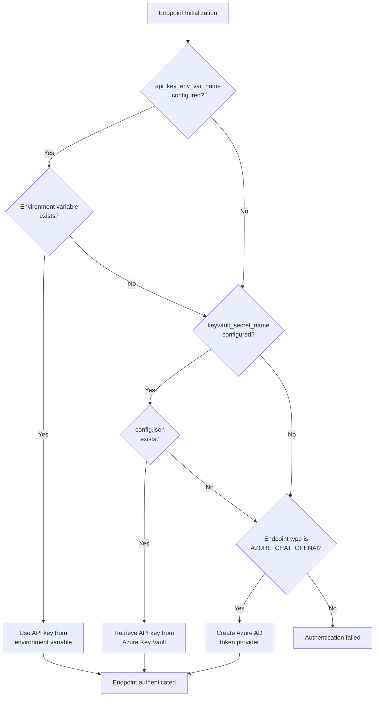
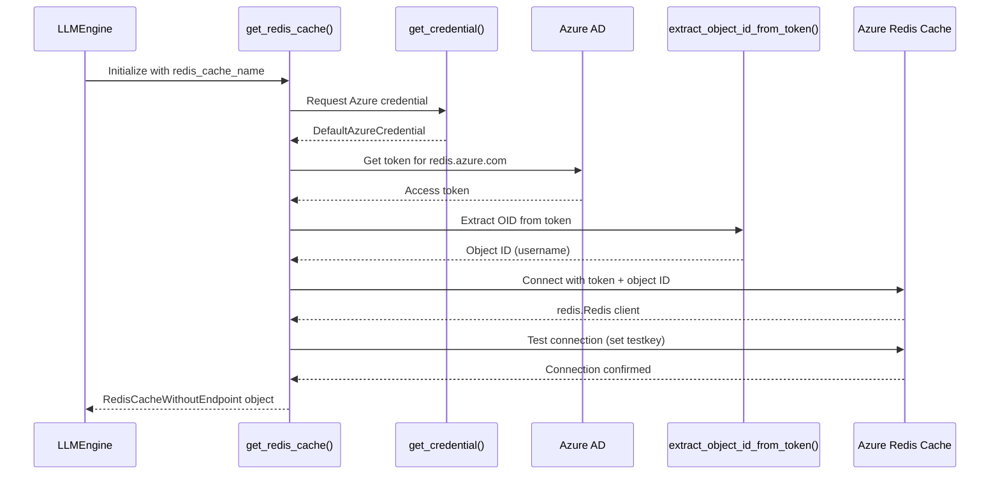
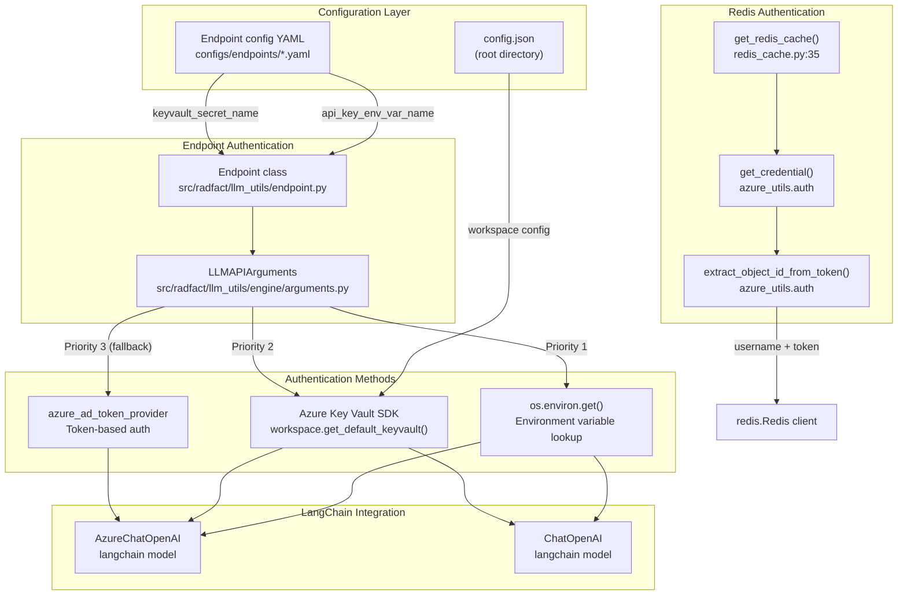

<!-- source: DeepWiki mcp.deepwiki.com · repo microsoft/RadFact · page 6.3 Authentication · fetched 2026-10-26 -->

# Authentication

<details>
<summary>Relevant source files</summary>

The following files were used as context for generating this wiki page:

- [README.md](README.md)
- [configs/endpoints/azure_chat_openai.yaml](configs/endpoints/azure_chat_openai.yaml)
- [src/radfact/llm_utils/engine/redis_cache.py](src/radfact/llm_utils/engine/redis_cache.py)

</details>


## Purpose and Scope

This page describes the authentication mechanisms used in RadFact to access LLM endpoints and Azure services. RadFact supports multiple authentication strategies to accommodate different deployment scenarios, from local development with API keys to production deployments using Azure Active Directory tokens.

For information about configuring LLM endpoints themselves, see [Endpoint Configuration](#6.2). For details on the configuration system structure, see [Configuration System](#6.1).

---

## Authentication Methods Overview

RadFact implements a three-tier authentication hierarchy for accessing LLM endpoints. When initializing a connection, the system attempts authentication methods in order until one succeeds.

The following table summarizes the supported authentication methods:

| Method | Use Case | Supported Endpoints | Priority |
|--------|----------|-------------------|----------|
| **Environment Variable API Key** | Local development, testing | `AZURE_CHAT_OPENAI`, `CHAT_OPENAI` | 1 (highest) |
| **Azure Key Vault Secret** | Production deployments, team environments | `AZURE_CHAT_OPENAI`, `CHAT_OPENAI` | 2 |
| **Azure AD Token Provider** | Managed identity scenarios, credential-less auth | `AZURE_CHAT_OPENAI` only | 3 (fallback) |

**Sources:** [README.md:54-63]()

---

## Authentication Decision Flow



**Sources:** [README.md:54-63](), [configs/endpoints/azure_chat_openai.yaml:6-14]()

---

## API Key via Environment Variables

The simplest authentication method uses API keys stored in environment variables. This is the first method attempted during endpoint initialization.

### Configuration

In the endpoint configuration file, specify the environment variable name:

```yaml
ENDPOINT_0:
  type: "AZURE_CHAT_OPENAI"
  url: "<endpoint_url>"
  api_key_env_var_name: "API_KEY"  # Default name
```

If omitted, RadFact uses `"API_KEY"` as the default environment variable name.

### Multiple Endpoints

When using multiple endpoints, each can reference a different environment variable:

```yaml
ENDPOINT_0:
  api_key_env_var_name: "API_KEY_AZURE_0"
  
ENDPOINT_1:
  api_key_env_var_name: "API_KEY_AZURE_1"
```

### Setting Environment Variables

Before running RadFact, export the required environment variables:

```bash
export API_KEY="your-api-key-here"
export API_KEY_AZURE_0="endpoint-0-key"
export API_KEY_AZURE_1="endpoint-1-key"
```

**Sources:** [README.md:58](), [configs/endpoints/azure_chat_openai.yaml:7-9]()

---

## API Key from Azure Key Vault

For production deployments, API keys can be retrieved from Azure Key Vault, providing centralized secret management and audit logging.

### Prerequisites

This authentication method requires:

1. **AzureML Workspace Configuration**: A `config.json` file in the repository root directory
2. **Azure Credentials**: Appropriate Azure permissions to access the workspace and Key Vault
3. **Secret Stored in Key Vault**: The API key stored in the workspace's default Key Vault

### Configuration File Structure

The `config.json` file must be placed at the root of the repository and contain:

```json
{
  "subscription_id": "your-subscription-id",
  "resource_group": "your-resource-group",
  "workspace_name": "your-workspace-name"
}
```

**Note:** This file is automatically excluded from version control via `.gitignore` to prevent credential exposure.

### Endpoint Configuration

Specify the Key Vault secret name in the endpoint configuration:

```yaml
ENDPOINT_0:
  type: "AZURE_CHAT_OPENAI"
  url: "<endpoint_url>"
  keyvault_secret_name: "my-api-key-secret"
```

### Retrieval Process

When `keyvault_secret_name` is configured, RadFact:

1. Reads `config.json` to determine the AzureML workspace
2. Accesses the workspace's default Key Vault
3. Retrieves the secret with the specified name
4. Uses the secret value as the API key

**Sources:** [README.md:59-61](), [README.md:60]()

---

## Token-Based Authentication

For `AZURE_CHAT_OPENAI` endpoints, RadFact can use Azure Active Directory token-based authentication as a fallback mechanism. This enables credential-less authentication using managed identities or Azure CLI credentials.

### When Token Authentication is Used

Token-based authentication is attempted only when:
- Neither `api_key_env_var_name` nor `keyvault_secret_name` successfully provides credentials
- The endpoint type is `AZURE_CHAT_OPENAI` (not supported for `CHAT_OPENAI`)

### Token Provider Mechanism

The system creates an `azure_ad_token_provider` that:
- Automatically acquires Azure AD tokens
- Handles token refresh automatically
- Uses the current Azure credentials (managed identity, Azure CLI, etc.)

This provider is passed to the `AzureChatOpenAI` model's `azure_ad_token_provider` parameter.

### Configuration

No explicit configuration is required for token-based authentication. It activates automatically as a fallback:

```yaml
ENDPOINT_0:
  type: "AZURE_CHAT_OPENAI"
  url: "<endpoint_url>"
  # No api_key_env_var_name or keyvault_secret_name specified
```

**Sources:** [README.md:62-63]()

---

## Authentication for Azure Redis Cache

RadFact uses Azure Redis Cache for LLM response caching. Redis authentication follows a different pattern than LLM endpoints, using token-based authentication exclusively.

### Redis Authentication Flow



### Implementation Details

The Redis cache authentication is implemented in [src/radfact/llm_utils/engine/redis_cache.py:35-60]():

```python
def get_redis_cache(redis_cache_name: str) -> RedisCache:
    credential = get_credential()
    token = credential.get_token("https://redis.azure.com/.default").token
    redis_username = extract_object_id_from_token(token)
    redis_url = f"{redis_cache_name}.redis.cache.windows.net"
    
    redis_client = redis.Redis(
        host=redis_url,
        port=6380,
        password=token,
        username=redis_username,
        ssl=True,
    )
```

### Key Components

| Function/Class | Location | Purpose |
|---------------|----------|---------|
| `get_credential()` | `radfact.azure_utils.auth` | Obtains Azure credentials (managed identity or CLI) |
| `extract_object_id_from_token()` | `radfact.azure_utils.auth` | Extracts OID claim from JWT for Redis username |
| `RedisCacheWithoutEndpoint` | [redis_cache.py:24-32]() | Custom cache implementation that normalizes endpoint URLs |

### Connection Parameters

The Redis connection uses:
- **Host**: `{redis_cache_name}.redis.cache.windows.net`
- **Port**: `6380` (SSL port)
- **Username**: Azure AD object ID from token
- **Password**: Azure AD access token
- **SSL**: `True`

**Sources:** [src/radfact/llm_utils/engine/redis_cache.py:35-60](), [src/radfact/llm_utils/engine/redis_cache.py:12]()

---

## Authentication Code Architecture

The following diagram maps authentication concepts to specific code entities:



**Sources:** [README.md:64](), [src/radfact/llm_utils/engine/redis_cache.py]()

---

## Configuration Examples

### Example 1: Environment Variables Only

```yaml
# configs/endpoints/azure_chat_openai.yaml
ENDPOINT_0:
  type: "AZURE_CHAT_OPENAI"
  url: "https://myendpoint.openai.azure.com/"
  deployment_name: "gpt-4"
  api_key_env_var_name: "API_KEY"
  speed_factor: 1.0
  num_parallel_processes: 1
```

Set the environment variable:
```bash
export API_KEY="your-key-here"
```

### Example 2: Azure Key Vault

```yaml
# configs/endpoints/azure_chat_openai.yaml
ENDPOINT_0:
  type: "AZURE_CHAT_OPENAI"
  url: "https://myendpoint.openai.azure.com/"
  deployment_name: "gpt-4"
  keyvault_secret_name: "gpt4-api-key"
  speed_factor: 1.0
  num_parallel_processes: 1
```

Create `config.json` in repository root:
```json
{
  "subscription_id": "abc-123-def",
  "resource_group": "my-rg",
  "workspace_name": "my-workspace"
}
```

### Example 3: Token-Based (Fallback)

```yaml
# configs/endpoints/azure_chat_openai.yaml
ENDPOINT_0:
  type: "AZURE_CHAT_OPENAI"
  url: "https://myendpoint.openai.azure.com/"
  deployment_name: "gpt-4"
  # No api_key_env_var_name or keyvault_secret_name
  speed_factor: 1.0
  num_parallel_processes: 1
```

Ensure Azure credentials are configured:
```bash
az login
# or use managed identity in Azure environments
```

### Example 4: Multiple Endpoints with Different Auth

```yaml
# configs/endpoints/azure_chat_openai.yaml
ENDPOINT_0:
  type: "AZURE_CHAT_OPENAI"
  url: "https://east-us.openai.azure.com/"
  deployment_name: "gpt-4"
  api_key_env_var_name: "API_KEY_EAST"
  speed_factor: 1.0
  num_parallel_processes: 10

ENDPOINT_1:
  type: "AZURE_CHAT_OPENAI"
  url: "https://west-us.openai.azure.com/"
  deployment_name: "gpt-4"
  keyvault_secret_name: "west-us-gpt4-key"
  speed_factor: 1.0
  num_parallel_processes: 10
```

**Sources:** [configs/endpoints/azure_chat_openai.yaml]()

---

## Security Considerations

### API Key Storage

| Method | Security Level | Recommendations |
|--------|---------------|-----------------|
| Environment Variables | Low-Medium | Use only for development. Never commit `.env` files. |
| Azure Key Vault | High | Recommended for production. Provides audit logging and access control. |
| Token-Based | High | Ideal for Azure-hosted environments with managed identities. |

### Configuration File Protection

- **`config.json`**: Listed in `.gitignore` to prevent accidental commits
- **Endpoint configs**: Can be committed, as they contain no secrets (only secret names/references)
- **Environment files**: Never commit files containing actual API keys

### Token Lifecycle

For token-based authentication:
- Tokens are automatically refreshed by the `azure_ad_token_provider`
- Default token lifetime is typically 1 hour
- No manual token management required
- Tokens are obtained at runtime and not stored persistently

**Sources:** [README.md:60]()

---

## Troubleshooting Authentication

### Common Issues

| Issue | Symptom | Solution |
|-------|---------|----------|
| Missing API key | `Authentication failed` error | Verify environment variable is set and name matches config |
| Key Vault access denied | `Permission denied` error | Check Azure RBAC permissions for Key Vault access |
| Token provider fails | Falls back to failure | Ensure `az login` completed or managed identity configured |
| Redis connection timeout | `Connection timeout` error | Verify network access to `*.redis.cache.windows.net:6380` |

### Debugging Authentication

To determine which authentication method is being used, check the logs. The system logs authentication attempts at the `INFO` level.

For Redis cache authentication, the system logs:
- Connection URL and object ID: [redis_cache.py:48]()
- Connection test result: [redis_cache.py:57-59]()

### Verifying Configuration

Before running RadFact, verify your authentication setup:

1. **Environment variables**: `echo $API_KEY`
2. **Azure login**: `az account show`
3. **Key Vault access**: `az keyvault secret show --vault-name <vault> --name <secret>`
4. **Config file**: Confirm `config.json` exists with valid workspace details

**Sources:** [README.md:54-64]()

---

