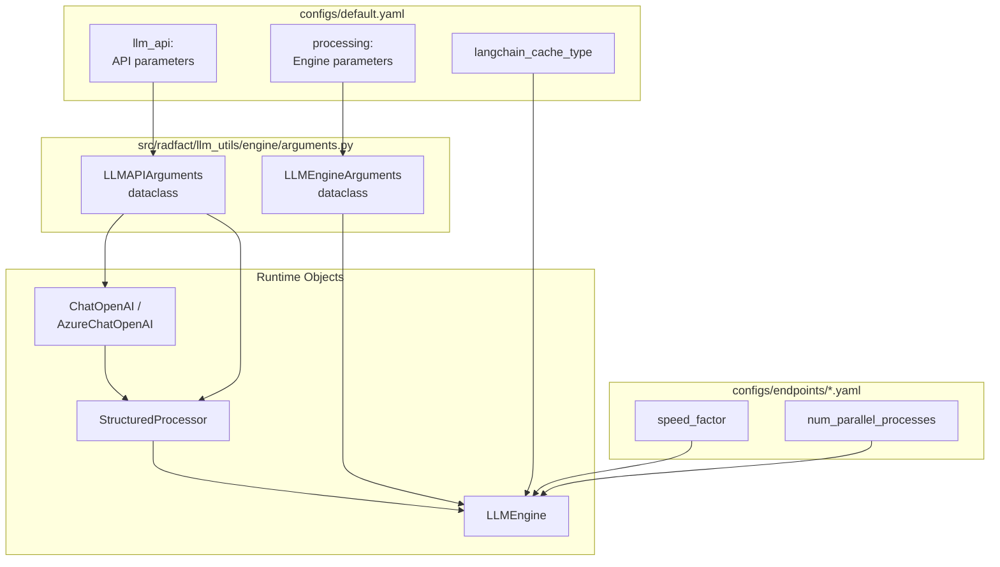
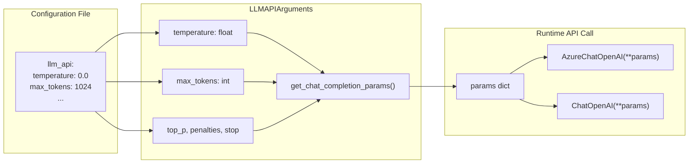
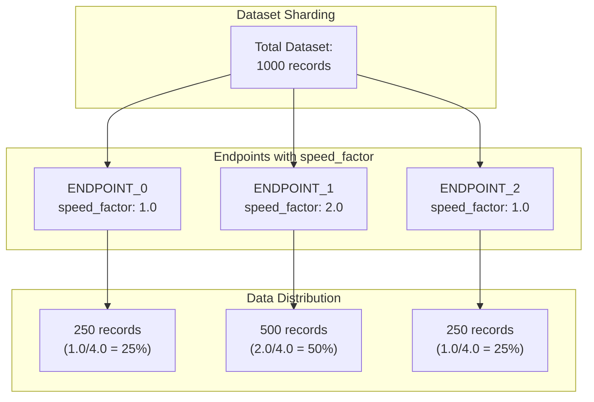
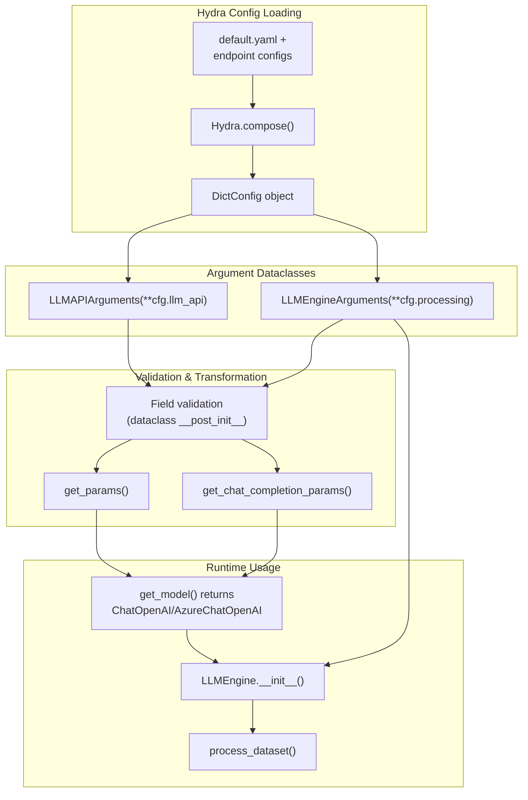

<!-- source: DeepWiki mcp.deepwiki.com · repo microsoft/RadFact · page 6.4 Processing Parameters · fetched 2026-10-26 -->

# Processing Parameters

<details>
<summary>Relevant source files</summary>

The following files were used as context for generating this wiki page:

- [configs/default.yaml](configs/default.yaml)
- [configs/endpoints/azure_chat_openai.yaml](configs/endpoints/azure_chat_openai.yaml)
- [src/radfact/llm_utils/engine/arguments.py](src/radfact/llm_utils/engine/arguments.py)

</details>


This document describes the configuration parameters that control LLM behavior and processing execution in RadFact. These parameters are separate from endpoint configuration ([6.2](#6.2)) and authentication ([6.3](#6.3)), and are managed through Hydra configuration files ([6.1](#6.1)).

The parameters fall into three categories:
1. **LLM API Parameters** - Control LLM behavior (temperature, max_tokens, etc.)
2. **Processing Parameters** - Control dataset processing (batch_size, indexing, etc.)
3. **Endpoint-Specific Parameters** - Control parallel execution (speed_factor, num_parallel_processes)

For information about the underlying LLM Engine architecture that uses these parameters, see [5.2](#5.2).

**Sources:** [configs/default.yaml:1-28](), [src/radfact/llm_utils/engine/arguments.py:1-136]()

---

## Parameter Categories and Flow

The following diagram shows how processing parameters are organized in the configuration system and which code classes consume them:



**Sources:** [configs/default.yaml:1-28](), [src/radfact/llm_utils/engine/arguments.py:19-136](), [configs/endpoints/azure_chat_openai.yaml:16-23]()

---

## LLM API Parameters

LLM API parameters control the behavior of the language model during inference. These parameters are defined in the `llm_api` section of the configuration and are encapsulated by the `LLMAPIArguments` dataclass.

### Parameter Reference

| Parameter | Type | Default | Description |
|-----------|------|---------|-------------|
| `api_version` | str | `"2023-07-01-preview"` | Azure OpenAI API version |
| `max_retries` | int | `10` | Maximum number of retry attempts for API calls |
| `timeout` | float \| None | `null` | Request timeout in seconds (None for no timeout) |
| `temperature` | float | `0.0` | Sampling temperature (0.0 = deterministic, higher = more random) |
| `max_tokens` | int | `1024` | Maximum tokens to generate in response |
| `n_completions` | int | `1` | Number of completions to generate per request |
| `top_p` | float | `1.0` | Nucleus sampling parameter |
| `frequency_penalty` | float | `0.0` | Penalize frequent tokens |
| `presence_penalty` | float | `0.0` | Penalize tokens that have appeared |
| `stop` | list[str] \| None | `null` | Stop sequences to end generation |

**Sources:** [configs/default.yaml:5-15](), [src/radfact/llm_utils/engine/arguments.py:76-100]()

### Temperature and Determinism

The `temperature` parameter is particularly important for RadFact evaluation:
- **Default: 0.0** - Ensures deterministic outputs for reproducible evaluations
- Higher values (e.g., 0.7-1.0) increase randomness but may reduce reproducibility
- For production evaluations, the default 0.0 is strongly recommended

**Sources:** [src/radfact/llm_utils/engine/arguments.py:79](), [configs/default.yaml:8]()

### Token Budget

The `max_tokens` parameter limits response length:
- **Default: 1024** - Sufficient for most RadFact tasks
- Report-to-phrases conversion may require higher values for long reports
- Entailment verification typically uses less than 512 tokens per response

**Sources:** [src/radfact/llm_utils/engine/arguments.py:80](), [configs/default.yaml:9]()

### Retry and Timeout Behavior

Connection reliability parameters:
- `max_retries: 10` - Handles transient API failures automatically
- `timeout: null` - No timeout by default; set to avoid hanging on slow endpoints
- Implemented in `OpenaiAPIArguments.get_params()` method

**Sources:** [src/radfact/llm_utils/engine/arguments.py:25-26](), [src/radfact/llm_utils/engine/arguments.py:43-65]()

### Code Mapping

The following diagram shows how LLM API parameters flow from configuration to runtime:



**Sources:** [src/radfact/llm_utils/engine/arguments.py:76-116]()

---

## Processing Parameters

Processing parameters control how the `LLMEngine` processes datasets. These parameters are defined in the `processing` section of the configuration and are encapsulated by the `LLMEngineArguments` dataclass.

### Parameter Reference

| Parameter | Type | Default | Description |
|-----------|------|---------|-------------|
| `index_col` | str | `"study_id"` | Column name used as unique identifier for each record |
| `batch_size` | int | `100` | Number of records to process before saving checkpoint |
| `start_index` | int | `0` | Starting position in dataset (for partial processing) |
| `end_index` | int \| None | `null` | Ending position in dataset (None = process all) |
| `output_filename` | str | `"outputs.json"` | Name of final aggregated output file |

**Sources:** [configs/default.yaml:17-22](), [src/radfact/llm_utils/engine/arguments.py:119-136]()

### Index Column

The `index_col` parameter specifies the unique identifier for each dataset record:
- **Default: "study_id"** - Matches RadFact's expected input format
- Used for progress tracking in `progress.csv`
- Must be a column present in the input dataset
- Used to resume processing after interruptions

**Sources:** [src/radfact/llm_utils/engine/arguments.py:130](), [configs/default.yaml:18]()

### Batch Size and Checkpointing

The `batch_size` parameter controls checkpoint frequency:
- **Default: 100** - Process 100 records before writing to disk
- Lower values = more frequent checkpoints, better fault tolerance
- Higher values = less I/O overhead, faster processing
- Batch outputs saved to `batch_outputs/*.json`

**Sources:** [src/radfact/llm_utils/engine/arguments.py:131](), [configs/default.yaml:19]()

### Dataset Range Selection

Use `start_index` and `end_index` for partial dataset processing:
- `start_index: 0` - Start from beginning (default)
- `end_index: null` - Process until end (default)
- Example: `start_index: 100, end_index: 200` processes 100 records
- Useful for parallel processing across multiple machines

**Sources:** [src/radfact/llm_utils/engine/arguments.py:132-134](), [configs/default.yaml:20-21]()

### Output File Naming

The `output_filename` parameter specifies the final output:
- **Default: "outputs.json"** - Standard name for aggregated results
- Written after all processing completes
- Contains aggregated metrics and results

**Sources:** [src/radfact/llm_utils/engine/arguments.py:135](), [configs/default.yaml:22]()

---

## Endpoint-Specific Parameters

Endpoint-specific parameters control parallel processing behavior for individual endpoints. These are defined within each endpoint configuration in `configs/endpoints/*.yaml`.

### Parameter Reference

| Parameter | Type | Default | Description |
|-----------|------|---------|-------------|
| `speed_factor` | float | `1.0` | Relative throughput weight for data sharding |
| `num_parallel_processes` | int | `1` | Number of parallel workers per endpoint |

**Sources:** [configs/endpoints/azure_chat_openai.yaml:16-23]()

### Speed Factor

The `speed_factor` controls proportional data distribution across endpoints:



**Calculation:** Each endpoint receives `(speed_factor / sum_of_all_speed_factors) * total_records`

**Use cases:**
- Set higher `speed_factor` for endpoints with higher TPM (tokens per minute) quotas
- Balance load across regions with different latencies
- Prioritize premium endpoints over free-tier endpoints

**Sources:** [configs/endpoints/azure_chat_openai.yaml:16-18]()

### Parallel Processes

The `num_parallel_processes` parameter enables concurrent workers per endpoint:
- **Default: 1** - Sequential processing (safest)
- Higher values (2-8) enable parallel requests to single endpoint
- Useful when endpoint has high TPM quota
- Risk: May exceed rate limits if set too high

**Example configuration:**
```yaml
ENDPOINT_0:
  type: "AZURE_CHAT_OPENAI"
  url: "https://..."
  deployment_name: "gpt-4"
  speed_factor: 1.0
  num_parallel_processes: 4  # 4 concurrent workers
```

**Sources:** [configs/endpoints/azure_chat_openai.yaml:20-23]()

---

## Cache Configuration

The `langchain_cache_type` parameter controls response caching behavior:

| Value | Description | Use Case |
|-------|-------------|----------|
| `null` | No caching (default) | Development, debugging |
| `"sqlite"` | Local SQLite cache | Single-machine experiments |
| `"redis"` | Redis distributed cache | Production, multi-run evaluations |

**Cache location:**
- SQLite: `~/.langchain.db`
- Redis: Configured via environment variables (see [5.4](#5.4))

**Benefits:**
- Avoid redundant API calls for identical queries
- Significant cost reduction for repeated evaluations
- Cache persists across runs

**Sources:** [configs/default.yaml:24-27]()

---

## Configuration Override Examples

### Example 1: High-Quality Evaluation

For maximum reproducibility with strict timeout:

```yaml
llm_api:
  temperature: 0.0        # Deterministic
  max_tokens: 2048        # Allow longer responses
  max_retries: 20         # More retries
  timeout: 300.0          # 5-minute timeout
  n_completions: 1        # Single completion

processing:
  batch_size: 50          # Frequent checkpoints
  
langchain_cache_type: redis  # Distributed caching
```

### Example 2: Fast Development Mode

For quick iteration during development:

```yaml
llm_api:
  temperature: 0.0
  max_tokens: 512         # Shorter responses
  max_retries: 3          # Fail fast
  timeout: 60.0           # 1-minute timeout

processing:
  batch_size: 10          # Small batches
  start_index: 0
  end_index: 100          # Process only 100 samples

langchain_cache_type: sqlite  # Local cache
```

### Example 3: Multi-Endpoint Load Balancing

For distributed processing across regions:

```yaml
ENDPOINT_0:
  type: "AZURE_CHAT_OPENAI"
  url: "https://eastus-endpoint.openai.azure.com/"
  speed_factor: 2.0       # High quota region
  num_parallel_processes: 4

ENDPOINT_1:
  type: "AZURE_CHAT_OPENAI"
  url: "https://westus-endpoint.openai.azure.com/"
  speed_factor: 1.0       # Standard quota
  num_parallel_processes: 2
```

**Sources:** [configs/default.yaml:1-28](), [configs/endpoints/azure_chat_openai.yaml:1-40]()

---

## Parameter Validation and Usage

The following diagram maps how configuration parameters are validated and used throughout the codebase:



**Sources:** [src/radfact/llm_utils/engine/arguments.py:19-136]()

---

## Common Configuration Patterns

### Pattern 1: Conservative API Usage

Minimize API costs and rate limit issues:
```yaml
llm_api:
  temperature: 0.0
  max_tokens: 512
  max_retries: 5
  timeout: 120.0

processing:
  batch_size: 200
  
langchain_cache_type: redis
```

### Pattern 2: Aggressive Throughput

Maximize processing speed with multiple endpoints:
```yaml
# Multiple endpoints with high parallelism
ENDPOINT_0:
  speed_factor: 3.0
  num_parallel_processes: 8

ENDPOINT_1:
  speed_factor: 2.0
  num_parallel_processes: 6

# Larger batches, aggressive retries
processing:
  batch_size: 500
  
llm_api:
  max_retries: 15
  timeout: null
```

### Pattern 3: Development and Testing

Quick iteration with small datasets:
```yaml
processing:
  batch_size: 5
  start_index: 0
  end_index: 50

llm_api:
  max_tokens: 256
  max_retries: 2
  timeout: 30.0

langchain_cache_type: sqlite
```

**Sources:** [configs/default.yaml:1-28](), [configs/endpoints/azure_chat_openai.yaml:1-40]()

---

## Related Configuration Pages

- **[6.1](#6.1) Configuration System** - Hydra configuration management and override mechanisms
- **[6.2](#6.2) Endpoint Configuration** - Configuring LLM endpoint URLs, deployments, and types
- **[6.3](#6.3) Authentication** - Setting up API keys, Key Vault, and token providers
- **[5.2](#5.2) LLM Engine** - Architecture of the parallel processing system that uses these parameters

---

