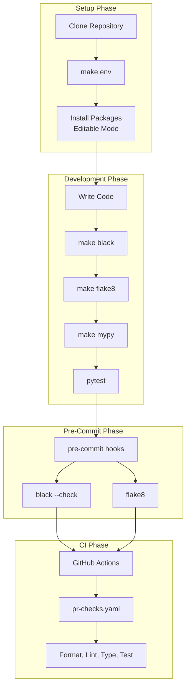
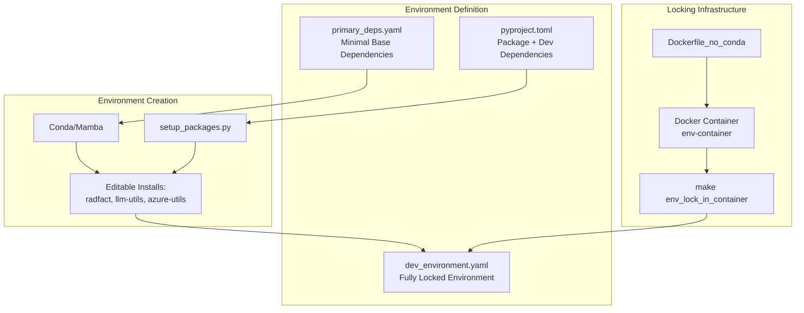
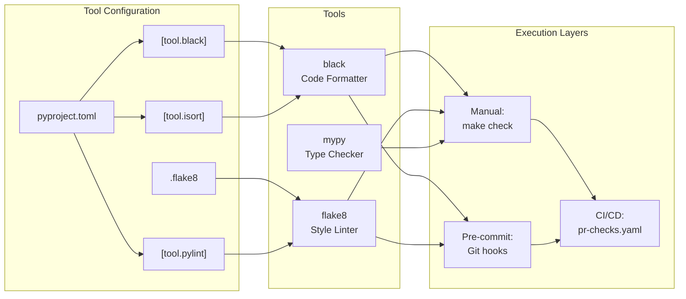
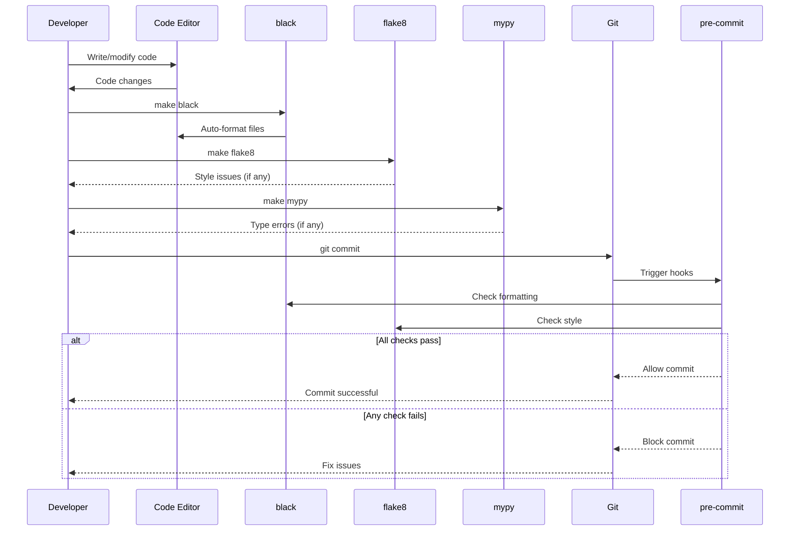
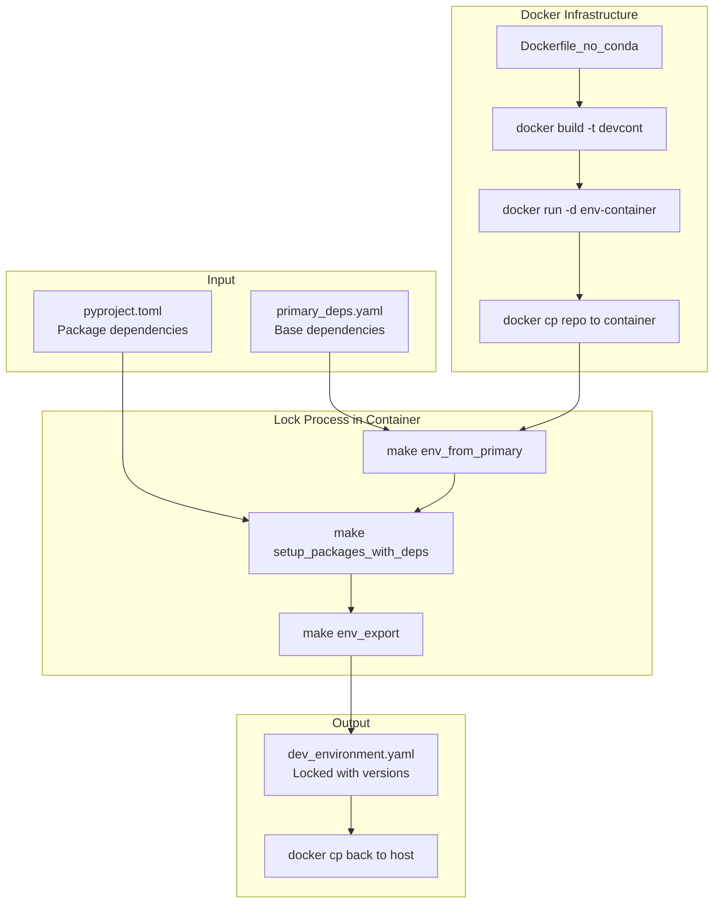

<!-- source: DeepWiki mcp.deepwiki.com · repo microsoft/RadFact · page 7 Development · fetched 2026-10-26 -->

# Development

<details>
<summary>Relevant source files</summary>

The following files were used as context for generating this wiki page:

- [Makefile](Makefile)
- [dev_environment.yaml](dev_environment.yaml)
- [pyproject.toml](pyproject.toml)

</details>


This page provides an overview of the development workflow, tools, and practices for contributing to RadFact. It covers the development environment setup, code quality enforcement, testing infrastructure, and CI/CD pipeline.

For specific topics:
- Environment setup instructions: See [Development Setup](#7.1)
- Code formatting and linting configuration: See [Code Quality Tools](#7.2)
- Running and writing tests: See [Testing](#7.3)
- GitHub Actions workflows: See [CI/CD Pipeline](#7.4)
- Docker-based environment locking: See [Environment Locking](#7.5)

## Development Workflow Overview

The RadFact development workflow follows a standard Python package development pattern with strict code quality enforcement and reproducible environments.

### High-Level Development Flow



**Sources:** [Makefile:1-118](), [pyproject.toml:1-89]()

### Development Environment Architecture



**Sources:** [Makefile:22-87](), [pyproject.toml:28-83](), [dev_environment.yaml:1-369]()

## Development Environment

The RadFact development environment is managed through Conda with locked dependencies for reproducibility. The environment includes:

### Core Environment Files

| File | Purpose | Management |
|------|---------|------------|
| `primary_deps.yaml` | Base Python and Conda dependencies | Manually edited |
| `pyproject.toml` | Package metadata and pip dependencies | Manually edited |
| `dev_environment.yaml` | Fully locked environment with exact versions | Auto-generated via `make env_lock` |
| `setup_packages.py` | Installs local packages in editable mode | Executed by Makefile |

### Environment Setup Process

The environment setup follows a three-step process:

1. **Create base environment**: `conda env create -n radfact -f dev_environment.yaml`
2. **Install local packages**: `setup_packages.py` installs `radfact`, `llm-utils`, and `azure-utils` in editable mode
3. **Verify installation**: Packages are importable and modifiable without reinstallation

Key Makefile targets:

- `make env`: Removes existing environment and rebuilds from `dev_environment.yaml` [Makefile:22-28]()
- `make env_from_primary`: Rebuilds from `primary_deps.yaml` (used for locking) [Makefile:32-36]()
- `make setup_packages`: Installs local packages without dependencies [Makefile:40-41]()
- `make setup_packages_with_deps`: Installs local packages with dependencies [Makefile:45-46]()

### Dependency Categories

The environment includes several categories of dependencies defined in `pyproject.toml`:

**Core Dependencies** [pyproject.toml:41-60]():
- Azure integration: `azureml-sdk`, `azure-keyvault`, `hi-ml-azure`
- LLM infrastructure: `hydra-core`, `langchain`, `langchain-openai`, `openai`, `redis`
- Data processing: `numpy`, `pandas`

**Development Dependencies** [pyproject.toml:63-75]():
- Formatting: `black`
- Linting: `flake8`
- Type checking: `mypy`, `pandas-stubs`, type stubs
- Workflow: `pre-commit`, `ipykernel`

**Test Dependencies** [pyproject.toml:77-82]():
- Testing framework: `pytest`, `pytest-lazy-fixture`
- Mocking: `mock`

**Sources:** [Makefile:22-46](), [pyproject.toml:28-82](), [dev_environment.yaml:1-369]()

## Code Quality Infrastructure

RadFact enforces code quality through multiple layers of automated checks. All tools are configured in `pyproject.toml`.

### Code Quality Tools Configuration



**Sources:** [pyproject.toml:2-22](), [Makefile:100-117]()

### Tool Configurations

**Black Configuration** [pyproject.toml:2-5]():
```
[tool.black]
line-length = 120
target-version = ["py310"]
skip-string-normalization = true
```

**Isort Configuration** [pyproject.toml:7-10]():
```
[tool.isort]
profile = "black"
known_first_party = ["radfact"]
sections = ["FUTURE", "STDLIB", "THIRDPARTY", "FIRSTPARTY", "LOCALFOLDER"]
```

**Pylint Configuration** [pyproject.toml:12-22]():
- Maximum line length: 120
- Disabled checks: logging-fstring-interpolation, docstring requirements, type-related false positives

### Makefile Quality Targets

| Target | Command | Purpose |
|--------|---------|---------|
| `make black` | `black --config pyproject.toml .` | Reformat all Python files [Makefile:101-102]() |
| `make blackcheck` | `black --check --config pyproject.toml .` | Check formatting without changes [Makefile:105-106]() |
| `make flake8` | `flake8 --config .flake8 .` | Run style linting [Makefile:109-110]() |
| `make mypy` | `mypy .` | Run static type checking [Makefile:113-114]() |
| `make check` | Sequential: `black`, `flake8`, `mypy` | Run all quality checks [Makefile:117]() |

**Sources:** [Makefile:100-117](), [pyproject.toml:2-22]()

## Development Workflow Integration

### Local Development Loop



**Sources:** [Makefile:100-117]()

### Multi-Layer Quality Enforcement

RadFact implements a defense-in-depth strategy for code quality:

1. **Developer Layer**: Manual execution via `make check` [Makefile:117]()
2. **Pre-commit Layer**: Automatic checks on `git commit` via pre-commit hooks
3. **CI/CD Layer**: Automated checks on pull requests via GitHub Actions

This ensures code quality is maintained even if earlier layers are bypassed.

### Package Management

The project uses a custom package installation system via `setup_packages.py`:

- Installs three local packages in editable mode: `radfact`, `llm-utils`, `azure-utils`
- Two modes:
  - `--no-deps`: Skip dependency installation (used with locked environment) [Makefile:41]()
  - `--add-dev-deps`: Include development dependencies (used for environment locking) [Makefile:46]()

**Editable Installation Benefits**:
- Code changes are immediately available without reinstallation
- Allows development across multiple related packages simultaneously
- Maintains proper import paths and package structure

**Sources:** [Makefile:40-46](), [pyproject.toml:86-88]()

## Environment Locking

RadFact uses Docker-based environment locking to ensure reproducibility across different machines and prevent dependency drift.

### Environment Locking Flow



**Sources:** [Makefile:67-87]()

### Locking Mechanism

The `make env_lock` target [Makefile:70-87]() performs the following steps:

1. **Build Docker image**: `docker build -t devcont -f Dockerfile_no_conda .`
2. **Start container**: `docker run -d --name env-container devcont sleep infinity`
3. **Copy repository**: `docker cp $(pwd) env-container:/home/radfact`
4. **Change ownership**: `docker exec -u root env-container chown -R radfact:radfact ...`
5. **Lock environment**: `docker exec env-container make env_lock_in_container`
6. **Extract result**: `docker cp env-container:/home/radfact/.../dev_environment.yaml .`
7. **Cleanup**: `docker rm -f env-container`

The `make env_lock_in_container` target [Makefile:67]() chains three operations:
- `env_from_primary`: Create clean environment from minimal dependencies
- `setup_packages_with_deps`: Install all packages with dependencies
- `env_export`: Export with exact versions to `dev_environment.yaml`

### Export Process

The `make env_export` target [Makefile:50-63]() generates the locked environment file:

1. **Export environment**: `conda env export --no-builds -n radfact`
2. **Filter prefix**: Remove machine-specific prefix line
3. **Filter local packages**: Remove `azure-utils`, `llm-utils`, `radfact` entries
4. **Add header**: Prepend comment warning against manual edits
5. **Write file**: Save to `dev_environment.yaml`

This ensures the locked file contains only external dependencies with exact versions, while local packages are installed separately via `setup_packages.py`.

**Sources:** [Makefile:50-87]()

## CLI Entry Points

RadFact defines two CLI commands in `pyproject.toml` [pyproject.toml:86-88]():

```
[project.scripts]
run_radfact = "radfact.cli.run_radfact:main"
run_report_to_phrases = "radfact.cli.run_report_to_phrases:main"
```

These are automatically installed as executable commands when the package is installed, making them available system-wide after running `make env`.

**Sources:** [pyproject.toml:86-88]()

## Project Metadata

The project is configured as a standard Python package with setuptools backend [pyproject.toml:24-39]():

- **Name**: `radfact`
- **Version**: `1.0.0`
- **Python requirement**: `>=3.10`
- **Build system**: `setuptools==69.5.1`
- **Repository**: https://github.com/microsoft/RadFact
- **Maintainer**: Biomedical Imaging Team - Health Futures UK

**Sources:** [pyproject.toml:24-85]()

---

