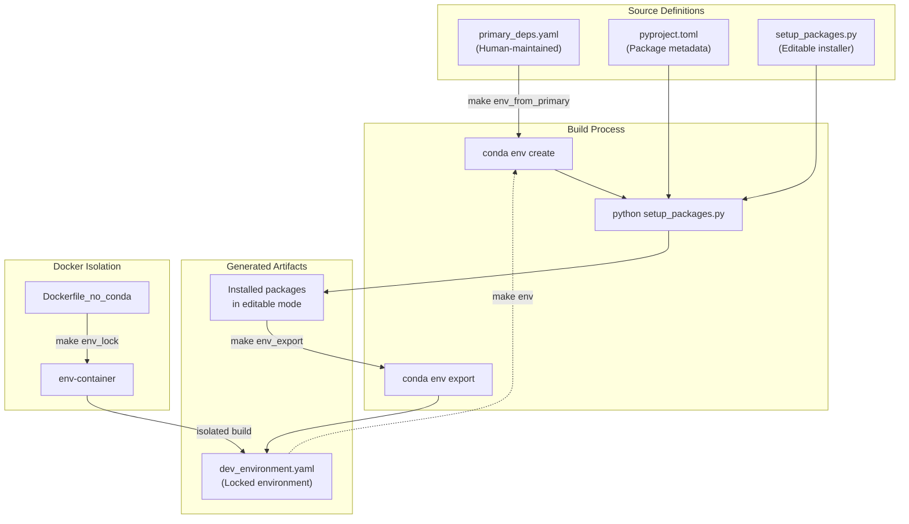
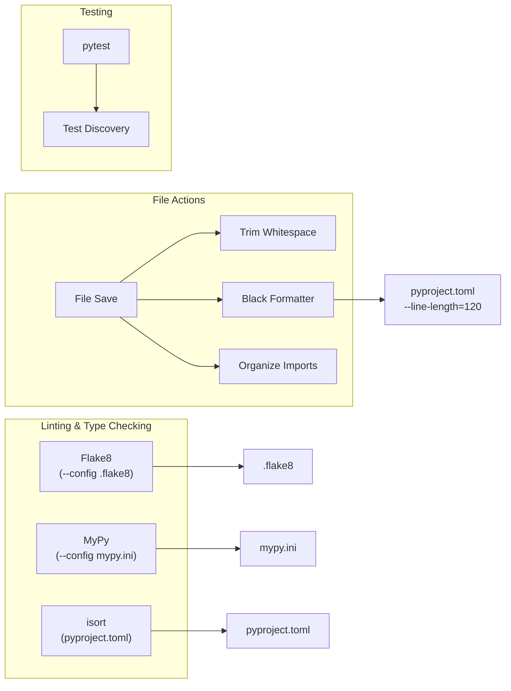
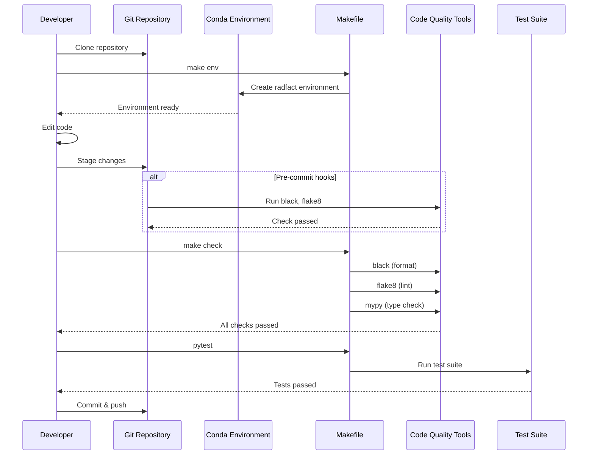
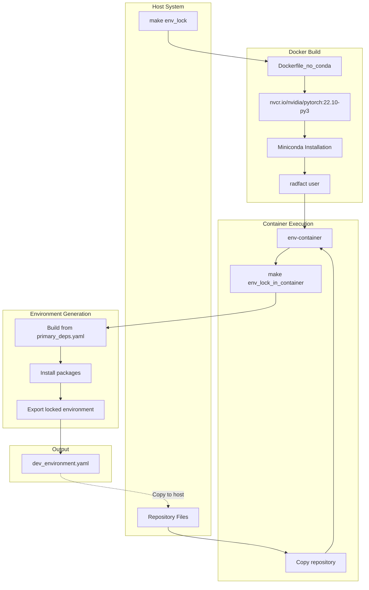

<!-- source: DeepWiki mcp.deepwiki.com · repo microsoft/RadFact · page 7.1 Development Setup · fetched 2026-10-26 -->

# Development Setup

<details>
<summary>Relevant source files</summary>

The following files were used as context for generating this wiki page:

- [.vscode/extensions.json](.vscode/extensions.json)
- [.vscode/settings.json](.vscode/settings.json)
- [Dockerfile_no_conda](Dockerfile_no_conda)
- [Makefile](Makefile)
- [dev_environment.yaml](dev_environment.yaml)

</details>


## Purpose and Scope

This page covers setting up a local development environment for contributing to the RadFact codebase. It includes installing required tools (Conda, Make, Docker), creating and managing the development environment, and configuring VS Code for optimal Python development. 

For information about code quality tools and their usage (Black, Flake8, MyPy, pre-commit), see [Code Quality Tools](#7.2). For details on the Docker-based environment locking mechanism, see [Environment Locking](#7.5). For running tests, see [Testing](#7.3).

**Sources:** [Makefile:1-118](), [dev_environment.yaml:1-370](), [.vscode/extensions.json:1-18](), [.vscode/settings.json:1-48]()

---

## Prerequisites

Before setting up the development environment, ensure you have the following tools installed:

| Tool | Purpose | Required For |
|------|---------|--------------|
| **Git** | Version control | All development |
| **Conda** (Miniconda or Anaconda) | Python environment management | All development |
| **Make** | Build automation | Running commands |
| **Docker** | Container runtime | Environment locking only |
| **Linux or WSL2** | Operating system | Environment locking only |

**Sources:** [Makefile:1-118](), [Dockerfile_no_conda:1-27]()

---

## Environment Management Architecture



**Diagram: Environment Management System**

RadFact uses a two-tier environment management approach:

1. **primary_deps.yaml** - Contains only direct dependencies specified by developers. This file is manually maintained and kept minimal.

2. **dev_environment.yaml** - Auto-generated locked environment file containing all transitive dependencies with exact versions. This file is generated via `make env_lock` and ensures reproducible builds.

The `setup_packages.py` script installs the local packages (`azure-utils`, `llm-utils`, `radfact`) in editable mode, allowing code changes to take effect immediately without reinstallation.

**Sources:** [Makefile:22-88](), [dev_environment.yaml:1-10]()

---

## Installation Steps

### Step 1: Install Miniconda

If you don't have Conda installed, use the provided Makefile target:

```bash
make miniconda
```

This downloads and installs Miniconda3 for Linux x86_64. Follow the installation prompts.

**Sources:** [Makefile:10-13]()

### Step 2: Install Mamba Solver

The Mamba solver significantly speeds up dependency resolution:

```bash
make mamba
```

This updates the base Conda environment and configures the fast `libmamba` solver as the default.

**Sources:** [Makefile:15-19]()

### Step 3: Create Development Environment

Create the environment from the locked `dev_environment.yaml` file:

```bash
make env
```

This command:
1. Removes any existing `radfact` environment
2. Creates a new environment from [dev_environment.yaml:1-370]()
3. Installs local packages in editable mode via `setup_packages.py --add-dev-deps`

The environment name is `radfact` as specified in [dev_environment.yaml:2]().

**Sources:** [Makefile:21-28](), [dev_environment.yaml:2]()

### Step 4: Activate the Environment

```bash
conda activate radfact
```

Verify the installation:

```bash
python -c "import radfact; print(radfact.__file__)"
```

This should show the path to your local repository's `src/radfact/__init__.py` file, confirming editable installation.

**Sources:** [dev_environment.yaml:2](), [Makefile:40-46]()

---

## Key Dependencies

The development environment includes:

| Category | Key Packages | Purpose |
|----------|-------------|---------|
| **Python Runtime** | python=3.10.15 | Base interpreter |
| **Azure Integration** | azure-cli=2.53.1, azure-identity=1.14.1, azure-keyvault=4.2.0 | Azure service authentication |
| **Azure ML** | azureml-sdk=1.58.0, azureml-mlflow=1.58.0 | Experiment tracking |
| **LLM Frameworks** | openai=1.55.0, langchain=0.2.17, langchain-openai=0.1.25 | LLM orchestration |
| **Configuration** | hydra-core=1.3.2, omegaconf=2.3.0 | Config management |
| **Caching** | redis=5.2.0 | Response caching |
| **Data Processing** | pandas=2.2.3, numpy=1.23.5, pyarrow=15.0.2 | Data manipulation |
| **Code Quality** | black=24.10.0, flake8=7.1.1, mypy=1.13.0 | Linting and formatting |
| **Testing** | pytest=8.3.3, pytest-lazy-fixture=0.6.3 | Test framework |
| **Development** | pre-commit=4.0.1, ipykernel=6.29.5 | Dev workflow |

**Sources:** [dev_environment.yaml:24-370]()

---

## VS Code Configuration

### Recommended Extensions

RadFact provides a curated list of VS Code extensions in [.vscode/extensions.json:1-18](). Install these for optimal development experience:

| Extension | Purpose |
|-----------|---------|
| `ms-python.python` | Python language support |
| `ms-python.vscode-pylance` | Fast IntelliSense and type checking |
| `ms-python.black-formatter` | Code formatting |
| `ms-python.isort` | Import sorting |
| `ms-python.mypy-type-checker` | Static type checking |
| `ms-python.flake8` | Linting |
| `ms-python.pylint` | Additional linting |
| `njpwerner.autodocstring` | Docstring generation |
| `usernamehw.errorlens` | Inline error display |

VS Code will prompt you to install these when opening the workspace.

**Sources:** [.vscode/extensions.json:5-14]()

### Workspace Settings

The repository includes pre-configured settings in [.vscode/settings.json:1-48]():



**Diagram: VS Code Automated Workflow**

Key configuration features:

- **Format on Save**: [.vscode/settings.json:26]() enables automatic Black formatting
- **Line Length**: 120 characters ([.vscode/settings.json:24](), [.vscode/settings.json:34]())
- **Import Organization**: Automatic isort on save ([.vscode/settings.json:28-29]())
- **Test Framework**: pytest enabled ([.vscode/settings.json:13]())
- **Editor Rulers**: Visual line length indicator ([.vscode/settings.json:23-25]())

**Sources:** [.vscode/settings.json:1-48]()

---

## Development Workflow



**Diagram: Typical Development Workflow**

### Common Development Tasks

| Task | Command | Description |
|------|---------|-------------|
| **Format code** | `make black` | Reformat all Python files with Black |
| **Check formatting** | `make blackcheck` | Verify formatting without changes |
| **Lint code** | `make flake8` | Run Flake8 linter |
| **Type check** | `make mypy` | Run MyPy static type checker |
| **All checks** | `make check` | Run black, flake8, and mypy sequentially |
| **Run tests** | `pytest` | Execute test suite |

**Sources:** [Makefile:100-117](), [.vscode/settings.json:1-48]()

---

## Makefile Command Reference

The [Makefile:1-118]() provides automation for common tasks:

### Environment Management

```bash
# Create environment from locked file
make env

# Create environment from primary dependencies
make env_from_primary

# Install packages in editable mode (no deps)
make setup_packages

# Install packages in editable mode (with deps)
make setup_packages_with_deps

# Export current environment to dev_environment.yaml
make env_export

# Full Docker-based environment locking
make env_lock
```

**Sources:** [Makefile:21-88]()

### Code Quality

```bash
# Format all code with Black
make black

# Check formatting without modifying files
make blackcheck

# Run Flake8 linter
make flake8

# Run MyPy type checker
make mypy

# Run all checks (black + flake8 + mypy)
make check
```

**Sources:** [Makefile:100-117]()

### Configuration Files Used

| File | Referenced By | Purpose |
|------|--------------|---------|
| `pyproject.toml` | Black, isort | Formatting configuration |
| `.flake8` | Flake8 | Linting rules |
| `mypy.ini` | MyPy | Type checking configuration |

**Sources:** [Makefile:100-117](), [.vscode/settings.json:14-41]()

---

## Docker-Based Environment Locking

For reproducible environment generation, RadFact uses Docker to isolate the build process:



**Diagram: Docker-Based Environment Locking Process**

The [Dockerfile_no_conda:1-27]() specifies the base environment:

- **Base Image**: `nvcr.io/nvidia/pytorch:22.10-py3` ([Dockerfile_no_conda:3]())
- **User**: Non-root `radfact` user ([Dockerfile_no_conda:8-13]())
- **Conda**: Miniconda installed in user home ([Dockerfile_no_conda:16-24]())
- **Solver**: Mamba solver configured for fast resolution ([Dockerfile_no_conda:23-24]())

This isolation ensures that local system packages don't interfere with dependency resolution. For details, see [Environment Locking](#7.5).

**Sources:** [Makefile:69-87](), [Dockerfile_no_conda:1-27]()

---

## Troubleshooting

### Environment Creation Fails

If `make env` fails with dependency conflicts:

1. Try creating from primary dependencies: `make env_from_primary`
2. If the locked environment is outdated, regenerate it: `make env_lock` (requires Docker)

### Docker Commands Fail

If `make env_lock` fails:

```bash
# Clean up any stuck containers
docker rm -f env-container

# Try again
make env_lock
```

**Sources:** [Makefile:69-87]()

### VS Code Extensions Not Working

Ensure you've activated the environment in VS Code:

1. Press `Ctrl+Shift+P`
2. Type "Python: Select Interpreter"
3. Choose the `radfact` conda environment

The extensions will use the interpreter from the activated environment as specified in [.vscode/settings.json:37]() and [.vscode/settings.json:42]().

**Sources:** [.vscode/settings.json:37-42]()

### Type Stubs Missing

Some packages include type stubs in the locked environment:

- `pandas-stubs=2.2.3.241009` ([dev_environment.yaml:277]())
- `types-*` packages for various libraries ([dev_environment.yaml:353-357]())

If MyPy reports missing stubs, they may need to be added to `primary_deps.yaml`.

**Sources:** [dev_environment.yaml:277](), [dev_environment.yaml:353-357]()

---

## Next Steps

After setting up your development environment:

1. **Configure Code Quality Tools**: See [Code Quality Tools](#7.2) for Black, Flake8, MyPy, and pre-commit hooks
2. **Run Tests**: See [Testing](#7.3) for pytest usage
3. **Understand CI/CD**: See [CI/CD Pipeline](#7.4) for automated checks
4. **Configure LLM Endpoints**: See [Configuration Setup](#2.3) for Azure/OpenAI authentication

**Sources:** [Makefile:1-118](), [.vscode/settings.json:1-48]()

---

