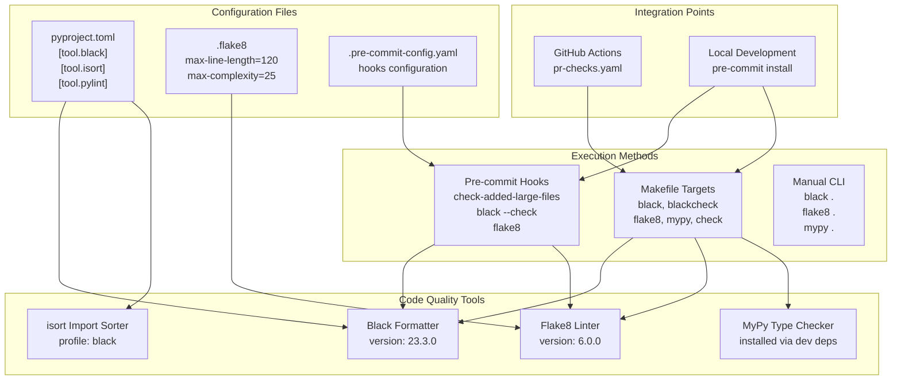
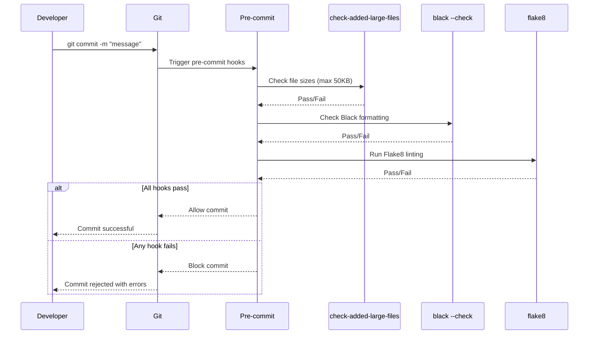
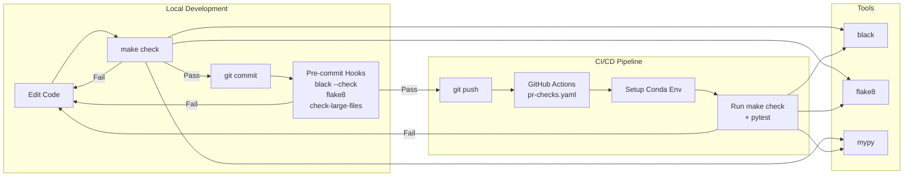

<!-- source: DeepWiki mcp.deepwiki.com · repo microsoft/RadFact · page 7.2 Code Quality Tools · fetched 2026-10-26 -->

# Code Quality Tools

<details>
<summary>Relevant source files</summary>

The following files were used as context for generating this wiki page:

- [.flake8](.flake8)
- [.pre-commit-config.yaml](.pre-commit-config.yaml)
- [Makefile](Makefile)
- [pyproject.toml](pyproject.toml)

</details>


## Purpose and Scope

This page documents the code quality tools integrated into the RadFact development workflow. These tools enforce consistent code style, identify potential bugs, and validate type annotations. For information about setting up the development environment itself, see [Development Setup](#7.1). For information about running tests, see [Testing](#7.3). For information about the automated CI/CD checks, see [CI/CD Pipeline](#7.4).

RadFact uses four primary code quality tools:
- **Black**: Automatic code formatter
- **Flake8**: Style guide enforcement and linting
- **MyPy**: Static type checking
- **isort**: Import statement organization

These tools are enforced through pre-commit hooks and GitHub Actions CI/CD workflows.

**Sources**: [pyproject.toml:1-89](), [Makefile:1-118](), [.pre-commit-config.yaml:1-19](), [.flake8:1-13]()

---

## Tool Architecture Overview

The following diagram shows how the code quality tools are structured in the codebase and how they interact with the development workflow:



**Diagram: Code Quality Tool Configuration and Execution Architecture**

This diagram illustrates the three-layer architecture: configuration files that define tool behavior, the tools themselves, and multiple execution methods (Makefile, pre-commit, manual). The tools share configuration where possible (e.g., Black's line length is used by Flake8 and isort).

**Sources**: [pyproject.toml:1-89](), [.flake8:1-13](), [.pre-commit-config.yaml:1-19](), [Makefile:100-118]()

---

## Black: Code Formatter

Black is an opinionated Python code formatter that enforces a consistent code style. RadFact uses Black to automatically reformat all Python code.

### Configuration

Black's configuration is specified in [pyproject.toml:2-5]():

| Parameter | Value | Purpose |
|-----------|-------|---------|
| `line-length` | 120 | Maximum line length before wrapping |
| `target-version` | `["py310"]` | Target Python 3.10 syntax |
| `skip-string-normalization` | `true` | Preserve single/double quote choice |

The `skip-string-normalization` setting is particularly important for RadFact because it preserves the use of single quotes in strings, which is the project's convention.

### Usage

Black can be executed in three ways:

1. **Reformat files** (via Makefile):
   ```bash
   make black
   ```
   This runs the command defined in [Makefile:101-102](): `black --config pyproject.toml .`

2. **Check formatting without changes** (via Makefile):
   ```bash
   make blackcheck
   ```
   This runs [Makefile:105-106](): `black --check --config pyproject.toml .`

3. **Direct CLI**:
   ```bash
   black --config pyproject.toml .
   ```

### Pre-commit Integration

Black is integrated as a pre-commit hook in [.pre-commit-config.yaml:8-12]():
```yaml
- repo: https://github.com/psf/black
  rev: 23.3.0
  hooks:
    - id: black
      args: ["--config=./pyproject.toml", "--check"]
```

The `--check` flag means pre-commit will fail if formatting is incorrect but won't automatically fix it. This forces developers to run `make black` explicitly.

**Sources**: [pyproject.toml:2-5](), [Makefile:100-106](), [.pre-commit-config.yaml:8-12]()

---

## Flake8: Linter

Flake8 is a Python linting tool that checks code for style guide violations and potential errors. It combines PyFlakes (logical errors), pycodestyle (PEP 8 violations), and McCabe (complexity checking).

### Configuration

Flake8's configuration is in [.flake8:1-13]():

| Parameter | Value | Purpose |
|-----------|-------|---------|
| `exclude` | `build,` | Directories to skip |
| `max-line-length` | 120 | Matches Black's line length |
| `max-complexity` | 25 | Maximum cyclomatic complexity |
| `extend-select` | `B950` | Enable line length warnings at 120 chars |
| `extend-ignore` | `E731, W503, E203, E501, E402` | Disabled error codes |

#### Ignored Error Codes

The following error codes are explicitly ignored in [.flake8:7-12]():

| Code | Description | Reason for Ignoring |
|------|-------------|---------------------|
| `E731` | Do not assign lambda expression | Project uses lambda assignments |
| `W503` | Line break before binary operator | Conflicts with Black |
| `E203` | Whitespace before ':' | Conflicts with Black |
| `E501` | Line too long | Handled by Black |
| `E402` | Module level import not at top | Some imports must be deferred |

### Usage

Run Flake8 via Makefile target [Makefile:109-110]():
```bash
make flake8
```

This executes: `flake8 --config .flake8 .`

### Pre-commit Integration

Flake8 is integrated in [.pre-commit-config.yaml:14-18]():
```yaml
- repo: https://github.com/pycqa/flake8
  rev: 6.0.0
  hooks:
    - id: flake8
      args: ["--config=./.flake8"]
```

**Sources**: [.flake8:1-13](), [Makefile:109-110](), [.pre-commit-config.yaml:14-18]()

---

## MyPy: Type Checker

MyPy performs static type checking on Python code, validating type annotations and identifying type-related errors before runtime.

### Configuration

MyPy does not have explicit configuration in the codebase. It uses default settings with type stubs provided by development dependencies in [pyproject.toml:63-75]():

- `mypy`: The type checker itself
- `pandas-stubs`: Type stubs for pandas
- `types-Pillow`: Type stubs for Pillow
- `types-PyYAML`: Type stubs for PyYAML
- `types-tqdm`: Type stubs for tqdm

### Usage

Run MyPy via Makefile target [Makefile:113-114]():
```bash
make mypy
```

This executes: `mypy .`

MyPy recursively checks all Python files in the current directory and its subdirectories.

### Type Checking Strategy

RadFact uses gradual typing:
- Critical infrastructure code (LLM engine, processors) includes type annotations
- Configuration classes use Pydantic for runtime type validation
- Test code may have fewer type annotations

**Sources**: [pyproject.toml:63-75](), [Makefile:113-114]()

---

## isort: Import Sorter

isort automatically organizes import statements according to a consistent style. While not directly invoked in the Makefile or pre-commit hooks, it's configured for compatibility with Black.

### Configuration

isort's configuration is in [pyproject.toml:7-10]():

| Parameter | Value | Purpose |
|-----------|-------|---------|
| `profile` | `"black"` | Use Black-compatible import style |
| `known_first_party` | `["radfact"]` | Identify radfact as first-party code |
| `sections` | `["FUTURE", "STDLIB", "THIRDPARTY", "FIRSTPARTY", "LOCALFOLDER"]` | Import grouping order |

The `profile = "black"` setting ensures isort doesn't conflict with Black's formatting decisions.

### Import Organization

isort organizes imports into five sections:
1. **FUTURE**: `from __future__ import ...`
2. **STDLIB**: Standard library imports (e.g., `import os`)
3. **THIRDPARTY**: External packages (e.g., `import pandas`)
4. **FIRSTPARTY**: RadFact modules (e.g., `from radfact.llm_utils import ...`)
5. **LOCALFOLDER**: Relative imports (e.g., `from . import module`)

**Sources**: [pyproject.toml:7-10]()

---

## Pylint Configuration

Pylint is configured but not actively enforced in the CI/CD pipeline. Its configuration in [pyproject.toml:12-22]() serves as guidance for IDE integration.

### Settings

| Parameter | Value | Purpose |
|-----------|-------|---------|
| `max-line-length` | 120 | Matches Black and Flake8 |
| `disable` | Various checks | Disabled rules |

### Disabled Checks

The following Pylint checks are disabled in [pyproject.toml:14-22]():

- `logging-fstring-interpolation`: Allow f-strings in logging
- `missing-module-docstring`: Docstrings not required for all modules
- `missing-class-docstring`: Docstrings not required for all classes  
- `missing-function-docstring`: Docstrings not required for all functions
- `no-value-for-parameter`: Can conflict with decorators
- `no-name-in-module`: False positives with dynamic imports
- `no-member`: False positives with complex objects

**Sources**: [pyproject.toml:12-22]()

---

## Pre-commit Hooks

Pre-commit hooks automatically run code quality checks before each git commit, catching issues early in the development process.

### Installation

Install pre-commit hooks:
```bash
conda activate radfact
pre-commit install
```

This installs git hooks that run automatically on `git commit`.

### Hook Configuration

The following diagram shows the pre-commit hook execution flow:



**Diagram: Pre-commit Hook Execution Sequence**

**Sources**: [.pre-commit-config.yaml:1-19]()

### Configured Hooks

Three hooks are configured in [.pre-commit-config.yaml:1-19]():

#### 1. check-added-large-files
```yaml
- repo: https://github.com/pre-commit/pre-commit-hooks
  rev: v4.4.0
  hooks:
    - id: check-added-large-files
      args: ["--maxkb", "50"]
```
Prevents committing files larger than 50KB (except those in Git LFS).

#### 2. black --check
```yaml
- repo: https://github.com/psf/black
  rev: 23.3.0
  hooks:
    - id: black
      args: ["--config=./pyproject.toml", "--check"]
```
Verifies code is formatted correctly. Does not auto-format; developers must run `make black`.

#### 3. flake8
```yaml
- repo: https://github.com/pycqa/flake8
  rev: 6.0.0
  hooks:
    - id: flake8
      args: ["--config=./.flake8"]
```
Runs linting checks using the `.flake8` configuration.

### Bypassing Hooks

In rare cases, hooks can be bypassed:
```bash
git commit --no-verify -m "message"
```

This should only be used when necessary and is discouraged in the standard workflow.

**Sources**: [.pre-commit-config.yaml:1-19]()

---

## Makefile Automation

The Makefile provides convenient targets for running code quality tools. These targets are used both locally and in CI/CD.

### Code Quality Targets

The following table summarizes the Makefile targets for code quality:

| Target | Command | Purpose |
|--------|---------|---------|
| `make black` | `black --config pyproject.toml .` | Reformat all Python files |
| `make blackcheck` | `black --check --config pyproject.toml .` | Check formatting without changes |
| `make flake8` | `flake8 --config .flake8 .` | Run linting checks |
| `make mypy` | `mypy .` | Run type checking |
| `make check` | Runs black, flake8, mypy in sequence | Run all quality checks |

### Target Definitions

The targets are defined in [Makefile:100-118]():

```makefile
# Run black and reformat all files as necessary
black:
	black $(BLACK_ARGS)

# Run black, but do not reformat files
blackcheck:
	black --check $(BLACK_ARGS)

# Run flake8
flake8:
	flake8 --config .flake8 .

# Run mypy
mypy:
	mypy .

# Run black to reformat all files, then flake8 to find issues beyond formatting, then mypy
check: black flake8 mypy
```

Where `BLACK_ARGS` is defined in [Makefile:4](): `BLACK_ARGS := --config pyproject.toml .`

### Usage in Development

Typical development workflow:

1. **Before committing**: Run `make check` to ensure code passes all checks
2. **If Black fails**: Code will be automatically reformatted
3. **If Flake8 fails**: Fix linting issues manually
4. **If MyPy fails**: Fix type annotation issues manually
5. **Commit**: Pre-commit hooks will verify again

**Sources**: [Makefile:4](), [Makefile:100-118]()

---

## Tool Integration Workflow

The following diagram shows how code quality tools integrate across different stages of development:



**Diagram: Code Quality Tool Integration Across Development Stages**

This diagram shows the multi-layered enforcement strategy:
1. **Local make check**: Developer-initiated quality checks
2. **Pre-commit hooks**: Automatic checks before commit
3. **CI/CD pipeline**: Final verification before merge

**Sources**: [Makefile:100-118](), [.pre-commit-config.yaml:1-19]()

---

## Development Dependencies

Code quality tools are installed as development dependencies in [pyproject.toml:62-75]():

```toml
[project.optional-dependencies]
dev = [
    # linting, formatting, type checking
    "black",
    "flake8",
    "ipykernel",
    "mypy",
    "pre-commit",
    "pyyaml",
    "pandas-stubs",
    "types-Pillow",
    "types-PyYAML",
    "types-tqdm",
]
```

These dependencies are installed when setting up the development environment with:
```bash
pip install -e ".[dev]"
```

Or when creating the Conda environment from `dev_environment.yaml`, which includes these packages.

**Sources**: [pyproject.toml:62-75]()

---

## Best Practices

### Recommended Workflow

1. **Before starting work**: Ensure environment is up-to-date with code quality tools
2. **During development**: Run `make black` periodically to maintain formatting
3. **Before committing**: Run `make check` to catch all issues
4. **On commit**: Pre-commit hooks provide a final safety check
5. **On push**: GitHub Actions CI/CD provides team-wide validation

### Common Issues and Solutions

| Issue | Cause | Solution |
|-------|-------|----------|
| Black formatting fails in CI but passes locally | Different Black versions | Use exact version from `dev_environment.yaml` |
| Flake8 reports line too long | Line exceeds 120 chars | Reformat using Black first |
| MyPy cannot find type stubs | Missing type stub packages | Install dev dependencies: `pip install -e ".[dev]"` |
| Pre-commit hook too slow | Large codebase | Pre-commit only checks staged files |
| Conflicting formatting rules | Black vs Flake8 disagreement | Check `.flake8` for ignored codes that resolve conflicts |

### IDE Integration

Most IDEs support these tools natively:

**VS Code**: Install extensions for Python, Black, Flake8, and MyPy. Configure in `.vscode/settings.json`:
```json
{
    "python.formatting.provider": "black",
    "python.linting.flake8Enabled": true,
    "python.linting.enabled": true
}
```

**PyCharm**: Built-in support for Black, Flake8, and MyPy through External Tools configuration.

**Sources**: [pyproject.toml:2-22](), [.flake8:1-13](), [Makefile:100-118](), [.pre-commit-config.yaml:1-19]()

---

## Summary

RadFact enforces code quality through a layered approach:

1. **Black** (formatter): Enforces consistent style with 120-character lines
2. **Flake8** (linter): Catches style violations and potential bugs
3. **MyPy** (type checker): Validates type annotations
4. **isort** (import sorter): Organizes imports (configured but not actively enforced)

These tools are integrated at three enforcement points:
- **Local development**: `make check` runs all tools
- **Pre-commit**: Automatic checks before each commit
- **CI/CD**: GitHub Actions validates on pull requests

For information about the CI/CD pipeline that runs these checks automatically, see [CI/CD Pipeline](#7.4).

**Sources**: [pyproject.toml:1-89](), [.flake8:1-13](), [.pre-commit-config.yaml:1-19](), [Makefile:100-118]()

---

